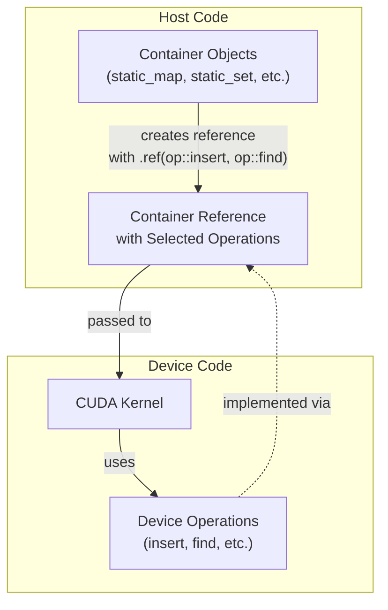
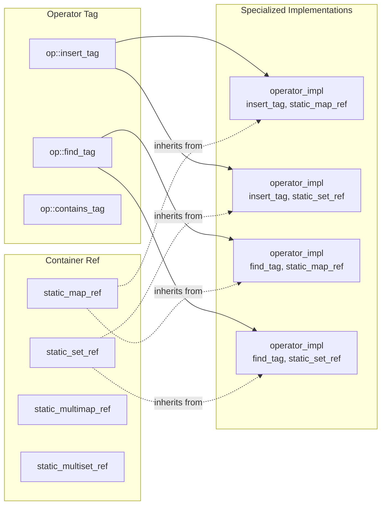
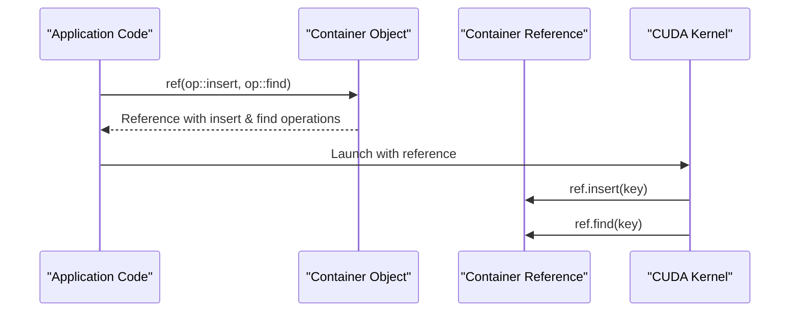
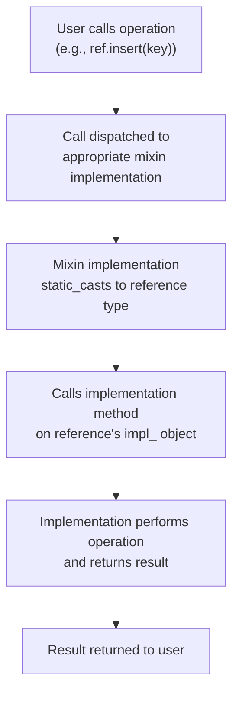

<!-- source: DeepWiki mcp.deepwiki.com · repo NVIDIA/cuCollections · page 7.1 Operator Tags and Mixin Pattern · fetched 2026-10-26 -->

# Operator Tags and Mixin Pattern

<details>
<summary>Relevant source files</summary>

The following files were used as context for generating this wiki page:

- [include/cuco/detail/open_addressing/kernels.cuh](include/cuco/detail/open_addressing/kernels.cuh)
- [include/cuco/detail/open_addressing/open_addressing_ref_impl.cuh](include/cuco/detail/open_addressing/open_addressing_ref_impl.cuh)
- [include/cuco/detail/static_map/helpers.cuh](include/cuco/detail/static_map/helpers.cuh)
- [include/cuco/detail/static_map/kernels.cuh](include/cuco/detail/static_map/kernels.cuh)
- [include/cuco/detail/static_map/static_map_ref.inl](include/cuco/detail/static_map/static_map_ref.inl)
- [include/cuco/detail/static_multimap/static_multimap_ref.inl](include/cuco/detail/static_multimap/static_multimap_ref.inl)
- [include/cuco/detail/static_multiset/static_multiset_ref.inl](include/cuco/detail/static_multiset/static_multiset_ref.inl)
- [include/cuco/detail/static_set/static_set_ref.inl](include/cuco/detail/static_set/static_set_ref.inl)
- [include/cuco/operator.hpp](include/cuco/operator.hpp)
- [include/cuco/static_map_ref.cuh](include/cuco/static_map_ref.cuh)
- [include/cuco/static_multimap_ref.cuh](include/cuco/static_multimap_ref.cuh)
- [include/cuco/static_multiset_ref.cuh](include/cuco/static_multiset_ref.cuh)
- [include/cuco/static_set_ref.cuh](include/cuco/static_set_ref.cuh)
- [tests/static_map/insert_or_apply_test.cu](tests/static_map/insert_or_apply_test.cu)

</details>


This page explains the operator tags and mixin pattern system in cuCollections, which enables flexible composition of device-side operations on container references. This pattern allows users to selectively add operations to device references, avoiding overhead from unused operations, while maintaining a consistent API across different container types.

## Overview

The operator tags and mixin pattern is a core design feature in cuCollections that enables a powerful composition-based approach to device-side operations. Instead of having every possible operation available on every container reference, operations are "mixed in" based on the specific needs of the user code.



Sources: [include/cuco/operator.hpp:16-404](), [include/cuco/static_map_ref.cuh:59-325](), [include/cuco/static_set_ref.cuh:32-300]()

## Operator Tags

Operator tags are empty struct types that serve as compile-time markers to enable specific operations on container references. Each tag represents a single operation like insert, find, or erase.

```mermaid
classDiagram
    class "op namespace" {
        +insert_tag insert
        +find_tag find
        +contains_tag contains
        +erase_tag erase
        +insert_or_assign_tag insert_or_assign
        +insert_or_apply_tag insert_or_apply
        +count_tag count
        +for_each_tag for_each
        +retrieve_tag retrieve
    }
    
    class "insert_tag" {
    }
    
    class "find_tag" {
    }
    
    class "contains_tag" {
    }
    
    "op namespace" --> "insert_tag"
    "op namespace" --> "find_tag" 
    "op namespace" --> "contains_tag"
```

Each operator tag is defined in the `cuco::op` namespace and enables a specific set of member functions on the container reference. For example, including `op::insert` enables `insert()` methods, while `op::find` enables `find()` methods.

Sources: [include/cuco/operator.hpp:46-404]()

## Mixin Pattern Implementation

The mixin pattern is implemented through template specialization and inheritance. Each container reference type inherits from specialized template implementations of `detail::operator_impl` for each operation it supports.

```mermaid
classDiagram
    class "static_map_ref<Key, T, Scope, KeyEqual, ProbingScheme, StorageRef, Operators...>" {
        -impl_type impl_
        +insert()
        +find()
        +contains()
        +etc...
    }
    
    class "operator_impl<op::insert_tag, static_map_ref<...>>" {
        +insert()
    }
    
    class "operator_impl<op::find_tag, static_map_ref<...>>" {
        +find()
    }
    
    class "operator_impl<op::contains_tag, static_map_ref<...>>" {
        +contains()
    }
    
    "static_map_ref<Key, T, Scope, KeyEqual, ProbingScheme, StorageRef, Operators...>" --|> "operator_impl<op::insert_tag, static_map_ref<...>>"
    "static_map_ref<Key, T, Scope, KeyEqual, ProbingScheme, StorageRef, Operators...>" --|> "operator_impl<op::find_tag, static_map_ref<...>>"
    "static_map_ref<Key, T, Scope, KeyEqual, ProbingScheme, StorageRef, Operators...>" --|> "operator_impl<op::contains_tag, static_map_ref<...>>"
```

The pattern works as follows:

1. Reference types (like `static_map_ref`) publicly inherit from specialized `operator_impl` for each operation tag.
2. Each `operator_impl` specialization implements the methods for a specific operation.
3. CRTP (Curiously Recurring Template Pattern) is used to allow the mixins to access the reference's implementation.

Sources: [include/cuco/static_map_ref.cuh:59-325](), [include/cuco/detail/static_map/static_map_ref.inl:400-629](), [include/cuco/static_set_ref.cuh:63-296]()

## Implementation Details

### Template Specialization

The mixin pattern relies on a specialized template class `detail::operator_impl` for each operator tag and reference type combination. Each specialization implements the specific methods for that operation.



Sources: [include/cuco/detail/static_map/static_map_ref.inl:400-629](), [include/cuco/detail/static_set/static_set_ref.inl:344-743](), [include/cuco/detail/static_multiset/static_multiset_ref.inl:347-564]()

### Implementation Method

Each operator implementation accesses the container's internal methods by using static casting. For example, the insert operator implementation in `static_map_ref` is defined as:

```cpp
template <typename Value>
__device__ bool insert(Value const& value) noexcept
{
  ref_type& ref_ = static_cast<ref_type&>(*this);
  return ref_.impl_.insert(value);
}
```

This pattern allows the actual implementation details to be contained in the `impl_` member, while the interface is provided through the mixins.

Sources: [include/cuco/detail/static_map/static_map_ref.inl:431-437](), [include/cuco/detail/static_set/static_set_ref.inl:372-377]()

## Creating References with Operators

Container references are created from container objects using the `.ref()` method, which takes operator tags as arguments. This creates a new reference with only the specified operations enabled.



The reference can also be modified to add or change operations using methods like `rebind_operators()`:

Sources: [include/cuco/static_map_ref.cuh:238-241](), [include/cuco/static_set_ref.cuh:215-218]()

## Operator Lifecycle

When operations are performed, they follow this flow:



Sources: [include/cuco/detail/static_map/static_map_ref.inl:431-437](), [include/cuco/detail/static_set/static_set_ref.inl:372-377]()

## Available Operators

The cuCollections library provides a comprehensive set of operators for different container types. Here's a summary of the major operator tags:

| Operator Tag | Description | Example Methods |
|--------------|-------------|----------------|
| `op::insert` | Inserts elements | `insert(value)` |
| `op::find` | Finds elements | `find(key)` |
| `op::contains` | Checks if key exists | `contains(key)` |
| `op::erase` | Removes elements | `erase(key)` |
| `op::insert_or_assign` | Inserts or updates | `insert_or_assign(value)` |
| `op::insert_or_apply` | Inserts or applies function | `insert_or_apply(value, op)` |
| `op::count` | Counts occurrences | `count(key)` |
| `op::for_each` | Applies function to elements | `for_each(key, callback)` |
| `op::retrieve` | Retrieves multiple elements | `retrieve(...)` |

Each operator supports both single-thread and cooperative group variants of its methods.

Sources: [include/cuco/operator.hpp:72-388]()

## Benefits of the Mixin Pattern

The operator tags and mixin pattern provides several advantages:

1. **Compile-time composition**: Only the operations actually used are compiled into the code
2. **Reduced code size**: Device code only includes necessary operations
3. **Explicit operation capability**: References clearly indicate which operations they support
4. **Consistent API**: Same pattern works across all container types
5. **Flexible extension**: New operators can be added without changing existing code

Sources: [include/cuco/operator.hpp:28-48]()

## Usage Examples

To use container references with specific operations:

1. Create a container reference with desired operations:
   ```cpp
   auto ref = map.ref(cuco::op::insert, cuco::op::find);
   ```

2. Use operations in device code:
   ```cpp
   __global__ void kernel(SomeMapRef ref) {
     if (ref.insert(my_key)) {
       // Insertion succeeded
     }
     
     auto found = ref.find(other_key);
     if (found != ref.end()) {
       // Found the key
     }
   }
   ```

3. Dynamically change available operations:
   ```cpp
   auto new_ref = ref.rebind_operators(cuco::op::contains, cuco::op::erase);
   ```

Sources: [include/cuco/static_map_ref.cuh:238-241](), [include/cuco/static_set_ref.cuh:215-218]()

## Integration with Containers

The operator tags and mixin pattern is tightly integrated with the container reference design in cuCollections. Container classes provide a `.ref()` method that creates a reference with the specified operators. This reference can then be passed to device code.

Sources: [include/cuco/static_map_ref.cuh:59-325](), [include/cuco/static_set_ref.cuh:32-300]()

## Related Pages

For more information on device references in general, see [Device References](#7).

For specific container reference types, see:
- [Static Map Device View](#2.2)
- [Static Set](#3)
- [Static Multimap Operations](#4.1)
- [Static Multiset](#5)

---

