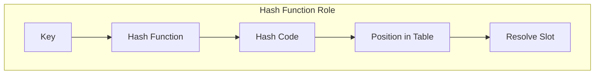
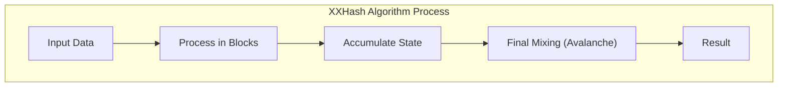
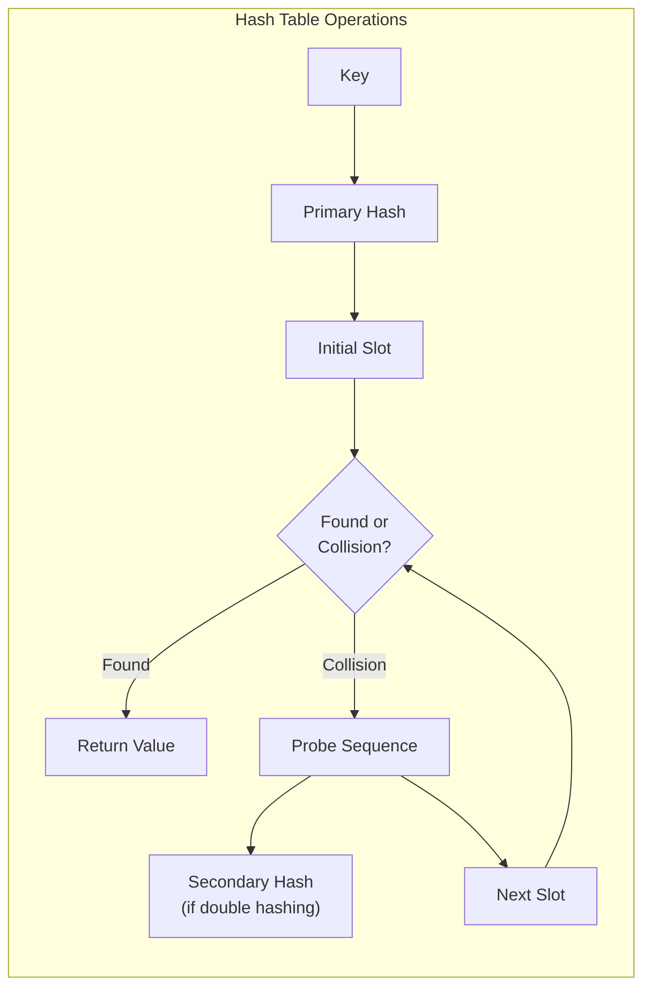
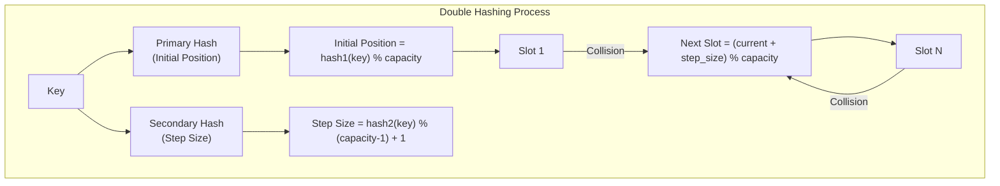

<!-- source: DeepWiki mcp.deepwiki.com · repo NVIDIA/cuCollections · page 8 Hash Functions · fetched 2026-10-26 -->

# Hash Functions

<details>
<summary>Relevant source files</summary>

The following files were used as context for generating this wiki page:

- [include/cuco/detail/hash_functions/identity_hash.cuh](include/cuco/detail/hash_functions/identity_hash.cuh)
- [include/cuco/detail/hash_functions/murmurhash3.cuh](include/cuco/detail/hash_functions/murmurhash3.cuh)
- [include/cuco/detail/hash_functions/utils.cuh](include/cuco/detail/hash_functions/utils.cuh)
- [include/cuco/detail/hash_functions/xxhash.cuh](include/cuco/detail/hash_functions/xxhash.cuh)
- [include/cuco/detail/probe_sequence_impl.cuh](include/cuco/detail/probe_sequence_impl.cuh)
- [include/cuco/hash_functions.cuh](include/cuco/hash_functions.cuh)
- [include/cuco/probe_sequences.cuh](include/cuco/probe_sequences.cuh)
- [tests/utility/hash_test.cu](tests/utility/hash_test.cu)

</details>


This document details the hash functions available in cuCollections (cuco) and how they are used within the library. Hash functions play a crucial role in determining the initial slot position and probe sequences in hash-based containers. For information about probe sequences and collision resolution, see [Probing Schemes](#9).

## Overview of Hash Functions

Hash functions in cuCollections convert arbitrary keys to fixed-size values (hash codes) that determine where elements are stored in hash tables. The library provides several high-performance hash implementations optimized for both CPU and GPU execution.



Sources: [include/cuco/hash_functions.cuh](), [include/cuco/detail/probe_sequence_impl.cuh:209-238]()

## Available Hash Functions

cuCollections provides multiple hash function implementations that can be used with all hash-based containers:

| Hash Function | Result Type | Description | Best Use Case |
|---------------|-------------|-------------|---------------|
| `identity_hash` | uint32_t/uint64_t | Returns key as-is | Perfect hashing, when input range equals table size |
| `murmurhash3_32` | uint32_t | 32-bit MurmurHash3 algorithm | General purpose, good distribution |
| `murmurhash3_x64_128` | std::array<uint64_t, 2> | 128-bit MurmurHash3 for x64 | Better distribution, large keys |
| `murmurhash3_x86_128` | std::array<uint32_t, 4> | 128-bit MurmurHash3 for x86 | Better distribution, large keys |
| `xxhash_32` | uint32_t | 32-bit XXHash algorithm | **Default hash**, fast with good distribution |
| `xxhash_64` | uint64_t | 64-bit XXHash algorithm | Larger hash space, better for large tables |

The default hash function is `xxhash_32`, which offers a good balance of performance and distribution quality.

```mermaid
classDiagram
    class "HashFunction" {
        <<interface>>
        +operator()(key) result_type
        +compute_hash(bytes, size) result_type
    }
    
    class "identity_hash~Key~" {
        +uint32_t/uint64_t operator()(Key)
    }
    
    class "xxhash_32~Key~" {
        +uint32_t operator()(Key)
        +uint32_t compute_hash(bytes, size)
        -uint32_t seed_
    }
    
    class "xxhash_64~Key~" {
        +uint64_t operator()(Key)
        +uint64_t compute_hash(bytes, size)
        -uint64_t seed_
    }
    
    class "murmurhash3_32~Key~" {
        +uint32_t operator()(Key)
        +uint32_t compute_hash(bytes, size)
        -uint32_t seed_
    }
    
    class "MurmurHash128Variants" {
        <<interface>>
        +operator()(key) array_type
        +compute_hash(bytes, size) array_type
    }
    
    "HashFunction" <|-- "identity_hash~Key~"
    "HashFunction" <|-- "xxhash_32~Key~"
    "HashFunction" <|-- "xxhash_64~Key~"
    "HashFunction" <|-- "murmurhash3_32~Key~"
    "HashFunction" <|-- "MurmurHash128Variants"
    "MurmurHash128Variants" <|-- "murmurhash3_x64_128~Key~"
    "MurmurHash128Variants" <|-- "murmurhash3_x86_128~Key~"
```

Sources: [include/cuco/hash_functions.cuh:26-106](), [include/cuco/detail/hash_functions/xxhash.cuh](), [include/cuco/detail/hash_functions/murmurhash3.cuh](), [include/cuco/detail/hash_functions/identity_hash.cuh]()

## Hash Function Usage

### Basic Usage

All hash functions in cuCollections follow a consistent interface pattern:

```cpp
// Creating a hash function with default seed (0)
cuco::xxhash_32<KeyType> hasher;

// With custom seed
cuco::xxhash_32<KeyType> hasher_seeded(42);

// Computing a hash
KeyType key = ...;
auto hash_value = hasher(key);
```

Sources: [include/cuco/hash_functions.cuh](), [tests/utility/hash_test.cu:42-51]()

### Using with Containers

Hash functions are specified as template parameters when creating containers:

```cpp
// Using default hash function (xxhash_32)
cuco::static_map<KeyType, ValueType> map(...);

// Using a specific hash function
cuco::static_map<KeyType, ValueType, cuco::xxhash_64<KeyType>> map(...);

// With double hashing (for static_multimap)
using primary_hash = cuco::xxhash_32<KeyType>;
using secondary_hash = cuco::murmurhash3_32<KeyType>;
using probe_scheme = cuco::legacy::double_hashing<8, primary_hash, secondary_hash>;

cuco::legacy::static_multimap<KeyType, ValueType, probe_scheme> multimap(...);
```

Sources: [include/cuco/probe_sequences.cuh:35-74]()

## Hash Function Implementation Details

### XXHash (Default)

XXHash is a non-cryptographic hash function designed for speed while maintaining good distribution. cuCollections implements both 32-bit and 64-bit variants.

Key characteristics:
- Very fast on both small and large inputs
- Good avalanche effect (small changes in input result in significant hash value changes)
- Capable of processing data in chunks for better performance
- Uses a customizable seed value



Sources: [include/cuco/detail/hash_functions/xxhash.cuh:66-422]()

### MurmurHash3

MurmurHash3 is a non-cryptographic hash function with several variants implemented in cuCollections.

Key characteristics:
- Good distribution and avalanche properties
- Different variants optimized for different architectures (x86, x64)
- Support for 32-bit and 128-bit outputs
- Includes finalizer functions that can be used independently

Sources: [include/cuco/detail/hash_functions/murmurhash3.cuh:30-638]()

### Identity Hash

The identity hash simply returns the key value as the hash code, which is useful in specific scenarios:

- When the key range is known and matches the hash table capacity
- For perfect hashing scenarios where no collisions are expected
- When keys are already pre-hashed or have good distribution properties

Sources: [include/cuco/detail/hash_functions/identity_hash.cuh:24-55]()

## Hash Functions and Probing Schemes

The hash functions directly interact with probing schemes to determine element placement and retrieval in hash tables:



For linear probing, a single hash function determines the initial position, and collisions are resolved by linear scanning. For double hashing, two hash functions are used - one for the initial position and another to determine the step size between probes.

Sources: [include/cuco/detail/probe_sequence_impl.cuh:160-433](), [include/cuco/probe_sequences.cuh:22-74]()

## Performance Considerations

When selecting a hash function, consider:

1. **Key size and complexity**: Larger keys benefit from more sophisticated hash functions (xxhash_64, murmurhash3_128)
2. **Distribution requirements**: Better distribution reduces collisions but may require more complex hash functions
3. **Performance constraints**: Simple hash functions like identity_hash are faster but only work in specific scenarios
4. **Table size**: Larger tables benefit from hash functions that produce larger hash values (64-bit or 128-bit)

The default `xxhash_32` is recommended for general use as it provides good performance and distribution properties for most workloads.

Sources: [include/cuco/hash_functions.cuh:104-106](), [tests/utility/hash_test.cu]()

## Creating Custom Hash Functions

Custom hash functions can be implemented by creating a class or struct that:

1. Defines `argument_type` (input key type) and `result_type` (hash value type)
2. Implements `operator()` that takes a key and returns a hash value
3. Is qualified with `__host__ __device__` for GPU compatibility

Example template for a custom hash function:

```cpp
template <typename Key>
struct custom_hash {
    using argument_type = Key;
    using result_type = std::uint32_t;  // Or other appropriate type
    
    __host__ __device__ custom_hash(std::uint32_t seed = 0) : seed_(seed) {}
    
    __host__ __device__ result_type operator()(Key const& key) const noexcept {
        // Custom hashing logic
        return /* hash value */;
    }
    
private:
    std::uint32_t seed_;
};
```

Sources: [include/cuco/detail/hash_functions/xxhash.cuh:66-205](), [include/cuco/detail/hash_functions/murmurhash3.cuh:92-118]()

## Integration with Double Hashing

When using double hashing (common in static_multimap), you need to provide two hash functions:



The primary hash function determines the initial slot, while the secondary hash function determines the step size between probes. This technique helps avoid clustering and provides better performance in high-occupancy or high-multiplicity scenarios.

Sources: [include/cuco/detail/probe_sequence_impl.cuh:313-433](), [include/cuco/probe_sequences.cuh:63-74]()

---

