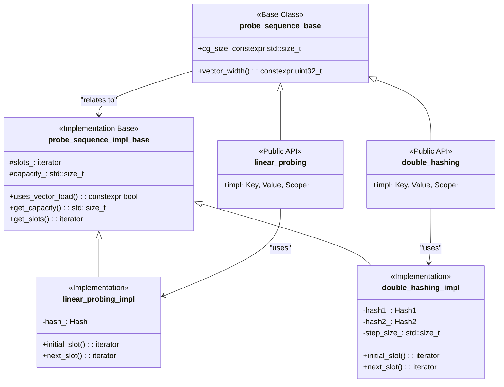
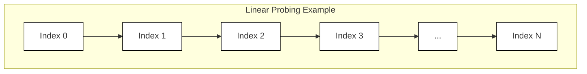
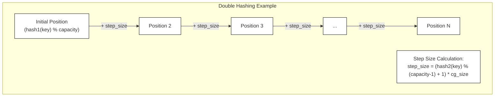
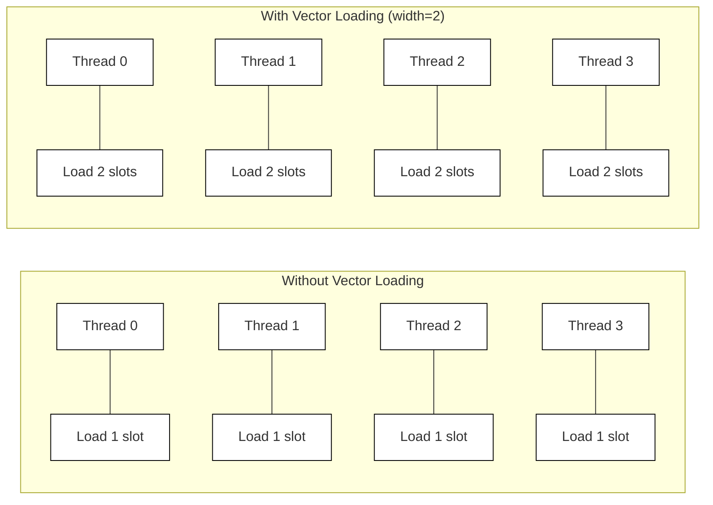
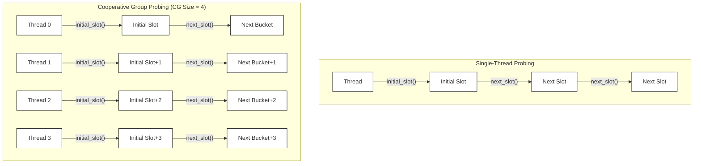

<!-- source: DeepWiki mcp.deepwiki.com · repo NVIDIA/cuCollections · page 9 Probing Schemes · fetched 2026-10-26 -->

# Probing Schemes

<details>
<summary>Relevant source files</summary>

The following files were used as context for generating this wiki page:

- [include/cuco/detail/probe_sequence_impl.cuh](include/cuco/detail/probe_sequence_impl.cuh)
- [include/cuco/detail/static_map.inl](include/cuco/detail/static_map.inl)
- [include/cuco/detail/static_map_kernels.cuh](include/cuco/detail/static_map_kernels.cuh)
- [include/cuco/probe_sequences.cuh](include/cuco/probe_sequences.cuh)
- [include/cuco/static_map.cuh](include/cuco/static_map.cuh)
- [include/cuco/static_multimap.cuh](include/cuco/static_multimap.cuh)
- [tests/static_map/erase_test.cu](tests/static_map/erase_test.cu)

</details>


This page documents the probing schemes used in cuCollections (cuco) for hash collision resolution. Probing schemes determine how the hash table searches for available slots when inserting new elements or looking up existing elements after a hash collision occurs.

## Overview

Probing schemes are a critical component of open addressing hash tables, where all key-value pairs are stored in a single contiguous array. When a hash collision occurs (i.e., when two different keys hash to the same location), the probing scheme determines the sequence of alternative locations to check.

cuCollections provides two primary probing schemes:
- Linear Probing
- Double Hashing

Each scheme balances different performance characteristics and is optimized for specific use cases.

Sources: [include/cuco/probe_sequences.cuh:21-76](), [include/cuco/static_map.cuh:94-97](), [include/cuco/static_multimap.cuh:96-97]()

## Probing Scheme Architecture

The probing schemes in cuCollections follow a layered architecture with base classes providing common functionality and specialized implementations for each scheme.



**Class Hierarchy and Responsibilities**:

- **probe_sequence_base**: Defines basic properties like cooperative group size and vector width.
- **probe_sequence_impl_base**: Provides core implementation details shared by all probing schemes, including slot management and capacity tracking.
- **linear_probing/double_hashing**: Public-facing classes that users interact with directly.
- **linear_probing_impl/double_hashing_impl**: Implementation details for each specific probing scheme.

Sources: [include/cuco/detail/probe_sequence_impl.cuh:28-146](), [include/cuco/probe_sequences.cuh:21-76]()

## Linear Probing

Linear probing is a simple collision resolution technique that checks sequential slots until an empty one is found.



### Implementation Details

- When a collision occurs, linear probing checks the next slot in sequence (i+1, i+2, i+3, etc.)
- The `next_slot` method simply moves to the next location based on the cooperative group size and vector width:

```
next_slot(s) = (s-slots + cg_size * vector_width) % capacity
```

- Linear probing performs well with low occupancy or when collisions are rare
- It's the default probing scheme for `static_map` in cuCollections

### Performance Characteristics

Linear probing has these performance traits:
- **Advantages**: Good cache locality, simple implementation, efficient with low load factors
- **Disadvantages**: Suffers from "clustering" at high load factors, where keys bunch together creating long probing sequences

### Configuration Parameters

Linear probing accepts the following template parameters:
- **CGSize**: Size of CUDA Cooperative Groups (threads that work together on a single operation)
- **Hash**: The hash function type used to map keys to slots

Sources: [include/cuco/detail/probe_sequence_impl.cuh:149-285](), [include/cuco/probe_sequences.cuh:22-46](), [include/cuco/static_map.cuh:94-97]()

## Double Hashing

Double hashing uses two hash functions to determine the probe sequence, offering better performance with high load factors and reducing clustering.



### Implementation Details

- Uses two hash functions:
  - `hash1`: Determines the initial position
  - `hash2`: Determines the step size between probes
- The step size remains constant for a given key but varies between different keys
- Step size is calculated as: `(hash2_(k) % (capacity / cg_size - 1) + 1) * cg_size`
- This approach greatly reduces clustering compared to linear probing

### Performance Characteristics

Double hashing has these performance traits:
- **Advantages**: Reduces clustering, better distribution of keys, superior performance with high multiplicity or high occupancy
- **Disadvantages**: Slightly more complex implementation, requires a second hash function

### Configuration Parameters

Double hashing accepts the following template parameters:
- **CGSize**: Size of CUDA Cooperative Groups
- **Hash1**: Primary hash function for the initial position
- **Hash2**: Secondary hash function for determining step size (defaults to Hash1 with different seed)

Sources: [include/cuco/detail/probe_sequence_impl.cuh:286-433](), [include/cuco/probe_sequences.cuh:47-74](), [include/cuco/static_multimap.cuh:96-97]()

## Vector Load Optimization

One key optimization in the probing schemes is the use of vector loads to improve memory throughput.



### How Vector Loading Works

- Vector loading loads multiple consecutive slots instead of one to better utilize GPU memory bandwidth
- This optimization is automatically applied when the key-value pairs are "packable" (can be packed into a single atomic operation)
- The default vector width is 2, meaning each thread loads 2 consecutive slots
- To support vector loading, the probing schemes ensure that initial slots are properly aligned to avoid illegal memory access

### Impact on Implementation

- Initial slots for linear probing are adjusted to be even-indexed when vector loading is enabled
- Double hashing step sizes are adjusted to be multiples of `cg_size * vector_width`
- This allows for efficient memory access patterns and better utilization of GPU memory bandwidth

Sources: [include/cuco/detail/probe_sequence_impl.cuh:47-107](), [include/cuco/detail/probe_sequence_impl.cuh:227-247](), [include/cuco/detail/probe_sequence_impl.cuh:382-399]()

## Cooperative Group Integration

Probing schemes in cuCollections are designed to work with CUDA Cooperative Groups, allowing multiple threads to collaborate on operations.



### How Cooperative Groups Work with Probing

- The `CGSize` template parameter determines how many threads work together on a single operation
- With CG size > 1, multiple threads cooperatively:
  - Search different slots within the same bucket simultaneously
  - Check for empty slots or matching keys in parallel
  - Coordinate through ballot operations to determine if any thread found a match
- This significantly improves performance, especially at high load factors

### CG Size Recommendations

cuCollections provides the following recommendations for CG size:

| Hash Map Size | Recommended CG Size |
|---------------|---------------------|
| Small (≤10M elements) | 1 or 2 |
| Large (>10M elements) | 4 or 8 |

Sources: [include/cuco/detail/probe_sequence_impl.cuh:209-281](), [include/cuco/detail/probe_sequence_impl.cuh:363-399](), [include/cuco/detail/static_map_kernels.cuh:136-166](), [include/cuco/detail/static_map_kernels.cuh:432-472]()

## Implementation Details in Container Types

cuCollections' container types use different probing schemes by default, optimized for their intended use cases:

| Container Type | Default Probing Scheme | Default CG Size |
|----------------|------------------------|-----------------|
| `static_map`   | Linear Probing         | 4               |
| `static_multimap` | Double Hashing     | 8               |

Users can customize the probing scheme by providing it as a template parameter:

```cpp
// Using linear probing with CG size 2
cuco::static_map<Key, T, /*...*/, cuco::linear_probing<2, cuco::default_hash_function<Key>>>

// Using double hashing with CG size 8 and custom hash functions
cuco::static_multimap<Key, T, /*...*/, 
    cuco::double_hashing<8, MyCustomHash1, MyCustomHash2>>
```

Sources: [include/cuco/static_map.cuh:89-97](), [include/cuco/static_multimap.cuh:91-98](), [tests/static_map/erase_test.cu:109-112]()

## Choosing a Probing Scheme

When deciding which probing scheme to use, consider the following guidelines:

### Linear Probing

Best for:
- Low to moderate load factors (less than 60%)
- Workloads with few key collisions
- Cases where cache efficiency is critical

### Double Hashing

Best for:
- High load factors (60-90%)
- Workloads with many collisions (e.g., `static_multimap` with multiple values per key)
- Cases where clustering would be problematic

### CG Size Selection

- Smaller CG sizes (1-2) work well for:
  - Small hash tables
  - Simple keys with fast hash functions
  - Low contention scenarios

- Larger CG sizes (4-8) excel for:
  - Large hash tables
  - Complex keys with expensive hash functions
  - High contention scenarios

The proper selection of probing scheme and CG size can significantly impact performance, particularly as the number of elements in the hash table grows.

Sources: [include/cuco/probe_sequences.cuh:26-29](), [include/cuco/probe_sequences.cuh:52-55]()

## Internal Implementation

The probing schemes are implemented in two main files:
- Public interfaces: [include/cuco/probe_sequences.cuh]()
- Implementation details: [include/cuco/detail/probe_sequence_impl.cuh]()

The key methods provided by both probing schemes are:
- `initial_slot`: Determines the starting position for probing based on the key
- `next_slot`: Determines the next position to check when probing forward

These methods are then used by hash table operations like insert, find, and erase to implement efficient collision resolution strategies.

Sources: [include/cuco/detail/probe_sequence_impl.cuh:209-285](), [include/cuco/detail/probe_sequence_impl.cuh:382-428]()

---

