# Page: Overview

# Overview

<details>
<summary>Relevant source files</summary>

The following files were used as context for generating this wiki page:

- [CMakeLists.txt](CMakeLists.txt)
- [README.md](README.md)
- [benchmarks/CMakeLists.txt](benchmarks/CMakeLists.txt)
- [examples/CMakeLists.txt](examples/CMakeLists.txt)
- [examples/static_map/count_by_key_example.cu](examples/static_map/count_by_key_example.cu)
- [examples/static_map/custom_type_example.cu](examples/static_map/custom_type_example.cu)
- [examples/static_set/device_subsets_example.cu](examples/static_set/device_subsets_example.cu)
- [examples/static_set/shared_memory_example.cu](examples/static_set/shared_memory_example.cu)
- [include/cuco/bucket_storage.cuh](include/cuco/bucket_storage.cuh)
- [include/cuco/detail/static_map.inl](include/cuco/detail/static_map.inl)
- [include/cuco/detail/static_map_kernels.cuh](include/cuco/detail/static_map_kernels.cuh)
- [include/cuco/static_map.cuh](include/cuco/static_map.cuh)
- [include/cuco/static_multimap.cuh](include/cuco/static_multimap.cuh)
- [tests/CMakeLists.txt](tests/CMakeLists.txt)
- [tests/static_map/erase_test.cu](tests/static_map/erase_test.cu)
- [tests/static_map/shared_memory_test.cu](tests/static_map/shared_memory_test.cu)
- [tests/static_set/shared_memory_test.cu](tests/static_set/shared_memory_test.cu)

</details>


cuCollections (cuco) is a header-only library providing GPU-accelerated, concurrent data structures for NVIDIA GPUs. Similar to how Thrust and CUB provide GPU-accelerated algorithms and primitives, cuCollections offers STL-like concurrent data structures designed specifically for efficient GPU usage. The library primarily implements hash-based containers optimized for parallel access.

This page provides a high-level introduction to cuCollections, explaining its architecture, main components, and core design patterns. For more detailed information about specific components, refer to their respective documentation pages.

## Core Features

- **GPU-accelerated containers** - Optimized for NVIDIA CUDA architectures (Volta+ with partial Pascal support)
- **Concurrent data access** - Designed for massively parallel operations
- **Dual interface pattern** - Both host-side bulk operations and device-side individual operations
- **Customizable behavior** - Configurable hash functions, probing schemes, and memory management

Sources: [README.md:8-10](), [CMakeLists.txt:122-133]()

## Architecture

cuCollections follows a consistent architecture across its containers that leverages the inherent parallelism of GPUs while allowing both bulk and fine-grained operations.

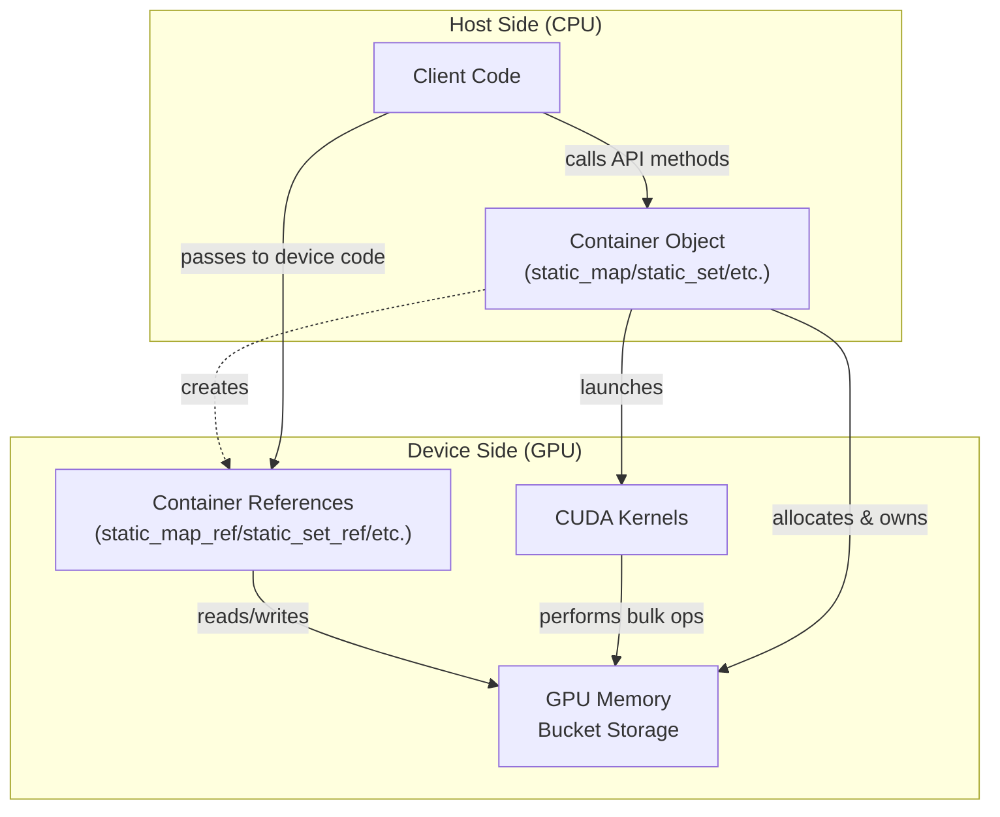

The architecture establishes a clear separation between:

1. **Host-side containers** - Manage memory and provide bulk operation APIs
2. **Device-side references** - Enable fine-grained access within CUDA kernels
3. **Storage buckets** - Organize data efficiently for GPU access patterns

This separation allows both "bulk" operations initiated from the host and fine-grained access from device code.

Sources: [include/cuco/static_map.cuh:45-72](), [include/cuco/bucket_storage.cuh:17-31]()

### Data Structures Hierarchy

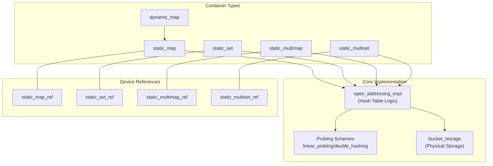

The codebase uses a layered design with shared implementation components. Each container type reuses the same core hash table implementation while providing specialized interfaces. The device references offer customizable operations through a tag-based composition pattern.

Sources: [include/cuco/static_map.cuh:108-115](), [include/cuco/static_multimap.cuh:110-117]()

## Main Components

cuCollections provides several container types, each designed for specific use cases:

| Container | Description | Allows Duplicate Keys | Has Associated Values | Fixed Size |
|-----------|-------------|----------------------|---------------------|------------|
| `static_map` | Maps unique keys to values | No | Yes | Yes |
| `static_set` | Stores unique keys | No | No | Yes |
| `static_multimap` | Maps keys to values with duplicates allowed | Yes | Yes | Yes |
| `static_multiset` | Stores keys with duplicates allowed | Yes | No | Yes |
| `dynamic_map` | Growable map that links multiple static maps | No | Yes | No |

### Common Characteristics

All containers in cuCollections share these key features:

1. **Open addressing** with configurable probing schemes
2. **Atomic operations** for thread-safe concurrent access
3. **Customizable hash functions** to optimize for specific key types
4. **Sentinel values** for empty and erased slots
5. **Dual API pattern** with host bulk operations and device individual operations

Sources: [include/cuco/static_map.cuh:46-78](), [include/cuco/static_multimap.cuh:47-81]()

## Operation Flow

The containers support two distinct operation flows:

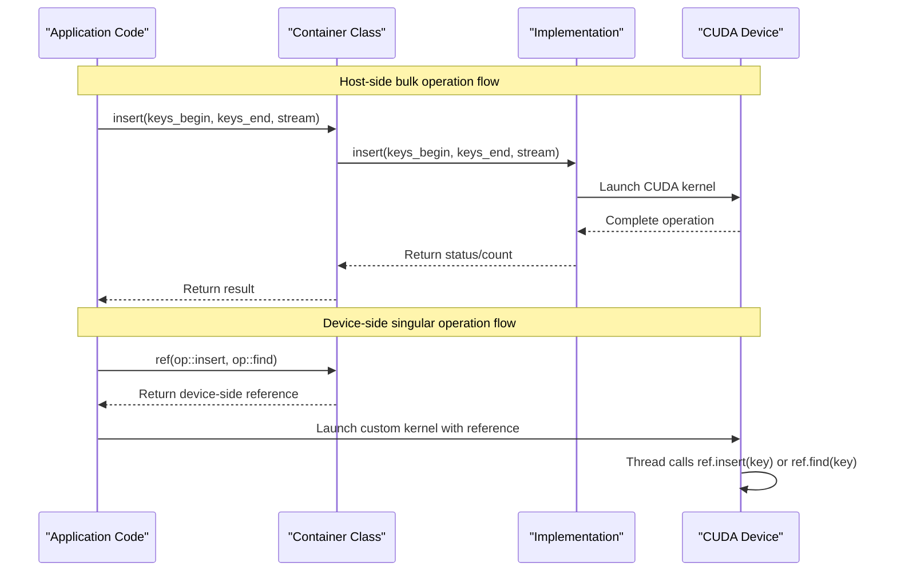

This dual approach provides flexibility for different access patterns:

1. **Host Bulk Operations**: Efficient for batch processing of large datasets
2. **Device Individual Operations**: Enables fine-grained control within custom kernels

Sources: [include/cuco/static_map.cuh:297-317](), [include/cuco/detail/static_map_kernels.cuh:81-108]()

## Storage Structure

cuCollections organizes data in a bucket-based storage model for efficient GPU memory access:

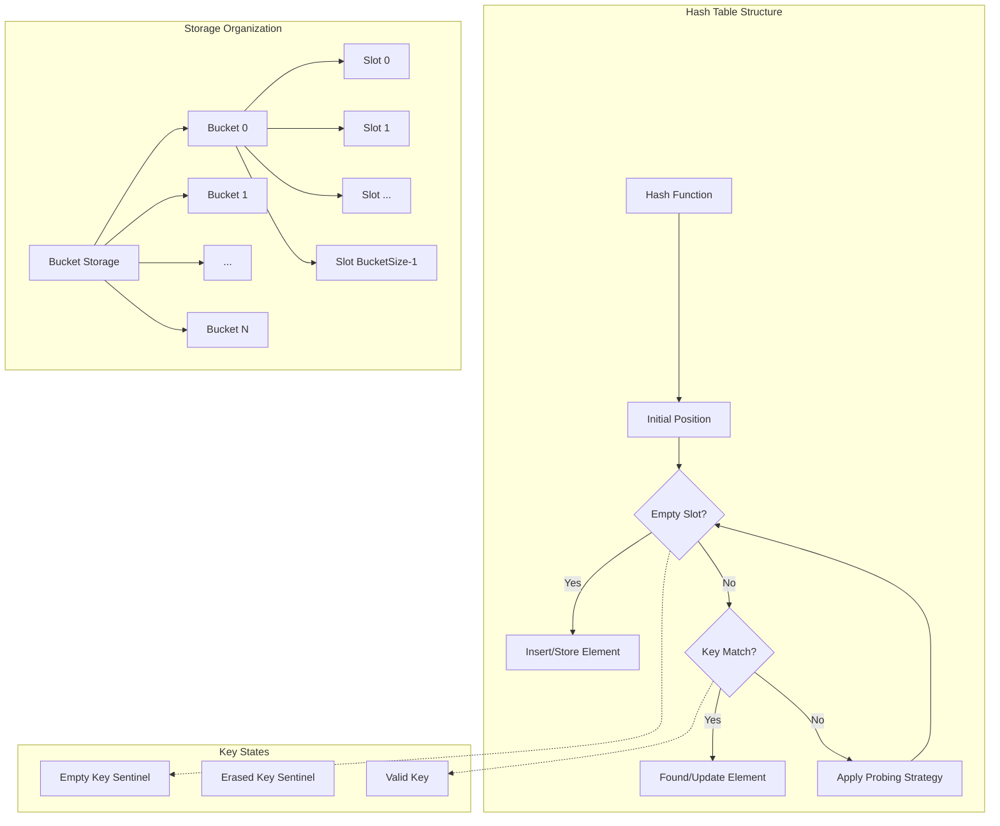

This storage model provides:

- **Bucket-based organization** for coalesced memory access
- **Open addressing** with configurable probing for collision resolution
- **Sentinel values** to mark empty and erased slots
- **Atomic operations** for thread-safe concurrent access

Sources: [include/cuco/bucket_storage.cuh:130-154](), [include/cuco/detail/static_map.inl:29-49]()

## Device References

One of the unique features of cuCollections is its device reference system, which enables fine-grained operations directly from device code:

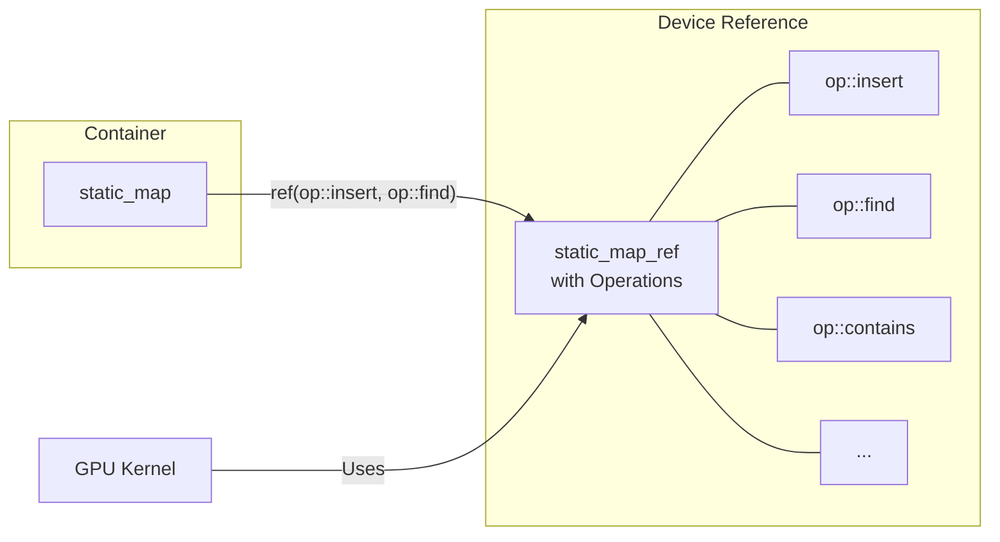

Key aspects of the device reference system:

1. **Composition-based design**: References are composed with specific operations
2. **Non-owning and lightweight**: Easily passed to device code
3. **Thread scope specification**: Controls visibility of atomic operations
4. **Shared memory support**: References can wrap shared memory for faster access

Sources: [include/cuco/static_map.cuh:134-141](), [examples/static_set/device_ref_example.cu:77-82]()

## Memory Usage Patterns

cuCollections offers several ways to manage memory:

1. **Global memory with device allocator**: Default approach for most use cases
2. **Shared memory**: For high-performance thread block-local operations
3. **Single storage with multiple references**: For creating multiple logical containers with shared storage

These patterns allow developers to optimize memory usage based on their specific requirements.

Sources: [examples/static_set/shared_memory_example.cu:30-48](), [examples/static_set/device_subsets_example.cu:140-173]()

## Requirements and Limitations

- **CUDA Requirements**: CUDA 11.5+, C++17, Volta+ architecture (Pascal partial support)
- **Key/Value Size Limits**: Limited to 8 bytes each for optimal performance
- **Type Requirements**: Key/Value types must have unique object representations (`cuco::is_bitwise_comparable_v<T>`)
- **Sentinel Values**: Must provide unique sentinel values for empty (and optionally erased) states

Sources: [README.md:61-66](), [include/cuco/static_map.cuh:73-106]()

## Integration with Applications

cuCollections is designed to integrate smoothly with CUDA applications through:

1. **CMake integration**: Simple to include in CMake projects
2. **Header-only design**: No separate compilation required
3. **Compatible with standard CUDA patterns**: Works with CUDA streams, cooperative groups, etc.

For detailed information on building and installation, see [Building and Installation](#1.2).

Sources: [README.md:25-59](), [CMakeLists.txt:81-89]()

---

# Page: Architecture

# Architecture

<details>
<summary>Relevant source files</summary>

The following files were used as context for generating this wiki page:

- [README.md](README.md)
- [examples/static_set/device_subsets_example.cu](examples/static_set/device_subsets_example.cu)
- [examples/static_set/shared_memory_example.cu](examples/static_set/shared_memory_example.cu)
- [include/cuco/bucket_storage.cuh](include/cuco/bucket_storage.cuh)
- [include/cuco/detail/open_addressing/open_addressing_ref_impl.cuh](include/cuco/detail/open_addressing/open_addressing_ref_impl.cuh)
- [include/cuco/detail/static_map.inl](include/cuco/detail/static_map.inl)
- [include/cuco/detail/static_map/static_map_ref.inl](include/cuco/detail/static_map/static_map_ref.inl)
- [include/cuco/detail/static_map_kernels.cuh](include/cuco/detail/static_map_kernels.cuh)
- [include/cuco/detail/static_multimap/static_multimap_ref.inl](include/cuco/detail/static_multimap/static_multimap_ref.inl)
- [include/cuco/detail/static_multiset/static_multiset_ref.inl](include/cuco/detail/static_multiset/static_multiset_ref.inl)
- [include/cuco/detail/static_set/static_set_ref.inl](include/cuco/detail/static_set/static_set_ref.inl)
- [include/cuco/static_map.cuh](include/cuco/static_map.cuh)
- [include/cuco/static_map_ref.cuh](include/cuco/static_map_ref.cuh)
- [include/cuco/static_multimap_ref.cuh](include/cuco/static_multimap_ref.cuh)
- [include/cuco/static_multiset_ref.cuh](include/cuco/static_multiset_ref.cuh)
- [include/cuco/static_set_ref.cuh](include/cuco/static_set_ref.cuh)
- [tests/static_map/erase_test.cu](tests/static_map/erase_test.cu)
- [tests/static_map/shared_memory_test.cu](tests/static_map/shared_memory_test.cu)
- [tests/static_set/shared_memory_test.cu](tests/static_set/shared_memory_test.cu)

</details>


This page describes the high-level architecture of cuCollections (cuco), explaining how the different components fit together to provide GPU-accelerated data structures. It covers the foundational design patterns, core components, and interactions that enable efficient, concurrent data structures on NVIDIA GPUs.

## Overview

cuCollections follows a unique architecture designed specifically for GPU-based data structures, with a clear separation between:

1. Host-side container objects that provide bulk operations
2. Device-side reference objects that enable fine-grained access

This design allows developers to use cuCollections efficiently in both bulk processing scenarios (processing millions of elements at once) and in custom CUDA kernels requiring individual element operations.

## Core Architecture Patterns

### Host-Device Interface Pattern

The foundational pattern in cuCollections is the separation between host-side containers and device-side references.

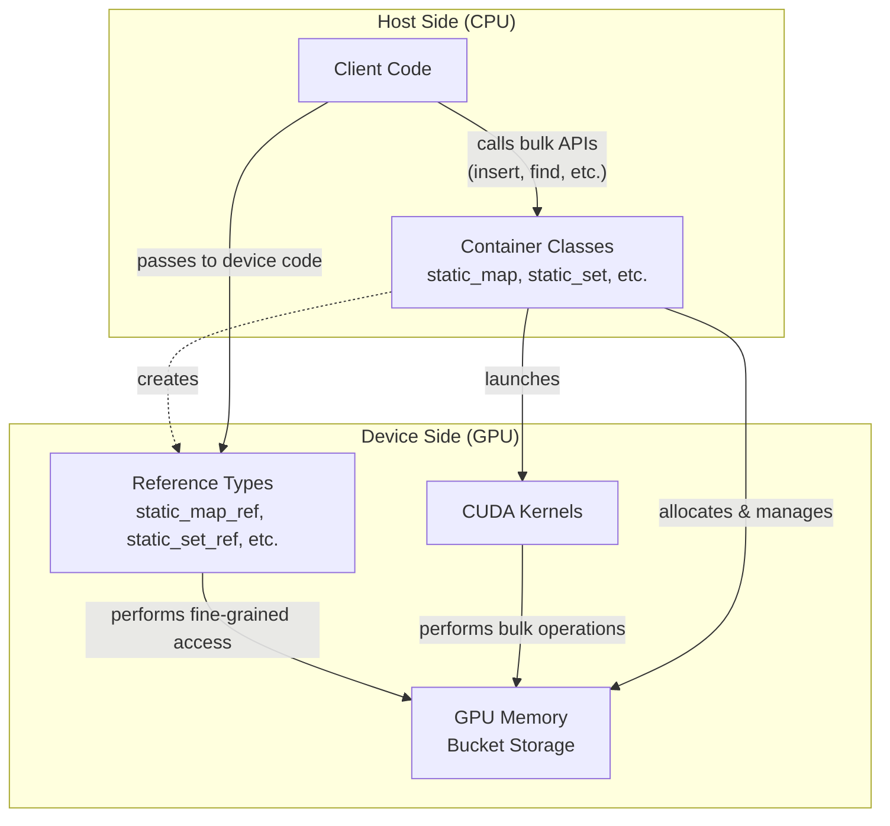

**Host-side containers**:
- Own and manage memory
- Provide bulk operations (insert, find, contains, etc.)
- Launch CUDA kernels for these operations
- Create device-side references

**Device-side references**:
- Non-owning, lightweight, trivially-copyable
- Enable fine-grained access in CUDA kernels
- Support various operations through template operator tags

Sources: [include/cuco/static_map.cuh:46-65](). [include/cuco/static_map_ref.cuh:32-58]()

### Storage Architecture

cuCollections uses a bucket-based storage design for efficient memory access patterns on GPUs.

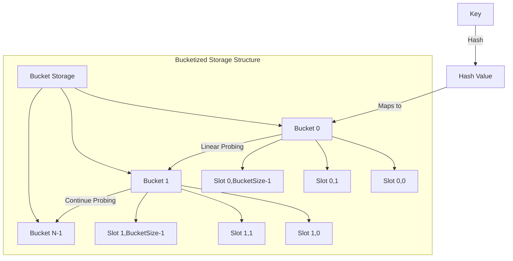

Key features:
- Buckets contain multiple slots
- Slots store elements (keys or key-value pairs)
- Bucketized design enables vectorized memory access
- Probing schemes determine collision resolution strategy

Sources: [include/cuco/bucket_storage.cuh:35-42](). [include/cuco/detail/open_addressing/open_addressing_ref_impl.cuh:66-108]()

## Container Implementation

### Open Addressing Implementation

All containers in cuCollections use open addressing with configurable probing schemes. This is implemented through a common template class: `open_addressing_impl` and `open_addressing_ref_impl`.

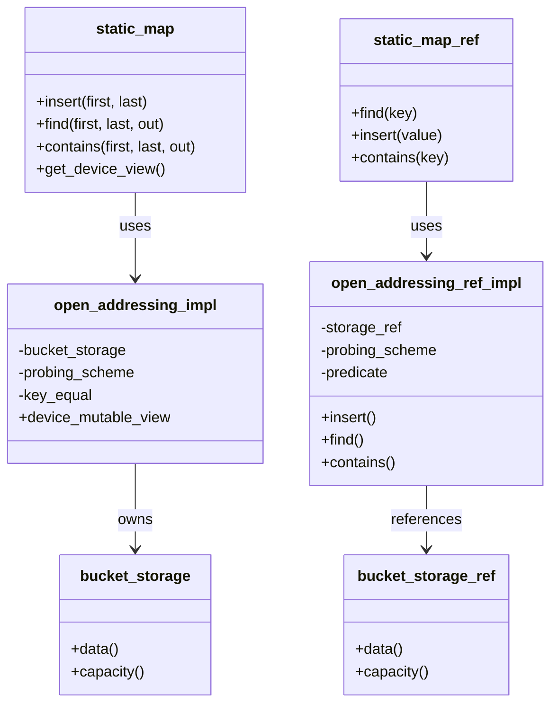

This implementation provides:
- Element storage in buckets
- Hash-based lookup
- Collision resolution through configured probing schemes
- Thread-safe operations via atomic operations

Sources: [include/cuco/detail/open_addressing/open_addressing_impl.cuh](). [include/cuco/detail/open_addressing/open_addressing_ref_impl.cuh:83-104]()

### Operator Composition Pattern

Device references use a template parameter pack of operator tags to determine their functionality. This enables compile-time composition of operations.

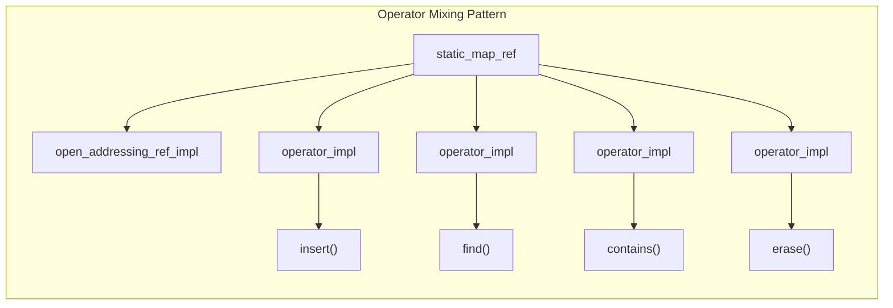

Key aspects:
- References inherit functionality from multiple operator implementations
- Operators can be composed at compile time
- Allows for minimal reference objects with only required functionality
- Enables rebinding to create references with different operations

Sources: [include/cuco/static_map_ref.cuh:63-71](). [include/cuco/operator.hpp]()

## Container Types and Relationships

cuCollections provides several container types, all built on the same architectural foundation but with different characteristics.

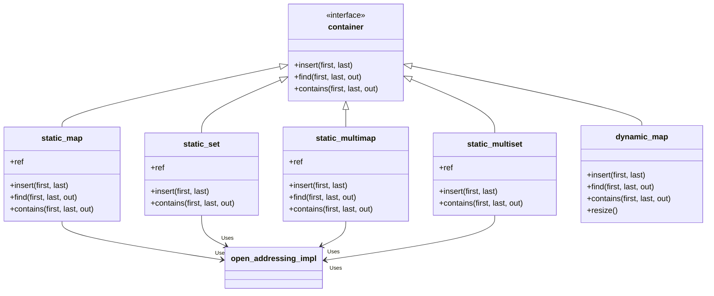

Container characteristics:
- **static_map**: Fixed-size hash table for unique key-value pairs
- **static_set**: Fixed-size container for unique keys
- **static_multimap**: Fixed-size hash table allowing duplicate keys
- **static_multiset**: Fixed-size container allowing duplicate keys
- **dynamic_map**: Resizable hash table for unique key-value pairs

Sources: [include/cuco/static_map.cuh:46-88](). [include/cuco/static_set.cuh](). [include/cuco/static_multimap.cuh](). [include/cuco/static_multiset.cuh](). [include/cuco/dynamic_map.cuh]()

## Operation Flow

The following diagram illustrates how operations flow through the system:

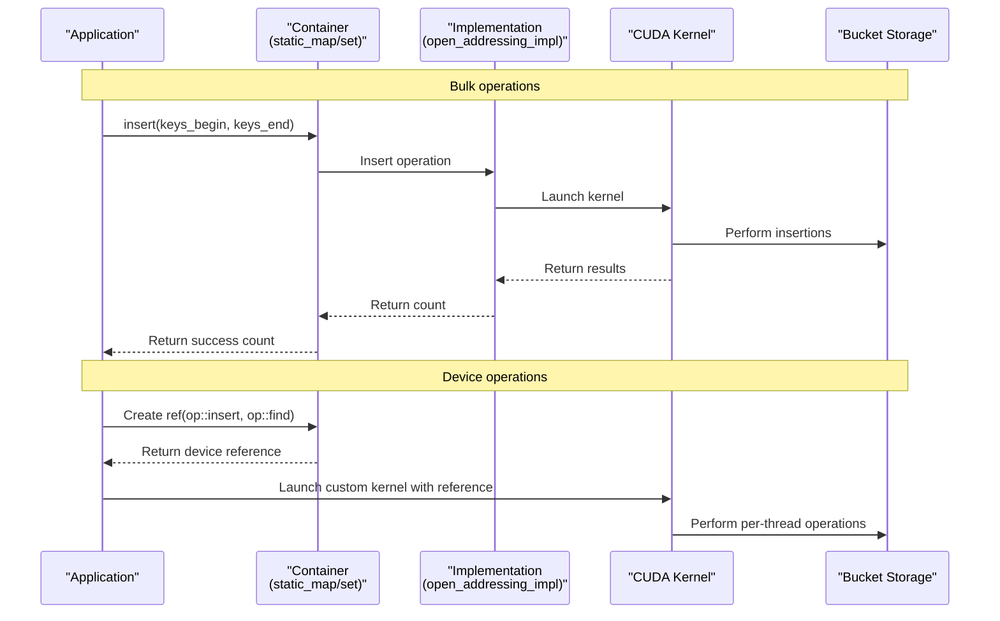

Key points:
- Bulk operations launch CUDA kernels from the host
- Device-side operations use reference objects passed to custom kernels
- Both paths interact with the same underlying storage

Sources: [include/cuco/detail/static_map_kernels.cuh:81-108](). [include/cuco/detail/open_addressing/open_addressing_ref_impl.cuh:374-417]()

## Memory Management

cuCollections containers handle memory management through allocators. The storage is structured as an array of buckets, each containing a fixed number of slots.

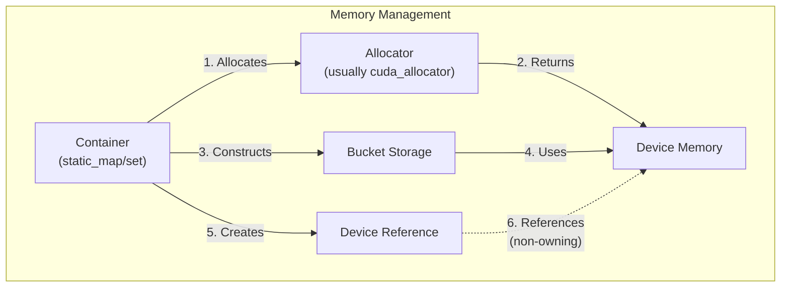

Key aspects:
- Containers own and manage memory allocation/deallocation
- References are non-owning and don't manage memory
- Storage is organized into buckets for efficient access
- Custom allocators can be provided

Sources: [include/cuco/static_map.cuh:87-96](). [include/cuco/utility/allocator.hpp]()

## Concurrency and Synchronization

cuCollections provides thread-safe concurrent access through atomic operations and cooperative groups.

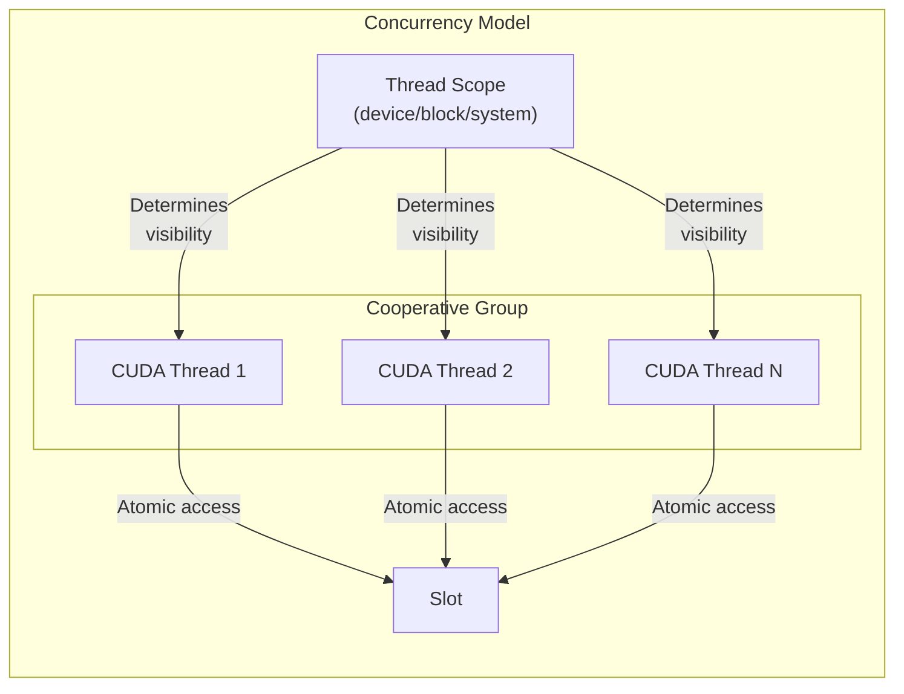

Features:
- Thread scope parameter controls synchronization scope (device, block, or system)
- Atomic operations ensure thread-safe modifications
- Cooperative groups can be used for collaborative operations
- Probing scheme's CG size parameter configures thread cooperation

Sources: [include/cuco/detail/open_addressing/open_addressing_ref_impl.cuh:387-415](). [include/cuco/detail/open_addressing/open_addressing_ref_impl.cuh:428-466]()

## Summary

The cuCollections architecture is designed for efficient GPU-accelerated data structures through:

1. **Separation of host and device interfaces** for both bulk and fine-grained operations
2. **Bucket-based storage** optimized for GPU memory access patterns
3. **Atomic operations** for thread-safe concurrent modifications
4. **Composable operations** through the operator tag system
5. **Flexible probing schemes** for collision resolution
6. **Cooperative threading model** for efficient parallel execution

This architecture enables high-performance, concurrent hash tables and sets optimized for NVIDIA GPUs while providing a flexible, STL-like interface.

---

# Page: Building and Installation

# Building and Installation

<details>
<summary>Relevant source files</summary>

The following files were used as context for generating this wiki page:

- [.gitignore](.gitignore)
- [.pre-commit-config.yaml](.pre-commit-config.yaml)
- [CMakeLists.txt](CMakeLists.txt)
- [benchmarks/CMakeLists.txt](benchmarks/CMakeLists.txt)
- [ci/pre-commit/example_links.py](ci/pre-commit/example_links.py)
- [cmake/thirdparty/get_cccl.cmake](cmake/thirdparty/get_cccl.cmake)
- [doxygen/Doxyfile](doxygen/Doxyfile)
- [examples/CMakeLists.txt](examples/CMakeLists.txt)
- [examples/static_map/count_by_key_example.cu](examples/static_map/count_by_key_example.cu)
- [examples/static_map/custom_type_example.cu](examples/static_map/custom_type_example.cu)
- [tests/CMakeLists.txt](tests/CMakeLists.txt)

</details>


This document provides detailed instructions for building, installing, and integrating the cuCollections (cuco) library into your projects. cuCollections is a header-only library, but it requires proper setup to ensure compatibility with your CUDA environment.

## Prerequisites

Before building cuCollections, ensure you have the following prerequisites installed on your system:

- **CMake** (minimum version 3.23.1)
- **CUDA Toolkit** (supported versions align with the NVIDIA CCCL library)
- **C++ Compiler** supporting C++17
- **Git** (for cloning the repository)

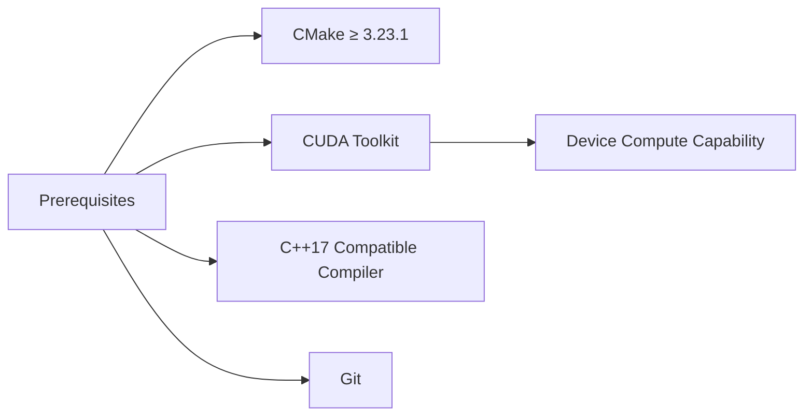

Sources: [CMakeLists.txt:16-17](), [CMakeLists.txt:34-36]()

## Repository Structure

cuCollections is organized with a clear separation between library header files, tests, benchmarks, and examples:

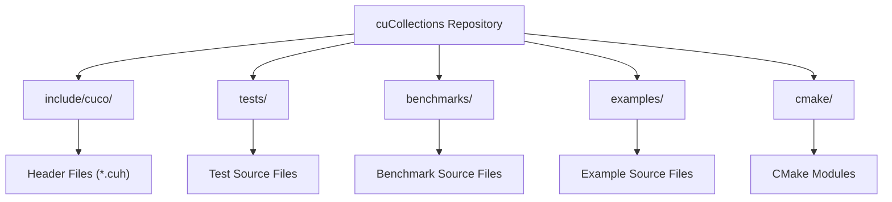

Sources: [CMakeLists.txt:83-88](), [tests/CMakeLists.txt](), [benchmarks/CMakeLists.txt](), [examples/CMakeLists.txt]()

## Building from Source

### Clone the Repository

First, clone the repository from GitHub:

```bash
git clone https://github.com/NVIDIA/cuCollections.git
cd cuCollections
```

### Configure and Build

cuCollections uses CMake for its build system. The basic build commands are:

```bash
mkdir build
cd build
cmake ..
cmake --build .
```

### CMake Build Options

cuCollections provides several build options that can be enabled or disabled:

| Option | Description | Default |
|--------|-------------|---------|
| `BUILD_TESTS` | Build test suite | ON when building directly, OFF as subproject |
| `BUILD_BENCHMARKS` | Build benchmark suite | ON when building directly, OFF as subproject |
| `BUILD_EXAMPLES` | Build example programs | ON when building directly, OFF as subproject |
| `INSTALL_CUCO` | Enable CMake install rules | ON when building directly, OFF as subproject |

To enable or disable these options, add them to your CMake command:

```bash
cmake .. -DBUILD_TESTS=ON -DBUILD_BENCHMARKS=OFF
```

Sources: [CMakeLists.txt:39-49]()

## Build Process

The build process for cuCollections follows this workflow:

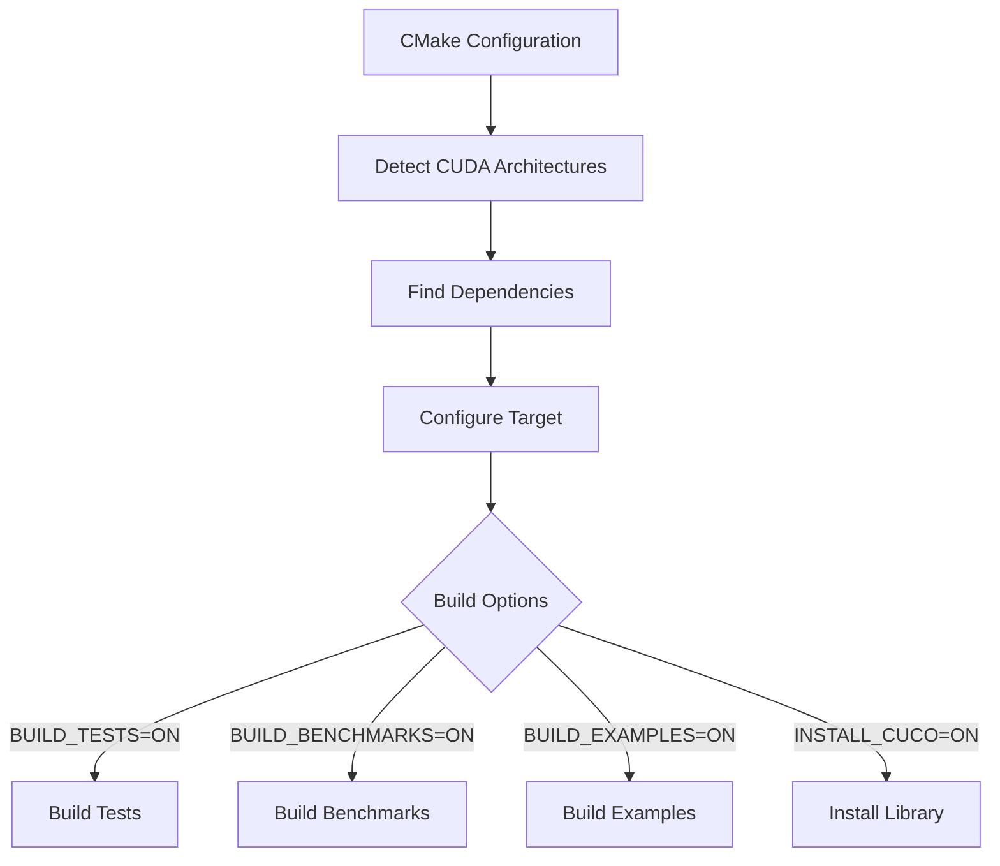

Sources: [CMakeLists.txt:34-114]()

## Dependencies

cuCollections primarily depends on:

1. **CUDA Toolkit**: For CUDA compiler and runtime
2. **CCCL (CUDA C++ Core Libraries)**: A collection of CUDA C++ libraries that provide foundational functionality

The build system automatically downloads and configures CCCL using CPM (CMake Package Manager) if it's not already available.

Sources: [CMakeLists.txt:66-72](), [cmake/thirdparty/get_cccl.cmake]()

## Installation

When `INSTALL_CUCO=ON`, the build will generate installation targets. To install the library:

```bash
cmake --build . --target install
```

By default, this will install:
- Header files to `<install-prefix>/include/cuco/`
- CMake configuration files to `<install-prefix>/lib/cmake/cuco/`

You can customize the installation directory by setting `CMAKE_INSTALL_PREFIX`:

```bash
cmake .. -DCMAKE_INSTALL_PREFIX=/custom/install/path
```

Sources: [CMakeLists.txt:144-154]()

## Using cuCollections in Your Projects

### CMake Integration

cuCollections provides CMake targets that can be used in your projects. There are two primary ways to integrate it:

#### 1. Using with `find_package`

If cuCollections is installed on your system:

```cmake
find_package(cuco REQUIRED)
target_link_libraries(your_target PRIVATE cuco::cuco)
```

#### 2. As a Subdirectory

You can include cuCollections as a subdirectory in your project:

```cmake
add_subdirectory(path/to/cuCollections)
target_link_libraries(your_target PRIVATE cuco::cuco)
```

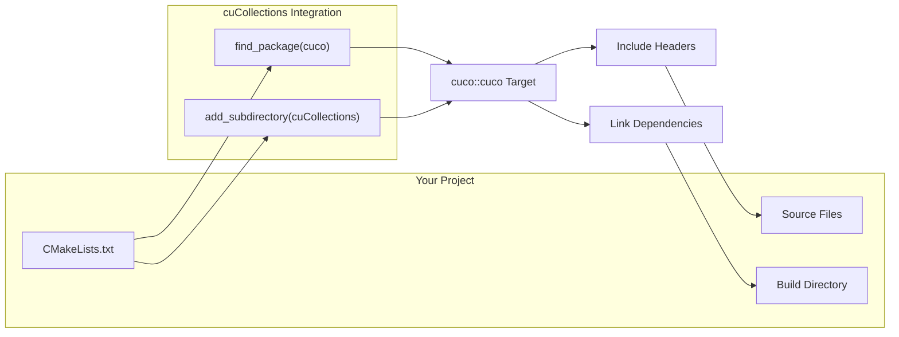

Sources: [CMakeLists.txt:83-88](), [CMakeLists.txt:119-154]()

## Example Usage

After building and installing, you can compile and run the example applications to understand how to use the library:

```bash
cd build/examples
./STATIC_MAP_HOST_BULK_EXAMPLE
```

The example programs demonstrate various features of cuCollections, such as static maps, multimaps, device references, and custom types.

Sources: [examples/CMakeLists.txt:21-49]()

## Test Suite

If you've built the test suite (`BUILD_TESTS=ON`), you can run the tests to verify that cuCollections works correctly on your system:

```bash
cd build
ctest
```

The test suite uses Catch2 and includes tests for all major components of the library.

Sources: [tests/CMakeLists.txt:18-32](), [tests/CMakeLists.txt:35-44]()

## Performance Benchmarks

If you've built the benchmarks (`BUILD_BENCHMARKS=ON`), you can run them to measure the performance of cuCollections on your system:

```bash
cd build/benchmarks
./STATIC_MAP_BENCH
./STATIC_SET_BENCH
```

The benchmarks use NVBench to measure performance metrics such as throughput and latency.

Sources: [benchmarks/CMakeLists.txt:23-35](), [benchmarks/CMakeLists.txt:42-101]()

## Compiler Settings and Requirements

cuCollections requires:
- CUDA compiler with C++17 support
- Host compiler with C++17 support

The library uses various CUDA features like:
- Lambda expressions (`--expt-extended-lambda`)
- Extensions for atomic operations

The tests and examples are compiled with warnings enabled (`-Wall -Wextra`).

Sources: [CMakeLists.txt:88](), [tests/CMakeLists.txt:41-42](), [examples/CMakeLists.txt:27-28](), [benchmarks/CMakeLists.txt:30]()

## Troubleshooting

### Common Build Issues

1. **CMake Version**:
   If you encounter errors about CMake policy or unsupported commands, ensure you're using CMake 3.23.1 or newer.

2. **CUDA Toolkit Not Found**:
   Ensure CUDA is properly installed and that the CUDA_HOME or CUDA_PATH environment variable is set.

3. **Header-Only Limitations**:
   Remember that while cuCollections is header-only, it still needs to be compiled with CUDA support to function.

4. **Custom CUDA Architecture**:
   The build system detects CUDA architectures automatically, but you can specify them manually with `CMAKE_CUDA_ARCHITECTURES`.

### CUDA Compatibility

cuCollections is tested with recent CUDA versions. If you encounter issues with older CUDA versions, you may need to update your CUDA toolkit or modify the code to remove newer CUDA features.

---

# Page: Static Map

# Static Map

<details>
<summary>Relevant source files</summary>

The following files were used as context for generating this wiki page:

- [include/cuco/detail/open_addressing/open_addressing_impl.cuh](include/cuco/detail/open_addressing/open_addressing_impl.cuh)
- [include/cuco/detail/static_map.inl](include/cuco/detail/static_map.inl)
- [include/cuco/detail/static_map/static_map.inl](include/cuco/detail/static_map/static_map.inl)
- [include/cuco/detail/static_map_kernels.cuh](include/cuco/detail/static_map_kernels.cuh)
- [include/cuco/detail/static_set/static_set.inl](include/cuco/detail/static_set/static_set.inl)
- [include/cuco/static_map.cuh](include/cuco/static_map.cuh)
- [include/cuco/static_set.cuh](include/cuco/static_set.cuh)
- [tests/dynamic_map/unique_sequence_test.cu](tests/dynamic_map/unique_sequence_test.cu)
- [tests/static_map/custom_type_test.cu](tests/static_map/custom_type_test.cu)
- [tests/static_map/erase_test.cu](tests/static_map/erase_test.cu)
- [tests/static_map/key_sentinel_test.cu](tests/static_map/key_sentinel_test.cu)
- [tests/static_map/stream_test.cu](tests/static_map/stream_test.cu)

</details>


The `static_map` is a GPU-accelerated, unordered, associative container of key-value pairs with unique keys in the cuCollections library. It provides a fixed-capacity hash table implementation optimized for NVIDIA GPUs with concurrent operations. Unlike [Dynamic Map](#6), the `static_map` has a predetermined capacity and will not automatically grow when full.

## Key Features and Design

The `static_map` provides two distinct interfaces for interaction:

1. **Host-side bulk operations**: For efficiently processing large numbers of keys in a single operation
2. **Device-side singular operations**: For individual threads to perform independent operations from device code

The container supports constant-time lookup, insertion, and deletion operations, and is designed for concurrent access in a GPU-parallel environment.

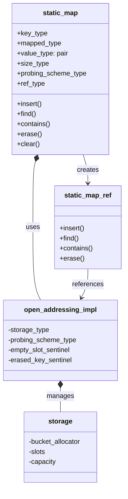

Sources: [include/cuco/static_map.cuh:98-154](). [include/cuco/detail/open_addressing/open_addressing_impl.cuh:71-107]()

## Initialization and Configuration

The `static_map` is initialized with a specific capacity and sentinel values that mark empty and erased slots. The capacity remains fixed throughout the container's lifetime. When creating a `static_map`, you must specify:

1. **Capacity**: The fixed size of the container
2. **Empty key sentinel**: A reserved key value that indicates an empty slot
3. **Empty value sentinel**: A reserved value for empty slots
4. **Optional erased key sentinel**: A reserved key value for erased slots (if not provided, uses empty key)

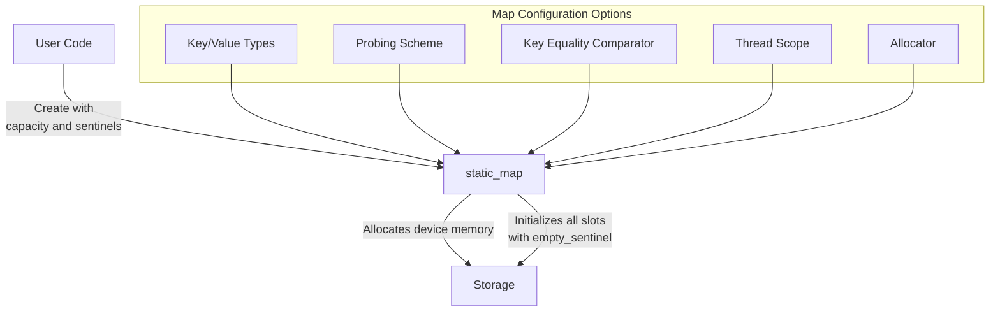

Sources: [include/cuco/static_map.cuh:179-231](). [include/cuco/detail/static_map/static_map.inl:41-118]()

## Hash Table Mechanics

The `static_map` uses open addressing with a configurable probing scheme (linear probing by default) to handle hash collisions. When a key is inserted:

1. The key is hashed to determine its initial slot position
2. If the slot is empty, the key-value pair is inserted
3. If the slot is occupied, the probing scheme determines the next slot to check
4. This continues until an empty slot is found or the key is found to already exist

For concurrent operations, `static_map` uses CUDA atomic operations to ensure thread safety when multiple threads try to modify the same slot simultaneously.

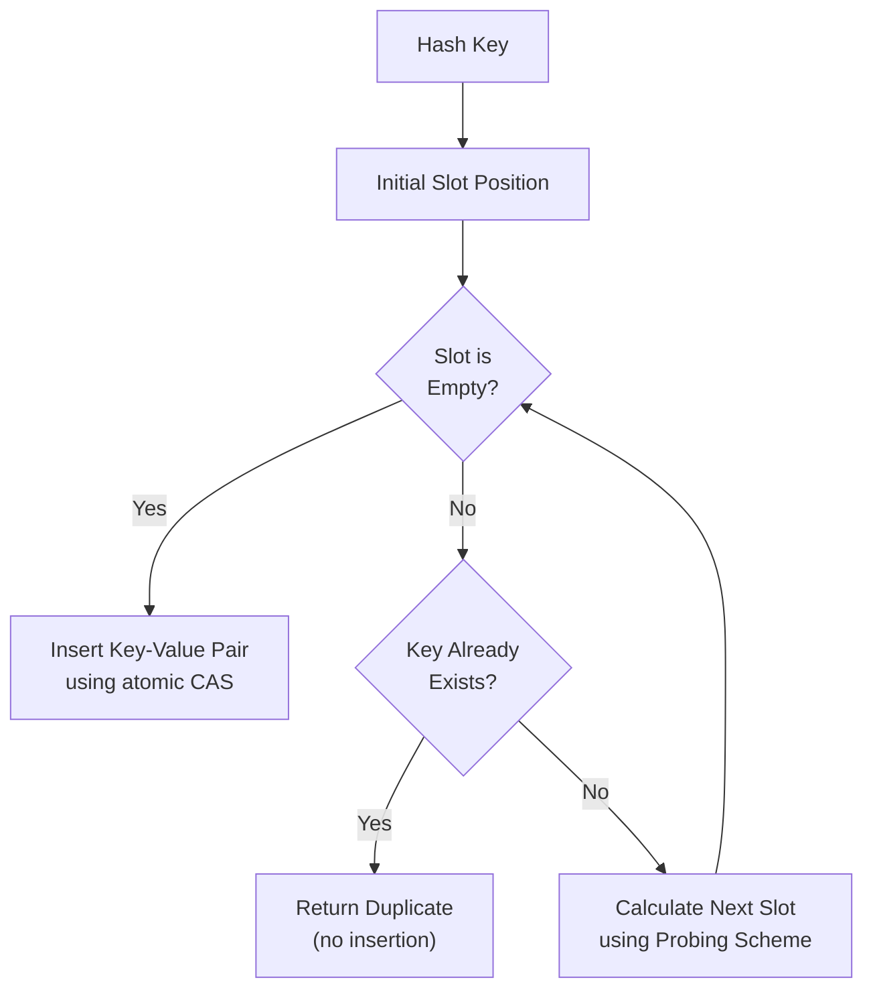

Sources: [include/cuco/detail/static_map.inl:386-430](). [include/cuco/detail/static_map_kernels.cuh:82-108]()

## Host Interface

The host interface provides bulk operations for processing large numbers of keys efficiently, including:

| Operation | Description | Synchronous | Asynchronous |
|-----------|-------------|-------------|--------------|
| `insert` | Inserts all key-value pairs in a range | ✓ | ✓ |
| `insert_if` | Inserts pairs based on a predicate | ✓ | ✓ |
| `insert_or_assign` | Inserts or updates existing values | ✓ | ✓ |
| `insert_or_apply` | Inserts or applies a binary operation | ✓ | ✓ |
| `find` | Retrieves values for keys in a range | ✓ | ✓ |
| `contains` | Checks if keys in a range are present | ✓ | ✓ |
| `erase` | Removes keys from the map | ✓ | ✓ |
| `clear` | Removes all entries from the map | ✓ | ✓ |

Each operation has both synchronous and asynchronous variants. The synchronous versions (e.g., `insert`) block until the operation completes, while the asynchronous versions (e.g., `insert_async`) return immediately without blocking.

Sources: [include/cuco/static_map.cuh:302-408](). [include/cuco/detail/static_map/static_map.inl:148-178]()

## Device Interface via References

Device-side operations are accessed through non-owning, trivially copyable reference types that allow individual threads to perform independent operations from device code. These references are created using the `ref()` method with operator tags:

```mermaid
graph TB
    A["static_map"]
    B["op::insert"]
    C["op::find"]
    D["op::contains"]
    E["op::erase"]
    F["static_map_ref"]
    
    A -->|"ref(op::insert)"| F
    A -->|"ref(op::find)"| F
    A -->|"ref(op::contains)"| F
    A -->|"ref(op::erase)"| F
    
    B --> F
    C --> F
    D --> F
    E --> F
    
    subgraph "Device Code"
        G["GPU Thread"]
        H["GPU Thread"]
        I["GPU Thread"]
    end
    
    G -->|"ref.insert(key, value)"| F
    H -->|"ref.find(key)"| F
    I -->|"ref.contains(key)"| F
```

The reference types support:
- Fine-grained operations from individual threads
- Concurrent modification and lookup (when appropriate operators are specified)
- Using cooperative groups for improved performance

Sources: [include/cuco/static_map.cuh:134-141](). [include/cuco/detail/static_map/static_map.inl:129-147]()

## Operation Flow Example

The following sequence diagram shows the flow for a bulk insertion operation:

```mermaid
sequenceDiagram
    participant UC as User Code
    participant SM as static_map
    participant OI as open_addressing_impl
    participant KR as CUDA Kernel
    participant ST as Storage
    
    UC->>SM: insert(keys_begin, keys_end, stream)
    SM->>OI: insert(first, last, ref(op::insert), stream)
    OI->>KR: Launch insert kernel with device reference
    KR->>ST: For each key: hash, find slot, insert atomically
    ST-->>KR: Success/failure for each key
    KR-->>OI: Number of successful insertions
    OI-->>SM: Number of successful insertions 
    SM-->>UC: Return result
```

Sources: [include/cuco/static_map.cuh:302-316](). [include/cuco/detail/static_map_kernels.cuh:136-167]()

## Threading Model and Concurrency

The `static_map` supports concurrent operations through:

1. **Atomic operations**: Using CUDA atomics for thread-safe slot updates
2. **Cooperative Groups**: Optional usage of CUDA Cooperative Groups for collaborative operations
3. **Custom thread scope**: Configurable scope for atomic operations (`cuda::thread_scope_device` by default)

Different probing schemes use different threading models:
- Scalar operations: One thread per operation
- Cooperative Group operations: Multiple threads collaborate on a single operation

The CG size is configured as part of the probing scheme template parameter.

Sources: [include/cuco/static_map.cuh:89-97](). [include/cuco/detail/static_map_kernels.cuh:525-582]()

## Erasing Elements

Unlike insertion which simply marks slots as occupied, erasure involves specifically marking slots as erased to maintain correct probing sequences:

1. When a key is erased, its slot is marked with the erased key sentinel
2. During probing, erased slots are skipped (similar to empty slots)
3. During insertion, erased slots can be reused for new keys
4. This approach preserves the probing sequence integrity

```mermaid
graph LR
    subgraph "Slot States"
        A["Empty\n(empty_key_sentinel)"]
        B["Occupied\n(valid key and value)"]
        C["Erased\n(erased_key_sentinel)"]
    end
    
    B -->|"erase(key)"| C
    C -->|"insert(new_key)"| B
    A -->|"insert(key)"| B
```

Sources: [include/cuco/static_map.cuh:601-627](). [include/cuco/detail/static_map.inl:586-632]()

## Performance Considerations

The performance of `static_map` is influenced by several factors:

1. **Load factor**: The ratio of elements to capacity affects performance; lower load factors generally provide better performance but use more memory
2. **Probing scheme**: Different probing schemes may perform better for different workloads
3. **CG size**: The number of threads collaborating on operations can improve performance for high load factors
4. **Bucket size**: The number of slots processed together affects memory access patterns

When the map is nearly full, lookups and insertions may become more expensive due to longer probe sequences.

Sources: [include/cuco/static_map.cuh:222-231](). [include/cuco/detail/static_map_kernels.cuh:432-472]()

## Usage Pattern Example

Here's a typical usage pattern for bulk operations with the `static_map`:

1. Create a `static_map` with appropriate capacity and sentinel values
2. Prepare device-accessible input data (keys/values)
3. Call bulk operations on ranges of keys
4. Retrieve results from device memory

For device-side operations:
1. Create a reference from the map using appropriate operator tags
2. Pass the reference to device code
3. In device code, individual threads can perform operations using the reference

Sources: [tests/static_map/erase_test.cu:31-80](). [tests/static_map/stream_test.cu:32-94]()

## Custom Types Support

The `static_map` supports custom types for both keys and values, provided they:

1. Have unique object representations (or explicitly specify `bitwise_comparable_v<T>`)
2. Don't exceed 8 bytes for key types and 8 bytes for mapped types
3. Provide appropriate comparison and hash functions

When using custom types, you need to provide appropriate equality operators and hash functions.

Sources: [tests/static_map/custom_type_test.cu:32-65](). [tests/static_map/custom_type_test.cu:100-261]()

---

# Page: Static Map Host Interface

# Static Map Host Interface

<details>
<summary>Relevant source files</summary>

The following files were used as context for generating this wiki page:

- [include/cuco/detail/static_map.inl](include/cuco/detail/static_map.inl)
- [include/cuco/detail/static_map_kernels.cuh](include/cuco/detail/static_map_kernels.cuh)
- [include/cuco/static_map.cuh](include/cuco/static_map.cuh)
- [tests/static_map/capacity_test.cu](tests/static_map/capacity_test.cu)
- [tests/static_map/duplicate_keys_test.cu](tests/static_map/duplicate_keys_test.cu)
- [tests/static_map/erase_test.cu](tests/static_map/erase_test.cu)
- [tests/static_map/find_test.cu](tests/static_map/find_test.cu)
- [tests/static_map/heterogeneous_lookup_test.cu](tests/static_map/heterogeneous_lookup_test.cu)
- [tests/static_map/insert_and_find_test.cu](tests/static_map/insert_and_find_test.cu)
- [tests/static_map/insert_or_assign_test.cu](tests/static_map/insert_or_assign_test.cu)
- [tests/static_multimap/heterogeneous_lookup_test.cu](tests/static_multimap/heterogeneous_lookup_test.cu)
- [tests/static_set/capacity_test.cu](tests/static_set/capacity_test.cu)
- [tests/static_set/heterogeneous_lookup_test.cu](tests/static_set/heterogeneous_lookup_test.cu)
- [tests/static_set/insert_and_find_test.cu](tests/static_set/insert_and_find_test.cu)
- [tests/static_set/large_input_test.cu](tests/static_set/large_input_test.cu)
- [tests/static_set/retrieve_all_test.cu](tests/static_set/retrieve_all_test.cu)
- [tests/static_set/retrieve_test.cu](tests/static_set/retrieve_test.cu)
- [tests/static_set/unique_sequence_test.cu](tests/static_set/unique_sequence_test.cu)

</details>


This page documents the host-side interface of `static_map`, focusing on operations that are called from CPU (host) code to manage and interact with the GPU data structure. For information about device-side access to the `static_map`, see [Static Map Device View](#2.2).

The host interface enables "bulk" operations where large numbers of elements can be manipulated in parallel using high-level functions, rather than writing custom CUDA kernels.

## Host Interface Overview

The `static_map` host interface provides methods that launch GPU kernels to perform parallel operations on the data structure. These operations include construction, insertion, lookup, deletion, and other data manipulations.

```mermaid
flowchart TD
    subgraph "Host Code" 
        app["Application"]
        app --> |"1. Calls host API<br>e.g., map.insert()"| host_api["static_map<br>Host Interface"]
    end
    
    subgraph "GPU Memory"
        storage["Bucket Storage<br>(Key-Value Slots)"]
    end
    
    host_api --> |"2. Launches<br>CUDA kernels"| kernels["CUDA Kernels<br>(e.g., insert_kernel)"]
    kernels --> |"3. Parallel<br>operations"| storage
    host_api --> |"Allocates &<br>manages"| storage
    host_api --> |"4. Returns results<br>to application"| app
```

Sources: [include/cuco/static_map.cuh:45-70](include/cuco/static_map.cuh:45-70)

## Constructing a Static Map

The static_map provides several constructors with different parameter options to create a map with the desired characteristics.

### Capacity-Based Construction

```mermaid
classDiagram
    class "static_map constructor" {
        +static_map(capacity, empty_key_sentinel, empty_value_sentinel, ...)
        +static_map(capacity, empty_key_sentinel, empty_value_sentinel, erased_key_sentinel, ...)
    }

    class "Parameters" {
        +Extent capacity: Requested minimum size
        +empty_key<Key>: Reserved value for empty slots
        +empty_value<T>: Reserved value for empty slots
        +erased_key<Key>: Reserved value for erased slots (optional)
        +KeyEqual: Key comparison predicate (optional)
        +ProbingScheme: Collision resolution strategy (optional)
        +cuda_thread_scope: Thread scope (optional)
        +Storage: Storage type (optional)
        +Allocator: Memory allocator (optional)
        +cuda::stream_ref: CUDA stream (optional)
    }

    "static_map constructor" -- "Parameters"
```

The map can be constructed with a specified capacity, which determines the number of slots to allocate. Since `static_map` has a fixed size, it's important to allocate enough space for all expected elements.

```cpp
// Basic constructor example with minimum required parameters
cuco::static_map<int32_t, int64_t> map{
    1000000,                      // Capacity
    cuco::empty_key<int32_t>{-1}, // Value used to represent empty keys
    cuco::empty_value<int64_t>{-1} // Value used for empty values
};
```

Sources: [include/cuco/static_map.cuh:178-187](include/cuco/static_map.cuh:178-187), [include/cuco/static_map.cuh:258-267](include/cuco/static_map.cuh:258-267)

### Load Factor-Based Construction

```mermaid
flowchart LR
    input["Input Parameters:
    - n (elements to insert)
    - desired_load_factor
    - empty_key_sentinel
    - empty_value_sentinel
    - other optional params"]
    
    calculate["Calculate capacity = ceiling(n / desired_load_factor)"]
    
    initialize["Initialize map with calculated capacity"]
    
    input --> calculate --> initialize
```

You can also construct a map by specifying the number of elements to insert and a desired load factor:

```cpp
// Load factor-based constructor
cuco::static_map<int32_t, int64_t> map{
    1000000,                      // Number of elements to insert
    0.7,                          // Desired load factor
    cuco::empty_key<int32_t>{-1}, // Value used to represent empty keys
    cuco::empty_value<int64_t>{-1} // Value used for empty values
};
```

The load factor affects the performance of hash table operations. A lower load factor typically provides better performance at the cost of higher memory usage.

Sources: [include/cuco/static_map.cuh:222-231](include/cuco/static_map.cuh:222-231)

## Basic Operations

### Size and Capacity

- `size()`: Returns the number of elements in the map
- `capacity()`: Returns the total number of slots available in the map
- `empty()`: Returns true if the map contains no elements

### Clearing the Map

```mermaid
sequenceDiagram
    participant App as Application Code
    participant Map as static_map
    participant Kernel as CUDA Kernel
    participant Memory as GPU Memory

    App->>Map: clear(stream)
    Map->>Kernel: Launch clear kernel
    Kernel->>Memory: Reset slots to empty sentinel
    Kernel-->>Map: Complete
    Map->>Map: Set size = 0
    Map-->>App: Return

    App->>Map: clear_async(stream)
    Map->>Kernel: Launch clear kernel asynchronously
    Kernel->>Memory: Reset slots to empty sentinel
    Map->>Map: Set size = 0 (will be effective after kernel completes)
    Map-->>App: Return immediately
```

The map provides two methods for clearing all entries:

- `clear(stream)`: Synchronously removes all elements, waiting for completion before returning
- `clear_async(stream)`: Asynchronously removes all elements, returning immediately

```cpp
// Synchronous clear
map.clear();

// Asynchronous clear with specified stream
cudaStream_t stream;
cudaStreamCreate(&stream);
map.clear_async(stream);
```

Sources: [include/cuco/static_map.cuh:274-283](include/cuco/static_map.cuh:274-283)

## Bulk Insertion Operations

### Basic Insertion

```mermaid
flowchart TD
    subgraph "Host Code"
        insert["map.insert(first, last, stream)"]
    end
    
    subgraph "CUDA Kernel"
        process["For each element in range:
        1. Calculate hash
        2. Find slot using probing
        3. Insert if slot empty
        4. If collision, continue probing"]
    end
    
    insert --> process
    process --> result["Return count of inserted elements"]
```

The basic insertion operation takes iterators to a range of key-value pairs:

```cpp
// Create device vectors for keys and values
thrust::device_vector<int> d_keys(1000);
thrust::device_vector<int> d_values(1000);

// Create pairs iterator
auto pairs_begin = thrust::make_transform_iterator(
    thrust::counting_iterator<int>(0),
    [] __device__(int i) { return cuco::pair<int, int>(i, i*2); }
);

// Insert pairs into the map
auto inserted_count = map.insert(pairs_begin, pairs_begin + 1000);
```

Sources: [include/cuco/static_map.cuh:302-304](include/cuco/static_map.cuh:302-304), [include/cuco/detail/static_map_kernels.cuh:82-108](include/cuco/detail/static_map_kernels.cuh:82-108)

### Conditional Insertion

```mermaid
flowchart TD
    start["map.insert_if(first, last, stencil, pred, stream)"]
    
    condition{"For each element i:
    pred(stencil[i]) ?"}
    
    insert["Insert pair first[i]"]
    skip["Skip this element"]
    
    start --> condition
    condition -- "true" --> insert
    condition -- "false" --> skip
    
    insert --> next["Continue to next element"]
    skip --> next
    
    next --> done["Return inserted count"]
```

Conditional insertion allows inserting elements only if they satisfy a predicate:

```cpp
// Create a predicate that inserts only even-indexed elements
auto stencil = thrust::counting_iterator<int>(0);
auto pred = [] __device__(int idx) { return idx % 2 == 0; };

// Insert only elements that satisfy the predicate
auto inserted_count = map.insert_if(
    pairs_begin, pairs_begin + 1000, 
    stencil, pred
);
```

Sources: [include/cuco/static_map.cuh:343-345](include/cuco/static_map.cuh:343-345), [include/cuco/detail/static_map_kernels.cuh:305-347](include/cuco/detail/static_map_kernels.cuh:305-347)

### Insert and Find

```mermaid
flowchart TD
    start["map.insert_and_find(first, last, found_begin, inserted_begin, stream)"]
    
    process["For each key-value pair in range:"]
    
    condition{"Key already exists?"}
    
    insert["Insert new pair
    Write iterator to found_begin[i]
    Write true to inserted_begin[i]"]
    
    find["Find existing pair
    Write iterator to found_begin[i]
    Write false to inserted_begin[i]"]
    
    start --> process --> condition
    
    condition -- "No" --> insert
    condition -- "Yes" --> find
    
    insert --> next["Continue to next element"]
    find --> next
```

Insert and find combines insertion with returning information about whether each element was inserted:

```cpp
// Create output vectors for results
thrust::device_vector<int> d_found(1000);
thrust::device_vector<bool> d_inserted(1000);

// Insert elements and get information about each insertion
map.insert_and_find(
    pairs_begin, pairs_begin + 1000,
    d_found.begin(), d_inserted.begin()
);
```

Sources: [include/cuco/static_map.cuh:395-400](include/cuco/static_map.cuh:395-400), [include/cuco/static_map.cuh:423-428](include/cuco/static_map.cuh:423-428)

## Bulk Query Operations

### Contains

```mermaid
flowchart TD
    start["map.contains(first, last, output_begin, stream)"]
    
    process["For each key in range:"]
    
    checkKey{"Key exists in map?"}
    
    writeTrue["Write true to output"]
    writeFalse["Write false to output"]
    
    start --> process --> checkKey
    
    checkKey -- "Yes" --> writeTrue
    checkKey -- "No" --> writeFalse
    
    writeTrue --> next["Continue to next key"]
    writeFalse --> next
```

The contains operation checks whether keys exist in the map:

```cpp
// Create device vector for keys
thrust::device_vector<int> d_keys(1000);
thrust::sequence(d_keys.begin(), d_keys.end());

// Create output vector for results
thrust::device_vector<bool> d_contained(1000);

// Check if keys are in the map
map.contains(d_keys.begin(), d_keys.end(), d_contained.begin());
```

Sources: [include/cuco/static_map.cuh:643-647](include/cuco/static_map.cuh:643-647), [include/cuco/detail/static_map_kernels.cuh:495-523](include/cuco/detail/static_map_kernels.cuh:495-523)

### Find

```mermaid
flowchart TD
    start["map.find(first, last, output_begin, stream)"]
    
    process["For each key in range:"]
    
    checkKey{"Key exists in map?"}
    
    writeValue["Copy associated value to output"]
    writeSentinel["Copy empty value sentinel to output"]
    
    start --> process --> checkKey
    
    checkKey -- "Yes" --> writeValue
    checkKey -- "No" --> writeSentinel
    
    writeValue --> next["Continue to next key"]
    writeSentinel --> next
```

The find operation retrieves values associated with keys:

```cpp
// Create device vector for keys
thrust::device_vector<int> d_keys(1000);
thrust::sequence(d_keys.begin(), d_keys.end());

// Create output vector for values
thrust::device_vector<int> d_values(1000);

// Find values for keys
map.find(d_keys.begin(), d_keys.end(), d_values.begin());
```

Sources: [include/cuco/static_map.cuh:747-748](include/cuco/static_map.cuh:747-748), [include/cuco/detail/static_map_kernels.cuh:371-403](include/cuco/detail/static_map_kernels.cuh:371-403)

### Retrieve All

```mermaid
flowchart TD
    start["map.retrieve_all(keys_out, values_out, stream)"]
    
    process["Copy all non-empty key-value pairs from hash table to output"]
    
    resultPair["Return pair of iterators pointing past the last written key and value"]
    
    start --> process --> resultPair
```

The retrieve_all operation extracts all key-value pairs from the map:

```cpp
// Create output vectors for all keys and values
thrust::device_vector<int> d_keys(map.size());
thrust::device_vector<int> d_values(map.size());

// Retrieve all key-value pairs
auto [keys_end, values_end] = map.retrieve_all(d_keys.begin(), d_values.begin());

// Number of elements retrieved
size_t num_elements = thrust::distance(d_keys.begin(), keys_end);
```

Sources: [include/cuco/detail/static_map.inl:212-262](include/cuco/detail/static_map.inl:212-262)

## Bulk Modification Operations

### Insert or Assign

```mermaid
flowchart TD
    start["map.insert_or_assign(first, last, stream)"]
    
    process["For each key-value pair in range:"]
    
    checkKey{"Key already exists?"}
    
    insert["Insert new pair"]
    update["Update existing value"]
    
    start --> process --> checkKey
    
    checkKey -- "No" --> insert
    checkKey -- "Yes" --> update
    
    insert --> next["Continue to next pair"]
    update --> next
```

Insert or assign either inserts a new key-value pair or updates the value if the key already exists:

```cpp
// Create pairs iterator with updated values
auto updated_pairs_begin = thrust::make_transform_iterator(
    thrust::counting_iterator<int>(0),
    [] __device__(int i) { return cuco::pair<int, int>(i, i*3); }
);

// Insert new pairs or update existing values
map.insert_or_assign(updated_pairs_begin, updated_pairs_begin + 1000);
```

Sources: [include/cuco/static_map.cuh:448-449](include/cuco/static_map.cuh:448-449), [include/cuco/static_map.cuh:467-468](include/cuco/static_map.cuh:467-468)

### Insert or Apply

```mermaid
flowchart TD
    start["map.insert_or_apply(first, last, op, stream)"]
    
    process["For each key-value pair in range:"]
    
    checkKey{"Key already exists?"}
    
    insert["Insert new pair"]
    apply["Apply binary operation:
    op(atomic_ref(slot_value), new_value)"]
    
    start --> process --> checkKey
    
    checkKey -- "No" --> insert
    checkKey -- "Yes" --> apply
    
    insert --> next["Continue to next pair"]
    apply --> next
```

Insert or apply either inserts a new key-value pair or applies a binary operation to combine the existing value with the new value:

```cpp
// Define a binary operation that adds the new value to the existing value
auto add_op = [] __device__(cuda::atomic_ref<int, cuda::thread_scope_device> existing, int new_val) {
    existing.fetch_add(new_val);
};

// Insert new pairs or apply the operation to existing pairs
map.insert_or_apply(pairs_begin, pairs_begin + 1000, add_op);
```

An overload is also provided that takes an initial value:

```cpp
// Define operation with initial value
int init_val = 0;
map.insert_or_apply(pairs_begin, pairs_begin + 1000, init_val, add_op);
```

Sources: [include/cuco/static_map.cuh:491-492](include/cuco/static_map.cuh:491-492), [include/cuco/static_map.cuh:519-520](include/cuco/static_map.cuh:519-520)

## Bulk Erase Operations

### Erase

```mermaid
flowchart TD
    start["map.erase(first, last, stream)"]
    
    process["For each key in range:"]
    
    checkKey{"Key exists in map?"}
    
    erase["Replace key with erased key sentinel
    Reset value to empty value sentinel
    Decrement size counter"]
    
    skip["Skip this key"]
    
    start --> process --> checkKey
    
    checkKey -- "Yes" --> erase
    checkKey -- "No" --> skip
    
    erase --> next["Continue to next key"]
    skip --> next
```

The erase operation removes keys from the map:

```cpp
// Create device vector for keys to erase
thrust::device_vector<int> d_keys_to_erase(500);
thrust::sequence(d_keys_to_erase.begin(), d_keys_to_erase.end());

// Erase keys from the map
map.erase(d_keys_to_erase.begin(), d_keys_to_erase.end());
```

Note that erase requires that an erased key sentinel value was provided during map construction.

Sources: [include/cuco/static_map.cuh:602](include/cuco/static_map.cuh:602), [include/cuco/detail/static_map_kernels.cuh:197-218](include/cuco/detail/static_map_kernels.cuh:197-218)

## Asynchronous Operations

Many operations in the static_map interface have both synchronous and asynchronous versions. The synchronous versions (e.g., `insert`, `find`, `contains`) wait for the operation to complete before returning. The asynchronous versions (e.g., `insert_async`, `find_async`, `contains_async`) return immediately, allowing the host to perform other work while the operation runs on the GPU.

```mermaid
sequenceDiagram
    participant App as Application Code
    participant Map as static_map
    participant GPU as GPU
    
    %% Synchronous operation
    Note over App,GPU: Synchronous Operation (e.g., insert)
    App->>Map: insert(first, last, stream)
    Map->>GPU: Launch kernel
    GPU->>GPU: Process data
    GPU-->>Map: Operation complete
    Map-->>App: Return results
    App->>App: Continue execution

    %% Asynchronous operation
    Note over App,GPU: Asynchronous Operation (e.g., insert_async)
    App->>Map: insert_async(first, last, stream)
    Map->>GPU: Launch kernel
    Map-->>App: Return immediately
    App->>App: Do other work
    GPU->>GPU: Process data in background
    Note over App,GPU: Application must synchronize on stream before using results
```

All operations accept an optional CUDA stream parameter. If not provided, the default stream is used.

```cpp
// Create a custom CUDA stream
cudaStream_t stream;
cudaStreamCreate(&stream);

// Asynchronously insert elements
map.insert_async(pairs_begin, pairs_begin + 1000, stream);

// Do other work while insert is running...

// Synchronize when results are needed
cudaStreamSynchronize(stream);
```

Sources: [include/cuco/static_map.cuh:316-317](include/cuco/static_map.cuh:316-317), [include/cuco/static_map.cuh:367-372](include/cuco/static_map.cuh:367-372)

## Typical Workflow Examples

Below is a common workflow pattern for using the static_map host interface:

```mermaid
flowchart TD
    create["1. Create static_map with appropriate capacity"]
    
    insert["2. Insert key-value pairs"]
    
    query["3. Query the map (contains/find)"]
    
    modify["4. Modify values (insert_or_assign/insert_or_apply)"]
    
    remove["5. Remove entries (erase) or clear"]
    
    create --> insert --> query --> modify --> remove
    
    query -- "Query more" --> query
    modify -- "Modify more" --> modify
```

### Performance Considerations

- **Capacity Planning**: Since `static_map` has a fixed size, allocate enough capacity to accommodate all expected elements plus some buffer for good performance.
  
- **Load Factor**: Higher load factors (ratio of elements to capacity) can reduce memory usage but may increase collision rate and decrease performance.
  
- **Sentinel Values**: Choose sentinel values that won't appear in your actual data.
  
- **Asynchronous Operations**: Use asynchronous operations when possible to overlap computation with other work.
  
- **Stream Management**: Use custom streams for better control over operation scheduling and overlap.

Sources: [include/cuco/static_map.cuh:45-70](include/cuco/static_map.cuh:45-70)

## Summary

The static_map host interface provides a comprehensive set of operations for managing a GPU hash map from host code. These operations include construction, insertion, querying, modification, and deletion, with both synchronous and asynchronous variants. The interface is designed to efficiently handle bulk operations on large datasets, leveraging the parallel processing capabilities of GPUs.

---

# Page: Static Map Device View

# Static Map Device View

<details>
<summary>Relevant source files</summary>

The following files were used as context for generating this wiki page:

- [include/cuco/detail/open_addressing/open_addressing_ref_impl.cuh](include/cuco/detail/open_addressing/open_addressing_ref_impl.cuh)
- [include/cuco/detail/static_map.inl](include/cuco/detail/static_map.inl)
- [include/cuco/detail/static_map/static_map_ref.inl](include/cuco/detail/static_map/static_map_ref.inl)
- [include/cuco/detail/static_map_kernels.cuh](include/cuco/detail/static_map_kernels.cuh)
- [include/cuco/detail/static_multimap/static_multimap_ref.inl](include/cuco/detail/static_multimap/static_multimap_ref.inl)
- [include/cuco/detail/static_multiset/static_multiset_ref.inl](include/cuco/detail/static_multiset/static_multiset_ref.inl)
- [include/cuco/detail/static_set/static_set_ref.inl](include/cuco/detail/static_set/static_set_ref.inl)
- [include/cuco/static_map.cuh](include/cuco/static_map.cuh)
- [include/cuco/static_map_ref.cuh](include/cuco/static_map_ref.cuh)
- [include/cuco/static_multimap_ref.cuh](include/cuco/static_multimap_ref.cuh)
- [include/cuco/static_multiset_ref.cuh](include/cuco/static_multiset_ref.cuh)
- [include/cuco/static_set_ref.cuh](include/cuco/static_set_ref.cuh)
- [tests/static_map/erase_test.cu](tests/static_map/erase_test.cu)

</details>


This document explains how to use the device-side views of static_map, which allow CUDA device code to directly access and modify the map. Device views enable fine-grained operations on individual key-value pairs from within CUDA kernels, complementing the host-side bulk operations.

For information about host-side operations on static maps, see [Static Map Host Interface](#2.1). For information about the general device reference pattern used across all cuCollections containers, see [Device References](#7).

## Device View Architecture

A static map device view (or "ref") is a non-owning, trivially-copyable reference that provides access to a static_map from device code. It's designed to be lightweight and efficient for passing to CUDA kernels.

```mermaid
flowchart TD
    subgraph "Host Side"
        map["static_map<Key, T>"]
        ref_creation["map.ref<Operators...>()"]
    end
    
    subgraph "Device Side"
        kernel["CUDA Kernel"]
        map_ref["static_map_ref<Key, T, Scope, KeyEqual, ProbingScheme, StorageRef, Operators...>"]
        operations["Operations (insert, find, etc.)"]
    end
    
    map --> ref_creation
    ref_creation --> kernel
    kernel --> map_ref
    map_ref --> operations
```

The device view doesn't own the underlying storage but provides an interface to access the static_map's data according to the operators specified during its creation.

Sources:
- [include/cuco/static_map.cuh:134-141]
- [include/cuco/static_map_ref.cuh:31-71]

## Creating a Device View

To obtain a device view from a static_map, you need to specify which operations the view should support using the operator tags from `cuco::op`. This is typically done using the `ref()` template method of the static_map.

```mermaid
sequenceDiagram
    participant Host as "Host Code"
    participant Map as "static_map"
    participant Kernel as "CUDA Kernel"
    participant Ref as "static_map_ref"
    
    Host->>Map: Create static_map
    Host->>Map: ref<op::insert, op::find>()
    Map-->>Host: Return static_map_ref
    Host->>Kernel: Launch with map_ref
    Kernel->>Ref: Use operations (insert, find)
```

The device view's functionality is determined by the operators you specify when creating it, using a mixin pattern for composition.

Sources:
- [include/cuco/static_map.cuh:134-141]
- [include/cuco/static_map_ref.cuh:111-139]
- [include/cuco/detail/static_map/static_map_ref.inl:92-106]

## Supported Operations

The static_map_ref operations are enabled through the operator tags specified at creation time:

| Operator Tag | Method | Description |
|--------------|--------|-------------|
| `op::insert` | `insert(value)` | Inserts a key-value pair |
| `op::find` | `find(key)` | Finds the value associated with a key |
| `op::contains` | `contains(key)` | Checks if a key exists |
| `op::erase` | `erase(key)` | Removes a key-value pair |
| `op::insert_or_assign` | `insert_or_assign(value)` | Inserts or updates a value |
| `op::insert_or_apply` | `insert_or_apply(value, op)` | Inserts or applies an operation |
| `op::find_or_insert` | `find_or_insert(value)` | Finds an existing entry or inserts |

Each operator mixin adds specific functionality to the device view, keeping it minimal and efficient.

```mermaid
classDiagram
    class static_map_ref {
        +empty_key_sentinel() : key_type
        +empty_value_sentinel() : T
        +key_eq() : KeyEqual
        +hash_function() : hasher
        +capacity() : size_type
        +end() : iterator
    }
    
    class op_insert {
        +insert(value) : bool
    }
    
    class op_find {
        +find(key) : iterator
    }
    
    class op_contains {
        +contains(key) : bool
    }
    
    class op_erase {
        +erase(key) : bool
    }
    
    static_map_ref <|-- op_insert : with op::insert
    static_map_ref <|-- op_find : with op::find
    static_map_ref <|-- op_contains : with op::contains
    static_map_ref <|-- op_erase : with op::erase
```

Sources:
- [include/cuco/detail/static_map/static_map_ref.inl:400-460]
- [include/cuco/detail/static_map/static_map_ref.inl:460-800]
- [include/cuco/detail/open_addressing/open_addressing_ref_impl.cuh:375-580]

## Thread Cooperation Models

Static map device views support both individual thread operations and cooperative group operations, depending on the `ProbingScheme::cg_size` template parameter:

```mermaid
flowchart LR
    subgraph "Individual Thread Model (cg_size=1)"
        A1["Thread"] --> B1["map_ref.insert(key_value_pair)"]
    end
    
    subgraph "Cooperative Group Model (cg_size>1)"
        A2["Thread Tile"] --> B2["cg::thread_block_tile<cg_size> group = ..."]
        B2 --> C2["map_ref.insert(group, key_value_pair)"]
    end
```

When using cooperative groups:
- Multiple threads cooperate to perform a single operation
- The operation's result is the same for all threads in the group
- Typically provides better performance at high load factors
- Requires CUDA Cooperative Groups API

Sources:
- [include/cuco/detail/open_addressing/open_addressing_ref_impl.cuh:376-416]
- [include/cuco/detail/open_addressing/open_addressing_ref_impl.cuh:428-498]
- [include/cuco/detail/static_map/static_map_ref.inl:448-458]

## Working with Device Views

Here's how to work with device views in a typical workflow:

```mermaid
sequenceDiagram
    participant Host as "Host Code"
    participant Map as "static_map"
    participant Kernel as "CUDA Kernel"
    participant Device as "Device Code"
    
    Host->>Map: Create static_map
    Host->>Map: Insert initial data (bulk operation)
    Host->>Map: auto map_ref = map.ref<op::insert, op::find>()
    Host->>Kernel: Launch with map_ref
    Kernel->>Device: Execute with threads/blocks
    Device->>Device: map_ref.insert(pair) or map_ref.find(key)
    Host->>Map: Synchronize and access results
```

Device views can be passed to kernels like any other parameter, and used inside device code to perform operations on the map.

Sources:
- [include/cuco/static_map.cuh:58-62]
- [include/cuco/detail/static_map/static_map_ref.inl:430-458]

## Advanced Features

### Rebinding Operators

Device views support rebinding operators to create new views with different functionality:

```mermaid
flowchart LR
    A["map_ref<op::find>"] -->|"rebind_operators(op::insert)"| B["map_ref<op::insert>"]
```

This allows for creating specialized variants of a device view based on specific needs without creating a new reference from the host.

### Customizing Hash and Equality Functions

Device views support rebinding the hash function and key equality comparator:

```mermaid
flowchart LR
    A["map_ref with default hasher"] -->|"rebind_hash_function(custom_hash)"| B["map_ref with custom hasher"]
    C["map_ref with default key_eq"] -->|"rebind_key_eq(custom_eq)"| D["map_ref with custom key_eq"]
```

This enables specialized hash or comparison operations for different parts of your algorithm.

### Shared Memory Copies

For performance-critical code, you can create copies of small maps in shared memory:

```mermaid
flowchart LR
    A["Global memory map_ref"] -->|"make_copy(tile, shared_mem)"| B["Shared memory map_ref"]
```

This provides faster access times but requires careful management of shared memory resources.

Sources:
- [include/cuco/static_map_ref.cuh:215-242]
- [include/cuco/detail/static_map/static_map_ref.inl:298-358]
- [include/cuco/detail/open_addressing/open_addressing_ref_impl.cuh:315-339]

## Implementation Details

The static_map_ref is implemented as a thin wrapper around the open_addressing_ref_impl class, which contains the core hash table operations:

```mermaid
classDiagram
    class static_map_ref {
        -impl_: open_addressing_ref_impl
        +Various public methods
    }
    
    class open_addressing_ref_impl {
        -empty_slot_sentinel_: value_type
        -predicate_: equal_wrapper
        -probing_scheme_: probing_scheme_type
        -storage_ref_: storage_ref_type
        +Core hash table operations
    }
    
    class operator_impl {
        +Operation-specific methods
    }
    
    static_map_ref *-- open_addressing_ref_impl : contains
    static_map_ref <|-- operator_impl : inherits from multiple
```

The implementation uses a technique similar to CRTP (Curiously Recurring Template Pattern) to inject functionality through operator_impl specializations.

Sources:
- [include/cuco/static_map_ref.cuh:66-76]
- [include/cuco/detail/open_addressing/open_addressing_ref_impl.cuh:84-108]
- [include/cuco/detail/static_map/static_map_ref.inl:400-600]

## Performance Considerations

When using static map device views, consider the following factors:

1. **Operator Selection**: Include only the operators you need to minimize the size and complexity of the device view.

2. **Probing Scheme**: The choice of probing scheme affects collision resolution and overall performance:
   - Linear probing is cache-friendly but susceptible to clustering
   - Double hashing reduces clustering but may have more cache misses

3. **Cooperative Groups**: Using cooperative groups (cg_size > 1) generally improves performance at high load factors but requires more threads per operation.

4. **Thread Scope**: The thread scope template parameter affects the atomicity guarantees and synchronization behavior.

5. **Memory Access Patterns**: Consider using shared memory copies for small maps that are accessed frequently.

Sources:
- [include/cuco/static_map_ref.cuh:38-44]
- [include/cuco/detail/open_addressing/open_addressing_ref_impl.cuh:126-130]

## Comparison with Other Device Views

cuCollections provides similar device view patterns for other containers:

```mermaid
classDiagram
    class device_view {
        Non-owning reference pattern
    }
    
    class static_map_ref {
        Key-value pairs
        Unique keys
    }
    
    class static_set_ref {
        Keys only
        Unique keys
    }
    
    class static_multimap_ref {
        Key-value pairs
        Allows duplicate keys
    }
    
    class static_multiset_ref {
        Keys only
        Allows duplicate keys
    }
    
    device_view <|-- static_map_ref
    device_view <|-- static_set_ref
    device_view <|-- static_multimap_ref
    device_view <|-- static_multiset_ref
```

All device views follow the same pattern of specifying operators at creation time and providing fine-grained access to container data.

Sources:
- [include/cuco/static_map_ref.cuh:31-66]
- [include/cuco/static_set_ref.cuh:33-66]
- [include/cuco/static_multimap_ref.cuh:32-66]
- [include/cuco/static_multiset_ref.cuh:34-66]

---

# Page: Static Set

# Static Set

<details>
<summary>Relevant source files</summary>

The following files were used as context for generating this wiki page:

- [README.md](README.md)
- [examples/static_set/device_subsets_example.cu](examples/static_set/device_subsets_example.cu)
- [examples/static_set/shared_memory_example.cu](examples/static_set/shared_memory_example.cu)
- [include/cuco/bucket_storage.cuh](include/cuco/bucket_storage.cuh)
- [include/cuco/detail/open_addressing/open_addressing_impl.cuh](include/cuco/detail/open_addressing/open_addressing_impl.cuh)
- [include/cuco/detail/static_map/static_map.inl](include/cuco/detail/static_map/static_map.inl)
- [include/cuco/detail/static_set/static_set.inl](include/cuco/detail/static_set/static_set.inl)
- [include/cuco/static_set.cuh](include/cuco/static_set.cuh)
- [tests/static_map/capacity_test.cu](tests/static_map/capacity_test.cu)
- [tests/static_map/find_test.cu](tests/static_map/find_test.cu)
- [tests/static_map/insert_or_assign_test.cu](tests/static_map/insert_or_assign_test.cu)
- [tests/static_map/shared_memory_test.cu](tests/static_map/shared_memory_test.cu)
- [tests/static_set/capacity_test.cu](tests/static_set/capacity_test.cu)
- [tests/static_set/insert_and_find_test.cu](tests/static_set/insert_and_find_test.cu)
- [tests/static_set/large_input_test.cu](tests/static_set/large_input_test.cu)
- [tests/static_set/retrieve_all_test.cu](tests/static_set/retrieve_all_test.cu)
- [tests/static_set/retrieve_test.cu](tests/static_set/retrieve_test.cu)
- [tests/static_set/shared_memory_test.cu](tests/static_set/shared_memory_test.cu)
- [tests/static_set/unique_sequence_test.cu](tests/static_set/unique_sequence_test.cu)

</details>


The `static_set` is a GPU-accelerated, unordered container that stores unique keys with no associated values. It provides fast, concurrent operations on NVIDIA GPUs through both host and device interfaces. This container is similar to `std::unordered_set` in functionality but is optimized for parallel GPU execution.

For cases where key-value pairs are needed, see [Static Map](#2).

## Key Features

- **Fixed-size container**: Pre-allocated with a specified capacity that doesn't automatically grow
- **High-performance**: Designed for efficient parallel operations on NVIDIA GPUs  
- **Dual interfaces**: Supports both host-side bulk operations and device-side fine-grained access
- **Concurrent operations**: Allows multiple threads to safely insert or lookup keys simultaneously
- **Configurable collision resolution**: Support for different probing schemes

Sources: [include/cuco/static_set.cuh:43-81](include/cuco/static_set.cuh:43-81), [README.md:204-206](README.md:204-206)

## Architecture

The `static_set` is built on an open addressing hash table implementation that uses sentinel values to mark empty and erased slots. The design follows a separation between the host-side container, which owns the storage, and lightweight device-side references that enable GPU kernels to access the container.

```mermaid
classDiagram
    class "static_set" {
        +insert(first, last, stream)
        +contains(first, last, stream)
        +find(first, last, stream)
        +erase(first, last, stream)
        +ref(...) static_set_ref
    }
    
    class "open_addressing_impl" {
        -storage
        -empty_key_sentinel
        -erased_key_sentinel
        -probing_scheme
    }
    
    class "bucket_storage" {
        -data
        -num_buckets
        -capacity
    }
    
    class "static_set_ref" {
        +insert(key)
        +contains(key)
        +find(key)
        +erase(key)
    }
    
    "static_set" --> "open_addressing_impl" : delegates to
    "open_addressing_impl" --> "bucket_storage" : uses
    "static_set" -- "static_set_ref" : creates
    "static_set_ref" ..> "bucket_storage" : references
```

Sources: [include/cuco/static_set.cuh:90-92](include/cuco/static_set.cuh:90-92), [include/cuco/detail/open_addressing/open_addressing_impl.cuh:70-86](include/cuco/detail/open_addressing/open_addressing_impl.cuh:70-86)

### Storage Model

The `static_set` uses a bucket-based storage system:

```mermaid
flowchart TD
    subgraph "Storage Layout"
        A["Bucket Storage"] --> B["Bucket 0"]
        A --> C["Bucket 1"]
        A --> D["..."]
        A --> E["Bucket N-1"]
        
        B --> F["Slot 0"]
        B --> G["Slot 1"]
        B --> H["..."]
        B --> I["Slot bucket_size-1"]
    end
    
    subgraph "Slot States"
        J["Empty: key == empty_sentinel"]
        K["Occupied: key != empty_sentinel && key != erased_sentinel"]
        L["Erased: key == erased_sentinel"]
    end
```

Each bucket contains a fixed number of slots (controlled by the `Storage` template parameter), and the set is composed of multiple buckets. This organization enables efficient vectorized memory access patterns on the GPU.

Sources: [include/cuco/bucket_storage.cuh:32-34](include/cuco/bucket_storage.cuh:32-34)

### Probing Schemes

The `static_set` supports different probing schemes for handling hash collisions:

1. **Linear Probing**: Checks consecutive slots following the initial hash position.
2. **Double Hashing**: Uses a secondary hash function to determine the step size between probes.

The probing scheme is specified as a template parameter and can be customized based on your workload characteristics.

```mermaid
flowchart LR
    A["Hash Key"] --> B["Initial Position"]
    B --> C{"Slot Empty?"}
    C -->|"Yes"| D["Insert Key"]
    C -->|"No"| E{"Key Match?"}
    E -->|"Yes"| F["Found Key"]
    E -->|"No"| G["Apply Probing Scheme"]
    G --> C
```

Sources: [include/cuco/static_set.cuh:86-88](include/cuco/static_set.cuh:86-88)

## Usage

### Creating a Static Set

The `static_set` can be created with a specified capacity or with a desired number of elements and load factor:

```cpp
// Create a set with a specific capacity
auto set1 = cuco::static_set<int>{capacity, cuco::empty_key<int>{-1}};

// Create a set based on expected elements and desired load factor
auto set2 = cuco::static_set<int>{num_elements, 0.7, cuco::empty_key<int>{-1}};

// Create a set with support for erased keys
auto set3 = cuco::static_set<int>{capacity, 
                                 cuco::empty_key<int>{-1}, 
                                 cuco::erased_key<int>{-2}};
```

Sources: [include/cuco/static_set.cuh:152-202](include/cuco/static_set.cuh:152-202)

### Host-side Operations

The `static_set` provides bulk operations that can be executed from the host:

```cpp
// Insert keys
thrust::device_vector<int> keys = {...};
set.insert(keys.begin(), keys.end());

// Check if keys exist
thrust::device_vector<bool> results(keys.size());
set.contains(keys.begin(), keys.end(), results.begin());

// Find keys
thrust::device_vector<int> found_keys(keys.size());
set.find(keys.begin(), keys.end(), found_keys.begin());

// Remove keys
set.erase(keys.begin(), keys.end());
```

Each operation also has an asynchronous version (e.g., `insert_async`, `contains_async`) that doesn't automatically synchronize the CUDA stream.

Sources: [include/cuco/detail/static_set/static_set.inl:125-132](include/cuco/detail/static_set/static_set.inl:125-132), [include/cuco/detail/static_set/static_set.inl:250-256](include/cuco/detail/static_set/static_set.inl:250-256)

### Device-side Operations

For fine-grained access within CUDA kernels, you need to create a device reference:

```cpp
// Create a reference with insert capability
auto insert_ref = set.ref(cuco::op::insert);

// Create a reference with find capability
auto find_ref = set.ref(cuco::op::find);

// Create a reference with multiple capabilities
auto multi_ref = set.ref(cuco::op::insert, cuco::op::find);

// Use in a kernel
my_kernel<<<blocks, threads>>>(insert_ref);
```

Inside the kernel, you can use the reference to perform operations:

```cpp
__global__ void my_kernel(auto set_ref) {
    // Get the thread's key
    int key = threadIdx.x + blockIdx.x * blockDim.x;
    
    // Insert the key
    set_ref.insert(key);
    
    // Check if a key exists
    bool exists = set_ref.contains(key);
    
    // Find a key
    auto found = set_ref.find(key);
    if (found != set_ref.end()) {
        // Key was found
    }
}
```

For cooperative groups, you can use the CG variants of the operations:

```cpp
__global__ void cg_kernel(auto set_ref) {
    auto tile = cg::tiled_partition<CG_SIZE>(cg::this_thread_block());
    int key = threadIdx.x + blockIdx.x * blockDim.x;
    
    set_ref.insert(tile, key);
}
```

Sources: [tests/static_set/shared_memory_test.cu:32-66](tests/static_set/shared_memory_test.cu:32-66), [examples/static_set/device_subsets_example.cu:80-95](examples/static_set/device_subsets_example.cu:80-95)

## Advanced Usage

### Shared Memory

For high-performance scenarios, you can create a `static_set` that uses shared memory within a CUDA block:

```mermaid
flowchart TD
    A["Host Side: Create static_set"] --> B["Get device reference"]
    B --> C["Pass reference to kernel"]
    
    C --> D["Device Side: Use reference directly<br>OR"]
    C --> E["Device Side: Create shared memory copy"]
    
    E --> F["Perform operations on<br>shared memory copy"]
    F --> G["Results stay in shared memory<br>or get copied back"]
```

Example workflow:

1. Define the shared memory buffer in your kernel
2. Create a copy of the reference that uses the shared memory
3. Perform operations on this local copy

```cpp
__global__ void shared_memory_kernel(SetRef original_ref) {
    // Allocate shared memory for the set
    __shared__ typename SetRef::bucket_type sm_buffer[NUM_BUCKETS];
    
    // Create a copy of the reference using shared memory
    auto g = cooperative_groups::this_thread_block();
    auto sm_ref = original_ref.make_copy(g, sm_buffer, cuco::thread_scope_block);
    
    // Use the shared memory reference
    sm_ref.insert(threadIdx.x);
}
```

Sources: [examples/static_set/shared_memory_example.cu:28-70](examples/static_set/shared_memory_example.cu:28-70), [tests/static_set/shared_memory_test.cu:154-187](tests/static_set/shared_memory_test.cu:154-187)

### Multiple Subsets from One Storage

For efficient memory usage, you can create multiple subsets that share a single storage allocation:

```cpp
// Create a single bulk storage
auto set_storage = storage_type{total_num_buckets};
set_storage.initialize(empty_key_sentinel);

// Create multiple subset references
std::vector<ref_type> set_refs;
for (std::size_t i = 0; i < num_subsets; ++i) {
    storage_ref_type storage_ref{sizes[i], set_storage.data() + offsets[i]};
    set_refs.emplace_back(
        ref_type{cuco::empty_key<key_type>{empty_key_sentinel}, {}, {}, {}, storage_ref});
}
```

This approach is useful when dealing with many small sets, avoiding the overhead of multiple separate allocations.

Sources: [examples/static_set/device_subsets_example.cu:159-174](examples/static_set/device_subsets_example.cu:159-174)

## Performance Considerations

### Capacity Planning

The `static_set` has a fixed capacity that doesn't automatically grow. It's important to allocate sufficient capacity to prevent insertion failures:

- **Rule of thumb**: Allocate a capacity that is 1.3-2.0 times the expected number of unique keys
- **Load factor**: The set's performance degrades as it gets more full; lower load factors (around 50-70%) provide better performance
- **Actual capacity**: The final capacity may be slightly different from the requested capacity due to internal rounding based on the probing scheme and bucket size

Sources: [tests/static_set/capacity_test.cu:31-61](tests/static_set/capacity_test.cu:31-61), [include/cuco/static_set.cuh:194-202](include/cuco/static_set.cuh:194-202)

### Probing Scheme Selection

The choice of probing scheme affects performance characteristics:

- **Linear probing**:
  - Better cache locality
  - Works well with lower load factors
  - May suffer from clustering

- **Double hashing**:
  - Reduces clustering
  - More robust at higher load factors
  - May have slightly higher computational cost

The cooperative group size (`cg_size`) also affects performance:
- Larger CG sizes (e.g., 2, 4, 8) can improve throughput for operations with high contention
- Smaller CG sizes (e.g., 1) may be more efficient for simpler workloads

Sources: [tests/static_set/unique_sequence_test.cu:137-170](tests/static_set/unique_sequence_test.cu:137-170)

### Sentinel Values

The `static_set` requires sentinel values to mark empty and (optionally) erased slots:

- Choose sentinels that will never appear in your actual data to avoid conflicts
- If you need to store values that could conflict with typical sentinels (e.g., -1), consider using a mapping table approach (see examples)

Sources: [include/cuco/static_set.cuh:152-160](include/cuco/static_set.cuh:152-160)

## Common Operations

| Operation | Host API | Device API | Description |
|-----------|----------|------------|-------------|
| Insert | `insert(first, last)` | `ref.insert(key)` | Add keys to the set |
| Contains | `contains(first, last, out)` | `ref.contains(key)` | Check if keys exist |
| Find | `find(first, last, out)` | `ref.find(key)` | Find keys and return values |
| Erase | `erase(first, last)` | `ref.erase(key)` | Remove keys from the set |
| Clear | `clear()` | N/A | Remove all elements |
| Size | `size()` | N/A | Get number of elements |
| Capacity | `capacity()` | `ref.capacity()` | Get maximum capacity |

Each host-side operation has both synchronous and asynchronous versions, with the asynchronous versions having an `_async` suffix (e.g., `insert_async`).

Sources: [include/cuco/static_set.cuh:270-286](include/cuco/static_set.cuh:270-286), [include/cuco/static_set.cuh:464-487](include/cuco/static_set.cuh:464-487)

## Template Parameters

The `static_set` class is highly configurable through template parameters:

```cpp
template <
    class Key,                                      // Key type
    class Extent = cuco::extent<std::size_t>,      // Size type
    cuda::thread_scope Scope = cuda::thread_scope_device, // Scope for atomics
    class KeyEqual = cuda::std::equal_to<Key>,     // Equality comparison
    class ProbingScheme = cuco::double_hashing<4, cuco::default_hash_function<Key>>, // Probing strategy
    class Allocator = cuco::cuda_allocator<Key>,   // Memory allocator
    class Storage = cuco::storage<1>               // Bucket storage type
>
class static_set;
```

- **Key**: Type of keys stored in the set (must be bitwise comparable)
- **Extent**: Type indicating the size/capacity
- **Scope**: CUDA thread scope for atomic operations
- **KeyEqual**: Binary predicate for key equality comparison
- **ProbingScheme**: Strategy for resolving hash collisions
- **Allocator**: Allocator for device memory
- **Storage**: Bucket storage configuration

Sources: [include/cuco/static_set.cuh:82-89](include/cuco/static_set.cuh:82-89)

## Related Components

```mermaid
classDiagram
    class "static_set~Key~" {
        +insert()
        +contains()
        +find()
        +erase()
    }
    class "static_map~Key,Value~" {
        +insert()
        +contains()
        +find()
        +erase()
    }
    class "static_multiset~Key~" {
        +insert()
        +count()
        +retrieve()
    }
    class "static_multimap~Key,Value~" {
        +insert()
        +count()
        +retrieve()
    }
    
    "static_set~Key~" -- "static_map~Key,Value~" : functionally similar
    "static_set~Key~" -- "static_multiset~Key~" : allows duplicates
    "static_map~Key,Value~" -- "static_multimap~Key,Value~" : allows duplicates
```

- **[Static Map](#2)**: Similar to `static_set` but stores key-value pairs
- **[Static Multiset](#5)**: Allows multiple occurrences of the same key
- **[Static Multimap](#4)**: Allows multiple key-value pairs with the same key
- **[Dynamic Map](#6)**: Supports automatic growth when capacity is exceeded

Sources: [README.md:200-248](README.md:200-248)

---

# Page: Static Multimap

# Static Multimap

<details>
<summary>Relevant source files</summary>

The following files were used as context for generating this wiki page:

- [include/cuco/detail/static_multimap/device_view_impl.inl](include/cuco/detail/static_multimap/device_view_impl.inl)
- [include/cuco/detail/static_multimap/kernels.cuh](include/cuco/detail/static_multimap/kernels.cuh)
- [include/cuco/detail/static_multimap/static_multimap.inl](include/cuco/detail/static_multimap/static_multimap.inl)
- [include/cuco/static_multimap.cuh](include/cuco/static_multimap.cuh)
- [tests/static_multimap/insert_if_test.cu](tests/static_multimap/insert_if_test.cu)
- [tests/static_multimap/multiplicity_test.cu](tests/static_multimap/multiplicity_test.cu)

</details>


The `static_multimap` is a GPU-accelerated, unordered associative container in the cuCollections (cuco) library that can store multiple values per key. Unlike the [Static Map](#2) which allows only one value per key, the static multimap supports storing equivalent keys with different values. It offers constant-time concurrent modify and lookup operations with fixed capacity determined at construction time.

Sources: [include/cuco/static_multimap.cuh:46-144](include/cuco/static_multimap.cuh:46-144)

## Overview and Architecture

The `static_multimap` follows a pattern common to all cuCollections containers: a separation between host-side container objects and device-side reference objects. This architecture allows both bulk operations from the host and fine-grained accesses from device code.

```mermaid
graph TD
    subgraph "Host Side Components"
        SM["static_multimap<Key,T>"]
        IMPL["open_addressing_impl"]
    end
    
    subgraph "Device Side Components"
        SMR["static_multimap_ref<Key,T>"]
        DVI["device_view_impl"]
        DMVI["device_mutable_view_impl"]
    end
    
    subgraph "Storage"
        BS["bucket_storage"]
    end
    
    SM -->|"owns"| IMPL
    IMPL -->|"manages"| BS
    SM -->|"creates"| SMR
    SMR -->|"accesses"| DVI
    SMR -->|"modifies"| DMVI
    DVI -->|"reads"| BS
    DMVI -->|"reads/writes"| BS
```

Key architectural components:

1. **Host-side container**: The `static_multimap` class manages allocation and operations
2. **Implementation layer**: Uses `open_addressing_impl` for core functionality 
3. **Device reference**: `static_multimap_ref` provides non-owning access from device code
4. **Storage**: Fixed-size bucket storage for key-value pairs

Sources: [include/cuco/static_multimap.cuh:110-143](include/cuco/static_multimap.cuh:110-143)

## Key Features

The `static_multimap` provides several key features that distinguish it from other containers:

1. **Multiple values per key**: Unlike a regular map, allows storing multiple entries with the same key
2. **Two operation modes**:
   - **Host-side bulk operations**: Process large batches of keys efficiently
   - **Device-side singular operations**: Perform individual operations from device code
3. **Concurrent operations**: Thread-safe design for parallel GPU execution
4. **Customizable components**:
   - Hash functions
   - Probing schemes (double hashing by default)
   - Key comparison predicates
   - Memory allocation

Sources: [include/cuco/static_multimap.cuh:50-71](include/cuco/static_multimap.cuh:50-71)

## Operation Flow

The static multimap provides two distinct patterns for operations: host-side bulk operations and device-side singular operations.

```mermaid
sequenceDiagram
    participant Host as "Host Code"
    participant SM as "static_multimap"
    participant Kernel as "CUDA Kernel"
    participant SMR as "static_multimap_ref"
    participant Storage as "Bucket Storage"
    
    Note over Host,Storage: Host-side bulk operation
    Host->>SM: insert(keys_begin, keys_end)
    SM->>Kernel: Launch insert kernel
    Kernel->>Storage: Perform insertion
    Kernel-->>SM: Complete operation
    SM-->>Host: Return success/count
    
    Note over Host,Storage: Device-side operation  
    Host->>SM: ref(op::insert)
    SM-->>Host: Return device reference
    Host->>Kernel: Launch custom kernel with reference
    Kernel->>SMR: Pass reference to threads
    SMR->>Storage: Thread calls ref.insert(key, value)
```

Sources: [include/cuco/static_multimap.cuh:155-210](include/cuco/static_multimap.cuh:155-210), [include/cuco/detail/static_multimap/kernels.cuh:82-96](include/cuco/detail/static_multimap/kernels.cuh:82-96)

## Data Structure and Storage

The `static_multimap` uses open addressing with probing to handle collisions. Since it allows multiple values per key, it will continue probing until it finds an empty slot to insert.

```mermaid
graph LR
    subgraph "Hash Table Structure"
        H["Hash Function"] --> IP["Initial Position"]
        IP --> CS{"Empty Slot?"}
        CS -->|"Yes"| I["Insert Element"]
        CS -->|"No"| PB["Apply Probing"]
        PB --> CS
    end
    
    subgraph "Multimap Storage"
        S["Slots Array"]
        B1["Bucket 1"]
        B2["Bucket 2"]
        B3["Bucket n"]
        S --- B1
        S --- B2
        S --- B3
        
        subgraph "Bucket Contents"
            K1["Key=5, Value=10"]
            K2["Key=7, Value=20"]
            K3["Key=5, Value=30"]
            K4["Key=EMPTY"]
        end
        
        B1 --- K1
        B1 --- K2
        B2 --- K3
        B2 --- K4
    end
```

The double hashing probing scheme (default) helps distribute collisions more evenly than linear probing, which is particularly important for multimaps that need to handle multiple elements with the same key.

Sources: [include/cuco/static_multimap.cuh:91-99](include/cuco/static_multimap.cuh:91-99)

## Construction and Initialization

The `static_multimap` provides multiple constructors with different configuration options:

```mermaid
graph TD
    subgraph "Construction Options"
        C1["Fixed Capacity Constructor"]
        C2["Load Factor Constructor"]
        C3["With Erased Key Constructor"]
    end
    
    C1 -->|"Requires"| P["Parameters"]
    C2 -->|"Requires"| P
    C3 -->|"Requires"| P
    
    subgraph "Required Parameters"
        P1["capacity/count"]
        P2["empty_key_sentinel"]
        P3["empty_value_sentinel"]
    end
    
    subgraph "Optional Parameters"
        O1["key_equal predicate"]
        O2["probing_scheme"]
        O3["allocator"]
        O4["CUDA stream"]
    end
    
    P --- P1
    P --- P2
    P --- P3
```

Key construction parameters:
- **capacity**: Fixed maximum size of the container (required)
- **empty_key_sentinel**: Reserved key that represents empty slots (required)
- **empty_value_sentinel**: Reserved value for empty slots (required)
- **erased_key_sentinel**: Optional key that represents erased slots

Sources: [include/cuco/static_multimap.cuh:180-269](include/cuco/static_multimap.cuh:180-269), [include/cuco/detail/static_multimap/static_multimap.inl:38-116](include/cuco/detail/static_multimap/static_multimap.inl:38-116)

## Core Operations

The `static_multimap` supports several key operations for manipulating and accessing data:

### Insert Operations

- **insert**: Adds multiple key-value pairs
- **insert_async**: Asynchronous insertion
- **insert_if**: Conditional insertion based on a predicate

### Query Operations

- **contains**: Checks if keys exist in the map
- **contains_async**: Asynchronous existence check
- **find**: Retrieves values associated with keys
- **count**: Counts occurrences of keys in the map

### Retrieval Operations

- **retrieve**: Gets key-value pairs matching probe keys
- **retrieve_all**: Gets all keys and values in the map
- **for_each**: Applies a function to all elements

Each operation has both synchronous and asynchronous variants, with the synchronous versions internally calling the asynchronous functions and then synchronizing the CUDA stream.

Sources: [include/cuco/static_multimap.cuh:300-316](include/cuco/static_multimap.cuh:300-316), [include/cuco/static_multimap.cuh:665-696](include/cuco/static_multimap.cuh:665-696), [include/cuco/static_multimap.cuh:719-724](include/cuco/static_multimap.cuh:719-724)

## Insert Operation Implementation

The insertion operation in `static_multimap` demonstrates how it handles multiple values with the same key:

```mermaid
flowchart TD
    Start["Start Insert"] --> Hash["Hash Key"]
    Hash --> InitSlot["Get Initial Slot"]
    InitSlot --> CheckSlot{"Is Slot Empty?"}
    CheckSlot -->|"Yes"| Insert["Insert Key-Value"]
    CheckSlot -->|"No"| NextSlot["Move to Next Slot"]
    NextSlot --> CheckSlot
    Insert --> End["End Insert"]
```

Unlike a regular map that would check for key equality and potentially update an existing value, the `static_multimap` simply finds the next empty slot to insert the new key-value pair, regardless of whether the key already exists in the map.

Sources: [include/cuco/detail/static_multimap/device_view_impl.inl:350-442](include/cuco/detail/static_multimap/device_view_impl.inl:350-442)

## Count and Retrieve Operations

Two key operations that highlight the multimap's capability to handle multiple values per key:

### Count Operation

The `count` operation tallies all occurrences of keys:

```mermaid
flowchart TD
    Start["Start Count"] --> Hash["Hash Key"]
    Hash --> InitSlot["Get Initial Slot"]
    InitSlot --> Loop["For Each Slot in Probe Sequence"]
    Loop --> CheckEmpty{"Is Slot Empty?"}
    CheckEmpty -->|"Yes"| End["Return Count"]
    CheckEmpty -->|"No"| CheckKey{"Key Matches?"}
    CheckKey -->|"Yes"| IncrCount["Increment Count"]
    CheckKey -->|"No"| Continue["Continue"]
    IncrCount --> Continue
    Continue --> Loop
```

### Retrieve Operation

The `retrieve` operation collects all key-value pairs with matching keys:

```mermaid
flowchart TD
    Start["Start Retrieve"] --> Hash["Hash Key"]
    Hash --> InitSlot["Get Initial Slot"]
    InitSlot --> Loop["For Each Slot in Probe Sequence"]
    Loop --> CheckEmpty{"Is Slot Empty?"}
    CheckEmpty -->|"Yes"| End["Return Results"]
    CheckEmpty -->|"No"| CheckKey{"Key Matches?"}
    CheckKey -->|"Yes"| CopyToOutput["Copy to Output"]
    CheckKey -->|"No"| Continue["Continue"]
    CopyToOutput --> Continue
    Continue --> Loop
```

The count operation is often used before retrieve to determine the required output buffer size.

Sources: [include/cuco/detail/static_multimap/device_view_impl.inl:706-789](include/cuco/detail/static_multimap/device_view_impl.inl:706-789), [include/cuco/detail/static_multimap/kernels.cuh:354-429](include/cuco/detail/static_multimap/kernels.cuh:354-429)

## Device Access with static_multimap_ref

The `static_multimap_ref` provides non-owning access to the map from device code:

```mermaid
graph TD
    subgraph "Host Code"
        SM["static_multimap"]
        KL["Kernel Launch"]
    end
    
    subgraph "Device Code"
        SMR["static_multimap_ref"]
        DK["Device Kernel"]
        OP1["insert()"]
        OP2["contains()"]
        OP3["count()"]
    end
    
    SM -->|"Creates"| SMR
    KL -->|"Passes"| SMR
    DK -->|"Uses"| SMR
    SMR -->|"Provides"| OP1
    SMR -->|"Provides"| OP2
    SMR -->|"Provides"| OP3
```

To access the map from device code, you need to:

1. Create a device reference with desired operations
2. Pass the reference to a kernel
3. Use the reference in device code to perform operations

This pattern allows fine-grained access to the map from individual CUDA threads.

Sources: [include/cuco/static_multimap.cuh:136-143](include/cuco/static_multimap.cuh:136-143), [include/cuco/detail/static_multimap/static_multimap.inl:709-728](include/cuco/detail/static_multimap/static_multimap.inl:709-728)

## Concurrency and Thread Safety

The `static_multimap` uses atomic operations to ensure thread safety during concurrent operations:

| Scope Option | Description | Use Case |
|--------------|-------------|----------|
| `cuda::thread_scope_device` | Atomic operations visible to device | Default, for device-only access |
| `cuda::thread_scope_system` | Atomic operations visible to device and host | For host-device concurrent access |

Thread safety is implemented using:
- Atomic CAS (Compare-And-Swap) operations for inserts
- Atomic loads for reads
- Lock-free algorithms for all operations

Sources: [include/cuco/detail/static_multimap/device_view_impl.inl:242-329](include/cuco/detail/static_multimap/device_view_impl.inl:242-329)

## Probing Schemes

The `static_multimap` supports different probing schemes for resolving hash collisions:

| Probing Scheme | Description | Characteristics |
|----------------|-------------|-----------------|
| `double_hashing` | Uses two hash functions | Default, better distribution |
| `linear_probing` | Probes consecutive slots | Simpler, but more clustering |

The probing scheme affects both performance and the distribution of elements in the table. Double hashing (the default) generally provides better distribution of elements, which is especially important for multimaps that may have many collisions due to equivalent keys.

Sources: [include/cuco/static_multimap.cuh:96-98](include/cuco/static_multimap.cuh:96-98)

## Performance Considerations

When using `static_multimap`, consider the following for optimal performance:

1. **Capacity Sizing**: Oversize the map capacity beyond the number of expected items
2. **Probing Scheme**: Double hashing generally performs better for multimaps
3. **CG Size**: The Cooperative Group size (threads per operation) can affect performance
   - Scalar operations (CG size = 1): Better for low occupancy
   - Vector operations (CG size > 1): Better for high occupancy
4. **Load Factor**: Keep below 70% for best performance
5. **Asynchronous Operations**: Use `*_async` functions when possible to overlap computation
6. **Sentinel Values**: Choose sentinel values that don't conflict with actual data

Sources: [include/cuco/static_multimap.cuh:224-233](include/cuco/static_multimap.cuh:224-233)

## Example Use Cases

The `static_multimap` is particularly useful for:

1. **Graph Adjacency Lists**: Storing edges for each vertex
2. **Inverted Indices**: Mapping terms to document occurrences 
3. **Join Operations**: Database-style join operations with duplicate keys
4. **Histogram Computation**: Counting occurrences of elements
5. **Multi-value Lookups**: Any scenario where multiple values must be associated with a single key

The multiplicity feature (allowing duplicate keys) makes it suitable for applications where one-to-many relationships need to be represented.

Sources: [tests/static_multimap/multiplicity_test.cu:32-82](tests/static_multimap/multiplicity_test.cu:32-82)

## Limitations

It's important to understand the following limitations of `static_multimap`:

1. **Fixed Capacity**: Cannot grow beyond initial capacity
2. **Key and Value Size**: Limited to 8 bytes each
3. **Bitwise Comparable Types**: Keys and values must have unique object representations
4. **Reserved Sentinel Values**: Cannot insert values that match the sentinels

For applications requiring dynamic resizing, consider the [Dynamic Map](#6) container instead, which can grow as elements are inserted.

Sources: [include/cuco/static_multimap.cuh:101-108](include/cuco/static_multimap.cuh:101-108)

---

# Page: Static Multimap Operations

# Static Multimap Operations

<details>
<summary>Relevant source files</summary>

The following files were used as context for generating this wiki page:

- [include/cuco/detail/static_multimap/device_view_impl.inl](include/cuco/detail/static_multimap/device_view_impl.inl)
- [include/cuco/detail/static_multimap/kernels.cuh](include/cuco/detail/static_multimap/kernels.cuh)
- [include/cuco/detail/static_multimap/static_multimap.inl](include/cuco/detail/static_multimap/static_multimap.inl)
- [include/cuco/static_multimap.cuh](include/cuco/static_multimap.cuh)

</details>


The Static Multimap Operations page documents the core operations supported by the `static_multimap` container in cuCollections. This container is a GPU-accelerated, unordered, associative container that supports equivalent keys (multiple values per key). Understanding these operations is essential for effectively utilizing this container in CUDA applications.

## Overview of Operation Types

The `static_multimap` supports two fundamental types of operations:

1. **Host-side "bulk" operations**: Used when processing large numbers of keys/values simultaneously
2. **Device-side "singular" operations**: Used for individual operations from device code

```mermaid
flowchart TD
    subgraph "static_multimap Operations"
        subgraph "Host-side Bulk Operations"
            insert["Insert Operations"]
            query["Query Operations"]
            retrieve["Retrieval Operations"]
            iter["Iteration Operations"]
        end
        
        subgraph "Device-side via References"
            dev_insert["Insert"]
            dev_contains["Contains"]
            dev_count["Count"]
            dev_retrieve["Retrieve"]
        end
    end
    
    insert --> |"insert\ninsert_async\ninsert_if\ninsert_if_async"| bulk_impl["Launch CUDA Kernels"]
    query --> |"contains\ncontains_async\ncount"| bulk_impl
    retrieve --> |"find\nfind_async\nretrieve\nretrieve_all"| bulk_impl
    iter --> |"for_each\nfor_each_async"| bulk_impl
    
    ref["Create device ref\nwith static_multimap::ref()"] --> dev_insert
    ref --> dev_contains
    ref --> dev_count
    ref --> dev_retrieve
```

Sources: [include/cuco/static_multimap.cuh:50-64](), [include/cuco/static_multimap.cuh:910-911]()

## Synchronous vs. Asynchronous Operations

Most host-side operations provide both synchronous and asynchronous variants:

- **Synchronous operations**: These functions synchronize the CUDA stream before returning
- **Asynchronous operations**: These functions return immediately without synchronizing the stream

```mermaid
sequenceDiagram
    participant App as Application Code
    participant Map as static_multimap
    participant Kernel as CUDA Kernel
    
    Note over App,Kernel: Synchronous Operation
    App->>Map: insert(keys_begin, keys_end, stream)
    Map->>Kernel: Launch insert kernel
    Kernel-->>Map: Kernel execution
    Map-->>App: Return (after stream synchronization)
    
    Note over App,Kernel: Asynchronous Operation
    App->>Map: insert_async(keys_begin, keys_end, stream)
    Map->>Kernel: Launch insert kernel
    Map-->>App: Return immediately
    Note right of App: App can do other work
    Kernel-->>Map: Kernel execution (in background)
```

Sources: [include/cuco/static_multimap.cuh:300-316](), [include/cuco/detail/static_multimap/static_multimap.inl:154-160](), [include/cuco/detail/static_multimap/static_multimap.inl:170-175]()

## Insertion Operations

### Insert

The insertion operations add key-value pairs to the map. These operations never fail due to duplicate keys, as the multimap allows equivalent keys.

```cpp
// Add all key-value pairs in the range
void insert(InputIt first, InputIt last, cuda::stream_ref stream = {})

// Asynchronous version - doesn't synchronize the stream
void insert_async(InputIt first, InputIt last, cuda::stream_ref stream = {}) noexcept
```

The implementation of `insert` simply calls `insert_async` and then synchronizes the stream:

```mermaid
flowchart TD
    insert["insert()"] --> insert_async["insert_async()"]
    insert_async --> launch["Launch CUDA kernel"]
    insert --> sync["stream.wait()"]
```

Sources: [include/cuco/static_multimap.cuh:301-316](), [include/cuco/detail/static_multimap/static_multimap.inl:154-175]()

### Conditional Insert

For conditional insertion, use the `insert_if` variants that use a stencil and predicate to determine which elements to insert:

```cpp
// Inserts key/value pairs if pred(stencil[i]) returns true
size_type insert_if(InputIt first, InputIt last, StencilIt stencil, Predicate pred, cuda::stream_ref stream = {})

// Asynchronous version of the above
void insert_if_async(InputIt first, InputIt last, StencilIt stencil, Predicate pred, cuda::stream_ref stream = {}) noexcept
```

Sources: [include/cuco/static_multimap.cuh:342-371](), [include/cuco/detail/static_multimap/static_multimap.inl:185-210](), [include/cuco/detail/static_multimap/kernels.cuh:126-146]()

## Query Operations

### Contains

The `contains` operations check whether keys exist in the map:

```cpp
// Indicates whether keys in the range exist in the map
void contains(InputIt first, InputIt last, OutputIt output_begin, cuda::stream_ref stream = {}) const

// Asynchronous version 
void contains_async(InputIt first, InputIt last, OutputIt output_begin, cuda::stream_ref stream = {}) const noexcept
```

For each key in the input range, the corresponding output location will contain `true` if the key exists, or `false` otherwise.

Sources: [include/cuco/static_multimap.cuh:387-409](), [include/cuco/detail/static_multimap/static_multimap.inl:220-244](), [include/cuco/detail/static_multimap/kernels.cuh:172-205]()

### Conditional Contains

Conditional variants are also available:

```cpp
// Check for keys while applying a predicate to a stencil
void contains_if(InputIt first, InputIt last, StencilIt stencil, Predicate pred, OutputIt output_begin, cuda::stream_ref stream = {}) const

// Asynchronous version of the above
void contains_if_async(InputIt first, InputIt last, StencilIt stencil, Predicate pred, OutputIt output_begin, cuda::stream_ref stream = {}) const noexcept
```

Sources: [include/cuco/static_multimap.cuh:436-473](), [include/cuco/detail/static_multimap/static_multimap.inl:254-285]()

### Count

The `count` operations count the number of occurrences of keys in the map:

```cpp
// Counts occurrences of keys in the range
size_type count(InputIt first, InputIt last, cuda::stream_ref stream = {}) const

// Counts with custom hash and key comparator
template <typename InputIt, typename ProbeEqual, typename ProbeHash>
size_type count(InputIt first, InputIt last, ProbeEqual const& probe_equal, ProbeHash const& probe_hash, cuda::stream_ref stream = {}) const
```

Because a multimap can have multiple values per key, the count may be greater than the number of unique keys in the input range.

Sources: [include/cuco/static_multimap.cuh:664-692](), [include/cuco/detail/static_multimap/static_multimap.inl:434-463](), [include/cuco/detail/static_multimap/kernels.cuh:230-264]()

## Retrieval Operations

### Find

The `find` operations retrieve values associated with keys:

```cpp
// Finds values associated with keys in the range
void find(InputIt first, InputIt last, OutputIt output_begin, cuda::stream_ref stream = {}) const

// Asynchronous version
void find_async(InputIt first, InputIt last, OutputIt output_begin, cuda::stream_ref stream = {}) const
```

For a given key, if there are multiple matching elements in the multimap, it retrieves the value of one match (unspecified which). If no match is found, it copies the empty value sentinel.

Sources: [include/cuco/static_multimap.cuh:494-519](), [include/cuco/detail/static_multimap/static_multimap.inl:296-316]()

### Conditional Find

```cpp
// Find with conditions applied to a stencil
void find_if(InputIt first, InputIt last, StencilIt stencil, Predicate pred, OutputIt output_begin, cuda::stream_ref stream = {}) const

// Asynchronous version
void find_if_async(InputIt first, InputIt last, StencilIt stencil, Predicate pred, OutputIt output_begin, cuda::stream_ref stream = {}) const
```

Sources: [include/cuco/static_multimap.cuh:546-583](), [include/cuco/detail/static_multimap/static_multimap.inl:326-357]()

### Retrieve

The `retrieve` operations return all key-value pairs for matching keys:

```mermaid
flowchart LR
    subgraph "Multimap"
        k1v1["Key=1, Value=10"]
        k1v2["Key=1, Value=20"]
        k2v1["Key=2, Value=30"]
        k1v3["Key=1, Value=40"]
    end
    
    subgraph "Input Keys"
        i1["Key=1"]
    end
    
    subgraph "Output"
        o1["Key=1, Value=10"]
        o2["Key=1, Value=20"]
        o3["Key=1, Value=40"]
    end
    
    i1 -->|"retrieve()"| Multimap
    k1v1 -->|"match"| o1
    k1v2 -->|"match"| o2
    k1v3 -->|"match"| o3
```

```cpp
// Retrieves all matches for probe keys in the range
template <typename InputIt, typename OutputProbeIt, typename OutputMatchIt>
std::pair<OutputProbeIt, OutputMatchIt> retrieve(
    InputIt first, InputIt last, 
    OutputProbeIt output_probe, 
    OutputMatchIt output_match,
    cuda::stream_ref stream = {}) const
```

The retrieve operation copies matched key-value pairs to the output locations and returns iterators to the last elements written.

Sources: [include/cuco/static_multimap.cuh:719-724](), [include/cuco/detail/static_multimap/static_multimap.inl:473-483](), [include/cuco/detail/static_multimap/kernels.cuh:355-429]()

### Retrieve All

To retrieve all key-value pairs in the map:

```cpp
// Retrieves all key-value pairs in the map
template <typename KeyOut, typename ValueOut>
std::pair<KeyOut, ValueOut> retrieve_all(
    KeyOut keys_out, 
    ValueOut values_out,
    cuda::stream_ref stream = {}) const
```

Sources: [include/cuco/static_multimap.cuh:789-792](), [include/cuco/detail/static_multimap/static_multimap.inl:521-531]()

## Iteration Operations

### For Each

The `for_each` operations apply a function to elements in the map:

```cpp
// Apply function to all filled slots
template <typename CallbackOp>
void for_each(CallbackOp&& callback_op, cuda::stream_ref stream = {}) const

// Asynchronous version
template <typename CallbackOp>
void for_each_async(CallbackOp&& callback_op, cuda::stream_ref stream = {}) const
```

You can also apply a function only to slots matching specific keys:

```cpp
// Apply function to slots matching keys in the range
template <typename InputIt, typename CallbackOp>
void for_each(InputIt first, InputIt last, CallbackOp&& callback_op, cuda::stream_ref stream = {}) const

// Asynchronous version
template <typename InputIt, typename CallbackOp>
void for_each_async(InputIt first, InputIt last, CallbackOp&& callback_op, cuda::stream_ref stream = {}) const noexcept
```

Sources: [include/cuco/static_multimap.cuh:596-651](), [include/cuco/detail/static_multimap/static_multimap.inl:367-424]()

## Device-Side Operations via References

To perform operations from device code, create a reference object:

```mermaid
flowchart LR
    subgraph "Host Code"
        SM["static_multimap instance"]
        create_ref["ref = map.ref(op::insert, op::find)"]
        kernel["Launch kernel with ref"]
    end
    
    subgraph "Device Code (Kernel)"
        device_insert["ref.insert(key, value)"]
        device_find["ref.find(key)"]
    end
    
    SM --> create_ref
    create_ref --> kernel
    kernel --> device_insert
    kernel --> device_find
```

```cpp
// Create a device reference with specified operations
template <typename... Operators>
auto ref(Operators... ops) const noexcept
```

The reference object is non-owning and can be passed to device code. The operators specify what operations are available on the reference.

Sources: [include/cuco/static_multimap.cuh:910-911](), [include/cuco/detail/static_multimap/static_multimap.inl:709-728]()

## Performance Considerations

1. **Asynchronous Operations**: For better performance, use asynchronous operations when possible to avoid unnecessary synchronization.

2. **Bulk vs. Singular**: Host-side bulk operations are more efficient for large batches of operations. Device-side singular operations are better for random access patterns from within kernels.

3. **Probing Scheme**: The `static_multimap` uses a double hashing probing scheme by default, which helps with hash collision resolution.

4. **Rehashing**: The container provides `rehash` operations that can be used to optimize storage after many insertions:

```cpp
// Regenerate the container
void rehash(cuda::stream_ref stream = {})

// Regenerate with specified capacity
void rehash(size_type capacity, cuda::stream_ref stream = {})
```

Sources: [include/cuco/static_multimap.cuh:801-860](), [include/cuco/detail/static_multimap/static_multimap.inl:541-589]()

## Example Usage Pattern

```mermaid
sequenceDiagram
    participant App as Application
    participant SM as static_multimap
    participant GPU as GPU Memory
    
    App->>SM: Create multimap
    SM->>GPU: Allocate storage
    
    App->>SM: insert_async(keys, values)
    SM->>GPU: Add entries
    
    App->>SM: count(query_keys)
    SM->>GPU: Count matching entries
    GPU-->>SM: Return counts
    SM-->>App: Return result
    
    App->>SM: retrieve(query_keys, out_probe, out_match)
    SM->>GPU: Find all matches
    GPU-->>SM: Copy matches to output
    SM-->>App: Return iterators to end of output
```

Sources: Overall understanding from [include/cuco/static_multimap.cuh]()

## Summary

The `static_multimap` container provides a comprehensive set of operations for efficiently managing collections of key-value pairs with equivalent keys on the GPU. By understanding these operations, developers can effectively use this container for various GPU-accelerated data processing tasks.

---

# Page: Static Multiset

# Static Multiset

<details>
<summary>Relevant source files</summary>

The following files were used as context for generating this wiki page:

- [include/cuco/detail/prime.hpp](include/cuco/detail/prime.hpp)
- [include/cuco/detail/static_multiset/static_multiset.inl](include/cuco/detail/static_multiset/static_multiset.inl)
- [include/cuco/detail/storage/kernels.cuh](include/cuco/detail/storage/kernels.cuh)
- [include/cuco/detail/utility/cuda.cuh](include/cuco/detail/utility/cuda.cuh)
- [include/cuco/detail/utils.hpp](include/cuco/detail/utils.hpp)
- [include/cuco/static_multiset.cuh](include/cuco/static_multiset.cuh)
- [tests/static_multiset/insert_test.cu](tests/static_multiset/insert_test.cu)

</details>


## Overview

The `static_multiset` is a GPU-accelerated, unordered, associative container for storing possibly non-unique objects. Unlike the [`static_set`](#3) which only allows unique keys, the `static_multiset` can store multiple occurrences of the same key value. This component provides a fixed-size container optimized for concurrent access on NVIDIA GPUs using CUDA.

Sources: [include/cuco/static_multiset.cuh:38-41]()

## Architecture and Design

The `static_multiset` follows cuCollection's core architecture pattern of separating host-side container objects from device-side reference objects. This enables both bulk operations from the host and fine-grained access within CUDA kernels.

```mermaid
flowchart TD
    subgraph "Host Components"
        static_multiset["static_multiset<Key>"]
        impl["detail::open_addressing_impl"]
    end
    
    subgraph "Device Components"
        static_multiset_ref["static_multiset_ref<Key>"]
        storage_ref["storage_ref_type"]
    end
    
    subgraph "Storage"
        bucket_storage["Bucket Storage"]
    end
    
    static_multiset -->|"contains"| impl
    static_multiset -->|"creates"| static_multiset_ref
    static_multiset_ref -->|"references"| storage_ref
    impl -->|"manages"| bucket_storage
    storage_ref -->|"accesses"| bucket_storage
```

The `static_multiset` container wraps an implementation of an open addressing hash table that uses double hashing as the default probing scheme. The fixed size is determined at construction time and cannot be dynamically resized during operation.

Sources: [include/cuco/static_multiset.cuh:76-87](), [include/cuco/static_multiset.cuh:105-111]()

## Key Features and Capabilities

### Multiple Key Occurrences

Unlike standard sets that enforce key uniqueness, the `static_multiset` allows multiple identical keys to be inserted and maintained:

```mermaid
flowchart LR
    subgraph "static_set"
        s1["Key: 42"] 
        s2["Key: 17"]
        s3["Key: 99"]
    end
    
    subgraph "static_multiset"
        m1["Key: 42"]
        m2["Key: 17"]
        m3["Key: 42"]
        m4["Key: 99"]
        m5["Key: 42"]
    end
```

This allows you to track frequency or occurrence data directly in the data structure.

Sources: [include/cuco/static_multiset.cuh:39-41](), [tests/static_multiset/insert_test.cu:47-54]()

### Operation Types

The `static_multiset` supports two primary operation modes:

1. **Host-side bulk operations**: Process large batches of keys at once
2. **Device-side singular operations**: Allow individual threads to perform independent operations

```mermaid
sequenceDiagram
    participant Host as "Host Code"
    participant Multiset as "static_multiset"
    participant Device as "GPU Kernels"
    participant DeviceRef as "static_multiset_ref"
    
    Note over Host,DeviceRef: Host-side Bulk Operations
    Host->>Multiset: insert(keys_begin, keys_end)
    Multiset->>Device: Launch CUDA kernel
    Device->>Multiset: Complete operation
    Multiset->>Host: Return status
    
    Note over Host,DeviceRef: Device-side Operations
    Host->>Multiset: ref(op::insert, op::find)
    Multiset->>Host: Return device reference
    Host->>Device: Pass reference to custom kernel
    Device->>DeviceRef: Thread calls operations
```

Sources: [include/cuco/static_multiset.cuh:41-54](), [include/cuco/static_multiset.cuh:126-145]()

## Using Static Multiset

### Construction

The `static_multiset` requires:
- A capacity (fixed size)
- An empty key sentinel value (to mark empty slots)
- Optionally, an erased key sentinel (for deletion)

```cpp
// Basic construction
cuco::static_multiset<int> multiset(
    1000,                      // capacity 
    cuco::empty_key<int>{-1},  // sentinel for empty slots
    cuda::stream_ref{}         // CUDA stream
);

// Advanced construction with load factor
cuco::static_multiset<int> multiset(
    500,                       // number of elements to insert
    0.7,                       // desired load factor
    cuco::empty_key<int>{-1},  // sentinel for empty slots
    {}                         // default key equality predicate
);
```

Sources: [include/cuco/static_multiset.cuh:147-155](), [include/cuco/static_multiset.cuh:188-197]()

### Core Operations

The `static_multiset` provides several operations for managing and querying data:

| Operation | Description | Synchronous API | Asynchronous API |
|-----------|-------------|----------------|------------------|
| Insert | Add elements to the multiset | `insert()` | `insert_async()` |
| Contains | Check if elements exist | `contains()` | `contains_async()` |
| Find | Locate elements | `find()` | `find_async()` |
| Count | Count key occurrences | `count()` | N/A |
| Retrieve | Get all matching elements | `retrieve()` | N/A |
| For Each | Apply operations to elements | `for_each()` | `for_each_async()` |

Each operation typically has variants that accept different parameters and predicates.

Sources: [include/cuco/static_multiset.cuh:264-278](), [include/cuco/static_multiset.cuh:337-373](), [include/cuco/static_multiset.cuh:391-395](), [include/cuco/static_multiset.cuh:452-460](), [include/cuco/static_multiset.cuh:560-575]()

### Device Access

To perform operations from device code, you need to obtain a device reference:

```cpp
// Get a reference with specific operations
auto device_ref = multiset.ref(op::insert, op::contains);

// Use the reference in a kernel
my_kernel<<<blocks, threads>>>(device_ref, ...);
```

The reference is a lightweight, non-owning object that can be passed to and used within CUDA kernels.

Sources: [include/cuco/static_multiset.cuh:105-111](), [include/cuco/detail/static_multiset/static_multiset.inl:677-693]()

## Implementation Details

### Storage Structure

The `static_multiset` uses a bucket-based storage structure:

```mermaid
flowchart TD
    subgraph "static_multiset Storage"
        buckets["Buckets Array"]
        buckets --> b1["Bucket 0"]
        buckets --> b2["Bucket 1"]
        buckets --> b3["..."]
        buckets --> bn["Bucket N-1"]
        
        b1 --> s10["Slot 0"]
        b1 --> s11["Slot 1"]
        b1 --> s12["..."]
        
        s10 --> k1["Key Value"]
        s11 --> k2["Key Value"]
        s12 --> k3["Empty Sentinel"]
    end
```

Each bucket contains multiple slots, and each slot can store a key. The default bucket size is 2, as specified in the template parameters.

Sources: [include/cuco/static_multiset.cuh:84]()

### Probing Schemes

When inserting or looking up keys, collisions are resolved using the configured probing scheme:

```mermaid
flowchart LR
    start["Hash Key"] --> pos["Initial Position"]
    pos --> check["Check Slot"]
    check --> |"Empty Slot"| insert["Insert Key"]
    check --> |"Occupied & Equal Key"| found["Key Match Found"]
    check --> |"Occupied & Different Key"| probe["Apply Probing"]
    probe --> check
```

By default, `static_multiset` uses double hashing with a cooperative group size of 4, but it can be configured to use linear probing or other schemes.

Sources: [include/cuco/static_multiset.cuh:81-83]()

### Memory Management

The `static_multiset` allocates GPU memory during construction based on the requested capacity. The actual number of slots allocated depends on the capacity, the probing scheme, cooperative group size, and bucket size.

When the load factor (ratio of filled slots to total capacity) becomes too high, performance can degrade. The constructor that accepts a desired load factor helps in allocating appropriate capacity upfront.

Sources: [include/cuco/static_multiset.cuh:188-197]()

## Differences from Static Set

The main differences between `static_multiset` and [`static_set`](#3) are:

1. `static_multiset` allows multiple occurrences of the same key
2. `static_multiset` adds count-related operations to determine occurrences
3. `static_multiset` retrieve operations may return multiple entries for the same key

```mermaid
flowchart LR
    subgraph "insert(42, 17, 42, 99, 42)"
        input["Input: [42, 17, 42, 99, 42]"]
        input --> set
        input --> mset
        
        subgraph "static_set Result"
            set["[42, 17, 99]"]
        end
        
        subgraph "static_multiset Result"
            mset["[42, 17, 42, 99, 42]"]
        end
    end
```

Sources: [include/cuco/static_multiset.cuh:630-656]()

## Performance Considerations

1. **Capacity Planning**: Choose an appropriate capacity with sufficient space to avoid performance degradation at high load factors.

2. **Probing Scheme**: Different probing schemes perform differently depending on your workload pattern:
   - Double hashing (default) generally works well for diverse key distributions
   - Linear probing may be more efficient for sequential or closely grouped keys

3. **Cooperative Group Size**: The cooperative group size (default: 4) affects how many threads collaborate on operations. Larger sizes can improve throughput for certain operations but reduce parallelism.

4. **Operation Choice**: When possible, use asynchronous versions of operations (`*_async`) when you don't need immediate results, and use the bulk operations for large batches of data.

Sources: [include/cuco/static_multiset.cuh:81-83]()

## Example Usage

1. **Frequency Counting**: Count occurrences of values in a dataset.

2. **Multi-value Storage**: When the same key needs to be associated with multiple occurrences or instances.

3. **Histogramming**: Storing intermediate results during histogram computation.

Sources: [tests/static_multiset/insert_test.cu:31-76]()

Note that the `static_multiset` doesn't provide automatic resizing - if your data volume may exceed capacity, consider using the [`dynamic_map`](#6) instead, which can grow as needed.

---

# Page: Dynamic Map

# Dynamic Map

<details>
<summary>Relevant source files</summary>

The following files were used as context for generating this wiki page:

- [cmake/thirdparty/get_cccl.cmake](cmake/thirdparty/get_cccl.cmake)
- [include/cuco/detail/dynamic_map.inl](include/cuco/detail/dynamic_map.inl)
- [include/cuco/detail/dynamic_map_kernels.cuh](include/cuco/detail/dynamic_map_kernels.cuh)
- [include/cuco/dynamic_map.cuh](include/cuco/dynamic_map.cuh)
- [tests/dynamic_map/erase_test.cu](tests/dynamic_map/erase_test.cu)

</details>


The Dynamic Map is a GPU-accelerated, unordered, associative container of key-value pairs with unique keys that automatically grows its capacity as elements are inserted. Unlike the [Static Map](#2), which has a fixed capacity, the dynamic map can expand to accommodate more elements until device memory is exhausted.

## Overview

The `dynamic_map` is designed for scenarios where the total number of elements isn't known in advance, providing flexibility at the cost of slightly reduced lookup performance compared to its fixed-size counterpart. It maintains this dynamic capability by managing a collection of static maps and distributing operations across them.

Sources: [include/cuco/dynamic_map.cuh:36-170](), [include/cuco/dynamic_map.cuh:173-227]()

## Architecture

The dynamic map implements a growth-supporting hash table by linking multiple static maps together, each working as a submap. When the current capacity is insufficient for new insertions, a new submap is created with increased capacity.

```mermaid
graph TD
    subgraph "dynamic_map"
        DM["dynamic_map<K,V>"]
        SM1["submap 0<br>static_map<K,V>"]
        SM2["submap 1<br>static_map<K,V>"]
        SM3["submap n<br>static_map<K,V>"]
        DM --> SM1
        DM --> SM2
        DM --> SM3
        DM -.-> SMV["submap_views<br>device views"]
        DM -.-> MSV["submap_mutable_views<br>mutable device views"]
    end
    
    subgraph "Client Code"
        CC["Application"]
        CC -- "insert()/find()/contains()" --> DM
    end
```

The dynamic map maintains:
- A vector of unique pointers to submaps (`submaps_`)
- Device vectors of device views for each submap (`submap_views_`, `submap_mutable_views_`)
- Size and capacity tracking
- Growth factor and load factor thresholds

Sources: [include/cuco/dynamic_map.cuh:161-167](), [include/cuco/dynamic_map.cuh:507-519]()

## Data Flow and Operation

The dynamic map routes operations across its constituent submaps, coordinating between them to maintain consistent behavior.

```mermaid
sequenceDiagram
    participant App as Application
    participant DM as dynamic_map
    participant Sub1 as Submap 0
    participant Sub2 as Submap 1
    participant Sub3 as Submap N
    participant GPU as CUDA Device

    App->>DM: insert(keys, values)
    DM->>DM: reserve(size+num_to_insert)
    Note over DM: Ensure enough capacity exists
    
    DM->>Sub1: Check capacity
    
    alt Submap 0 has capacity
        DM->>GPU: Launch insert kernel
        GPU->>Sub1: Insert pairs
    else Need another submap
        DM->>Sub2: Check capacity
        DM->>GPU: Launch insert kernel
        GPU->>Sub2: Insert pairs
    end
    
    App->>DM: find(keys)
    DM->>GPU: Launch find kernel
    GPU->>Sub1: Check keys
    GPU->>Sub2: Check keys if not found
    GPU->>Sub3: Check keys if not found
    GPU->>App: Return values
```

For operations like `find` and `contains`, the dynamic map must check all submaps to determine if a key exists, as keys can be distributed across any submap.

Sources: [include/cuco/detail/dynamic_map.inl:119-173](), [include/cuco/detail/dynamic_map.inl:219-238]()

## Growth Mechanism

The dynamic map grows by creating new submaps with progressively larger capacities when existing submaps are full. The growth strategy is controlled by a load factor threshold.

```mermaid
graph TD
    subgraph "Growth Process"
        DIR["dynamic_map::insert()"]
        RES["reserve(size + num_to_insert)"]
        CHK["Check if existing submaps<br>have enough space"]
        CRT["Create new submap with<br>larger capacity"]
        INS["Insert elements into<br>appropriate submaps"]
        
        DIR --> RES
        RES --> CHK
        CHK -->|"No"| CRT
        CRT --> INS
        CHK -->|"Yes"| INS
    end
```

Key aspects of the growth mechanism:
- Initial capacity is set at construction
- The `reserve()` method ensures enough space exists for a specified number of elements
- New submaps double the capacity of the previous submap
- A maximum load factor (default 0.60) determines when submaps are considered full
- Each submap maintains its own sentinel values for empty/erased slots

Sources: [include/cuco/detail/dynamic_map.inl:77-117](), [include/cuco/dynamic_map.cuh:124]()

## API Overview

### Construction

The dynamic map is initialized with:
- Initial capacity
- Empty key sentinel value (marks unused slots)
- Empty value sentinel value
- Optional erased key sentinel (for erase functionality)

Example:
```cpp
// Create a dynamic map with initial capacity of 1000 elements
// Using -1 as sentinel for both empty keys and values
cuco::dynamic_map<int, int> map{1000, 
                               cuco::empty_key<int>{-1}, 
                               cuco::empty_value<int>{-1}};

// With erase capability
cuco::dynamic_map<int, int> map{1000, 
                               cuco::empty_key<int>{-1}, 
                               cuco::empty_value<int>{-1},
                               cuco::erased_key<int>{-2}};
```

Sources: [include/cuco/dynamic_map.cuh:106-114](), [include/cuco/dynamic_map.cuh:280-315]()

### Key Operations

The dynamic map supports the following primary operations:

| Operation | Description | Example Usage |
|-----------|-------------|---------------|
| `insert`  | Inserts all key/value pairs in a given range | `map.insert(pairs_begin, pairs_end, stream)` |
| `find`    | Finds values corresponding to keys in a given range | `map.find(keys_begin, keys_end, values_out, stream)` |
| `contains` | Checks if keys in a given range exist in the map | `map.contains(keys_begin, keys_end, results_out, stream)` |
| `erase`   | Removes keys in a given range from the map | `map.erase(keys_begin, keys_end, stream)` |
| `reserve` | Ensures capacity for a specific number of elements | `map.reserve(n, stream)` |
| `retrieve_all` | Retrieves all key/value pairs from the map | `map.retrieve_all(keys_out, values_out, stream)` |

Sources: [include/cuco/dynamic_map.cuh:138-149](), [include/cuco/dynamic_map.cuh:417-480]()

## Implementation Details

### Submap Management

The dynamic map manages a collection of static maps through a vector of unique pointers:

```cpp
std::vector<std::unique_ptr<cuco::legacy::static_map<key_type, mapped_type, Scope>>> submaps_;
```

For GPU kernel operations, it maintains device-accessible views:

```cpp
thrust::device_vector<view_type> submap_views_;
thrust::device_vector<mutable_view_type> submap_mutable_views_;
```

Sources: [include/cuco/dynamic_map.cuh:165](), [include/cuco/dynamic_map.cuh:512-516]()

### Kernel Operations

Operations like `insert`, `find`, and `contains` use specialized CUDA kernels that operate across all submaps:

```mermaid
graph TD
    subgraph "Insert Operation"
        Insert["insert<block_size, tile_size>"]
        CheckDupe["Check for duplicates<br>across all submaps"]
        InsertPair["Insert pair into<br>target submap"]
        
        Insert --> CheckDupe
        CheckDupe -->|"No duplicates"| InsertPair
    end
    
    subgraph "Find Operation"
        Find["find<block_size, tile_size>"]
        Check1["Check submap 0"]
        Check2["Check submap 1"]
        CheckN["Check submap N"]
        
        Find --> Check1
        Check1 -->|"Not found"| Check2
        Check2 -->|"Not found"| CheckN
    end
```

The kernels leverage CUDA Cooperative Groups for improved parallel performance, allowing groups of threads to collaborate on operations.

Sources: [include/cuco/detail/dynamic_map_kernels.cuh:142-196](), [include/cuco/detail/dynamic_map_kernels.cuh:440-488]()

## Performance Considerations

When using the dynamic map, consider these performance implications:

1. The performance of `find` and `contains` gradually decreases as the map grows, as they need to check more submaps
2. The maximum load factor (default 0.60) affects both space efficiency and performance
3. Multiple small insertions may be less efficient than batched larger insertions
4. Erase operations mark slots as erased but do not reclaim memory (capacity does not shrink)

Sources: [include/cuco/dynamic_map.cuh:93-94](), [include/cuco/dynamic_map.cuh:268-269]()

## Usage Example

Here's an example of using the dynamic map to store and retrieve key-value pairs:

```cpp
// Create a dynamic map with initial capacity
cuco::dynamic_map<int, int> map{100'000,
                               cuco::empty_key<int>{-1},
                               cuco::empty_value<int>{-1}};

// Create key-value pairs
thrust::device_vector<cuco::pair<int, int>> pairs(50'000);
thrust::transform(thrust::make_counting_iterator(0),
                 thrust::make_counting_iterator(pairs.size()),
                 pairs.begin(),
                 []__device__(auto i){ return cuco::pair{i, i*2}; });

// Insert pairs into the map
map.insert(pairs.begin(), pairs.end());

// Check if keys exist
thrust::device_vector<int> keys(1000);
thrust::device_vector<bool> results(1000);
thrust::sequence(keys.begin(), keys.end(), 0);
map.contains(keys.begin(), keys.end(), results.begin());

// Find values for keys
thrust::device_vector<int> values(1000);
map.find(keys.begin(), keys.end(), values.begin());
```

Sources: [include/cuco/dynamic_map.cuh:196-225](), [tests/dynamic_map/erase_test.cu:42-75]()

## Relationship to Static Map

The dynamic map builds upon the [Static Map](#2) implementation, effectively serving as a wrapper that manages multiple static maps to provide growth capabilities:

```mermaid
classDiagram
    class dynamic_map {
        +std::vector<std::unique_ptr<static_map>> submaps_
        +insert(InputIt first, InputIt last)
        +find(InputIt first, InputIt last, OutputIt output)
        +contains(InputIt first, InputIt last, OutputIt output)
        +erase(InputIt first, InputIt last)
        +reserve(size_type n)
    }
    
    class static_map {
        +insert(InputIt first, InputIt last)
        +find(InputIt first, InputIt last, OutputIt output)
        +contains(InputIt first, InputIt last, OutputIt output)
        +erase(InputIt first, InputIt last)
    }
    
    dynamic_map *-- static_map : contains
```

The dynamic map delegates most operations to the underlying static maps but coordinates between them to maintain consistent behavior.

Sources: [include/cuco/dynamic_map.cuh:21](), [include/cuco/dynamic_map.cuh:62]()

---

# Page: Device References

# Device References

<details>
<summary>Relevant source files</summary>

The following files were used as context for generating this wiki page:

- [include/cuco/detail/open_addressing/kernels.cuh](include/cuco/detail/open_addressing/kernels.cuh)
- [include/cuco/detail/open_addressing/open_addressing_ref_impl.cuh](include/cuco/detail/open_addressing/open_addressing_ref_impl.cuh)
- [include/cuco/detail/static_map/helpers.cuh](include/cuco/detail/static_map/helpers.cuh)
- [include/cuco/detail/static_map/kernels.cuh](include/cuco/detail/static_map/kernels.cuh)
- [include/cuco/detail/static_map/static_map_ref.inl](include/cuco/detail/static_map/static_map_ref.inl)
- [include/cuco/detail/static_multimap/static_multimap_ref.inl](include/cuco/detail/static_multimap/static_multimap_ref.inl)
- [include/cuco/detail/static_multiset/static_multiset_ref.inl](include/cuco/detail/static_multiset/static_multiset_ref.inl)
- [include/cuco/detail/static_set/static_set_ref.inl](include/cuco/detail/static_set/static_set_ref.inl)
- [include/cuco/operator.hpp](include/cuco/operator.hpp)
- [include/cuco/static_map_ref.cuh](include/cuco/static_map_ref.cuh)
- [include/cuco/static_multimap_ref.cuh](include/cuco/static_multimap_ref.cuh)
- [include/cuco/static_multiset_ref.cuh](include/cuco/static_multiset_ref.cuh)
- [include/cuco/static_set_ref.cuh](include/cuco/static_set_ref.cuh)
- [tests/static_map/insert_or_apply_test.cu](tests/static_map/insert_or_apply_test.cu)

</details>


Device references in cuCollections (cuco) are lightweight, non-owning objects that enable fine-grained access to data structures from device (GPU) code. They serve as the bridge between host-side container objects and device-side operations. This page explains how device references work, their architecture, and how they enable efficient GPU-based operations.

## Overview of Device References

Device references are an essential part of cuCollections' architecture, allowing individual CUDA threads to perform operations on data structures while maintaining thread safety. They have several key characteristics:

- **Non-owning**: References do not own the underlying storage
- **Trivially copyable**: Designed to be passed by value to device code
- **Operation-specific**: Operations are composed through templated operator tags
- **Thread-scope aware**: Support different CUDA thread scopes for synchronization
- **Cooperative group compatible**: Can be used with multiple threads working together

```mermaid
flowchart LR
    subgraph "Host Code"
        container["Container Object
        static_map/static_set/etc."]
    end

    subgraph "Device Code"
        device_ref["Device Reference
        static_map_ref/static_set_ref/etc."]
        thread1["CUDA Thread"]
        thread2["CUDA Thread"]
        thread3["CUDA Thread"]
    end

    container -->|"creates"| device_ref
    device_ref --> thread1
    device_ref --> thread2
    device_ref --> thread3
```

Sources: [include/cuco/static_map_ref.cuh:31-58](), [include/cuco/static_set_ref.cuh:32-56]()

## Architecture and Implementation Pattern

All device references in cuCollections follow a common implementation pattern:

```mermaid
classDiagram
    class "static_X_ref<Key, ...Operators>" {
        +impl_: open_addressing_ref_impl
        +capacity() const
        +empty_key_sentinel() const
        +probing_scheme() const
        +storage_ref() const
        +key_eq() const
        +hash_function() const
        +end() const
        +rebind_operators(...) const
        +rebind_key_eq(...) const
        +rebind_hash_function(...) const
        +make_copy(...) const
    }

    class "open_addressing_ref_impl<Key, Scope, ...>" {
        -empty_slot_sentinel_
        -predicate_
        -probing_scheme_
        -storage_ref_
        +insert()
        +erase()
        +contains()
        +find()
        +make_copy()
    }

    class "operator_impl<Op, Ref>" {
        +insert()
        +insert_or_assign()
        +find()
        +contains()
        +erase()
        ...
    }

    "static_X_ref<Key, ...Operators>" *-- "open_addressing_ref_impl<Key, Scope, ...>"
    "static_X_ref<Key, ...Operators>" --|> "operator_impl<Op, Ref>"
```

Each device reference type:

1. Wraps an `open_addressing_ref_impl` instance that provides the core implementation
2. Inherits from multiple `operator_impl` specializations using CRTP (Curiously Recurring Template Pattern)
3. Uses template parameters to specify the operations it supports

Sources: 
[include/cuco/static_map_ref.cuh:66-76](), 
[include/cuco/static_set_ref.cuh:63-73](), 
[include/cuco/static_multimap_ref.cuh:66-76](), 
[include/cuco/static_multiset_ref.cuh:63-73]()

### Common Device Reference Types

cuCollections provides four main types of device references, each corresponding to a container type:

| Device Reference Type | Container Type | Description | Allows Duplicates |
|----------------------|---------------|-------------|-------------------|
| `static_map_ref` | `static_map` | Map with unique key-value pairs | No |
| `static_set_ref` | `static_set` | Set with unique keys | No |
| `static_multimap_ref` | `static_multimap` | Map allowing multiple values per key | Yes |
| `static_multiset_ref` | `static_multiset` | Set allowing duplicate keys | Yes |

Each device reference provides type definitions that mirror its corresponding container, such as `key_type`, `mapped_type` (for maps), `value_type`, and more.

Sources: 
[include/cuco/static_map_ref.cuh:86-97](), 
[include/cuco/static_set_ref.cuh:75-85](), 
[include/cuco/static_multimap_ref.cuh:83-94](), 
[include/cuco/static_multiset_ref.cuh:75-85]()

## Operator Tags System

Device references use a mixin-based architecture where operations are added through template parameters. This design allows for precise control over which operations are available on a reference:

```mermaid
flowchart TD
    subgraph "Operator Mixin Pattern"
        dev_ref["device_ref"]
        
        op_insert["operator_impl<op::insert_tag, device_ref>"]
        op_find["operator_impl<op::find_tag, device_ref>"]
        op_erase["operator_impl<op::erase_tag, device_ref>"]
        op_contains["operator_impl<op::contains_tag, device_ref>"]
        
        dev_ref --> op_insert
        dev_ref --> op_find
        dev_ref --> op_erase
        dev_ref --> op_contains
    end
```

The available operators include:

| Operator Tag | Description | Available on |
|-------------|-------------|--------------|
| `op::insert` | Inserts an element | All references |
| `op::insert_and_find` | Inserts and returns iterator to element | All references |
| `op::insert_or_assign` | Inserts or updates an element | Map references |
| `op::insert_or_apply` | Inserts or applies function to element | Map references |
| `op::erase` | Removes an element | All references |
| `op::contains` | Checks if an element exists | All references |
| `op::find` | Finds an element and returns iterator | All references |
| `op::count` | Counts occurrences of an element | All references |
| `op::retrieve` | Retrieves elements matching a key | Multimap/Multiset |
| `op::for_each` | Applies function to matching elements | All references |

Sources: 
[include/cuco/operator.hpp:45-178](), 
[include/cuco/detail/static_map/static_map_ref.inl:400-470](), 
[include/cuco/detail/static_set/static_set_ref.inl:344-404]()

### Composing Operations with Rebinding

Device references can be customized through "rebinding" methods that create new references with different operators or properties:

```mermaid
flowchart LR
    subgraph "Rebinding Mechanism"
        original["device_ref"]
        op_ref["device_ref with only op::insert"]
        find_ref["device_ref with op::find"]
        custom_ref["device_ref with custom operators"]
        
        original -->|"rebind_operators(op::insert)"| op_ref
        original -->|"rebind_operators(op::find)"| find_ref
        original -->|"rebind_operators(op1, op2, ...)"| custom_ref
    end
```

Key rebinding methods include:

- `rebind_operators<Ops...>()`: Creates a new reference with different operations
- `rebind_key_eq(equal)`: Creates a new reference with a different key equality function
- `rebind_hash_function(hash)`: Creates a new reference with a different hash function

Sources: 
[include/cuco/static_map_ref.cuh:238-265](), 
[include/cuco/static_set_ref.cuh:215-242]()

## Usage in CUDA Device Code

Device references are designed to be used in CUDA kernels, providing thread-safe access to the underlying data structure:

```mermaid
sequenceDiagram
    participant Host as Host Code
    participant Kernel as CUDA Kernel
    participant Thread as CUDA Thread
    participant Container as Device Reference
    participant Storage as GPU Memory

    Host->>Container: Create container
    Host->>Container: Get device reference
    Host->>Kernel: Launch kernel with reference
    
    Kernel->>Thread: Distribute work
    Thread->>Container: Insert/find/erase
    Container->>Storage: Perform operation
    Storage-->>Container: Result
    Container-->>Thread: Return result
    
    Thread-->>Kernel: Complete work
    Kernel-->>Host: Return control
```

### Thread Scope and Cooperative Groups

Device references support different thread scopes and can work with CUDA cooperative groups:

1. **Thread Scope**: Determines synchronization visibility (block, device, system)
2. **Cooperative Groups**: Allow multiple threads to work together on a single operation

```mermaid
flowchart TD
    subgraph "Device Reference Operations"
        direction LR
        single["Single-Thread Operation"]
        coop["Cooperative Group Operation"]
        
        single_insert["ref.insert(value)"]
        single_find["ref.find(key)"]
        
        cg_insert["ref.insert(group, value)"]
        cg_find["ref.find(group, key)"]
        
        single --> single_insert
        single --> single_find
        
        coop --> cg_insert
        coop --> cg_find
    end
```

The `ProbingScheme::cg_size` template parameter determines how many threads work together for operations. When `cg_size == 1`, scalar (non-cooperative) operations are used. When `cg_size > 1`, operations use thread cooperation.

Sources: 
[include/cuco/detail/open_addressing/open_addressing_ref_impl.cuh:375-415](), 
[include/cuco/detail/open_addressing/open_addressing_ref_impl.cuh:787-847]()

## Advanced Features

### Creating Shared Memory Copies

Device references support creating copies in shared memory, which can significantly improve performance for frequently accessed small containers:

```mermaid
flowchart LR
    subgraph "Global Memory"
        g_storage["Global Storage"]
        g_ref["Global Device Reference"]
    end
    
    subgraph "Shared Memory"
        s_storage["Shared Memory Storage"]
        s_ref["Shared Memory Reference"]
    end
    
    g_ref -->|"make_copy(tile, shared_mem_ptr)"| s_ref
    g_storage -.->|"copy data"| s_storage
    s_ref -->|"access"| s_storage
```

This is achieved with the `make_copy` method, which is useful for creating shared memory copies of small static data structures.

Sources: 
[include/cuco/detail/open_addressing/open_addressing_ref_impl.cuh:315-338](), 
[include/cuco/static_map_ref.cuh:286-290]()

### Thread Initialization of Storage

Device references provide methods to initialize storage directly from device code:

```mermaid
flowchart LR
    subgraph "Initialization"
        tile["Thread Tile/Block"]
        ref["Device Reference"]
        storage["Storage"]
        
        tile -->|"ref.initialize(tile)"| ref
        ref -->|"initialize storage"| storage
    end
```

This is particularly useful when creating shared memory copies that need to be initialized.

Sources: 
[include/cuco/detail/open_addressing/open_addressing_ref_impl.cuh:350-364](), 
[include/cuco/static_map_ref.cuh:301-302]()

## Type Safety and Constraints

Device references have various compile-time assertions to ensure type safety:

1. Key and mapped types must be bitwise comparable
2. Key and mapped types must not exceed 8 bytes
3. Probing schemes must inherit from the correct base class

These constraints help ensure that the containers work correctly on the GPU.

Sources: 
[include/cuco/detail/open_addressing/open_addressing_ref_impl.cuh:91-100](), 
[include/cuco/static_map_ref.cuh:77-83]()

## Thread Safety and Concurrency

Device references use atomic operations to ensure thread safety when multiple threads access the same container:

```mermaid
flowchart TD
    subgraph "Thread Safety Mechanism"
        threads["Multiple CUDA Threads"]
        atomics["Atomic Operations"]
        storage["Storage Buckets"]
        
        threads -->|"access"| atomics
        atomics -->|"synchronized access"| storage
    end
```

Different operations have different concurrency guarantees:
- Lookup operations (`find`, `contains`) can safely run concurrently with each other
- Modification operations (`insert`, `erase`) use atomic operations for thread safety
- Mixed lookup and modification operations work when both operator types are included

Sources:
[include/cuco/detail/open_addressing/open_addressing_ref_impl.cuh:408-415](),
[include/cuco/detail/static_map/static_map_ref.inl:511-525]()

---

# Page: Operator Tags and Mixin Pattern

# Operator Tags and Mixin Pattern

<details>
<summary>Relevant source files</summary>

The following files were used as context for generating this wiki page:

- [include/cuco/detail/open_addressing/kernels.cuh](include/cuco/detail/open_addressing/kernels.cuh)
- [include/cuco/detail/open_addressing/open_addressing_ref_impl.cuh](include/cuco/detail/open_addressing/open_addressing_ref_impl.cuh)
- [include/cuco/detail/static_map/helpers.cuh](include/cuco/detail/static_map/helpers.cuh)
- [include/cuco/detail/static_map/kernels.cuh](include/cuco/detail/static_map/kernels.cuh)
- [include/cuco/detail/static_map/static_map_ref.inl](include/cuco/detail/static_map/static_map_ref.inl)
- [include/cuco/detail/static_multimap/static_multimap_ref.inl](include/cuco/detail/static_multimap/static_multimap_ref.inl)
- [include/cuco/detail/static_multiset/static_multiset_ref.inl](include/cuco/detail/static_multiset/static_multiset_ref.inl)
- [include/cuco/detail/static_set/static_set_ref.inl](include/cuco/detail/static_set/static_set_ref.inl)
- [include/cuco/operator.hpp](include/cuco/operator.hpp)
- [include/cuco/static_map_ref.cuh](include/cuco/static_map_ref.cuh)
- [include/cuco/static_multimap_ref.cuh](include/cuco/static_multimap_ref.cuh)
- [include/cuco/static_multiset_ref.cuh](include/cuco/static_multiset_ref.cuh)
- [include/cuco/static_set_ref.cuh](include/cuco/static_set_ref.cuh)
- [tests/static_map/insert_or_apply_test.cu](tests/static_map/insert_or_apply_test.cu)

</details>


This page explains the operator tags and mixin pattern system in cuCollections, which enables flexible composition of device-side operations on container references. This pattern allows users to selectively add operations to device references, avoiding overhead from unused operations, while maintaining a consistent API across different container types.

## Overview

The operator tags and mixin pattern is a core design feature in cuCollections that enables a powerful composition-based approach to device-side operations. Instead of having every possible operation available on every container reference, operations are "mixed in" based on the specific needs of the user code.

```mermaid
flowchart TD
    subgraph "Host Code"
        container["Container Objects<br>(static_map, static_set, etc.)"]
        container_ref["Container Reference<br>with Selected Operations"]
    end
    
    subgraph "Device Code"
        kernel["CUDA Kernel"]
        device_ops["Device Operations<br>(insert, find, etc.)"]
    end
    
    container -->|"creates reference<br>with .ref(op::insert, op::find)"| container_ref
    container_ref -->|"passed to"| kernel
    kernel -->|"uses"| device_ops
    device_ops -.->|"implemented via"| container_ref
```

Sources: [include/cuco/operator.hpp:16-404](), [include/cuco/static_map_ref.cuh:59-325](), [include/cuco/static_set_ref.cuh:32-300]()

## Operator Tags

Operator tags are empty struct types that serve as compile-time markers to enable specific operations on container references. Each tag represents a single operation like insert, find, or erase.

```mermaid
classDiagram
    class "op namespace" {
        +insert_tag insert
        +find_tag find
        +contains_tag contains
        +erase_tag erase
        +insert_or_assign_tag insert_or_assign
        +insert_or_apply_tag insert_or_apply
        +count_tag count
        +for_each_tag for_each
        +retrieve_tag retrieve
    }
    
    class "insert_tag" {
    }
    
    class "find_tag" {
    }
    
    class "contains_tag" {
    }
    
    "op namespace" --> "insert_tag"
    "op namespace" --> "find_tag" 
    "op namespace" --> "contains_tag"
```

Each operator tag is defined in the `cuco::op` namespace and enables a specific set of member functions on the container reference. For example, including `op::insert` enables `insert()` methods, while `op::find` enables `find()` methods.

Sources: [include/cuco/operator.hpp:46-404]()

## Mixin Pattern Implementation

The mixin pattern is implemented through template specialization and inheritance. Each container reference type inherits from specialized template implementations of `detail::operator_impl` for each operation it supports.

```mermaid
classDiagram
    class "static_map_ref<Key, T, Scope, KeyEqual, ProbingScheme, StorageRef, Operators...>" {
        -impl_type impl_
        +insert()
        +find()
        +contains()
        +etc...
    }
    
    class "operator_impl<op::insert_tag, static_map_ref<...>>" {
        +insert()
    }
    
    class "operator_impl<op::find_tag, static_map_ref<...>>" {
        +find()
    }
    
    class "operator_impl<op::contains_tag, static_map_ref<...>>" {
        +contains()
    }
    
    "static_map_ref<Key, T, Scope, KeyEqual, ProbingScheme, StorageRef, Operators...>" --|> "operator_impl<op::insert_tag, static_map_ref<...>>"
    "static_map_ref<Key, T, Scope, KeyEqual, ProbingScheme, StorageRef, Operators...>" --|> "operator_impl<op::find_tag, static_map_ref<...>>"
    "static_map_ref<Key, T, Scope, KeyEqual, ProbingScheme, StorageRef, Operators...>" --|> "operator_impl<op::contains_tag, static_map_ref<...>>"
```

The pattern works as follows:

1. Reference types (like `static_map_ref`) publicly inherit from specialized `operator_impl` for each operation tag.
2. Each `operator_impl` specialization implements the methods for a specific operation.
3. CRTP (Curiously Recurring Template Pattern) is used to allow the mixins to access the reference's implementation.

Sources: [include/cuco/static_map_ref.cuh:59-325](), [include/cuco/detail/static_map/static_map_ref.inl:400-629](), [include/cuco/static_set_ref.cuh:63-296]()

## Implementation Details

### Template Specialization

The mixin pattern relies on a specialized template class `detail::operator_impl` for each operator tag and reference type combination. Each specialization implements the specific methods for that operation.

```mermaid
flowchart LR
    subgraph "Operator Tag" 
        insert_tag["op::insert_tag"]
        find_tag["op::find_tag"]
        contains_tag["op::contains_tag"]
    end
    
    subgraph "Container Ref" 
        map_ref["static_map_ref"]
        set_ref["static_set_ref"]
        multimap_ref["static_multimap_ref"]
        multiset_ref["static_multiset_ref"]
    end
    
    subgraph "Specialized Implementations"
        insert_map["operator_impl<br>insert_tag, static_map_ref"]
        insert_set["operator_impl<br>insert_tag, static_set_ref"]
        find_map["operator_impl<br>find_tag, static_map_ref"]
        find_set["operator_impl<br>find_tag, static_set_ref"]
    end
    
    insert_tag --> insert_map
    insert_tag --> insert_set
    find_tag --> find_map
    find_tag --> find_set
    
    map_ref -.->|"inherits from"| insert_map
    map_ref -.->|"inherits from"| find_map
    set_ref -.->|"inherits from"| insert_set
    set_ref -.->|"inherits from"| find_set
```

Sources: [include/cuco/detail/static_map/static_map_ref.inl:400-629](), [include/cuco/detail/static_set/static_set_ref.inl:344-743](), [include/cuco/detail/static_multiset/static_multiset_ref.inl:347-564]()

### Implementation Method

Each operator implementation accesses the container's internal methods by using static casting. For example, the insert operator implementation in `static_map_ref` is defined as:

```cpp
template <typename Value>
__device__ bool insert(Value const& value) noexcept
{
  ref_type& ref_ = static_cast<ref_type&>(*this);
  return ref_.impl_.insert(value);
}
```

This pattern allows the actual implementation details to be contained in the `impl_` member, while the interface is provided through the mixins.

Sources: [include/cuco/detail/static_map/static_map_ref.inl:431-437](), [include/cuco/detail/static_set/static_set_ref.inl:372-377]()

## Creating References with Operators

Container references are created from container objects using the `.ref()` method, which takes operator tags as arguments. This creates a new reference with only the specified operations enabled.

```mermaid
sequenceDiagram
    participant app as "Application Code"
    participant container as "Container Object"
    participant ref as "Container Reference"
    participant kernel as "CUDA Kernel"
    
    app->>container: ref(op::insert, op::find)
    container-->>app: Reference with insert & find operations
    app->>kernel: Launch with reference
    kernel->>ref: ref.insert(key)
    kernel->>ref: ref.find(key)
```

The reference can also be modified to add or change operations using methods like `rebind_operators()`:

Sources: [include/cuco/static_map_ref.cuh:238-241](), [include/cuco/static_set_ref.cuh:215-218]()

## Operator Lifecycle

When operations are performed, they follow this flow:

```mermaid
flowchart TD
    A["User calls operation<br>(e.g., ref.insert(key))"] --> B["Call dispatched to<br>appropriate mixin implementation"]
    B --> C["Mixin implementation<br>static_casts to reference type"]
    C --> D["Calls implementation method<br>on reference's impl_ object"]
    D --> E["Implementation performs operation<br>and returns result"]
    E --> F["Result returned to user"]
```

Sources: [include/cuco/detail/static_map/static_map_ref.inl:431-437](), [include/cuco/detail/static_set/static_set_ref.inl:372-377]()

## Available Operators

The cuCollections library provides a comprehensive set of operators for different container types. Here's a summary of the major operator tags:

| Operator Tag | Description | Example Methods |
|--------------|-------------|----------------|
| `op::insert` | Inserts elements | `insert(value)` |
| `op::find` | Finds elements | `find(key)` |
| `op::contains` | Checks if key exists | `contains(key)` |
| `op::erase` | Removes elements | `erase(key)` |
| `op::insert_or_assign` | Inserts or updates | `insert_or_assign(value)` |
| `op::insert_or_apply` | Inserts or applies function | `insert_or_apply(value, op)` |
| `op::count` | Counts occurrences | `count(key)` |
| `op::for_each` | Applies function to elements | `for_each(key, callback)` |
| `op::retrieve` | Retrieves multiple elements | `retrieve(...)` |

Each operator supports both single-thread and cooperative group variants of its methods.

Sources: [include/cuco/operator.hpp:72-388]()

## Benefits of the Mixin Pattern

The operator tags and mixin pattern provides several advantages:

1. **Compile-time composition**: Only the operations actually used are compiled into the code
2. **Reduced code size**: Device code only includes necessary operations
3. **Explicit operation capability**: References clearly indicate which operations they support
4. **Consistent API**: Same pattern works across all container types
5. **Flexible extension**: New operators can be added without changing existing code

Sources: [include/cuco/operator.hpp:28-48]()

## Usage Examples

To use container references with specific operations:

1. Create a container reference with desired operations:
   ```cpp
   auto ref = map.ref(cuco::op::insert, cuco::op::find);
   ```

2. Use operations in device code:
   ```cpp
   __global__ void kernel(SomeMapRef ref) {
     if (ref.insert(my_key)) {
       // Insertion succeeded
     }
     
     auto found = ref.find(other_key);
     if (found != ref.end()) {
       // Found the key
     }
   }
   ```

3. Dynamically change available operations:
   ```cpp
   auto new_ref = ref.rebind_operators(cuco::op::contains, cuco::op::erase);
   ```

Sources: [include/cuco/static_map_ref.cuh:238-241](), [include/cuco/static_set_ref.cuh:215-218]()

## Integration with Containers

The operator tags and mixin pattern is tightly integrated with the container reference design in cuCollections. Container classes provide a `.ref()` method that creates a reference with the specified operators. This reference can then be passed to device code.

Sources: [include/cuco/static_map_ref.cuh:59-325](), [include/cuco/static_set_ref.cuh:32-300]()

## Related Pages

For more information on device references in general, see [Device References](#7).

For specific container reference types, see:
- [Static Map Device View](#2.2)
- [Static Set](#3)
- [Static Multimap Operations](#4.1)
- [Static Multiset](#5)

---

# Page: Hash Functions

# Hash Functions

<details>
<summary>Relevant source files</summary>

The following files were used as context for generating this wiki page:

- [include/cuco/detail/hash_functions/identity_hash.cuh](include/cuco/detail/hash_functions/identity_hash.cuh)
- [include/cuco/detail/hash_functions/murmurhash3.cuh](include/cuco/detail/hash_functions/murmurhash3.cuh)
- [include/cuco/detail/hash_functions/utils.cuh](include/cuco/detail/hash_functions/utils.cuh)
- [include/cuco/detail/hash_functions/xxhash.cuh](include/cuco/detail/hash_functions/xxhash.cuh)
- [include/cuco/detail/probe_sequence_impl.cuh](include/cuco/detail/probe_sequence_impl.cuh)
- [include/cuco/hash_functions.cuh](include/cuco/hash_functions.cuh)
- [include/cuco/probe_sequences.cuh](include/cuco/probe_sequences.cuh)
- [tests/utility/hash_test.cu](tests/utility/hash_test.cu)

</details>


This document details the hash functions available in cuCollections (cuco) and how they are used within the library. Hash functions play a crucial role in determining the initial slot position and probe sequences in hash-based containers. For information about probe sequences and collision resolution, see [Probing Schemes](#9).

## Overview of Hash Functions

Hash functions in cuCollections convert arbitrary keys to fixed-size values (hash codes) that determine where elements are stored in hash tables. The library provides several high-performance hash implementations optimized for both CPU and GPU execution.

```mermaid
flowchart TD
    subgraph "Hash Function Role"
        K["Key"] --> H["Hash Function"]
        H --> HC["Hash Code"]
        HC --> P["Position in Table"]
        P --> RS["Resolve Slot"]
    end
```

Sources: [include/cuco/hash_functions.cuh](), [include/cuco/detail/probe_sequence_impl.cuh:209-238]()

## Available Hash Functions

cuCollections provides multiple hash function implementations that can be used with all hash-based containers:

| Hash Function | Result Type | Description | Best Use Case |
|---------------|-------------|-------------|---------------|
| `identity_hash` | uint32_t/uint64_t | Returns key as-is | Perfect hashing, when input range equals table size |
| `murmurhash3_32` | uint32_t | 32-bit MurmurHash3 algorithm | General purpose, good distribution |
| `murmurhash3_x64_128` | std::array<uint64_t, 2> | 128-bit MurmurHash3 for x64 | Better distribution, large keys |
| `murmurhash3_x86_128` | std::array<uint32_t, 4> | 128-bit MurmurHash3 for x86 | Better distribution, large keys |
| `xxhash_32` | uint32_t | 32-bit XXHash algorithm | **Default hash**, fast with good distribution |
| `xxhash_64` | uint64_t | 64-bit XXHash algorithm | Larger hash space, better for large tables |

The default hash function is `xxhash_32`, which offers a good balance of performance and distribution quality.

```mermaid
classDiagram
    class "HashFunction" {
        <<interface>>
        +operator()(key) result_type
        +compute_hash(bytes, size) result_type
    }
    
    class "identity_hash~Key~" {
        +uint32_t/uint64_t operator()(Key)
    }
    
    class "xxhash_32~Key~" {
        +uint32_t operator()(Key)
        +uint32_t compute_hash(bytes, size)
        -uint32_t seed_
    }
    
    class "xxhash_64~Key~" {
        +uint64_t operator()(Key)
        +uint64_t compute_hash(bytes, size)
        -uint64_t seed_
    }
    
    class "murmurhash3_32~Key~" {
        +uint32_t operator()(Key)
        +uint32_t compute_hash(bytes, size)
        -uint32_t seed_
    }
    
    class "MurmurHash128Variants" {
        <<interface>>
        +operator()(key) array_type
        +compute_hash(bytes, size) array_type
    }
    
    "HashFunction" <|-- "identity_hash~Key~"
    "HashFunction" <|-- "xxhash_32~Key~"
    "HashFunction" <|-- "xxhash_64~Key~"
    "HashFunction" <|-- "murmurhash3_32~Key~"
    "HashFunction" <|-- "MurmurHash128Variants"
    "MurmurHash128Variants" <|-- "murmurhash3_x64_128~Key~"
    "MurmurHash128Variants" <|-- "murmurhash3_x86_128~Key~"
```

Sources: [include/cuco/hash_functions.cuh:26-106](), [include/cuco/detail/hash_functions/xxhash.cuh](), [include/cuco/detail/hash_functions/murmurhash3.cuh](), [include/cuco/detail/hash_functions/identity_hash.cuh]()

## Hash Function Usage

### Basic Usage

All hash functions in cuCollections follow a consistent interface pattern:

```cpp
// Creating a hash function with default seed (0)
cuco::xxhash_32<KeyType> hasher;

// With custom seed
cuco::xxhash_32<KeyType> hasher_seeded(42);

// Computing a hash
KeyType key = ...;
auto hash_value = hasher(key);
```

Sources: [include/cuco/hash_functions.cuh](), [tests/utility/hash_test.cu:42-51]()

### Using with Containers

Hash functions are specified as template parameters when creating containers:

```cpp
// Using default hash function (xxhash_32)
cuco::static_map<KeyType, ValueType> map(...);

// Using a specific hash function
cuco::static_map<KeyType, ValueType, cuco::xxhash_64<KeyType>> map(...);

// With double hashing (for static_multimap)
using primary_hash = cuco::xxhash_32<KeyType>;
using secondary_hash = cuco::murmurhash3_32<KeyType>;
using probe_scheme = cuco::legacy::double_hashing<8, primary_hash, secondary_hash>;

cuco::legacy::static_multimap<KeyType, ValueType, probe_scheme> multimap(...);
```

Sources: [include/cuco/probe_sequences.cuh:35-74]()

## Hash Function Implementation Details

### XXHash (Default)

XXHash is a non-cryptographic hash function designed for speed while maintaining good distribution. cuCollections implements both 32-bit and 64-bit variants.

Key characteristics:
- Very fast on both small and large inputs
- Good avalanche effect (small changes in input result in significant hash value changes)
- Capable of processing data in chunks for better performance
- Uses a customizable seed value

```mermaid
flowchart TD
    subgraph "XXHash Algorithm Process"
        I["Input Data"] --> P["Process in Blocks"]
        P --> A["Accumulate State"]
        A --> F["Final Mixing (Avalanche)"]
        F --> R["Result"]
    end
```

Sources: [include/cuco/detail/hash_functions/xxhash.cuh:66-422]()

### MurmurHash3

MurmurHash3 is a non-cryptographic hash function with several variants implemented in cuCollections.

Key characteristics:
- Good distribution and avalanche properties
- Different variants optimized for different architectures (x86, x64)
- Support for 32-bit and 128-bit outputs
- Includes finalizer functions that can be used independently

Sources: [include/cuco/detail/hash_functions/murmurhash3.cuh:30-638]()

### Identity Hash

The identity hash simply returns the key value as the hash code, which is useful in specific scenarios:

- When the key range is known and matches the hash table capacity
- For perfect hashing scenarios where no collisions are expected
- When keys are already pre-hashed or have good distribution properties

Sources: [include/cuco/detail/hash_functions/identity_hash.cuh:24-55]()

## Hash Functions and Probing Schemes

The hash functions directly interact with probing schemes to determine element placement and retrieval in hash tables:

```mermaid
flowchart LR
    subgraph "Hash Table Operations"
        Key["Key"] --> PH["Primary Hash"]
        PH --> IS["Initial Slot"]
        IS --> FC{"Found or\nCollision?"}
        FC -->|"Found"| Found["Return Value"]
        FC -->|"Collision"| PS["Probe Sequence"]
        PS --> SH["Secondary Hash\n(if double hashing)"]
        PS --> NS["Next Slot"]
        NS --> FC
    end
```

For linear probing, a single hash function determines the initial position, and collisions are resolved by linear scanning. For double hashing, two hash functions are used - one for the initial position and another to determine the step size between probes.

Sources: [include/cuco/detail/probe_sequence_impl.cuh:160-433](), [include/cuco/probe_sequences.cuh:22-74]()

## Performance Considerations

When selecting a hash function, consider:

1. **Key size and complexity**: Larger keys benefit from more sophisticated hash functions (xxhash_64, murmurhash3_128)
2. **Distribution requirements**: Better distribution reduces collisions but may require more complex hash functions
3. **Performance constraints**: Simple hash functions like identity_hash are faster but only work in specific scenarios
4. **Table size**: Larger tables benefit from hash functions that produce larger hash values (64-bit or 128-bit)

The default `xxhash_32` is recommended for general use as it provides good performance and distribution properties for most workloads.

Sources: [include/cuco/hash_functions.cuh:104-106](), [tests/utility/hash_test.cu]()

## Creating Custom Hash Functions

Custom hash functions can be implemented by creating a class or struct that:

1. Defines `argument_type` (input key type) and `result_type` (hash value type)
2. Implements `operator()` that takes a key and returns a hash value
3. Is qualified with `__host__ __device__` for GPU compatibility

Example template for a custom hash function:

```cpp
template <typename Key>
struct custom_hash {
    using argument_type = Key;
    using result_type = std::uint32_t;  // Or other appropriate type
    
    __host__ __device__ custom_hash(std::uint32_t seed = 0) : seed_(seed) {}
    
    __host__ __device__ result_type operator()(Key const& key) const noexcept {
        // Custom hashing logic
        return /* hash value */;
    }
    
private:
    std::uint32_t seed_;
};
```

Sources: [include/cuco/detail/hash_functions/xxhash.cuh:66-205](), [include/cuco/detail/hash_functions/murmurhash3.cuh:92-118]()

## Integration with Double Hashing

When using double hashing (common in static_multimap), you need to provide two hash functions:

```mermaid
flowchart TD
    subgraph "Double Hashing Process"
        K["Key"] --> H1["Primary Hash\n(Initial Position)"]
        K --> H2["Secondary Hash\n(Step Size)"]
        H1 --> IP["Initial Position = hash1(key) % capacity"]
        H2 --> SS["Step Size = hash2(key) % (capacity-1) + 1"]
        IP --> S1["Slot 1"]
        S1 -->|"Collision"| NS["Next Slot = (current + step_size) % capacity"]
        NS --> SN["Slot N"]
        SN -->|"Collision"| NS
    end
```

The primary hash function determines the initial slot, while the secondary hash function determines the step size between probes. This technique helps avoid clustering and provides better performance in high-occupancy or high-multiplicity scenarios.

Sources: [include/cuco/detail/probe_sequence_impl.cuh:313-433](), [include/cuco/probe_sequences.cuh:63-74]()

---

# Page: Probing Schemes

# Probing Schemes

<details>
<summary>Relevant source files</summary>

The following files were used as context for generating this wiki page:

- [include/cuco/detail/probe_sequence_impl.cuh](include/cuco/detail/probe_sequence_impl.cuh)
- [include/cuco/detail/static_map.inl](include/cuco/detail/static_map.inl)
- [include/cuco/detail/static_map_kernels.cuh](include/cuco/detail/static_map_kernels.cuh)
- [include/cuco/probe_sequences.cuh](include/cuco/probe_sequences.cuh)
- [include/cuco/static_map.cuh](include/cuco/static_map.cuh)
- [include/cuco/static_multimap.cuh](include/cuco/static_multimap.cuh)
- [tests/static_map/erase_test.cu](tests/static_map/erase_test.cu)

</details>


This page documents the probing schemes used in cuCollections (cuco) for hash collision resolution. Probing schemes determine how the hash table searches for available slots when inserting new elements or looking up existing elements after a hash collision occurs.

## Overview

Probing schemes are a critical component of open addressing hash tables, where all key-value pairs are stored in a single contiguous array. When a hash collision occurs (i.e., when two different keys hash to the same location), the probing scheme determines the sequence of alternative locations to check.

cuCollections provides two primary probing schemes:
- Linear Probing
- Double Hashing

Each scheme balances different performance characteristics and is optimized for specific use cases.

Sources: [include/cuco/probe_sequences.cuh:21-76](), [include/cuco/static_map.cuh:94-97](), [include/cuco/static_multimap.cuh:96-97]()

## Probing Scheme Architecture

The probing schemes in cuCollections follow a layered architecture with base classes providing common functionality and specialized implementations for each scheme.

```mermaid
classDiagram
    class probe_sequence_base {
        <<Base Class>>
        +cg_size: constexpr std::size_t
        +vector_width(): constexpr uint32_t
    }
    
    class probe_sequence_impl_base {
        <<Implementation Base>>
        +uses_vector_load(): constexpr bool
        +get_capacity(): std::size_t
        +get_slots(): iterator
        #slots_: iterator
        #capacity_: std::size_t
    }
    
    class linear_probing {
        <<Public API>>
        +impl~Key, Value, Scope~
    }
    
    class double_hashing {
        <<Public API>>
        +impl~Key, Value, Scope~
    }
    
    class linear_probing_impl {
        <<Implementation>>
        +initial_slot(): iterator
        +next_slot(): iterator
        -hash_: Hash
    }
    
    class double_hashing_impl {
        <<Implementation>>
        +initial_slot(): iterator
        +next_slot(): iterator
        -hash1_: Hash1
        -hash2_: Hash2
        -step_size_: std::size_t
    }
    
    probe_sequence_base <|-- linear_probing
    probe_sequence_base <|-- double_hashing
    probe_sequence_impl_base <|-- linear_probing_impl
    probe_sequence_impl_base <|-- double_hashing_impl
    linear_probing --> linear_probing_impl : "uses"
    double_hashing --> double_hashing_impl : "uses"
    probe_sequence_base --> probe_sequence_impl_base : "relates to"
```

**Class Hierarchy and Responsibilities**:

- **probe_sequence_base**: Defines basic properties like cooperative group size and vector width.
- **probe_sequence_impl_base**: Provides core implementation details shared by all probing schemes, including slot management and capacity tracking.
- **linear_probing/double_hashing**: Public-facing classes that users interact with directly.
- **linear_probing_impl/double_hashing_impl**: Implementation details for each specific probing scheme.

Sources: [include/cuco/detail/probe_sequence_impl.cuh:28-146](), [include/cuco/probe_sequences.cuh:21-76]()

## Linear Probing

Linear probing is a simple collision resolution technique that checks sequential slots until an empty one is found.

```mermaid
graph TD
    subgraph "Linear Probing Example"
        A["Index 0"] --> B["Index 1"]
        B --> C["Index 2"]
        C --> D["Index 3"]
        D --> E["..."]
        E --> F["Index N"]
    end

    style A fill:white,stroke:black
    style B fill:white,stroke:black
    style C fill:white,stroke:black
    style D fill:white,stroke:black
    style E fill:white,stroke:black
    style F fill:white,stroke:black
```

### Implementation Details

- When a collision occurs, linear probing checks the next slot in sequence (i+1, i+2, i+3, etc.)
- The `next_slot` method simply moves to the next location based on the cooperative group size and vector width:

```
next_slot(s) = (s-slots + cg_size * vector_width) % capacity
```

- Linear probing performs well with low occupancy or when collisions are rare
- It's the default probing scheme for `static_map` in cuCollections

### Performance Characteristics

Linear probing has these performance traits:
- **Advantages**: Good cache locality, simple implementation, efficient with low load factors
- **Disadvantages**: Suffers from "clustering" at high load factors, where keys bunch together creating long probing sequences

### Configuration Parameters

Linear probing accepts the following template parameters:
- **CGSize**: Size of CUDA Cooperative Groups (threads that work together on a single operation)
- **Hash**: The hash function type used to map keys to slots

Sources: [include/cuco/detail/probe_sequence_impl.cuh:149-285](), [include/cuco/probe_sequences.cuh:22-46](), [include/cuco/static_map.cuh:94-97]()

## Double Hashing

Double hashing uses two hash functions to determine the probe sequence, offering better performance with high load factors and reducing clustering.

```mermaid
graph TD
    subgraph "Double Hashing Example"
        A["Initial Position<br>(hash1(key) % capacity)"] -->|"+ step_size"| B["Position 2"]
        B -->|"+ step_size"| C["Position 3"]
        C -->|"+ step_size"| D["..."]
        D -->|"+ step_size"| E["Position N"]
        
        F["Step Size Calculation:<br>step_size = (hash2(key) % (capacity-1) + 1) * cg_size"]
    end
    
    style A fill:white,stroke:black
    style B fill:white,stroke:black
    style C fill:white,stroke:black
    style D fill:white,stroke:black
    style E fill:white,stroke:black
    style F fill:white,stroke:black
```

### Implementation Details

- Uses two hash functions:
  - `hash1`: Determines the initial position
  - `hash2`: Determines the step size between probes
- The step size remains constant for a given key but varies between different keys
- Step size is calculated as: `(hash2_(k) % (capacity / cg_size - 1) + 1) * cg_size`
- This approach greatly reduces clustering compared to linear probing

### Performance Characteristics

Double hashing has these performance traits:
- **Advantages**: Reduces clustering, better distribution of keys, superior performance with high multiplicity or high occupancy
- **Disadvantages**: Slightly more complex implementation, requires a second hash function

### Configuration Parameters

Double hashing accepts the following template parameters:
- **CGSize**: Size of CUDA Cooperative Groups
- **Hash1**: Primary hash function for the initial position
- **Hash2**: Secondary hash function for determining step size (defaults to Hash1 with different seed)

Sources: [include/cuco/detail/probe_sequence_impl.cuh:286-433](), [include/cuco/probe_sequences.cuh:47-74](), [include/cuco/static_multimap.cuh:96-97]()

## Vector Load Optimization

One key optimization in the probing schemes is the use of vector loads to improve memory throughput.

```mermaid
graph LR
    subgraph "Without Vector Loading"
        A1["Thread 0"] --- B1["Load 1 slot"]
        A2["Thread 1"] --- B2["Load 1 slot"]
        A3["Thread 2"] --- B3["Load 1 slot"]
        A4["Thread 3"] --- B4["Load 1 slot"]
    end
    
    subgraph "With Vector Loading (width=2)"
        C1["Thread 0"] --- D1["Load 2 slots"]
        C2["Thread 1"] --- D2["Load 2 slots"]
        C3["Thread 2"] --- D3["Load 2 slots"]
        C4["Thread 3"] --- D4["Load 2 slots"]
    end

    style A1 fill:white,stroke:black
    style A2 fill:white,stroke:black
    style A3 fill:white,stroke:black
    style A4 fill:white,stroke:black
    style B1 fill:white,stroke:black
    style B2 fill:white,stroke:black
    style B3 fill:white,stroke:black
    style B4 fill:white,stroke:black
    style C1 fill:white,stroke:black
    style C2 fill:white,stroke:black
    style C3 fill:white,stroke:black
    style C4 fill:white,stroke:black
    style D1 fill:white,stroke:black
    style D2 fill:white,stroke:black
    style D3 fill:white,stroke:black
    style D4 fill:white,stroke:black
```

### How Vector Loading Works

- Vector loading loads multiple consecutive slots instead of one to better utilize GPU memory bandwidth
- This optimization is automatically applied when the key-value pairs are "packable" (can be packed into a single atomic operation)
- The default vector width is 2, meaning each thread loads 2 consecutive slots
- To support vector loading, the probing schemes ensure that initial slots are properly aligned to avoid illegal memory access

### Impact on Implementation

- Initial slots for linear probing are adjusted to be even-indexed when vector loading is enabled
- Double hashing step sizes are adjusted to be multiples of `cg_size * vector_width`
- This allows for efficient memory access patterns and better utilization of GPU memory bandwidth

Sources: [include/cuco/detail/probe_sequence_impl.cuh:47-107](), [include/cuco/detail/probe_sequence_impl.cuh:227-247](), [include/cuco/detail/probe_sequence_impl.cuh:382-399]()

## Cooperative Group Integration

Probing schemes in cuCollections are designed to work with CUDA Cooperative Groups, allowing multiple threads to collaborate on operations.

```mermaid
graph TD
    subgraph "Single-Thread Probing"
        A1["Thread"] -->|"initial_slot()"| B1["Initial Slot"]
        B1 -->|"next_slot()"| C1["Next Slot"]
        C1 -->|"next_slot()"| D1["Next Slot"]
    end
    
    subgraph "Cooperative Group Probing (CG Size = 4)"
        A2["Thread 0"] -->|"initial_slot()"| B2["Initial Slot"]
        A3["Thread 1"] -->|"initial_slot()"| B3["Initial Slot+1"]
        A4["Thread 2"] -->|"initial_slot()"| B4["Initial Slot+2"]
        A5["Thread 3"] -->|"initial_slot()"| B5["Initial Slot+3"]
        
        B2 -->|"next_slot()"| C2["Next Bucket"]
        B3 -->|"next_slot()"| C3["Next Bucket+1"]
        B4 -->|"next_slot()"| C4["Next Bucket+2"]
        B5 -->|"next_slot()"| C5["Next Bucket+3"]
    end

    style A1 fill:white,stroke:black
    style B1 fill:white,stroke:black
    style C1 fill:white,stroke:black
    style D1 fill:white,stroke:black
    style A2 fill:white,stroke:black
    style A3 fill:white,stroke:black
    style A4 fill:white,stroke:black
    style A5 fill:white,stroke:black
    style B2 fill:white,stroke:black
    style B3 fill:white,stroke:black
    style B4 fill:white,stroke:black
    style B5 fill:white,stroke:black
    style C2 fill:white,stroke:black
    style C3 fill:white,stroke:black
    style C4 fill:white,stroke:black
    style C5 fill:white,stroke:black
```

### How Cooperative Groups Work with Probing

- The `CGSize` template parameter determines how many threads work together on a single operation
- With CG size > 1, multiple threads cooperatively:
  - Search different slots within the same bucket simultaneously
  - Check for empty slots or matching keys in parallel
  - Coordinate through ballot operations to determine if any thread found a match
- This significantly improves performance, especially at high load factors

### CG Size Recommendations

cuCollections provides the following recommendations for CG size:

| Hash Map Size | Recommended CG Size |
|---------------|---------------------|
| Small (≤10M elements) | 1 or 2 |
| Large (>10M elements) | 4 or 8 |

Sources: [include/cuco/detail/probe_sequence_impl.cuh:209-281](), [include/cuco/detail/probe_sequence_impl.cuh:363-399](), [include/cuco/detail/static_map_kernels.cuh:136-166](), [include/cuco/detail/static_map_kernels.cuh:432-472]()

## Implementation Details in Container Types

cuCollections' container types use different probing schemes by default, optimized for their intended use cases:

| Container Type | Default Probing Scheme | Default CG Size |
|----------------|------------------------|-----------------|
| `static_map`   | Linear Probing         | 4               |
| `static_multimap` | Double Hashing     | 8               |

Users can customize the probing scheme by providing it as a template parameter:

```cpp
// Using linear probing with CG size 2
cuco::static_map<Key, T, /*...*/, cuco::linear_probing<2, cuco::default_hash_function<Key>>>

// Using double hashing with CG size 8 and custom hash functions
cuco::static_multimap<Key, T, /*...*/, 
    cuco::double_hashing<8, MyCustomHash1, MyCustomHash2>>
```

Sources: [include/cuco/static_map.cuh:89-97](), [include/cuco/static_multimap.cuh:91-98](), [tests/static_map/erase_test.cu:109-112]()

## Choosing a Probing Scheme

When deciding which probing scheme to use, consider the following guidelines:

### Linear Probing

Best for:
- Low to moderate load factors (less than 60%)
- Workloads with few key collisions
- Cases where cache efficiency is critical

### Double Hashing

Best for:
- High load factors (60-90%)
- Workloads with many collisions (e.g., `static_multimap` with multiple values per key)
- Cases where clustering would be problematic

### CG Size Selection

- Smaller CG sizes (1-2) work well for:
  - Small hash tables
  - Simple keys with fast hash functions
  - Low contention scenarios

- Larger CG sizes (4-8) excel for:
  - Large hash tables
  - Complex keys with expensive hash functions
  - High contention scenarios

The proper selection of probing scheme and CG size can significantly impact performance, particularly as the number of elements in the hash table grows.

Sources: [include/cuco/probe_sequences.cuh:26-29](), [include/cuco/probe_sequences.cuh:52-55]()

## Internal Implementation

The probing schemes are implemented in two main files:
- Public interfaces: [include/cuco/probe_sequences.cuh]()
- Implementation details: [include/cuco/detail/probe_sequence_impl.cuh]()

The key methods provided by both probing schemes are:
- `initial_slot`: Determines the starting position for probing based on the key
- `next_slot`: Determines the next position to check when probing forward

These methods are then used by hash table operations like insert, find, and erase to implement efficient collision resolution strategies.

Sources: [include/cuco/detail/probe_sequence_impl.cuh:209-285](), [include/cuco/detail/probe_sequence_impl.cuh:382-428]()

---

# Page: Memory Management

# Memory Management

<details>
<summary>Relevant source files</summary>

The following files were used as context for generating this wiki page:

- [CMakeLists.txt](CMakeLists.txt)
- [README.md](README.md)
- [benchmarks/CMakeLists.txt](benchmarks/CMakeLists.txt)
- [examples/CMakeLists.txt](examples/CMakeLists.txt)
- [examples/static_map/count_by_key_example.cu](examples/static_map/count_by_key_example.cu)
- [examples/static_map/custom_type_example.cu](examples/static_map/custom_type_example.cu)
- [examples/static_set/device_subsets_example.cu](examples/static_set/device_subsets_example.cu)
- [examples/static_set/shared_memory_example.cu](examples/static_set/shared_memory_example.cu)
- [include/cuco/bucket_storage.cuh](include/cuco/bucket_storage.cuh)
- [include/cuco/detail/open_addressing/functors.cuh](include/cuco/detail/open_addressing/functors.cuh)
- [include/cuco/detail/utility/strong_type.cuh](include/cuco/detail/utility/strong_type.cuh)
- [include/cuco/detail/utils.cuh](include/cuco/detail/utils.cuh)
- [include/cuco/utility/key_generator.cuh](include/cuco/utility/key_generator.cuh)
- [tests/CMakeLists.txt](tests/CMakeLists.txt)
- [tests/static_map/shared_memory_test.cu](tests/static_map/shared_memory_test.cu)
- [tests/static_set/shared_memory_test.cu](tests/static_set/shared_memory_test.cu)

</details>


This page explains the memory management systems in the cuCollections library, covering memory organization, allocation strategies, and optimizations for GPU-accelerated data structures. It focuses on how memory is allocated, organized, and shared among different containers to maximize performance and efficiency.

## Memory Organization

At the core of cuCollections' memory management is the concept of bucket storage, which provides a structured approach to organizing data for efficient GPU access.

```mermaid
graph TD
    subgraph "Memory Organization"
        A["bucket_storage"] --> B["Buckets"]
        B --> C["Slots"]
        C --> D["Data Elements"]
    end
```

The bucket storage approach organizes memory into a collection of buckets, with each bucket containing one or more slots that store the actual data elements (keys and values). This organization facilitates efficient memory access patterns and vectorized loads on GPU hardware.

Sources: [include/cuco/bucket_storage.cuh:134-222](), [include/cuco/detail/storage/bucket_storage_base.cuh]()

### Owning vs. Non-owning Storage Types

cuCollections provides two primary storage classes:

```mermaid
classDiagram
    class bucket_storage {
        +allocator_type allocator_
        +bucket_deleter_type bucket_deleter_
        +unique_ptr<bucket_type> buckets_
        +data() 
        +initialize()
        +initialize_async()
    }
    
    class bucket_storage_ref {
        +bucket_type* buckets_
        +data()
        +operator[]()
    }
    
    bucket_storage ..> bucket_storage_ref : creates
```

- **`bucket_storage`** - An owning container that handles memory allocation, initialization, and deallocation
- **`bucket_storage_ref`** - A lightweight, non-owning reference type primarily used for passing to device code

This separation of concerns allows for efficient management of GPU memory, where owning containers live on the host while non-owning references can be passed efficiently to device code.

Sources: [include/cuco/bucket_storage.cuh:43-120](), [include/cuco/bucket_storage.cuh:134-222]()

## Memory Types

### Host vs. Device Memory

cuCollections manages memory across both the host (CPU) and device (GPU):

```mermaid
graph TB
    subgraph "Host Side (CPU)"
        A["Container Objects<br>static_map/static_set"]
        B["Configuration Parameters"]
    end
    
    subgraph "Device Side (GPU)"
        C["Bucket Storage<br>Global Memory"]
        D["Device References<br>static_map_ref/static_set_ref"]
        E["Shared Memory<br>Temporary Storage"]
    end
    
    A -->|"Allocates"| C
    A -->|"Creates"| D
    D -->|"Can use"| E
    B -->|"Influences"| C
```

The host side contains the primary container objects and configuration parameters, while the device side stores the actual data in either global memory (for persistent storage) or shared memory (for high-performance temporary operations).

Sources: [tests/static_map/shared_memory_test.cu:33-66](), [tests/static_set/shared_memory_test.cu:33-64]()

### Global vs. Shared Memory

cuCollections supports both global device memory and shared memory:

- **Global Memory**: Used for persistent storage that lives across kernel launches
- **Shared Memory**: Used for high-performance temporary storage within a thread block

```mermaid
graph LR
    subgraph "Memory Performance Hierarchy"
        A["Shared Memory<br>Low Latency, Limited Size"] -->|"Faster than"| B["Global Memory<br>Higher Latency, Large Size"]
    end
```

The library provides mechanisms to use both types efficiently based on the specific use case requirements.

Sources: [examples/static_set/shared_memory_example.cu:30-111](), [tests/static_map/shared_memory_test.cu:168-224]()

## Memory Allocation Strategies

### Static Allocation

Static containers (`static_map`, `static_set`, etc.) allocate memory upfront with a fixed capacity that doesn't change during the container's lifetime:

```mermaid
sequenceDiagram
    participant App as Application
    participant Container as Static Container
    participant Storage as Bucket Storage
    
    App->>Container: Create with capacity N
    Container->>Storage: Allocate storage
    Storage->>Storage: Initialize with sentinels
    Storage-->>Container: Ready storage
    Container-->>App: Ready container
```

This approach provides predictable memory usage and avoids the overhead of dynamic resizing, but requires knowing the maximum capacity in advance.

Sources: [include/cuco/bucket_storage.cuh:166-175](), [include/cuco/static_map.cuh]()

### Dynamic Allocation

Dynamic containers (`dynamic_map`) can grow as needed by allocating additional storage when the current capacity is exhausted:

```mermaid
sequenceDiagram
    participant App as Application
    participant DynamicMap as dynamic_map
    participant StaticMaps as "Multiple static_map instances"
    
    App->>DynamicMap: Insert beyond capacity
    DynamicMap->>DynamicMap: Check if growth needed
    DynamicMap->>StaticMaps: Create new static_map
    StaticMaps-->>DynamicMap: Additional storage
    DynamicMap->>DynamicMap: Link new storage
    DynamicMap-->>App: Continue operation
```

This strategy provides flexibility in situations where the final data size is unknown or may grow over time.

Sources: [tests/dynamic_map/unique_sequence_test.cu](), [tests/dynamic_map/unique_sequence_test_experimental.cu]()

## Memory Initialization and Sentinel Values

### Sentinel Values

cuCollections uses sentinel values to indicate special slot states:

```mermaid
graph LR
    subgraph "Sentinel Values"
        A["Empty Key Sentinel<br>Unused Slot"] 
        B["Empty Value Sentinel<br>Default Value"] 
        C["Erased Key Sentinel<br>Deleted Element"]
    end
```

- **Empty key sentinel**: Marks slots that have never been used
- **Empty value sentinel**: The default value associated with empty keys
- **Erased key sentinel**: Marks slots where an element was deleted (used in some containers)

These sentinels must be chosen carefully to avoid conflicts with actual data values.

Sources: [include/cuco/detail/open_addressing/functors.cuh:78-110](), [examples/static_map/custom_type_example.cu:62-63]()

### Storage Initialization

All storage must be initialized with appropriate sentinel values before use:

```mermaid
graph TD
    subgraph "Storage Initialization"
        A["Allocate Memory"] --> B["Fill with Empty Sentinels"]
        B --> C["Ready for Operations"]
    end
```

The library provides both synchronous and asynchronous initialization methods to accommodate different usage patterns.

Sources: [include/cuco/bucket_storage.cuh:207-215]()

## Optimized Memory Usage Patterns

### Shared Memory Usage

For performance-critical operations, cuCollections supports using shared memory:

```mermaid
graph TD
    subgraph "Shared Memory Workflow"
        A["Declare Shared Memory Array"] --> B["Create Storage Reference"]
        B --> C["Initialize with Empty Sentinels"]
        C --> D["Perform High-Speed Operations"]
    end
```

This pattern is especially useful for operations that require multiple lookups or inserts within a single kernel.

Sources: [examples/static_set/shared_memory_example.cu:30-111](), [tests/static_map/shared_memory_test.cu:168-224]()

### Memory Subsets

To optimize memory usage for multiple small containers, cuCollections allows creating subsets within a single storage:

```mermaid
graph LR
    subgraph "Shared Storage Architecture"
        A["Single Bulk Storage Allocation"] --> B1["Subset 1"]
        A --> B2["Subset 2"]
        A --> B3["..."]
        A --> B4["Subset N"]
    end
```

This approach:
- Reduces memory allocation/deallocation overhead
- Enables better management of GPU memory resources
- Reduces memory fragmentation
- Minimizes the pressure on the GPU memory allocator

Sources: [examples/static_set/device_subsets_example.cu:145-184]()

## Memory Layout and Bucket Structure

Understanding the physical memory layout is crucial for optimizing performance:

```mermaid
graph TD
    subgraph "Physical Memory Layout"
        A["Full Storage"] --> B1["Bucket 0"]
        A --> B2["Bucket 1"]
        A --> B3["..."]
        A --> Bn["Bucket N-1"]
        
        B1 --> S11["Slot 0"]
        B1 --> S12["Slot 1"]
        B1 --> S13["..."]
        B1 --> S1m["Slot BucketSize-1"]
    end
```

The bucket size parameter determines how many slots are grouped together, affecting memory access patterns and vectorization opportunities.

Sources: [include/cuco/bucket_storage.cuh:33-35](), [examples/static_set/shared_memory_example.cu:35-39]()

## Memory Management Best Practices

### Capacity Planning

For optimal performance:
- Choose appropriate container capacity based on expected data size
- Consider load factor for hash tables (typically 50-80%)
- Account for growth patterns when using dynamic containers

### Memory Usage Optimization

To get the most from cuCollections:
- Use shared memory for performance-critical operations with localized access patterns
- Consider using memory subsets for multiple small containers
- Select the appropriate bucket size for your hardware and access patterns

### Sentinel Value Selection

When choosing sentinels:
- Select values that will never appear in your actual data
- Document sentinel choices to avoid confusion
- Consider using `cuco::empty_key<T>` and `cuco::empty_value<T>` wrappers for type safety

Sources: [examples/static_map/custom_type_example.cu:62-63](), [examples/static_set/shared_memory_example.cu:78-79]()

## Container-Specific Memory Considerations

Different containers have specific memory requirements and characteristics:

| Container | Memory Model | Growth | Recommended Use Case |
|-----------|--------------|--------|---------------------|
| `static_map` | Fixed allocation | No | When size is known in advance |
| `static_set` | Fixed allocation | No | When size is known in advance |
| `static_multimap` | Fixed allocation | No | Multiple values per key, known size |
| `static_multiset` | Fixed allocation | No | Multiple occurrences, known size |
| `dynamic_map` | Growable | Yes | When size may increase over time |

Each container type is optimized for different memory usage patterns and requirements.

Sources: [README.md:8-10](), [tests/CMakeLists.txt:50-149]()

## Performance Impact of Memory Decisions

### Load Factor Effects

The load factor (ratio of filled slots to total slots) affects both memory efficiency and performance:

```mermaid
graph LR
    subgraph "Load Factor Trade-offs"
        A["Low Load Factor<br>Better Performance"] -->|"vs."| B["High Load Factor<br>Better Memory Utilization"]
    end
```

Higher load factors improve memory utilization but may increase collision probability and probe sequence length.

### Memory Access Patterns

The bucket organization helps maintain coalesced memory access patterns, which are crucial for GPU performance:

```mermaid
graph TD
    subgraph "Memory Access Optimization"
        A["Coalesced Access<br>Multiple Threads"] --> B["Bucket Organization"]
        B --> C["Higher Throughput"]
    end
```

The library is designed to promote efficient memory access patterns through its bucket storage structure.

Sources: [include/cuco/detail/open_addressing/functors.cuh:48-59](), [examples/static_set/shared_memory_example.cu:30-111]()

---

# Page: Custom Types and Key-Value Pairs

# Custom Types and Key-Value Pairs

<details>
<summary>Relevant source files</summary>

The following files were used as context for generating this wiki page:

- [include/cuco/detail/bitwise_compare.cuh](include/cuco/detail/bitwise_compare.cuh)
- [include/cuco/detail/pair/helpers.cuh](include/cuco/detail/pair/helpers.cuh)
- [include/cuco/pair.cuh](include/cuco/pair.cuh)
- [include/cuco/utility/traits.hpp](include/cuco/utility/traits.hpp)
- [tests/dynamic_map/unique_sequence_test.cu](tests/dynamic_map/unique_sequence_test.cu)
- [tests/static_map/custom_type_test.cu](tests/static_map/custom_type_test.cu)
- [tests/static_map/duplicate_keys_test.cu](tests/static_map/duplicate_keys_test.cu)
- [tests/static_map/heterogeneous_lookup_test.cu](tests/static_map/heterogeneous_lookup_test.cu)
- [tests/static_map/insert_and_find_test.cu](tests/static_map/insert_and_find_test.cu)
- [tests/static_map/key_sentinel_test.cu](tests/static_map/key_sentinel_test.cu)
- [tests/static_map/stream_test.cu](tests/static_map/stream_test.cu)
- [tests/static_multimap/heterogeneous_lookup_test.cu](tests/static_multimap/heterogeneous_lookup_test.cu)
- [tests/static_set/heterogeneous_lookup_test.cu](tests/static_set/heterogeneous_lookup_test.cu)

</details>


This document explains how to use custom types as keys and values in cuCollections containers, as well as the key-value pair implementation provided by the library. It covers requirements for custom types, optimizations for key comparisons, and techniques for heterogeneous lookups.

## Key-Value Pairs in cuCollections

cuCollections provides its own pair implementation (`cuco::pair`) which is designed specifically for CUDA environments. Unlike `std::pair` or `cuda::std::pair`, the cuCollections pair type ensures proper memory alignment, which is critical for atomic operations on the GPU.

```mermaid
classDiagram
    class "cuco::pair<First, Second>" {
        +First first
        +Second second
        +pair()
        +pair(First f, Second s)
        +template<typename F, typename S> pair(pair<F, S> const& p)
    }
    
    note for "cuco::pair<First, Second>" "Properly aligned for GPU memory access\nEnabled for atomic operations when possible"
    
    class "std::pair" {
        +first_type first
        +second_type second
    }
    
    class "cuda::std::pair" {
        +first_type first
        +second_type second
    }
    
    "cuco::pair<First, Second>" --> "std::pair": "Can construct from"
    "cuco::pair<First, Second>" --> "cuda::std::pair": "Can construct from"
```

The `cuco::pair` type has these important characteristics:

- Proper alignment based on the size of key and value types
- Support for construction from standard pair types
- Used as the foundation for all key-value operations in the library

Sources: [include/cuco/pair.cuh:30-154](), [include/cuco/detail/pair/helpers.cuh:25-97]()

## Requirements for Custom Types

### Basic Requirements

When using custom types as keys or values in cuCollections containers, these types must:

1. Be usable in CUDA device code (with `__device__` functions/operators)
2. Support equality comparison (for key types)
3. Support appropriate hash functions (for key types)

```mermaid
flowchart TD
    subgraph "Requirements for Custom Types"
        A["CUDA Device Code Compatibility"]
        B["Key Equality Comparison"]
        C["Hash Function Support"]
        D["Thread Safety Considerations"]
    end
    
    subgraph "Common Patterns"
        E["Implement __device__ operator=="]
        F["Custom Hash Functor"]
        G["Custom Key Equality Functor"]
    end
    
    A --- E
    B --- E
    B --- G
    C --- F
```

### Example of a Custom Key Type

Custom types used as keys typically need to:
- Implement device equality operators
- Have a way to be hashed effectively
- Support comparison with empty key sentinel values

Sources: [tests/static_map/custom_type_test.cu:33-47](), [tests/static_map/heterogeneous_lookup_test.cu:34-47]()

## Key Type Optimization

### Bitwise Comparability

For performance reasons, cuCollections can use bitwise comparison for keys and values rather than relying on equality operators. A type is bitwise comparable by default if it has unique object representations (i.e., the same bit patterns always represent the same value).

```mermaid
flowchart TD
    Start["Is Type Bitwise Comparable?"]
    A["Does it have a unique\nobject representation?"]
    B["Is it explicitly declared\nbitwise comparable?"]
    Fast["Use fast bitwise\ncomparison"]
    Slow["Use standard equality\noperator comparison"]
    
    Start --> A
    A -->|"Yes"| Fast
    A -->|"No"| B
    B -->|"Yes"| Fast
    B -->|"No"| Slow
    
    classDef default fill:#f9f9f9,stroke:#333
    classDef operation fill:#f0f0f0,stroke:#333
```

You can declare a custom type as bitwise comparable using the `CUCO_DECLARE_BITWISE_COMPARABLE` macro:

```cpp
// Example usage
CUCO_DECLARE_BITWISE_COMPARABLE(MyCustomType)
```

This is especially important for key types as it can significantly improve performance.

Sources: [include/cuco/utility/traits.hpp:24-60](), [include/cuco/detail/bitwise_compare.cuh:17-97]()

## Packable Pairs

cuCollections implements an optimization for key-value pairs called "packable pairs." A pair is packable when:

1. The combined size of the key and value matches the size of an atomic type (4 or 8 bytes)
2. The pair has a unique object representation (no padding bits)

Packable pairs can be inserted with a single atomic operation, improving performance.

```mermaid
flowchart TD
    Start["Is Pair Packable?"]
    A["Is size exactly 4 or 8 bytes?"]
    B["Does it have unique\nobject representation?"]
    Packable["Packable: Use atomicCAS\nfor single-operation insert"]
    NotPackable["Not Packable: Use\nstandard insertion"]
    
    Start --> A
    A -->|"Yes"| B
    A -->|"No"| NotPackable
    B -->|"Yes"| Packable
    B -->|"No"| NotPackable
    
    classDef default fill:#f9f9f9,stroke:#333
    classDef operation fill:#f0f0f0,stroke:#333
```

The `pair_converter` union facilitates viewing a pair in its packed representation:

```cpp
template <typename Pair>
union pair_converter {
  using packed_type = packed_t<Pair>;  // uint32_t or uint64_t
  packed_type packed;                  // Packed representation
  Pair pair;                           // Pair representation
  // ...
};
```

Sources: [include/cuco/detail/pair/helpers.cuh:67-120]()

## Heterogeneous Lookup

cuCollections supports heterogeneous lookup, where you can search for keys using a different type than the one stored in the container. This is useful when:

1. The stored key type is complex but can be identified by a simpler type
2. You want to avoid constructing the full key type for lookups

```mermaid
flowchart LR
    subgraph "Container"
        StoredKeys["Stored Key Type\n(e.g., key_pair<T>)"]
    end
    
    subgraph "Lookup Operation"
        ProbeKey["Probe Key Type\n(e.g., key_triplet<T>)"]
        CustomHash["Custom Hash Function"]
        CustomEqual["Custom Equality Predicate"]
    end
    
    ProbeKey --> CustomHash --> StoredKeys
    ProbeKey --> CustomEqual --> StoredKeys
    
    note["The custom equality predicate\ndetermines how different types\nare compared"]
```

### Implementing Heterogeneous Lookup

To enable heterogeneous lookup:

1. Define a custom equality functor that can compare your probe type with the stored key type
2. Define a custom hash functor that provides the same hash value for equivalent keys of different types
3. Pass these custom functors to the container operations

Example:
```cpp
// Custom equality for heterogeneous lookup
struct custom_key_equal {
  template <typename InputKey, typename SlotKey>
  __device__ bool operator()(InputKey const& lhs, SlotKey const& rhs) const {
    return lhs.a == rhs; // Compare just one field with the stored key
  }
};

// Use in container operations
map.contains(probe_keys, probe_keys + num, contained.begin(), custom_key_equal{});
```

Sources: [tests/static_map/heterogeneous_lookup_test.cu:66-82](), [tests/static_multimap/heterogeneous_lookup_test.cu:64-80](), [tests/static_set/heterogeneous_lookup_test.cu:76-81]()

## Example Usage Pattern

The following diagram illustrates the typical flow for using custom types with cuCollections containers:

```mermaid
sequenceDiagram
    participant App as Application Code
    participant Container as cuco Container
    participant Device as CUDA Device
    
    Note over App: Define custom key and value types
    Note over App: Implement hash and equality functions
    
    App->>Container: Create container with custom types
    App->>Container: Insert key-value pairs
    Container->>Device: Launch insertion kernel
    
    Note over App: Perform lookup with same or different type
    App->>Container: contains/find operation
    Container->>Device: Launch lookup kernel
    Device-->>Container: Return result
    Container-->>App: Return to application
```

Sources: [tests/static_map/custom_type_test.cu:139-158](), [tests/static_map/heterogeneous_lookup_test.cu:123-128]()

## Common Patterns and Best Practices

When working with custom types in cuCollections, consider these best practices:

1. **Make key types bitwise comparable** when possible for performance
2. **Keep key types small** to minimize memory usage and improve hash table efficiency
3. **Design key types with packability in mind** - if possible, make your key-value pair exactly 4 or 8 bytes
4. **For heterogeneous lookup**, ensure hash values match between different types that represent the same key
5. **Always provide device equality operators** for custom types used as keys
6. **Consider thread safety** when designing custom types for concurrent access

Sources: [tests/static_map/custom_type_test.cu:33-65](), [tests/static_map/heterogeneous_lookup_test.cu:34-64]()

## Performance Considerations

The choice of custom types can significantly impact the performance of cuCollections containers:

| Consideration | Recommendation |
|---------------|----------------|
| Key Size | Keep keys as small as possible while maintaining uniqueness |
| Value Size | Consider the tradeoff between value size and memory access patterns |
| Equality Comparison | Use bitwise comparison when possible |
| Hash Function | Choose hash functions with good distribution and low collision rates |
| Packability | Design key-value pairs to be exactly 4 or 8 bytes when possible |

For more detailed performance guidance, see [Performance Considerations](#13).

Sources: [include/cuco/detail/pair/helpers.cuh:67-88](), [include/cuco/detail/bitwise_compare.cuh:85-97]()

---

# Page: Error Handling

# Error Handling

<details>
<summary>Relevant source files</summary>

The following files were used as context for generating this wiki page:

- [.clang-format](.clang-format)
- [include/cuco/detail/error.hpp](include/cuco/detail/error.hpp)
- [include/cuco/detail/open_addressing/functors.cuh](include/cuco/detail/open_addressing/functors.cuh)
- [include/cuco/detail/utility/strong_type.cuh](include/cuco/detail/utility/strong_type.cuh)
- [include/cuco/detail/utils.cuh](include/cuco/detail/utils.cuh)
- [include/cuco/utility/key_generator.cuh](include/cuco/utility/key_generator.cuh)

</details>


This document describes the error handling mechanisms provided by the cuCollections (cuco) library. It covers the error checking macros, exception types, and usage patterns for handling errors in both host and device code when working with GPU-accelerated data structures.

## Overview

cuCollections employs a consistent error handling strategy using a combination of:
1. Exception-based error handling for host code
2. Macro-based error checking for CUDA operations
3. Precondition validation for function arguments
4. Assertion mechanisms for internal state validation

```mermaid
flowchart TD
    subgraph "Error Handling Framework"
        A["Error Detection"] --> B["Error Reporting"]
        B --> C["Error Propagation"]
    end

    subgraph "Error Detection"
        D["CUDA Runtime Errors<br>CUCO_CUDA_TRY"] 
        E["Precondition Violations<br>CUCO_EXPECTS"]
        F["Invalid Code Paths<br>CUCO_FAIL"]
        G["Debug Assertions<br>CUCO_ASSERT_CUDA_SUCCESS"]
    end

    subgraph "Error Reporting"
        H["Custom Exception Types<br>logic_error, cuda_error"]
        I["Standard Exception Types<br>std::runtime_error"]
        J["Detailed Error Messages"]
    end

    D --> H
    E --> H
    E --> I
    F --> H
    F --> I
    G --> H
```

Sources: [include/cuco/detail/error.hpp:16-142]()

## Exception Types

cuCollections defines custom exception types to differentiate between various error categories:

| Exception Type | Purpose | Used By |
|----------------|---------|---------|
| `cuco::cuda_error` | CUDA-specific errors (implicit in `CUCO_CUDA_TRY`) | `CUCO_CUDA_TRY` |
| `cuco::logic_error` | Logical errors and precondition violations | `CUCO_EXPECTS`, `CUCO_FAIL` |
| Standard exceptions | Can be specified explicitly | Any error macro with custom exception parameter |

Note: The actual exception type definitions are not shown in the provided files but are referenced in the macros.

Sources: [include/cuco/detail/error.hpp:45-63](), [include/cuco/detail/error.hpp:97-111]()

## Error Checking Macros

The library provides several macros for different error checking scenarios:

### CUDA Runtime Error Checking

```mermaid
flowchart TD
    A["CUCO_CUDA_TRY(cudaCall)"] --> B{"cudaCall == cudaSuccess?"}
    B -->|"Yes"| C["Continue Execution"]
    B -->|"No"| D["cudaGetLastError()"]
    D --> E["Throw Exception<br>with detailed info"]
    E --> F["Error Handling<br>by Caller"]
```

The `CUCO_CUDA_TRY` macro is used to check for errors in CUDA runtime API calls. It has two forms:
- `CUCO_CUDA_TRY(cudaCall)` - Throws `cuco::cuda_error` on failure
- `CUCO_CUDA_TRY(cudaCall, ExceptionType)` - Throws custom exception type on failure

Example usage:
```cpp
// Throws cuco::cuda_error if allocation fails
CUCO_CUDA_TRY(cudaMalloc(&device_ptr, bytes_needed));

// Throws std::runtime_error if allocation fails
CUCO_CUDA_TRY(cudaMalloc(&device_ptr, bytes_needed), std::runtime_error);
```

Sources: [include/cuco/detail/error.hpp:26-60]()

### Precondition Checking

```mermaid
flowchart TD
    A["CUCO_EXPECTS(condition, message)"] --> B{"condition == true?"}
    B -->|"Yes"| C["Continue Execution"]
    B -->|"No"| D["Throw Exception<br>with Message"]
    
    E["CUCO_EXPECTS(condition, message, ExceptionType)"] --> F{"condition == true?"}
    F -->|"Yes"| G["Continue Execution"]
    F -->|"No"| H["Throw Custom Exception<br>with Message"]
```

The `CUCO_EXPECTS` macro checks if a condition is met before proceeding:
- `CUCO_EXPECTS(condition, message)` - Throws `cuco::logic_error` if condition is false
- `CUCO_EXPECTS(condition, message, ExceptionType)` - Throws custom exception type

Example usage from the key generator implementation:
```cpp
CUCO_EXPECTS(multiplicity > 0, "Multiplicity must be greater than 0");
CUCO_EXPECTS(skew > 0, "Skew must be greater than 0");
CUCO_EXPECTS(max_sequence_length > 0, "Maximum sequence lengths cannot be 0");
```

Sources: [include/cuco/detail/error.hpp:73-111](), [include/cuco/utility/key_generator.cuh:64-67](), [include/cuco/utility/key_generator.cuh:76-80](), [include/cuco/utility/key_generator.cuh:459-462]()

### Error Path Handling

The `CUCO_FAIL` macro explicitly indicates an erroneous code path has been taken:
- `CUCO_FAIL(message)` - Throws `cuco::logic_error` with the given message
- `CUCO_FAIL(message, ExceptionType)` - Throws custom exception type

Example usage from the key generator implementation:
```cpp
// In the default case of a switch statement or unexpected condition
CUCO_FAIL("Unexpected distribution type");
```

Sources: [include/cuco/detail/error.hpp:113-142](), [include/cuco/utility/key_generator.cuh:307]()

### Debug Assertions

For debug builds or internal validation, the `CUCO_ASSERT_CUDA_SUCCESS` macro provides assertion-based error checking:
```cpp
CUCO_ASSERT_CUDA_SUCCESS(cudaDeviceSynchronize());
```

This macro uses assertions rather than exceptions, making it suitable for debug-only checks that shouldn't impact release builds.

Sources: [include/cuco/detail/error.hpp:62-71]()

## Error Handling in GPU Code

GPU code has different error handling patterns due to the constraints of CUDA device functions:

1. **Device Functions**: Cannot throw exceptions, so error conditions are typically reported through return values or status flags.

2. **Kernel Launches**: Errors are checked on the host side after kernel execution using `CUCO_CUDA_TRY`.

3. **Sanitization Functions**: Special functions like `sanitize_hash` handle potential error conditions by normalizing values instead of failing.

Example of error handling through sanitization:
```cpp
template <typename SizeType, typename HashType>
__host__ __device__ constexpr SizeType sanitize_hash(HashType hash) noexcept
{
  // Convert hash to positive size_type value safely
  if constexpr (cuda::std::is_signed_v<SizeType>) {
    return cuda::std::abs(static_cast<SizeType>(hash));
  } else {
    return static_cast<SizeType>(hash);
  }
}
```

Sources: [include/cuco/detail/utils.cuh:90-122](), [include/cuco/detail/utils.cuh:133-142]()

## Common Error Handling Patterns

### Handling Invalid Input Values

The library ensures input values are valid using `CUCO_EXPECTS`:

```mermaid
sequenceDiagram
    participant Client as "Client Code"
    participant Container as "Container"
    participant Impl as "Implementation"
    
    Client->>Container: create/operate with parameters
    Container->>Container: CUCO_EXPECTS(parameter_validation)
    Note over Container: Validates input parameters
    alt Invalid Parameters
        Container-->>Client: Throws exception
    else Valid Parameters
        Container->>Impl: Forward operation
        Impl-->>Container: Return result
        Container-->>Client: Return result
    end
```

Example validation from the random byte sequence generator:
```cpp
CUCO_EXPECTS(max_sequence_length > 0, "Maximum sequence lengths cannot be 0");
CUCO_EXPECTS(min_sequence_length > 0, "Minimum sequence lengths cannot be 0");
CUCO_EXPECTS(min_sequence_length <= max_sequence_length,
           "Maximum sequence lengths cannot be smaller than minimum sequence length");
```

Sources: [include/cuco/utility/key_generator.cuh:459-462]()

### CUDA Error Propagation

When working with CUDA, errors are checked at multiple levels:
1. Direct CUDA API calls using `CUCO_CUDA_TRY`
2. Kernel execution results
3. Device memory operations

For example, when allocating device memory:
```cpp
// Allocate device memory with error checking
CUCO_CUDA_TRY(cudaMalloc(&d_keys, num_keys * sizeof(key_type)));

// Use the memory
kernel<<<blocks, threads>>>(d_keys, num_keys);

// Check for kernel launch errors
CUCO_CUDA_TRY(cudaGetLastError());

// Wait for completion and check for errors
CUCO_CUDA_TRY(cudaDeviceSynchronize());
```

Sources: [include/cuco/detail/error.hpp:26-60]()

## Best Practices

1. **Use Standard Macros**: Consistently use the provided error handling macros rather than custom error checking.

2. **Check Preconditions Early**: Validate inputs at function boundaries using `CUCO_EXPECTS`.

3. **Provide Clear Messages**: Include descriptive error messages that explain what went wrong and how to fix it.

4. **Consider Exception Safety**: Ensure resources are properly released when exceptions occur.

5. **Context Information**: Include contextual information in error messages to help with debugging.

6. **Appropriate Exception Types**: Use the most specific exception type for the error condition.

Sources: [include/cuco/detail/error.hpp:16-142](), [include/cuco/utility/key_generator.cuh:64-67](), [include/cuco/utility/key_generator.cuh:76-80](), [include/cuco/utility/key_generator.cuh:459-462]()

## Related Topics

For information about performance considerations when handling errors, see [Performance Considerations](#13).

For information about custom types and potential errors that may occur with them, see [Custom Types and Key-Value Pairs](#11).

---

# Page: Performance Considerations

# Performance Considerations

<details>
<summary>Relevant source files</summary>

The following files were used as context for generating this wiki page:

- [include/cuco/detail/open_addressing/kernels.cuh](include/cuco/detail/open_addressing/kernels.cuh)
- [include/cuco/detail/probe_sequence_impl.cuh](include/cuco/detail/probe_sequence_impl.cuh)
- [include/cuco/detail/static_map/helpers.cuh](include/cuco/detail/static_map/helpers.cuh)
- [include/cuco/detail/static_map/kernels.cuh](include/cuco/detail/static_map/kernels.cuh)
- [include/cuco/operator.hpp](include/cuco/operator.hpp)
- [include/cuco/probe_sequences.cuh](include/cuco/probe_sequences.cuh)
- [include/cuco/static_multimap.cuh](include/cuco/static_multimap.cuh)
- [tests/static_map/insert_or_apply_test.cu](tests/static_map/insert_or_apply_test.cu)

</details>


This page provides guidance on optimizing performance when using cuCollections data structures. It covers key factors that affect performance including probing schemes, cooperative group sizes, memory access patterns, and container sizing. For specific API details, see the container-specific pages like [Static Map](#2) and [Static Multimap](#4).

## Probing Scheme Selection

cuCollections containers use open addressing hash tables with different probing schemes that significantly impact performance. Choosing the right probing scheme depends on your specific workload characteristics.

```mermaid
flowchart TD
    subgraph "Probing Scheme Selection Guide"
        Start["Select Probing Scheme"] --> Q1{"What is your expected<br>collision rate?"}
        Q1 -->|"Low collision rate"| A1["Linear Probing"]
        Q1 -->|"High collision rate"| A2["Double Hashing"]
        
        A1 --> B1["Best for: Low load factors<br>or unique keys"]
        A2 --> B2["Best for: High load factors<br>or duplicate keys"]
        
        A1 -.-> C1["Performance degrades with<br>clustering at high load factors"]
        A2 -.-> C2["Reduces clustering but has<br>higher computation overhead"]
    end
```

### Linear Probing

Linear probing offers excellent performance when collisions are rare (low occupancy or when using containers with unique keys like `static_map` and `static_set`).

When a collision occurs, linear probing checks the next adjacent slot:
- **Pros**: Simple, efficient memory access pattern, good cache locality
- **Cons**: Performance degrades due to clustering at high load factors (>0.7)

```cpp
// Example of specifying linear probing with CG size of 1
using ProbeScheme = cuco::linear_probing<1, cuco::default_hash_function<Key>>;
```

### Double Hashing

Double hashing performs better when dealing with high multiplicity (like in `static_multimap`) and/or high occupancy scenarios:
- **Pros**: Reduces clustering, maintains performance at high load factors
- **Cons**: Higher computational overhead per probe

```cpp
// Example of specifying double hashing with CG size of 8
using ProbeScheme = cuco::double_hashing<8, cuco::default_hash_function<Key>>;
```

Double hashing is the default probing scheme for `static_multimap` because it handles duplicate keys more efficiently.

Sources: [include/cuco/probe_sequences.cuh:22-74](), [include/cuco/detail/probe_sequence_impl.cuh:160-432]()

## Cooperative Group Size Optimization

cuCollections uses CUDA Cooperative Groups for parallel operations. The CG size specifies how many threads cooperate to handle a single operation.

```mermaid
flowchart LR
    subgraph "Cooperative Group Size Recommendation"
        Start["Select CG Size"] --> Q1{"Container Size"}
        Q1 -->|"Small (<10M elements)"| Q2A{"Workload Type"}
        Q1 -->|"Large (≥10M elements)"| Q2B{"Workload Type"}
        
        Q2A -->|"Single-element ops<br>or low contention"| A1["CG Size = 1"]
        Q2A -->|"Moderate contention"| A2["CG Size = 2"]
        
        Q2B -->|"Low contention"| A3["CG Size = 4"]
        Q2B -->|"High contention"| A4["CG Size = 8"]
    end
```

General recommendations:
- **CG Size = 1**: Best for small hash tables or when operations are mostly independent
- **CG Size = 2**: Good for small to medium tables with some contention
- **CG Size = 4 or 8**: Better for large tables or high-contention scenarios

Larger CG sizes:
- Improve throughput for high-contention operations
- More efficiently handle probing on large tables
- Reduce thread divergence in warp-based execution

Note that when using larger CG sizes, each thread in the group performs part of the probing sequence, which can improve performance by reducing the number of iterations needed to find an empty slot.

Sources: [include/cuco/probe_sequences.cuh:35-42](), [include/cuco/detail/probe_sequence_impl.cuh:35-49](), [include/cuco/static_multimap.cuh:96-98]()

## Memory Access Patterns and Optimizations

cuCollections implements several memory access optimizations to maximize throughput.

### Vector Loads

Hash map operations are generally memory-bandwidth bound. cuCollections uses vector loads to improve memory throughput when possible:

```mermaid
sequenceDiagram
    participant Thread as GPU Thread
    participant Memory as Global Memory
    
    Note over Thread,Memory: Standard Load
    Thread->>Memory: Load single 8-byte key
    Memory-->>Thread: Return key (8 bytes)
    
    Note over Thread,Memory: Vector Load
    Thread->>Memory: Load two keys in one operation (16 bytes)
    Memory-->>Thread: Return two keys (16 bytes)
```

Vector loads automatically activate when:
- Key and value types have unique object representations
- The total size of the key-value pair is small enough (≤16 bytes)

This technique improves memory bandwidth utilization by loading two consecutive slots at once, fully utilizing the 16B memory load supported by CUDA hardware.

Sources: [include/cuco/detail/probe_sequence_impl.cuh:67-106]()

### Shared Memory Optimizations

For operations with high data locality, cuCollections uses shared memory to reduce global memory traffic:

```mermaid
flowchart TD
    subgraph "Shared Memory Insert Decision"
        Start["Insert Operation"] --> Q1{"Elements per thread > 2?"}
        Q1 -->|"Yes"| A1["Use shared memory<br>intermediate map"]
        Q1 -->|"No"| A2["Use global memory<br>direct insert"]
        
        A1 --> B1["Threads insert into shared map first"]
        B1 --> C1["Then cooperatively insert<br>from shared to global map"]
        
        A2 --> B2["Each thread directly inserts<br>to global memory"]
    end
```

The shared memory optimization particularly benefits `insert_or_apply` operations with high key locality:
1. Elements are first inserted into a small map in shared memory
2. Once shared memory map is processed, results are merged into the global map
3. This reduces contention and global memory transactions

The implementation automatically selects shared memory when each thread has more than 2 elements to process, as this indicates potential data locality that can benefit from the optimization.

Sources: [include/cuco/detail/static_map/helpers.cuh:43-114](), [include/cuco/detail/static_map/kernels.cuh:162-263]()

### L1 Cache Optimization

cuCollections employs specific techniques to prevent excessive L1 cache flushing:

```mermaid
sequenceDiagram
    participant Thread as GPU Thread
    participant SH as Shared Memory
    participant L1 as L1 Cache
    participant GM as Global Memory
    
    Note over Thread,GM: L1 Cache Optimization
    Thread->>SH: Write results to<br>shared memory buffer
    Thread->>Thread: Block synchronize
    Thread->>SH: Read from shared memory
    Thread->>GM: Write to global memory<br>in single operation
```

This pattern is used in operations like `contains_if_n` and `find_if_n` to prevent the ld.relaxed.gpu instruction from causing excessive L1 flushes, which would result in increased sector stores from L2 to global memory.

Sources: [include/cuco/detail/open_addressing/kernels.cuh:278-288](), [include/cuco/detail/open_addressing/kernels.cuh:395-401]()

## Container Sizing and Load Factors

Properly sizing your containers and choosing appropriate load factors is critical for performance.

```mermaid
graph TD
    subgraph "Load Factor Impact on Performance"
        LF25["Load Factor: 0.25"] --> P1["Probes: ~1.1<br>Memory Efficiency: 25%<br>Performance: Excellent"]
        LF50["Load Factor: 0.50"] --> P2["Probes: ~1.5<br>Memory Efficiency: 50%<br>Performance: Very Good"]
        LF70["Load Factor: 0.70"] --> P3["Probes: ~2.2<br>Memory Efficiency: 70%<br>Performance: Good"]
        LF90["Load Factor: 0.90"] --> P4["Probes: ~5.5<br>Memory Efficiency: 90%<br>Performance: Poor"]
    end
```

### Capacity Planning

When initializing containers, you can either:
1. Specify the exact capacity: `container{capacity, empty_key_sentinel, empty_value_sentinel}`
2. Specify element count and desired load factor: `container{n, desired_load_factor, empty_key_sentinel, empty_value_sentinel}`

The second approach makes it easier to balance performance and memory usage without manual calculations.

The actual capacity will be at least `ceil(n / desired_load_factor)` and may be adjusted to optimize for the probing scheme and bucket organization.

### Load Factor Recommendations

- **0.5 to 0.7**: Good balance between memory usage and performance for most applications
- **<0.5**: Better performance but less memory-efficient
- **>0.7**: Better memory efficiency but degraded performance, especially with linear probing
- **>0.9**: Not recommended due to significant performance degradation

For `static_multimap` with double hashing, higher load factors (up to 0.8) can be used without severe performance penalties.

Sources: [include/cuco/static_multimap.cuh:191-223]()

## Bulk vs. Fine-Grained Operations

cuCollections provides two types of operations:
- Host-side "bulk" operations for processing large batches of keys
- Device-side "singular" operations for fine-grained control

```mermaid
flowchart TD
    Start["Choose Operation Type"] --> Q1{"What is your use case?"}
    Q1 -->|"Processing large<br>batches of keys"| A1["Use host-side bulk APIs"]
    Q1 -->|"Fine-grained control<br>within kernels"| A2["Use device-side singular APIs"]
    
    A1 --> B1["Example: map.insert(keys_begin, keys_end)"]
    A2 --> B2["Example: map.ref(cuco::op::insert).insert(key)"]
    
    A1 --> C1["Optimized for throughput"]
    A2 --> C2["Optimized for flexibility"]
```

### Bulk Operations Performance Tips

1. **Batch Operations**: Process as many elements as possible in a single call
2. **Stream Management**: 
   - Use the asynchronous variants (`insert_async`, `find_async`) to overlap computation
   - Be aware that non-async variants synchronize the stream by default
3. **Memory Layout**: Ensure input data has good memory coalescing

### Fine-Grained Device Operations

When using device-side operations:

1. **Operator Selection**: Only include the operators you need when creating references:
   ```cpp
   auto ref = map.ref(cuco::op::insert, cuco::op::find);
   ```

2. **Thread Divergence**: Be aware that probing can cause thread divergence, especially with linear probing at high load factors

3. **CG Size Consideration**: Larger CG sizes can help reduce thread divergence but may not be optimal for all workloads

Sources: [include/cuco/static_multimap.cuh:50-66](), [include/cuco/operator.hpp:46-377]()

## Custom Types and Hash Functions

Performance with custom types depends significantly on the quality of hash functions and equality comparison operations.

```mermaid
flowchart TD
    subgraph "Hash Function Properties"
        Start["Optimize Hash Function"] --> A1["Uniformity:<br>Even distribution of hash values"]
        Start --> A2["Efficiency:<br>Fast to compute"]
        Start --> A3["Determinism:<br>Same input always yields same output"]
        
        A1 --> C1["Reduces clustering"]
        A2 --> C2["Reduces computation overhead"]
        A3 --> C3["Required for correctness"]
    end
```

### Recommendations for Custom Types

1. **Custom Hash Functions**: Provide high-quality hash functions to minimize collisions
2. **Bitwise Comparability**: Ensure your types are bitwise comparable or explicitly mark them as safe using `cuco::is_bitwise_comparable_v<T>`
3. **Size Constraints**: Key and value types should be ≤8 bytes each for optimal performance
4. **Key Equality Predicates**: Use efficient equality comparison functions

When multiple hash functions are needed (for double hashing), use different seeds to ensure they produce different sequences.

Sources: [include/cuco/static_multimap.cuh:100-107]()

## Conclusion

Performance optimization in cuCollections involves balancing multiple factors:

1. **Probing scheme selection** based on expected collision rates
2. **Cooperative Group sizing** based on data size and contention levels
3. **Load factor selection** to balance memory usage and lookup performance
4. **API selection** (bulk vs. singular) based on access patterns
5. **Hash function quality** to minimize collisions

By understanding these considerations, you can tune your data structures for optimal performance based on your specific workload characteristics.