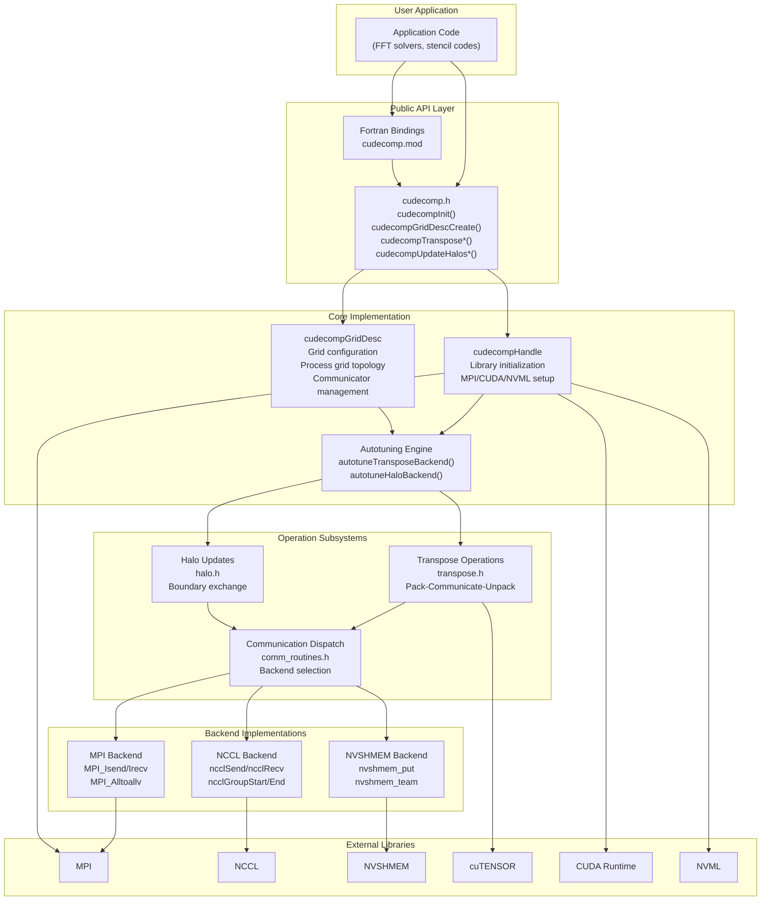
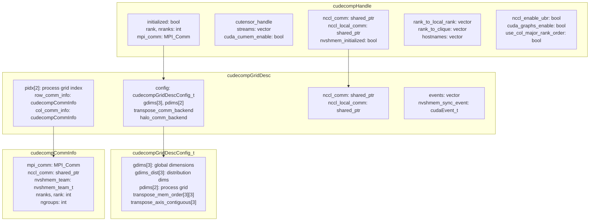
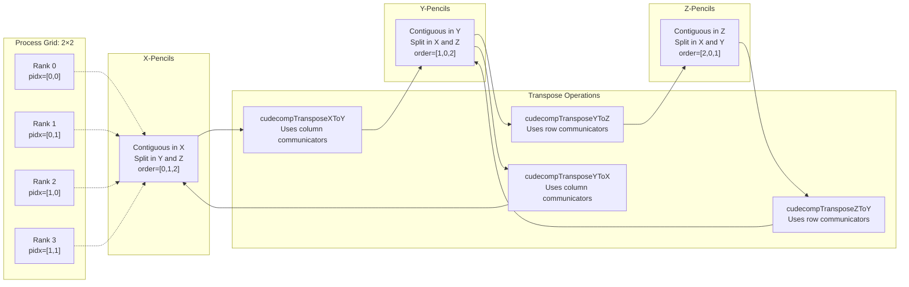
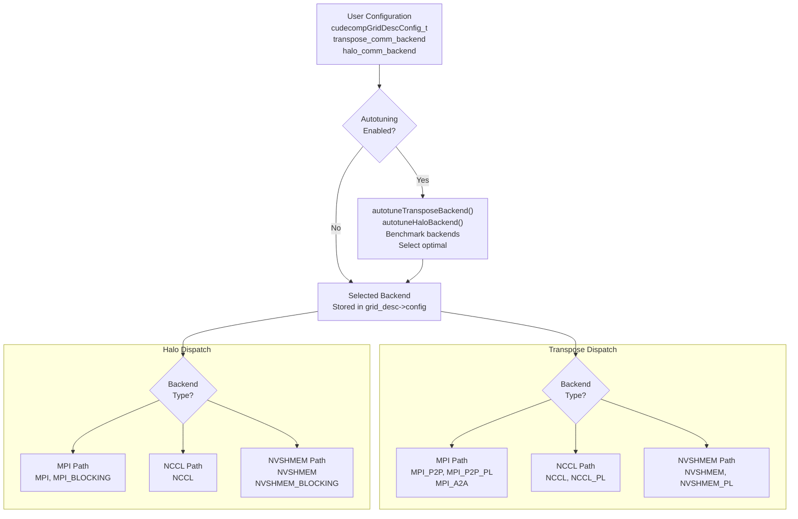
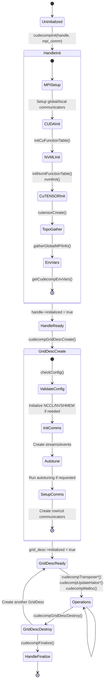
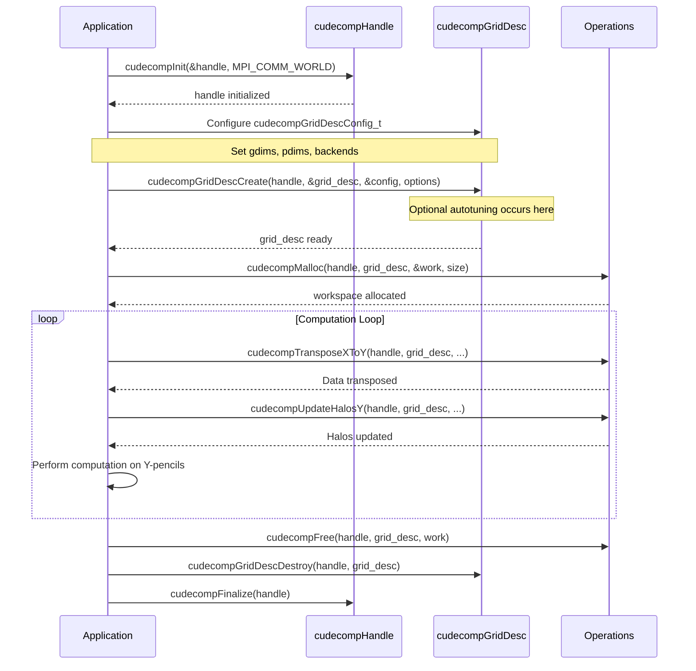

<!-- source: DeepWiki mcp.deepwiki.com · repo NVIDIA/cuDecomp · page 1 Overview · fetched 2026-10-26 -->

# Overview

Relevant source files

The following files were used as context for generating this wiki page:

- [README.md](README.md)
- [docs/env_vars.rst](docs/env_vars.rst)
- [docs/overview.rst](docs/overview.rst)
- [include/cudecomp.h](include/cudecomp.h)
- [src/cudecomp.cc](src/cudecomp.cc)

## Purpose and Scope

This page provides a high-level introduction to the cuDecomp library, its architecture, and core concepts. It explains what cuDecomp is, why it exists, and how its components fit together. For detailed API documentation, see [API Reference](#4). For building and installation instructions, see [Getting Started](#2). For detailed explanations of decomposition strategies and communication patterns, see [Core Concepts](#3).

## What is cuDecomp?

cuDecomp is a library for managing 1D (slab) and 2D (pencil) parallel decompositions of 3D Cartesian spatial domains on NVIDIA GPUs. It provides routines to perform global transpositions and halo communication, enabling efficient parallel computation on distributed GPU systems.

The library addresses a key challenge in GPU cluster computing: modern GPU systems have complex network topologies with varying bandwidth characteristics (fast NVLink/NVSwitch within nodes, slower inter-node connections via InfiniBand or Ethernet). cuDecomp helps navigate this complexity by:

1. **Providing flexible decomposition strategies** - distributing 3D domains across GPUs in optimal configurations
2. **Supporting multiple communication backends** - leveraging CUDA-aware MPI, NCCL, and NVSHMEM
3. **Offering runtime autotuning** - automatically selecting optimal decomposition and communication strategies

cuDecomp is designed for applications requiring global transpositions (FFT-based solvers, ADI methods) or stencil operations (finite difference methods), where communication patterns significantly impact overall performance.

Sources: [README.md:1-14](), [docs/overview.rst:1-28](), [include/cudecomp.h:18-22]()

## Library Architecture

### Component Overview

**cuDecomp High-Level Architecture**

The library architecture consists of several layers:

- **Public API Layer**: Exposes C functions in `cudecomp.h` and Fortran bindings for application integration
- **Core Implementation**: Manages library state through `cudecompHandle` and `cudecompGridDesc` structures, implements autotuning
- **Operation Subsystems**: Handles transpose and halo operations with backend-agnostic dispatch
- **Backend Implementations**: Provides MPI, NCCL, and NVSHMEM communication implementations
- **External Libraries**: Leverages MPI for process management, NCCL/NVSHMEM for GPU communication, cuTENSOR for local permutations, NVML for topology detection

Sources: [src/cudecomp.cc:1-551](), [include/cudecomp.h:1-631]()

## Core Data Structures

### Handle and Grid Descriptor Relationship

**Core Data Structure Relationships**

The library uses two primary data structures:

**cudecompHandle** ([src/cudecomp.cc:409-511]()): Created once per application via `cudecompInit()`. Contains:
- MPI communicator and rank information
- Shared CUDA/cuTENSOR resources
- Global NCCL communicators
- GPU topology information (MNNVL cliques, local ranks)
- Configuration flags from environment variables

**cudecompGridDesc** ([src/cudecomp.cc:565-822]()): Created via `cudecompGridDescCreate()`, potentially multiple instances. Contains:
- Grid configuration (global dimensions, process grid dimensions)
- Communication backend selections
- Row and column communicator information (`cudecompCommInfo`)
- References to shared communicators
- CUDA events for synchronization

**cudecompGridDescConfig_t** ([include/cudecomp.h:113-132]()): User-facing configuration structure defining:
- Global grid dimensions (`gdims[3]`)
- Process grid dimensions (`pdims[2]`)
- Communication backend choices
- Memory layout preferences

Sources: [src/cudecomp.cc:409-822](), [include/cudecomp.h:101-132]()

## Pencil Decomposition Strategy

### Decomposition Orientations

cuDecomp decomposes a 3D global grid with dimensions `[X, Y, Z]` across a 2D process grid with dimensions `[P_row, P_col]`. Data can exist in three orientations:

| Orientation | Contiguous Axis | Distributed Dimensions | Typical Shape |
|-------------|-----------------|------------------------|---------------|
| X-pencils | X | Y, Z | `[X, Y/P_row, Z/P_col]` |
| Y-pencils | Y | X, Z | `[X/P_row, Y, Z/P_col]` |
| Z-pencils | Z | X, Y | `[X/P_row, Y/P_col, Z]` |

**Pencil Orientations and Transpose Operations**

The process grid is defined by `config.pdims[0]` (P_row) and `config.pdims[1]` (P_col). By default, ranks are assigned in row-major order, but this can be changed via the `CUDECOMP_USE_COL_MAJOR_RANK_ORDER` environment variable.

Each process computes its position in the process grid as `pidx[0]` (row index) and `pidx[1]` (column index). Processes with the same `pidx[0]` belong to the same row communicator; those with the same `pidx[1]` belong to the same column communicator.

Transpose operations redistribute data between orientations:
- **X-to-Y and Y-to-X**: Use column communicators (processes with same `pidx[1]`)
- **Y-to-Z and Z-to-Y**: Use row communicators (processes with same `pidx[0]`)

Sources: [docs/overview.rst:31-65](), [src/cudecomp.cc:740-757](), [include/cudecomp.h:431-545]()

## Communication Backend Architecture

### Backend Selection and Dispatch

**Communication Backend Selection Flow**

cuDecomp supports three communication backend families:

**MPI Backends** ([include/cudecomp.h:45-47]()):
- `CUDECOMP_TRANSPOSE_COMM_MPI_P2P`: Point-to-point using `MPI_Isend`/`MPI_Irecv`
- `CUDECOMP_TRANSPOSE_COMM_MPI_P2P_PL`: Pipelined point-to-point for overlap
- `CUDECOMP_TRANSPOSE_COMM_MPI_A2A`: Collective using `MPI_Alltoallv`
- `CUDECOMP_HALO_COMM_MPI`: Non-blocking halo exchange
- `CUDECOMP_HALO_COMM_MPI_BLOCKING`: Blocking halo exchange

**NCCL Backends** ([include/cudecomp.h:48-49](), [include/cudecomp.h:60]()):
- `CUDECOMP_TRANSPOSE_COMM_NCCL`: Standard NCCL communication
- `CUDECOMP_TRANSPOSE_COMM_NCCL_PL`: Pipelined NCCL for overlap
- `CUDECOMP_HALO_COMM_NCCL`: NCCL-based halo exchange

**NVSHMEM Backends** ([include/cudecomp.h:50-51](), [include/cudecomp.h:61-62]()):
- `CUDECOMP_TRANSPOSE_COMM_NVSHMEM`: Standard NVSHMEM communication
- `CUDECOMP_TRANSPOSE_COMM_NVSHMEM_PL`: Pipelined NVSHMEM for overlap
- `CUDECOMP_HALO_COMM_NVSHMEM`: Non-blocking NVSHMEM halo exchange
- `CUDECOMP_HALO_COMM_NVSHMEM_BLOCKING`: Blocking NVSHMEM halo exchange

Backend selection occurs during grid descriptor creation. If autotuning is enabled via `cudecompGridDescAutotuneOptions_t`, cuDecomp benchmarks available backends and selects the fastest. Otherwise, the user-specified backend is used.

Sources: [include/cudecomp.h:44-63](), [src/cudecomp.cc:89-124](), [src/cudecomp.cc:632-696]()

## Library Initialization and Resource Lifecycle

### Initialization Sequence

**cuDecomp Resource Lifecycle**

The library follows a two-stage initialization model:

**Stage 1: Handle Initialization** ([src/cudecomp.cc:409-511]()):
1. Create `cudecompHandle` structure
2. Duplicate MPI communicator, create local communicator via `MPI_Comm_split_type`
3. Initialize CUDA driver function table ([src/cudecomp.cc:426]())
4. Initialize NVML function table and library ([src/cudecomp.cc:429-431]())
5. Initialize cuTENSOR handle ([src/cudecomp.cc:434-440]())
6. Gather global MPI information: hostnames, local ranks, MNNVL clique info ([src/cudecomp.cc:443]())
7. Read environment variables for feature flags ([src/cudecomp.cc:446]())
8. Detect GPU topology: NVLink peers, P2P copy engine count ([src/cudecomp.cc:449-498]())

**Stage 2: Grid Descriptor Creation** ([src/cudecomp.cc:565-822]()):
1. Validate configuration ([src/cudecomp.cc:587]())
2. Initialize NCCL communicators if needed ([src/cudecomp.cc:632-683]())
3. Initialize NVSHMEM if needed ([src/cudecomp.cc:685-696]())
4. Create CUDA streams and events ([src/cudecomp.cc:698-714]())
5. Run autotuning if requested ([src/cudecomp.cc:724-734]())
6. Create row and column MPI communicators ([src/cudecomp.cc:748-757]())
7. Setup NVSHMEM teams if needed ([src/cudecomp.cc:758-774]())

Multiple grid descriptors can coexist under a single handle, allowing different decomposition strategies within one application.

**Cleanup** proceeds in reverse order: grid descriptors are destroyed via `cudecompGridDescDestroy()` ([src/cudecomp.cc:824-907]()), followed by handle finalization via `cudecompFinalize()` ([src/cudecomp.cc:513-551]()).

Sources: [src/cudecomp.cc:409-822](), [src/cudecomp.cc:824-907](), [src/cudecomp.cc:513-551]()

## Typical Usage Pattern

A typical cuDecomp application follows this pattern:

**Typical Application Workflow**

1. **Initialize library**: `cudecompInit()` with MPI communicator
2. **Configure grid**: Populate `cudecompGridDescConfig_t` with global dimensions, process grid, and backend preferences
3. **Create grid descriptor**: `cudecompGridDescCreate()` with optional autotuning
4. **Allocate workspaces**: `cudecompMalloc()` for transpose and halo workspaces
5. **Perform operations**: Call `cudecompTranspose*()` and `cudecompUpdateHalos*()` functions
6. **Cleanup**: Free workspaces, destroy grid descriptor, finalize library

For detailed examples, see [Examples and Use Cases](#11). For step-by-step tutorials, see [Quick Start Tutorial](#2.2).

Sources: [include/cudecomp.h:205-625](), [README.md:1-14]()

## Feature Highlights

### Runtime Autotuning

cuDecomp can automatically select optimal process grid dimensions and communication backends through runtime benchmarking. Autotuning is controlled via `cudecompGridDescAutotuneOptions_t` ([include/cudecomp.h:137-189]()):

- **Process grid autotuning**: Tests different `pdims` configurations to minimize communication time
- **Backend autotuning**: Benchmarks MPI, NCCL, and NVSHMEM backends to find the fastest
- **Configurable trials**: Control warmup and timed trials per configuration
- **Skip threshold**: Early termination for slow configurations

For details, see [Performance Autotuning](#7).

### Memory Management

cuDecomp provides `cudecompMalloc()` and `cudecompFree()` functions that select appropriate allocators based on communication backend requirements:

- **Standard CUDA**: `cudaMalloc` for MPI/NCCL-only configurations
- **NVSHMEM symmetric heap**: `nvshmem_malloc` for NVSHMEM backends
- **CUDA VMM**: Fabric-aware allocations for multi-node NVLink systems (controlled by `CUDECOMP_ENABLE_CUMEM`)
- **NCCL UBR**: Optional buffer registration with NCCL communicators (controlled by `CUDECOMP_ENABLE_NCCL_UBR`)

For details, see [Memory Management](#9).

### Hardware Topology Detection

cuDecomp automatically detects GPU topology features via NVML:

- **MNNVL support**: Detects multi-node NVLink connections and creates clique communicators
- **NVSwitch detection**: Identifies systems with NVSwitch for optimized communication
- **P2P copy engine count**: Determines available peer-to-peer copy engines

For details, see [Hardware-Specific Features](#10).

### Performance Monitoring

cuDecomp includes built-in performance monitoring controlled by environment variables:

- **`CUDECOMP_ENABLE_PERFORMANCE_REPORT`**: Enable performance tracking
- **`CUDECOMP_PERFORMANCE_REPORT_DETAIL`**: Control report verbosity
- **`CUDECOMP_PERFORMANCE_REPORT_WRITE_DIR`**: Export data to CSV files

For details, see [Internal Architecture - Performance Monitoring](#14.3).

Sources: [src/cudecomp.cc:264-368](), [docs/env_vars.rst:1-100]()

## Language Support

cuDecomp provides both C and Fortran interfaces:

- **C API**: Declared in `cudecomp.h` ([include/cudecomp.h:1-631]())
- **Fortran bindings**: Provided through `cudecomp_fort` module with `_F` suffixed functions ([src/cudecomp.cc:553-563]())

Fortran support requires NVHPC SDK compilers. For details, see [Fortran Interface](#4.6).

Sources: [include/cudecomp.h:1-631](), [src/cudecomp.cc:553-563](), [README.md:30-31]()

---

