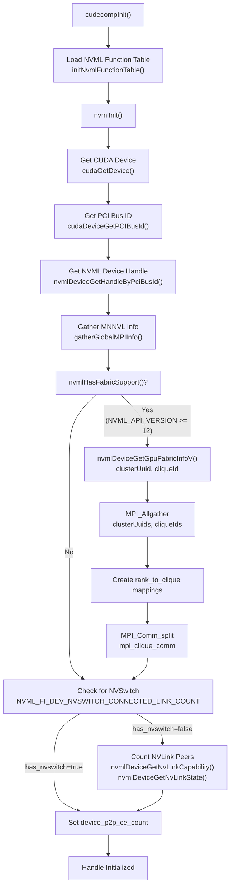
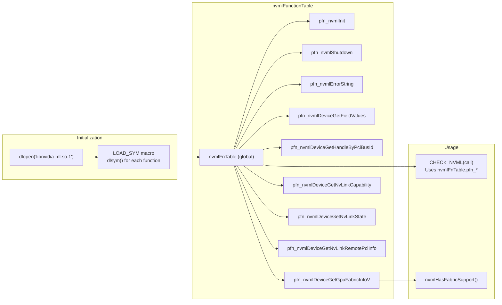
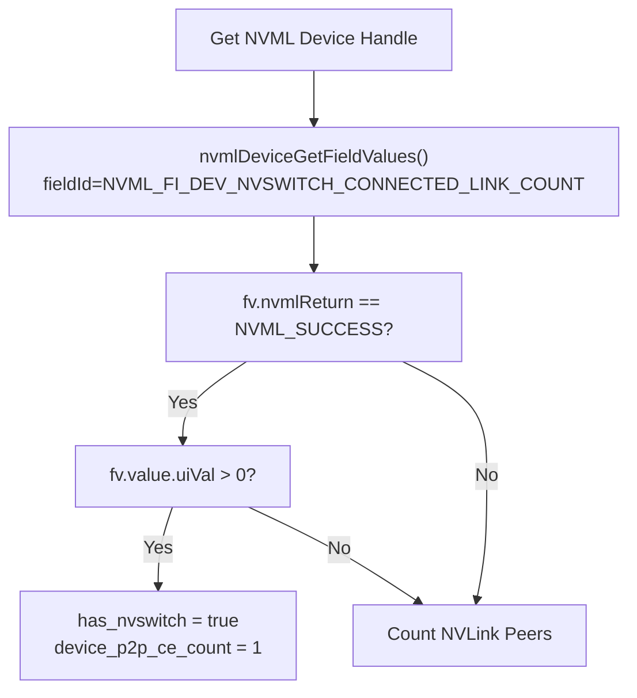
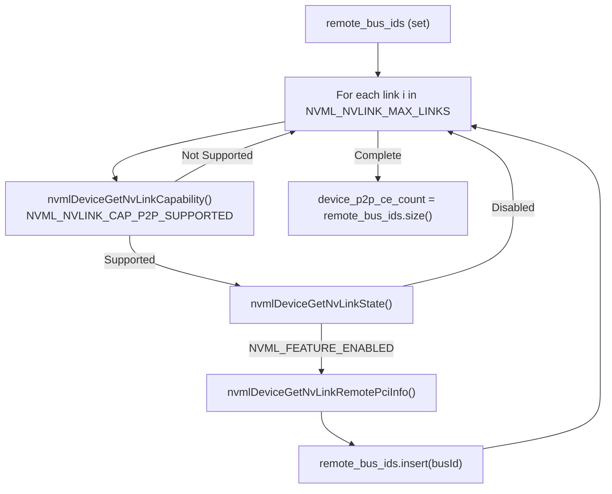
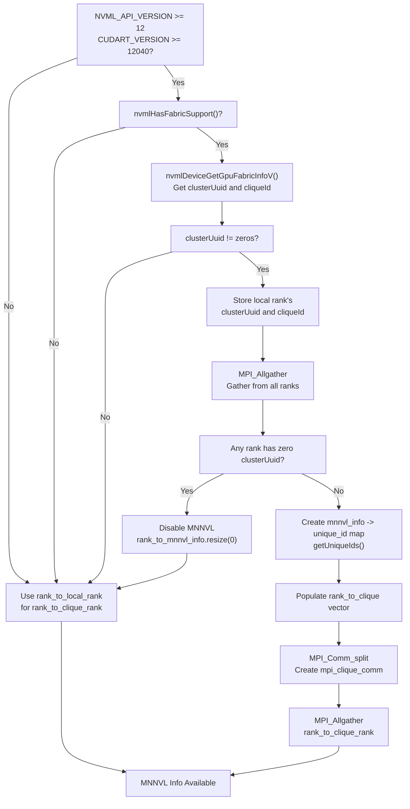
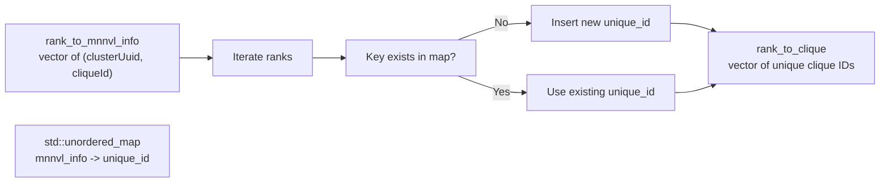
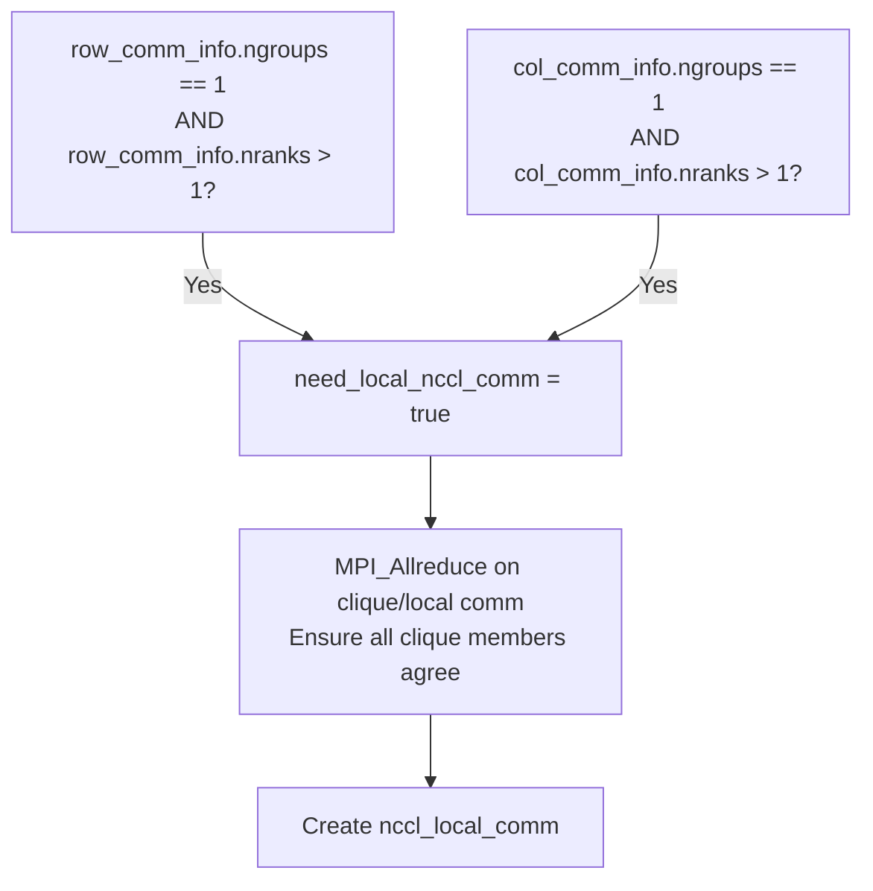

<!-- source: DeepWiki mcp.deepwiki.com · repo NVIDIA/cuDecomp · page 10 Hardware-Specific Features · fetched 2026-10-26 -->

# Hardware-Specific Features

<details>
<summary>Relevant source files</summary>

The following files were used as context for generating this wiki page:

- [include/internal/checks.h](include/internal/checks.h)
- [include/internal/nvml_wrap.h](include/internal/nvml_wrap.h)
- [src/cudecomp.cc](src/cudecomp.cc)
- [src/nvml_wrap.cc](src/nvml_wrap.cc)

</details>


## Purpose and Scope

This document describes hardware-specific features in cuDecomp that enable optimized performance on NVIDIA GPU systems. These features include dynamic NVML integration for GPU topology detection, MNNVL (Multi-Node NVLink) support for creating optimized communicators across NVLink-connected systems, and P2P copy engine determination for efficient multi-stream communication.

For details on how these features affect memory allocation strategies, see [Memory Management](#9). For information on how hardware topology influences communicator creation, see [Communication Backend Details](#8).

## Overview

cuDecomp leverages hardware-specific information to optimize communication patterns and resource allocation. The library dynamically loads NVML (NVIDIA Management Library) at runtime to query GPU topology information without creating hard dependencies. This information is used to:

- Detect NVSwitch and direct NVLink connections between GPUs
- Identify MNNVL cliques (groups of GPUs connected via multi-node NVLink)
- Determine the number of available P2P copy engines for stream management
- Create optimized NCCL communicators for local and clique-based communication

**Hardware Detection and Initialization Flow**



Sources: [src/cudecomp.cc:409-511](), [src/nvml_wrap.cc:36-60]()

## NVML Dynamic Loading

cuDecomp uses dynamic loading to access NVML functions, avoiding hard dependencies on specific NVML versions or installations. This approach ensures the library can function even if NVML is unavailable, though some optimization features will be disabled.

### NVML Function Table Architecture



Sources: [src/nvml_wrap.cc:25-62](), [include/internal/nvml_wrap.h:26-50]()

The `nvmlFunctionTable` struct holds function pointers for all required NVML operations. During initialization, `initNvmlFunctionTable()` uses `dlopen()` to load the NVML shared library and `dlsym()` to populate the function table.

| NVML Function | Purpose |
|---------------|---------|
| `nvmlInit` | Initialize NVML library |
| `nvmlShutdown` | Cleanup NVML library |
| `nvmlErrorString` | Convert error codes to strings |
| `nvmlDeviceGetFieldValues` | Query device field values (e.g., NVSwitch link count) |
| `nvmlDeviceGetHandleByPciBusId` | Get device handle from PCI bus ID |
| `nvmlDeviceGetGpuFabricInfoV` | Get GPU fabric information (clusterUuid, cliqueId) |
| `nvmlDeviceGetNvLinkCapability` | Check NVLink capabilities |
| `nvmlDeviceGetNvLinkState` | Check if NVLink is active |
| `nvmlDeviceGetNvLinkRemotePciInfo` | Get remote peer PCI information |

Sources: [include/internal/nvml_wrap.h:26-42]()

### CHECK_NVML Macro

The `CHECK_NVML` macro provides consistent error handling for NVML calls:

```cpp
#define CHECK_NVML(call)                                                                                               \
  do {                                                                                                                 \
    nvmlReturn_t err = nvmlFnTable.pfn_##call;                                                                         \
    if (NVML_SUCCESS != err) { throw cudecomp::NvmlError(__FILE__, __LINE__, nvmlFnTable.pfn_nvmlErrorString(err)); }  \
  } while (false)
```

This macro automatically calls the function through the function table and throws an exception with a descriptive error message on failure.

Sources: [include/internal/checks.h:104-108]()

## GPU Topology Detection

cuDecomp detects the GPU interconnect topology to optimize P2P copy engine allocation and stream management. The library distinguishes between three topology types:

1. **NVSwitch Systems**: GPUs connected through NVSwitch fabric
2. **Direct NVLink Systems**: GPUs connected via direct NVLink connections (without NVSwitch)
3. **PCIe Systems**: GPUs connected only through PCIe

### NVSwitch Detection



Sources: [src/cudecomp.cc:458-498]()

NVSwitch detection uses the `NVML_FI_DEV_NVSWITCH_CONNECTED_LINK_COUNT` field. If the query succeeds and returns a non-zero value, the GPU is connected to NVSwitch. In NVSwitch systems, cuDecomp sets `device_p2p_ce_count = 1` because all GPUs are fully connected and only one P2P copy engine is needed.

### NVLink Peer Detection

For systems without NVSwitch, cuDecomp counts the number of direct NVLink connections:



Sources: [src/cudecomp.cc:466-499]()

The algorithm iterates through all possible NVLink connections (up to `NVML_NVLINK_MAX_LINKS`), checking if each link:
1. Supports P2P operations (`NVML_NVLINK_CAP_P2P_SUPPORTED`)
2. Is active (`NVML_FEATURE_ENABLED`)
3. Has a valid remote peer

The number of unique remote PCI bus IDs determines the P2P copy engine count, as each NVLink peer typically has a dedicated P2P copy engine.

### P2P Copy Engine Count

The `device_p2p_ce_count` field in the handle determines how many CUDA streams are created for pipelined communication:

| Topology | P2P CE Count | Rationale |
|----------|--------------|-----------|
| NVSwitch | 1 | All GPUs fully connected through fabric |
| Direct NVLink | Number of NVLink peers | Each peer typically has dedicated CE |
| PCIe only | 2 | Shared D2H/H2D copy engines |

This count directly affects stream allocation in [src/cudecomp.cc:698-705](), where `handle->streams.resize(handle->device_p2p_ce_count + 1)` creates streams for concurrent communication operations.

Sources: [src/cudecomp.cc:492-498]()

## MNNVL (Multi-Node NVLink) Support

MNNVL enables direct GPU-to-GPU communication across nodes connected via NVLink, providing lower latency than traditional network fabrics. cuDecomp detects MNNVL cliques and creates optimized NCCL communicators for intra-clique communication.

### MNNVL Clique Detection Flow



Sources: [src/cudecomp.cc:193-262]()

### MNNVL Data Structures

The handle maintains several vectors for MNNVL information:

```cpp
// In cudecompHandle
std::vector<mnnvl_info> rank_to_mnnvl_info;  // (clusterUuid, cliqueId) per rank
std::vector<unsigned int> rank_to_clique;    // Unique clique ID per rank
std::vector<int> rank_to_clique_rank;        // Rank within clique
MPI_Comm mpi_clique_comm;                     // Clique-local communicator
int clique_rank, clique_nranks;              // Clique rank and size
```

Sources: [include/internal/common.h]() (referenced from [src/cudecomp.cc:203-257]())

### Unique Clique ID Assignment

NVML's `cliqueId` values are not unique across different MNNVL clusters. cuDecomp creates globally unique clique IDs by mapping each `(clusterUuid, cliqueId)` pair to a unique index using the `getUniqueIds()` function:



Sources: [src/cudecomp.cc:234-244]()

This ensures that ranks in different MNNVL clusters with the same raw `cliqueId` get different unique clique IDs.

## MNNVL Communicator Creation

cuDecomp uses MNNVL information to create specialized communicators optimized for intra-clique communication. This affects both NCCL and MPI communicator creation.

### NCCL Local Communicator Selection

```mermaid
graph TD
    CreateNCCL["Need NCCL communicator?"]
    CheckClique["mpi_clique_comm != MPI_COMM_NULL?"]
    UseClique["ncclCommFromMPIComm<br/>(mpi_clique_comm)"]
    UseLocal["ncclCommFromMPIComm<br/>(mpi_local_comm)"]
    StoreRef["nccl_local_comm"]
    
    CreateNCCL -->|Yes| CheckClique
    CreateNCCL -->|No| Skip["Skip"]
    CheckClique -->|Yes<br/>"MNNVL clique available"| UseClique
    CheckClique -->|No<br/>"Use node-local only"| UseLocal
    UseClique --> StoreRef
    UseLocal --> StoreRef
```

Sources: [src/cudecomp.cc:664-670](), [src/cudecomp.cc:674-677]()

When MNNVL is available, cuDecomp creates NCCL communicators spanning the entire clique (potentially multiple nodes) rather than just node-local GPUs. This enables NCCL to leverage MNNVL for optimized inter-node communication.

### Grid Descriptor Communicator Logic

During grid descriptor creation, cuDecomp determines which communicator to use based on whether row/column communicators span multiple cliques:



Sources: [src/cudecomp.cc:658-670]()

The `ngroups` field indicates how many separate MNNVL cliques (or node-local groups) are involved in the communicator. If `ngroups == 1`, all ranks are within the same clique and can use the local NCCL communicator for optimized communication.

## Environment Variables

cuDecomp provides several environment variables related to hardware features:

| Variable | Default | Purpose |
|----------|---------|---------|
| `CUDECOMP_ENABLE_NCCL_UBR` | 0 | Enable NCCL User Buffer Registration for pre-registered communication buffers |
| `CUDECOMP_ENABLE_CUMEM` | 0 | Enable CUDA VMM fabric allocations for multi-GPU systems |
| `CUDECOMP_ENABLE_CUDA_GRAPHS` | 0 | Enable CUDA Graph capture in pipelined backends |

Sources: [src/cudecomp.cc:264-368]()

### CUDA VMM Fabric Allocations

When `CUDECOMP_ENABLE_CUMEM=1`, cuDecomp uses CUDA Virtual Memory Management to create fabric-aware allocations. This requires:
- CUDA 12.3 or later (compilation and runtime)
- GPU with `CU_DEVICE_ATTRIBUTE_HANDLE_TYPE_FABRIC_SUPPORTED`

The enable check in [src/cudecomp.cc:272-304]() validates these requirements and automatically disables the feature if unsupported.

## Hardware Information Impact on Performance

The hardware detection and MNNVL support directly affect communication performance:

1. **Stream Count**: `device_p2p_ce_count` determines how many concurrent streams are used for pipelined communication, affecting overlap potential
2. **NCCL Communicator Scope**: MNNVL enables NCCL to span multiple nodes directly, reducing latency for intra-clique communication
3. **Memory Allocation**: Fabric allocations (when enabled) optimize GPU-to-GPU transfers across NVLink and MNNVL
4. **Autotuning**: Hardware topology affects which backends perform best, influencing autotune results

See [Performance Autotuning](#7) for how hardware information affects backend selection, and [Communication Backend Details](#8) for how communicators are configured based on hardware topology.

Sources: [src/cudecomp.cc:179-262](), [src/cudecomp.cc:448-499]()

---

