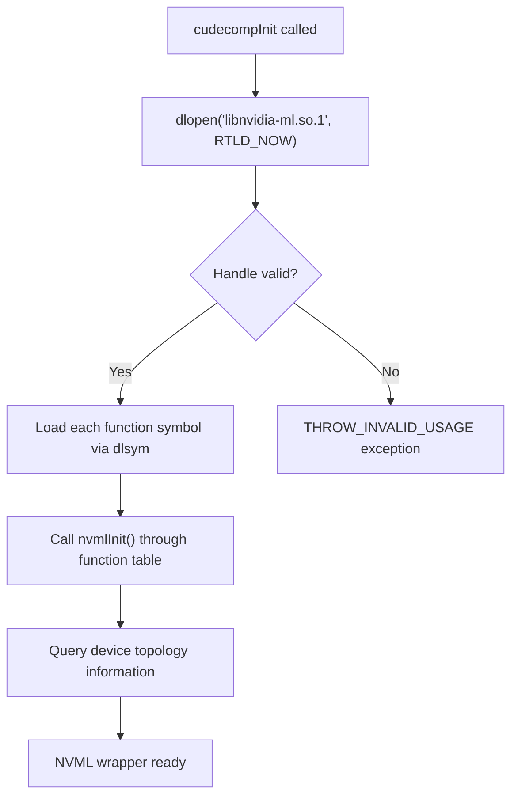
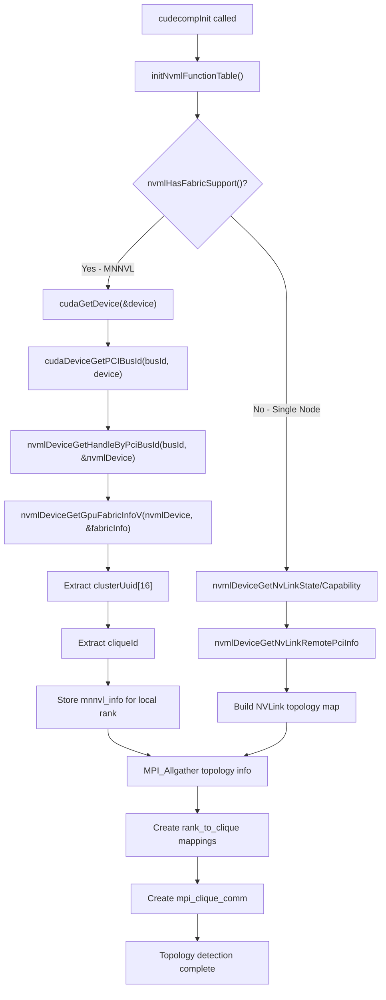
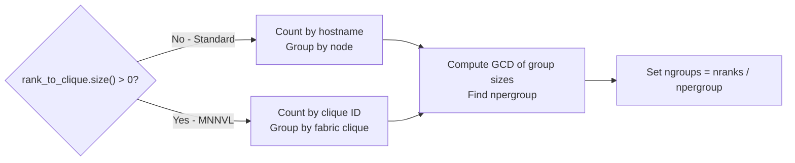
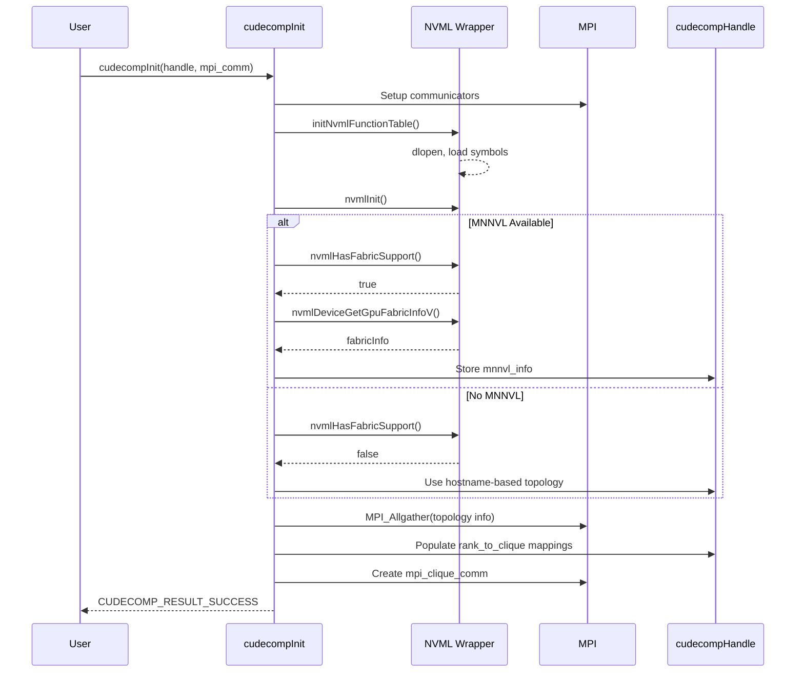

<!-- source: DeepWiki mcp.deepwiki.com · repo NVIDIA/cuDecomp · page 10.1 NVML Wrapper and GPU Topology · fetched 2026-10-26 -->

# NVML Wrapper and GPU Topology

<details>
<summary>Relevant source files</summary>

The following files were used as context for generating this wiki page:

- [include/internal/checks.h](include/internal/checks.h)
- [include/internal/common.h](include/internal/common.h)
- [include/internal/nvml_wrap.h](include/internal/nvml_wrap.h)
- [src/nvml_wrap.cc](src/nvml_wrap.cc)

</details>


## Purpose and Scope

This page documents the NVML (NVIDIA Management Library) wrapper system in cuDecomp, which provides dynamic loading of NVML functionality for GPU topology detection and multi-node NVLink (MNNVL) support. The wrapper enables cuDecomp to query GPU hardware capabilities, detect fabric connectivity, and identify MNNVL cliques without requiring a hard dependency on the NVML library at compile time.

For information about how MNNVL topology information is used to create optimized communicators, see [MNNVL and Multi-Node NVLink](#10.2). For details on how clique information affects memory allocation strategies, see [Memory Management](#9).

---

## Dynamic Loading Architecture

cuDecomp dynamically loads the NVML library at runtime using `dlopen()` rather than linking against it directly. This approach avoids requiring NVML as a build-time dependency while still enabling advanced GPU topology features when the library is available.

### Why Dynamic Loading

The dynamic loading strategy provides several benefits:
- **Optional dependency**: Systems without NVML installed can still build and run cuDecomp
- **Graceful degradation**: If NVML is unavailable, cuDecomp falls back to hostname-based topology detection
- **Version flexibility**: Different NVML API versions can be supported through compile-time conditionals

### Function Table Structure

NVML functions are accessed through a global function table that stores function pointers loaded via `dlsym()`. The `nvmlFunctionTable` structure is defined in [include/internal/nvml_wrap.h:26-42]():

```cpp
struct nvmlFunctionTable {
  nvmlReturn_t (*pfn_nvmlInit)(void) = nullptr;
  nvmlReturn_t (*pfn_nvmlShutdown)(void) = nullptr;
  const char* (*pfn_nvmlErrorString)(nvmlReturn_t result) = nullptr;
  nvmlReturn_t (*pfn_nvmlDeviceGetFieldValues)(...) = nullptr;
  nvmlReturn_t (*pfn_nvmlDeviceGetHandleByPciBusId)(...) = nullptr;
  nvmlReturn_t (*pfn_nvmlDeviceGetGpuFabricInfoV)(...) = nullptr;  // CUDA 12.4+
  nvmlReturn_t (*pfn_nvmlDeviceGetNvLinkCapability)(...) = nullptr;
  nvmlReturn_t (*pfn_nvmlDeviceGetNvLinkState)(...) = nullptr;
  nvmlReturn_t (*pfn_nvmlDeviceGetNvLinkRemotePciInfo)(...) = nullptr;
};
```

All NVML calls in cuDecomp are made through this function table using the `CHECK_NVML` macro, which accesses `nvmlFnTable.pfn_<function_name>`.

**Sources**: [include/internal/nvml_wrap.h:26-42](), [include/internal/checks.h:104-108]()

### Initialization Process

The NVML function table is populated during library initialization through the following sequence:



The `initNvmlFunctionTable()` function in [src/nvml_wrap.cc:36-50]() performs this initialization using a macro-based approach:

| Step | Action | File Location |
|------|--------|---------------|
| 1. Open library | `dlopen("libnvidia-ml.so.1", RTLD_NOW)` | [src/nvml_wrap.cc:37]() |
| 2. Validate handle | Check if `nvml_handle` is not null | [src/nvml_wrap.cc:38]() |
| 3. Load symbols | Use `LOAD_SYM` macro for each function | [src/nvml_wrap.cc:39-49]() |
| 4. Conditional loading | Load fabric functions only for CUDA 12.4+ | [src/nvml_wrap.cc:44-46]() |

The `LOAD_SYM` macro at [src/nvml_wrap.cc:25-30]() performs the dynamic symbol resolution:

```cpp
#define LOAD_SYM(symbol)                                      \
  do {                                                        \
    void** fptr = (void**)(&nvmlFnTable.pfn_##symbol);       \
    void* sym = dlsym(nvml_handle, #symbol);                 \
    *fptr = sym;                                             \
  } while (false)
```

**Sources**: [src/nvml_wrap.cc:25-50]()

---

## NVML Function Table Contents

### Core Management Functions

The function table includes essential NVML lifecycle and query functions:

| Function Pointer | Purpose | Used For |
|-----------------|---------|----------|
| `pfn_nvmlInit` | Initialize NVML library | First call during handle creation |
| `pfn_nvmlShutdown` | Clean up NVML resources | Called during `cudecompFinalize` |
| `pfn_nvmlErrorString` | Get error message text | Error reporting in `CHECK_NVML` macro |
| `pfn_nvmlDeviceGetHandleByPciBusId` | Get device handle from PCI bus ID | Convert CUDA device to NVML device |

**Sources**: [include/internal/nvml_wrap.h:27-32]()

### Topology Query Functions

Functions for querying GPU interconnect topology:

| Function Pointer | Purpose | Detects |
|-----------------|---------|---------|
| `pfn_nvmlDeviceGetFieldValues` | Query multiple device fields | General device properties |
| `pfn_nvmlDeviceGetNvLinkCapability` | Check NVLink capabilities | P2P support levels |
| `pfn_nvmlDeviceGetNvLinkState` | Check NVLink link state | Active connections |
| `pfn_nvmlDeviceGetNvLinkRemotePciInfo` | Get remote device PCI info | Direct peer connections |

These functions enable cuDecomp to build a map of GPU interconnect topology, identifying which GPUs have direct NVLink connections and their characteristics.

**Sources**: [include/internal/nvml_wrap.h:30-41]()

### Fabric Support Detection

The `nvmlDeviceGetGpuFabricInfoV` function pointer is conditionally included only when both NVML API version 12+ and CUDA 12.4+ are available:

```cpp
#if NVML_API_VERSION >= 12 && CUDART_VERSION >= 12040
  nvmlReturn_t (*pfn_nvmlDeviceGetGpuFabricInfoV)(...) = nullptr;
#endif
```

The helper function `nvmlHasFabricSupport()` at [src/nvml_wrap.cc:52-58]() checks whether fabric support is available:

```cpp
bool nvmlHasFabricSupport() {
#if NVML_API_VERSION >= 12 && CUDART_VERSION >= 12040
  return (nvmlFnTable.pfn_nvmlDeviceGetGpuFabricInfoV != nullptr);
#else
  return false;
#endif
}
```

This function is used to determine if MNNVL detection should be attempted.

**Sources**: [include/internal/nvml_wrap.h:33-35](), [src/nvml_wrap.cc:52-58]()

---

## GPU Topology Data Structures

### MNNVL Information Storage

GPU topology information is stored in the `cudecompHandle` structure. The `mnnvl_info` type is defined conditionally based on NVML and CUDA versions at [include/internal/common.h:45-49]():

```cpp
#if NVML_API_VERSION >= 12 && CUDART_VERSION >= 12040
typedef std::pair<std::array<unsigned char, NVML_GPU_FABRIC_UUID_LEN>, 
                  unsigned int> mnnvl_info;
#else
typedef std::pair<std::array<unsigned char, 1>, unsigned int> mnnvl_info;
#endif
```

When fabric support is available, `mnnvl_info` stores:
- **Fabric UUID**: 16-byte cluster UUID identifying the fabric domain
- **Clique ID**: Unsigned integer identifying the clique within the fabric

### Handle Topology Fields

The `cudecompHandle` structure maintains several vectors for rank-to-topology mappings at [include/internal/common.h:96-100]():

| Field | Type | Purpose |
|-------|------|---------|
| `cuda_cumem_enable` | `bool` | Enable CUDA VMM allocations for fabric-aware memory |
| `rank_to_mnnvl_info` | `std::vector<mnnvl_info>` | Full fabric info per rank |
| `rank_to_clique` | `std::vector<unsigned int>` | Clique ID per rank |
| `rank_to_clique_rank` | `std::vector<int>` | Rank within clique per rank |

These mappings are populated during `cudecompInit` by gathering topology information from all ranks via MPI collective operations.

**Sources**: [include/internal/common.h:45-100]()

---

## Topology Detection Workflow

The following diagram shows how NVML functions are used to detect and map GPU topology during initialization:



**Sources**: [src/nvml_wrap.cc:36-58](), [include/internal/common.h:96-100]()

---

## Integration with Communicator Creation

### Clique-Based Communicator Setup

The topology information gathered via NVML is used to create specialized MPI and NCCL communicators that are aware of GPU fabric boundaries. The `setCommInfo` function at [include/internal/common.h:305-355]() uses this data:



The code distinguishes between two topology modes:

**Standard Mode (lines 316-332)**:
- Groups ranks by hostname (stored in `handle->hostnames`)
- Finds homogeneous peer-to-peer group size using GCD
- Creates `npergroup` and `ngroups` based on node boundaries

**MNNVL Mode (lines 334-350)**:
- Groups ranks by clique ID (stored in `handle->rank_to_clique`)
- Finds homogeneous peer-to-peer group size across cliques
- Enables cross-node NVLink-aware communication patterns

### Communication Pattern Optimization

The `npergroup` and `ngroups` values computed from topology information affect the all-to-all communication pattern. The `getAlltoallPeerRanks` function at [include/internal/common.h:357-401]() uses these values to optimize transfer ordering:

```cpp
// Multi-level ring communication pattern
int groupid = info.rank / info.npergroup;
if (iter < info.npergroup) {
  // Intra-group transfers (within clique or node)
  dst_rank = (info.rank + iter) % info.npergroup + groupid * info.npergroup;
  src_rank = (info.rank + info.npergroup - iter) % info.npergroup + 
             groupid * info.npergroup;
} else {
  // Inter-group transfers (across cliques or nodes)
  dst_rank = (info.rank + iter) % info.nranks;
  // Skip same-group ranks
  if (dst_rank in same group) { dst_rank += info.npergroup; }
}
```

This creates a communication pattern where:
1. Ranks within the same MNNVL clique (or node) communicate first using fast interconnect
2. Inter-clique transfers occur after intra-clique transfers complete
3. Transfer ordering distributes load across multiple communication paths

**Sources**: [include/internal/common.h:305-401]()

---

## Conditional Compilation and Fallback Behavior

### Version-Gated Features

The NVML wrapper uses preprocessor conditionals to handle different API versions:

| Condition | Feature | Behavior if False |
|-----------|---------|-------------------|
| `NVML_API_VERSION >= 12` | Fabric info API | `mnnvl_info` type uses placeholder |
| `CUDART_VERSION >= 12040` | CUDA VMM support | No fabric-aware memory allocation |
| Both conditions | `nvmlDeviceGetGpuFabricInfoV` | Function pointer remains `nullptr` |

The type definition at [include/internal/common.h:45-49]() shows this pattern:

```cpp
#if NVML_API_VERSION >= 12 && CUDART_VERSION >= 12040
typedef std::pair<std::array<unsigned char, NVML_GPU_FABRIC_UUID_LEN>, 
                  unsigned int> mnnvl_info;
#else
typedef std::pair<std::array<unsigned char, 1>, unsigned int> mnnvl_info;
#endif
```

When compiled without MNNVL support, the code compiles but all MNNVL-specific logic paths are disabled.

### Error Handling

The NVML wrapper uses the custom `CHECK_NVML` macro at [include/internal/checks.h:104-108]():

```cpp
#define CHECK_NVML(call)                                      \
  do {                                                        \
    nvmlReturn_t err = nvmlFnTable.pfn_##call;               \
    if (NVML_SUCCESS != err) {                               \
      throw cudecomp::NvmlError(__FILE__, __LINE__,          \
                                nvmlFnTable.pfn_nvmlErrorString(err)); \
    }                                                         \
  } while (false)
```

This macro:
1. Calls the function through the function table
2. Checks the return status
3. Uses the dynamically loaded `nvmlErrorString` function to get error details
4. Throws a `cudecomp::NvmlError` exception with file/line information

If NVML initialization fails completely (library not found), cuDecomp throws an `InvalidUsageException` but continues initialization without topology information, falling back to hostname-based grouping.

**Sources**: [include/internal/common.h:45-49](), [include/internal/checks.h:104-108](), [src/nvml_wrap.cc:38]()

---

## Usage in cuDecomp Initialization

The NVML wrapper is invoked early in the `cudecompInit` sequence as shown in the library initialization lifecycle (Diagram 3 from overview). The key integration points are:



After initialization, the topology information stored in the handle is used throughout the library's lifetime for:
- Creating row and column communicators with topology awareness ([include/internal/common.h:305-355]())
- Enabling CUDA VMM allocations for fabric-aware memory (see [Memory Management](#9))
- Selecting appropriate NCCL communicators (global vs. local/clique)
- Optimizing communication patterns in transpose and halo operations

**Sources**: [include/internal/common.h:54-117](), [include/internal/common.h:305-355]()

---

