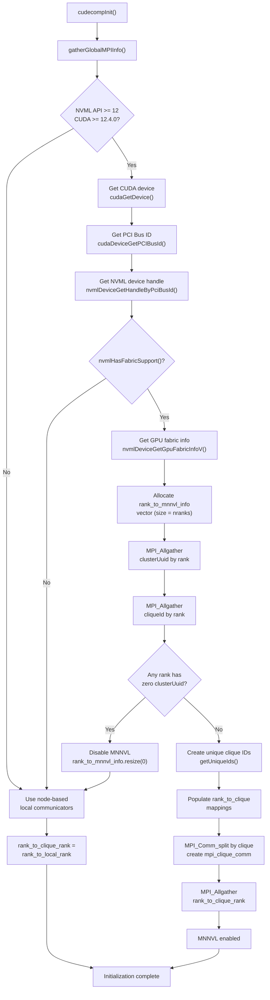
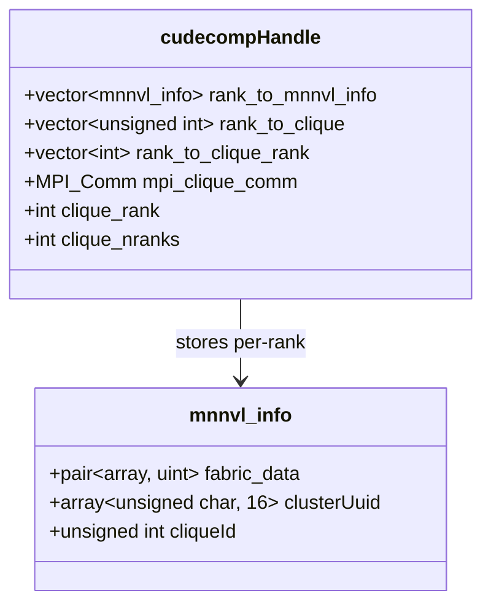
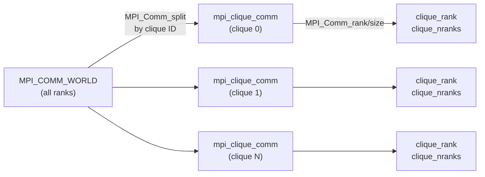
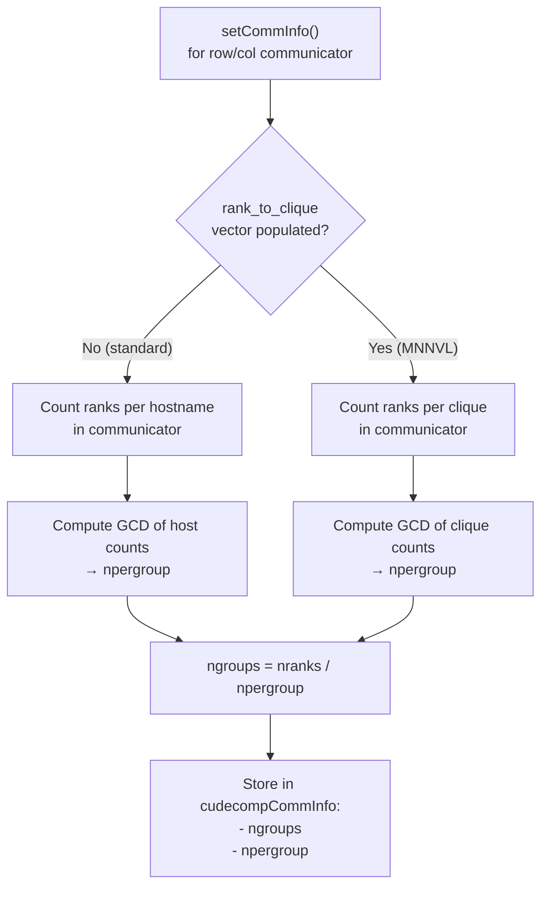
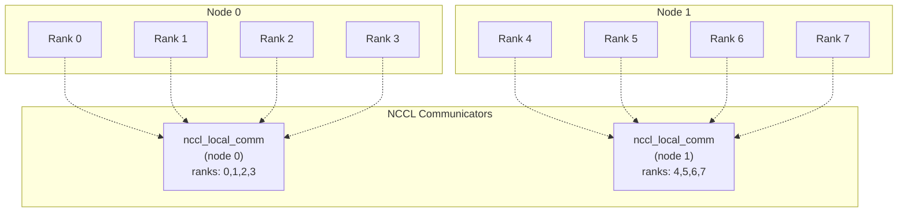
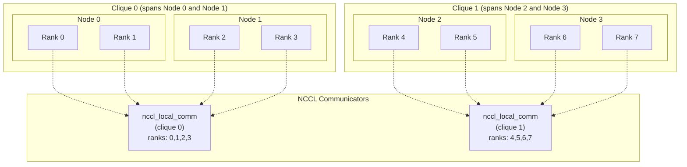
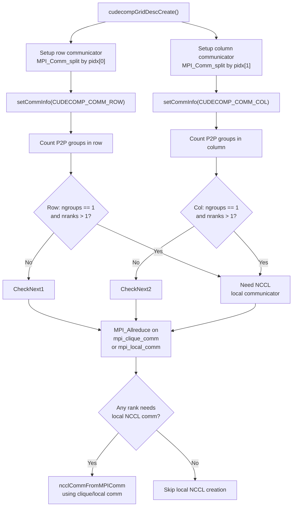
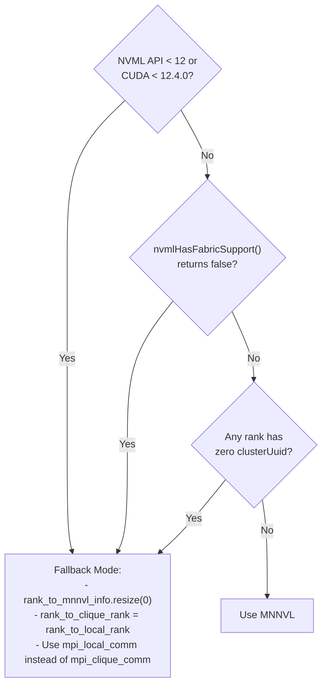

<!-- source: DeepWiki mcp.deepwiki.com · repo NVIDIA/cuDecomp · page 10.2 MNNVL and Multi-Node NVLink · fetched 2026-10-26 -->

# MNNVL and Multi-Node NVLink

<details>
<summary>Relevant source files</summary>

The following files were used as context for generating this wiki page:

- [include/internal/common.h](include/internal/common.h)
- [src/cudecomp.cc](src/cudecomp.cc)

</details>


## Purpose and Scope

This page describes cuDecomp's support for Multi-Node NVLink (MNNVL) systems, which enable direct GPU-to-GPU communication across network nodes. This document covers MNNVL detection, clique identification, and how cuDecomp adapts its communication patterns and resource allocation for MNNVL topologies.

For general GPU topology detection and NVML integration, see [NVML Wrapper and GPU Topology](#10.1). For details on NCCL communicator setup in general, see [NCCL Backend](#8.2).

## Overview of MNNVL

Multi-Node NVLink (MNNVL) is a hardware feature that extends NVLink connectivity beyond a single node, allowing GPUs on different physical servers to communicate directly via NVLink. This creates "cliques" of GPUs with high-bandwidth, low-latency interconnects that span multiple nodes.

In MNNVL systems:
- A **clique** is a group of GPUs connected via NVLink, potentially spanning multiple nodes
- Each GPU belongs to exactly one clique, identified by a `(clusterUuid, cliqueId)` pair
- Communication within a clique can achieve much higher bandwidth than traditional network communication
- cuDecomp optimizes its communication strategies to leverage intra-clique connectivity

**Key Requirements:**
- NVML API version 12 or higher
- CUDA runtime version 12.4.0 or higher
- Hardware with MNNVL support (e.g., NVIDIA DGX SuperPOD architectures)

Sources: [src/cudecomp.cc:193-262](), [include/internal/common.h:45-49](), [include/internal/common.h:96-100]()

## MNNVL Detection and Initialization

### Detection Flow



**MNNVL Detection Process**

The detection process occurs during `cudecompInit()` within the `gatherGlobalMPIInfo()` function:

1. **API Version Check**: First checks if NVML API version 12+ and CUDA 12.4+ are available via compile-time macros
2. **Fabric Support Detection**: Calls `nvmlHasFabricSupport()` to verify the GPU supports fabric operations
3. **Fabric Information Retrieval**: Uses `nvmlDeviceGetGpuFabricInfoV()` to obtain `clusterUuid` and `cliqueId`
4. **Global Information Gathering**: All ranks exchange their fabric information via `MPI_Allgather`
5. **Validation**: If any rank has a zero `clusterUuid`, MNNVL is disabled globally for consistency
6. **Clique ID Assignment**: Creates unique global clique IDs from `(clusterUuid, cliqueId)` pairs using `getUniqueIds()`

Sources: [src/cudecomp.cc:193-262]()

### Fabric Information Structure



**Key Data Structures**

| Structure | Type | Purpose |
|-----------|------|---------|
| `mnnvl_info` | `std::pair<std::array<unsigned char, 16>, unsigned int>` | Stores `(clusterUuid, cliqueId)` pair from NVML |
| `rank_to_mnnvl_info` | `std::vector<mnnvl_info>` | Maps global rank → MNNVL info for all ranks |
| `rank_to_clique` | `std::vector<unsigned int>` | Maps global rank → unique clique ID |
| `rank_to_clique_rank` | `std::vector<int>` | Maps global rank → rank within its clique |
| `mpi_clique_comm` | `MPI_Comm` | MPI communicator containing only ranks in the same clique |

Sources: [include/internal/common.h:45-49](), [include/internal/common.h:96-100]()

## Clique Communicator Creation

When MNNVL is detected, cuDecomp creates specialized MPI communicators for intra-clique communication:



**Clique Communicator Creation Steps**

The clique communicator is created using `MPI_Comm_split()`:

```
MPI_Comm_split(handle->mpi_comm, 
               static_cast<int>(handle->rank_to_clique[handle->rank]), 
               handle->rank, 
               &handle->mpi_clique_comm);
```

This splits the global communicator into separate communicators for each clique, where:
- **Split key**: The clique ID for each rank
- **Rank ordering**: Preserved from the original global rank
- **Result**: Each rank's `mpi_clique_comm` contains only ranks in the same clique

Sources: [src/cudecomp.cc:247-256]()

## Impact on Peer-to-Peer Group Detection

MNNVL affects how cuDecomp identifies peer-to-peer groups for communication optimization:



**Clique-Based vs. Host-Based Grouping**

The `setCommInfo()` function determines peer-to-peer groups differently based on MNNVL availability:

**Standard (Non-MNNVL) Systems:**
- Groups ranks by hostname (node boundary)
- Assumes ranks on the same node have fast interconnect
- Code path: [include/internal/common.h:315-332]()

**MNNVL Systems:**
- Groups ranks by clique ID (MNNVL domain boundary)
- Allows P2P groups to span multiple nodes within a clique
- Code path: [include/internal/common.h:334-351]()

Both paths use GCD (Greatest Common Divisor) to handle heterogeneous configurations where not all groups have the same size.

| Configuration | Grouping Boundary | Example |
|---------------|-------------------|---------|
| Standard | Node (hostname) | 8 GPUs/node → `npergroup=8` |
| MNNVL | Clique | 16 GPUs/clique across 2 nodes → `npergroup=16` |
| Mixed MNNVL | GCD of clique sizes | Cliques of 16 and 12 → `npergroup=4` |

Sources: [include/internal/common.h:305-355]()

## NCCL Local Communicator with MNNVL

MNNVL changes which ranks participate in the "local" NCCL communicator:

### Standard System (No MNNVL)



### MNNVL System



**Local Communicator Selection**

The code selects which MPI communicator to use when creating the local NCCL communicator:

```cpp
handle->nccl_local_comm = ncclCommFromMPIComm(
    handle->mpi_clique_comm != MPI_COMM_NULL ? handle->mpi_clique_comm 
                                             : handle->mpi_local_comm);
```

This pattern appears in multiple locations:
- During grid descriptor creation when NCCL is required: [src/cudecomp.cc:664-677]()
- When setting up autotuning if pdims not provided: [src/cudecomp.cc:674-677]()

The local NCCL communicator is used for:
- Communication within a row or column communicator when all ranks are in the same clique
- Pipelined communication operations that benefit from low-latency intra-clique transfers
- Reducing global communicator overhead for localized operations

Sources: [src/cudecomp.cc:636-679]()

## Communication Pattern Optimization

### Determining Communication Groups



**When Local NCCL Communicator is Created**

The system determines whether to create a local NCCL communicator based on the communication pattern:

1. **Row/Column Analysis**: For each communicator (row and column), calculate `ngroups` and `npergroup`
2. **Single-Group Check**: If `ngroups == 1` and `nranks > 1`, all ranks in that communicator are in the same P2P group
3. **Global Coordination**: Use `MPI_Allreduce` to check if any rank needs a local communicator (handles cases where ranks span multiple rows/columns)
4. **Communicator Selection**: Create NCCL communicator from `mpi_clique_comm` if MNNVL is available, otherwise use `mpi_local_comm`

**Example Scenarios:**

| Process Grid | Row ngroups | Col ngroups | Uses Local NCCL? | Reason |
|--------------|-------------|-------------|------------------|---------|
| 4×4 on 2 cliques (8 GPUs each) | 2 | 2 | No | All comms span groups |
| 8×2 on 2 cliques (8 GPUs each) | 1 | 2 | Yes | Row comm within clique |
| 2×8 on 2 cliques (8 GPUs each) | 2 | 1 | Yes | Col comm within clique |
| 4×4 on 1 clique (16 GPUs) | 1 | 1 | Yes | All comms within clique |

Sources: [src/cudecomp.cc:636-683]()

## Memory Allocation Considerations

MNNVL does not directly affect `cudecompMalloc()` behavior, but the related CUDA VMM (Virtual Memory Management) feature can optimize memory for multi-node communication:

**Fabric-Aware Allocations (CUDA VMM)**
- Controlled by `CUDECOMP_ENABLE_CUMEM` environment variable
- Uses `CU_MEM_HANDLE_TYPE_FABRIC` handle type
- Enables efficient memory sharing across fabric-connected GPUs
- Automatically detected if driver supports fabric allocations
- See [Memory Management](#9) for details

**Relationship to MNNVL:**
- CUDA VMM fabric allocations are beneficial on MNNVL systems
- Both features require similar hardware capabilities
- cuDecomp detects and enables them independently
- Combining MNNVL topology awareness with fabric allocations provides optimal performance

Sources: [src/cudecomp.cc:264-305](), [src/cudecomp.cc:1163-1199]()

## Fallback Behavior

When MNNVL detection fails or is unavailable, cuDecomp gracefully falls back to node-based communication:



**Fallback Conditions:**
1. **API Version**: Compile-time check fails for NVML 12+ or CUDA 12.4+
2. **Fabric Support**: Runtime detection indicates GPU lacks fabric support
3. **Incomplete Information**: Any rank fails to retrieve valid fabric information

**Fallback Operation:**
- `rank_to_mnnvl_info` is resized to zero, disabling MNNVL code paths
- `rank_to_clique_rank` is set equal to `rank_to_local_rank` (node-local ranks)
- All MNNVL-aware functions use hostname-based grouping instead of clique-based
- NCCL local communicator uses `mpi_local_comm` (node-local) instead of `mpi_clique_comm`

This design ensures cuDecomp functions correctly on all hardware configurations without requiring MNNVL support.

Sources: [src/cudecomp.cc:193-262](), [include/internal/common.h:315-355]()

## Configuration Summary

**Environment Variables** (None specific to MNNVL, but related features):
- `CUDECOMP_ENABLE_CUMEM=1`: Enable fabric-aware memory allocations (complements MNNVL)
- `CUDECOMP_ENABLE_NCCL_UBR=1`: Enable NCCL user buffer registration (see [NCCL User Buffer Registration](#9.2))

**Handle Fields Modified by MNNVL Detection:**

| Field | Type | Purpose |
|-------|------|---------|
| `mpi_clique_comm` | `MPI_Comm` | MPI communicator for clique-local operations |
| `clique_rank` | `int32_t` | Rank within clique communicator |
| `clique_nranks` | `int32_t` | Size of clique communicator |
| `rank_to_mnnvl_info` | `std::vector<mnnvl_info>` | Per-rank fabric information |
| `rank_to_clique` | `std::vector<unsigned int>` | Global rank to clique ID mapping |
| `rank_to_clique_rank` | `std::vector<int>` | Global rank to clique-local rank mapping |

**Grid Descriptor Fields Affected:**

| Field | Impact |
|-------|--------|
| `row_comm_info.ngroups` | Computed using clique boundaries instead of node boundaries |
| `row_comm_info.npergroup` | Reflects clique size rather than node size |
| `col_comm_info.ngroups` | Computed using clique boundaries instead of node boundaries |
| `col_comm_info.npergroup` | Reflects clique size rather than node size |
| `nccl_local_comm` | References clique-based NCCL communicator |

Sources: [include/internal/common.h:54-117](), [include/internal/common.h:119-131]()

---

