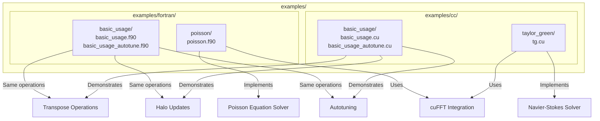
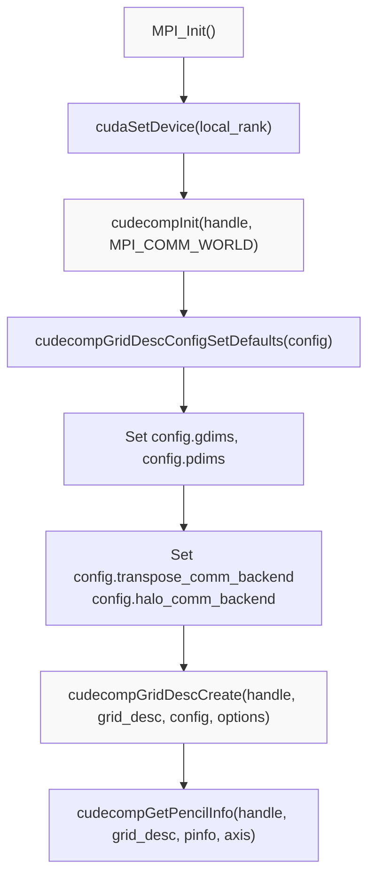
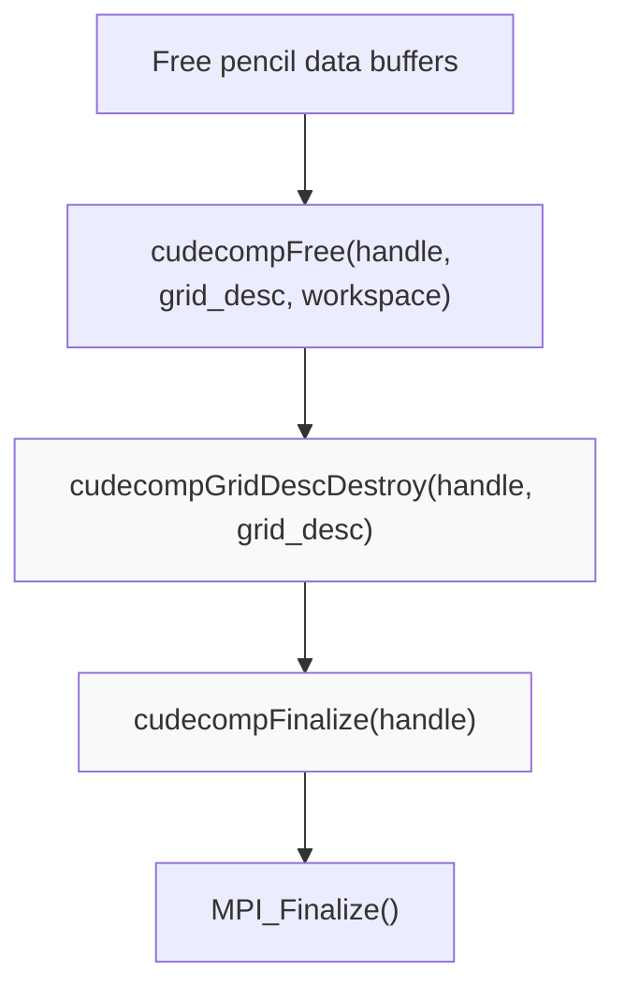

<!-- source: DeepWiki mcp.deepwiki.com · repo NVIDIA/cuDecomp · page 11 Examples and Use Cases · fetched 2026-10-26 -->

# Examples and Use Cases

Relevant source files

The following files were used as context for generating this wiki page:

- [LICENSE](LICENSE)
- [docs/autotuning.rst](docs/autotuning.rst)
- [examples/cc/basic_usage/basic_usage.cu](examples/cc/basic_usage/basic_usage.cu)
- [examples/cc/taylor_green/tg.cu](examples/cc/taylor_green/tg.cu)
- [examples/fortran/basic_usage/basic_usage.f90](examples/fortran/basic_usage/basic_usage.f90)
- [examples/fortran/basic_usage/basic_usage_autotune.f90](examples/fortran/basic_usage/basic_usage_autotune.f90)
- [examples/fortran/poisson/poisson.f90](examples/fortran/poisson/poisson.f90)
- [include/internal/autotune.h](include/internal/autotune.h)
- [include/internal/exceptions.h](include/internal/exceptions.h)

This page provides an overview of the examples and real-world applications included in the cuDecomp repository. These examples demonstrate how to integrate cuDecomp into various computational workflows, from basic transpose and halo operations to complete FFT-based solvers for scientific computing applications.

For detailed API usage, see [API Reference](#4). For specific autotuning configuration, see [Performance Autotuning](#7). For building FFT applications specifically, see [FFT-Based Applications](#11.3).

## Purpose and Scope

The cuDecomp repository includes examples in both C++ and Fortran that demonstrate:
- Basic library operations (transposes, halo exchanges)
- Autotuning configuration and usage
- Integration with cuFFT for spectral methods
- Complete solver implementations (Navier-Stokes, Poisson)

These examples serve as starting points for building distributed GPU applications using pencil decomposition.

## Example Repository Structure

The examples are organized by language and complexity:

**Sources:** [examples/cc/basic_usage/basic_usage.cu](), [examples/cc/taylor_green/tg.cu](), [examples/fortran/basic_usage/basic_usage.f90](), [examples/fortran/poisson/poisson.f90]()

## Example Categories

### Basic Usage Examples

Location: [examples/cc/basic_usage/](), [examples/fortran/basic_usage/]()

These examples demonstrate fundamental cuDecomp operations in minimal, self-contained programs:

| Example | Language | Key Operations | Grid Size |
|---------|----------|----------------|-----------|
| `basic_usage.cu` | C++ | Transpose X↔Y↔Z, Halo updates | 64³, 2×2 process grid |
| `basic_usage.f90` | Fortran | Transpose X↔Y↔Z, Halo updates | 64³, 2×2 process grid |
| `basic_usage_autotune.cu` | C++ | Same + Autotuning | 64³, autotuned grid |
| `basic_usage_autotune.f90` | Fortran | Same + Autotuning | 64³, autotuned grid |

These examples are covered in detail in [Basic Usage Examples](#11.1).

**Sources:** [examples/cc/basic_usage/basic_usage.cu](), [examples/fortran/basic_usage/basic_usage.f90](), [examples/fortran/basic_usage/basic_usage_autotune.f90]()

### FFT-Based Solver Examples

Location: [examples/cc/taylor_green/](), [examples/fortran/poisson/]()

These examples demonstrate complete solver implementations using cuDecomp for data distribution and cuFFT for spectral transforms:

| Example | Language | Algorithm | Equations Solved | Grid Operations |
|---------|----------|-----------|------------------|-----------------|
| `tg.cu` | C++ | Spectral Navier-Stokes | 3D incompressible flow | R2C/C2R + C2C FFTs, RK1/RK4 timestepping |
| `poisson.f90` | Fortran | Spectral Poisson solver | ∇²u = φ | C2C FFTs in all directions |

These examples are covered in detail in [Taylor-Green Vortex Solver](#11.2) and [FFT-Based Applications](#11.3).

**Sources:** [examples/cc/taylor_green/tg.cu](), [examples/fortran/poisson/poisson.f90]()

## Common Code Patterns Across Examples

### Initialization Pattern

All examples follow this initialization sequence:

**Sources:** [examples/cc/basic_usage/basic_usage.cu:94-132](), [examples/cc/taylor_green/tg.cu:340-393](), [examples/fortran/poisson/poisson.f90:84-187]()

### Memory Allocation Pattern

Examples allocate pencil data and workspace using consistent patterns:

1. **Query pencil sizes** using `cudecompGetPencilInfo` for each orientation needed
2. **Allocate unified buffer** sized for the maximum of all pencil sizes: `max(pinfo_x.size, pinfo_y.size, pinfo_z.size)`
3. **Query workspace sizes** using `cudecompGetTransposeWorkspaceSize` and `cudecompGetHaloWorkspaceSize`
4. **Allocate workspace** using `cudecompMalloc` for backend-specific requirements

**Sources:** [examples/cc/basic_usage/basic_usage.cu:144-247](), [examples/cc/taylor_green/tg.cu:427-466]()

### Data Initialization Pattern

Examples demonstrate multiple approaches to initialize pencil data:

| Approach | Location | Key Features |
|----------|----------|--------------|
| Flattened loop (CPU) | [examples/cc/basic_usage/basic_usage.cu:170-194]() | Uses `pinfo.lo`, `pinfo.order`, `pinfo.halo_extents` |
| Triple loop (CPU) | [examples/cc/basic_usage/basic_usage.cu:197-217]() | Direct iteration with `pinfo.lo`, `pinfo.hi` bounds |
| CUDA kernel (GPU) | [examples/cc/basic_usage/basic_usage.cu:69-89]() | Device-side initialization |
| OpenACC (GPU) | [examples/fortran/basic_usage/basic_usage.f90:162-186]() | Fortran GPU parallelization |

All approaches compute global coordinates using `pinfo.order` array mapping and `pinfo.lo`/`pinfo.hi` bounds.

**Sources:** [examples/cc/basic_usage/basic_usage.cu:69-225](), [examples/fortran/basic_usage/basic_usage.f90:132-186]()

### Cleanup Pattern

All examples follow this cleanup sequence:

**Sources:** [examples/cc/basic_usage/basic_usage.cu:284-292](), [examples/cc/taylor_green/tg.cu:323-338]()

## FFT Integration Pattern

### Real-to-Complex FFT Workflow

The Taylor-Green vortex solver demonstrates the complete R2C/C2R FFT workflow:

```mermaid
graph LR
    subgraph "Physical Space (X-pencil)"
        U_R["U_r[3]<br/>Real data<br/>shape: [(N/2+1)*2, ny, nz]"]
    end
    
    subgraph "Forward Transform"
        R2C_X["cufftExecD2Z<br/>R2C along X"]
        XY["cudecompTransposeXToY"]
        C2C_Y["cufftExecZ2Z<br/>C2C along Y"]
        YZ["cudecompTransposeYToZ"]
        C2C_Z["cufftExecZ2Z<br/>C2C along Z"]
    end
    
    subgraph "Spectral Space (Z-pencil)"
        U_C["Uh_c[3]<br/>Complex data<br/>shape: [nz, (N/2+1), ny]"]
    end
    
    subgraph "Backward Transform"
        C2C_Z_INV["cufftExecZ2Z<br/>C2C inverse Z"]
        ZY["cudecompTransposeZToY"]
        C2C_Y_INV["cufftExecZ2Z<br/>C2C inverse Y"]
        YX["cudecompTransposeYToX"]
        C2R_X["cufftExecZ2D<br/>C2R along X"]
    end
    
    U_R --> R2C_X
    R2C_X --> XY
    XY --> C2C_Y
    C2C_Y --> YZ
    YZ --> C2C_Z
    C2C_Z --> U_C
    
    U_C --> C2C_Z_INV
    C2C_Z_INV --> ZY
    ZY --> C2C_Y_INV
    C2C_Y_INV --> YX
    YX --> C2R_X
    C2R_X --> U_R
```

**Key Implementation Details:**

- **Grid descriptors**: Separate `grid_desc_r` for real data with padding and `grid_desc_c` for complex data [examples/cc/taylor_green/tg.cu:790-791]()
- **Padding for in-place R2C/C2R**: Real grid has shape `[(N/2+1)*2, N, N]` to accommodate in-place transforms [examples/cc/taylor_green/tg.cu:376-380]()
- **cuFFT plan creation**: 1D plans with batch sizes matching pencil shapes [examples/cc/taylor_green/tg.cu:400-425]()
- **Workspace sharing**: cuFFT and cuDecomp share the same workspace buffer [examples/cc/taylor_green/tg.cu:432-444]()

**Sources:** [examples/cc/taylor_green/tg.cu:645-667](), [examples/cc/taylor_green/tg.cu:370-445]()

### Complex-to-Complex FFT Workflow

The Poisson solver demonstrates C2C FFTs in all directions:

```mermaid
graph LR
    subgraph "X-pencil"
        PHI_X["phi(x,y,z)"]
    end
    
    FFT_X["cufftExecZ2Z<br/>CUFFT_FORWARD<br/>planX"]
    TRANS_XY["cudecompTransposeXToY"]
    
    subgraph "Y-pencil"
        PHI_Y["phi(kx,y,z)"]
    end
    
    FFT_Y["cufftExecZ2Z<br/>CUFFT_FORWARD<br/>planY"]
    TRANS_YZ["cudecompTransposeYToZ"]
    
    subgraph "Z-pencil"
        PHI_Z["phi(kx,ky,z)"]
    end
    
    FFT_Z["cufftExecZ2Z<br/>CUFFT_FORWARD<br/>planZ"]
    
    subgraph "Spectral Space (Z-pencil)"
        PHI_K["phi(kx,ky,kz)"]
    end
    
    PHI_X --> FFT_X
    FFT_X --> TRANS_XY
    TRANS_XY --> PHI_Y
    PHI_Y --> FFT_Y
    FFT_Y --> TRANS_YZ
    TRANS_YZ --> PHI_Z
    PHI_Z --> FFT_Z
    FFT_Z --> PHI_K
```

**Key Implementation Details:**

- **Single grid descriptor**: Only complex data, no padding needed [examples/fortran/poisson/poisson.f90:174]()
- **Wavenumber arrays**: Pre-computed on GPU for spectral operations [examples/fortran/poisson/poisson.f90:228-252]()
- **In-place transforms**: All operations use the same buffer `phi_d` [examples/fortran/poisson/poisson.f90:286-297]()
- **Normalization**: FFT results scaled by `1/(nx*ny*nz)` [examples/fortran/poisson/poisson.f90:314]()

**Sources:** [examples/fortran/poisson/poisson.f90:286-353]()

## Error Handling Pattern

All examples use consistent error checking macros:

| Macro | Purpose | Example File |
|-------|---------|--------------|
| `CHECK_CUDECOMP_EXIT` | Check cuDecomp API results | [examples/cc/basic_usage/basic_usage.cu:33-40]() |
| `CHECK_CUDA_EXIT` | Check CUDA runtime results | [examples/cc/basic_usage/basic_usage.cu:42-49]() |
| `CHECK_MPI_EXIT` | Check MPI call results | [examples/cc/basic_usage/basic_usage.cu:51-66]() |
| `CHECK_CUFFT_EXIT` | Check cuFFT results | [examples/cc/taylor_green/tg.cu:85-92]() |

These macros print file, line number, and error information before exiting on failure.

**Sources:** [examples/cc/basic_usage/basic_usage.cu:33-66](), [examples/cc/taylor_green/tg.cu:41-92](), [include/internal/exceptions.h:28-59]()

## Command-Line Interface Patterns

### Basic Examples

Basic usage examples are hardcoded for 4 ranks on a 64³ grid with a 2×2 process grid (or autotuned process grid). They have no command-line options.

**Sources:** [examples/cc/basic_usage/basic_usage.cu:99-102]()

### Taylor-Green Vortex Solver

The Taylor-Green example provides extensive command-line control:

| Option | Purpose | Default |
|--------|---------|---------|
| `-n, --N` | Grid dimension | 256 |
| `-i, --niter` | Number of iterations | 1000 |
| `-m, --max_flowtime` | Maximum flow time | unlimited |
| `-p, --printfreq` | Statistics print frequency | 100 |
| `-s, --specfreq` | Spectrum output frequency | 0 (disabled) |
| `-l, --logfile` | Time history log file | none |
| `-o, --csvfile` | Solution output prefix | none |
| `-v, --nu` | Fluid viscosity | 0.000625 |
| `-t, --dt` | Fixed timestep | 0.001 |
| `-c, --cfl` | CFL number (adaptive dt) | 0.0 (fixed) |

**Sources:** [examples/cc/taylor_green/tg.cu:832-867](), [examples/cc/taylor_green/tg.cu:869-918]()

### Poisson Solver

The Poisson example provides configuration options:

| Option | Purpose | Default |
|--------|---------|---------|
| `--nx`, `--ny`, `--nz` | Grid dimensions | 64×64×64 |
| `--backend` | Communication backend | `CUDECOMP_TRANSPOSE_COMM_MPI_P2P` |
| `--pr`, `--pc` | Process grid dimensions | 0, 0 (autotuned) |

**Sources:** [examples/fortran/poisson/poisson.f90:100-143]()

## Performance Monitoring Examples

The Taylor-Green solver demonstrates comprehensive performance monitoring:

### Statistics Tracking

- **Kinetic energy**: Global reduction of velocity magnitude squared [examples/cc/taylor_green/tg.cu:548-557]()
- **Enstrophy**: Global reduction of vorticity magnitude squared [examples/cc/taylor_green/tg.cu:530-545]()
- **Maximum velocity**: For adaptive timestepping [examples/cc/taylor_green/tg.cu:760-773]()
- **Energy spectrum**: Shell-averaged spectral energy [examples/cc/taylor_green/tg.cu:295-314]()

### Output Formats

- **Console output**: Runtime statistics [examples/cc/taylor_green/tg.cu:560-577]()
- **CSV logs**: Time history for post-processing [examples/cc/taylor_green/tg.cu:567-576]()
- **Spectrum files**: Per-timestep spectral data [examples/cc/taylor_green/tg.cu:594-607]()
- **Solution files**: Final solution in CSV format [examples/cc/taylor_green/tg.cu:611-638]()

**Sources:** [examples/cc/taylor_green/tg.cu:527-638]()

## Navigating to Detailed Documentation

- For step-by-step basic usage, see [Basic Usage Examples](#11.1)
- For the complete Taylor-Green vortex solver walkthrough, see [Taylor-Green Vortex Solver](#11.2)
- For general FFT application guidance, see [FFT-Based Applications](#11.3)
- For autotuning configuration used in examples, see [Performance Autotuning](#7)
- For API reference of functions used in examples, see [API Reference](#4)

---

