<!-- source: DeepWiki mcp.deepwiki.com · repo NVIDIA/cuDecomp · page 11.1 Basic Usage Examples · fetched 2026-10-26 -->

# Basic Usage Examples

<details>
<summary>Relevant source files</summary>

The following files were used as context for generating this wiki page:

- [docs/autotuning.rst](docs/autotuning.rst)
- [examples/fortran/basic_usage/basic_usage_autotune.f90](examples/fortran/basic_usage/basic_usage_autotune.f90)
- [include/cudecomp.h](include/cudecomp.h)

</details>


## Purpose and Scope

This page documents the simple example programs included in cuDecomp that demonstrate core library operations. These examples show how to initialize the library, create grid descriptors, perform transpose operations, update halo regions, and use the autotuning feature. The examples are designed as templates for users building their own applications.

For a beginner-friendly walkthrough of library concepts, see [Quick Start Tutorial](#2.2). For complete real-world applications, see [Taylor-Green Vortex Solver](#11.2) and [FFT-Based Applications](#11.3).

## Basic Example Structure

The cuDecomp repository includes basic usage examples in both C++ and Fortran:
- C++: `examples/cc/basic_usage/basic_usage.cu`
- Fortran: `examples/fortran/basic_usage/basic_usage.f90`
- C++ with autotuning: `examples/cc/basic_usage/basic_usage_autotune.cu`
- Fortran with autotuning: `examples/fortran/basic_usage/basic_usage_autotune.f90`

These examples follow a common workflow pattern that demonstrates the essential operations needed in most cuDecomp applications.

### Example Workflow

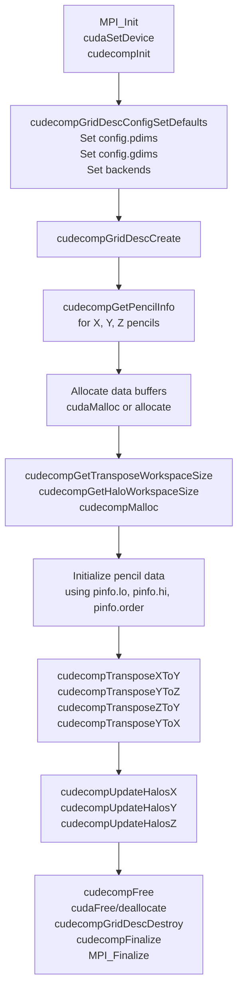

Sources: [examples/fortran/basic_usage/basic_usage_autotune.f90:58-289]()

### Core API Functions Used

The basic examples demonstrate usage of the following key API functions:

| Category | Function | Purpose |
|----------|----------|---------|
| **Initialization** | `cudecompInit` | Initialize library with MPI communicator |
| **Configuration** | `cudecompGridDescConfigSetDefaults` | Set default config values |
| | `cudecompGridDescCreate` | Create grid descriptor with specified config |
| **Query** | `cudecompGetPencilInfo` | Get shape and bounds of local pencil |
| | `cudecompGetTransposeWorkspaceSize` | Query transpose workspace requirements |
| | `cudecompGetHaloWorkspaceSize` | Query halo workspace requirements |
| **Memory** | `cudecompMalloc` | Allocate backend-appropriate memory |
| | `cudecompFree` | Deallocate cuDecomp memory |
| **Transpose** | `cudecompTransposeXToY` | Transpose from X-pencils to Y-pencils |
| | `cudecompTransposeYToZ` | Transpose from Y-pencils to Z-pencils |
| | `cudecompTransposeZToY` | Transpose from Z-pencils to Y-pencils |
| | `cudecompTransposeYToX` | Transpose from Y-pencils to X-pencils |
| **Halo** | `cudecompUpdateHalosX` | Update halos for X-pencils |
| | `cudecompUpdateHalosY` | Update halos for Y-pencils |
| | `cudecompUpdateHalosZ` | Update halos for Z-pencils |
| **Cleanup** | `cudecompGridDescDestroy` | Destroy grid descriptor |
| | `cudecompFinalize` | Finalize library |

Sources: [include/cudecomp.h:205-625]()

## Data Structure Relationships

Understanding how the core data structures relate is essential for using the examples effectively:

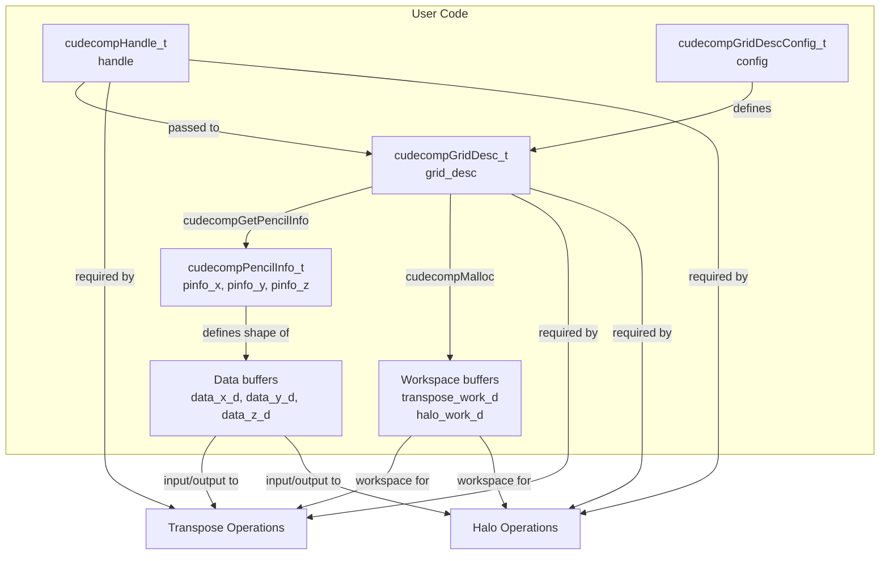

Sources: [include/cudecomp.h:103-203](), [examples/fortran/basic_usage/basic_usage_autotune.f90:39-53]()

### Configuration Structure Fields

The `cudecompGridDescConfig_t` structure contains the key parameters for decomposition:

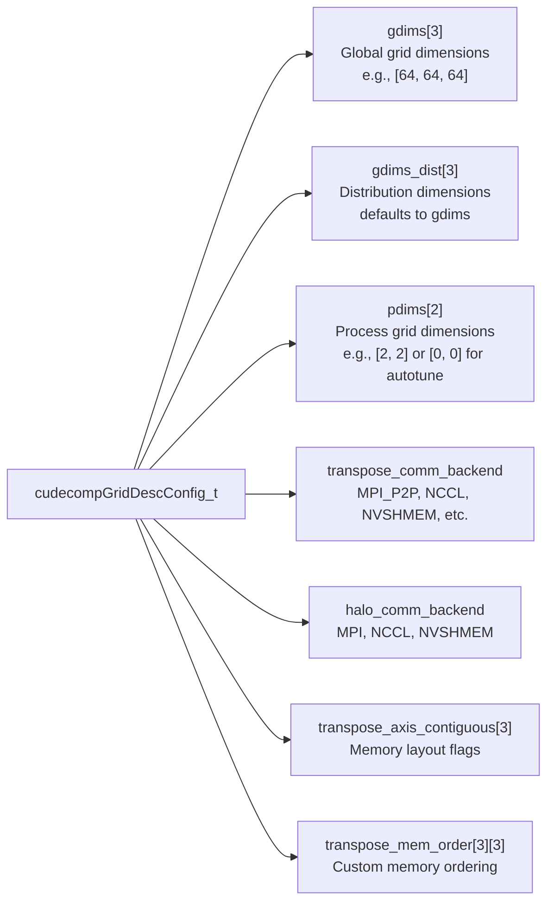

Sources: [include/cudecomp.h:113-132]()

### Pencil Information Structure

The `cudecompPencilInfo_t` structure describes the local portion of data:

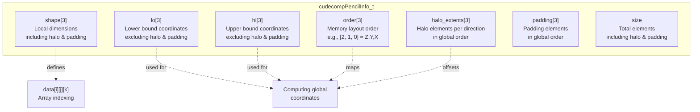

Sources: [include/cudecomp.h:194-202]()

## Basic Transpose and Halo Example

### Initialization and Configuration

The basic examples begin by initializing MPI, setting the CUDA device, and initializing cuDecomp:

**C++:**
```cpp
MPI_Init(&argc, &argv);
MPI_Comm_rank(MPI_COMM_WORLD, &rank);
MPI_Comm_size(MPI_COMM_WORLD, &nranks);

// Select GPU based on local rank
MPI_Comm local_comm;
MPI_Comm_split_type(MPI_COMM_WORLD, MPI_COMM_TYPE_SHARED, 0, MPI_INFO_NULL, &local_comm);
int local_rank;
MPI_Comm_rank(local_comm, &local_rank);
CHECK_CUDA_EXIT(cudaSetDevice(local_rank));

// Initialize cuDecomp
cudecompHandle_t handle;
CHECK_CUDECOMP_EXIT(cudecompInit(&handle, MPI_COMM_WORLD));
```

**Fortran:**
Reference [examples/fortran/basic_usage/basic_usage_autotune.f90:59-68]()

After initialization, configure the grid descriptor:

**Grid descriptor configuration pattern:**


Sources: [include/cudecomp.h:264-272](), [examples/fortran/basic_usage/basic_usage_autotune.f90:71-80]()

### Querying Pencil Information

After creating the grid descriptor with `cudecompGridDescCreate`, query information about the local pencils:

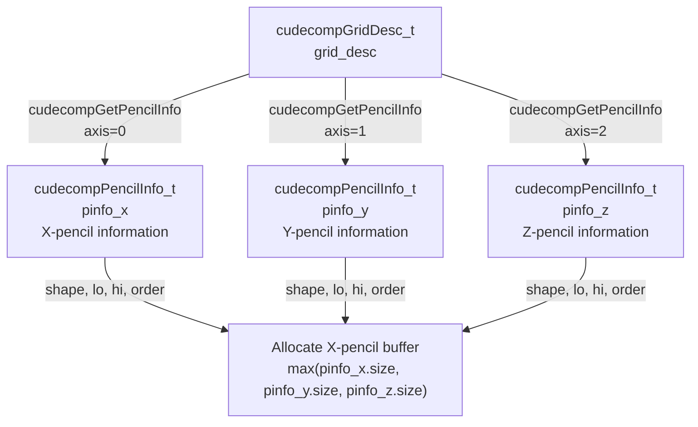

The pencil information can be queried with or without halo extents:

**Fortran example:**
```fortran
! Get X-pencil information with halo elements
integer :: halo_extents(3) = [1, 1, 1]
istat = cudecompGetPencilInfo(handle, grid_desc, pinfo_x, 1, halo_extents)

! Get Y-pencil information without halos (pass no halo argument)
istat = cudecompGetPencilInfo(handle, grid_desc, pinfo_y, 2)
```

Reference [examples/fortran/basic_usage/basic_usage_autotune.f90:135-145]()

Sources: [include/cudecomp.h:285-307]()

### Data Initialization Pattern

The examples demonstrate how to initialize pencil data using the `cudecompPencilInfo_t` structure. The key is computing global coordinates from local indices:

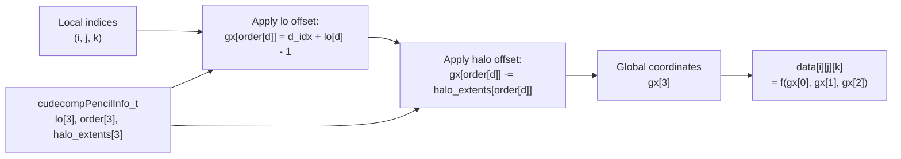

**Fortran initialization example:**
```fortran
do k = 1, pinfo_x%shape(3)
  do j = 1, pinfo_x%shape(2)
    do i = 1, pinfo_x%shape(1)
      ! Compute global coordinates using order array to map local to global
      gx(pinfo_x%order(1)) = i + pinfo_x%lo(1) - 1
      gx(pinfo_x%order(2)) = j + pinfo_x%lo(2) - 1
      gx(pinfo_x%order(3)) = k + pinfo_x%lo(3) - 1
      
      ! Apply halo offset if pencil has halos
      gx(pinfo_x%order(1)) = gx(pinfo_x%order(1)) - pinfo_x%halo_extents(pinfo_x%order(1))
      gx(pinfo_x%order(2)) = gx(pinfo_x%order(2)) - pinfo_x%halo_extents(pinfo_x%order(2))
      gx(pinfo_x%order(3)) = gx(pinfo_x%order(3)) - pinfo_x%halo_extents(pinfo_x%order(3))
      
      ! Initialize based on global coordinates
      data_x_d(i,j,k) = gx(1) + gx(2) + gx(3)
    enddo
  enddo
enddo
```

Reference [examples/fortran/basic_usage/basic_usage_autotune.f90:168-191]()

Sources: [examples/fortran/basic_usage/basic_usage_autotune.f90:168-221]()

### Workspace Allocation

Before performing transpose or halo operations, allocate workspace memory using `cudecompMalloc`:

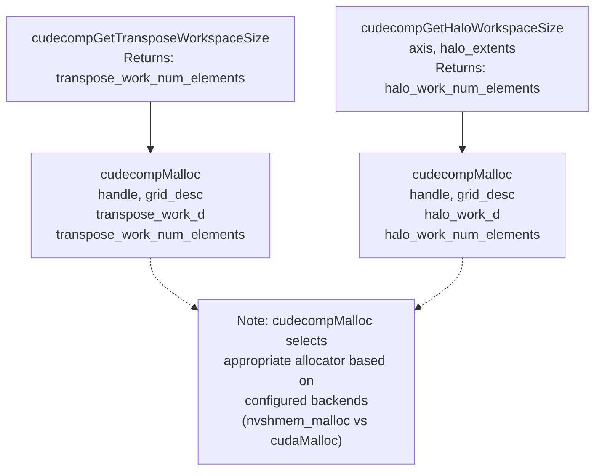

**Fortran example:**
```fortran
! Get workspace sizes
istat = cudecompGetTransposeWorkspaceSize(handle, grid_desc, transpose_work_num_elements)
istat = cudecompGetHaloWorkspaceSize(handle, grid_desc, 1, [1,1,1], halo_work_num_elements)

! Allocate using cudecompMalloc
istat = cudecompMalloc(handle, grid_desc, transpose_work_d, transpose_work_num_elements)
istat = cudecompMalloc(handle, grid_desc, halo_work_d, halo_work_num_elements)
```

Reference [examples/fortran/basic_usage/basic_usage_autotune.f90:226-237]()

**Important:** The workspace arrays must have element type matching the `cudecompDataType_t` used in operations. If using a different type, adjust the workspace size accordingly.

Sources: [include/cudecomp.h:309-381](), [examples/fortran/basic_usage/basic_usage_autotune.f90:223-237]()

### Executing Transpose Operations

The transpose operations redistribute data between different pencil orientations:

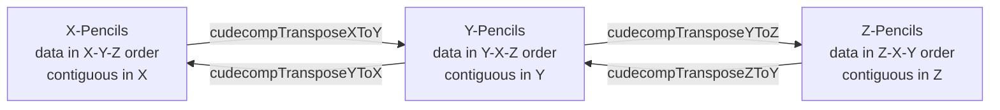

**Key parameters for transpose functions:**

| Parameter | Description |
|-----------|-------------|
| `handle` | cuDecomp handle |
| `grid_desc` | Grid descriptor |
| `input` | Input data buffer (pencil-aligned) |
| `output` | Output data buffer (can be same as input for in-place) |
| `work` | Workspace buffer |
| `dtype` | Data type (CUDECOMP_DOUBLE, CUDECOMP_FLOAT, etc.) |
| `input_halo_extents` | Halo extents of input (NULL if none) |
| `output_halo_extents` | Halo extents of output (NULL if none) |
| `input_padding` | Padding of input (NULL if none) |
| `output_padding` | Padding of output (NULL if none) |
| `stream` | CUDA stream for GPU operations |

**Fortran example with halos:**
```fortran
! Transpose X to Y (input has halos, output does not)
istat = cudecompTransposeXToY(handle, grid_desc, data_d, data_d, &
                              transpose_work_d, CUDECOMP_DOUBLE, &
                              pinfo_x%halo_extents, [0,0,0])

! Transpose Y to Z (no halos on either)
istat = cudecompTransposeYToZ(handle, grid_desc, data_d, data_d, &
                              transpose_work_d, CUDECOMP_DOUBLE)

! Transpose Z to Y
istat = cudecompTransposeZToY(handle, grid_desc, data_d, data_d, &
                              transpose_work_d, CUDECOMP_DOUBLE)

! Transpose Y to X (output has halos)
istat = cudecompTransposeYToX(handle, grid_desc, data_d, data_d, &
                              transpose_work_d, CUDECOMP_DOUBLE, &
                              [0,0,0], pinfo_x%halo_extents)
```

Reference [examples/fortran/basic_usage/basic_usage_autotune.f90:242-255]()

Sources: [include/cudecomp.h:430-545](), [examples/fortran/basic_usage/basic_usage_autotune.f90:239-255]()

### Executing Halo Updates

Halo updates exchange boundary data between neighboring processes for stencil operations:

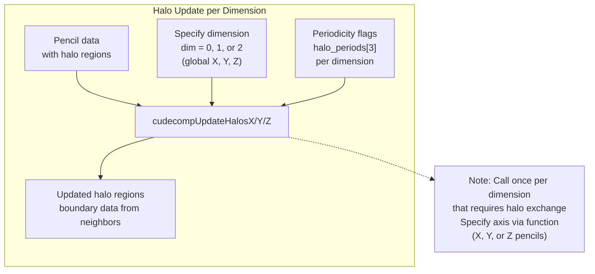

**Key parameters for halo functions:**

| Parameter | Description |
|-----------|-------------|
| `handle` | cuDecomp handle |
| `grid_desc` | Grid descriptor |
| `input` | In/out data buffer (updated in-place) |
| `work` | Workspace buffer |
| `dtype` | Data type |
| `halo_extents` | Halo extents (3 integers, global order) |
| `halo_periods` | Periodicity flags (3 booleans, NULL for no periodicity) |
| `dim` | Which dimension to update (0=X, 1=Y, 2=Z in global coordinates) |
| `padding` | Padding (NULL if none) |
| `stream` | CUDA stream |

**Fortran example:**
```fortran
! Set periodic boundaries in all directions
logical :: halo_periods(3) = [.true., .true., .true.]

! Update X-pencil halos in all three dimensions
istat = cudecompUpdateHalosX(handle, grid_desc, data_d, halo_work_d, &
                             CUDECOMP_DOUBLE, pinfo_x%halo_extents, &
                             halo_periods, 1)  ! Update X dimension

istat = cudecompUpdateHalosX(handle, grid_desc, data_d, halo_work_d, &
                             CUDECOMP_DOUBLE, pinfo_x%halo_extents, &
                             halo_periods, 2)  ! Update Y dimension

istat = cudecompUpdateHalosX(handle, grid_desc, data_d, halo_work_d, &
                             CUDECOMP_DOUBLE, pinfo_x%halo_extents, &
                             halo_periods, 3)  ! Update Z dimension
```

Reference [examples/fortran/basic_usage/basic_usage_autotune.f90:258-273]()

**Important:** The `dim` parameter is in global coordinates (1-indexed in Fortran, 0-indexed in C++), not local pencil coordinates.

Sources: [include/cudecomp.h:547-625](), [examples/fortran/basic_usage/basic_usage_autotune.f90:258-273]()

### Cleanup

Proper resource cleanup is essential:

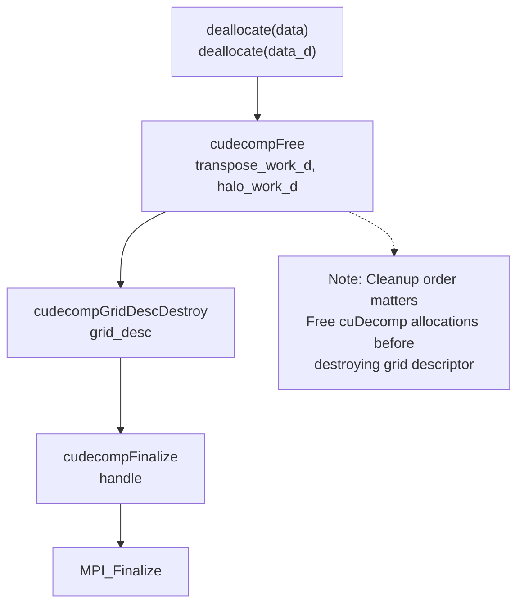

**Fortran example:**
```fortran
deallocate(data)
deallocate(data_d)
istat = cudecompFree(handle, grid_desc, transpose_work_d)
istat = cudecompFree(handle, grid_desc, halo_work_d)
istat = cudecompGridDescDestroy(handle, grid_desc)
istat = cudecompFinalize(handle)
call MPI_Finalize(ierr)
```

Reference [examples/fortran/basic_usage/basic_usage_autotune.f90:275-287]()

Sources: [include/cudecomp.h:226-261](), [include/cudecomp.h:369-381](), [examples/fortran/basic_usage/basic_usage_autotune.f90:275-287]()

## Autotuning Example

The autotuning examples demonstrate how to let cuDecomp automatically select optimal process grid dimensions and communication backends. For detailed autotuning documentation, see [Performance Autotuning](#7).

### Enabling Autotuning

To enable autotuning, modify the grid descriptor creation process:

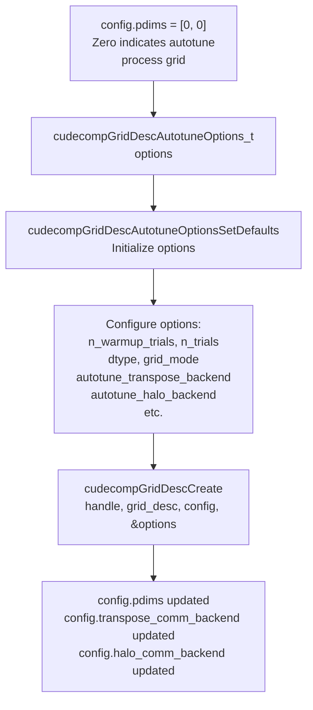

Sources: [include/cudecomp.h:136-189](), [examples/fortran/basic_usage/basic_usage_autotune.f90:71-121]()

### Autotune Options Categories

The `cudecompGridDescAutotuneOptions_t` structure organizes options into categories:

```mermaid
graph TB
    Options["cudecompGridDescAutotuneOptions_t"]
    
    subgraph "General Options"
        nwarmup["n_warmup_trials<br/>default: 3"]
        ntrials["n_trials<br/>default: 5"]
        dtype["dtype<br/>default: CUDECOMP_DOUBLE"]
        skip["skip_threshold<br/>default: 0.0"]
        disable_nccl["disable_nccl_backends<br/>default: false"]
        disable_nvshmem["disable_nvshmem_backends<br/>default: false"]
    end
    
    subgraph "Process Grid Options"
        grid_mode["grid_mode<br/>TRANSPOSE or HALO<br/>default: TRANSPOSE"]
        allow_uneven["allow_uneven_decompositions<br/>default: true"]
    end
    
    subgraph "Transpose Backend Options"
        autotune_trans["autotune_transpose_backend<br/>default: false"]
        use_inplace["transpose_use_inplace_buffers[4]<br/>per operation"]
        op_weights["transpose_op_weights[4]<br/>per operation"]
        input_halo["transpose_input_halo_extents[4][3]<br/>per operation"]
        output_halo["transpose_output_halo_extents[4][3]<br/>per operation"]
    end
    
    subgraph "Halo Backend Options"
        autotune_halo["autotune_halo_backend<br/>default: false"]
        halo_extents["halo_extents[3]"]
        halo_periods["halo_periods[3]"]
        halo_axis["halo_axis<br/>which pencil axis"]
    end
    
    Options --> nwarmup
    Options --> ntrials
    Options --> dtype
    Options --> skip
    Options --> disable_nccl
    Options --> disable_nvshmem
    Options --> grid_mode
    Options --> allow_uneven
    Options --> autotune_trans
    Options --> use_inplace
    Options --> op_weights
    Options --> input_halo
    Options --> output_halo
    Options --> autotune_halo
    Options --> halo_extents
    Options --> halo_periods
    Options --> halo_axis
```

Sources: [include/cudecomp.h:136-189]()

### General Autotune Options

**Fortran example:**
```fortran
! Set defaults first (required)
istat = cudecompGridDescAutotuneOptionsSetDefaults(options)

! General options
options%n_warmup_trials = 3              ! warmup runs per config
options%n_trials = 5                     ! timed runs per config
options%dtype = CUDECOMP_DOUBLE          ! data type for testing
options%disable_nccl_backends = .false.  ! enable NCCL backends
options%disable_nvshmem_backends = .false. ! enable NVSHMEM backends
options%skip_threshold = 0.0             ! no early skipping (0.0 = disabled)
```

Reference [examples/fortran/basic_usage/basic_usage_autotune.f90:83-92]()

The `skip_threshold` enables rapid elimination of slow configurations. If `skip_threshold * t_first > t_best`, the configuration is skipped without running all trials.

Sources: [include/cudecomp.h:138-153](), [docs/autotuning.rst:99-150]()

### Process Grid Autotune Options

**Fortran example:**
```fortran
! Process grid autotuning
options%grid_mode = CUDECOMP_AUTOTUNE_GRID_TRANSPOSE ! use transpose for grid selection
options%allow_uneven_decompositions = .true.         ! allow non-uniform distributions
```

Reference [examples/fortran/basic_usage/basic_usage_autotune.f90:95-96]()

The `grid_mode` determines which communication type (transpose or halo) is used in the first autotuning phase to select the process grid. The `allow_uneven_decompositions` flag controls whether to test process grids that result in different pencil shapes across ranks.

Sources: [include/cudecomp.h:143-147](), [docs/autotuning.rst:152-180]()

### Transpose Backend Autotune Options

**Fortran example:**
```fortran
! Transpose backend autotuning
options%autotune_transpose_backend = .true.

! Specify in-place vs out-of-place testing per operation
options%transpose_use_inplace_buffers(1) = .true. ! X-to-Y in-place
options%transpose_use_inplace_buffers(2) = .true. ! Y-to-Z in-place
options%transpose_use_inplace_buffers(3) = .true. ! Z-to-Y in-place
options%transpose_use_inplace_buffers(4) = .true. ! Y-to-X in-place

! Weight each operation's contribution to total timing
options%transpose_op_weights(1) = 1.0 ! X-to-Y weight
options%transpose_op_weights(2) = 1.0 ! Y-to-Z weight
options%transpose_op_weights(3) = 1.0 ! Z-to-Y weight
options%transpose_op_weights(4) = 1.0 ! Y-to-X weight

! Specify halo configurations for each operation
options%transpose_input_halo_extents(:, 1) = [1, 1, 1]  ! X-to-Y input halos
options%transpose_output_halo_extents(:, 4) = [1, 1, 1] ! Y-to-X output halos
```

Reference [examples/fortran/basic_usage/basic_usage_autotune.f90:99-109]()

The `transpose_op_weights` array allows emphasizing operations that are called more frequently. Setting a weight to 0.0 skips that operation entirely during autotuning.

Sources: [include/cudecomp.h:156-181](), [docs/autotuning.rst:183-288]()

### Halo Backend Autotune Options

**Fortran example:**
```fortran
! Halo backend autotuning
options%autotune_halo_backend = .true.

options%halo_axis = 1                        ! autotune on X-pencils
options%halo_extents = [1, 1, 1]            ! 1 halo element per direction
options%halo_periods = [.true., .true., .true.] ! periodic boundaries
```

Reference [examples/fortran/basic_usage/basic_usage_autotune.f90:112-118]()

The halo autotuning tests all three dimensions (specified by `dim` in the halo functions) for the specified pencil axis and configuration.

Sources: [include/cudecomp.h:184-188](), [docs/autotuning.rst:290-336]()

### Two-Phase Autotuning Process

When full autotuning is enabled (both process grid and one or both backends), the autotuner runs in two phases:

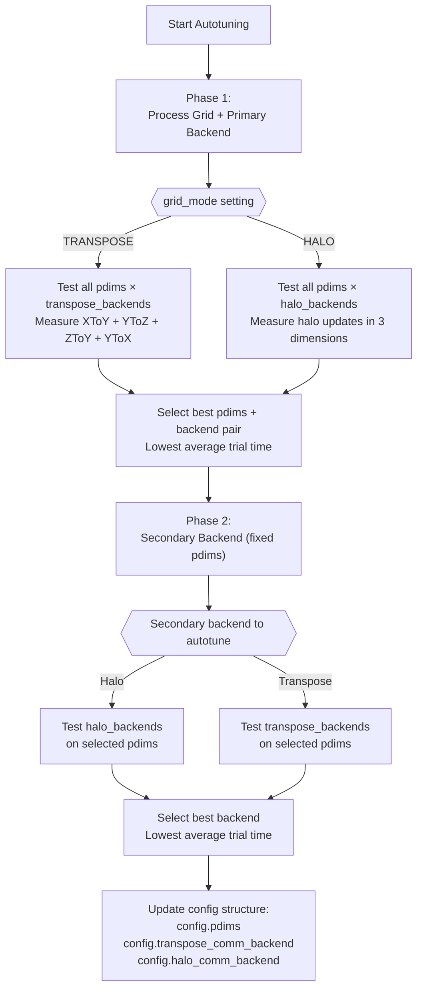

Sources: [docs/autotuning.rst:14-40](), [docs/autotuning.rst:439-467]()

### Interpreting Autotune Output

The autotuner prints detailed timing information to stdout (rank 0 only):

**Example Phase 1 output (process grid + transpose backend):**
```
CUDECOMP: Running transpose autotuning...
CUDECOMP:       grid: 1 x 4, backend: MPI_P2P
CUDECOMP:       Total time min/max/avg/std [ms]: 0.266102/0.276084/0.270158/0.003797
CUDECOMP:       TransposeXY time min/max/avg/std [ms]: 0.018432/0.026624/0.020941/0.002208
CUDECOMP:       TransposeYZ time min/max/avg/std [ms]: 0.101376/0.110592/0.104806/0.002341
CUDECOMP:       TransposeZY time min/max/avg/std [ms]: 0.095232/0.101376/0.097229/0.001602
CUDECOMP:       TransposeYX time min/max/avg/std [ms]: 0.015360/0.020480/0.017459/0.001354
...
CUDECOMP: SELECTED: grid: 4 x 1, backend: NCCL, Avg. time 0.138808
CUDECOMP: transpose autotuning time [s]: 1.589209
```

Reference [docs/autotuning.rst:363-425]()

**Example Phase 2 output (halo backend with fixed grid):**
```
CUDECOMP: Running halo autotuning...
CUDECOMP: Autotune halo axis: x
CUDECOMP:       grid: 4 x 1, halo backend: MPI
CUDECOMP:       Total time min/max/avg/std [ms]: 0.068239/0.074815/0.070960/0.002477
...
CUDECOMP: SELECTED: grid: 4 x 1, halo backend: NVSHMEM, Avg. time [s] 0.051291
CUDECOMP: halo autotuning time [s]: 0.227950
```

Reference [docs/autotuning.rst:445-461]()

Sources: [docs/autotuning.rst:353-467]()

### Querying Autotune Results

After autotuning, the `config` structure passed to `cudecompGridDescCreate` is updated with the selected values:

**Fortran example:**
```fortran
! Create grid descriptor with autotuning
istat = cudecompGridDescCreate(handle, grid_desc, config, options)

! Query and print results (config structure is updated)
if (rank == 0) then
  write(*,"('running on ', i0, ' x ', i0, ' process grid ...')") &
        config%pdims(1), config%pdims(2)
  write(*,"('running using ', a, ' transpose backend ...')") &
        cudecompTransposeCommBackendToString(config%transpose_comm_backend)
  write(*,"('running using ', a, ' halo backend ...')") &
        cudecompHaloCommBackendToString(config%halo_comm_backend)
endif
```

Reference [examples/fortran/basic_usage/basic_usage_autotune.f90:120-130]()

The updated configuration can also be retrieved later using `cudecompGetGridDescConfig`:

Sources: [include/cudecomp.h:403-411](), [docs/autotuning.rst:469-494]()

## Common Patterns and Best Practices

### Error Checking

All cuDecomp functions return `cudecompResult_t` status codes. The examples demonstrate consistent error checking:

**C++ helper macro pattern:**
```cpp
#define CHECK_CUDECOMP_EXIT(f) \
  { \
    cudecompResult_t res = (f); \
    if (res != CUDECOMP_RESULT_SUCCESS) { \
      fprintf(stderr, "cuDecomp error at %s:%d\n", __FILE__, __LINE__); \
      exit(1); \
    } \
  }
```

**Fortran helper subroutine pattern:**
```fortran
subroutine CHECK_CUDECOMP_EXIT(istat)
  use cudecomp
  integer :: istat
  if (istat /= CUDECOMP_RESULT_SUCCESS) then
    print*, "CUDECOMP Error. Exiting."
    call exit(1)
  endif
end subroutine
```

Reference [examples/fortran/basic_usage/basic_usage_autotune.f90:17-24]()

**Error codes:**
- `CUDECOMP_RESULT_SUCCESS`: Operation succeeded
- `CUDECOMP_RESULT_INVALID_USAGE`: User error (invalid argument)
- `CUDECOMP_RESULT_NOT_SUPPORTED`: Unsupported configuration
- `CUDECOMP_RESULT_INTERNAL_ERROR`: Library bug (should be reported)
- `CUDECOMP_RESULT_CUDA_ERROR`: CUDA runtime error
- `CUDECOMP_RESULT_CUTENSOR_ERROR`: cuTENSOR error
- `CUDECOMP_RESULT_MPI_ERROR`: MPI error
- `CUDECOMP_RESULT_NCCL_ERROR`: NCCL error
- `CUDECOMP_RESULT_NVSHMEM_ERROR`: NVSHMEM error
- `CUDECOMP_RESULT_NVML_ERROR`: NVML error

Sources: [include/cudecomp.h:84-98]()

### Device Selection

The examples demonstrate proper GPU device selection based on local MPI rank:

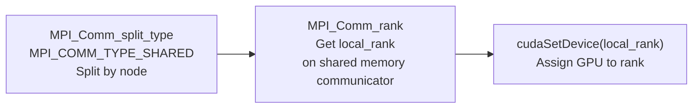

**Why this matters:** Multiple MPI ranks on the same node must use different GPUs. The `MPI_COMM_TYPE_SHARED` split creates a communicator of ranks sharing memory (same node), and the local rank within this communicator corresponds to the GPU index.

Reference [examples/fortran/basic_usage/basic_usage_autotune.f90:63-65]()

Sources: [examples/fortran/basic_usage/basic_usage_autotune.f90:59-68]()

### Memory Management

The examples demonstrate the proper pattern for allocating cuDecomp data and workspace:

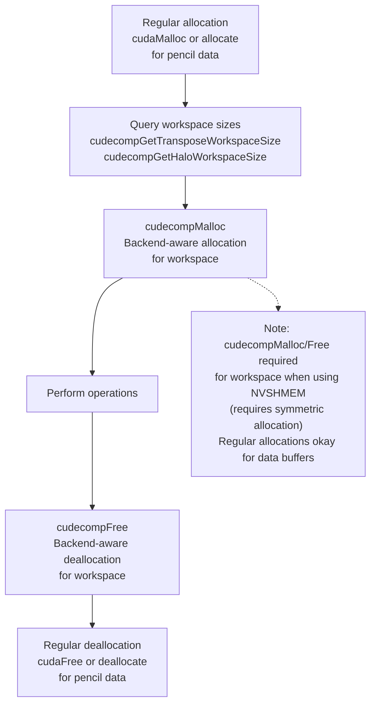

**Key points:**
- User data buffers can use regular CUDA allocation (`cudaMalloc`, `cudaFree`)
- Workspace buffers must use `cudecompMalloc`/`cudecompFree`
- `cudecompMalloc` selects the appropriate allocator based on backend (NVSHMEM requires `nvshmem_malloc`)
- Free workspaces before destroying the grid descriptor

Sources: [include/cudecomp.h:351-381](), [examples/fortran/basic_usage/basic_usage_autotune.f90:148-154](), [examples/fortran/basic_usage/basic_usage_autotune.f90:223-237](), [examples/fortran/basic_usage/basic_usage_autotune.f90:276-281]()

### Handling NULL/Optional Arguments

Many cuDecomp functions accept optional arguments for halos and padding:

**Fortran conventions:**
- Optional arguments can be omitted entirely
- Zero arrays can be passed explicitly: `[0,0,0]`

**C++ conventions:**
- Pass `NULL` or `nullptr` for optional pointer arguments
- Example: `cudecompTransposeYToZ(handle, grid_desc, in, out, work, dtype, NULL, NULL, NULL, NULL, stream)`

**When to pass halos/padding:**
- If pencil data includes halo elements: pass `halo_extents` to `cudecompGetPencilInfo`, transposes, and halo updates
- If pencil data includes padding: pass `padding` to relevant functions
- If no halos/padding: omit the arguments (Fortran) or pass `NULL` (C++)

Reference [examples/fortran/basic_usage/basic_usage_autotune.f90:242-255]()

Sources: [include/cudecomp.h:285-625]()

### Configuration Best Practices

**For basic usage:**
1. Always call `cudecompGridDescConfigSetDefaults` first
2. Set `pdims` to factorization of MPI ranks: `pdims[0] * pdims[1] == nranks`
3. Set `gdims` to your global domain size
4. For simple cases, use default backends (`MPI_P2P` for transpose, `MPI` for halo)
5. Set `transpose_axis_contiguous` to `true` for better cache performance in local operations

**For production use:**
1. Enable autotuning for initial runs to find optimal configuration
2. Save the autotuned `pdims` and backends
3. Use fixed configuration in subsequent runs to avoid autotuning overhead
4. Consider different configurations for different problem sizes

**Backend selection guidelines:**
- `MPI_P2P`: Good default, widely compatible
- `MPI_A2A`: Can be faster on some interconnects
- `NCCL`: Often fastest on systems with GPU-aware MPI and GPUDirect
- `NVSHMEM`: Best for multi-node NVLink systems, requires symmetric memory
- Pipelined variants: Enable computation-communication overlap at the cost of more memory

Sources: [include/cudecomp.h:113-132](), [docs/autotuning.rst:43-497]()

---

