<!-- source: DeepWiki mcp.deepwiki.com · repo NVIDIA/cuDecomp · page 11.2 Taylor-Green Vortex Solver · fetched 2026-10-26 -->

# Taylor-Green Vortex Solver

<details>
<summary>Relevant source files</summary>

The following files were used as context for generating this wiki page:

- [examples/cc/basic_usage/basic_usage.cu](examples/cc/basic_usage/basic_usage.cu)
- [examples/cc/taylor_green/tg.cu](examples/cc/taylor_green/tg.cu)
- [include/internal/exceptions.h](include/internal/exceptions.h)
- [include/internal/transpose.h](include/internal/transpose.h)

</details>


## Purpose and Scope

This page documents the Taylor-Green vortex solver example, a complete implementation of a 3D incompressible Navier-Stokes solver using spectral methods. The solver demonstrates how to integrate cuDecomp domain decomposition with cuFFT for real-world computational fluid dynamics applications. This example showcases transpose operations between pencil orientations, FFT-based spatial transforms, and time integration schemes.

For basic cuDecomp usage patterns, see [Basic Usage Examples](#11.1). For general guidance on FFT-based applications, see [FFT-Based Applications](#11.3).

**Sources:** [examples/cc/taylor_green/tg.cu:1-986]()

## Problem Description

The Taylor-Green vortex is a canonical test case for incompressible flow solvers. It features an analytical initial condition that evolves into turbulent flow at low viscosity, making it ideal for validating numerical methods. The solver solves the incompressible Navier-Stokes equations in a triply-periodic cube using a pseudo-spectral method.

The governing equations are solved in spectral (Fourier) space where spatial derivatives become algebraic operations, while nonlinear terms are computed in physical space to maintain accuracy. The 2/3 dealiasing rule is applied to prevent aliasing errors from quadratic nonlinearities.

**Sources:** [examples/cc/taylor_green/tg.cu:157-165](), [examples/cc/taylor_green/tg.cu:202-237]()

## Solver Architecture

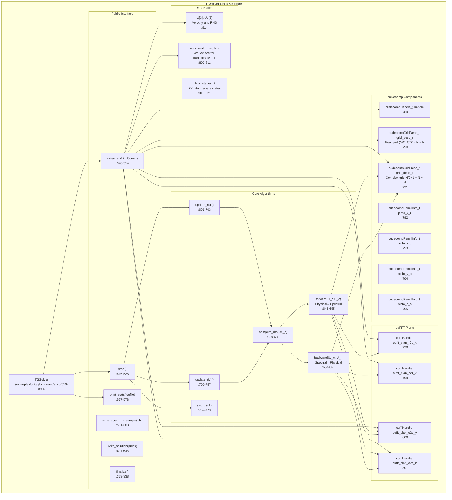

**Diagram: TGSolver Class Architecture**

The `TGSolver` class encapsulates the entire solver with distinct initialization, execution, and output phases. It manages two grid descriptors (real and complex), four cuFFT plans for different transform directions, and multiple data buffers for velocity fields and workspace.

**Sources:** [examples/cc/taylor_green/tg.cu:316-830]()

## Initialization and Setup

The initialization process establishes MPI communication, configures cuDecomp grids, creates cuFFT plans, and allocates memory:

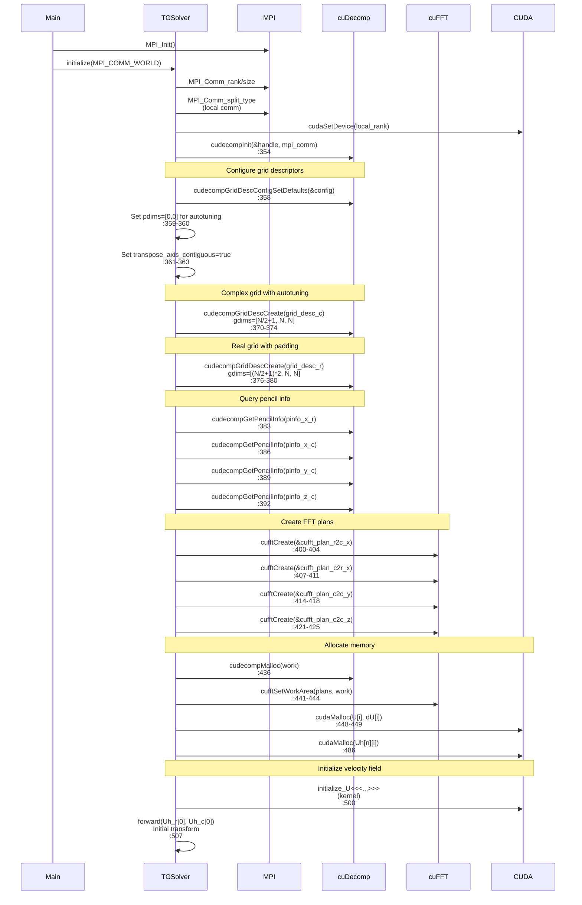

**Diagram: Initialization Sequence**

The initialization follows a specific order: MPI setup, cuDecomp handle creation, grid descriptor configuration with autotuning, cuFFT plan creation, memory allocation, and initial condition setup.

**Sources:** [examples/cc/taylor_green/tg.cu:340-514]()

### Grid Configuration

The solver uses two grid descriptors to handle real and complex data layouts:

| Grid | Dimensions | Purpose | Lines |
|------|-----------|---------|-------|
| `grid_desc_c` | `(N/2+1) × N × N` | Complex Fourier coefficients | [370-374]() |
| `grid_desc_r` | `((N/2+1)*2) × N × N` | Real data with padding for in-place R2C/C2R transforms | [376-380]() |

The real grid has extra padding in the first dimension to accommodate the in-place cuFFT R2C transform, which outputs `N/2+1` complex values requiring `2*(N/2+1)` real elements.

**Key configuration options:**
- `pdims[0] = 0, pdims[1] = 0`: Enables automatic process grid tuning
- `transpose_axis_contiguous = true`: Requests contiguous data layout for transpose axes
- `autotune_transpose_backend = true`: Enables backend selection for optimal performance

**Sources:** [examples/cc/taylor_green/tg.cu:356-380]()

## Data Layout and Pencil Management

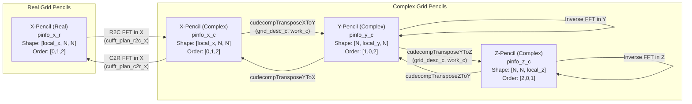

**Diagram: Transform Pipeline and Pencil Transitions**

The solver performs 1D FFTs along contiguous dimensions of each pencil orientation, using transposes to cycle through all three spatial directions. This minimizes the number of transposes (6 total per forward-backward cycle) while keeping FFT operations on contiguous data.

**Sources:** [examples/cc/taylor_green/tg.cu:645-667](), [examples/cc/taylor_green/tg.cu:792-795]()

### Memory Buffer Organization

The solver maintains multiple aliased pointers to the same underlying memory:

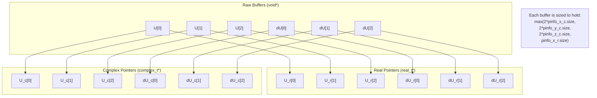

**Diagram: Memory Buffer Aliasing**

Each velocity component buffer can be interpreted as either real or complex data, enabling in-place R2C/C2R transforms without extra copies. The factor of 2 accounts for complex data requiring twice the storage of real data.

**Sources:** [examples/cc/taylor_green/tg.cu:428-456](), [examples/cc/taylor_green/tg.cu:814-816]()

## Transform Pipeline

### Forward Transform (Physical → Spectral)

The `forward()` method transforms velocity fields from physical space (X-pencil, real) to spectral space (Z-pencil, complex):

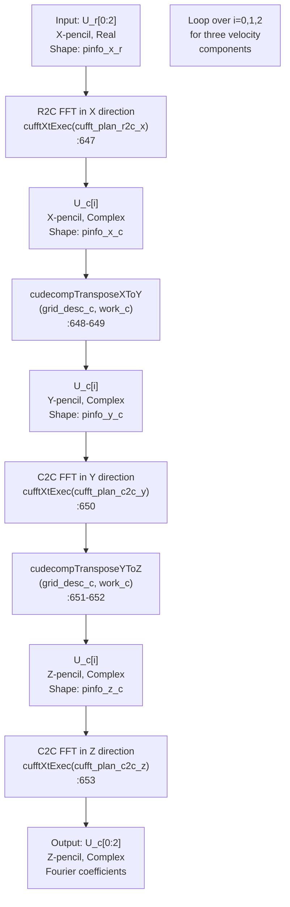

**Diagram: Forward Transform Data Flow**

Each velocity component undergoes the same sequence: R2C FFT, transpose to Y, C2C FFT, transpose to Z, C2C FFT. The result is a fully transformed field in spectral space.

**Sources:** [examples/cc/taylor_green/tg.cu:645-655]()

### Backward Transform (Spectral → Physical)

The `backward()` method reverses the forward transform:

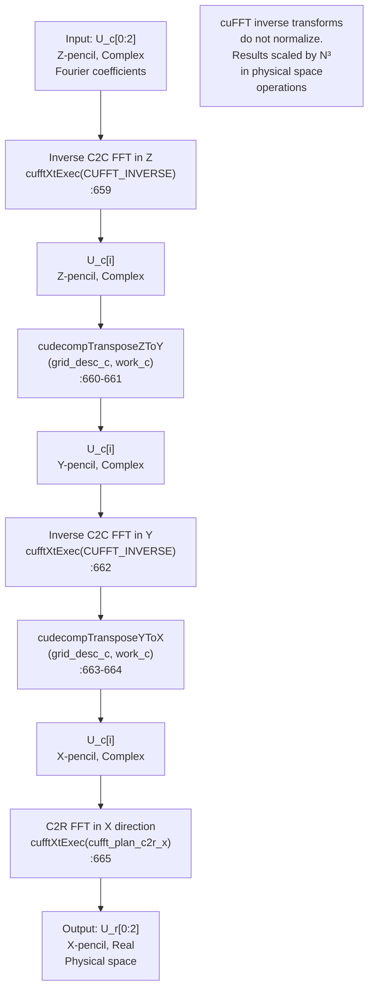

**Diagram: Backward Transform Data Flow**

The backward transform mirrors the forward transform in reverse order, returning data to physical space. Note that cuFFT inverse transforms are unnormalized, requiring manual scaling by `N³` in subsequent computations.

**Sources:** [examples/cc/taylor_green/tg.cu:657-667]()

## Time Integration

### Right-Hand Side Computation

The `compute_rhs()` method evaluates the Navier-Stokes right-hand side in spectral space:

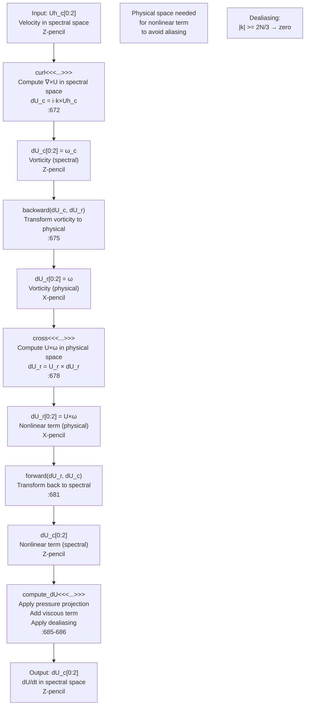

**Diagram: Right-Hand Side Computation Pipeline**

The RHS computation uses spectral space for linear terms (curl, pressure projection, viscous term) and physical space for the nonlinear advection term (U×ω), following the standard pseudo-spectral method.

**Sources:** [examples/cc/taylor_green/tg.cu:669-688]()

### Runge-Kutta Time Stepping

The solver supports RK1 (Forward Euler) and RK4 (classical 4th-order Runge-Kutta):

```mermaid
stateDiagram-v2
    [*] --> RK1_START: TimeScheme=RK1
    [*] --> RK4_START: TimeScheme=RK4
    
    state RK1_START {
        [*] --> ComputeRHS1: Uh_c[0]
        ComputeRHS1 --> UpdateUh1: dU_c
        UpdateUh1 --> ToPhysical1: Uh_c[0] += dt*dU_c
        ToPhysical1 --> [*]: backward(Uh_c[0], U_r)
    }
    
    state RK4_START {
        [*] --> CopyInitial: Uh_c[1] = Uh_c[0]
        CopyInitial --> Stage1
        
        state Stage1 {
            [*] --> RHS1: compute_rhs(Uh_c[1])
            RHS1 --> Update1a: Uh_c[1] = Uh_c[0] + 0.5*dt*dU_c
            Update1a --> Update1b: Uh_c[2] = Uh_c[0] + (1/6)*dt*dU_c
            Update1b --> Physical1: backward(Uh_c[1], U_r)
        }
        
        Stage1 --> Stage2
        
        state Stage2 {
            [*] --> RHS2: compute_rhs(Uh_c[1])
            RHS2 --> Update2a: Uh_c[1] = Uh_c[0] + 0.5*dt*dU_c
            Update2a --> Update2b: Uh_c[2] += (1/3)*dt*dU_c
            Update2b --> Physical2: backward(Uh_c[1], U_r)
        }
        
        Stage2 --> Stage3
        
        state Stage3 {
            [*] --> RHS3: compute_rhs(Uh_c[1])
            RHS3 --> Update3a: Uh_c[1] = Uh_c[0] + dt*dU_c
            Update3a --> Update3b: Uh_c[2] += (1/3)*dt*dU_c
            Update3b --> Physical3: backward(Uh_c[1], U_r)
        }
        
        Stage3 --> Stage4
        
        state Stage4 {
            [*] --> RHS4: compute_rhs(Uh_c[1])
            RHS4 --> Update4: Uh_c[0] = Uh_c[2] + (1/6)*dt*dU_c
            Update4 --> Physical4: backward(Uh_c[0], U_r)
        }
        
        Stage4 --> [*]
    }
    
    RK1_START --> [*]
    RK4_START --> [*]
```

**Diagram: Time Integration State Machines**

RK1 requires a single RHS evaluation, while RK4 uses four stages with specific weighting coefficients. Each stage includes a backward transform to update the physical space velocity field for the next RHS computation.

**Sources:** [examples/cc/taylor_green/tg.cu:691-757]()

### Adaptive Time Stepping

When CFL-based time stepping is enabled (`cfl > 0`), the time step is computed from the maximum velocity:

| Operation | Implementation | Lines |
|-----------|---------------|-------|
| Compute velocity magnitude | `velmax<<<...>>>(U_r[0:2], dU_r[0])` kernel | [760]() |
| Local reduction | `cub::DeviceReduce::Max(dU_r[0], cub_sum)` | [763]() |
| Global reduction | `MPI_Allreduce(velmax, MPI_MAX)` | [768]() |
| Compute timestep | `dt = cfl * dx / velmax` | [772]() |

The CFL condition ensures numerical stability by limiting the time step based on the characteristic advection time scale.

**Sources:** [examples/cc/taylor_green/tg.cu:759-773]()

## Computational Kernels

The solver implements several CUDA kernels for operations in physical and spectral space:

### Physical Space Kernels

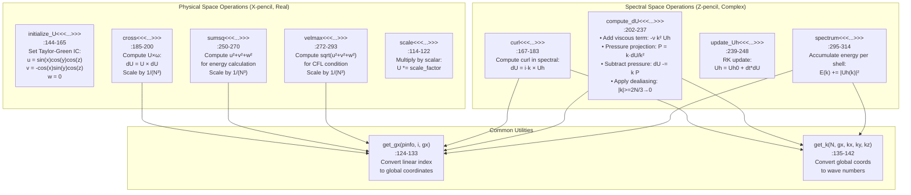

**Diagram: CUDA Kernel Dependency Graph**

The kernels use helper functions `get_gx()` and `get_k()` to map between linear buffer indices, global grid coordinates, and wave numbers. Physical space kernels apply cuFFT normalization (`1/N³`) while spectral kernels perform linear operations on Fourier coefficients.

**Sources:** [examples/cc/taylor_green/tg.cu:114-314]()

### Kernel Launch Patterns

All kernels follow a common launch pattern:

```cpp
// Compute grid dimensions
int threads_per_block = 256;
int nblocks = (pinfo.size + threads_per_block - 1) / threads_per_block;

// Launch kernel
kernel_name<<<nblocks, threads_per_block>>>(args, pinfo);
CHECK_CUDA_LAUNCH_EXIT();
```

The thread count is based on the pencil size (`pinfo.size`), ensuring one thread per grid point. Each thread computes its global coordinates from its linear index using the pencil metadata.

**Sources:** [examples/cc/taylor_green/tg.cu:500](), [examples/cc/taylor_green/tg.cu:672]()

## Diagnostics and Output

### Energy and Enstrophy Computation

The solver tracks kinetic energy and enstrophy to validate conservation properties:

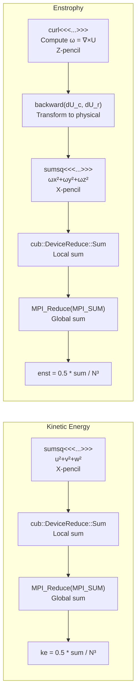

**Diagram: Diagnostic Computation Pipeline**

Diagnostics use CUB device-wide reductions for efficient local summation followed by MPI collective operations for global statistics. Only rank 0 prints results.

**Sources:** [examples/cc/taylor_green/tg.cu:527-578]()

### Energy Spectrum

The `write_spectrum_sample()` method computes the energy distribution across wave numbers:

1. Initialize spectrum array `ek[num_shells]` to zero
2. Launch `spectrum<<<...>>>()` kernel on Z-pencil data
3. For each grid point, compute `k = sqrt(kx² + ky² + kz²)` and accumulate energy into `ek[shell]` using atomic adds
4. Reduce across ranks with `MPI_Reduce(MPI_SUM)`
5. Rank 0 writes spectrum to file

The spectrum provides insight into energy cascade from large scales to small scales in turbulent flows.

**Sources:** [examples/cc/taylor_green/tg.cu:581-608](), [examples/cc/taylor_green/tg.cu:295-314]()

### Solution Output

The `write_solution()` method exports velocity fields to CSV format readable by ParaView:

```cpp
// Copy device data to host
cudaMemcpy(U_cpu_r[i], U_r[i], pinfo_x_r.size * sizeof(*U_r[i]), 
           cudaMemcpyDeviceToHost);

// Write CSV with columns: x, y, z, u, v, w
// Skip padded elements (gx[0] >= N || gx[1] >= N || gx[2] >= N)
// Scale by 1/N³ to undo cuFFT normalization
```

Each rank writes its local X-pencil data to a separate file `<prefix>_<rank>.csv`. The global grid can be reconstructed by combining files.

**Sources:** [examples/cc/taylor_green/tg.cu:611-638]()

## Running the Solver

### Command-Line Interface

The solver accepts several command-line arguments:

| Option | Default | Description | Lines |
|--------|---------|-------------|-------|
| `-n, --N` | 256 | Grid dimension (N×N×N) | [875]() |
| `-i, --niter` | 1000 | Number of iterations | [876]() |
| `-m, --max_flowtime` | -1 (unlimited) | Maximum flow time | [877]() |
| `-p, --printfreq` | 100 | Print frequency (iterations) | [878]() |
| `-s, --specfreq` | 0 (disabled) | Spectrum write frequency (flow time) | [879]() |
| `-l, --logfile` | none | Time history log file | [881]() |
| `-o, --csvfile` | none | Solution output prefix | [880]() |
| `-v, --nu` | 0.000625 | Kinematic viscosity | [884]() |
| `-t, --dt` | 0.001 | Fixed timestep | [885]() |
| `-c, --cfl` | 0.0 | CFL number (overrides fixed dt) | [886]() |

**Sources:** [examples/cc/taylor_green/tg.cu:832-922]()

### Execution Loop

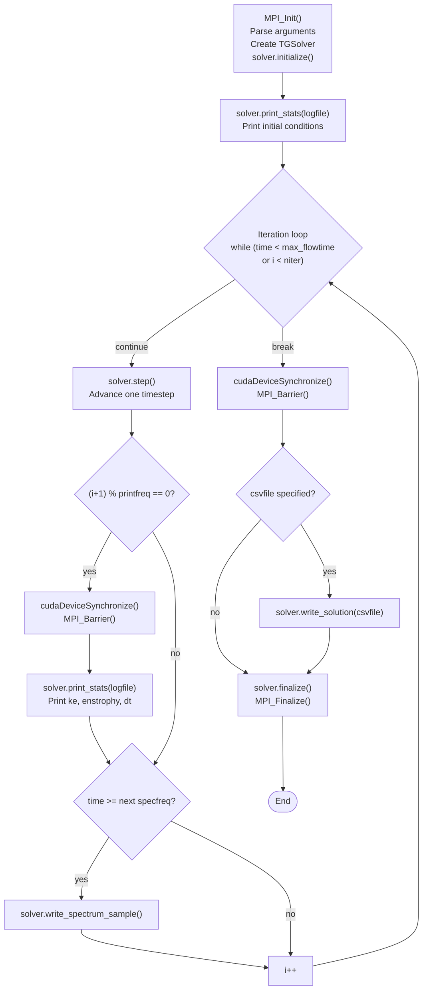

**Diagram: Main Execution Flow**

The main loop advances the simulation, periodically printing statistics and optionally writing energy spectra. After completion, the solution can be exported to CSV format.

**Sources:** [examples/cc/taylor_green/tg.cu:869-985]()

### Example Invocation

```bash
# Run 512³ grid on 16 ranks for 5000 iterations
# Print stats every 100 iterations
# Write spectrum every 1.0 flow time units
# Use CFL=0.4 for adaptive timestepping
mpirun -np 16 ./tg \
    -n 512 \
    -i 5000 \
    -p 100 \
    -s 1.0 \
    -c 0.4 \
    -l history.csv \
    -o solution
```

This produces:
- Terminal output every 100 iterations with statistics
- `history.csv` with time series of kinetic energy and enstrophy  
- `spectrum_XXXXXXXX.txt` files at specified flow time intervals
- `solution_0.csv` through `solution_15.csv` with final velocity fields

**Sources:** [examples/cc/taylor_green/tg.cu:832-867]()

## Performance Considerations

The solver demonstrates several optimization strategies:

1. **In-place Transforms**: Real and complex data share the same buffers, reducing memory usage
2. **Workspace Reuse**: Single workspace serves both cuDecomp transposes and cuFFT operations
3. **Autotuned Decomposition**: Process grid and communication backend selected automatically for optimal performance
4. **Contiguous FFTs**: 1D FFTs operate on contiguous data in each pencil orientation
5. **Spectral Efficiency**: Linear operations in spectral space avoid explicit derivatives
6. **CUB Reductions**: Device-wide primitives for fast local reductions
7. **CUDA Graphs**: Can be enabled via `cudecompGridDescConfig` for kernel launch overhead reduction

The computational cost scales primarily with `N³ log N` for the FFTs and `N³` for nonlinear terms, distributed across processes via domain decomposition.

**Sources:** [examples/cc/taylor_green/tg.cu:340-514](), [examples/cc/taylor_green/tg.cu:428-445]()

---

