<!-- source: DeepWiki mcp.deepwiki.com · repo NVIDIA/cuDecomp · page 11.3 FFT-Based Applications · fetched 2026-10-26 -->

# FFT-Based Applications

Relevant source files

The following files were used as context for generating this wiki page:

- [LICENSE](LICENSE)
- [benchmark/CMakeLists.txt](benchmark/CMakeLists.txt)
- [examples/cc/basic_usage/CMakeLists.txt](examples/cc/basic_usage/CMakeLists.txt)
- [examples/cc/basic_usage/basic_usage.cu](examples/cc/basic_usage/basic_usage.cu)
- [examples/cc/taylor_green/CMakeLists.txt](examples/cc/taylor_green/CMakeLists.txt)
- [examples/cc/taylor_green/tg.cu](examples/cc/taylor_green/tg.cu)
- [examples/fortran/basic_usage/CMakeLists.txt](examples/fortran/basic_usage/CMakeLists.txt)
- [examples/fortran/basic_usage/basic_usage.f90](examples/fortran/basic_usage/basic_usage.f90)
- [examples/fortran/poisson/CMakeLists.txt](examples/fortran/poisson/CMakeLists.txt)
- [examples/fortran/poisson/poisson.f90](examples/fortran/poisson/poisson.f90)
- [include/internal/autotune.h](include/internal/autotune.h)
- [include/internal/exceptions.h](include/internal/exceptions.h)

## Purpose and Scope

This page provides guidance for building FFT-based applications using cuDecomp with cuFFT. It covers real-to-complex (R2C) and complex-to-complex (C2C) transforms, grid configuration with proper padding for in-place operations, workspace management, and transform sequencing across pencil orientations.

For general examples demonstrating basic cuDecomp operations, see [Basic Usage Examples](#11.1). For a complete spectral-method Navier-Stokes solver implementation, see [Taylor-Green Vortex Solver](#11.2).

## Grid Configuration for FFT Applications

FFT-based applications typically require careful grid configuration depending on the transform type. Real-to-complex transforms have special requirements for in-place operations.

### Real-to-Complex Transform Grids

R2C transforms reduce the last dimension due to Hermitian symmetry. For a real grid of size `(Nx, Ny, Nz)`, the complex output has size `(Nx/2+1, Ny, Nz)`. For in-place transforms, the real grid must be padded.

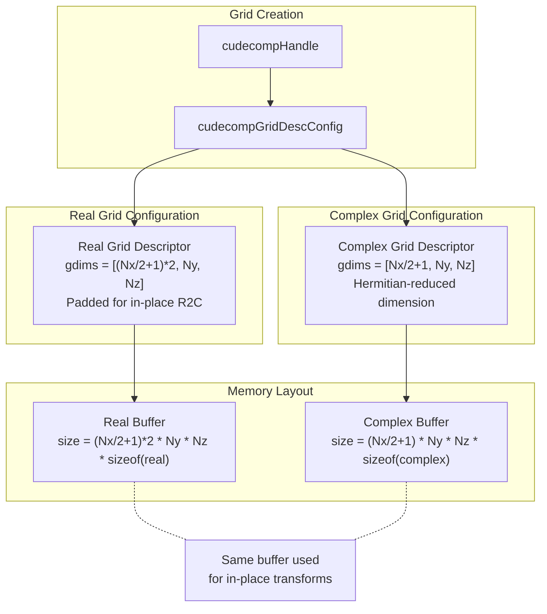

**Real Grid Padding for In-Place R2C Transforms**

The real grid's first dimension must be padded to `(Nx/2+1)*2` to accommodate complex data during in-place transforms. This ensures sufficient memory for the complex result without reallocation.

| Transform Type | Real Grid Dimensions | Complex Grid Dimensions | Padding Required |
|----------------|---------------------|------------------------|------------------|
| R2C (in-place) | `[(Nx/2+1)*2, Ny, Nz]` | `[Nx/2+1, Ny, Nz]` | Yes |
| C2C | `[Nx, Ny, Nz]` | `[Nx, Ny, Nz]` | No |

Sources: [examples/cc/taylor_green/tg.cu:376-380](), [examples/cc/taylor_green/tg.cu:370-374]()

### Example Grid Descriptor Creation

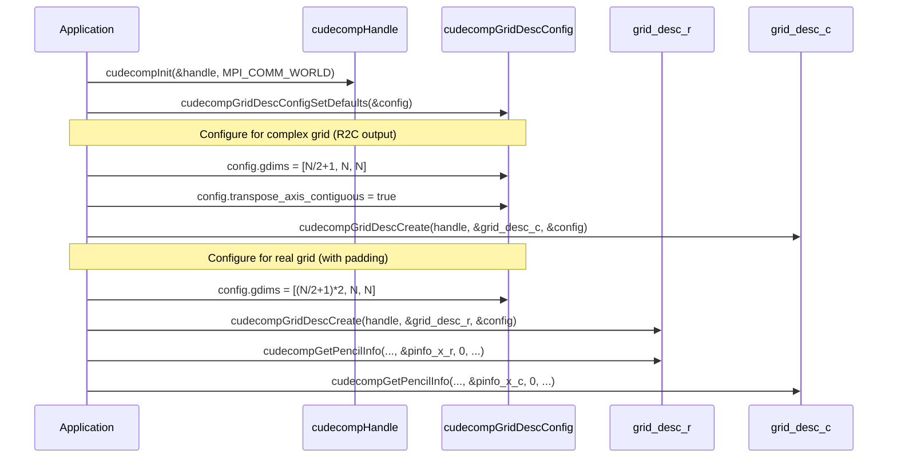

**Key Configuration Steps**

Sources: [examples/cc/taylor_green/tg.cu:356-380](), [examples/fortran/poisson/poisson.f90:160-174]()

## cuFFT Integration

cuDecomp integrates with cuFFT by providing appropriately sized pencil data for 1D transforms in each direction. Workspace can be shared between cuDecomp and cuFFT operations.

### cuFFT Plan Creation

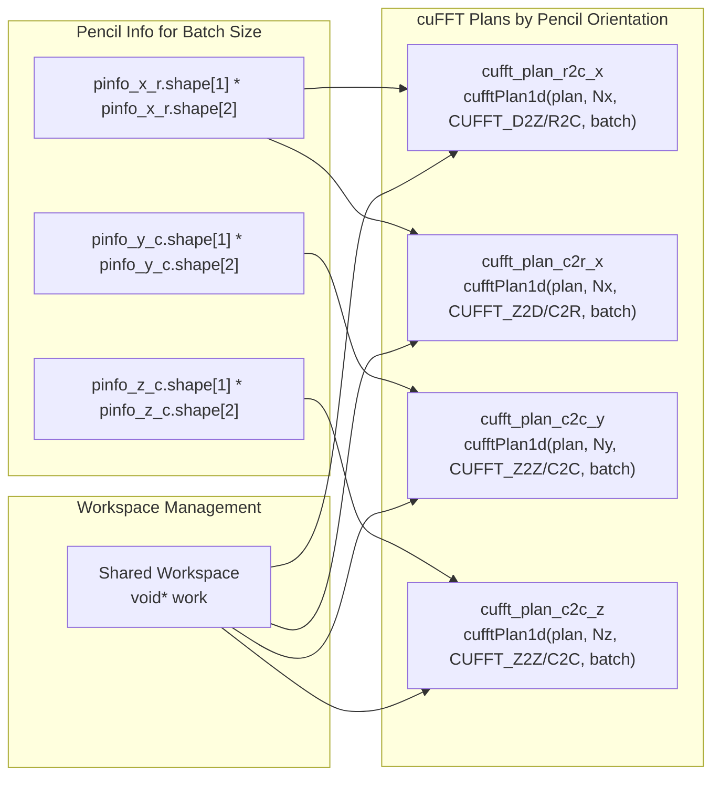

**Creating cuFFT Plans with Pencil Batch Sizes**

The batch size for each plan is determined by the pencil shape in the non-transformed dimensions. For an X-pencil transform, the batch size is `shape[1] * shape[2]` (the Y and Z dimensions of the pencil).

Sources: [examples/cc/taylor_green/tg.cu:399-425](), [examples/fortran/poisson/poisson.f90:193-204]()

### Workspace Sharing

cuDecomp and cuFFT can share workspace memory to reduce allocation overhead. The workspace size must accommodate both transpose operations and FFT scratch space.

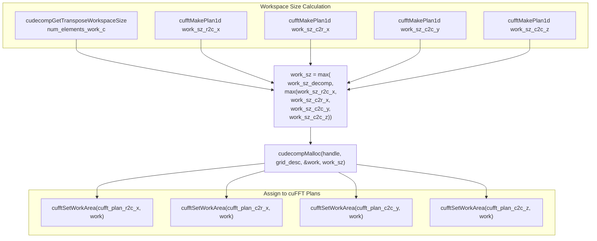

**Workspace Allocation Strategy**

1. Query transpose workspace size from cuDecomp
2. Query FFT workspace sizes from cuFFT for all plans
3. Allocate using the maximum required size
4. Assign workspace to all cuFFT plans using `cufftSetWorkArea`

Sources: [examples/cc/taylor_green/tg.cu:394-444]()

## Transform Sequence Patterns

### Forward Transform (Real to Spectral)

A complete forward R2C transform requires transforming in all three dimensions. The data transitions between pencil orientations, with cuDecomp transposes between cuFFT operations.

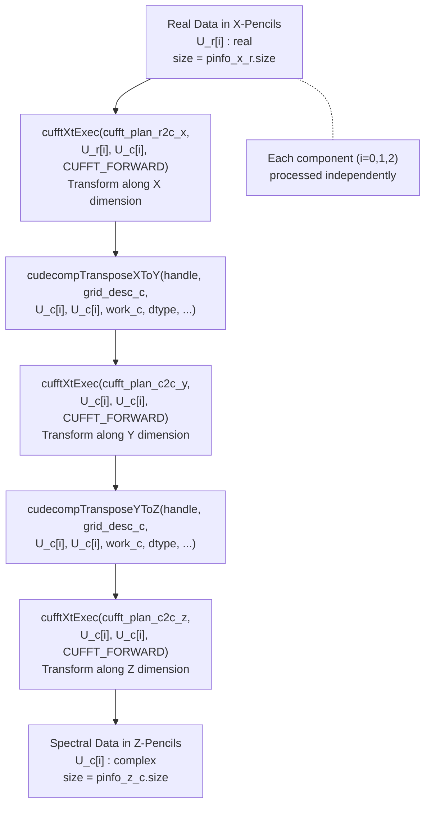

**Forward Transform Implementation Pattern**

The forward transform follows this sequence for each vector component:
1. R2C FFT on X-pencils (real → complex)
2. Transpose X → Y 
3. C2C FFT on Y-pencils
4. Transpose Y → Z
5. C2C FFT on Z-pencils (final spectral data)

Sources: [examples/cc/taylor_green/tg.cu:645-655](), [examples/fortran/poisson/poisson.f90:285-297]()

### Backward Transform (Spectral to Real)

The backward transform inverts the forward sequence, using inverse FFTs and reverse transposes.

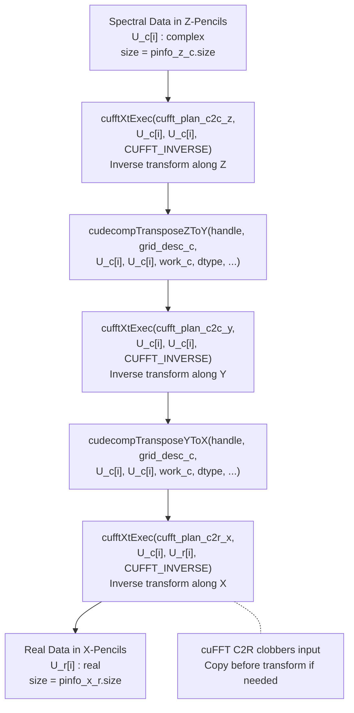

**Backward Transform Implementation Pattern**

The backward transform reverses the forward sequence:
1. Inverse C2C FFT on Z-pencils
2. Transpose Z → Y
3. Inverse C2C FFT on Y-pencils
4. Transpose Y → X
5. C2R FFT on X-pencils (complex → real)

**Important**: `cufftExecC2R` and `cufftExecZ2D` destroy the input array. If the spectral data must be preserved, copy it before the C2R transform.

Sources: [examples/cc/taylor_green/tg.cu:657-667](), [examples/fortran/poisson/poisson.f90:341-353]()

### Complex-to-Complex Transform

For C2C transforms (no dimension reduction), use identical grid descriptors for all pencil orientations.

Sources: [benchmark/CMakeLists.txt:31-34]()

## Working in Spectral Space

### Accessing Wavenumbers

After a forward transform, data exists in spectral space where operations involve wavenumbers rather than spatial coordinates. Computing wavenumbers requires understanding the cuFFT output ordering.

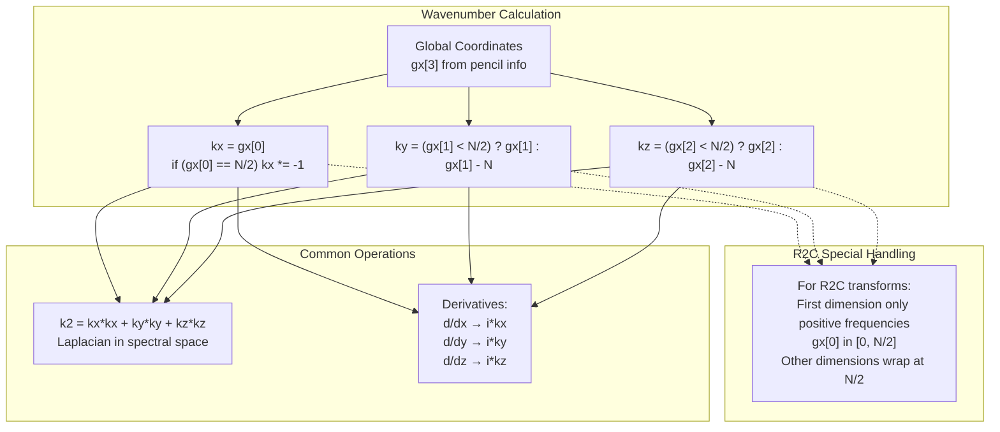

**Wavenumber Ordering in cuFFT Output**

For R2C transforms:
- **First dimension (X)**: Only positive frequencies `[0, Nx/2]`
- **Other dimensions (Y, Z)**: Standard FFT ordering with negative frequencies in second half

| Index Range | Interpretation |
|-------------|----------------|
| `gx[0] = 0 to Nx/2` | Positive frequencies (R2C) |
| `gx[1] = 0 to Ny/2-1` | Positive frequencies |
| `gx[1] = Ny/2 to Ny-1` | Negative frequencies (use `gx[1] - Ny`) |

Sources: [examples/cc/taylor_green/tg.cu:135-142](), [examples/fortran/poisson/poisson.f90:226-252]()

### Spectral Operations Example

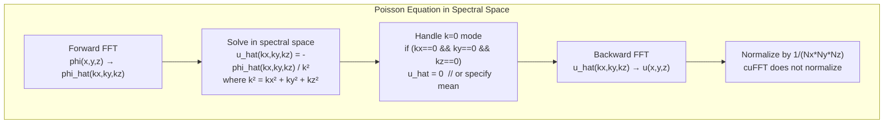

**Poisson Equation Example**

To solve `∇²u = φ`:
1. Transform `φ` to spectral space
2. Divide by `-k²` for each mode: `û(k) = -φ̂(k) / k²`
3. Handle the zero wavenumber specially (sets mean value)
4. Transform back to real space
5. Apply normalization factor `1/(Nx*Ny*Nz)`

Sources: [examples/fortran/poisson/poisson.f90:299-338]()

### Derivatives in Spectral Space

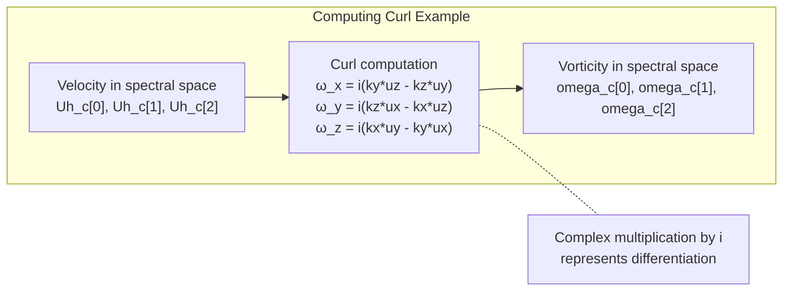

**Computing Derivatives**

Derivatives in spectral space become multiplications by `i*k`:
- `∂/∂x` → multiply by `i*kx`
- `∂/∂y` → multiply by `i*ky`
- `∂/∂z` → multiply by `i*kz`

For curl: `∇ × u`, the components are:
- `ωx = ∂uz/∂y - ∂uy/∂z = i(ky*ûz - kz*ûy)`
- `ωy = ∂ux/∂z - ∂uz/∂x = i(kz*ûx - kx*ûz)`
- `ωz = ∂uy/∂x - ∂ux/∂y = i(kx*ûy - ky*ûx)`

Sources: [examples/cc/taylor_green/tg.cu:167-183]()

## Dealiasing

For nonlinear terms in spectral methods, aliasing can introduce errors. The 2/3 rule removes the highest 1/3 of frequencies.

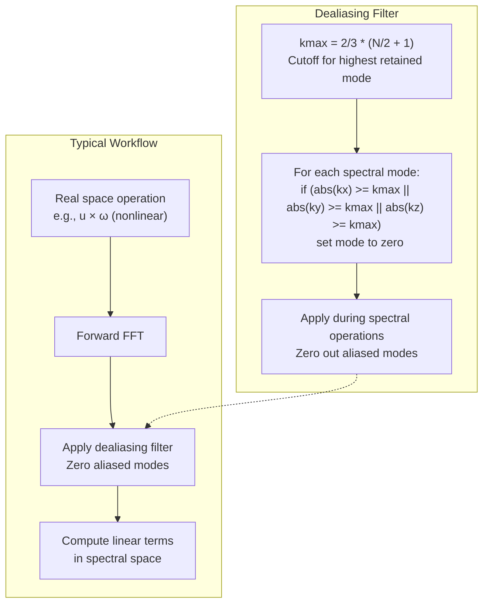

**Implementing Dealiasing**

1. Define cutoff: `kmax = (2.0/3.0) * (N/2 + 1)`
2. For each spectral mode, check if any wavenumber exceeds cutoff
3. Zero out modes with `|kx| >= kmax` or `|ky| >= kmax` or `|kz| >= kmax`
4. Apply during spectral computations after transforming nonlinear terms

Sources: [examples/cc/taylor_green/tg.cu:684](), [examples/cc/taylor_green/tg.cu:217]()

## Normalization

cuFFT does not normalize transforms. For forward-inverse pairs, a factor of `Nx*Ny*Nz` accumulates.

### Normalization Strategies

| Strategy | When Applied | Factor |
|----------|--------------|--------|
| After inverse transform | Most common | `1/(Nx*Ny*Nz)` |
| After forward transform | Less common | `1/(Nx*Ny*Nz)` |
| Split normalization | Rarely used | `1/sqrt(Nx*Ny*Nz)` each direction |

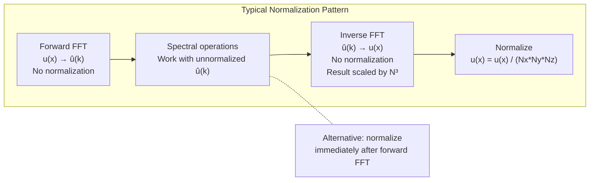

Sources: [examples/cc/taylor_green/tg.cu:190](), [examples/cc/taylor_green/tg.cu:264](), [examples/fortran/poisson/poisson.f90:314]()

## Complete Application Example Structure

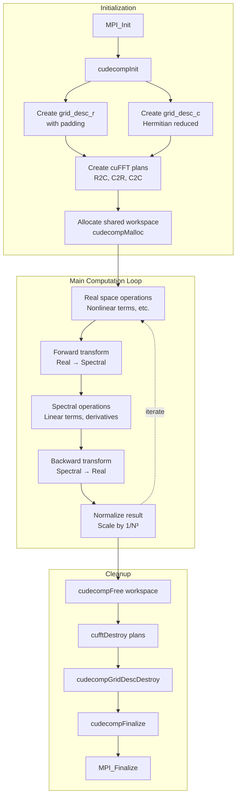

Sources: [examples/cc/taylor_green/tg.cu:340-514](), [examples/cc/taylor_green/tg.cu:323-338](), [examples/fortran/poisson/poisson.f90:158-205](), [examples/fortran/poisson/poisson.f90:381-399]()

## Example Applications

### Taylor-Green Vortex Solver

A complete 3D spectral Navier-Stokes solver demonstrating:
- Dual grid descriptors (real with padding, complex Hermitian-reduced)
- RK4 timestepping in spectral space
- Curl computation for vorticity
- Cross product in real space for nonlinear terms
- Dealiasing with 2/3 rule
- Statistics computation (kinetic energy, enstrophy)

File: [examples/cc/taylor_green/tg.cu:1-920]()

Key class: `TGSolver` [examples/cc/taylor_green/tg.cu:316-830]()

### Poisson Solver

A spectral Poisson solver demonstrating:
- Single grid descriptor (complex)
- Forward FFT of right-hand side
- Division by `-k²` in spectral space
- Zero mode handling
- Backward FFT to solution
- Error validation

File: [examples/fortran/poisson/poisson.f90:1-402]()

### FFT Benchmarks

Performance benchmarking tools for R2C and C2C transforms with cuDecomp:
- `benchmark_r2c`: Real-to-complex transforms
- `benchmark_c2c`: Complex-to-complex transforms
- Single and double precision variants (`_f` suffix for float)

Files: [benchmark/CMakeLists.txt:1-40]()

Sources: [benchmark/CMakeLists.txt:1-40](), [examples/cc/taylor_green/CMakeLists.txt:1-31](), [examples/fortran/poisson/CMakeLists.txt:1-24]()

---

