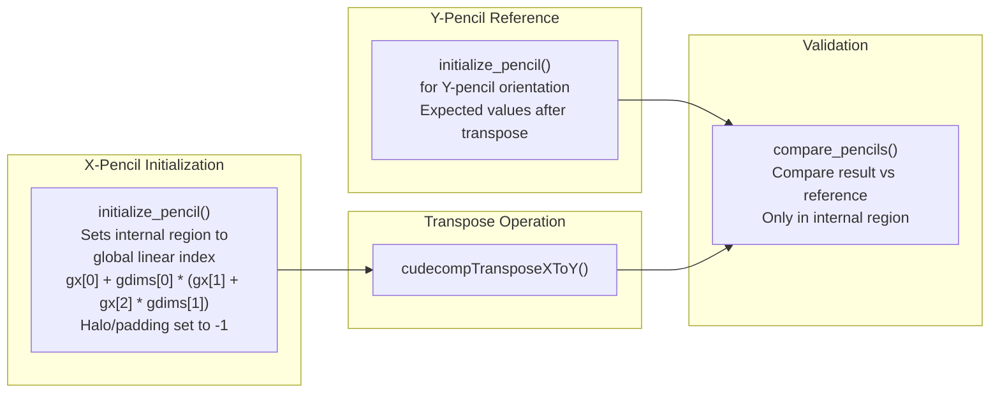
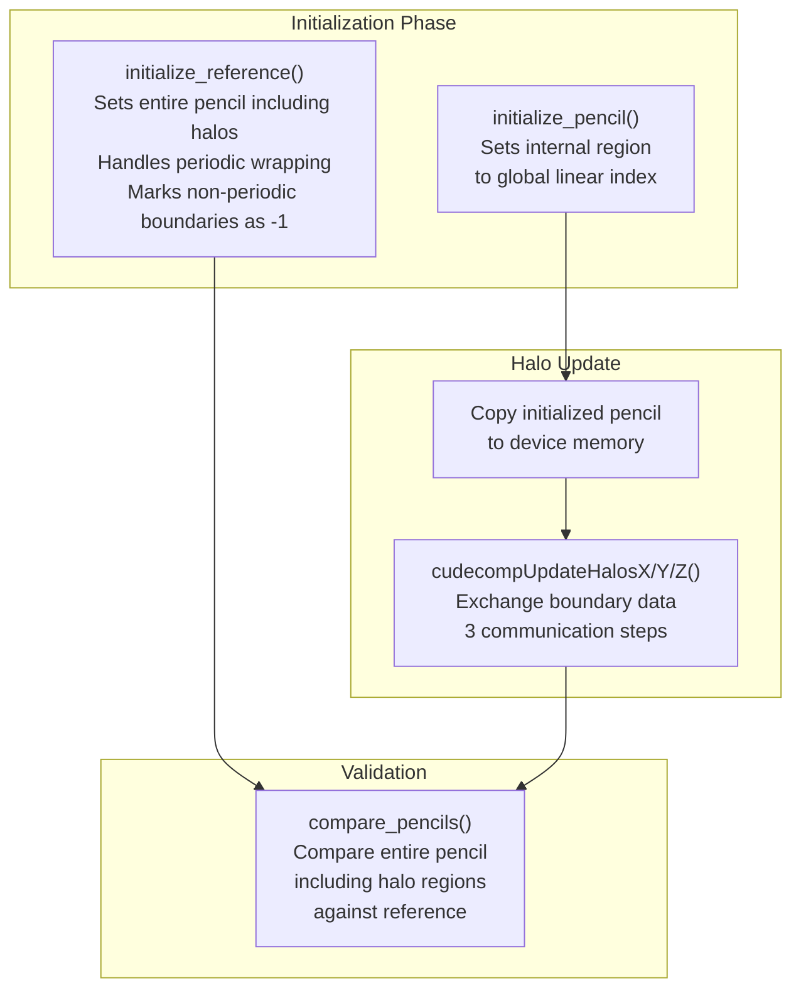
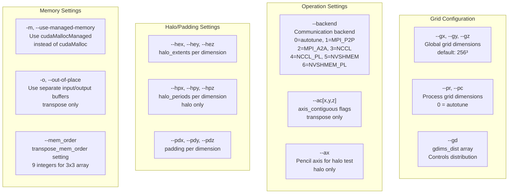
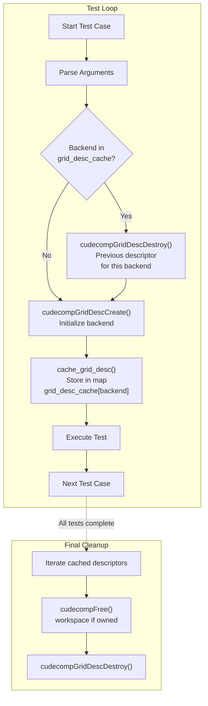
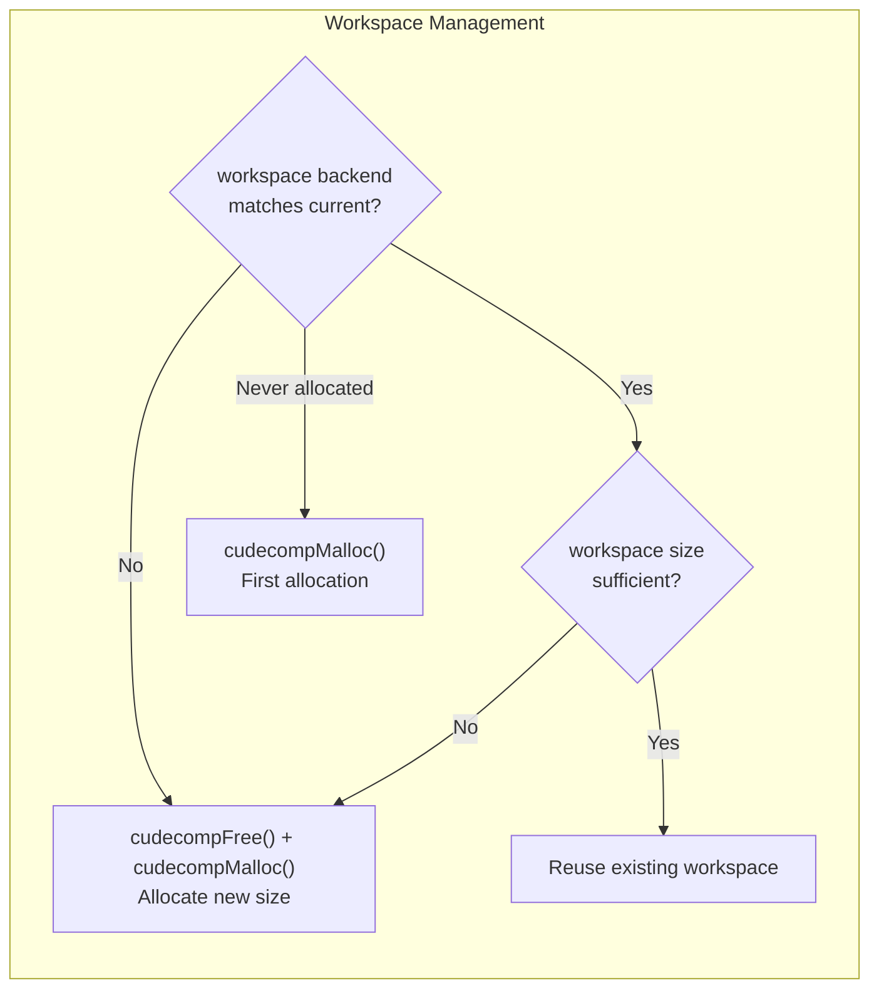
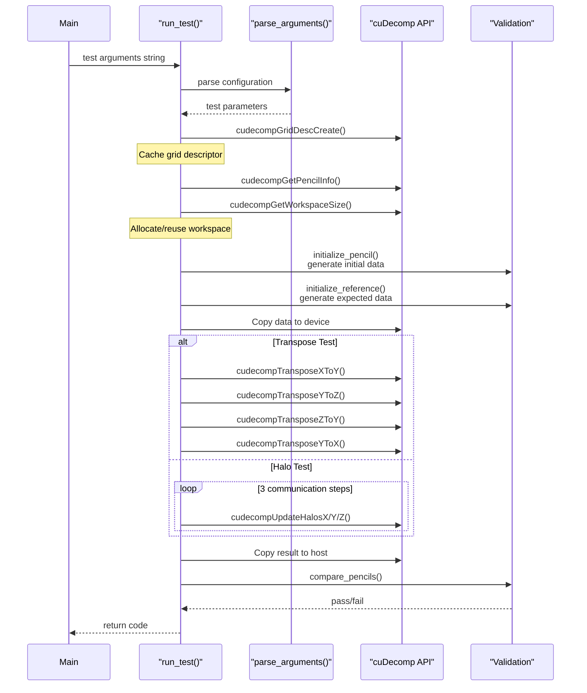
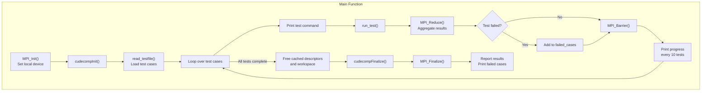
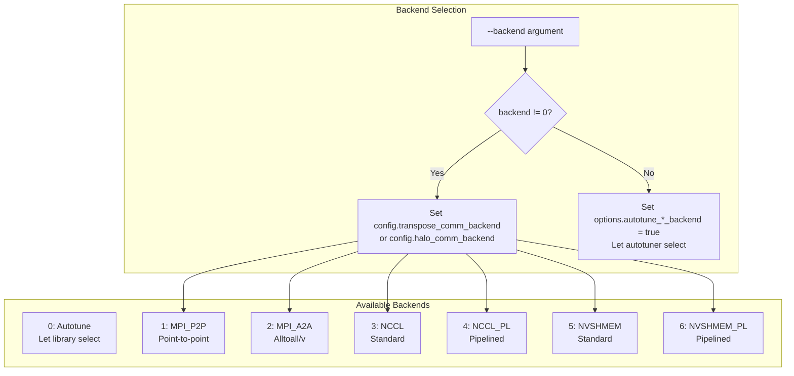

<!-- source: DeepWiki mcp.deepwiki.com · repo NVIDIA/cuDecomp · page 12 Testing and Validation · fetched 2026-10-26 -->

# Testing and Validation

<details>
<summary>Relevant source files</summary>

The following files were used as context for generating this wiki page:

- [benchmark/CMakeLists.txt](benchmark/CMakeLists.txt)
- [examples/cc/basic_usage/CMakeLists.txt](examples/cc/basic_usage/CMakeLists.txt)
- [examples/cc/taylor_green/CMakeLists.txt](examples/cc/taylor_green/CMakeLists.txt)
- [examples/fortran/basic_usage/CMakeLists.txt](examples/fortran/basic_usage/CMakeLists.txt)
- [examples/fortran/poisson/CMakeLists.txt](examples/fortran/poisson/CMakeLists.txt)
- [tests/cc/halo_test.cc](tests/cc/halo_test.cc)
- [tests/cc/transpose_test.cc](tests/cc/transpose_test.cc)
- [tests/fortran/halo_test.f90](tests/fortran/halo_test.f90)

</details>


This document describes the testing and validation infrastructure in cuDecomp, including the test suite organization, validation methodology, test execution model, and how correctness is verified across different communication backends and configurations. For information about building and running tests, see [Running the Test Suite](#12.1). For performance measurement tools, see [Benchmarking Performance](#12.2).

## Overview

The cuDecomp library includes a comprehensive test suite that validates correctness of core operations (transpose and halo updates) across multiple dimensions:

- **Operations tested**: Transpose operations in all directions (X↔Y, Y↔Z, Z↔Y) and halo updates for all pencil orientations
- **Data types**: Real and complex data in single and double precision (R32, R64, C32, C64)
- **Communication backends**: MPI, NCCL, and NVSHMEM for both transpose and halo operations
- **Language interfaces**: Both C++ and Fortran APIs
- **Memory types**: Standard device memory and CUDA managed memory
- **Operation modes**: In-place and out-of-place transposes

The test infrastructure is built around parameterized test executables that can run individual test cases or batch process test files containing multiple configurations. Each test performs independent validation by generating reference data and comparing it against operation results.

**Sources**: [tests/cc/transpose_test.cc:1-661](), [tests/cc/halo_test.cc:1-597](), [tests/fortran/halo_test.f90:1-636]()

## Test Suite Organization

### Test Executable Structure

The test suite consists of specialized executables for different operation types and languages:

| Executable | Language | Operations Tested | Data Types |
|------------|----------|-------------------|------------|
| `transpose_test_{r32,r64,c32,c64}` | C++ | cudecompTransposeXToY/YToZ/ZToY/YToX | Real/Complex, Single/Double |
| `halo_test_{r32,r64,c32,c64}` | C++ | cudecompUpdateHalosX/Y/Z | Real/Complex, Single/Double |
| `halo_test_{r32,r64,c32,c64}_fort` | Fortran | cudecompUpdateHalosX/Y/Z | Real/Complex, Single/Double |

Each executable is compiled with preprocessor definitions (e.g., `R32`, `C64`) that specialize the test for a specific data type via template/type selection mechanisms.

```mermaid
graph TB
    subgraph "Test Compilation"
        SRC_TRANS["transpose_test.cc<br/>Generic test implementation"]
        SRC_HALO_CC["halo_test.cc<br/>Generic test implementation"]
        SRC_HALO_F["halo_test.f90<br/>Generic test implementation"]
    end
    
    subgraph "Compiled Executables"
        TRANS_R32["transpose_test_r32<br/>-DR32"]
        TRANS_R64["transpose_test_r64<br/>-DR64"]
        TRANS_C32["transpose_test_c32<br/>-DC32"]
        TRANS_C64["transpose_test_c64<br/>-DC64"]
        
        HALO_R32["halo_test_r32<br/>-DR32"]
        HALO_R64["halo_test_r64<br/>-DR64"]
        HALO_C32["halo_test_c32<br/>-DC32"]
        HALO_C64["halo_test_c64<br/>-DC64"]
        
        HALO_F_R32["halo_test_r32_fort<br/>-DR32"]
        HALO_F_R64["halo_test_r64_fort<br/>-DR64"]
        HALO_F_C32["halo_test_c32_fort<br/>-DC32"]
        HALO_F_C64["halo_test_c64_fort<br/>-DC64"]
    end
    
    SRC_TRANS --> TRANS_R32
    SRC_TRANS --> TRANS_R64
    SRC_TRANS --> TRANS_C32
    SRC_TRANS --> TRANS_C64
    
    SRC_HALO_CC --> HALO_R32
    SRC_HALO_CC --> HALO_R64
    SRC_HALO_CC --> HALO_C32
    SRC_HALO_CC --> HALO_C64
    
    SRC_HALO_F --> HALO_F_R32
    SRC_HALO_F --> HALO_F_R64
    SRC_HALO_F --> HALO_F_C32
    SRC_HALO_F --> HALO_F_C64
```



**Test Suite Organization by Data Type and Language**

**Sources**: [tests/cc/transpose_test.cc:39-54](), [tests/cc/halo_test.cc:38-53](), [tests/fortran/halo_test.f90:20-42]()

### Test Execution Model

Tests can run in two modes:

1. **Single test mode**: Execute with command-line arguments directly
2. **Batch mode**: Read test cases from a file using `--testfile` or `-f` flag

The batch mode is particularly useful for comprehensive validation, allowing hundreds of test configurations to be specified in a text file with one test case per line. Each line contains command-line arguments for that specific test configuration.

**Sources**: [tests/cc/transpose_test.cc:573-597](), [tests/cc/halo_test.cc:509-533](), [tests/fortran/halo_test.f90:546-570]()

## Validation Methodology

### Reference Data Generation

Tests validate correctness by comparing operation results against reference data generated on the host. The validation approach differs between transpose and halo operations:

#### Transpose Test Validation

Transpose tests initialize pencils with a unique global linear index at each grid point, making it easy to verify that data ends up in the correct location after redistribution:



**Transpose Validation Flow**

The `initialize_pencil()` function sets values only in the internal (non-halo, non-padding) region of each pencil. During comparison, only these internal regions are validated, as halo and padding regions are not guaranteed to contain meaningful data after a transpose.

**Sources**: [tests/cc/transpose_test.cc:127-155](), [tests/cc/transpose_test.cc:103-125]()

#### Halo Test Validation

Halo tests use a more sophisticated validation approach that accounts for periodic boundary conditions:



**Halo Test Validation Flow**

The `initialize_reference()` function generates expected values for the entire pencil, including halo regions. For periodic boundaries, it wraps global indices around the grid. For non-periodic boundaries, it marks halo entries as `-1` to indicate they should remain unmodified.

**Sources**: [tests/cc/halo_test.cc:109-137](), [tests/cc/halo_test.cc:139-177](), [tests/fortran/halo_test.f90:68-100](), [tests/fortran/halo_test.f90:102-152]()

### Comparison Logic

The comparison functions verify correctness with different strategies:

**Transpose comparison** ([tests/cc/transpose_test.cc:103-125]()):
- Iterates through all pencil elements
- Computes local coordinates from linear index
- Only compares elements within the internal region (excluding halos and padding)
- Returns false if any internal element mismatches

**Halo comparison** ([tests/cc/halo_test.cc:102-108]()):
- Simple element-by-element comparison of entire arrays
- All elements including halos must match reference
- This validates that halo exchanges correctly populated boundary regions

**Sources**: [tests/cc/transpose_test.cc:103-125](), [tests/cc/halo_test.cc:102-108](), [tests/fortran/halo_test.f90:57-66]()

## Test Configuration and Parameters

### Command-Line Arguments

Tests accept extensive command-line arguments to configure the test scenario:



**Test Configuration Parameters**

These parameters allow testing various configurations without recompiling, enabling comprehensive validation across the parameter space.

**Sources**: [tests/cc/transpose_test.cc:211-229](), [tests/cc/halo_test.cc:229-244](), [tests/fortran/halo_test.f90:209-221]()

### Argument Parsing Implementation

Both C++ and Fortran tests implement argument parsing differently but support the same parameter set:

**C++ implementation** uses `getopt_long()` with a helper function `string_to_argcv()` that converts string arguments (from test files) into `argc/argv` format for consistent parsing in both single and batch modes.

**Fortran implementation** uses custom string parsing logic, splitting arguments by spaces and manually parsing each flag.

**Sources**: [tests/cc/transpose_test.cc:56-83](), [tests/cc/transpose_test.cc:231-350](), [tests/fortran/halo_test.f90:164-187](), [tests/fortran/halo_test.f90:249-378]()

## Resource Management and Caching

### Grid Descriptor Caching Strategy

To improve test throughput when running many test cases in batch mode, both transpose and halo tests implement grid descriptor caching. This avoids repeatedly initializing and destroying NCCL/NVSHMEM resources between tests that use the same backend:



**Grid Descriptor and Workspace Caching Strategy**

The caching mechanism uses an `std::unordered_map` (C++) or array (Fortran) keyed by backend type to store one grid descriptor per backend. When a new test requires the same backend, the old descriptor is destroyed and replaced, keeping NCCL/NVSHMEM communicators initialized.

**Sources**: [tests/cc/transpose_test.cc:354-364](), [tests/cc/halo_test.cc:338-345](), [tests/fortran/halo_test.f90:189-200]()

### Workspace Reuse

Workspace buffers are also cached to avoid repeated allocation/deallocation:



**Workspace Reuse Decision Tree**

The workspace is tracked in a tuple `(backend_id, pointer, size)`. If the backend matches and size is sufficient, the workspace is reused. Otherwise, it's freed using the cached grid descriptor for its backend and reallocated with the current backend.

**Sources**: [tests/cc/transpose_test.cc:463-488](), [tests/cc/halo_test.cc:436-461](), [tests/fortran/halo_test.f90:444-457]()

## Test Execution Flow

### Single Test Execution

The `run_test()` function encapsulates the complete test lifecycle:



**Test Execution Sequence**

Each test independently creates its grid descriptor, performs operations, validates results, and returns success/failure. The grid descriptor is cached for the next test.

**Sources**: [tests/cc/transpose_test.cc:366-560](), [tests/cc/halo_test.cc:347-496](), [tests/fortran/halo_test.f90:202-500]()

### Batch Test Execution

When running with a test file, the main function orchestrates multiple test executions:



**Batch Test Execution Flow**

Results are aggregated across all MPI ranks using `MPI_Reduce()` to ensure that failures on any rank are detected. Progress is printed periodically, and all failed test cases are reported at the end.

**Sources**: [tests/cc/transpose_test.cc:562-660](), [tests/cc/halo_test.cc:498-596](), [tests/fortran/halo_test.f90:503-635]()

## Data Type Support

### Preprocessor-Based Type Selection

Tests are compiled multiple times with different preprocessor definitions to create executables for each data type:

**C++ implementation** uses compile-time type selection:

```
#if defined(R32)
using real_t = float;
static cudecompDataType_t get_cudecomp_datatype(float) { return CUDECOMP_FLOAT; }
#elif defined(R64)
using real_t = double;
...
```

**Fortran implementation** uses module-level conditional compilation:

```
#ifdef R32
#define ARRTYPE real(real32)
#define DTYPE CUDECOMP_FLOAT
module halo_CUDECOMP_FLOAT_mod
#endif
```

This approach allows a single source file to be compiled into multiple test executables, each specialized for a different data type without runtime type checking overhead.

**Sources**: [tests/cc/transpose_test.cc:39-54](), [tests/cc/halo_test.cc:38-53](), [tests/fortran/halo_test.f90:20-42]()

### Type-Specific Testing

Each data type test validates:

- **Real types (R32, R64)**: Standard floating-point arithmetic, initialization with integer indices cast to real
- **Complex types (C32, C64)**: Implicit conversion from real values (imaginary parts remain zero), verifies complex data layout handling

The validation methodology works identically across all types since the test initializes data with integer-valued indices that can be represented exactly in all floating-point formats.

**Sources**: [tests/cc/transpose_test.cc:445-451](), [tests/cc/halo_test.cc:424-425]()

## Testing Different Communication Backends

### Backend Specification

Tests can target specific communication backends or use autotuning:



**Backend Selection in Tests**

This allows comprehensive testing of each backend implementation to ensure correctness across all communication methods.

**Sources**: [tests/cc/transpose_test.cc:405-409](), [tests/cc/halo_test.cc:391-395](), [tests/fortran/halo_test.f90:409-413]()

### Backend-Specific Validation

The caching strategy ensures that backend-specific resources (NCCL communicators, NVSHMEM teams, etc.) are properly initialized and reused across tests with the same backend. This tests the complete lifecycle:

1. Backend initialization during grid descriptor creation
2. Resource allocation (`cudecompMalloc` with backend-specific paths)
3. Communication operations with backend-specific implementations
4. Resource deallocation and cleanup

**Sources**: [tests/cc/transpose_test.cc:642-654](), [tests/cc/halo_test.cc:578-590]()

## Coverage and Test Case Generation

The test infrastructure enables systematic coverage of the parameter space through test files. A comprehensive test file might include:

- Multiple grid sizes (powers of 2, prime numbers, composite numbers)
- Various process grid configurations (balanced, skewed)
- All communication backends (MPI, NCCL, NVSHMEM, pipelined variants)
- Different halo extents (1-4 elements per dimension)
- Periodic and non-periodic boundary conditions
- Different memory layouts (`transpose_mem_order` settings)
- Axis-contiguous and non-axis-contiguous pencils
- With and without padding
- Managed and standard device memory

Each test case is a single line in the test file, making it easy to generate comprehensive test matrices programmatically or manually.

**Sources**: [tests/cc/transpose_test.cc:85-101](), [tests/cc/halo_test.cc:84-100](), [tests/fortran/halo_test.f90:164-187]()

---

