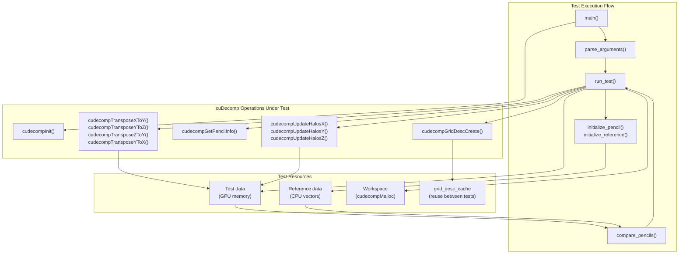
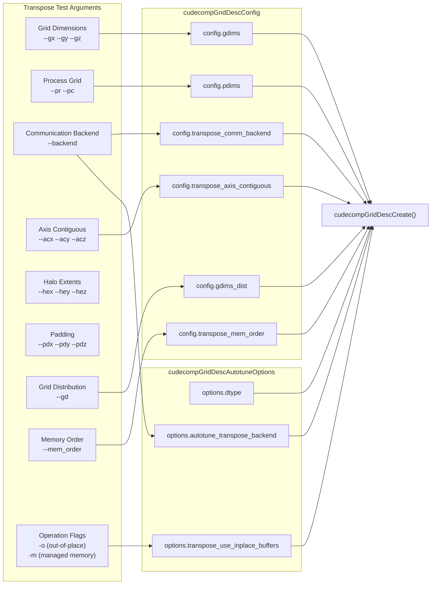
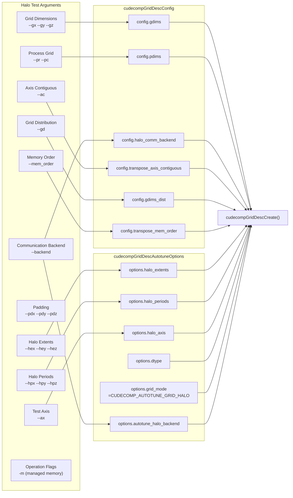

<!-- source: DeepWiki mcp.deepwiki.com · repo NVIDIA/cuDecomp · page 12.1 Running the Test Suite · fetched 2026-10-26 -->

# Running the Test Suite

<details>
<summary>Relevant source files</summary>

The following files were used as context for generating this wiki page:

- [CMakeLists.txt](CMakeLists.txt)
- [tests/cc/halo_test.cc](tests/cc/halo_test.cc)
- [tests/cc/transpose_test.cc](tests/cc/transpose_test.cc)
- [tests/fortran/halo_test.f90](tests/fortran/halo_test.f90)

</details>


This page describes how to build, execute, and interpret results from the cuDecomp test suite. The test suite validates the correctness of core operations (transposes and halo exchanges) across different data types, communication backends, and grid configurations.

For information about benchmarking performance rather than correctness, see [Benchmarking Performance](#12.2). For examples demonstrating library usage, see [Basic Usage Examples](#11.1).

## Overview

The cuDecomp test suite consists of test executables that validate transpose and halo operations. Tests can be executed with individual command-line arguments or via test files containing multiple test configurations. Each test creates reference data, performs the operation, and compares results to detect errors.

**Sources:** [tests/cc/transpose_test.cc:1-660](), [tests/cc/halo_test.cc:1-596](), [tests/fortran/halo_test.f90:1-636]()

## Building the Test Suite

Tests are built when the `CUDECOMP_BUILD_EXTRAS` CMake option is enabled:

```bash
cmake -DCUDECOMP_BUILD_EXTRAS=ON ..
make
```

This produces test executables in the build directory:

| Test Executable | Purpose | Language |
|----------------|---------|----------|
| `tests/cc/transpose_test_r32` | Transpose tests (single precision real) | C++ |
| `tests/cc/transpose_test_r64` | Transpose tests (double precision real) | C++ |
| `tests/cc/transpose_test_c32` | Transpose tests (single precision complex) | C++ |
| `tests/cc/transpose_test_c64` | Transpose tests (double precision complex) | C++ |
| `tests/cc/halo_test_r32` | Halo tests (single precision real) | C++ |
| `tests/cc/halo_test_r64` | Halo tests (double precision real) | C++ |
| `tests/cc/halo_test_c32` | Halo tests (single precision complex) | C++ |
| `tests/cc/halo_test_c64` | Halo tests (double precision complex) | C++ |
| `tests/fortran/halo_test_r32` | Halo tests (single precision real) | Fortran |
| `tests/fortran/halo_test_r64` | Halo tests (double precision real) | Fortran |
| `tests/fortran/halo_test_c32` | Halo tests (single precision complex) | Fortran |
| `tests/fortran/halo_test_c64` | Halo tests (double precision complex) | Fortran |

The tests are compiled with specific data type definitions (`R32`, `R64`, `C32`, `C64`) to specialize template types and module interfaces.

**Sources:** [CMakeLists.txt:293-306]()

## Test Execution Modes

### Single Test Mode

Execute a test with specific configuration via command-line arguments:

```bash
mpirun -np 4 tests/cc/transpose_test_r64 --gx 256 --gy 256 --gz 256 --backend 1
```

The test runs once with the specified parameters and outputs:
```
running on 256 x 256 x 256 spatial grid...
running on 2 x 2 process grid...
running using CUDECOMP_TRANSPOSE_COMM_MPI_P2P transpose backend...
running correctness tests...
```

If all checks pass, the test exits with return code 0. If any operation fails, it prints an error message (e.g., `FAILED cudecompTransposeXToY`) and exits with return code 1.

**Sources:** [tests/cc/transpose_test.cc:366-560](), [tests/cc/halo_test.cc:347-496]()

### Test File Mode

Execute multiple test configurations from a test file:

```bash
mpirun -np 4 tests/cc/transpose_test_r64 --testfile test_cases.txt
```

The test file contains one test case per line, with each line specifying command-line arguments:

```
--gx 256 --gy 256 --gz 256 --backend 1
--gx 512 --gy 512 --gz 512 --backend 2 --pr 2 --pc 2
--gx 128 --gy 128 --gz 256 --hex 1 1 1 --hey 1 1 1 --hez 1 1 1
```

Test file mode produces detailed output:

```
Running 3 tests...
command: tests/cc/transpose_test_r64 --gx 256 --gy 256 --gz 256 --backend 1
running on 256 x 256 x 256 spatial grid...
running on 2 x 2 process grid...
running using CUDECOMP_TRANSPOSE_COMM_MPI_P2P transpose backend...
running correctness tests...
 PASSED
command: tests/cc/transpose_test_r64 --gx 512 --gy 512 --gz 512 --backend 2 --pr 2 --pc 2
...
Completed 10/100 tests, running time 15.234567 s
...
Completed all tests, running time 45.123456 s
Passed all tests.
```

If any test fails, the summary lists failing cases for easy reproduction:

```
Failed 2/100 tests. Failing cases:
 tests/cc/transpose_test_r64 --gx 512 --gy 512 --gz 512 --backend 3
 tests/cc/transpose_test_r64 --gx 256 --gy 256 --gz 256 --hex 2 0 0
```

**Sources:** [tests/cc/transpose_test.cc:574-638](), [tests/cc/halo_test.cc:509-574](), [tests/fortran/halo_test.f90:164-187]()

## Test Architecture



**Test Execution Architecture**

The test programs follow a common pattern:
1. Parse arguments to determine test configuration
2. Initialize cuDecomp handle once per program execution
3. Create grid descriptor with specified configuration
4. Cache grid descriptors by backend type to avoid repeated NCCL/NVSHMEM initialization
5. Generate reference data on CPU using known indexing pattern
6. Execute operation on GPU
7. Copy results back to CPU and compare with reference
8. Reuse workspace buffers across tests when backend matches

**Sources:** [tests/cc/transpose_test.cc:352-560](), [tests/cc/halo_test.cc:333-496](), [tests/fortran/halo_test.f90:49-55,189-200]()

## Transpose Test Configuration



**Transpose Test Argument Mapping**

### Common Transpose Test Arguments

| Argument | Description | Default | Maps To |
|----------|-------------|---------|---------|
| `--gx`, `--gy`, `--gz` | Global grid dimensions | 256 × 256 × 256 | `config.gdims` |
| `--pr`, `--pc` | Process grid dimensions | 0 (autotune) | `config.pdims` |
| `--backend` | Transpose backend (0=autotune, 1=MPI_P2P, 2=MPI_A2A, 3=NCCL, 4=NCCL_PL, 5=NVSHMEM, 6=NVSHMEM_PL) | 0 | `config.transpose_comm_backend` |
| `--acx`, `--acy`, `--acz` | Axis-contiguous flags per pencil | false | `config.transpose_axis_contiguous` |
| `--gd` | Grid distribution (3 values) | 0 0 0 | `config.gdims_dist` |
| `--hex`, `--hey`, `--hez` | Halo extents per pencil (3 values each) | 0 0 0 | `cudecompGetPencilInfo` parameter |
| `--pdx`, `--pdy`, `--pdz` | Padding per pencil (3 values each) | 0 0 0 | `cudecompGetPencilInfo` parameter |
| `--mem_order` | Memory ordering (9 values) | unset | `config.transpose_mem_order` |
| `-o`, `--out-of-place` | Use separate input/output buffers | false | `options.transpose_use_inplace_buffers` |
| `-m`, `--use-managed-memory` | Use CUDA managed memory | false | Memory allocation strategy |

**Sources:** [tests/cc/transpose_test.cc:211-350](), [tests/cc/transpose_test.cc:376-418]()

## Halo Test Configuration



**Halo Test Argument Mapping**

### Common Halo Test Arguments

| Argument | Description | Default | Maps To |
|----------|-------------|---------|---------|
| `--gx`, `--gy`, `--gz` | Global grid dimensions | 256 × 256 × 256 | `config.gdims` |
| `--pr`, `--pc` | Process grid dimensions | 0 (autotune) | `config.pdims` |
| `--backend` | Halo backend (0=autotune, 1=MPI_P2P, 3=NCCL, 5=NVSHMEM) | 0 | `config.halo_comm_backend` |
| `--ac` | Axis-contiguous flag | false | `config.transpose_axis_contiguous` |
| `--gd` | Grid distribution (3 values) | 0 0 0 | `config.gdims_dist` |
| `--hex`, `--hey`, `--hez` | Halo extents per dimension | 1 | `options.halo_extents` |
| `--hpx`, `--hpy`, `--hpz` | Halo periodicity per dimension | true | `options.halo_periods` |
| `--pdx`, `--pdy`, `--pdz` | Padding per dimension | 0 | `cudecompGetPencilInfo` parameter |
| `--ax` | Axis to test (0=X, 1=Y, 2=Z) | 0 | `options.halo_axis` |
| `--mem_order` | Memory ordering (3 values) | unset | `config.transpose_mem_order` |
| `-m`, `--use-managed-memory` | Use CUDA managed memory | false | Memory allocation strategy |

**Sources:** [tests/cc/halo_test.cc:229-331](), [tests/cc/halo_test.cc:357-403]()

## Test Validation Logic

### Reference Data Generation

Tests initialize reference data by computing global linear indices for each point:

```
global_index = gx + gdims[0] * (gy + gz * gdims[1])
```

where `gx`, `gy`, `gz` are the global coordinates (0-based). This pattern creates a unique value at each grid point that is independent of decomposition.

For halo tests, the reference includes boundary handling:
- **Periodic boundaries**: Wrap indices using modulo arithmetic
- **Non-periodic boundaries**: Set halo values to -1 (sentinel)
- **Interior points**: Use global linear index

For transpose tests, only interior regions are validated since halo/padding regions may contain uninitialized or undefined data.

**Sources:** [tests/cc/transpose_test.cc:127-155](), [tests/cc/halo_test.cc:109-177](), [tests/fortran/halo_test.f90:68-152]()

### Comparison Strategy

The `compare_pencils` function validates results element-by-element:

**Transpose Tests:**
- Compare only interior points (excluding halo and padding regions)
- Check exact equality (no tolerance for numerical precision)
- Return false on first mismatch

**Halo Tests:**
- Compare entire pencil including halo regions
- Validate that periodic wrapping occurred correctly
- Validate that non-periodic boundaries remain unset (-1)
- Check exact equality

The tests use exact comparison because operations are pure data movement without arithmetic, so bit-exact results are expected.

**Sources:** [tests/cc/transpose_test.cc:103-125](), [tests/cc/halo_test.cc:102-108](), [tests/fortran/halo_test.f90:57-66]()

## Resource Management and Optimization

### Grid Descriptor Caching

Tests cache one `cudecompGridDesc_t` per backend type in `grid_desc_cache`:

```cpp
std::unordered_map<cudecompTransposeCommBackend_t, cudecompGridDesc_t> grid_desc_cache;
```

When a test requires a specific backend, the cache is checked first. If a descriptor for that backend exists, it is destroyed and replaced. This strategy:
- Keeps NCCL communicators initialized between tests
- Keeps NVSHMEM symmetric heap allocated
- Avoids expensive teardown/setup overhead
- Reduces total test execution time significantly

**Sources:** [tests/cc/transpose_test.cc:354-364](), [tests/cc/halo_test.cc:335-345](), [tests/fortran/halo_test.f90:189-200]()

### Workspace Reuse

Tests reuse workspace buffers when the backend matches:

```cpp
std::tuple<int, real_t*, size_t> workspace{-1, nullptr, 0};
```

The tuple stores: `(backend_id, buffer_pointer, buffer_size)`. When executing a new test:
- If backend matches and buffer is large enough: reuse existing buffer
- If backend matches but buffer too small: free and reallocate
- If backend differs: free with old grid descriptor, allocate with new one

This avoids repeated `cudecompMalloc`/`cudecompFree` calls and associated backend-specific overhead (NCCL registration, NVSHMEM symmetric allocation).

**Sources:** [tests/cc/transpose_test.cc:462-488](), [tests/cc/halo_test.cc:436-461](), [tests/fortran/halo_test.f90:444-457]()

### Cleanup Order

Test cleanup must respect backend requirements:

1. Free workspace using correct grid descriptor (backend-specific)
2. Destroy grid descriptors
3. Finalize cuDecomp handle
4. Finalize MPI

The workspace must be freed with the grid descriptor that allocated it because NCCL UBR handles and NVSHMEM allocations are tied to specific communicators.

**Sources:** [tests/cc/transpose_test.cc:640-657](), [tests/cc/halo_test.cc:576-594](), [tests/fortran/halo_test.f90:620-632]()

## Interpreting Test Results

### Successful Test Output

Single test mode prints configuration and exits silently:
```
running on 256 x 256 x 256 spatial grid...
running on 2 x 2 process grid...
running using CUDECOMP_TRANSPOSE_COMM_MPI_P2P transpose backend...
running correctness tests...
```
Return code: 0

Test file mode shows progress and summary:
```
Running 100 tests...
...
Completed 10/100 tests, running time 15.234567 s
...
Completed all tests, running time 45.123456 s
Passed all tests.
```
Return code: 0

### Failed Test Output

Single test mode prints error and exits:
```
FAILED cudecompTransposeXToY
```
Return code: 1

Test file mode lists all failures:
```
Failed 2/100 tests. Failing cases:
 tests/cc/transpose_test_r64 --gx 512 --gy 512 --gz 512 --backend 3
 tests/cc/transpose_test_r64 --gx 256 --gy 256 --gz 256 --hex 2 0 0
```

Each failing case can be re-run individually for debugging:
```bash
mpirun -np 4 tests/cc/transpose_test_r64 --gx 512 --gy 512 --gz 512 --backend 3
```

Return code: 1

**Sources:** [tests/cc/transpose_test.cc:514-517,526-529,538-541,550-553](), [tests/cc/halo_test.cc:487-490]()

## Test File Format Specification

Test files contain one test case per line. Each line specifies command-line arguments (without executable name):

```
# Lines starting with # are ignored as comments
--gx 128 --gy 128 --gz 128
--gx 256 --gy 256 --gz 256 --backend 1
--gx 512 --gy 512 --gz 512 --pr 2 --pc 2 --backend 2
--gx 256 --gy 256 --gz 256 --hex 1 1 1 --hey 1 1 1 --hez 1 1 1
--gx 256 --gy 256 --gz 256 --backend 3 -o -m
```

Empty lines are ignored. The test runner reads all non-empty lines and executes them sequentially.

**Sources:** [tests/cc/transpose_test.cc:85-101](), [tests/cc/halo_test.cc:84-100](), [tests/fortran/halo_test.f90:164-187]()

## Running Tests with Different MPI Configurations

Tests require MPI execution with appropriate process counts. The number of ranks should match or be compatible with the process grid configuration:

### Examples with Different Process Counts

```bash
# Auto-tune process grid (recommended)
mpirun -np 4 tests/cc/transpose_test_r64 --gx 256 --gy 256 --gz 256

# Explicit 2×2 process grid (requires exactly 4 ranks)
mpirun -np 4 tests/cc/transpose_test_r64 --gx 256 --gy 256 --gz 256 --pr 2 --pc 2

# 4×2 process grid (requires exactly 8 ranks)
mpirun -np 8 tests/cc/transpose_test_r64 --gx 512 --gy 512 --gz 512 --pr 4 --pc 2

# Single process (for debugging)
mpirun -np 1 tests/cc/transpose_test_r64 --gx 128 --gy 128 --gz 128 --pr 1 --pc 1
```

If process count doesn't match requested process grid, cuDecomp initialization will fail.

**Sources:** [tests/cc/transpose_test.cc:563-571](), [tests/cc/halo_test.cc:499-507]()

---

