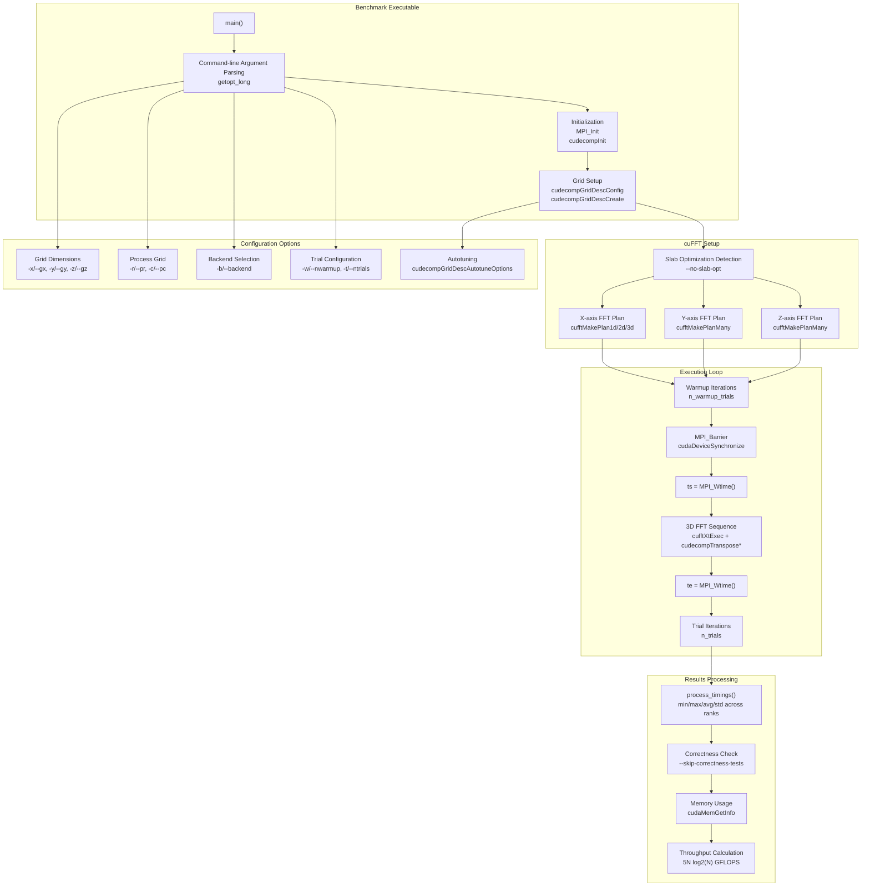
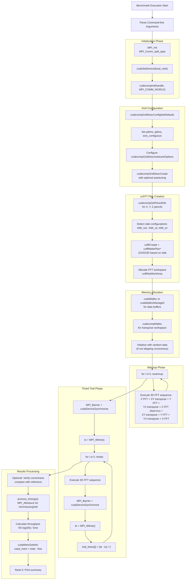
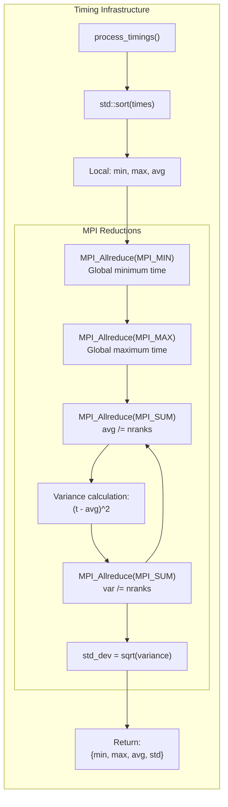

<!-- source: DeepWiki mcp.deepwiki.com · repo NVIDIA/cuDecomp · page 12.2 Benchmarking Performance · fetched 2026-10-26 -->

# Benchmarking Performance

<details>
<summary>Relevant source files</summary>

The following files were used as context for generating this wiki page:

- [benchmark/CMakeLists.txt](benchmark/CMakeLists.txt)
- [benchmark/benchmark.cu](benchmark/benchmark.cu)
- [examples/cc/basic_usage/CMakeLists.txt](examples/cc/basic_usage/CMakeLists.txt)
- [examples/cc/basic_usage/basic_usage_autotune.cu](examples/cc/basic_usage/basic_usage_autotune.cu)
- [examples/cc/taylor_green/CMakeLists.txt](examples/cc/taylor_green/CMakeLists.txt)
- [examples/fortran/basic_usage/CMakeLists.txt](examples/fortran/basic_usage/CMakeLists.txt)
- [examples/fortran/poisson/CMakeLists.txt](examples/fortran/poisson/CMakeLists.txt)
- [src/autotune.cc](src/autotune.cc)

</details>


## Purpose and Scope

This page describes the cuDecomp benchmark suite, a collection of standalone executables for measuring transpose and FFT performance across different configurations. The benchmarks allow users to manually evaluate performance characteristics of various communication backends, process grid layouts, and problem sizes without integrating cuDecomp into their own applications.

For information about the automatic performance optimization system that selects optimal configurations at runtime, see [Performance Autotuning](#7). For information about running correctness tests, see [Running the Test Suite](#12.1).

## Overview

The benchmark suite provides four executables for measuring distributed 3D FFT performance using cuDecomp for data decomposition and cuFFT for local transforms:

| Benchmark | Transform Type | Precision | Description |
|-----------|---------------|-----------|-------------|
| `benchmark_r2c` | Real-to-Complex | Double | Measures R2C and C2R FFT performance |
| `benchmark_c2c` | Complex-to-Complex | Double | Measures forward and inverse C2C FFT performance |
| `benchmark_r2c_f` | Real-to-Complex | Single | Single-precision variant of R2C benchmark |
| `benchmark_c2c_f` | Complex-to-Complex | Single | Single-precision variant of C2C benchmark |

All benchmarks follow the same execution pattern: perform warmup iterations, execute timed trials, compute statistics across ranks, and report performance metrics including throughput in GFLOPS.

Sources: [benchmark/CMakeLists.txt:1-34](), [benchmark/benchmark.cu:1-50]()

## Benchmark Architecture



Sources: [benchmark/benchmark.cu:129-205](), [benchmark/benchmark.cu:499-609]()

## Command-Line Options

The benchmark executables accept various command-line options to configure the test parameters:

### Grid Configuration Options

```
-x, --gx <NX>              X-dimension of global grid (default: 256)
-y, --gy <NY>              Y-dimension of global grid (default: 256)
-z, --gz <NZ>              Z-dimension of global grid (default: 256)
-r, --pr <PROCROWS>        Row dimension of process grid (default: 0, autotune)
-c, --pc <PROCCOLS>        Column dimension of process grid (default: 0, autotune)
--acx                      Enable X-axis contiguous pencils (default: 0)
--acy                      Enable Y-axis contiguous pencils (default: 0)
--acz                      Enable Z-axis contiguous pencils (default: 0)
```

### Communication Backend Selection

```
-b, --backend <INTEGER>    Communication backend selection:
                             0: AUTOTUNE (default)
                             1: MPI_P2P
                             2: MPI_P2P_PL (pipelined)
                             3: MPI_A2A (alltoall)
                             4: NCCL
                             5: NCCL_PL (pipelined)
                             6: NVSHMEM
                             7: NVSHMEM_PL (pipelined)
```

### Execution Configuration Options

```
-w, --nwarmup <NWARMUP>    Number of warmup iterations (default: 3)
-t, --ntrials <NTRIALS>    Number of timed trials (default: 5)
-k, --skip-threshold <VAL> Autotuner skip threshold (default: 0.0)
-o, --out-of-place         Use out-of-place transforms instead of in-place
-m, --use-managed-memory   Allocate data using cudaMallocManaged
-s, --skip-correctness-tests   Skip result verification
-n, --no-slab-opt          Disable slab optimizations (2D/3D FFTs)
```

Sources: [benchmark/benchmark.cu:79-127](), [benchmark/benchmark.cu:157-205]()

## Benchmark Execution Flow



Sources: [benchmark/benchmark.cu:129-205](), [benchmark/benchmark.cu:211-260](), [benchmark/benchmark.cu:272-412](), [benchmark/benchmark.cu:414-448](), [benchmark/benchmark.cu:470-609](), [benchmark/benchmark.cu:612-693]()

## FFT Sequence and Slab Optimizations

The benchmark executes a complete 3D FFT forward-inverse cycle, which includes multiple local FFTs and cuDecomp transpose operations. The specific sequence depends on slab detection:

### Standard Decomposition

For general process grids where both `pdims[0] > 1` and `pdims[1] > 1`:

1. **X-axis FFT** (R2C or C2C) on X-pencils
2. **X-to-Y transpose** (`cudecompTransposeXToY`)
3. **Y-axis FFT** (C2C) on Y-pencils
4. **Y-to-Z transpose** (`cudecompTransposeYToZ`)
5. **Z-axis forward FFT** (C2C) on Z-pencils
6. **Z-axis inverse FFT** (C2C) on Z-pencils
7. **Z-to-Y transpose** (`cudecompTransposeZToY`)
8. **Y-axis FFT** (C2C) on Y-pencils
9. **Y-to-X transpose** (`cudecompTransposeYToX`)
10. **X-axis FFT** (C2R or C2C) on X-pencils

### Slab Optimizations

The benchmark automatically detects and optimizes for slab configurations:

| Slab Type | Condition | Optimization |
|-----------|-----------|--------------|
| **XYZ Slab** | `pdims[0] == 1 && pdims[1] == 1` | Single rank: use 3D FFT, skip all transposes |
| **XY Slab** | `pdims[0] == 1` | Use 2D FFT for X-Y plane, skip X-to-Y transpose |
| **YZ Slab** | `pdims[1] == 1` (without XYZ) | Use 2D FFT for Y-Z plane, skip Y-to-Z and Z-to-Y transposes |

Slab optimizations can be disabled with the `--no-slab-opt` flag to measure transpose-only performance.

Sources: [benchmark/benchmark.cu:296-412](), [benchmark/benchmark.cu:509-584]()

## Timing Methodology



The benchmark uses wall-clock timing with `MPI_Wtime()` to measure end-to-end performance:

1. **Warmup Phase**: Execute `n_warmup_trials` iterations without timing to prime caches and JIT-compile CUDA kernels
2. **Barrier Synchronization**: Call `MPI_Barrier()` and `cudaDeviceSynchronize()` before timing starts
3. **Trial Execution**: For each of `n_trials`:
   - Record start time with `MPI_Wtime()`
   - Execute complete FFT sequence
   - Synchronize with `MPI_Barrier()` and `cudaDeviceSynchronize()`
   - Record end time
   - Compute trial time (divided by 2 for forward or inverse only)
4. **Statistics Processing**: Use `process_timings()` to compute min/max/avg/std across all ranks via MPI reductions

This methodology ensures accurate performance measurement by:
- Eliminating cold-start effects through warmup
- Using global barriers to ensure all ranks are synchronized
- Computing statistics across all ranks to identify load imbalances
- Excluding result scaling from timed region

Sources: [benchmark/benchmark.cu:47-69](), [benchmark/benchmark.cu:499-609]()

## Performance Metrics and Output

The benchmark reports comprehensive performance statistics on rank 0:

### Result Summary Format

```
Result Summary:
    FFT size: <gx> x <gy> x <gz>
    FFT mode: <R2C|C2C>
    Precision: <single|double>
    Process grid: <pdims[0]> x <pdims[1]>
    Comm backend: <backend_name>
    Axis contiguous: <ac[0]> <ac[1]> <ac[2]>
    Out of place: <true|false>
    Managed memory: <true|false>
    Slab optimizations: <true|false>
    Time min/max/avg/std [ms]: <t_min>/<t_max>/<t_avg>/<t_std>
    Throughput min/max/avg/std [GFLOPS/s]: <f_min>/<f_max>/<f_avg>/<f_std>
    Max error: <err_max>
    Memory usage range (per GPU) [MB]: <mem_min> - <mem_max>
```

### Throughput Calculation

The benchmark computes throughput using the standard formula for 3D FFT floating-point operations:

```
flopcount = 5.0 * N * log2(N) * 1e-9  [GFLOPS]
throughput = flopcount / time_avg     [GFLOPS/s]
```

where `N = gx * gy * gz` is the total number of grid points.

### Correctness Verification

When correctness testing is enabled (default), the benchmark:
1. Initializes input data with random values using `std::uniform_real_distribution`
2. Stores a reference copy on the host
3. After the complete forward-inverse FFT cycle, copies results back to host
4. Compares each element against the reference with tolerance checking
5. Reports the maximum error via `MPI_Reduce(MPI_MAX)`

For R2C benchmarks, padding elements are excluded from verification.

Sources: [benchmark/benchmark.cu:654-693](), [benchmark/benchmark.cu:470-487](), [benchmark/benchmark.cu:612-644]()

## Building the Benchmark Suite

The benchmark executables are built as part of the cuDecomp extras. The build process creates four separate executables with different compile-time definitions:

```cmake
set(benchmark_targets
  benchmark_r2c      # R2C, double precision
  benchmark_c2c      # C2C, double precision
  benchmark_r2c_f    # R2C, single precision
  benchmark_c2c_f    # C2C, single precision
)

# Common configuration for all targets
foreach(tgt ${benchmark_targets})
  add_executable(${tgt})
  target_sources(${tgt} PRIVATE benchmark.cu)
  target_link_libraries(${tgt} PRIVATE cudecomp NVHPC::CUFFT)
  # ... CUDA architecture settings ...
endforeach()

# Target-specific compile definitions
target_compile_definitions(benchmark_r2c PRIVATE R2C)
target_compile_definitions(benchmark_c2c PRIVATE C2C)
target_compile_definitions(benchmark_r2c_f PRIVATE R2C USE_FLOAT)
target_compile_definitions(benchmark_c2c_f PRIVATE C2C USE_FLOAT)
```

### Build Requirements

- CMake 3.17 or later
- MPI implementation (for distributed execution)
- CUDA Toolkit (for GPU operations)
- cuFFT library (for local FFT transforms)
- NCCL (optional, for NCCL backend testing)
- NVSHMEM (optional, for NVSHMEM backend testing)

### Build Commands

```bash
# Configure with benchmarks enabled
cmake -DBUILD_EXTRAS=ON /path/to/cudecomp

# Build all benchmarks
cmake --build . --target benchmark_r2c benchmark_c2c benchmark_r2c_f benchmark_c2c_f

# Or build all extras at once
cmake --build .
```

The executables are installed to `${CMAKE_INSTALL_PREFIX}/bin/benchmark`.

Sources: [benchmark/CMakeLists.txt:1-39]()

## Example Usage Scenarios

### Basic Performance Test

Measure double-precision C2C FFT performance with default settings (256³ grid, autotuned configuration):

```bash
mpirun -n 16 ./benchmark_c2c
```

### Testing Specific Backend

Compare MPI point-to-point vs NCCL performance on a 512³ grid:

```bash
# MPI_P2P backend
mpirun -n 64 ./benchmark_c2c -x 512 -y 512 -z 512 -b 1

# NCCL backend
mpirun -n 64 ./benchmark_c2c -x 512 -y 512 -z 512 -b 4
```

### Process Grid Exploration

Test different process grid configurations without autotuning:

```bash
# 8x8 process grid
mpirun -n 64 ./benchmark_c2c -r 8 -c 8 -b 0

# 4x16 process grid
mpirun -n 64 ./benchmark_c2c -r 4 -c 16 -b 0

# 16x4 process grid
mpirun -n 64 ./benchmark_c2c -r 16 -c 4 -b 0
```

### Autotuning with Custom Trial Counts

Run extensive autotuning with more trials for better statistics:

```bash
mpirun -n 64 ./benchmark_c2c -x 1024 -y 1024 -z 1024 -w 5 -t 10
```

This executes 5 warmup iterations and 10 timed trials for each backend/grid combination.

### Out-of-Place Performance Testing

Compare in-place vs out-of-place performance:

```bash
# In-place (default)
mpirun -n 16 ./benchmark_c2c -x 256 -y 256 -z 256

# Out-of-place
mpirun -n 16 ./benchmark_c2c -x 256 -y 256 -z 256 -o
```

### Weak Scaling Study

Test how performance scales with problem size and processor count (constant work per rank):

```bash
# 256³ on 8 ranks (256³/8 ≈ 2M points/rank)
mpirun -n 8 ./benchmark_c2c -x 256 -y 256 -z 256

# 512³ on 64 ranks (512³/64 ≈ 2M points/rank)
mpirun -n 64 ./benchmark_c2c -x 512 -y 512 -z 512

# 1024³ on 512 ranks (1024³/512 ≈ 2M points/rank)
mpirun -n 512 ./benchmark_c2c -x 1024 -y 1024 -z 1024
```

### Single-Precision Performance

Measure single-precision performance (higher throughput, lower memory):

```bash
mpirun -n 16 ./benchmark_c2c_f -x 512 -y 512 -z 512
```

### Memory-Constrained Testing

Test with managed memory for systems with limited GPU memory:

```bash
mpirun -n 8 ./benchmark_c2c -x 1024 -y 1024 -z 1024 -m
```

### Skip Correctness for Pure Performance

For production performance testing without verification overhead:

```bash
mpirun -n 64 ./benchmark_c2c -x 2048 -y 2048 -z 2048 -s
```

Sources: [benchmark/benchmark.cu:79-127]()

## Interpreting Benchmark Results

### Understanding Timing Statistics

The benchmark reports four timing statistics for each configuration:

- **min**: Fastest trial across all ranks (best-case performance)
- **max**: Slowest trial across all ranks (worst-case performance)
- **avg**: Average time across all ranks and trials (typical performance)
- **std**: Standard deviation (measure of performance variability)

High standard deviation indicates:
- Load imbalance across ranks
- Network contention or variability
- System interference from other processes
- Need for more warmup iterations

### Performance Analysis Guidelines

1. **Compare avg values** for typical performance differences between configurations
2. **Check max - min spread** to identify load imbalances
3. **Monitor std/avg ratio** as a percentage (< 5% is good, > 10% indicates issues)
4. **Verify correctness** before trusting performance numbers (errors indicate bugs)
5. **Check memory usage** to ensure adequate GPU memory availability

### Backend Selection Recommendations

Based on benchmark results, general guidelines:

- **MPI_P2P**: Good baseline, works on all systems
- **MPI_P2P_PL**: Better overlap for high-latency networks
- **MPI_A2A**: Efficient for small messages, MPI-optimized
- **NCCL**: Best for NVLink/NVSwitch systems, GPU-native
- **NCCL_PL**: Overlap optimization for NCCL
- **NVSHMEM**: Best for multi-GPU nodes with symmetric memory
- **NVSHMEM_PL**: Overlap optimization for NVSHMEM

Always run benchmarks on target hardware to verify optimal backend.

Sources: [benchmark/benchmark.cu:47-69](), [benchmark/benchmark.cu:654-693]()

## Relationship to Autotuning System

While the benchmark suite provides manual performance measurement, cuDecomp also includes an integrated autotuning system (see [Performance Autotuning](#7)). Key differences:

| Aspect | Benchmark Suite | Autotuning System |
|--------|-----------------|-------------------|
| **Purpose** | Manual performance measurement | Automatic configuration selection |
| **Integration** | Standalone executables | Library function calls |
| **Scope** | Full FFT sequences | Transpose or halo operations |
| **Timing** | `MPI_Wtime()` wall-clock | `cudaEvent_t` GPU timing |
| **Output** | Detailed statistics | Selected configuration |
| **Use case** | Performance analysis, comparisons | Production optimization |

The autotuning system reuses similar timing methodology from the benchmark suite, as seen in [src/autotune.cc:53-74]() where the `processTimings` function follows the same pattern as the benchmark's `process_timings` function.

Users can leverage both: run benchmarks to understand performance characteristics, then use autotuning in applications for automatic optimization.

Sources: [benchmark/benchmark.cu:47-69](), [src/autotune.cc:53-74]()

---

