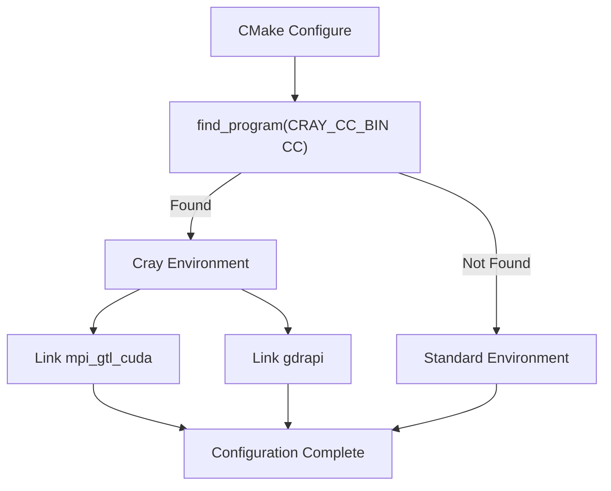
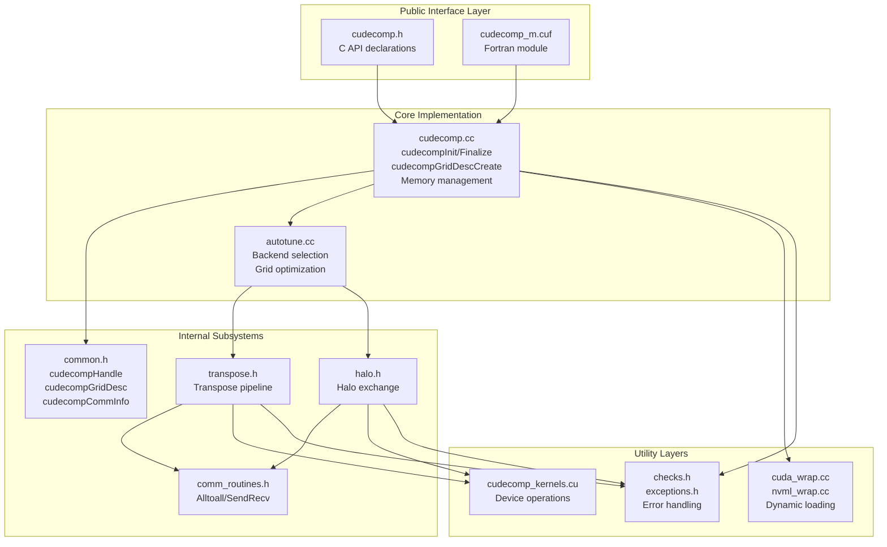
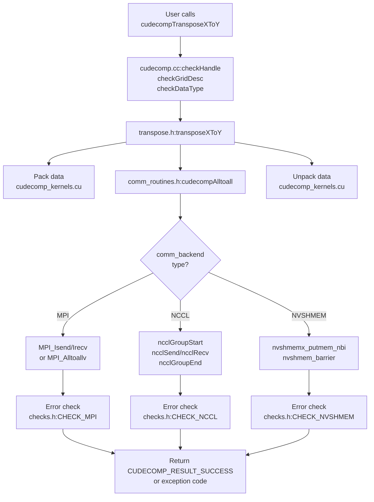
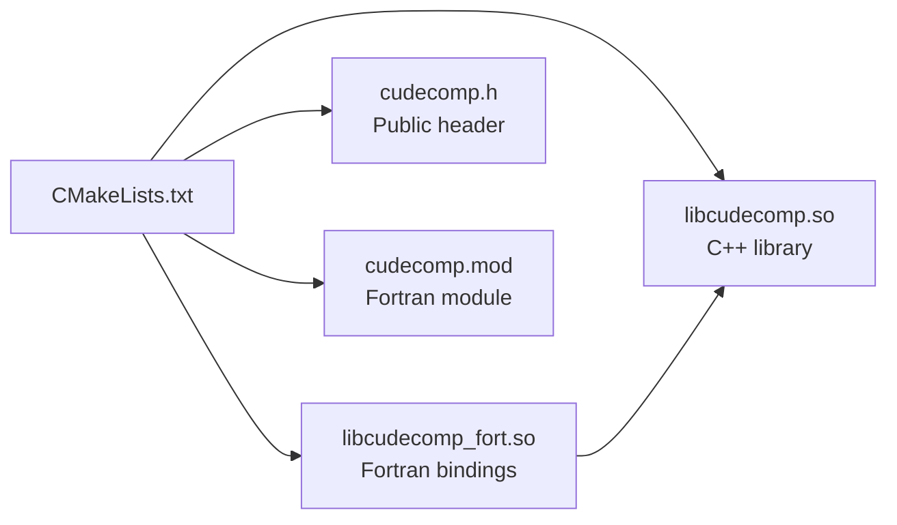
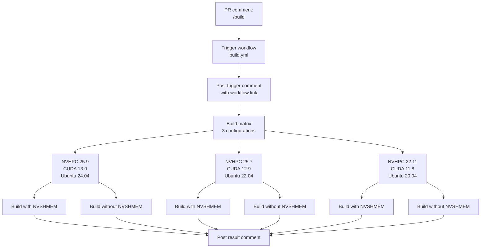
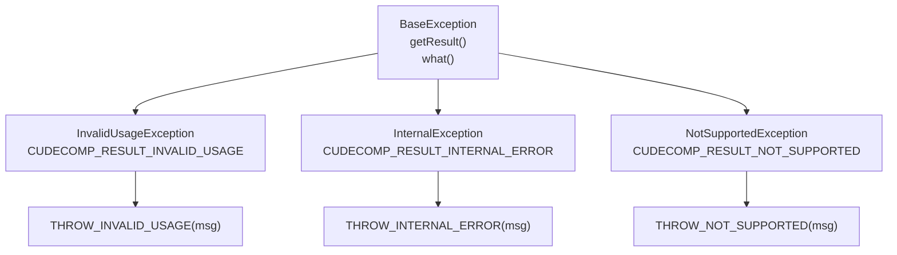
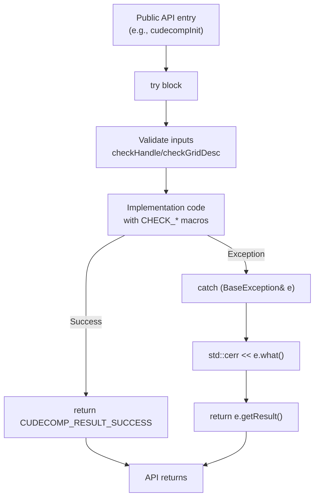
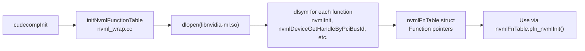
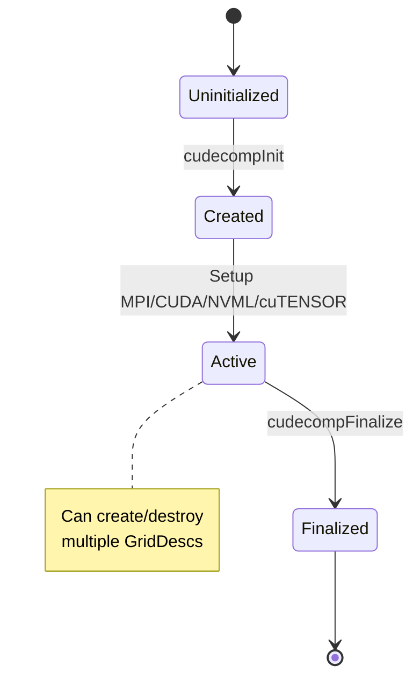
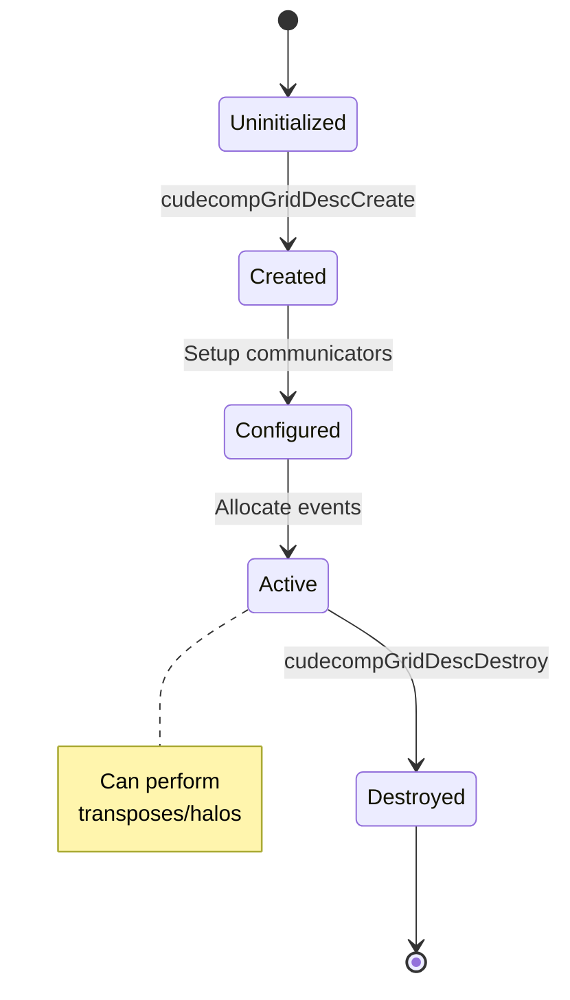

<!-- source: DeepWiki mcp.deepwiki.com · repo NVIDIA/cuDecomp · page 13 Development Guide · fetched 2026-10-26 -->

# Development Guide

<details>
<summary>Relevant source files</summary>

The following files were used as context for generating this wiki page:

- [.github/workflows/build.yml](.github/workflows/build.yml)
- [CMakeLists.txt](CMakeLists.txt)
- [cmake/test_std_fs.cc](cmake/test_std_fs.cc)
- [src/cudecomp.cc](src/cudecomp.cc)

</details>


This page provides an overview for developers who want to contribute to, extend, or debug cuDecomp. It covers the development environment setup, codebase organization, build system overview, and development workflows. For detailed information about specific subsystems, see:
- Build system architecture and CMake configuration: [Build System Architecture](#13.1)
- CI/CD pipeline and testing workflows: [CI/CD Pipeline](#13.2)
- Error handling patterns and debugging: [Error Handling](#13.3)

For information about using cuDecomp in applications, see [Getting Started](#2). For internal implementation details, see [Internal Architecture](#14).

## Development Environment Requirements

cuDecomp requires the NVHPC SDK for compilation, as it depends on NVHPC-specific features and compilers.

### Required Compilers

The build system automatically locates and uses NVHPC compilers:

| Compiler | Purpose | Location Detection |
|----------|---------|-------------------|
| `nvc++` | C++ compilation with CUDA support | [CMakeLists.txt:24-25]() |
| `nvfortran` | Fortran bindings (optional) | [CMakeLists.txt:28-29]() |

The compilers are searched via `find_program`, and the build will fail if they are not found in the system PATH.

### Required Dependencies

| Dependency | Purpose | Configuration |
|-----------|---------|---------------|
| MPI | Distributed communication | Detected via `find_package(MPI REQUIRED)` [CMakeLists.txt:75]() |
| NCCL | GPU collective operations | Located via NVHPC package or override path [CMakeLists.txt:104-124]() |
| cuTENSOR | Tensor operations for transposes | Provided by NVHPC SDK [CMakeLists.txt:97]() |
| CUDA Runtime | GPU execution | Provided by NVHPC SDK [CMakeLists.txt:97]() |
| NVML | GPU topology detection | Dynamically loaded at runtime [src/cudecomp.cc:429]() |

### Optional Dependencies

| Dependency | Purpose | Enable Flag |
|-----------|---------|-------------|
| NVSHMEM | Symmetric memory communication | `-DCUDECOMP_ENABLE_NVSHMEM=1` [CMakeLists.txt:18]() |
| NVTX | Performance profiling ranges | `-DCUDECOMP_ENABLE_NVTX=ON` (default) [CMakeLists.txt:17]() |

### Special Environment Detection

The build system detects Cray programming environments automatically by searching for the `CC` wrapper [CMakeLists.txt:68-72](). When detected, it adds Cray-specific libraries for GPU-aware MPI support [CMakeLists.txt:81-94]().

**Cray Environment Detection Diagram**



Sources: [CMakeLists.txt:68-94]()

## Codebase Organization

The cuDecomp repository is organized into distinct layers with clear separation between public and internal components.

### Directory Structure

```
cudecomp/
├── include/              # Public API headers
│   └── cudecomp.h       # Main C API header
├── src/                 # Implementation files
│   ├── cudecomp.cc      # Core implementation
│   ├── autotune.cc      # Autotuning system
│   ├── cuda_wrap.cc     # CUDA driver wrapper
│   ├── nvml_wrap.cc     # NVML wrapper
│   ├── cudecomp_kernels.cu      # Device kernels
│   ├── cudecomp_kernels_rdc.cu  # RDC kernels
│   ├── cudecomp_m.cuf   # Fortran module
│   └── internal/        # Internal headers
│       ├── common.h     # Core data structures
│       ├── autotune.h   # Autotuning routines
│       ├── transpose.h  # Transpose operations
│       ├── halo.h       # Halo exchange
│       ├── comm_routines.h  # Communication layer
│       ├── checks.h     # Error checking macros
│       ├── exceptions.h # Exception hierarchy
│       └── ...
├── examples/            # Example applications
├── tests/              # Test suite
├── benchmark/          # Performance benchmarks
└── CMakeLists.txt      # Build configuration
```

### Component Layer Architecture



Sources: [CMakeLists.txt:165-175](), [src/cudecomp.cc:1-47]()

### Public vs Internal Headers

The API is divided into public and internal components:

**Public API** (`include/cudecomp.h`):
- C function declarations: `cudecompInit`, `cudecompGridDescCreate`, `cudecompTranspose*`, etc.
- Type definitions: `cudecompHandle_t`, `cudecompGridDesc_t`, configuration structures
- Enums: `cudecompTransposeCommBackend_t`, `cudecompHaloCommBackend_t`, `cudecompDataType_t`

**Internal Headers** (`src/internal/`):
- `common.h`: Full definitions of `cudecompHandle`, `cudecompGridDesc`, and related structures
- `checks.h`: Error checking macros (`CHECK_MPI`, `CHECK_CUDA`, `CHECK_NCCL`, etc.)
- `exceptions.h`: Exception class hierarchy for error propagation
- Subsystem headers: `transpose.h`, `halo.h`, `comm_routines.h`, `autotune.h`

This separation ensures that:
1. Users only see opaque pointer types for handles
2. Internal implementation details remain encapsulated
3. ABI stability is maintained across releases

Sources: [include/cudecomp.h](), [src/cudecomp.cc:36-45]()

## Core Implementation Flow

The following diagram shows how a typical API call flows through the implementation layers:

**API Call Flow Example**



Sources: [src/cudecomp.cc:136-143](), [src/internal/transpose.h](), [src/internal/comm_routines.h](), [src/internal/checks.h]()

## Build System Overview

cuDecomp uses CMake with a multi-stage configuration process. Detailed information is available in [Build System Architecture](#13.1).

### Key Build Options

| Option | Default | Description |
|--------|---------|-------------|
| `CUDECOMP_BUILD_FORTRAN` | `ON` | Build Fortran bindings and module |
| `CUDECOMP_ENABLE_NVTX` | `ON` | Enable NVTX profiling ranges |
| `CUDECOMP_ENABLE_NVSHMEM` | `OFF` | Enable NVSHMEM backend support |
| `CUDECOMP_BUILD_EXTRAS` | `OFF` | Build examples, tests, benchmarks |
| `CUDECOMP_CUDA_CC_LIST` | Auto | List of CUDA compute capabilities |
| `CUDECOMP_NCCL_HOME` | (empty) | Override path for NCCL library |
| `CUDECOMP_NVSHMEM_HOME` | (empty) | Override path for NVSHMEM library |

Sources: [CMakeLists.txt:15-21](), [CMakeLists.txt:51-64]()

### CUDA Architecture Selection

The build system automatically selects appropriate CUDA compute capabilities based on the CUDA version:

| CUDA Version | Default Architectures |
|--------------|----------------------|
| ≥ 13.0 | 75, 80, 90, 100 |
| ≥ 12.8 | 70, 80, 90, 100 |
| ≥ 11.8 | 70, 80, 90 |
| < 11.8 | 70, 80 |

Users can override this by setting `-DCUDECOMP_CUDA_CC_LIST="70;80;90"`.

Sources: [CMakeLists.txt:51-64]()

### Build Targets

The CMake configuration produces the following targets:

**Library Targets:**


**Extras Targets (when `CUDECOMP_BUILD_EXTRAS=1`):**
- `tests/cc/halo_test`: C++ halo validation
- `tests/fortran/halo_test`: Fortran halo validation
- `examples/cc/basic_usage`: Basic C++ example
- `examples/cc/taylor_green`: Taylor-Green vortex solver
- `examples/fortran/basic_usage`: Basic Fortran example
- `examples/fortran/poisson`: Poisson solver with FFT
- `benchmark/benchmark_r2c`, `benchmark_c2c`: Performance benchmarks

Sources: [CMakeLists.txt:148-306]()

## Testing and CI/CD Overview

cuDecomp uses GitHub Actions for continuous integration with comment-triggered builds. Detailed information is available in [CI/CD Pipeline](#13.2).

### CI/CD Workflow Structure



Sources: [.github/workflows/build.yml:1-110]()

### CI Build Matrix

The CI system tests three NVHPC SDK versions spanning approximately 3 years of releases:

| Configuration | NVHPC Version | CUDA Version | Ubuntu Version |
|--------------|---------------|--------------|----------------|
| Latest | 25.9 | 13.0 | 24.04 |
| Recent | 25.7 | 12.9 | 22.04 |
| Stable | 22.11 | 11.8 | 20.04 |

Each configuration performs two builds:
1. Full build with NVSHMEM enabled (`-DCUDECOMP_ENABLE_NVSHMEM=1 -DCUDECOMP_BUILD_EXTRAS=1`)
2. Library-only build without NVSHMEM (default options)

Sources: [.github/workflows/build.yml:30-83]()

## Error Handling Patterns

cuDecomp uses a consistent error handling approach across all API functions. Detailed information is available in [Error Handling](#13.3).

### Exception-Based Internal Error Handling

Internally, cuDecomp uses C++ exceptions derived from `BaseException`:



Sources: [src/internal/exceptions.h](), [src/cudecomp.cc:505-511]()

### Error Checking Macros

The codebase uses standardized macros for error checking:

| Macro | Purpose | Exception on Failure |
|-------|---------|---------------------|
| `CHECK_MPI(call)` | Validate MPI return codes | `InternalException` |
| `CHECK_CUDA(call)` | Validate CUDA runtime calls | `InternalException` |
| `CHECK_CUDA_DRV(call)` | Validate CUDA driver calls | `InternalException` |
| `CHECK_NCCL(call)` | Validate NCCL calls | `InternalException` |
| `CHECK_CUTENSOR(call)` | Validate cuTENSOR calls | `InternalException` |
| `CHECK_NVML(call)` | Validate NVML calls | `InternalException` |
| `CHECK_NVSHMEM(call)` | Validate NVSHMEM calls | `InternalException` |
| `CHECK_CUDECOMP(call)` | Validate cuDecomp API calls | Various |

These macros are defined in [src/internal/checks.h]() and used throughout the implementation [src/cudecomp.cc:418-432]().

### API-Level Error Propagation

All public API functions follow this pattern:



Sources: [src/cudecomp.cc:409-511](), [src/cudecomp.cc:565-822]()

## Development Workflow

### Making Code Changes

When modifying cuDecomp:

1. **Understand the component layers**: Determine which layer your change affects (public API, core implementation, internal subsystem, or utilities).

2. **Follow error handling patterns**: Use appropriate `CHECK_*` macros and throw descriptive exceptions with `THROW_*` macros.

3. **Maintain API stability**: Changes to `include/cudecomp.h` must maintain backward compatibility. Internal changes to `src/internal/*.h` have more flexibility.

4. **Add validation**: Use input validation functions like `checkHandle`, `checkGridDesc`, `checkConfig` at API boundaries [src/cudecomp.cc:136-177]().

### Testing Changes

Testing should be performed at multiple levels:

**Local Development Testing:**
```bash
mkdir build && cd build
cmake -DCUDECOMP_BUILD_EXTRAS=1 -DCUDECOMP_ENABLE_NVSHMEM=1 ..
make -j
# Run tests
mpirun -n 4 tests/cc/halo_test
mpirun -n 4 examples/cc/basic_usage/basic_usage
```

**CI Testing:**
- Submit a pull request
- Comment `/build` on the PR
- GitHub Actions will run the full build matrix

**Performance Validation:**
```bash
# Run benchmarks
mpirun -n <N> benchmark/benchmark_c2c <args>
mpirun -n <N> benchmark/benchmark_r2c <args>
```

Sources: [CMakeLists.txt:293-306](), [.github/workflows/build.yml:67-83]()

### Code Style Considerations

While cuDecomp doesn't enforce a strict style guide, follow these patterns observed in the codebase:

- **Naming conventions**: 
  - Public API uses lowercase with underscores: `cudecomp_init`, `cudecompGridDescCreate`
  - Internal classes use PascalCase: `cudecompHandle`, `BaseException`
  - Internal functions use camelCase: `checkHandle`, `gatherGlobalMPIInfo`

- **Error messages**: Include context and actionable information [src/cudecomp.cc:414](), [src/cudecomp.cc:1145-1150]()

- **Memory management**: Use RAII patterns and smart pointers (`std::shared_ptr`) for NCCL communicators [src/cudecomp.cc:518-519]()

- **Namespace usage**: Wrap internal implementation in `namespace cudecomp` [src/cudecomp.cc:47-407]()

### Dynamic Library Loading Pattern

cuDecomp dynamically loads certain libraries to avoid hard dependencies:

**NVML Dynamic Loading:**


**CUDA Driver Dynamic Loading:**


This pattern allows cuDecomp to:
- Avoid linking directly against driver libraries
- Gracefully handle missing features
- Support multiple CUDA/NVML versions

Sources: [src/cudecomp.cc:426](), [src/cudecomp.cc:429](), [src/nvml_wrap.cc](), [src/cuda_wrap.cc]()

### Resource Lifecycle Management

Key resources in cuDecomp follow specific lifecycle patterns:

**Handle Lifecycle:**


**GridDesc Lifecycle:**


Important patterns:
- Single handle per process: `cudecomp_initialized` flag prevents multiple handles [src/cudecomp.cc:51](), [src/cudecomp.cc:413-415]()
- Reference counting for NCCL communicators: `std::shared_ptr` allows multiple GridDescs to share communicators [src/cudecomp.cc:518-519](), [src/cudecomp.cc:881-884]()
- Cleanup in reverse order: Resources freed in opposite order of allocation [src/cudecomp.cc:513-551]()

Sources: [src/cudecomp.cc:409-551](), [src/cudecomp.cc:565-822](), [src/cudecomp.cc:824-915]()

### Environment Variable Support

cuDecomp reads several environment variables at initialization to configure runtime behavior:

| Environment Variable | Type | Default | Effect |
|---------------------|------|---------|--------|
| `CUDECOMP_ENABLE_NCCL_UBR` | int | 0 | Enable NCCL User Buffer Registration |
| `CUDECOMP_ENABLE_CUMEM` | int | 0 | Enable CUDA VMM fabric allocations |
| `CUDECOMP_ENABLE_CUDA_GRAPHS` | int | 0 | Enable CUDA Graphs in pipelined backends |
| `CUDECOMP_ENABLE_PERFORMANCE_REPORT` | int | 0 | Enable performance reporting |
| `CUDECOMP_PERFORMANCE_REPORT_DETAIL` | int | 0 | Detail level (0-2) for performance reports |
| `CUDECOMP_PERFORMANCE_REPORT_SAMPLES` | int | 100 | Number of performance samples to collect |
| `CUDECOMP_PERFORMANCE_REPORT_WARMUP_SAMPLES` | int | 5 | Number of initial samples to ignore |
| `CUDECOMP_PERFORMANCE_REPORT_WRITE_DIR` | string | (none) | Directory to write CSV performance reports |
| `CUDECOMP_USE_COL_MAJOR_RANK_ORDER` | int | 0 | Use column-major rank assignment |
| `NVSHMEM_DISABLE_CUDA_VMM` | int | 0 | Disable NVSHMEM CUDA VMM (inspected, not set) |
| `NVSHMEM_SYMMETRIC_SIZE` | string | "1G" | NVSHMEM symmetric heap size (inspected, not set) |

Environment variables are read in `getCudecompEnvVars` [src/cudecomp.cc:264-368]() and `inspectNvshmemEnvVars` [src/cudecomp.cc:370-404]() during handle initialization.

Sources: [src/cudecomp.cc:264-404]()

## Debugging Tips

### Common Development Issues

**Issue**: Compilation fails with missing NVHPC compilers
- **Solution**: Ensure NVHPC SDK is installed and `nvc++`/`nvfortran` are in PATH
- **Check**: `which nvc++` should return a valid path

**Issue**: NCCL/NVSHMEM library not found
- **Solution**: Use `-DCUDECOMP_NCCL_HOME=/path/to/nccl` or `-DCUDECOMP_NVSHMEM_HOME=/path/to/nvshmem`
- **Check**: Look at CMake output for "Using NCCL library: ..." message

**Issue**: Runtime error about invalid handle
- **Solution**: Ensure `cudecompInit` succeeded before using the handle
- **Check**: Verify return code is `CUDECOMP_RESULT_SUCCESS`

**Issue**: Segmentation fault during initialization
- **Solution**: Check that MPI is properly initialized before calling `cudecompInit`
- **Check**: Call `MPI_Init` before `cudecompInit` in your application

### Enabling Debug Output

Performance reporting can be enabled to track operation timings:

```bash
export CUDECOMP_ENABLE_PERFORMANCE_REPORT=1
export CUDECOMP_PERFORMANCE_REPORT_DETAIL=2
export CUDECOMP_PERFORMANCE_REPORT_WRITE_DIR=./perf_data
```

This will generate CSV files with detailed timing information for transpose and halo operations.

Sources: [src/cudecomp.cc:320-364]()

### Using NVTX for Profiling

NVTX ranges are enabled by default when `CUDECOMP_ENABLE_NVTX=ON`. Use Nsight Systems to visualize:

```bash
nsys profile -o cudecomp_profile mpirun -n 4 ./my_application
```

NVTX ranges mark major operations like transposes, halos, and communication phases.

Sources: [CMakeLists.txt:210-212]()

---

