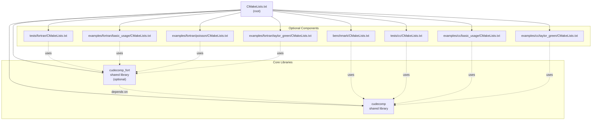
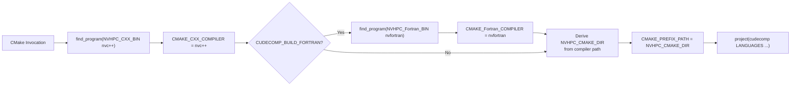
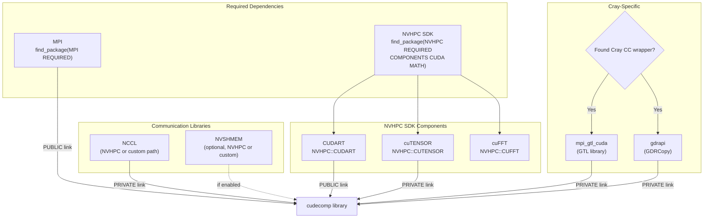
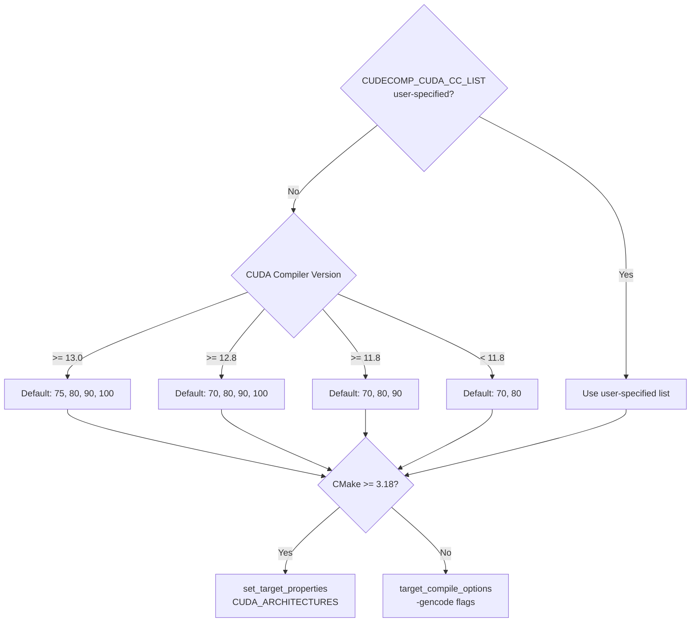
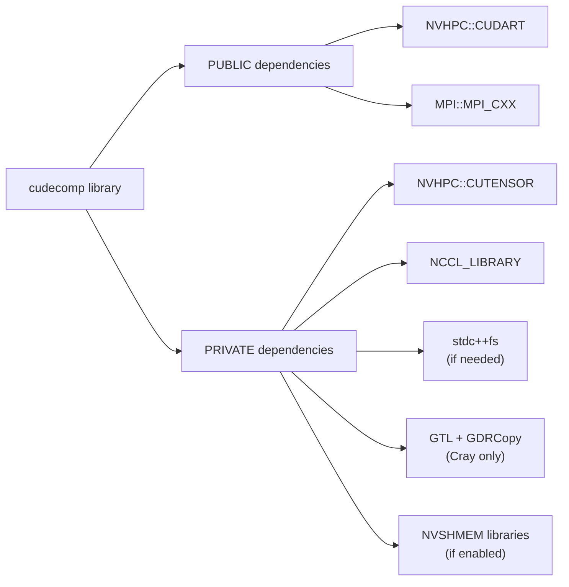
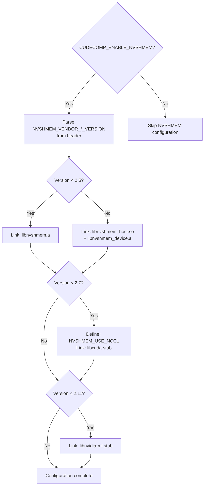

<!-- source: DeepWiki mcp.deepwiki.com · repo NVIDIA/cuDecomp · page 13.1 Build System Architecture · fetched 2026-10-26 -->

# Build System Architecture

<details>
<summary>Relevant source files</summary>

The following files were used as context for generating this wiki page:

- [CMakeLists.txt](CMakeLists.txt)
- [benchmark/CMakeLists.txt](benchmark/CMakeLists.txt)
- [examples/cc/basic_usage/CMakeLists.txt](examples/cc/basic_usage/CMakeLists.txt)
- [examples/cc/taylor_green/CMakeLists.txt](examples/cc/taylor_green/CMakeLists.txt)
- [examples/fortran/basic_usage/CMakeLists.txt](examples/fortran/basic_usage/CMakeLists.txt)
- [examples/fortran/poisson/CMakeLists.txt](examples/fortran/poisson/CMakeLists.txt)

</details>


## Purpose and Scope

This document describes the CMake-based build system architecture for cuDecomp, covering compiler detection, dependency management, library compilation, and optional component builds. For information about the CI/CD pipeline that uses this build system, see [CI/CD Pipeline](#13.2). For details about individual test programs, see [Testing and Validation](#12).

The build system is designed around the NVHPC SDK and supports building both C++ and Fortran interfaces, with optional NVSHMEM support and configurable CUDA compute capabilities.

## Build System Hierarchy

The build system is organized hierarchically with the root CMakeLists.txt coordinating compiler setup, dependency detection, and library builds, then delegating to subdirectories for optional components.



Sources: [CMakeLists.txt:1-307](), [benchmark/CMakeLists.txt:1-40](), [examples/cc/taylor_green/CMakeLists.txt:1-31]()

## Compiler Detection and Configuration

The build system requires NVHPC compilers and automatically detects them before project initialization. This ensures CUDA-aware compilation capabilities are available.



**Compiler Setup Details:**

| Component | Detection | Configuration |
|-----------|-----------|---------------|
| C++ Compiler | `find_program(NVHPC_CXX_BIN "nvc++")` | Set as `CMAKE_CXX_COMPILER` before `project()` |
| Fortran Compiler | `find_program(NVHPC_Fortran_BIN "nvfortran")` | Set as `CMAKE_Fortran_COMPILER` if enabled |
| CMake Modules | Derived from compiler path | `CMAKE_PREFIX_PATH` set to `${NVHPC_BIN}/../cmake` |
| C++ Standard | `CMAKE_CXX_STANDARD 17` | Applied globally |

The compiler path manipulation [CMakeLists.txt:33-34]() ensures the NVHPC CMake configuration modules are found, enabling `find_package(NVHPC)` to locate SDK components.

**Optimization Level Constraints:**

CPU code optimization is intentionally limited to `-O1` [CMakeLists.txt:37-41]() to reduce compile times, as GPU kernels are the performance-critical components. Fortran RelWithDebInfo mode omits `-g` to enable mixed compilation across compute capabilities including older architectures.

Sources: [CMakeLists.txt:1-49]()

## Build Options and Configuration

The build system exposes several CMake options to control library features and optional components:

| Option | Default | Description |
|--------|---------|-------------|
| `CUDECOMP_BUILD_FORTRAN` | `ON` | Build Fortran bindings (requires nvfortran) |
| `CUDECOMP_ENABLE_NVTX` | `ON` | Enable NVTX profiling ranges |
| `CUDECOMP_ENABLE_NVSHMEM` | `OFF` | Enable NVSHMEM backend support |
| `CUDECOMP_BUILD_EXTRAS` | `OFF` | Build benchmarks, examples, and tests |
| `CUDECOMP_NCCL_HOME` | (empty) | Override NVHPC-provided NCCL installation |
| `CUDECOMP_NVSHMEM_HOME` | (empty) | Override NVHPC-provided NVSHMEM installation |
| `CUDECOMP_CUDA_CC_LIST` | (auto) | CUDA compute capabilities to build for |

These options are defined at [CMakeLists.txt:16-21]() and [CMakeLists.txt:63]().

**Conditional Language Support:**

The `project()` command language list is built dynamically based on `CUDECOMP_BUILD_FORTRAN` [CMakeLists.txt:43-49](). This ensures Fortran compiler checks only run when needed.

Sources: [CMakeLists.txt:15-21](), [CMakeLists.txt:43-49](), [CMakeLists.txt:52-64]()

## Dependency Detection and Linking

The build system locates and links against multiple external libraries with special handling for NVHPC SDK components and Cray environments.



**Dependency Location Strategy:**

1. **MPI**: Standard CMake `FindMPI` module [CMakeLists.txt:75]()
2. **NVHPC SDK**: Custom NVHPC CMake modules from SDK installation [CMakeLists.txt:97]()
3. **NCCL**: NVHPC-provided unless `CUDECOMP_NCCL_HOME` overrides [CMakeLists.txt:105-122]()
4. **NVSHMEM**: NVHPC-provided unless `CUDECOMP_NVSHMEM_HOME` overrides [CMakeLists.txt:127-142]()

**Include Path Derivation:**

The NVHPC CMake modules only provide library directories. Include paths are derived via regex replacement [CMakeLists.txt:100-102]():

```cmake
string(REGEX REPLACE "(.+)(\/lib64)$" "\\1/include" NVHPC_CUDA_INCLUDE_DIR ${NVHPC_CUDA_LIBRARY_DIR})
string(REGEX REPLACE "(.+)(\/lib64)$" "\\1/include" NVHPC_CUFFT_INCLUDE_DIR ${NVHPC_MATH_LIBRARY_DIR})
string(REGEX REPLACE "(.+)(\/lib64)$" "\\1/include" NVHPC_CUTENSOR_INCLUDE_DIR ${NVHPC_MATH_LIBRARY_DIR})
```

**Cray Environment Detection:**

The build system detects Cray environments by searching for the `CC` wrapper [CMakeLists.txt:68-72](). When found, it links against CUDA-aware MPI GTL libraries and GDRCopy [CMakeLists.txt:77-94](), [CMakeLists.txt:193-197]().

Sources: [CMakeLists.txt:74-146](), [CMakeLists.txt:189-197]()

## CUDA Architecture Selection

CUDA compute capabilities are automatically selected based on the CUDA compiler version, with user override capability.

**Version-Based Defaults:**



**Implementation Details:**

The version-based logic is at [CMakeLists.txt:52-64]():

- CUDA 13.0+: Supports Hopper (90) and Blackwell (100)
- CUDA 12.8+: Adds Blackwell (100) to Volta/Ampere/Hopper
- CUDA 11.8+: Volta (70), Ampere (80), Hopper (90)
- CUDA < 11.8: Volta (70), Ampere (80)

**CMake Version Compatibility:**

For CMake < 3.18, the `CUDA_ARCHITECTURES` property is unavailable. Instead, `-gencode` flags are manually constructed [CMakeLists.txt:153-160]():

```cmake
foreach(CUDA_CC ${CUDECOMP_CUDA_CC_LIST})
  list(APPEND CUDA_CC_FLAGS -gencode=arch=compute_${CUDA_CC},code=sm_${CUDA_CC})
endforeach()
target_compile_options(cudecomp PRIVATE $<$<COMPILE_LANGUAGE:CUDA>: ${CUDA_CC_FLAGS}>)
```

This pattern is replicated in all subdirectory CMakeLists.txt files for examples and benchmarks.

Sources: [CMakeLists.txt:52-64](), [CMakeLists.txt:153-163](), [examples/cc/taylor_green/CMakeLists.txt:8-12]()

## Library Targets

### Main C++ Library (cudecomp)

The `cudecomp` target builds a shared library containing the core implementation.

**Source Files:**

| File | Purpose | Special Flags |
|------|---------|---------------|
| `autotune.cc` | Backend autotuning system | - |
| `cuda_wrap.cc` | CUDA function table initialization | - |
| `cudecomp_kernels.cu` | Pack/unpack/halo kernels | - |
| `cudecomp_kernels_rdc.cu` | RDC-enabled kernels | `-rdc=true` |
| `cudecomp.cc` | Main implementation | - |
| `graph.cc` | CUDA graph capture utilities | - |
| `nvml_wrap.cc` | Dynamic NVML loading | - |
| `performance.cc` | Performance monitoring | - |

Source list at [CMakeLists.txt:165-175]().

**Key Properties:**

- Relocatable device code enabled: `CUDA_RESOLVE_DEVICE_SYMBOLS ON` [CMakeLists.txt:178]()
- Output directory: `${CMAKE_BINARY_DIR}/lib` [CMakeLists.txt:150]()
- Public header: `include/cudecomp.h` [CMakeLists.txt:253-254]()

**Link Dependencies:**



**std::filesystem Compatibility:**

A compile test checks if `std::filesystem` links without additional flags [CMakeLists.txt:199-208](). If it fails (older GCC toolchains), `-lstdc++fs` is added explicitly.

**NVTX Support:**

When `CUDECOMP_ENABLE_NVTX` is ON, `ENABLE_NVTX` is defined as a preprocessor macro [CMakeLists.txt:210-212]().

Sources: [CMakeLists.txt:149-212](), [CMakeLists.txt:253-260]()

### Fortran Bindings Library (cudecomp_fort)

The `cudecomp_fort` target builds Fortran module and library when `CUDECOMP_BUILD_FORTRAN` is enabled.

**GPU Argument Construction:**

The Fortran compiler requires a `-gpu=` argument specifying compute capabilities and CUDA version. This is built dynamically [CMakeLists.txt:264-269]():

```cmake
foreach(CUDA_CC ${CUDECOMP_CUDA_CC_LIST})
  list(APPEND CUF_GPU_ARG "cc${CUDA_CC}")
endforeach()
list(APPEND CUF_GPU_ARG "cuda${NVHPC_CUDA_VERSION}")
list(JOIN CUF_GPU_ARG "," CUF_GPU_ARG)
# Result: -gpu=cc70,cc80,cc90,cuda12.6 (example)
```

**Key Properties:**

- Source file: `src/cudecomp_m.cuf` (CUDA Fortran) [CMakeLists.txt:276-281]()
- Module output: `${CMAKE_BINARY_DIR}/include` [CMakeLists.txt:273]()
- Compile options: `-cpp -cuda -gpu=${CUF_GPU_ARG}` [CMakeLists.txt:275]()
- Linker language: Fortran [CMakeLists.txt:274]()

**Installation:**

Both the library and the compiled module (`cudecomp.mod`) are installed [CMakeLists.txt:285-290]():

```cmake
install(TARGETS cudecomp_fort LIBRARY DESTINATION ${CMAKE_INSTALL_PREFIX}/lib)
install(FILES ${CMAKE_BINARY_DIR}/include/cudecomp.mod DESTINATION ${CMAKE_INSTALL_PREFIX}/include)
```

Sources: [CMakeLists.txt:263-291]()

## NVSHMEM Conditional Configuration

When `CUDECOMP_ENABLE_NVSHMEM` is ON, additional configuration is required to handle version-specific library changes and dependencies.

**Version Detection:**

The build system reads NVSHMEM version from headers [CMakeLists.txt:221-233](), checking multiple possible locations for compatibility with different NVSHMEM versions.

**Version-Specific Linking:**



**Version-Specific Handling:**

| NVSHMEM Version | Library Structure | Additional Flags |
|----------------|-------------------|------------------|
| < 2.5 | Single static library (`libnvshmem.a`) | - |
| 2.5 - 2.6 | Split host/device (`libnvshmem_host.so` + `libnvshmem_device.a`) | - |
| < 2.7 | (any) | `NVSHMEM_USE_NCCL` + link `libcuda` stub |
| < 2.11 | (any) | Link `libnvidia-ml` stub |

The version logic is at [CMakeLists.txt:235-250]().

**Rationale:**

- Pre-2.5: NVSHMEM shipped as monolithic static library
- 2.5+: Split into host (dynamic) and device (static) components
- Pre-2.7: NVSHMEM incorrectly exported NCCL symbols, requiring workaround
- Pre-2.11: NVML dependency required explicit stub linking

Sources: [CMakeLists.txt:214-251]()

## Examples, Tests, and Benchmarks

When `CUDECOMP_BUILD_EXTRAS` is enabled, subdirectories are added [CMakeLists.txt:293-306]().

### Build Patterns

All subdirectory CMakeLists.txt files follow common patterns:

**Pattern 1: C++ Examples/Tests**

1. Create executable target
2. Set CUDA architectures (CMake version conditional)
3. Add deprecation warning suppression for older GPUs
4. Include directories: `${CMAKE_BINARY_DIR}/include`, MPI includes
5. Link: `cudecomp`, `MPI::MPI_CXX`
6. Set linker language to CXX

Example from [examples/cc/taylor_green/CMakeLists.txt:1-26]():

```cmake
add_executable(tg)
target_sources(tg PRIVATE tg.cu)
if (CMAKE_VERSION VERSION_LESS 3.18)
  target_compile_options(tg PRIVATE $<$<COMPILE_LANGUAGE:CUDA>: ${CUDA_CC_FLAGS}>)
else()
  set_target_properties(tg PROPERTIES CUDA_ARCHITECTURES "${CUDECOMP_CUDA_CC_LIST}")
endif()
target_link_libraries(tg PRIVATE cudecomp MPI::MPI_CXX NVHPC::CUFFT)
```

**Pattern 2: Fortran Examples/Tests**

1. Create executable target
2. Include `${CMAKE_BINARY_DIR}/include` for module files
3. Compile with `-cpp -cuda -gpu=${CUF_GPU_ARG}`
4. Link: `cudecomp`, `cudecomp_fort`, `MPI::MPI_Fortran`
5. Link options mirror compile options (Fortran linker needs GPU flags)

Example from [examples/fortran/basic_usage/CMakeLists.txt:18-31]():

```cmake
target_compile_options(${tgt} PRIVATE $<$<COMPILE_LANGUAGE:Fortran>:-cpp -cuda -gpu=${CUF_GPU_ARG}>)
target_link_options(${tgt} PRIVATE $<$<COMPILE_LANGUAGE:Fortran>:-cpp -cuda -gpu=${CUF_GPU_ARG}>)
target_link_libraries(${tgt} PRIVATE MPI::MPI_Fortran cudecomp cudecomp_fort)
```

**Pattern 3: Benchmarks with Variants**

Benchmarks create multiple targets from the same source with different preprocessor definitions [benchmark/CMakeLists.txt:1-34]():

```cmake
set(benchmark_targets benchmark_r2c benchmark_c2c benchmark_r2c_f benchmark_c2c_f)
foreach(tgt ${benchmark_targets})
  add_executable(${tgt})
  target_sources(${tgt} PRIVATE benchmark.cu)
  # ... common setup ...
endforeach()
target_compile_definitions(benchmark_r2c PRIVATE R2C)
target_compile_definitions(benchmark_c2c PRIVATE C2C)
target_compile_definitions(benchmark_r2c_f PRIVATE R2C USE_FLOAT)
target_compile_definitions(benchmark_c2c_f PRIVATE C2C USE_FLOAT)
```

This creates variants for real-to-complex vs complex-to-complex FFTs, and double vs single precision.

Sources: [examples/cc/taylor_green/CMakeLists.txt:1-31](), [examples/fortran/basic_usage/CMakeLists.txt:1-37](), [benchmark/CMakeLists.txt:1-40]()

## Installation

Installation targets are defined for the library, headers, and optionally all extras.

**Installation Structure:**

```
${CMAKE_INSTALL_PREFIX}/
├── lib/
│   ├── libcudecomp.so
│   └── libcudecomp_fort.so (if FORTRAN enabled)
├── include/
│   ├── cudecomp.h
│   └── cudecomp.mod (if FORTRAN enabled)
└── bin/
    ├── benchmark/
    │   ├── benchmark_r2c
    │   ├── benchmark_c2c
    │   ├── benchmark_r2c_f
    │   └── benchmark_c2c_f
    └── examples/
        ├── cc/
        │   ├── basic_usage/
        │   └── taylor_green/
        └── fortran/
            ├── basic_usage/
            ├── poisson/
            └── taylor_green/
```

**Install Commands:**

- Library: [CMakeLists.txt:256-260]()
- Fortran module: [CMakeLists.txt:290]()
- Benchmarks: [benchmark/CMakeLists.txt:36-39]()
- Examples: Each example has its own install target

All install commands use `${CMAKE_INSTALL_PREFIX}` for relocatability.

Sources: [CMakeLists.txt:256-260](), [CMakeLists.txt:285-290](), [benchmark/CMakeLists.txt:36-39](), [examples/cc/taylor_green/CMakeLists.txt:27-30]()

## Build System Summary

The cuDecomp build system implements a robust, hierarchical CMake configuration with the following key characteristics:

| Feature | Implementation |
|---------|----------------|
| **Compiler** | NVHPC nvc++/nvfortran required, detected before project() |
| **Dependencies** | MPI, NVHPC SDK (CUDA, cuTENSOR, cuFFT, NCCL), optional NVSHMEM |
| **CUDA Architectures** | Auto-selected by CUDA version, user-overridable |
| **Library Outputs** | cudecomp (C++) + cudecomp_fort (optional Fortran) |
| **Optional Builds** | Examples, tests, benchmarks via CUDECOMP_BUILD_EXTRAS |
| **Platform Support** | Special handling for Cray environments (GTL, GDRCopy) |
| **Version Compatibility** | CMake 3.16+, CUDA 11.8+, NVSHMEM 2.x with version detection |

The build system prioritizes correct dependency detection, proper CUDA architecture selection, and compatibility across multiple NVHPC SDK versions while maintaining a clean separation between core library and optional components.

Sources: [CMakeLists.txt:1-307]()

---

