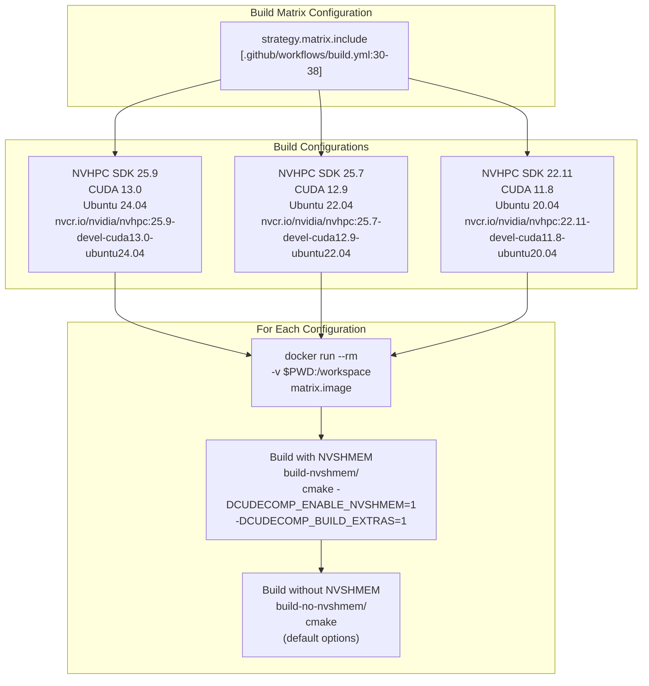
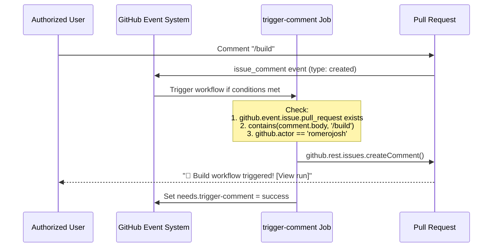
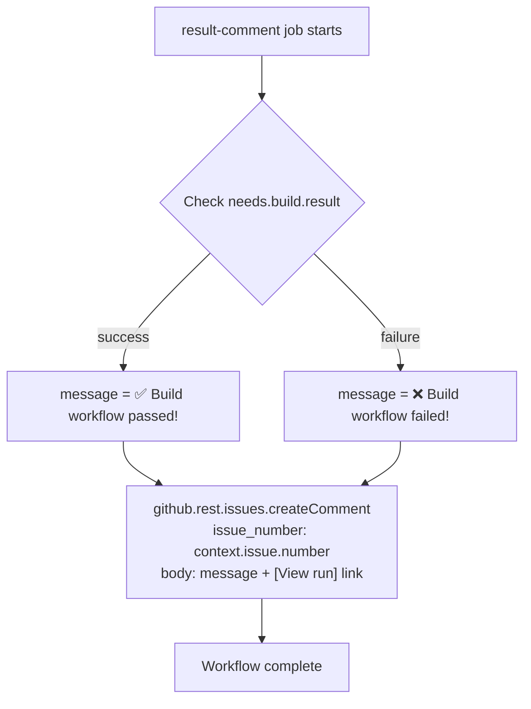
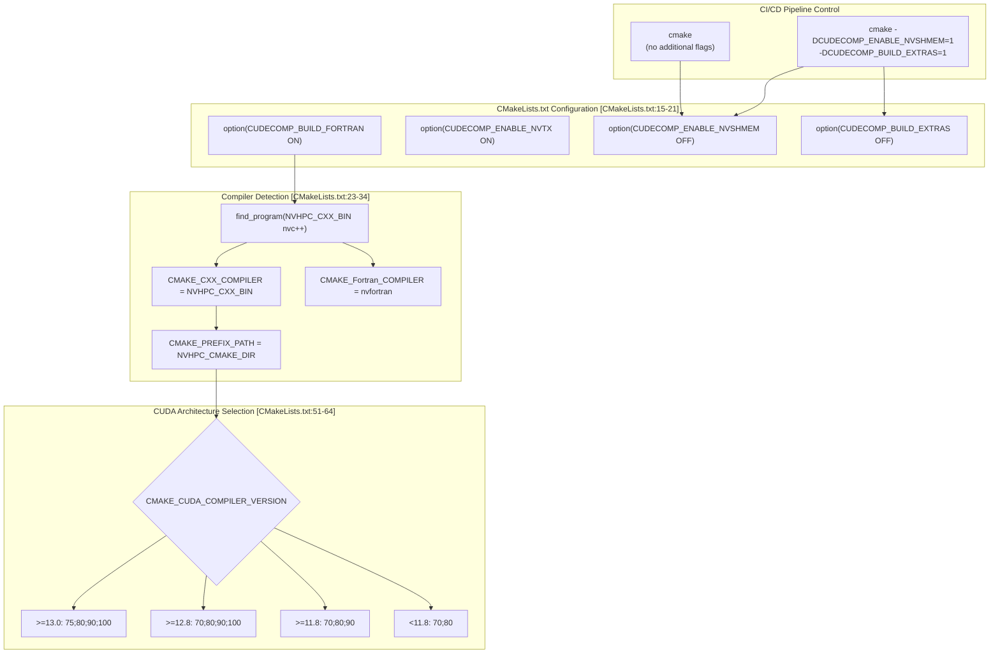

<!-- source: DeepWiki mcp.deepwiki.com · repo NVIDIA/cuDecomp · page 13.2 CI/CD Pipeline · fetched 2026-10-26 -->

# CI/CD Pipeline

<details>
<summary>Relevant source files</summary>

The following files were used as context for generating this wiki page:

- [.github/workflows/build.yml](.github/workflows/build.yml)
- [CMakeLists.txt](CMakeLists.txt)
- [cmake/test_std_fs.cc](cmake/test_std_fs.cc)

</details>


## Purpose and Scope

This document describes the Continuous Integration and Continuous Deployment (CI/CD) infrastructure for cuDecomp. The CI/CD system automates building and testing the library across multiple compiler versions, CUDA versions, and operating system configurations using GitHub Actions. The pipeline validates that changes compile successfully before merging.

For information about the build system configuration itself, see [Build System Architecture](#13.1). For running tests and benchmarks, see [Testing and Validation](#12).

## Overview

The cuDecomp CI/CD pipeline uses a **comment-triggered** GitHub Actions workflow that allows maintainers to initiate builds on pull requests by posting a `/build` command. This approach provides flexibility in when builds are executed while reducing unnecessary CI runs. The pipeline builds the library across a matrix of NVHPC SDK versions spanning three years of releases to ensure broad compatibility.

**Sources:** [.github/workflows/build.yml:1-110]()

## Workflow Trigger Mechanism

The CI/CD workflow is activated through pull request comments rather than automatic triggers on every commit. When an authorized user comments `/build` on a pull request, the workflow executes through three sequential jobs.

```mermaid
stateDiagram-v2
    [*] --> WaitingForTrigger: PR Open
    
    WaitingForTrigger --> ValidatingComment: User posts comment
    
    state ValidatingComment {
        [*] --> CheckIssueType: github.event.issue_comment
        CheckIssueType --> CheckContent: Is PR?
        CheckContent --> CheckPermissions: Contains /build?
        CheckPermissions --> AuthorizedUser: github.actor == romerojosh?
        AuthorizedUser --> [*]: Valid
    }
    
    ValidatingComment --> TriggerCommentJob: Valid
    ValidatingComment --> WaitingForTrigger: Invalid
    
    state TriggerCommentJob {
        [*] --> PostTriggerComment: github.rest.issues.createComment
        PostTriggerComment --> [*]: 🚀 Build workflow triggered
    }
    
    TriggerCommentJob --> BuildJob: needs: trigger-comment
    
    state BuildJob {
        [*] --> RetrievePRInfo: actions/github-script
        RetrievePRInfo --> CheckoutCode: actions/checkout@v4
        CheckoutCode --> BuildMatrix: Run parallel builds
        
        state BuildMatrix {
            [*] --> BuildNVSHMEM: docker run matrix.image
            BuildNVSHMEM --> BuildNoNVSHMEM: cmake -DCUDECOMP_ENABLE_NVSHMEM=1
        }
    }
    
    BuildJob --> ResultCommentJob: needs: build
    
    state ResultCommentJob {
        [*] --> CheckResult: needs.build.result
        CheckResult --> PostSuccess: success
        CheckResult --> PostFailure: failure
        PostSuccess --> [*]: ✅ Build workflow passed
        PostFailure --> [*]: ❌ Build workflow failed
    }
    
    ResultCommentJob --> [*]
```



**Workflow Job Structure**

| Job Name | Trigger Condition | Purpose |
|----------|------------------|---------|
| `trigger-comment` | Comment contains `/build` and author is authorized | Posts confirmation comment with workflow run link |
| `build` | After `trigger-comment` completes | Executes build matrix across all configurations |
| `result-comment` | After `build` completes (always runs) | Posts success or failure status with workflow link |

**Sources:** [.github/workflows/build.yml:4-9](), [.github/workflows/build.yml:27-29](), [.github/workflows/build.yml:85-109]()

## Build Matrix Configuration

The pipeline builds cuDecomp across multiple NVHPC SDK, CUDA, and Ubuntu version combinations to validate compatibility. The matrix is defined using Docker images from the NVIDIA NGC container registry.



**Version Coverage Strategy**

The matrix spans approximately three years of NVHPC SDK releases:
- **Latest (25.9)**: Tests bleeding-edge compiler features and CUDA 13.0
- **Recent (25.7)**: Tests current stable release with CUDA 12.9
- **Legacy (22.11)**: Ensures backward compatibility with CUDA 11.8

Each configuration tests two build variants:
1. **Full build with NVSHMEM**: Validates NVSHMEM backend integration with examples, tests, and benchmarks
2. **Library-only build without NVSHMEM**: Validates minimal MPI/NCCL-only configuration

**Sources:** [.github/workflows/build.yml:30-38](), [.github/workflows/build.yml:67-83]()

## Workflow Execution Steps

### Step 1: Trigger Comment Job

The workflow begins when an authorized maintainer posts a comment containing `/build` on a pull request. The `trigger-comment` job validates the trigger and posts a confirmation.



**Key Implementation Details:**
- Condition: `github.event.issue.pull_request && contains(github.event.comment.body, '/build') && (github.actor == 'romerojosh')`
- Uses `actions/github-script@v7` to interact with GitHub API
- Posts comment with dynamic workflow URL: `${context.payload.repository.html_url}/actions/runs/${context.runId}`

**Sources:** [.github/workflows/build.yml:8-25]()

### Step 2: Build Job Execution

After the trigger job succeeds, the `build` job executes in parallel across all matrix configurations. Each matrix instance runs as an independent GitHub Actions runner.

```mermaid
graph LR
    subgraph "PR Code Retrieval"
        RETRIEVE["Retrieve PR info<br/>actions/github-script"]
        EXTRACT["Extract pr.data.head.sha"]
        CHECKOUT["Checkout PR code<br/>actions/checkout@v4<br/>ref: sha"]
    end
    
    subgraph "Build 1: With NVSHMEM"
        DIR1["mkdir -p build-nvshmem"]
        CMAKE1["cmake<br/>-DCUDECOMP_ENABLE_NVSHMEM=1<br/>-DCUDECOMP_BUILD_EXTRAS=1"]
        MAKE1["make -j$(nproc)"]
    end
    
    subgraph "Build 2: Without NVSHMEM"
        DIR2["mkdir -p build-no-nvshmem"]
        CMAKE2["cmake<br/>(default configuration)"]
        MAKE2["make -j$(nproc)"]
    end
    
    RETRIEVE --> EXTRACT
    EXTRACT --> CHECKOUT
    CHECKOUT --> DIR1
    DIR1 --> CMAKE1
    CMAKE1 --> MAKE1
    MAKE1 --> DIR2
    DIR2 --> CMAKE2
    CMAKE2 --> MAKE2
```



**Build Step Details:**

The build executes inside Docker containers to ensure reproducible environments:

```bash
docker run --rm -v $PWD:/workspace -w /workspace ${{ matrix.image }} bash -c '
  mkdir -p build-nvshmem
  cd build-nvshmem
  cmake -DCUDECOMP_ENABLE_NVSHMEM=1 -DCUDECOMP_BUILD_EXTRAS=1 ..
  make -j$(nproc)
'
```

**Build Artifacts Generated:**

| Build Configuration | Artifacts |
|---------------------|-----------|
| With NVSHMEM | `libcudecomp.so`, `libcudecomp_fort.so`, examples, tests, benchmarks |
| Without NVSHMEM | `libcudecomp.so`, `libcudecomp_fort.so` only |

**Sources:** [.github/workflows/build.yml:49-65](), [.github/workflows/build.yml:67-83]()

### Step 3: Result Comment Job

The final job posts build results to the pull request regardless of build success or failure (using `if: always()`).



The result comment includes:
- Status indicator emoji (✅ or ❌)
- Descriptive message
- Link to the workflow run for debugging

**Sources:** [.github/workflows/build.yml:85-109]()

## Integration with Build System

The CI/CD pipeline delegates all build configuration to the CMake build system. The pipeline provides only two high-level options:



**Compiler Detection Process:**

The Docker images provide NVHPC compilers, and CMake automatically detects them:

1. `find_program(NVHPC_CXX_BIN "nvc++" REQUIRED)` - Locates the NVHPC C++ compiler
2. `CMAKE_CXX_COMPILER` and `CMAKE_Fortran_COMPILER` are set to NVHPC binaries
3. NVHPC CMake configuration path is derived from compiler path: `${NVHPC_CXX_BIN}` → `compilers/bin/nvc++` → `cmake`

**CUDA Architecture Auto-Configuration:**

The build system automatically selects CUDA compute capabilities based on the CUDA version:

| CUDA Version | Compute Capabilities |
|--------------|---------------------|
| ≥ 13.0 | 75, 80, 90, 100 (Hopper, Blackwell) |
| ≥ 12.8 | 70, 80, 90, 100 |
| ≥ 11.8 | 70, 80, 90 (Volta, Ampere, Hopper) |
| < 11.8 | 70, 80 |

This ensures each CI configuration builds for architectures supported by that CUDA version.

**Sources:** [CMakeLists.txt:15-21](), [CMakeLists.txt:23-34](), [CMakeLists.txt:51-64]()

## Docker Container Usage

Each build runs inside an isolated Docker container with all dependencies pre-installed. This approach ensures:

1. **Reproducibility**: Same environment on local machines and CI
2. **Dependency Management**: No need to install compilers on the runner
3. **Isolation**: Builds don't interfere with each other

**Container Execution Pattern:**

```bash
docker run --rm \
  -v $PWD:/workspace \     # Mount source code
  -w /workspace \          # Set working directory
  ${{ matrix.image }} \    # NVHPC container image
  bash -c 'build commands'
```

The workflow mounts the repository directory into `/workspace` inside the container, allowing the build to access source files and write build artifacts back to the runner's filesystem.

**Pre-Build Disk Space Management:**

Before running builds, the workflow frees disk space to prevent out-of-space errors during compilation:

```bash
sudo rm -rf /usr/local/lib/android || true
sudo rm -rf /usr/share/dotnet || true
```

**Sources:** [.github/workflows/build.yml:44-47](), [.github/workflows/build.yml:69-74]()

## Failure Handling and Debugging

The workflow provides multiple mechanisms for diagnosing build failures:

**Failure Detection:**

The `result-comment` job uses `if: always()` to ensure it runs even when the build job fails. The result is checked via `needs.build.result`:

```javascript
const success = '${{ needs.build.result }}' === 'success';
const message = success
  ? `✅ Build workflow passed! [View run](${workflowUrl})`
  : `❌ Build workflow failed! [View run](${workflowUrl})`;
```

**Debugging Information:**

When a build fails, developers can:

1. Click the workflow run link in the result comment
2. View logs for each matrix configuration separately
3. Identify which configuration(s) failed
4. Examine CMake configuration output
5. Review compilation errors from `make -j$(nproc)`

**Matrix Strategy Configuration:**

The workflow does not use `fail-fast: false`, meaning if one matrix configuration fails, GitHub Actions will cancel remaining jobs by default. This behavior can be modified in [.github/workflows/build.yml:30]() by adding:

```yaml
strategy:
  fail-fast: false
  matrix:
    # ...
```

**Sources:** [.github/workflows/build.yml:85-109]()

## Limitations and Future Enhancements

### Current Limitations

1. **No Test Execution**: The CI only validates compilation, not runtime correctness. Tests and benchmarks are built but not executed.
2. **Single Authorized User**: Only `romerojosh` can trigger builds via comments.
3. **No Artifact Retention**: Build artifacts are discarded after the workflow completes.
4. **No Performance Tracking**: No historical tracking of build times or binary sizes.

### Potential Enhancements

The following capabilities could be added to enhance the CI/CD pipeline:

| Enhancement | Implementation Approach | Benefit |
|------------|-------------------------|---------|
| Automated Testing | Run `ctest` after builds complete | Catch regressions before merge |
| Multi-User Authorization | Check team membership via GitHub API | Enable broader team to trigger builds |
| Artifact Upload | Use `actions/upload-artifact` | Allow downloading binaries for local testing |
| Performance Benchmarks | Run lightweight benchmarks and track trends | Detect performance regressions |
| Code Coverage | Enable coverage flags and upload to Codecov | Improve test coverage visibility |

**Sources:** [.github/workflows/build.yml:1-110]()

---

