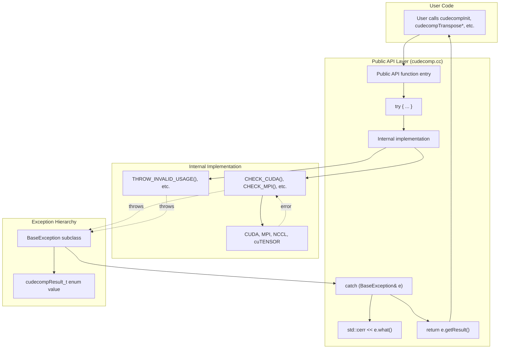

<!-- source: DeepWiki mcp.deepwiki.com · repo NVIDIA/cuDecomp · page 13.3 Error Handling · fetched 2026-10-26 -->

# Error Handling

<details>
<summary>Relevant source files</summary>

The following files were used as context for generating this wiki page:

- [examples/cc/basic_usage/basic_usage.cu](examples/cc/basic_usage/basic_usage.cu)
- [examples/cc/taylor_green/tg.cu](examples/cc/taylor_green/tg.cu)
- [include/internal/exceptions.h](include/internal/exceptions.h)
- [src/cudecomp.cc](src/cudecomp.cc)

</details>


This page documents the error handling mechanisms used throughout the cuDecomp library, including the exception hierarchy, error reporting to users, and internal error checking macros. This information is primarily intended for developers working on or extending cuDecomp.

For information about using the cuDecomp API and checking for errors in application code, see the API Reference sections ([4](#4)). For build system configuration and debugging techniques, see [Build System Architecture](#13.1).

## Overview

cuDecomp employs a dual-layer error handling strategy:
- **Internal layer**: Uses C++ exceptions for error conditions detected within the library
- **External layer**: Converts exceptions to integer result codes (`cudecompResult_t`) at API boundaries

This design provides clean internal error propagation while maintaining a C-compatible API that can be used from multiple languages including Fortran.

**Sources:** [include/internal/exceptions.h:1-149](), [src/cudecomp.cc:505-511]()

## Exception Hierarchy

### Class Structure

```mermaid
classDiagram
    class BaseException {
        <<abstract>>
        -string s
        +BaseException(file, line, generic_info, extra_info)
        +what() const char*
        +getResult()* cudecompResult_t
    }
    
    class InvalidUsage {
        +getResult() CUDECOMP_RESULT_INVALID_USAGE
    }
    
    class NotSupported {
        +getResult() CUDECOMP_RESULT_NOT_SUPPORTED
    }
    
    class InternalError {
        +getResult() CUDECOMP_RESULT_INTERNAL_ERROR
    }
    
    class CudaError {
        +getResult() CUDECOMP_RESULT_CUDA_ERROR
    }
    
    class CutensorError {
        +getResult() CUDECOMP_RESULT_CUTENSOR_ERROR
    }
    
    class MpiError {
        +getResult() CUDECOMP_RESULT_MPI_ERROR
    }
    
    class NcclError {
        +getResult() CUDECOMP_RESULT_NCCL_ERROR
    }
    
    class NvshmemError {
        +getResult() CUDECOMP_RESULT_NVSHMEM_ERROR
    }
    
    class NvmlError {
        +getResult() CUDECOMP_RESULT_NVML_ERROR
    }
    
    BaseException <|-- InvalidUsage
    BaseException <|-- NotSupported
    BaseException <|-- InternalError
    BaseException <|-- CudaError
    BaseException <|-- CutensorError
    BaseException <|-- MpiError
    BaseException <|-- NcclError
    BaseException <|-- NvshmemError
    BaseException <|-- NvmlError
```



**Exception Type Mapping**

All exception classes inherit from `cudecomp::BaseException` defined in [include/internal/exceptions.h:63-82](). Each exception type maps to a specific `cudecompResult_t` value:

| Exception Class | Result Code | Usage |
|-----------------|-------------|-------|
| `InvalidUsage` | `CUDECOMP_RESULT_INVALID_USAGE` | Invalid API arguments or usage patterns |
| `NotSupported` | `CUDECOMP_RESULT_NOT_SUPPORTED` | Unsupported configuration or backend |
| `InternalError` | `CUDECOMP_RESULT_INTERNAL_ERROR` | Internal library logic errors |
| `CudaError` | `CUDECOMP_RESULT_CUDA_ERROR` | CUDA runtime errors |
| `CutensorError` | `CUDECOMP_RESULT_CUTENSOR_ERROR` | cuTENSOR library errors |
| `MpiError` | `CUDECOMP_RESULT_MPI_ERROR` | MPI library errors |
| `NcclError` | `CUDECOMP_RESULT_NCCL_ERROR` | NCCL library errors |
| `NvshmemError` | `CUDECOMP_RESULT_NVSHMEM_ERROR` | NVSHMEM library errors |
| `NvmlError` | `CUDECOMP_RESULT_NVML_ERROR` | NVML library errors |

**Sources:** [include/internal/exceptions.h:84-145]()

## Throwing Exceptions

### Exception Throw Macros

cuDecomp provides convenience macros for throwing exceptions with file and line information automatically included:

```cpp
// Usage pattern inside cudecomp.cc
if (invalid_condition) {
    THROW_INVALID_USAGE("descriptive error message");
}
```

**Available Macros:**

| Macro | Exception Thrown | Typical Use Case |
|-------|-----------------|------------------|
| `THROW_INVALID_USAGE(msg)` | `InvalidUsage` | Null pointers, out-of-range values, invalid configurations |
| `THROW_NOT_SUPPORTED(msg)` | `NotSupported` | Unavailable backends, unsupported features |
| `THROW_INTERNAL_ERROR(msg)` | `InternalError` | Unexpected internal states |
| `THROW_CUDA_ERROR(msg)` | `CudaError` | CUDA errors detected by checking macros |
| `THROW_CUTENSOR_ERROR(msg)` | `CutensorError` | cuTENSOR errors detected by checking macros |
| `THROW_MPI_ERROR(msg)` | `MpiError` | MPI errors detected by checking macros |
| `THROW_NCCL_ERROR(msg)` | `NcclError` | NCCL errors detected by checking macros |
| `THROW_NVSHMEM_ERROR(msg)` | `NvshmemError` | NVSHMEM errors detected by checking macros |

Each macro is defined as a do-while-false construct to ensure proper statement semantics:

```cpp
#define THROW_INVALID_USAGE(msg)                    \
  do {                                              \
    throw cudecomp::InvalidUsage(__FILE__, __LINE__, msg); \
  } while (false)
```

**Sources:** [include/internal/exceptions.h:28-59]()

### Exception Constructor and Message Formatting

The `BaseException` constructor formats error messages consistently:

```
CUDECOMP:ERROR: <file>:<line> <generic_info> (<extra_info>)
```

For example:
```
CUDECOMP:ERROR: src/cudecomp.cc:137 Invalid usage. (invalid handle)
```

**Sources:** [include/internal/exceptions.h:65-74]()

## Error Checking Macros

### Internal Checking Macros

cuDecomp uses internal macros to check return codes from external libraries. These macros are defined in `include/internal/checks.h` and throw appropriate exceptions on failure. The pattern is:

```cpp
CHECK_CUDA(cudaMalloc(&ptr, size));
CHECK_MPI(MPI_Comm_rank(comm, &rank));
CHECK_NCCL(ncclCommInitRank(&comm, nranks, id, rank));
```

When a check fails, these macros throw the corresponding exception type with error details from the underlying library.

**Common Internal Check Macros:**

- `CHECK_CUDA()` - Checks CUDA runtime calls, throws `CudaError`
- `CHECK_CUDA_DRV()` - Checks CUDA driver calls, throws `CudaError`
- `CHECK_MPI()` - Checks MPI calls, throws `MpiError`
- `CHECK_NCCL()` - Checks NCCL calls, throws `NcclError`
- `CHECK_NVML()` - Checks NVML calls, throws `NvmlError`
- `CHECK_CUTENSOR()` - Checks cuTENSOR calls, throws `CutensorError`
- `CHECK_CUDECOMP()` - Checks internal cuDecomp calls, propagates exceptions

**Sources:** [src/cudecomp.cc:55-56](), [src/cudecomp.cc:418-419]()

### User-Facing Error Checking Patterns

Examples demonstrate recommended error checking patterns for users:

```cpp
// Check return code and exit on failure
#define CHECK_CUDECOMP_EXIT(call)                          \
  do {                                                     \
    cudecompResult_t err = call;                          \
    if (CUDECOMP_RESULT_SUCCESS != err) {                 \
      fprintf(stderr, "%s:%d CUDECOMP error. (error code %d)\n", \
              __FILE__, __LINE__, err);                   \
      exit(EXIT_FAILURE);                                 \
    }                                                      \
  } while (false)
```

Examples also provide similar patterns for CUDA, MPI, and cuFFT:

**Sources:** [examples/cc/basic_usage/basic_usage.cu:33-66](), [examples/cc/taylor_green/tg.cu:41-92]()

## Error Propagation Flow

### Exception to Result Code Conversion



**Typical Public API Function Pattern:**

```cpp
cudecompResult_t cudecompFunctionName(...) {
  using namespace cudecomp;
  cudecompGridDesc_t grid_desc = nullptr;  // Local variables
  try {
    // Validate arguments
    checkHandle(handle);
    if (!arg) { THROW_INVALID_USAGE("arg cannot be null"); }
    
    // Perform operations with error checking
    CHECK_CUDA(cudaMalloc(...));
    CHECK_MPI(MPI_Allgather(...));
    
    // Success path
  } catch (const cudecomp::BaseException& e) {
    // Cleanup allocated resources
    if (grid_desc) { delete grid_desc; }
    
    // Print error message to stderr
    std::cerr << e.what();
    
    // Return appropriate error code
    return e.getResult();
  }
  return CUDECOMP_RESULT_SUCCESS;
}
```

This pattern is used consistently throughout cuDecomp's public API functions.

**Sources:** [src/cudecomp.cc:409-511](), [src/cudecomp.cc:565-822]()

## Validation and Early Error Detection

### Argument Validation

cuDecomp performs extensive validation of user inputs before attempting operations. Common validation functions include:

**Handle and Descriptor Validation:**
```cpp
static void checkHandle(cudecompHandle_t handle) {
  if (!handle || !handle->initialized) {
    THROW_INVALID_USAGE("invalid handle");
  }
}

static void checkGridDesc(cudecompGridDesc_t grid_desc) {
  if (!grid_desc || !grid_desc->initialized) {
    THROW_INVALID_USAGE("invalid grid descriptor");
  }
}
```

**Backend Validation:**
```cpp
static void checkTransposeCommBackend(cudecompTransposeCommBackend_t backend) {
  switch (backend) {
  case CUDECOMP_TRANSPOSE_COMM_NCCL:
  case CUDECOMP_TRANSPOSE_COMM_MPI_P2P:
    // ... other valid cases
    return;
#ifndef ENABLE_NVSHMEM
  case CUDECOMP_TRANSPOSE_COMM_NVSHMEM:
    THROW_NOT_SUPPORTED("transpose communication type unsupported");
#endif
  default:
    THROW_INVALID_USAGE("unknown transpose communication type");
  }
}
```

**Configuration Validation:**

The `checkConfig` function validates grid descriptor configurations including process dimensions, memory ordering, and other settings.

**Sources:** [src/cudecomp.cc:136-177](), [src/cudecomp.cc:89-124]()

## Error Recovery and Resource Cleanup

### Cleanup on Error

Public API functions ensure proper resource cleanup when errors occur:

```cpp
cudecompResult_t cudecompGridDescCreate(...) {
  cudecompGridDesc_t grid_desc = nullptr;
  try {
    grid_desc = new cudecompGridDesc;
    // ... operations that might throw ...
  } catch (const cudecomp::BaseException& e) {
    if (grid_desc) { delete grid_desc; }  // Cleanup
    std::cerr << e.what();
    return e.getResult();
  }
  return CUDECOMP_RESULT_SUCCESS;
}
```

### Non-Recoverable Errors

Some errors are considered fatal and cannot be recovered from gracefully. In these cases, the library still returns an error code, but the handle or descriptor may be in an invalid state. Users should:

1. Check return codes after every API call
2. Avoid using handles or descriptors after functions return errors
3. Call cleanup functions (`cudecompFinalize`, `cudecompGridDescDestroy`) even after errors, which will attempt best-effort cleanup

**Sources:** [src/cudecomp.cc:816-822]()

## Backend-Specific Error Handling

### Conditional Backend Support

cuDecomp handles backend availability at compile time and runtime:

**Compile-Time Checks:**
```cpp
#ifdef ENABLE_NVSHMEM
  // NVSHMEM code paths
#else
  case CUDECOMP_TRANSPOSE_COMM_NVSHMEM:
    THROW_NOT_SUPPORTED("NVSHMEM backend not compiled");
#endif
```

**Runtime Checks:**

For features that depend on CUDA or driver versions:
```cpp
if (driverVersion < 12030) {
  if (handle->rank == 0) {
    printf("CUDECOMP:WARN: Feature disabled, driver too old\n");
  }
  handle->feature_enable = false;
}
```

**Sources:** [src/cudecomp.cc:89-124](), [src/cudecomp.cc:264-318]()

## Error Reporting to Users

### Error Messages

All exceptions include descriptive messages that are printed to `stderr` when caught:

- **File and line number**: Where the error was detected
- **Error category**: Type of error (e.g., "Invalid usage", "CUDA error")
- **Specific details**: Additional context about the failure

### Return Code Checking

Users must check the `cudecompResult_t` return value from all API calls:

```cpp
cudecompResult_t result = cudecompInit(&handle, MPI_COMM_WORLD);
if (result != CUDECOMP_RESULT_SUCCESS) {
  // Handle error - message already printed to stderr
  return result;
}
```

The value `CUDECOMP_RESULT_SUCCESS` (typically 0) indicates success. All other values indicate specific error conditions.

**Sources:** [examples/cc/basic_usage/basic_usage.cu:111](), [examples/cc/taylor_green/tg.cu:354]()

## Best Practices for Error Handling

### For Library Developers

1. **Use check macros**: Always use `CHECK_CUDA()`, `CHECK_MPI()`, etc. for external library calls
2. **Validate early**: Check arguments at function entry before allocating resources
3. **Provide context**: Include descriptive messages in `THROW_*` macros
4. **Clean up on error**: Use catch blocks to release allocated resources
5. **Maintain invariants**: Ensure objects are not left in partially-constructed states

### For Library Users

1. **Check all return codes**: Never ignore `cudecompResult_t` values
2. **Handle errors appropriately**: Decide whether to exit, retry, or propagate errors
3. **Read stderr**: Error messages contain valuable debugging information
4. **Clean up on error**: Call finalization functions even after errors
5. **Use wrappers**: Consider wrapping API calls in check macros like the examples demonstrate

**Sources:** [examples/cc/basic_usage/basic_usage.cu:33-49](), [examples/cc/taylor_green/tg.cu:41-66]()

---

