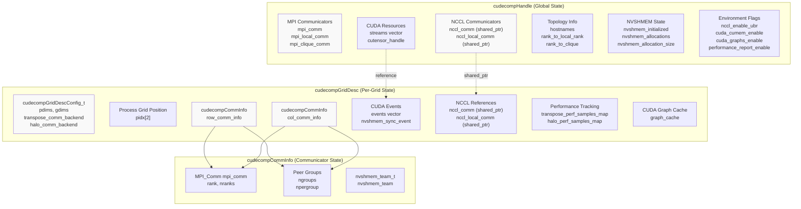
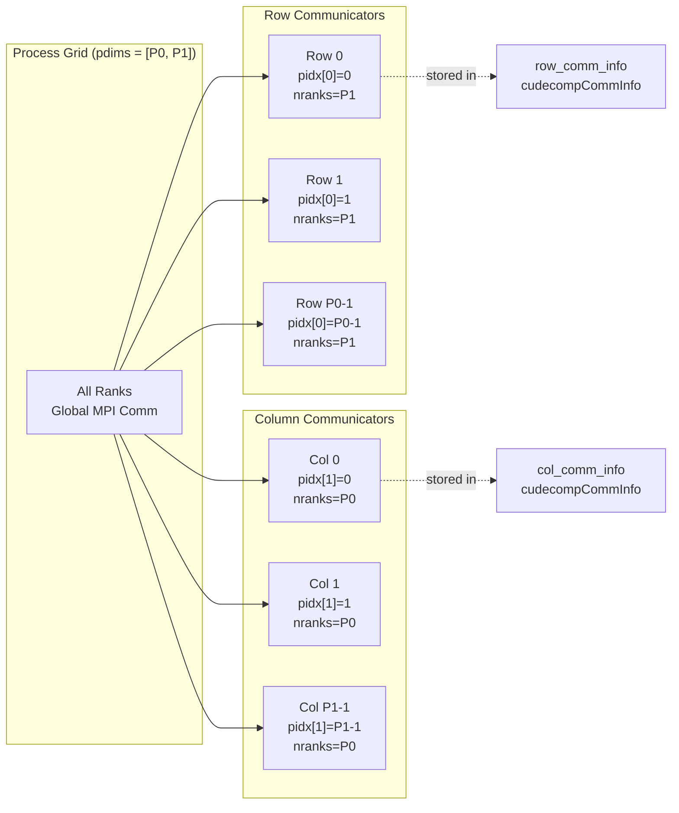
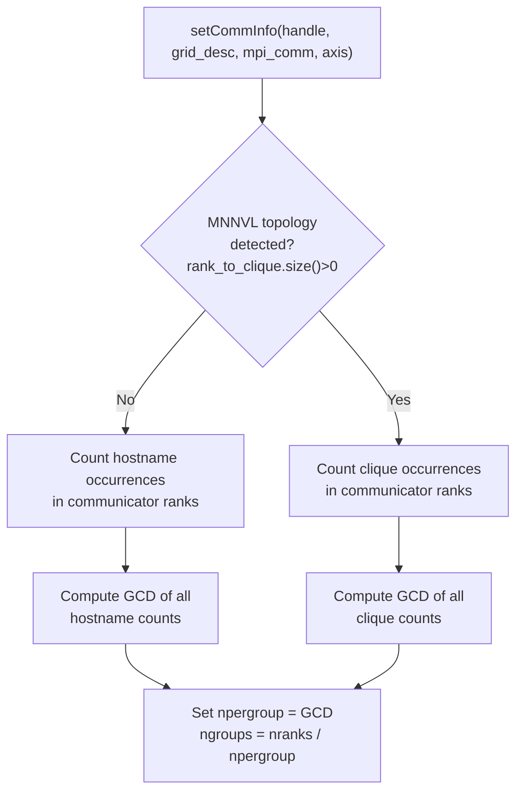

<!-- source: DeepWiki mcp.deepwiki.com · repo NVIDIA/cuDecomp · page 14 Internal Architecture · fetched 2026-10-26 -->

# Internal Architecture

<details>
<summary>Relevant source files</summary>

The following files were used as context for generating this wiki page:

- [include/internal/common.h](include/internal/common.h)
- [src/cudecomp.cc](src/cudecomp.cc)

</details>


This page provides a deep dive into cuDecomp's internal implementation details for advanced users and contributors. It covers the core internal data structures, resource management strategies, and internal communication patterns that support the public API.

For information about the public-facing library architecture and initialization process, see [Library Architecture and Initialization](#3.1). For API documentation, see [API Reference](#4).

---

## Overview of Internal Organization

cuDecomp's internal architecture is organized around three primary data structures that manage state at different scopes:

| Structure | Scope | Lifecycle | Purpose |
|-----------|-------|-----------|---------|
| `cudecompHandle` | Global | One per process | Manages MPI/NCCL/NVSHMEM resources, GPU topology info, environment settings |
| `cudecompGridDesc` | Per-grid | Multiple per handle | Manages decomposition-specific state, communicators, events, performance data |
| `cudecompCommInfo` | Per-communicator | Embedded in GridDesc | Tracks row/column communicator details and peer group topology |

The implementation follows a strict resource hierarchy where handles own shared resources (NCCL communicators, CUDA streams) that are referenced by multiple grid descriptors through shared pointers.

**Sources:** [include/internal/common.h:54-206](), [src/cudecomp.cc:409-551]()

---

## Internal Data Structure Hierarchy



**Diagram: Internal Data Structure Organization**

This diagram shows the hierarchical relationship between cuDecomp's core internal structures. The handle maintains global state and owns shared resources, while grid descriptors maintain per-decomposition state and reference shared resources through smart pointers.

**Sources:** [include/internal/common.h:54-206]()

---

## cudecompHandle: Global State Management

The `cudecompHandle` structure maintains all process-global state and resources. Only one handle can exist per process (enforced by the static flag `cudecomp_initialized` at [src/cudecomp.cc:51]()).

### Key Components

**MPI Topology Information:**
- `mpi_comm`, `mpi_local_comm`, `mpi_clique_comm`: Three-level communicator hierarchy (global, node-local, MNNVL-clique-local)
- `hostnames`: Gathered from all ranks for intra-node peer detection
- `rank_to_local_rank`, `rank_to_clique_rank`: Mappings for multi-level topology

**NCCL Management:**
- `nccl_comm`, `nccl_local_comm`: Shared pointers to NCCL communicators, enabling reference counting
- `nccl_ubr_handles`: Map of buffer addresses to NCCL User Buffer Registration handles for multiple communicators
- `nccl_enable_ubr`: Environment flag to control UBR usage

**NVSHMEM Tracking:**
- `nvshmem_initialized`: Flag indicating NVSHMEM initialization status
- `nvshmem_allocations`: Map tracking all NVSHMEM symmetric allocations and their sizes
- `n_grid_descs_using_nvshmem`: Reference count to determine when to finalize NVSHMEM

**Resource Pools:**
- `streams`: Vector of high-priority CUDA streams for concurrent communication scheduling (size = `device_p2p_ce_count + 1`)
- `cutensor_handle`: Global cuTENSOR handle for local transpose operations

**Sources:** [include/internal/common.h:54-117](), [src/cudecomp.cc:409-511]()

---

## cudecompGridDesc: Per-Grid State

Each `cudecompGridDesc` represents a specific decomposition configuration and maintains all state required for transpose and halo operations on that grid.

### Communicator Information Structure



**Diagram: Grid Descriptor Communicator Organization**

Each grid descriptor maintains separate communicator information for its row and column, created by splitting the global MPI communicator based on the process grid indices `pidx[0]` and `pidx[1]`.

**Sources:** [src/cudecomp.cc:748-757](), [include/internal/common.h:169-206]()

### Performance Monitoring Infrastructure

Grid descriptors maintain comprehensive performance tracking data through two map structures:

**Transpose Performance Tracking:**
- Key: `tuple<axis_in, axis_out, input_halos, output_halos, input_padding, output_padding, inplace, blocking, dtype>`
- Value: `cudecompTransposePerformanceSampleCollection` containing:
  - Vector of samples with start/end events for overall operation and individual alltoall chunks
  - Current sample index and warmup count
  - Byte counts for bandwidth calculation

**Halo Performance Tracking:**
- Key: `tuple<axis, dim, halo_extents, halo_periods, padding, blocking, dtype>`
- Value: `cudecompHaloPerformanceSampleCollection` containing:
  - Vector of samples with start/end events for overall and sendrecv operations
  - Current sample index and warmup count
  - Byte counts for bandwidth calculation

The performance system creates CUDA events on-demand and maintains a circular buffer of samples controlled by `performance_report_samples` and `performance_report_warmup_samples` in the handle.

**Sources:** [include/internal/common.h:134-166](), [include/internal/common.h:195-203]()

---

## cudecompCommInfo: Communicator Topology

The `cudecompCommInfo` structure encapsulates all information about a row or column communicator, including its MPI communicator, NVSHMEM team, and peer group topology.

### Peer Group Detection

The `setCommInfo` function at [include/internal/common.h:305-355]() performs sophisticated topology analysis to determine the structure of high-bandwidth peer groups within a communicator:



**Diagram: Peer Group Detection Algorithm**

The algorithm uses GCD to find the largest homogeneous peer group size, accommodating scenarios where different nodes have different GPU counts or cliques have different sizes. This information is critical for optimizing communication patterns.

**Key Fields:**
- `ngroups`: Number of peer groups in the communicator
- `npergroup`: Number of ranks per peer group
- When `ngroups == 1`, all ranks share fast interconnect (NVLink/NVSwitch/MNNVL) and can use local NCCL communicator
- When `ngroups > 1`, communication crosses nodes and requires global NCCL communicator

**Sources:** [include/internal/common.h:120-131](), [include/internal/common.h:305-355]()

---

## Resource Reference Counting and Sharing

cuDecomp uses C++ shared pointers (`std::shared_ptr`) to implement reference-counted resource management for expensive objects like NCCL communicators.

### NCCL Communicator Lifecycle

```mermaid
stateDiagram-v2
    [*] --> HandleOwns: cudecompInit creates handle
    
    HandleOwns: Handle owns nccl_comm<br/>nccl_local_comm
    
    HandleOwns --> GridRefCreated: cudecompGridDescCreate
    
    GridRefCreated: Grid descriptor holds<br/>shared_ptr references
    
    state GridRefCreated {
        [*] --> CheckBackend: Check comm backends
        CheckBackend --> NeedGlobal: Requires global comm
        CheckBackend --> NeedLocal: Requires local comm
        CheckBackend --> NeedBoth: Requires both
        NeedGlobal --> RefGlobal: grid_desc->nccl_comm = handle->nccl_comm
        NeedLocal --> RefLocal: grid_desc->nccl_local_comm = handle->nccl_local_comm
        NeedBoth --> RefGlobal
        NeedBoth --> RefLocal
    end
    
    GridRefCreated --> GridDestroyed: cudecompGridDescDestroy
    
    GridDestroyed: Release grid_desc references<br/>grid_desc->nccl_comm.reset()
    
    state GridDestroyed {
        [*] --> CheckRefCount: Check use_count()
        CheckRefCount --> DestroyComm: use_count() == 1
        CheckRefCount --> KeepComm: use_count() > 1
        DestroyComm --> DoneDestroy[Communicator destroyed]
        KeepComm --> DoneKeep[Communicator kept]
    end
    
    GridDestroyed --> HandleOwns: Other grids still exist
    GridDestroyed --> HandleFinalized: cudecompFinalize
    HandleFinalized --> [*]
```

**Diagram: NCCL Communicator Reference Counting**

The lifecycle shows how NCCL communicators are shared between handle and grid descriptors through shared pointers. The `use_count()` check ensures communicators are only destroyed when no grid descriptors reference them.

**Implementation Details:**
- Custom deleter `ncclCommDeleter` at [include/internal/common.h:429-436]() calls `ncclCommDestroy`
- Helper function `createNcclComm` at [include/internal/common.h:439-441]() wraps raw NCCL communicators
- Grid descriptor creation conditionally initializes communicators at [src/cudecomp.cc:633-683]()
- Grid descriptor destruction checks reference counts at [src/cudecomp.cc:875-883]()

**Sources:** [include/internal/common.h:429-441](), [src/cudecomp.cc:633-683](), [src/cudecomp.cc:875-883]()

---

## Internal Communication Scheduling

### Multi-Stream Concurrent Scheduling

cuDecomp maintains a pool of high-priority CUDA streams in the handle for concurrent communication scheduling. The number of streams is determined by `device_p2p_ce_count + 1`, where the P2P CE count is detected based on GPU topology:

| Topology | P2P CE Count | Logic |
|----------|--------------|-------|
| NVSwitch present | 1 | Single shared CE for all peers |
| NVLink peers detected | Number of NVLink peers | One CE per peer |
| PCIe/other | 2 | Shared D2H/H2D CEs |

The detection logic is at [src/cudecomp.cc:458-498]() and uses NVML to query NVSwitch presence and NVLink peer counts.

**Stream Allocation:**
Streams are created with the highest priority available at [src/cudecomp.cc:698-705]():
```
cudaDeviceGetStreamPriorityRange(nullptr, &greatest_priority)
cudaStreamCreateWithPriority(&stream, cudaStreamNonBlocking, greatest_priority)
```

**Sources:** [src/cudecomp.cc:458-498](), [src/cudecomp.cc:698-705]()

### Event-Based Dependency Management

Grid descriptors maintain a vector of CUDA events (`events`) sized to the number of ranks for fine-grained dependency tracking between communication operations. Events are created with `cudaEventDisableTiming` flag at [src/cudecomp.cc:708-714]() since timing is handled separately by the performance monitoring system.

The events vector is used in transpose and halo operations to:
- Schedule pipelined communication chunks without synchronization
- Enforce ordering between alltoall iterations
- Coordinate between packing, communication, and unpacking stages

**Sources:** [src/cudecomp.cc:708-714](), [include/internal/common.h:179-180]()

---

## NVSHMEM Resource Management

NVSHMEM requires special handling due to its symmetric memory model and limited heap space.

### Allocation Tracking

The handle maintains detailed tracking of NVSHMEM allocations:
- `nvshmem_allocations`: Map from buffer pointer to allocation size
- `nvshmem_allocation_size`: Running total of allocated bytes
- `nvshmem_symmetric_size`: Total symmetric heap size (parsed from environment at [src/cudecomp.cc:383-402]())

### Size Synchronization

NVSHMEM requires all ranks to allocate the same buffer size. The `cudecompMalloc` function performs a `MPI_Allreduce` with `MPI_MAX` to find the maximum requested size across all ranks at [src/cudecomp.cc:1142](). This ensures symmetric allocations even when different ranks have different pencil sizes.

### Lazy Finalization

NVSHMEM is initialized lazily when needed but finalized aggressively to reclaim symmetric heap:
- `n_grid_descs_using_nvshmem`: Reference count of grid descriptors using NVSHMEM backends
- When count reaches zero during grid descriptor destruction, `nvshmem_finalize()` is called immediately at [src/cudecomp.cc:898-903]()
- This allows the symmetric heap to be reclaimed and reused by subsequent grid descriptors with different backends

**Sources:** [src/cudecomp.cc:383-402](), [src/cudecomp.cc:1138-1161](), [src/cudecomp.cc:886-904]()

---

## CUDA VMM and Fabric-Aware Allocations

When `CUDECOMP_ENABLE_CUMEM` is set and the driver/device support it, cuDecomp uses CUDA Virtual Memory Management (VMM) APIs for fabric-aware allocations.

### Feature Detection

The initialization process at [src/cudecomp.cc:272-304]() performs a multi-stage check:
1. Verify CUDA runtime version >= 12.3
2. Verify driver version >= 12.3
3. Query device attribute `CU_DEVICE_ATTRIBUTE_HANDLE_TYPE_FABRIC_SUPPORTED`
4. Disable feature and warn if any check fails

### Allocation Process

The `cudecompMalloc` function at [src/cudecomp.cc:1163-1199]() uses CUDA driver APIs:
1. Create allocation properties with `CU_MEM_HANDLE_TYPE_FABRIC` handle type
2. Query and enable RDMA support if available
3. Align allocation size to granularity
4. Create memory handle with `cuMemCreate`
5. Reserve address range with `cuMemAddressReserve`
6. Map memory with `cuMemMap`
7. Set read/write access with `cuMemSetAccess`

### Deallocation Process

The `cudecompFree` function at [src/cudecomp.cc:1264-1275]() reverses the process:
1. Retain allocation handle with `cuMemRetainAllocationHandle`
2. Release once
3. Query address range size
4. Unmap with `cuMemUnmap`
5. Release handle again
6. Free address range with `cuMemAddressFree`

**Sources:** [src/cudecomp.cc:272-304](), [src/cudecomp.cc:1163-1199](), [src/cudecomp.cc:1264-1275]()

---

## NCCL User Buffer Registration (UBR)

NCCL 2.19+ supports User Buffer Registration to eliminate runtime registration overhead. When `CUDECOMP_ENABLE_NCCL_UBR` is set, cuDecomp registers all work buffers with NCCL communicators.

### Registration Strategy

During `cudecompMalloc` at [src/cudecomp.cc:1203-1218]():
1. Register buffer with `nccl_comm` if grid descriptor has global communicator
2. Register buffer with `nccl_local_comm` if grid descriptor has local communicator
3. Store each `(ncclComm_t, handle)` pair in `nccl_ubr_handles` map keyed by buffer address

This allows a single buffer to be registered with multiple NCCL communicators, which is necessary since a grid descriptor may use both global and local communicators depending on the communicator topology.

### Deregistration

During `cudecompFree` at [src/cudecomp.cc:1235-1245]():
1. Look up buffer in `nccl_ubr_handles` map
2. Call `ncclCommDeregister` for each stored `(comm, handle)` pair
3. Erase entry from map

**Sources:** [src/cudecomp.cc:1203-1218](), [src/cudecomp.cc:1235-1245]()

---

## Environment Variable Processing

The handle initialization at [src/cudecomp.cc:264-368]() processes multiple environment variables that control internal behavior:

| Variable | Type | Default | Effect |
|----------|------|---------|--------|
| `CUDECOMP_ENABLE_NCCL_UBR` | bool | false | Enable NCCL user buffer registration |
| `CUDECOMP_ENABLE_CUMEM` | bool | false | Use CUDA VMM for allocations |
| `CUDECOMP_ENABLE_CUDA_GRAPHS` | bool | false | Use CUDA graphs in pipelined backends |
| `CUDECOMP_ENABLE_PERFORMANCE_REPORT` | bool | false | Enable performance monitoring |
| `CUDECOMP_PERFORMANCE_REPORT_DETAIL` | int | 0 | Detail level: 0=aggregate, 1=rank 0, 2=all ranks |
| `CUDECOMP_PERFORMANCE_REPORT_SAMPLES` | int | 20 | Number of samples to collect |
| `CUDECOMP_PERFORMANCE_REPORT_WARMUP_SAMPLES` | int | 3 | Number of warmup samples to skip |
| `CUDECOMP_PERFORMANCE_REPORT_WRITE_DIR` | string | "" | Directory for CSV output (empty = none) |
| `CUDECOMP_USE_COL_MAJOR_RANK_ORDER` | bool | false | Use column-major rank ordering |

The function includes runtime validation and warning messages when features are requested but not supported by the current driver/device combination.

**Sources:** [src/cudecomp.cc:264-368]()

---

## Internal Helper Functions

The `common.h` header provides several utility functions used throughout the implementation:

### Rank Mapping Functions

**`getGlobalRank(handle, grid_desc, axis, axis_rank)`** at [include/internal/common.h:215-226]():
- Converts row or column communicator rank to global MPI rank
- Handles both row-major (default) and column-major rank ordering
- Used extensively in communication setup and peer identification

### Pencil Size Calculation

**`getGlobalMaxPencilSize(handle, grid_desc, axis)`** at [include/internal/common.h:229-246]():
- Computes maximum pencil size across all ranks for a given axis
- Accounts for uneven decompositions and `gdims_dist` padding
- Used for workspace allocation sizing

### Pointer Offset Calculation

**`getPencilPtrOffset(pinfo, lx)`** at [include/internal/common.h:249-252]():
- Converts global index to linear memory offset
- Respects the pencil's memory order specified in `pinfo.order`
- Used in packing/unpacking kernels

### Alltoall Peer Selection

**`getAlltoallPeerRanks(grid_desc, comm_axis, iter, src_rank, dst_rank)`** at [include/internal/common.h:357-401]():
- Computes source and destination ranks for alltoall iteration `iter`
- Uses XOR pattern for power-of-2 communicator sizes
- Uses multi-level ring pattern for non-power-of-2 sizes
- Mixes transfer ordering to distribute intra-group and inter-group transfers

**Sources:** [include/internal/common.h:215-401]()

---

## Validation and Error Checking

Internal validation functions ensure API arguments are valid before proceeding with operations. These are called at the entry point of every public API function:

**`checkHandle(handle)`** at [src/cudecomp.cc:136-138]():
- Verifies handle pointer is non-null and `initialized` flag is set

**`checkGridDesc(grid_desc)`** at [src/cudecomp.cc:140-142]():
- Verifies grid descriptor pointer is non-null and `initialized` flag is set

**`checkConfig(handle, config, autotune_transpose, autotune_halos)`** at [src/cudecomp.cc:144-177]():
- Validates communication backend enums unless autotuning is enabled
- Checks `pdims` product equals rank count (or is zero for autotuning)
- Validates `transpose_mem_order` is either fully set or fully unset
- Ensures each axis has a valid permutation (values 0, 1, 2 appear exactly once)

**`checkDataType(dtype)`** at [src/cudecomp.cc:126-134]():
- Validates data type enum value

**`checkTransposeCommBackend(backend)`** at [src/cudecomp.cc:89-107]():
- Validates transpose backend enum
- Throws `THROW_NOT_SUPPORTED` for NVSHMEM backends when `ENABLE_NVSHMEM` not defined

**`checkHaloCommBackend(backend)`** at [src/cudecomp.cc:109-124]():
- Validates halo backend enum
- Throws `THROW_NOT_SUPPORTED` for NVSHMEM backends when `ENABLE_NVSHMEM` not defined

All validation failures use exception macros from `internal/exceptions.h` that are caught at the API boundary and converted to result codes.

**Sources:** [src/cudecomp.cc:89-177]()

---

## Summary

cuDecomp's internal architecture is designed around three core principles:

1. **Hierarchical State Management**: Global state in handle, per-grid state in grid descriptor, per-communicator state in comm info
2. **Reference-Counted Resource Sharing**: Expensive resources like NCCL communicators are shared through smart pointers
3. **Comprehensive Tracking**: All allocations, performance data, and topology information are tracked for optimization and reporting

For detailed information about specific aspects:
- See [Core Data Structures](#14.1) for detailed field-by-field documentation
- See [Resource Lifecycle and Caching](#14.2) for resource management patterns
- See [Performance Monitoring](#14.3) for performance tracking implementation

---

