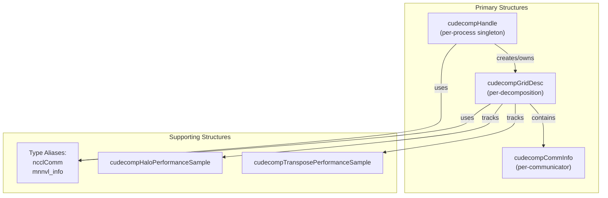
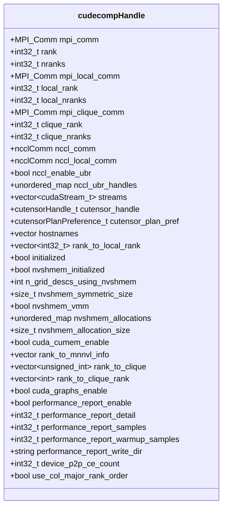
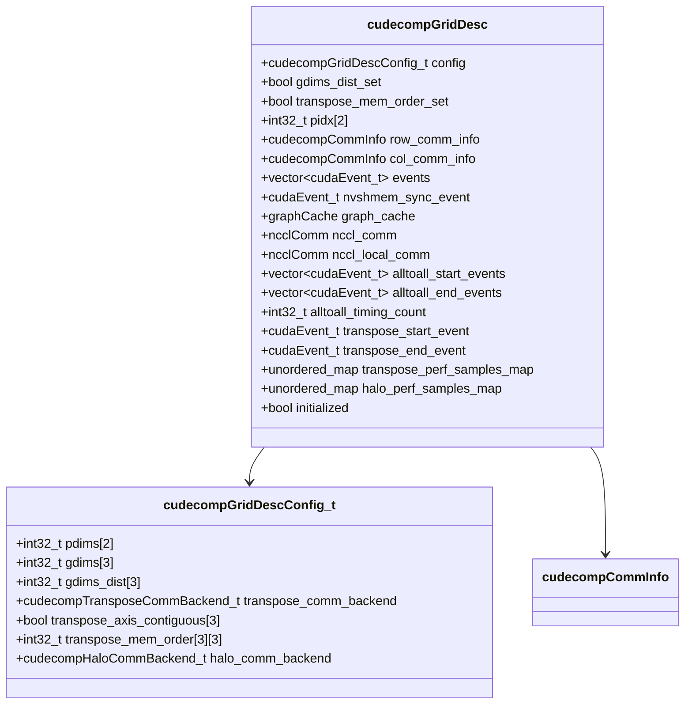
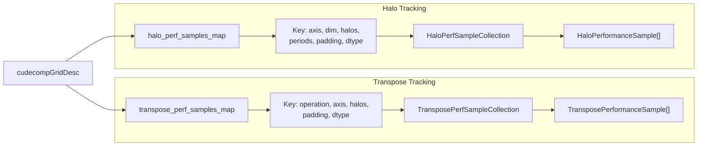
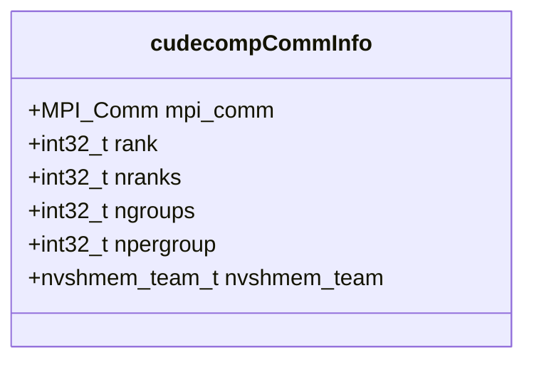
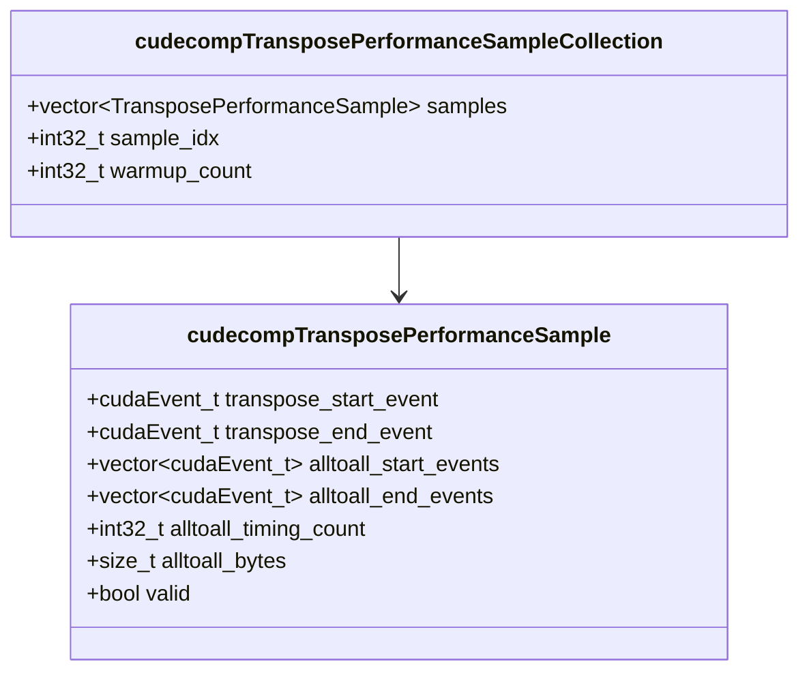
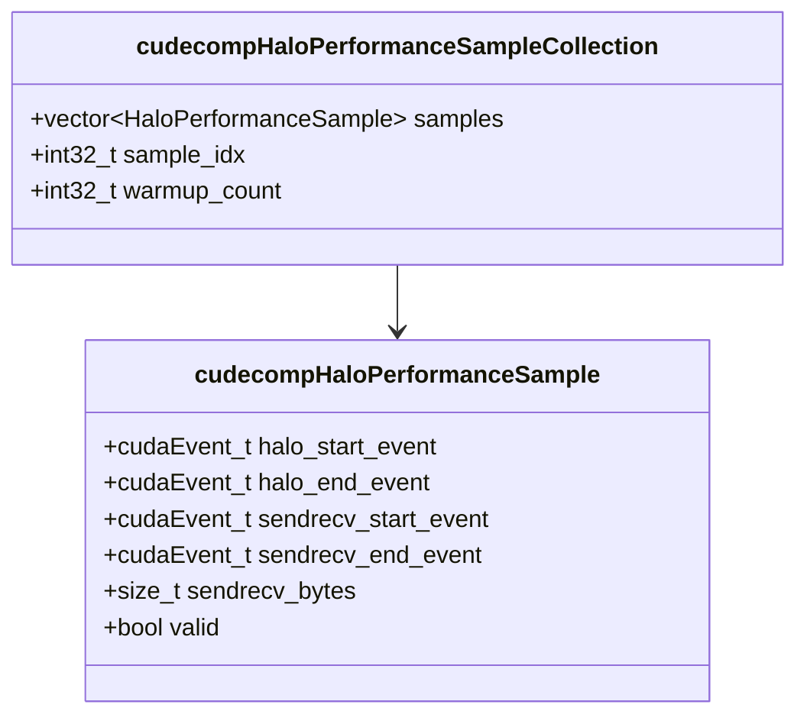
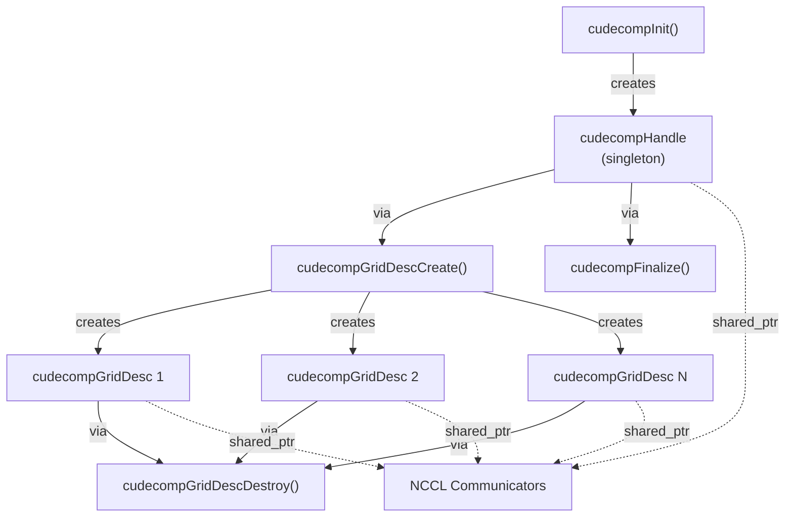
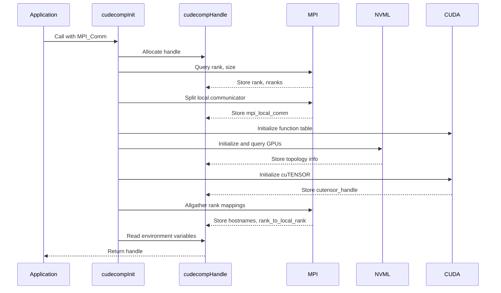

<!-- source: DeepWiki mcp.deepwiki.com · repo NVIDIA/cuDecomp · page 14.1 Core Data Structures · fetched 2026-10-26 -->

# Core Data Structures

<details>
<summary>Relevant source files</summary>

The following files were used as context for generating this wiki page:

- [include/internal/common.h](include/internal/common.h)
- [src/cudecomp.cc](src/cudecomp.cc)

</details>


This page documents the internal data structures that form the foundation of cuDecomp's implementation. These structures are defined in [include/internal/common.h]() and are used throughout the library to manage resources, configuration, and state. This documentation is intended for advanced users and contributors who need to understand cuDecomp's internal architecture.

For information about the public API structures (e.g., `cudecompGridDescConfig_t`, `cudecompPencilInfo_t`), see [Grid Configuration and Creation](#4.2). For details on how these structures are initialized and managed, see [Resource Lifecycle and Caching](#14.2).

---

## Overview of Core Structures

cuDecomp's internal architecture centers on three primary data structures that work together to manage distributed decomposition state:



**Sources:** [include/internal/common.h:54-206]()

---

## cudecompHandle Structure

The `cudecompHandle` structure is the top-level resource container for a cuDecomp instance. It is created once per MPI communicator during initialization and persists until finalization.

### Structure Definition



### Field Categories

The handle fields are organized into logical categories:

| Category | Fields | Purpose |
|----------|--------|---------|
| **MPI Communicators** | `mpi_comm`, `rank`, `nranks`, `mpi_local_comm`, `local_rank`, `local_nranks`, `mpi_clique_comm`, `clique_rank`, `clique_nranks` | MPI communication infrastructure for global, local (intra-node), and clique (MNNVL) scopes |
| **NCCL Resources** | `nccl_comm`, `nccl_local_comm`, `nccl_enable_ubr`, `nccl_ubr_handles` | NCCL communicators and user buffer registration tracking |
| **CUDA Resources** | `streams`, `cutensor_handle`, `cutensor_plan_pref` | Internal CUDA streams for concurrent operations and cuTENSOR handle |
| **Rank Topology** | `hostnames`, `rank_to_local_rank`, `rank_to_mnnvl_info`, `rank_to_clique`, `rank_to_clique_rank` | Mappings between global ranks, local ranks, hostnames, and MNNVL cliques |
| **NVSHMEM Management** | `nvshmem_initialized`, `n_grid_descs_using_nvshmem`, `nvshmem_symmetric_size`, `nvshmem_vmm`, `nvshmem_allocations`, `nvshmem_allocation_size` | NVSHMEM initialization state and symmetric heap tracking |
| **Feature Flags** | `cuda_cumem_enable`, `cuda_graphs_enable`, `use_col_major_rank_order` | Runtime feature enablement flags |
| **Performance Reporting** | `performance_report_enable`, `performance_report_detail`, `performance_report_samples`, `performance_report_warmup_samples`, `performance_report_write_dir` | Performance tracking configuration |
| **Hardware Info** | `device_p2p_ce_count` | GPU hardware capabilities |

**Sources:** [include/internal/common.h:54-117]()

### Key Design Decisions

#### Singleton Pattern
The handle enforces a singleton pattern through the static flag `cudecomp_initialized` in [src/cudecomp.cc:51](), preventing multiple handles from being created. This simplifies resource management and avoids conflicts with libraries like NVSHMEM that have global state.

#### Shared NCCL Communicators
NCCL communicators (`nccl_comm`, `nccl_local_comm`) are managed as `std::shared_ptr<ncclComm_t>` with custom deleters ([include/internal/common.h:429-441]()). This allows multiple grid descriptors to safely share communicators, with automatic cleanup when the last reference is released.

#### NVSHMEM Allocation Tracking
The `nvshmem_allocations` map tracks all NVSHMEM symmetric allocations and their sizes, while `nvshmem_allocation_size` maintains a running total. This is necessary because NVSHMEM has a fixed symmetric heap size, and cuDecomp needs to warn users if they exceed it.

**Sources:** [include/internal/common.h:54-117](), [src/cudecomp.cc:409-511]()

---

## cudecompGridDesc Structure

The `cudecompGridDesc` structure contains all information specific to a particular data decomposition. Multiple grid descriptors can coexist under a single handle, each with different process grid dimensions, communication backends, and configurations.

### Structure Definition



### Configuration Fields

| Field | Type | Description |
|-------|------|-------------|
| `config` | `cudecompGridDescConfig_t` | User-facing configuration including process grid dimensions, global grid dimensions, and backend selections |
| `gdims_dist_set` | `bool` | Flag tracking whether `gdims_dist` was explicitly set (vs. defaulting to `gdims`) |
| `transpose_mem_order_set` | `bool` | Flag tracking whether custom memory ordering was specified |
| `pidx[2]` | `int32_t[2]` | This process's index in the 2D process grid |

### Communicator State

The grid descriptor maintains two `cudecompCommInfo` structures:
- `row_comm_info`: Communicator for processes in the same row (same `pidx[0]`)
- `col_comm_info`: Communicator for processes in the same column (same `pidx[1]`)

These communicators are used for different transpose operations:
- X↔Y transposes use `col_comm_info` ([src/cudecomp.cc:752-757]())
- Y↔Z transposes use `row_comm_info`

### Performance Tracking

The grid descriptor includes extensive performance tracking infrastructure:



The performance maps use configuration tuples as keys, allowing separate tracking for each unique operation configuration. Samples are collected in a circular buffer, with warmup samples discarded.

**Sources:** [include/internal/common.h:169-206](), [src/cudecomp.cc:565-822]()

---

## cudecompCommInfo Structure

The `cudecompCommInfo` structure encapsulates information about a row or column communicator in the process grid.

### Structure Definition



### Field Descriptions

| Field | Description |
|-------|-------------|
| `mpi_comm` | MPI communicator for this row or column |
| `rank` | This process's rank within the communicator |
| `nranks` | Total number of processes in the communicator |
| `ngroups` | Number of P2P groups (ranks with fast interconnect) |
| `npergroup` | Number of ranks per P2P group |
| `nvshmem_team` | NVSHMEM team corresponding to this communicator (if using NVSHMEM) |

### P2P Group Detection

The `ngroups` and `npergroup` fields are computed by the `setCommInfo` function ([include/internal/common.h:305-355]()). This function analyzes the communicator topology to identify groups of processes with fast interconnect:

**For non-MNNVL systems:** Groups are determined by hostname. All ranks on the same node form a P2P group.

**For MNNVL systems:** Groups are determined by MNNVL clique membership. All ranks in the same clique form a P2P group.

The group information is used to optimize communication patterns. For example, the `getAlltoallPeerRanks` function ([include/internal/common.h:357-401]()) uses multi-level ring patterns that prioritize intra-group communication over inter-group communication.

**Sources:** [include/internal/common.h:120-131](), [include/internal/common.h:305-355]()

---

## Performance Tracking Structures

cuDecomp includes a sophisticated performance tracking system for both transpose and halo operations.

### Transpose Performance Structures



Each transpose operation records:
- Overall transpose timing via `transpose_start_event` and `transpose_end_event`
- Individual all-to-all phase timing for pipelined backends
- Communication volume in bytes
- Validity flag to track which samples have completed

### Halo Performance Structures



Halo operations track:
- Overall halo operation timing
- Send/receive pair timing (the actual communication)
- Communication volume

### Circular Buffer Management

The sample collections implement a circular buffer pattern:
- `sample_idx` tracks the next sample to write
- `warmup_count` tracks how many samples to discard initially
- When the buffer fills, the oldest sample is overwritten

**Sources:** [include/internal/common.h:134-166]()

---

## Type Aliases and Helper Types

cuDecomp defines several type aliases to improve code readability and enable cross-platform compatibility.

### NCCL Communicator Wrapper

```cpp
typedef std::shared_ptr<ncclComm_t> ncclComm;
```

The `ncclComm` type wraps NCCL communicators in a shared pointer with a custom deleter ([include/internal/common.h:429-441]()). This enables:
- Automatic reference counting
- Shared ownership between handle and grid descriptors
- Automatic cleanup via `ncclCommDestroy` when the last reference is dropped

Helper function:
```cpp
ncclComm createNcclComm(ncclComm_t comm);
```

### MNNVL Information

```cpp
#if NVML_API_VERSION >= 12 && CUDART_VERSION >= 12040
typedef std::pair<std::array<unsigned char, NVML_GPU_FABRIC_UUID_LEN>, unsigned int> mnnvl_info;
#else
typedef std::pair<std::array<unsigned char, 1>, unsigned int> mnnvl_info;
#endif
```

The `mnnvl_info` type stores MNNVL clique information as a pair of:
1. Cluster UUID (fabric identifier)
2. Clique ID (identifier within the cluster)

On systems without MNNVL support, it degrades to a minimal size to maintain API compatibility.

### Communication Count Type

```cpp
using comm_count_t = int32_t;
```

Simple alias for communication counts used throughout the communication routines.

**Sources:** [include/internal/common.h:45-51](), [include/internal/common.h:429-441]()

---

## Structure Relationships and Lifecycle

### Ownership Hierarchy



### Resource Sharing

Several resources are shared between the handle and grid descriptors:

| Resource | Shared via | Lifecycle |
|----------|-----------|-----------|
| NCCL global communicator | `std::shared_ptr` | Destroyed when last reference released |
| NCCL local communicator | `std::shared_ptr` | Destroyed when last reference released |
| CUDA streams | Raw pointers | Owned by handle, destroyed in `cudecompFinalize` |
| cuTENSOR handle | Raw pointer | Owned by handle, destroyed in `cudecompFinalize` |

Grid descriptors hold shared pointers to NCCL communicators, allowing them to be destroyed independently while maintaining communicator validity as long as any grid descriptor needs them. When a grid descriptor is destroyed, it releases its shared pointer references. If the handle holds the only remaining reference, it destroys the communicator to reclaim resources ([src/cudecomp.cc:875-884]()).

### Initialization Sequence

The initialization sequence populates these structures:



**Sources:** [src/cudecomp.cc:409-511](), [src/cudecomp.cc:565-822](), [src/cudecomp.cc:824-915]()

---

## Enum Types for Communication Axis

The `cudecompCommAxis` enum distinguishes between row and column communicators:

```cpp
enum cudecompCommAxis { 
    CUDECOMP_COMM_COL = 0,  // Column communicator (same pidx[1])
    CUDECOMP_COMM_ROW = 1   // Row communicator (same pidx[0])
};
```

This enum is used throughout the codebase to specify which communicator to use for operations. Helper functions like `getGlobalRank` ([include/internal/common.h:215-226]()) take a `cudecompCommAxis` parameter to convert between axis ranks and global ranks.

**Sources:** [include/internal/common.h:212]()

---

## Memory Layout and Size Considerations

### Handle Size
The `cudecompHandle` structure contains:
- Fixed-size fields: ~200 bytes (communicators, flags, scalars)
- Dynamic vectors: O(nranks) memory for topology information
- Unordered maps: O(number of allocations) for tracking NVSHMEM and NCCL UBR

For a 1024-rank job, the handle requires approximately 50-100 KB.

### Grid Descriptor Size
The `cudecompGridDesc` structure contains:
- Fixed-size fields: ~100 bytes
- Events vector: O(nranks) CUDA events
- Performance maps: O(number of unique operation configs) with circular buffers

For typical usage with performance tracking enabled, a grid descriptor requires approximately 10-50 KB per unique operation configuration tracked.

**Sources:** [include/internal/common.h:54-206]()

---

