<!-- source: DeepWiki mcp.deepwiki.com · repo NVIDIA/cuDecomp · page 14.2 Resource Lifecycle and Caching · fetched 2026-10-26 -->

# Resource Lifecycle and Caching

Relevant source files

The following files were used as context for generating this wiki page:

- [include/internal/common.h](include/internal/common.h)
- [src/cudecomp.cc](src/cudecomp.cc)

This page documents the internal resource lifecycle management and caching strategies in cuDecomp. It explains how resources such as communicators, streams, events, and memory allocations are created, tracked, shared, and destroyed throughout the library's lifetime. This material is intended for advanced users and contributors who need to understand the internal architecture for debugging or extending the library.

For information about the public-facing initialization and grid configuration APIs, see [Initialization and Finalization](#4.1) and [Grid Configuration and Creation](#4.2). For details about core data structures, see [Core Data Structures](#14.1).

## Overview of Resource Management

cuDecomp manages resources at two primary levels:

1. **Handle-level resources**: Shared across all grid descriptors, including MPI communicators, NCCL communicators (with reference counting), CUDA streams, cuTENSOR handles, and NVSHMEM state.

2. **Grid descriptor-level resources**: Specific to each decomposition configuration, including row/column communicators, CUDA events, CUDA graph caches, and performance monitoring structures.

The library implements several strategies to optimize resource usage:
- **Reference counting** for expensive resources (NCCL communicators)
- **Lazy initialization** to avoid creating unused resources
- **Resource sharing** across multiple grid descriptors
- **Allocation tracking** for proper cleanup and debugging

## Handle Lifecycle

### Handle Initialization State Machine

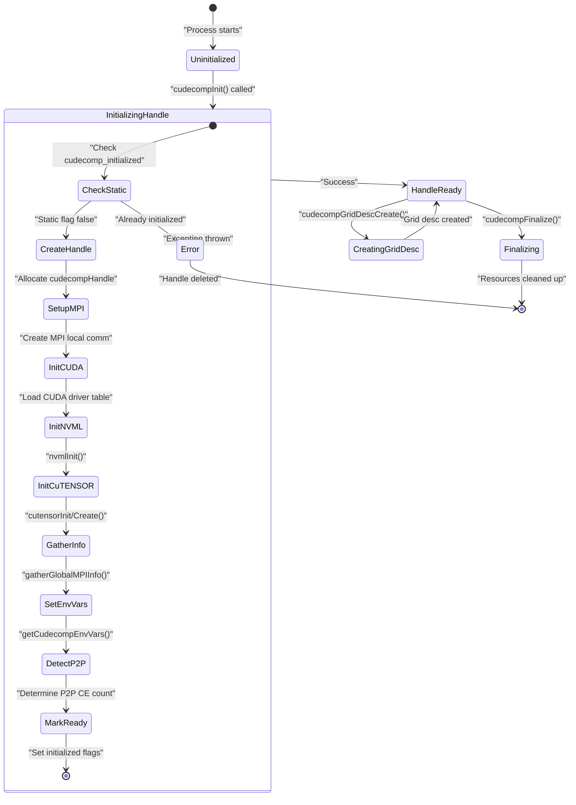

**Sources:** [src/cudecomp.cc:409-511](), [src/cudecomp.cc:51](), [include/internal/common.h:54-117]()

The handle initialization follows a strict sequence to ensure all dependencies are properly initialized. The `cudecomp_initialized` static flag prevents multiple handles from being created, as the library currently supports only a single handle per process.

### Handle Resource Initialization

The handle manages the following categories of resources:

| Resource Type | Initialization Location | Purpose |
|---------------|------------------------|---------|
| MPI Communicators | [src/cudecomp.cc:417-423]() | Global and local (node-level) communication |
| CUDA Function Table | [src/cudecomp.cc:426]() | Dynamic loading of CUDA driver API |
| NVML | [src/cudecomp.cc:428-431]() | GPU topology detection and MNNVL support |
| cuTENSOR Handle | [src/cudecomp.cc:433-440]() | Local tensor permutation operations |
| Topology Info | [src/cudecomp.cc:443]() | Hostname, local rank, MNNVL clique mappings |
| Environment Variables | [src/cudecomp.cc:446]() | Configuration flags (UBR, CUDA graphs, etc.) |
| P2P CE Count | [src/cudecomp.cc:449-498]() | Determines internal stream count |

**Sources:** [src/cudecomp.cc:409-511](), [src/cudecomp.cc:179-262](), [src/cudecomp.cc:264-368]()

The initialization order is critical: NVML must be initialized before topology detection, and MPI must be set up before any collective operations to gather global information.

### Handle Finalization

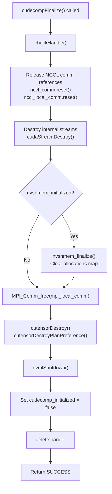

**Sources:** [src/cudecomp.cc:513-551]()

Finalization follows the reverse order of initialization to ensure proper dependency cleanup. Note that NCCL communicators are released via `reset()` calls, which decrements their reference count but may not immediately destroy them if grid descriptors still hold references.

## Grid Descriptor Lifecycle

### Creation and Configuration

```mermaid
graph TB
    Start["cudecompGridDescCreate() called"]
    ValidateArgs["Validate config and options"]
    
    AllocGridDesc["Allocate cudecompGridDesc<br/>Set initialized = true"]
    
    CheckNCCL{"NCCL needed?"}
    CreateNCCLGlobal["Create handle->nccl_comm<br/>if not exists"]
    CheckLocalNeeded{"Local NCCL needed?"}
    CreateNCCLLocal["Create handle->nccl_local_comm<br/>if not exists"]
    SetNCCLRefs["Set grid_desc NCCL references"]
    
    CheckNVSHMEM{"NVSHMEM needed?"}
    InitNVSHMEM["initNvshmemFromMPIComm()<br/>Set nvshmem_initialized"]
    
    CreateStreams{"handle->streams empty?"}
    AllocStreams["Create streams based on<br/>device_p2p_ce_count"]
    
    CreateEvents["Allocate CUDA events<br/>events.resize(nranks)"]
    
    CheckAutotune{"Autotuning requested?"}
    RunAutotune["autotuneTransposeBackend()<br/>autotuneHaloBackend()"]
    
    CreateRowCol["Create row/column MPI comms<br/>setCommInfo()"]
    
    SetupNVSHMEMTeams{"NVSHMEM used?"}
    CreateTeams["nvshmem_team_split_2d()<br/>Increment n_grid_descs_using_nvshmem"]
    
    ReleaseUnused["Release unused NCCL references<br/>if not needed by this grid"]
    
    ReturnGridDesc["Return grid_desc and config"]
    
    Start --> ValidateArgs
    ValidateArgs --> AllocGridDesc
    AllocGridDesc --> CheckNCCL
    CheckNCCL -->|Yes| CreateNCCLGlobal
    CheckNCCL -->|No| CreateStreams
    CreateNCCLGlobal --> CheckLocalNeeded
    CheckLocalNeeded -->|Yes| CreateNCCLLocal
    CheckLocalNeeded -->|No| SetNCCLRefs
    CreateNCCLLocal --> SetNCCLRefs
    SetNCCLRefs --> CheckNVSHMEM
    CheckNVSHMEM -->|Yes| InitNVSHMEM
    CheckNVSHMEM -->|No| CreateStreams
    InitNVSHMEM --> CreateStreams
    CreateStreams -->|Yes| AllocStreams
    CreateStreams -->|No| CreateEvents
    AllocStreams --> CreateEvents
    CreateEvents --> CheckAutotune
    CheckAutotune -->|Yes| RunAutotune
    CheckAutotune -->|No| CreateRowCol
    RunAutotune --> CreateRowCol
    CreateRowCol --> SetupNVSHMEMTeams
    SetupNVSHMEMTeams -->|Yes| CreateTeams
    SetupNVSHMEMTeams -->|No| ReleaseUnused
    CreateTeams --> ReleaseUnused
    ReleaseUnused --> ReturnGridDesc
```

**Sources:** [src/cudecomp.cc:565-822]()

Grid descriptor creation involves complex logic to lazily initialize handle-level resources and properly set up communicators. The function checks whether NCCL and NVSHMEM backends are needed (either configured directly or during autotuning) and initializes them only if required.

### Grid Descriptor Destruction

```mermaid
graph TB
    Start["cudecompGridDescDestroy() called"]
    FreeMPI["MPI_Comm_free()<br/>row_comm_info.mpi_comm<br/>col_comm_info.mpi_comm"]
    
    DestroyEvents["Destroy scheduling events<br/>cudaEventDestroy()"]
    
    CheckPerf{"performance_report_enable?"}
    PrintReport["printPerformanceReport()"]
    DestroyPerfEvents["Destroy performance<br/>sample events"]
    
    CheckNCCL{"NCCL used by grid?"}
    ReleaseNCCLRefs["grid_desc->nccl_comm.reset()<br/>grid_desc->nccl_local_comm.reset()"]
    CheckNCCLCount{"handle ref count == 1?"}
    DestroyNCCL["handle->nccl_comm.reset()<br/>handle->nccl_local_comm.reset()"]
    
    CheckNVSHMEM{"NVSHMEM used by grid?"}
    DestroyTeams["nvshmem_team_destroy()<br/>Decrement n_grid_descs_using_nvshmem"]
    CheckNVSHMEMCount{"n_grid_descs_using_nvshmem == 0?"}
    FinalizeNVSHMEM["nvshmem_finalize()<br/>Clear allocations"]
    
    DeleteGridDesc["delete grid_desc<br/>Set pointer to nullptr"]
    
    End["Return SUCCESS"]
    
    Start --> FreeMPI
    FreeMPI --> DestroyEvents
    DestroyEvents --> CheckPerf
    CheckPerf -->|Yes| PrintReport
    CheckPerf -->|No| CheckNCCL
    PrintReport --> DestroyPerfEvents
    DestroyPerfEvents --> CheckNCCL
    CheckNCCL -->|Yes| ReleaseNCCLRefs
    CheckNCCL -->|No| CheckNVSHMEM
    ReleaseNCCLRefs --> CheckNCCLCount
    CheckNCCLCount -->|Yes| DestroyNCCL
    CheckNCCLCount -->|No| CheckNVSHMEM
    DestroyNCCL --> CheckNVSHMEM
    CheckNVSHMEM -->|Yes| DestroyTeams
    CheckNVSHMEM -->|No| DeleteGridDesc
    DestroyTeams --> CheckNVSHMEMCount
    CheckNVSHMEMCount -->|Yes| FinalizeNVSHMEM
    CheckNVSHMEMCount -->|No| DeleteGridDesc
    FinalizeNVSHMEM --> DeleteGridDesc
    DeleteGridDesc --> End
```

**Sources:** [src/cudecomp.cc:824-915]()

Destruction logic carefully manages shared resources. NCCL communicators use reference counting to determine when to actually destroy the underlying communicator. NVSHMEM finalization occurs when the last grid descriptor using it is destroyed, reclaiming symmetric heap memory.

## Communicator Management and Reference Counting

### NCCL Communicator Reference Counting

cuDecomp uses `std::shared_ptr<ncclComm_t>` to implement reference-counted NCCL communicators. This allows multiple grid descriptors to share communicators while ensuring they are destroyed only when no longer needed.

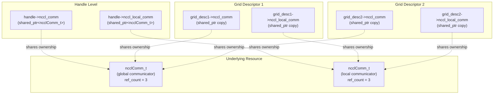

**Sources:** [include/internal/common.h:50](), [include/internal/common.h:69-70](), [include/internal/common.h:184-186](), [include/internal/common.h:429-441]()

The `ncclComm` type is defined as `std::shared_ptr<ncclComm_t>` with a custom deleter (`ncclCommDeleter`) that calls `ncclCommDestroy()` when the last reference is released. Helper function `createNcclComm()` wraps raw `ncclComm_t` pointers in this smart pointer.

### Communicator Creation and Sharing Logic

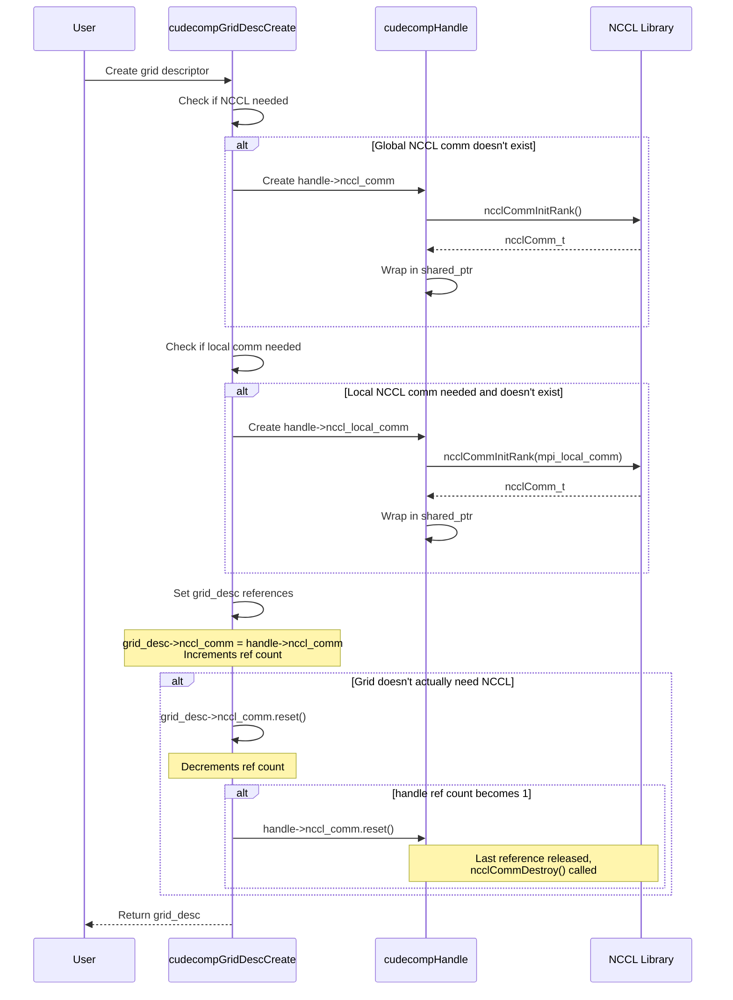

**Sources:** [src/cudecomp.cc:633-683](), [src/cudecomp.cc:775-796]()

The creation logic handles several scenarios:
1. **Initial creation**: First grid descriptor triggers communicator creation
2. **Reuse**: Subsequent grid descriptors share existing communicators
3. **Conditional release**: Grid descriptors that don't need NCCL release their references
4. **Lazy destruction**: Communicators are destroyed only when handle and all grid descriptors release references

### NVSHMEM Reference Counting

NVSHMEM uses a simpler integer counter (`n_grid_descs_using_nvshmem`) rather than shared pointers, since NVSHMEM maintains global state that cannot be partially released.

| Operation | Counter Update | Action |
|-----------|----------------|--------|
| Grid descriptor created with NVSHMEM backends | `++n_grid_descs_using_nvshmem` | Initialize NVSHMEM on first use |
| Grid descriptor destroyed with NVSHMEM backends | `--n_grid_descs_using_nvshmem` | Call `nvshmem_finalize()` when counter reaches 0 |

**Sources:** [include/internal/common.h:89](), [src/cudecomp.cc:764](), [src/cudecomp.cc:895](), [src/cudecomp.cc:898-903]()

## Memory Allocation Tracking

### Allocation Maps

cuDecomp tracks allocations in several maps to ensure proper cleanup and enable advanced features:

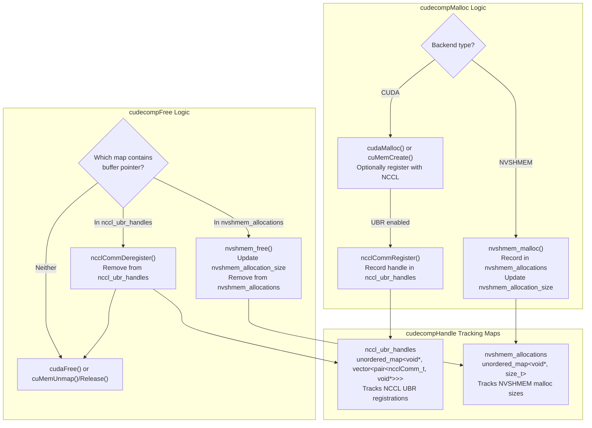

**Sources:** [include/internal/common.h:72-73](), [include/internal/common.h:93-94](), [src/cudecomp.cc:1131-1227](), [src/cudecomp.cc:1229-1286]()

### NVSHMEM Allocation Tracking

The `nvshmem_allocations` map serves two purposes:
1. **Size tracking**: Records the size of each allocation to properly update `nvshmem_allocation_size`
2. **Deallocation validation**: Ensures correct memory is freed in `cudecompFree`

The `nvshmem_allocation_size` counter provides visibility into symmetric heap usage and enables warnings when approaching capacity.

**Sources:** [src/cudecomp.cc:1157-1158](), [src/cudecomp.cc:1144-1152](), [src/cudecomp.cc:1255-1257]()

### NCCL User Buffer Registration (UBR) Tracking

When NCCL UBR is enabled (`nccl_enable_ubr = true`), allocations are registered with NCCL communicators to eliminate runtime registration overhead. The tracking map stores:

- **Key**: Buffer pointer
- **Value**: Vector of `(ncclComm_t, void*)` pairs, where each pair is a communicator and its UBR handle

Multiple entries per buffer are needed because buffers may be registered with both global and local NCCL communicators.

**Sources:** [src/cudecomp.cc:1207-1217](), [src/cudecomp.cc:1239-1244]()

## CUDA Resource Management

### Stream Management

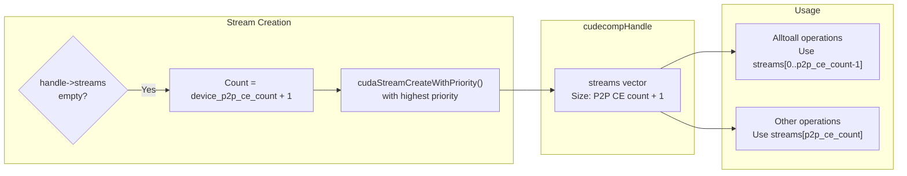

**Sources:** [src/cudecomp.cc:698-705](), [include/internal/common.h:75](), [include/internal/common.h:115]()

Streams are created once when the first grid descriptor is initialized. The number of streams is determined by the P2P CE (Copy Engine) count, which varies based on hardware topology:
- **NVSwitch systems**: 1 P2P CE → 2 streams total
- **NVLink systems**: One CE per peer → N+1 streams
- **PCIe systems**: 2 P2P CEs (shared) → 3 streams

The extra stream is used for operations that don't participate in concurrent P2P scheduling.

### Event Management

Events are managed at two levels:

| Event Type | Lifecycle | Purpose | Storage Location |
|------------|-----------|---------|------------------|
| Scheduling events | Per grid descriptor | Synchronize between concurrent operations | `grid_desc->events` [src/cudecomp.cc:708-711]() |
| NVSHMEM sync event | Per grid descriptor | Synchronize before NVSHMEM operations | `grid_desc->nvshmem_sync_event` [src/cudecomp.cc:713]() |
| Performance events | Per operation config | Measure transpose/halo timings | `grid_desc->transpose_perf_samples_map` [include/internal/common.h:195-198]() |

**Sources:** [src/cudecomp.cc:707-714](), [include/internal/common.h:179-180](), [include/internal/common.h:188-203]()

### CUDA Graph Caching

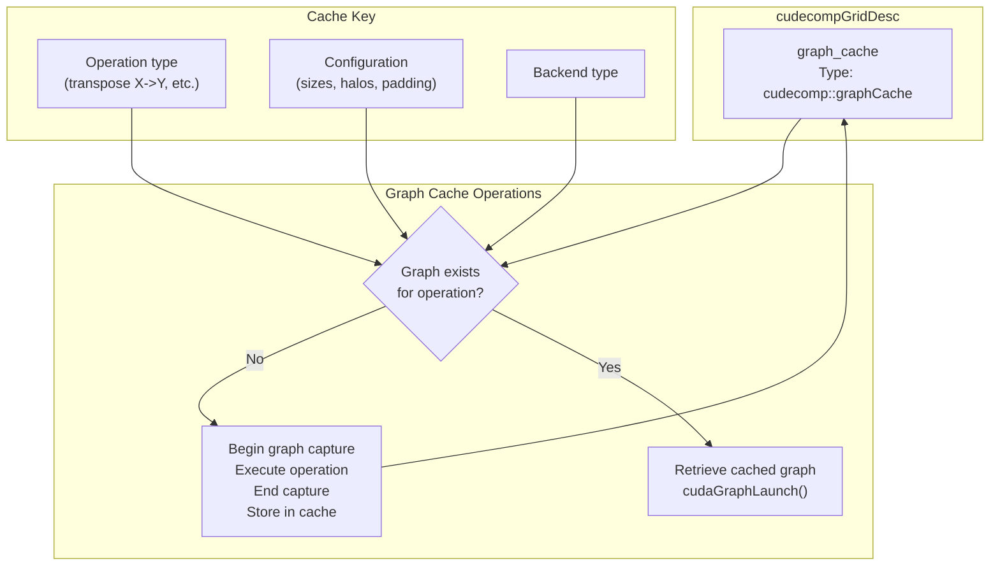

**Sources:** [include/internal/common.h:182](), [include/internal/graph.h]()

CUDA graphs are cached per grid descriptor to avoid the overhead of graph capture on repeated operations. This is particularly beneficial for pipelined backends where the same operation sequence is executed repeatedly. Graph caching is enabled via the `CUDECOMP_ENABLE_CUDA_GRAPHS` environment variable.

## Performance Sample Caching

### Sample Collection Maps

Performance reporting uses maps to store timing samples for different operation configurations:

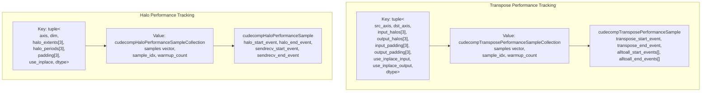

**Sources:** [include/internal/common.h:133-149](), [include/internal/common.h:151-166](), [include/internal/common.h:195-203]()

The maps use comprehensive keys that capture all relevant configuration parameters. This ensures that samples are correctly associated with their specific operation configuration, enabling accurate performance analysis across different use cases.

### Sample Lifecycle

Performance samples are managed with a circular buffer approach:

1. **Warmup phase**: First N samples (configured by `performance_report_warmup_samples`) are collected but not retained
2. **Collection phase**: Subsequent samples up to `performance_report_samples` limit are stored
3. **Circular overwrite**: Once limit is reached, oldest samples are overwritten

Events within each sample are reused across multiple calls to avoid allocation overhead. Events are only destroyed when the grid descriptor is destroyed.

**Sources:** [include/internal/common.h:145-149](), [include/internal/common.h:162-166](), [src/cudecomp.cc:849-873]()

## Cleanup and Destruction Order

### Resource Dependency Graph

```mermaid
graph TD
    Handle["cudecompHandle"]
    GridDesc["cudecompGridDesc"]
    
    MPIGlobal["MPI Global Comm"]
    MPILocal["MPI Local Comm"]
    MPIClique["MPI Clique Comm"]
    MPIRow["MPI Row Comm"]
    MPICol["MPI Column Comm"]
    
    NCCLGlobal["NCCL Global Comm (ref counted)"]
    NCCLLocal["NCCL Local Comm (ref counted)"]
    
    NVSHMEMState["NVSHMEM State"]
    NVSHMEMTeams["NVSHMEM Teams"]
    
    Streams["CUDA Streams"]
    Events["CUDA Events"]
    GraphCache["CUDA Graph Cache"]
    
    CuTENSOR["cuTENSOR Handle"]
    NVML["NVML State"]
    
    PerfSamples["Performance Sample Events"]
    
    Handle -->|owns| MPIGlobal
    Handle -->|owns| MPILocal
    Handle -->|owns| MPIClique
    Handle -->|shares ref| NCCLGlobal
    Handle -->|shares ref| NCCLLocal
    Handle -->|owns| NVSHMEMState
    Handle -->|owns| Streams
    Handle -->|owns| CuTENSOR
    Handle -->|owns| NVML
    
    GridDesc -->|owns| MPIRow
    GridDesc -->|owns| MPICol
    GridDesc -->|shares ref| NCCLGlobal
    GridDesc -->|shares ref| NCCLLocal
    GridDesc -->|references| NVSHMEMTeams
    GridDesc -->|owns| Events
    GridDesc -->|owns| GraphCache
    GridDesc -->|owns| PerfSamples
    
    NVSHMEMTeams -.->|depends on| NVSHMEMState
    NCCLGlobal -.->|depends on| MPIGlobal
    NCCLLocal -.->|depends on| MPILocal
    NCCLLocal -.->|depends on| MPIClique
    
    style Handle fill:#e1f5ff
    style GridDesc fill:#fff5e1
```

**Sources:** [src/cudecomp.cc:513-551](), [src/cudecomp.cc:824-915]()

### Destruction Order Requirements

The destruction order must respect these dependencies:

**Grid Descriptor Destruction:**
1. Free MPI row/column communicators
2. Destroy CUDA events (including performance sample events)
3. Release NCCL communicator references (may not destroy underlying comms)
4. Destroy NVSHMEM teams
5. Conditionally finalize NVSHMEM if no other grid descriptors use it
6. Deallocate grid descriptor structure

**Handle Finalization:**
1. Release NCCL communicator references (may trigger destruction)
2. Destroy CUDA streams
3. Conditionally finalize NVSHMEM if still initialized
4. Free MPI local communicator
5. Destroy cuTENSOR handle and plan preference
6. Shutdown NVML
7. Clear static initialization flag
8. Deallocate handle structure

**Sources:** [src/cudecomp.cc:824-915](), [src/cudecomp.cc:513-551]()

### Critical Cleanup Scenarios

Several scenarios require careful ordering:

**Scenario 1: Multiple grid descriptors with shared NCCL**
- Each grid descriptor releases its NCCL references during destruction
- Actual `ncclCommDestroy()` only called when handle releases final reference
- Prevents premature destruction while grid descriptors still need communicators

**Scenario 2: NVSHMEM with multiple grid descriptors**
- Counter tracks how many grid descriptors use NVSHMEM
- `nvshmem_finalize()` called only when counter reaches zero
- Reclaims symmetric heap memory when no longer needed

**Scenario 3: NCCL UBR with allocations still registered**
- `cudecompFree()` must be called before grid descriptor destruction
- Otherwise, UBR handles remain registered but communicators are destroyed
- Maps track registrations to ensure proper deregistration order

**Sources:** [src/cudecomp.cc:875-884](), [src/cudecomp.cc:897-904](), [src/cudecomp.cc:1239-1244]()

---

