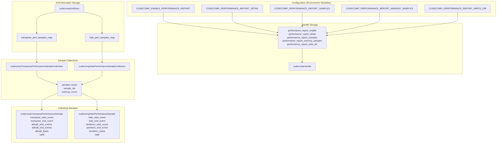
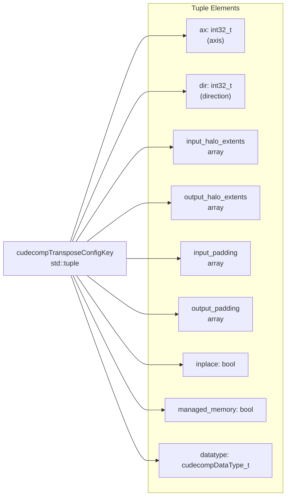
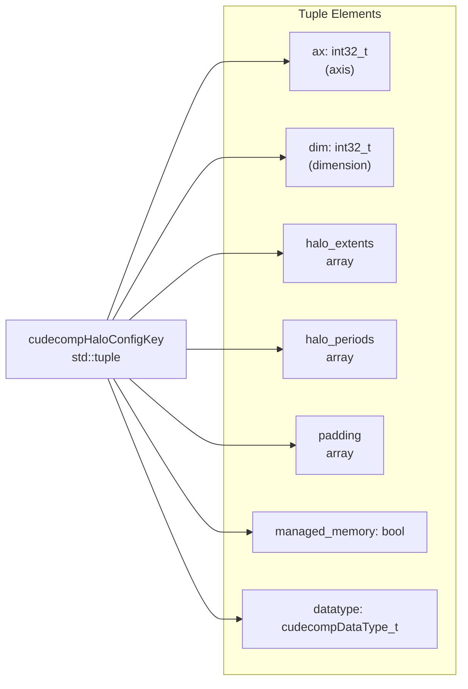
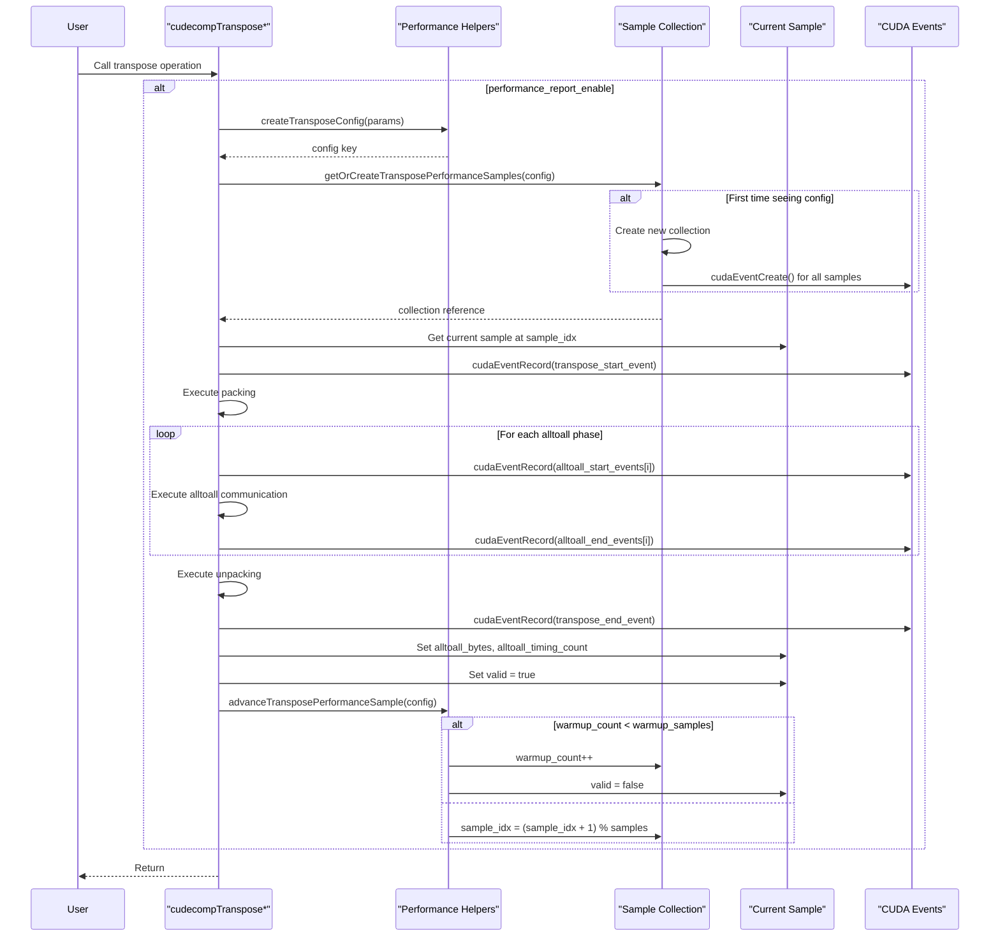
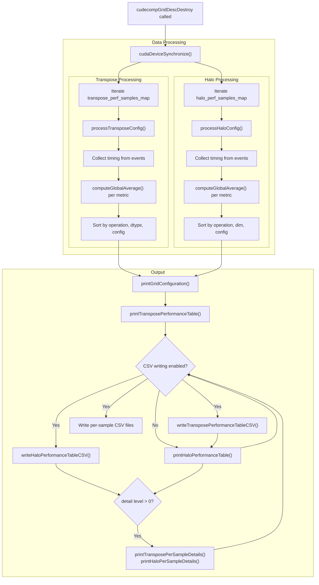

<!-- source: DeepWiki mcp.deepwiki.com · repo NVIDIA/cuDecomp · page 14.3 Performance Monitoring · fetched 2026-10-26 -->

# Performance Monitoring

<details>
<summary>Relevant source files</summary>

The following files were used as context for generating this wiki page:

- [include/internal/common.h](include/internal/common.h)
- [include/internal/performance.h](include/internal/performance.h)
- [src/cudecomp.cc](src/cudecomp.cc)
- [src/performance.cc](src/performance.cc)

</details>


This document describes the internal performance monitoring system in cuDecomp. The system automatically collects timing data for transpose and halo operations, computes statistics, and generates performance reports. This is separate from the autotuning system (see [7](#7)) which uses performance data to select optimal configurations. Performance monitoring is designed for production workloads to help users understand the runtime behavior of their decomposition operations.

---

## System Overview

cuDecomp includes an optional performance monitoring system that tracks the execution time of transpose and halo operations. The system uses CUDA events to measure GPU kernel and communication timing with minimal overhead. Performance data is collected in a circular buffer per operation configuration and can be reported at grid descriptor destruction time.

**Performance Monitoring Architecture**



**Sources:** [src/cudecomp.cc:264-368](), [include/internal/common.h:54-117](), [include/internal/common.h:133-206]()

---

## Configuration

Performance monitoring is controlled through environment variables that are read during `cudecompInit`. All settings are stored in the `cudecompHandle` structure for the lifetime of the handle.

### Environment Variables

| Variable | Type | Default | Description |
|----------|------|---------|-------------|
| `CUDECOMP_ENABLE_PERFORMANCE_REPORT` | int | 0 | Enable (1) or disable (0) performance monitoring |
| `CUDECOMP_PERFORMANCE_REPORT_DETAIL` | int | 0 | Detail level: 0=aggregated, 1=per-sample rank 0, 2=per-sample all ranks |
| `CUDECOMP_PERFORMANCE_REPORT_SAMPLES` | int | 20 | Number of samples to keep in circular buffer |
| `CUDECOMP_PERFORMANCE_REPORT_WARMUP_SAMPLES` | int | 3 | Number of initial samples to ignore (warmup) |
| `CUDECOMP_PERFORMANCE_REPORT_WRITE_DIR` | string | "" | Directory for CSV output files (empty = no file writing) |

### Configuration Processing

The `getCudecompEnvVars` function reads these environment variables and validates the values:

```
CUDECOMP_ENABLE_PERFORMANCE_REPORT:
  - Sets handle->performance_report_enable
  
CUDECOMP_PERFORMANCE_REPORT_DETAIL:
  - Must be 0, 1, or 2
  - Sets handle->performance_report_detail
  - Invalid values trigger warning and use default (0)
  
CUDECOMP_PERFORMANCE_REPORT_SAMPLES:
  - Must be > 0
  - Sets handle->performance_report_samples
  - Determines size of circular buffer per configuration
  
CUDECOMP_PERFORMANCE_REPORT_WARMUP_SAMPLES:
  - Must be >= 0
  - Sets handle->performance_report_warmup_samples
  - These samples are collected but marked invalid
  
CUDECOMP_PERFORMANCE_REPORT_WRITE_DIR:
  - Sets handle->performance_report_write_dir
  - If non-empty, CSV files are written to this directory
```

**Sources:** [src/cudecomp.cc:320-363](), [include/internal/common.h:105-112]()

---

## Data Structures

### Configuration Keys

Performance data is organized by unique configuration keys that capture all parameters affecting performance.

**Transpose Configuration Key**



The `createTransposeConfig` helper function creates these keys from operation parameters, detecting inplace operations and managed memory automatically.

**Halo Configuration Key**



The `createHaloConfig` helper function creates these keys, detecting managed memory from the input pointer.

**Sources:** [include/internal/performance.h:31-49](), [src/performance.cc:149-191]()

### Sample Structures

**cudecompTransposePerformanceSample**

Individual transpose operation measurements:

```
Fields:
  cudaEvent_t transpose_start_event      - Start of entire transpose
  cudaEvent_t transpose_end_event        - End of entire transpose
  vector<cudaEvent_t> alltoall_start_events - Start of each alltoall phase
  vector<cudaEvent_t> alltoall_end_events   - End of each alltoall phase
  int32_t alltoall_timing_count          - Number of alltoall phases
  size_t alltoall_bytes                  - Bytes transferred in alltoall
  bool valid                             - Whether sample should be included
```

**cudecompHaloPerformanceSample**

Individual halo operation measurements:

```
Fields:
  cudaEvent_t halo_start_event           - Start of entire halo update
  cudaEvent_t halo_end_event             - End of entire halo update
  cudaEvent_t sendrecv_start_event       - Start of sendrecv communication
  cudaEvent_t sendrecv_end_event         - End of sendrecv communication
  size_t sendrecv_bytes                  - Bytes transferred in sendrecv
  bool valid                             - Whether sample should be included
```

**Sources:** [include/internal/common.h:133-166]()

### Sample Collections

Each unique configuration (identified by its key) has a sample collection:

**cudecompTransposePerformanceSampleCollection / cudecompHaloPerformanceSampleCollection**

```
Fields:
  vector<Sample> samples     - Circular buffer of samples
  int32_t sample_idx         - Current write position in circular buffer
  int32_t warmup_count       - Number of warmup samples completed
```

Collections are stored in unordered maps within `cudecompGridDesc`:

- `transpose_perf_samples_map`: Maps `cudecompTransposeConfigKey` to `cudecompTransposePerformanceSampleCollection`
- `halo_perf_samples_map`: Maps `cudecompHaloConfigKey` to `cudecompHaloPerformanceSampleCollection`

The `getOrCreateTransposePerformanceSamples` and `getOrCreateHaloPerformanceSamples` functions lazily create sample collections and their CUDA events when a new configuration is first encountered.

**Sources:** [include/internal/common.h:144-166](), [include/internal/common.h:195-203](), [src/performance.cc:193-251]()

---

## Data Collection Lifecycle

**Performance Sample Recording Pipeline**



**Sources:** [src/performance.cc:901-936](), [src/transpose.cc]() (implied from architecture)

### Event Recording

Events are recorded at specific points during operation execution:

**For Transpose Operations:**
1. `transpose_start_event`: Before packing begins
2. `alltoall_start_events[i]`: Before each communication phase in pipelined or standard alltoall
3. `alltoall_end_events[i]`: After each communication phase completes
4. `transpose_end_event`: After unpacking completes

**For Halo Operations:**
1. `halo_start_event`: Before halo packing begins
2. `sendrecv_start_event`: Before sendrecv communication (if bytes > 0)
3. `sendrecv_end_event`: After sendrecv communication completes
4. `halo_end_event`: After halo unpacking completes

Events use `cudaEventCreateWithFlags` with timing enabled (no `cudaEventDisableTiming`) to allow `cudaEventElapsedTime` queries.

**Sources:** [src/performance.cc:206-250]()

### Warmup Handling

The warmup mechanism ensures initial runs (which may include JIT compilation, cache warmup, etc.) don't skew statistics:

```
During warmup phase (warmup_count < performance_report_warmup_samples):
  - Sample is recorded normally
  - Sample.valid is set to false
  - warmup_count is incremented
  - sample_idx does NOT advance (stays at 0)
  
After warmup phase:
  - Sample.valid is set to true
  - sample_idx advances in circular buffer: (sample_idx + 1) % samples
```

This means the first `performance_report_warmup_samples` calls are ignored, then the next `performance_report_samples` calls fill the circular buffer, after which old samples are overwritten.

**Sources:** [src/performance.cc:901-936]()

---

## Performance Reporting

### Report Generation

Performance reports are generated when `cudecompGridDescDestroy` is called, before CUDA events are destroyed. The `printPerformanceReport` function processes all collected samples.

**Report Generation Pipeline**



**Sources:** [src/performance.cc:783-868](), [src/cudecomp.cc:844-873]()

### Statistics Computation

For each configuration, the following statistics are computed:

**Transpose Statistics (TransposePerformanceStats):**

```
Computed per configuration:
  operation           - "TransposeXY", "TransposeYZ", "TransposeZY", "TransposeYX"
  datatype            - "S", "D", "C", "Z" (single, double, complex single, complex double)
  input_halos         - "[x,y,z]" formatted string
  output_halos        - "[x,y,z]" formatted string
  input_padding       - "[x,y,z]" formatted string
  output_padding      - "[x,y,z]" formatted string
  inplace             - "T" or "F"
  managed             - "T" or "F" (managed memory)
  samples             - Number of valid samples
  total_time_avg      - Average total time (ms) across all ranks
  alltoall_time_avg   - Average alltoall time (ms) across all ranks
  local_time_avg      - Average local compute time (ms) across all ranks
  alltoall_bw_avg     - Average alltoall bandwidth (GB/s) across all ranks
```

**Halo Statistics (HaloPerformanceStats):**

```
Computed per configuration:
  operation           - "HaloX", "HaloY", "HaloZ"
  datatype            - "S", "D", "C", "Z"
  dim                 - Dimension (0, 1, or 2)
  halos               - "[x,y,z]" formatted string
  periods             - "[0/1,0/1,0/1]" formatted string
  padding             - "[x,y,z]" formatted string
  managed             - "T" or "F"
  samples             - Number of valid samples
  total_time_avg      - Average total time (ms) across all ranks
  sendrecv_time_avg   - Average sendrecv time (ms) across all ranks
  local_time_avg      - Average local compute time (ms) across all ranks
  sendrecv_bw_avg     - Average sendrecv bandwidth (GB/s) across all ranks
```

The `computeGlobalAverage` function performs a local average followed by `MPI_Allreduce` with `MPI_SUM`, then divides by number of ranks to get a global average across all processes.

**Sources:** [src/performance.cc:52-82](), [src/performance.cc:374-491](), [src/performance.cc:353-362]()

### Console Output Format

**Aggregated Report (Detail Level 0):**

Console output shows a compact table for rank 0 only:

```
CUDECOMP:
CUDECOMP: ===== Performance Summary =====
CUDECOMP: Grid Configuration:
CUDECOMP:     Transpose backend: <backend>
CUDECOMP:     Halo backend: <backend>
CUDECOMP:     Process grid: [P0, P1]
CUDECOMP:     Global dimensions: [Nx, Ny, Nz]
CUDECOMP:     Memory order: [order_x]; [order_y]; [order_z]
CUDECOMP:
CUDECOMP: Transpose Performance Data:
CUDECOMP:
CUDECOMP: operation    dtype  halo extents    padding         inplace  managed  samples  total     A2A       local     A2A BW   
CUDECOMP:                                                                                  [ms]      [ms]      [ms]      [GB/s]   
CUDECOMP: ----------------------------------------------------------------------------------------------------------------------------
CUDECOMP: TransposeXY  D      [0,0,0]/[0,0,0] [0,0,0]/[0,0,0] F        F        20       12.345    8.123     4.222     456.789  
...
```

**Per-Sample Details (Detail Level 1 or 2):**

Shows individual sample timings:
- Level 1: Rank 0 samples only
- Level 2: All ranks samples

```
CUDECOMP: TransposeXY (dtype=D, halo extents=[0,0,0]/[0,0,0], padding=[0,0,0]/[0,0,0], inplace=F, managed=F) samples:
CUDECOMP: rank   sample       total     A2A       local     A2A BW   
CUDECOMP:                     [ms]      [ms]      [ms]      [GB/s]   
CUDECOMP: 0      0            12.123    7.890     4.233     450.123  
CUDECOMP: 0      1            12.456    8.234     4.222     460.456  
...
```

**Sources:** [src/performance.cc:494-571](), [src/performance.cc:574-695]()

### CSV File Output

When `CUDECOMP_PERFORMANCE_REPORT_WRITE_DIR` is set, CSV files are written to the specified directory. Filenames include grid configuration details to avoid collisions.

**File Naming Convention:**

```
cudecomp-perf-report-<type>-tcomm_<tbackend>-hcomm_<hbackend>-pdims_<P0>x<P1>-gdims_<Nx>x<Ny>x<Nz>-memorder_<orders>.csv

Types:
  - transpose-aggregated: Aggregated transpose statistics
  - halo-aggregated: Aggregated halo statistics
  - transpose-samples: Per-sample transpose data (if detail level > 0)
  - halo-samples: Per-sample halo data (if detail level > 0)
```

**CSV Headers:**

Aggregated transpose CSV:
```csv
# <Grid configuration comments>
operation,dtype,input_halo_extents,output_halo_extents,input_padding,output_padding,inplace,managed,samples,total_ms,A2A_ms,local_ms,A2A_BW_GBps
```

Aggregated halo CSV:
```csv
# <Grid configuration comments>
operation,dtype,dim,halo_extent,periods,padding,managed,samples,total_ms,SR_ms,local_ms,SR_BW_GBps
```

Per-sample CSVs include additional `rank` and `sample` columns.

**Sources:** [src/performance.cc:38-147](), [src/performance.cc:698-781]()

---

## Integration Points

### Transpose Operations

Transpose operations integrate performance monitoring by:

1. Creating a configuration key from operation parameters
2. Getting or creating the sample collection for that configuration
3. Recording events around pack, alltoall, and unpack phases
4. Recording byte counts for bandwidth calculation
5. Advancing the sample index after completion

The monitoring code is conditionally compiled based on `handle->performance_report_enable`.

**Sources:** Implied from architecture, actual integration is in transpose implementation files

### Halo Operations

Halo operations integrate performance monitoring similarly:

1. Creating a configuration key from axis, dimension, extents, periods, and padding
2. Getting or creating the sample collection
3. Recording events around pack, sendrecv, and unpack phases
4. Recording byte counts for bandwidth calculation
5. Advancing the sample index after completion

**Sources:** Implied from architecture, actual integration is in halo implementation files

### Event Lifecycle

CUDA events for performance monitoring are:

**Created:** 
- Lazily when a new configuration is first encountered (`getOrCreateTransposePerformanceSamples` / `getOrCreateHaloPerformanceSamples`)
- All events for all samples in the collection are created at once

**Destroyed:**
- In `cudecompGridDescDestroy`, after the performance report is printed
- Iterates through all collections and destroys all events

This ensures events exist for the lifetime of the grid descriptor and are properly cleaned up.

**Sources:** [src/cudecomp.cc:844-873](), [src/performance.cc:193-251]()

---

## Usage Example

Typical usage pattern for performance monitoring:

```bash
# Enable performance monitoring with 50 samples, 5 warmup, detail level 1, and CSV output
export CUDECOMP_ENABLE_PERFORMANCE_REPORT=1
export CUDECOMP_PERFORMANCE_REPORT_SAMPLES=50
export CUDECOMP_PERFORMANCE_REPORT_WARMUP_SAMPLES=5
export CUDECOMP_PERFORMANCE_REPORT_DETAIL=1
export CUDECOMP_PERFORMANCE_REPORT_WRITE_DIR=./perf_results

# Run application
mpirun -n 16 ./my_app

# Results will be printed to console and written to CSV files in ./perf_results/
```

The application requires no code changes - performance monitoring is purely controlled by environment variables and automatically integrates with existing transpose and halo operations.

**Sources:** [src/cudecomp.cc:320-363]()

---

## Performance Overhead

The performance monitoring system is designed for minimal overhead:

1. **CUDA Events:** Event recording has very low overhead (~1 μs per event)
2. **Conditional Compilation:** All monitoring code is skipped when `performance_report_enable=false`
3. **Lazy Initialization:** Events are only created for configurations that are actually used
4. **Circular Buffer:** Fixed memory overhead per configuration (`performance_report_samples` samples)
5. **Report Generation:** Only happens once at grid descriptor destruction

The primary overhead is the memory for CUDA events (a few KB per configuration) and the small cost of event recording (negligible compared to actual operation time).

**Sources:** General performance design principles from the implementation