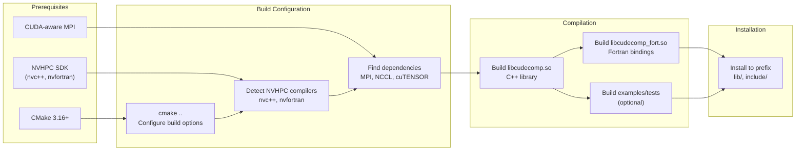
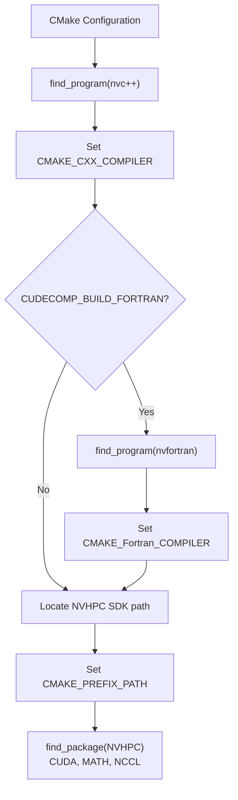
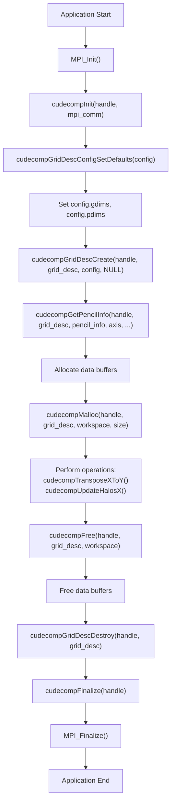
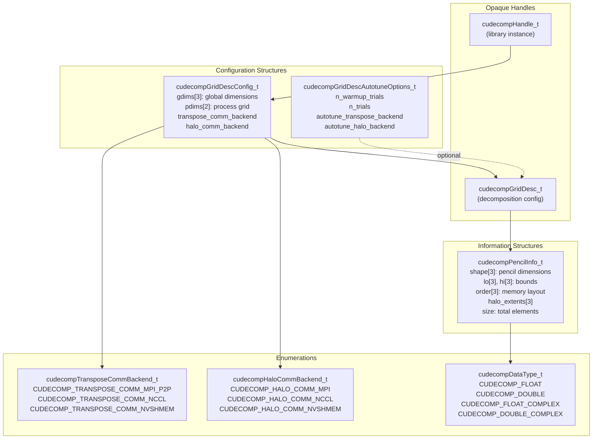
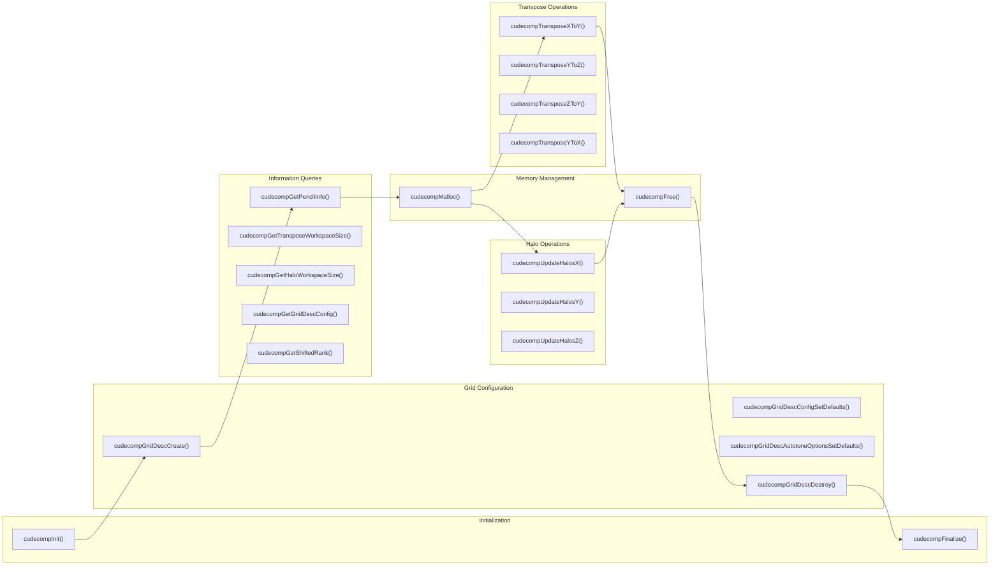

<!-- source: DeepWiki mcp.deepwiki.com · repo NVIDIA/cuDecomp · page 2 Getting Started · fetched 2026-10-26 -->

# Getting Started

<details>
<summary>Relevant source files</summary>

The following files were used as context for generating this wiki page:

- [CMakeLists.txt](CMakeLists.txt)
- [README.md](README.md)
- [docs/env_vars.rst](docs/env_vars.rst)
- [docs/overview.rst](docs/overview.rst)
- [include/cudecomp.h](include/cudecomp.h)

</details>


This page provides an introduction to building and running your first cuDecomp program. It covers the essential prerequisites, basic build instructions, and the fundamental workflow for initializing and using the library. For detailed build configuration options, see [Building and Installation](#2.1). For a complete working example with code, see [Quick Start Tutorial](#2.2).

## Purpose and Scope

This Getting Started guide will help you:
- Understand the required dependencies and toolchain
- Build the cuDecomp library from source
- Learn the basic initialization sequence
- Understand the minimal set of API calls needed for decomposition operations

This page does not cover advanced topics like performance autotuning or detailed API usage. For core concepts like pencil decomposition and communication backends, see [Core Concepts](#3).

## Prerequisites

cuDecomp requires specific toolchain components and libraries. The library is designed to work with the NVIDIA HPC SDK, which bundles all required dependencies.

### Required Dependencies

| Dependency | Purpose | Minimum Version |
|------------|---------|-----------------|
| NVHPC SDK | C++/CUDA/Fortran compilers, CUDA runtime, cuTENSOR, NCCL | Recommended (latest) |
| MPI | Inter-process communication | CUDA-aware MPI required |
| CMake | Build system | 3.16+ |

### Optional Dependencies

| Dependency | Purpose | Enable Via |
|------------|---------|------------|
| NVSHMEM | Symmetric memory communication backend | `CUDECOMP_ENABLE_NVSHMEM=ON` |

**Important**: cuDecomp requires CUDA-aware MPI. Verify your MPI library supports this feature. On Cray systems, the Cray MPI with GPU Transport Layer (GTL) is automatically detected and linked [CMakeLists.txt:68-94]().

Sources: [CMakeLists.txt:1-147](), [README.md:30-39]()

## Building the Library

### Basic Build Process



**Basic Build**

The minimal build requires only the core library without examples:

```bash
mkdir build
cd build
cmake ..
make -j
```

This creates `libcudecomp.so` in `build/lib/` and installs `cudecomp.h` to `build/include/` [CMakeLists.txt:149-254]().

**Build with Examples and NVSHMEM**

To build additional examples, tests, and enable NVSHMEM backends:

```bash
cmake -DCUDECOMP_BUILD_EXTRAS=ON -DCUDECOMP_ENABLE_NVSHMEM=ON ..
make -j
```

Sources: [README.md:15-27](), [CMakeLists.txt:15-22]()

### Build Options

The following CMake options control the build configuration:

| Option | Default | Description |
|--------|---------|-------------|
| `CUDECOMP_BUILD_FORTRAN` | `ON` | Build Fortran bindings (`libcudecomp_fort.so`) |
| `CUDECOMP_ENABLE_NVTX` | `ON` | Enable NVTX profiling ranges |
| `CUDECOMP_ENABLE_NVSHMEM` | `OFF` | Enable NVSHMEM communication backends |
| `CUDECOMP_BUILD_EXTRAS` | `OFF` | Build benchmarks, examples, and tests |
| `CUDECOMP_NCCL_HOME` | (empty) | Override NCCL installation path |
| `CUDECOMP_NVSHMEM_HOME` | (empty) | Override NVSHMEM installation path |
| `CUDECOMP_CUDA_CC_LIST` | (auto-detected) | CUDA compute capabilities to build for |

The build system automatically detects CUDA compute capabilities based on the CUDA toolkit version [CMakeLists.txt:52-64]().

Sources: [CMakeLists.txt:15-64]()

### Compiler Detection



The build system locates the NVHPC SDK compilers and automatically configures paths to find CUDA, cuTENSOR, and NCCL libraries bundled with the SDK [CMakeLists.txt:23-122]().

Sources: [CMakeLists.txt:23-146]()

## Library Initialization Workflow

### Basic API Call Sequence



This diagram shows the complete lifecycle of a cuDecomp application, from initialization through operation and cleanup.

Sources: [include/cudecomp.h:204-261]()

### Minimal Code Structure

A minimal cuDecomp program follows this pattern:

1. **Initialize the library** with `cudecompInit()`, passing an MPI communicator [include/cudecomp.h:213]()
2. **Configure decomposition** using `cudecompGridDescConfig_t` structure [include/cudecomp.h:113-132]()
3. **Create grid descriptor** with `cudecompGridDescCreate()` [include/cudecomp.h:251]()
4. **Query pencil geometry** using `cudecompGetPencilInfo()` [include/cudecomp.h:305]()
5. **Allocate workspaces** with `cudecompMalloc()` [include/cudecomp.h:366]()
6. **Perform operations** like transposes or halo updates
7. **Clean up** in reverse order: free workspaces, destroy grid descriptor, finalize library

### Key Data Structures



- `cudecompHandle_t`: Opaque pointer representing a library instance, initialized by `cudecompInit()` [include/cudecomp.h:103]()
- `cudecompGridDesc_t`: Opaque pointer representing a decomposition configuration, created by `cudecompGridDescCreate()` [include/cudecomp.h:108]()
- `cudecompGridDescConfig_t`: User-visible structure defining the global grid dimensions, process grid, and communication backends [include/cudecomp.h:113-132]()
- `cudecompPencilInfo_t`: Structure containing geometry information about a pencil, returned by `cudecompGetPencilInfo()` [include/cudecomp.h:194-202]()

Sources: [include/cudecomp.h:42-202]()

### API Function Categories



The cuDecomp API is organized into six functional categories, each serving a specific purpose in the decomposition workflow.

Sources: [include/cudecomp.h:204-625]()

## Process Grid and Pencils

The decomposition is controlled by two key configuration parameters:

- **`gdims[3]`**: Global grid dimensions `[X, Y, Z]` in column-major order
- **`pdims[2]`**: Process grid dimensions `[P_row, P_col]`

The library creates three pencil orientations:
- **X-pencils**: Shape `[X, Y/P_row, Z/P_col]`, contiguous in X direction
- **Y-pencils**: Shape `[X/P_row, Y, Z/P_col]`, contiguous in Y direction
- **Z-pencils**: Shape `[X/P_row, Y/P_col, Z]`, contiguous in Z direction

Transpose operations redistribute data between these orientations using either row or column communicators [docs/overview.rst:31-65]().

## Communication Backends

cuDecomp supports multiple communication backends, selectable via the `transpose_comm_backend` and `halo_comm_backend` fields in `cudecompGridDescConfig_t`:

| Backend | Enum Value | Requirements |
|---------|------------|--------------|
| MPI P2P | `CUDECOMP_TRANSPOSE_COMM_MPI_P2P` | CUDA-aware MPI |
| MPI P2P Pipelined | `CUDECOMP_TRANSPOSE_COMM_MPI_P2P_PL` | CUDA-aware MPI |
| MPI Alltoallv | `CUDECOMP_TRANSPOSE_COMM_MPI_A2A` | CUDA-aware MPI |
| NCCL | `CUDECOMP_TRANSPOSE_COMM_NCCL` | NCCL library |
| NCCL Pipelined | `CUDECOMP_TRANSPOSE_COMM_NCCL_PL` | NCCL library |
| NVSHMEM | `CUDECOMP_TRANSPOSE_COMM_NVSHMEM` | NVSHMEM library, `CUDECOMP_ENABLE_NVSHMEM=ON` |
| NVSHMEM Pipelined | `CUDECOMP_TRANSPOSE_COMM_NVSHMEM_PL` | NVSHMEM library, `CUDECOMP_ENABLE_NVSHMEM=ON` |

Pipelined backends overlap communication with computation for better performance. The optimal backend depends on system topology, scale, and problem size. Use autotuning to select automatically (see [Performance Autotuning](#7)).

Sources: [include/cudecomp.h:42-63]()

## Next Steps

After successfully building the library, proceed to:

- **[Quick Start Tutorial](#2.2)**: Complete working example with code
- **[Core Concepts](#3)**: Understanding decomposition, pencils, and communication patterns
- **[API Reference](#4)**: Detailed documentation of all functions
- **[Examples and Use Cases](#11)**: Real-world applications including FFT solvers

For runtime configuration, see the environment variables documented in [docs/env_vars.rst:1-100]().

Sources: [README.md:1-43](), [docs/overview.rst:1-66]()

---

