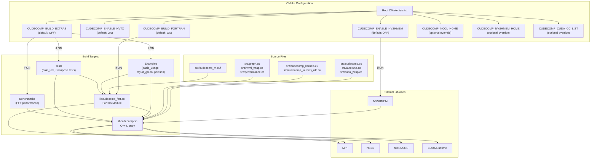
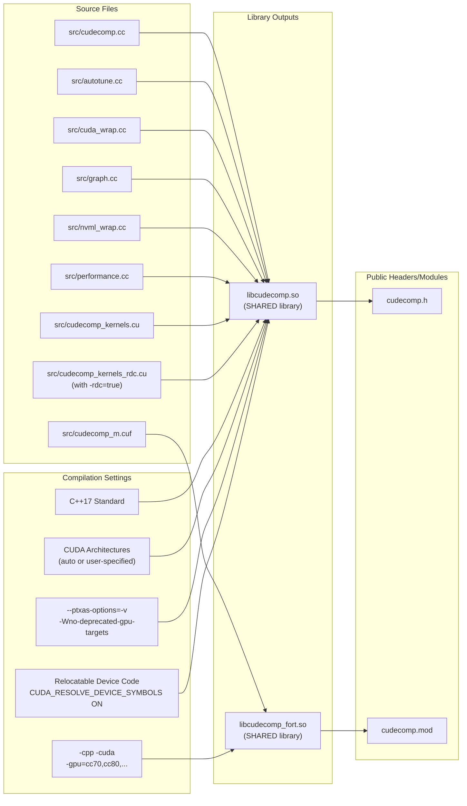
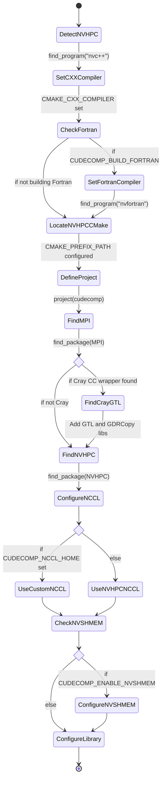
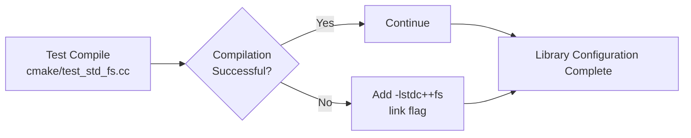
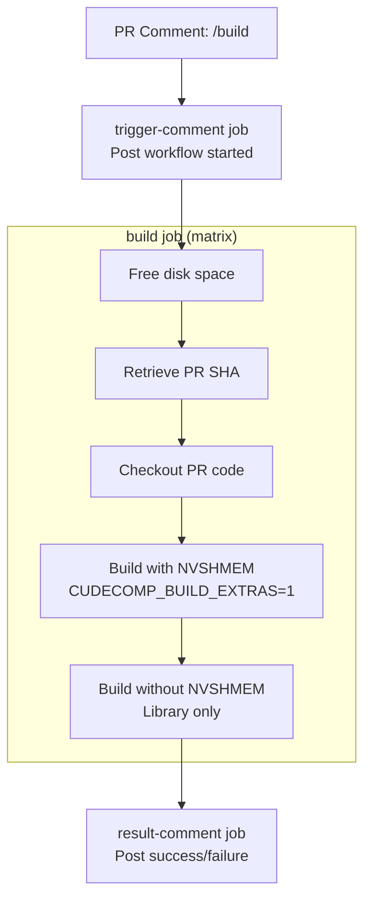

<!-- source: DeepWiki mcp.deepwiki.com · repo NVIDIA/cuDecomp · page 2.1 Building and Installation · fetched 2026-10-26 -->

# Building and Installation

<details>
<summary>Relevant source files</summary>

The following files were used as context for generating this wiki page:

- [.github/workflows/build.yml](.github/workflows/build.yml)
- [CMakeLists.txt](CMakeLists.txt)
- [cmake/test_std_fs.cc](cmake/test_std_fs.cc)

</details>


This page provides comprehensive instructions for building and installing cuDecomp from source using CMake. It covers compiler requirements, dependency management, CMake configuration options, and build procedures. For a quick walkthrough of writing your first cuDecomp program after installation, see [Quick Start Tutorial](#2.2). For details on the build system architecture for contributors, see [Build System Architecture](#13.1).

## Prerequisites

### Compiler Requirements

cuDecomp requires the NVIDIA HPC SDK (NVHPC) for compilation. The library uses `nvc++` for C++/CUDA code and `nvfortran` for Fortran bindings.

**Supported NVHPC SDK Versions:**

| NVHPC Version | CUDA Version | Ubuntu Version | Status |
|---------------|--------------|----------------|--------|
| 25.9          | 13.0         | 24.04          | Tested |
| 25.7          | 12.9         | 22.04          | Tested |
| 22.11         | 11.8         | 20.04          | Tested |

The build system automatically locates the NVHPC compilers and uses them by default:
- [CMakeLists.txt:24-30]() detects `nvc++` and `nvfortran` executables
- [CMakeLists.txt:32-34]() configures CMake to use the NVHPC CMake module

The system enforces C++17 standard ([CMakeLists.txt:2](), [CMakeLists.txt:4-7]()) to support modern C++ features used throughout the library.

Sources: [CMakeLists.txt:1-50](), [.github/workflows/build.yml:33-38]()

### Core Dependencies

#### Required Dependencies

**MPI (Message Passing Interface)**
- Required for distributed communication
- Located via `find_package(MPI REQUIRED)` at [CMakeLists.txt:75]()
- In Cray environments, additional GTL (GPU Transfer Library) and GDRCopy libraries are automatically linked for CUDA-aware MPI support ([CMakeLists.txt:77-94]())

**CUDA Runtime and Math Libraries**
- Automatically provided by NVHPC SDK
- cuTENSOR library required for tensor transpose operations
- cuFFT used by examples and benchmarks
- Located via `find_package(NVHPC REQUIRED COMPONENTS CUDA MATH)` at [CMakeLists.txt:97]()

**NCCL (NVIDIA Collective Communications Library)**
- Required for GPU-to-GPU communication
- Can be provided by NVHPC SDK or overridden via `CUDECOMP_NCCL_HOME`
- Located at [CMakeLists.txt:104-122]()

#### Optional Dependencies

**NVSHMEM (NVIDIA Symmetric Memory)**
- Enables partitioned global address space (PGAS) communication
- Controlled by `CUDECOMP_ENABLE_NVSHMEM` CMake option
- Can be provided by NVHPC SDK or overridden via `CUDECOMP_NVSHMEM_HOME`
- Version detection at [CMakeLists.txt:222-233]() handles different NVSHMEM versions (2.5, 2.7, 2.11+) with appropriate linking strategies

Sources: [CMakeLists.txt:74-146]()

### System Requirements

**CMake Version**: Minimum 3.16 required ([CMakeLists.txt:1]())

**CUDA Compute Capabilities**: Automatically selected based on CUDA version:

| CUDA Version | Default Compute Capabilities |
|--------------|------------------------------|
| ≥ 13.0       | 75, 80, 90, 100              |
| ≥ 12.8       | 70, 80, 90, 100              |
| ≥ 11.8       | 70, 80, 90                   |
| < 11.8       | 70, 80                       |

Override defaults with `CUDECOMP_CUDA_CC_LIST` ([CMakeLists.txt:51-64]())

Sources: [CMakeLists.txt:1](), [CMakeLists.txt:51-64]()

## CMake Configuration Options

The following diagram shows the dependency structure and how CMake options control the build:



Sources: [CMakeLists.txt:15-21](), [CMakeLists.txt:149-306]()

### Configuration Option Reference

| Option | Type | Default | Description |
|--------|------|---------|-------------|
| `CUDECOMP_BUILD_FORTRAN` | BOOL | `ON` | Build Fortran bindings and `libcudecomp_fort.so` |
| `CUDECOMP_ENABLE_NVTX` | BOOL | `ON` | Enable NVTX profiling ranges for performance analysis |
| `CUDECOMP_ENABLE_NVSHMEM` | BOOL | `OFF` | Enable NVSHMEM backend for communication |
| `CUDECOMP_BUILD_EXTRAS` | BOOL | `OFF` | Build examples, tests, and benchmarks |
| `CUDECOMP_NCCL_HOME` | STRING | (empty) | Path to override NVHPC-provided NCCL installation |
| `CUDECOMP_NVSHMEM_HOME` | STRING | (empty) | Path to override NVHPC-provided NVSHMEM installation |
| `CUDECOMP_CUDA_CC_LIST` | STRING | (auto) | List of CUDA compute capabilities (e.g., "70;80;90") |

Sources: [CMakeLists.txt:15-21]()

## Building the Library

### Basic Build Procedure

The standard build procedure uses out-of-source builds:

```bash
# Clone the repository
git clone https://github.com/NVIDIA/cuDecomp.git
cd cuDecomp

# Create build directory
mkdir build
cd build

# Configure with CMake
cmake ..

# Build with parallel compilation
make -j$(nproc)
```

This produces:
- `build/lib/libcudecomp.so` - Main C++ library
- `build/lib/libcudecomp_fort.so` - Fortran bindings (if enabled)
- `build/include/cudecomp.h` - C++ header
- `build/include/cudecomp.mod` - Fortran module (if enabled)

Sources: [CMakeLists.txt:149-291]()

### Build with NVSHMEM Support

To enable NVSHMEM backend:

```bash
mkdir build-nvshmem
cd build-nvshmem
cmake -DCUDECOMP_ENABLE_NVSHMEM=ON ..
make -j$(nproc)
```

The build system automatically:
1. Locates NVSHMEM headers at [CMakeLists.txt:129-142]()
2. Detects NVSHMEM version from headers [CMakeLists.txt:222-233]()
3. Links appropriate libraries based on version:
   - Version < 2.5: Links `libnvshmem.a` ([CMakeLists.txt:236]())
   - Version ≥ 2.5: Links `libnvshmem_host.so` and `libnvshmem_device.a` ([CMakeLists.txt:238-239]())
4. Applies version-specific workarounds for NCCL symbol export issues ([CMakeLists.txt:242-246]())
5. Links NVML stubs for older NVSHMEM versions ([CMakeLists.txt:248-250]())

Sources: [CMakeLists.txt:126-251]()

### Build with Examples and Tests

To build the complete project including examples, tests, and benchmarks:

```bash
mkdir build-extras
cd build-extras
cmake -DCUDECOMP_BUILD_EXTRAS=ON ..
make -j$(nproc)
```

This builds:
- **Examples**: `basic_usage`, `taylor_green` (C++ and Fortran variants), `poisson` (Fortran)
- **Tests**: `halo_test` (C++ and Fortran), transpose validation tests
- **Benchmarks**: R2C and C2C FFT benchmarks in single and double precision

The extras are configured via subdirectories at [CMakeLists.txt:293-306]()

Sources: [CMakeLists.txt:293-306]()

### Custom Compiler and Dependency Paths

Override default paths for dependencies:

```bash
cmake \
  -DCUDECOMP_NCCL_HOME=/custom/nccl/path \
  -DCUDECOMP_NVSHMEM_HOME=/custom/nvshmem/path \
  -DCUDECOMP_CUDA_CC_LIST="80;90" \
  ..
```

When `CUDECOMP_NCCL_HOME` is set, CMake searches for `nccl.h` and `libnccl.so` in the specified location ([CMakeLists.txt:105-114]()), bypassing the NVHPC-provided version.

Sources: [CMakeLists.txt:20-21](), [CMakeLists.txt:105-122](), [CMakeLists.txt:128-142]()

### Fortran-Only Build

To disable Fortran bindings:

```bash
cmake -DCUDECOMP_BUILD_FORTRAN=OFF ..
make -j$(nproc)
```

This skips:
- Detection of `nvfortran` compiler ([CMakeLists.txt:27-30]())
- Building `libcudecomp_fort.so` ([CMakeLists.txt:263-291]())
- Fortran examples and tests in extras ([CMakeLists.txt:300-305]())

Sources: [CMakeLists.txt:16](), [CMakeLists.txt:27-30](), [CMakeLists.txt:263-291]()

## Installation

Install the library to a custom prefix:

```bash
cmake -DCMAKE_INSTALL_PREFIX=/install/path ..
make install
```

The installation layout:

```
/install/path/
├── lib/
│   ├── libcudecomp.so
│   └── libcudecomp_fort.so  (if Fortran enabled)
└── include/
    ├── cudecomp.h
    └── cudecomp.mod         (if Fortran enabled)
```

Installation targets are defined at:
- C++ library and header: [CMakeLists.txt:256-260]()
- Fortran library: [CMakeLists.txt:285-288]()
- Fortran module: [CMakeLists.txt:290]()

Sources: [CMakeLists.txt:256-291]()

## Build Target Details

The following diagram maps source files to build outputs and shows compilation flags:



Sources: [CMakeLists.txt:165-178](), [CMakeLists.txt:275-280]()

### Special Compilation Requirements

**Relocatable Device Code (RDC)**
- `src/cudecomp_kernels_rdc.cu` compiled with `-rdc=true` flag ([CMakeLists.txt:177]())
- Enables separate compilation and linking of device code
- Library configured with `CUDA_RESOLVE_DEVICE_SYMBOLS ON` ([CMakeLists.txt:178]())

**NVCC Flags**
- `--ptxas-options=-v`: Verbose PTX assembly output for register usage analysis ([CMakeLists.txt:162]())
- `-Wno-deprecated-gpu-targets`: Suppress warnings for older compute capabilities ([CMakeLists.txt:163]())

**Fortran CUDA Integration**
- Uses `-cuda` flag to enable CUDA Fortran features ([CMakeLists.txt:275]())
- GPU target string generated from `CUDECOMP_CUDA_CC_LIST` ([CMakeLists.txt:264-269]())
- Format: `-gpu=cc70,cc80,cuda12.9` combines compute capabilities and CUDA version

Sources: [CMakeLists.txt:162-163](), [CMakeLists.txt:177-178](), [CMakeLists.txt:264-275]()

## Build System Architecture

### Compiler Detection and Setup

The build system performs the following initialization sequence:



Sources: [CMakeLists.txt:23-146]()

### Cray Environment Support

When Cray compiler wrappers are detected ([CMakeLists.txt:68-72]()), the build system automatically:

1. Detects `CRAY_LD_LIBRARY_PATH` environment variable
2. Searches for `libmpi_gtl_cuda.so` in Cray library paths ([CMakeLists.txt:81-84]())
3. Locates GDRCopy library (`libgdrapi.so`) ([CMakeLists.txt:88-90]())
4. Links both libraries to enable CUDA-aware MPI on Cray systems ([CMakeLists.txt:193-196]())

These libraries enable GPU Direct RDMA capabilities on Cray XC and Cray EX systems.

Sources: [CMakeLists.txt:68-94](), [CMakeLists.txt:193-196]()

### std::filesystem Compatibility

The build system tests for `std::filesystem` linking support:



This handles GCC toolchain versions that require explicit linking of `std::filesystem` symbols ([CMakeLists.txt:199-208]()).

Sources: [CMakeLists.txt:199-208](), [cmake/test_std_fs.cc:1-6]()

## CI/CD Build Testing

The cuDecomp CI/CD system validates builds across multiple configurations using GitHub Actions workflows.

### Build Matrix

The CI workflow ([.github/workflows/build.yml]()) tests three configurations:

| Configuration | NVHPC SDK | CUDA Version | Ubuntu Version | Image |
|---------------|-----------|--------------|----------------|-------|
| Latest        | 25.9      | 13.0         | 24.04          | `nvcr.io/nvidia/nvhpc:25.9-devel-cuda13.0-ubuntu24.04` |
| Current       | 25.7      | 12.9         | 22.04          | `nvcr.io/nvidia/nvhpc:25.7-devel-cuda12.9-ubuntu22.04` |
| Legacy        | 22.11     | 11.8         | 20.04          | `nvcr.io/nvidia/nvhpc:22.11-devel-cuda11.8-ubuntu20.04` |

### Build Configurations Tested

For each matrix entry, two build configurations are tested:

1. **Full build with NVSHMEM** ([.github/workflows/build.yml:67-74]()):
   ```bash
   cmake -DCUDECOMP_ENABLE_NVSHMEM=1 -DCUDECOMP_BUILD_EXTRAS=1 ..
   make -j$(nproc)
   ```

2. **Library-only build without NVSHMEM** ([.github/workflows/build.yml:76-83]()):
   ```bash
   cmake ..
   make -j$(nproc)
   ```

### Triggering CI Builds

The workflow is triggered by pull request comments:
- Comment `/build` on a PR to trigger the workflow ([.github/workflows/build.yml:9]())
- Restricted to authorized users ([.github/workflows/build.yml:9]())
- Posts status comments with workflow run links ([.github/workflows/build.yml:14-25](), [.github/workflows/build.yml:92-109]())

Sources: [.github/workflows/build.yml:1-110]()

### Build Workflow Structure



Sources: [.github/workflows/build.yml:7-109]()

## Troubleshooting Common Build Issues

### Compiler Not Found

If NVHPC compilers are not in PATH:
```bash
# Set PATH to include NVHPC bin directory
export PATH=/opt/nvidia/hpc_sdk/Linux_x86_64/2025/compilers/bin:$PATH
cmake ..
```

### Custom NCCL/NVSHMEM Paths

If using non-standard installations:
```bash
cmake \
  -DCUDECOMP_NCCL_HOME=/path/to/nccl \
  -DCUDECOMP_NVSHMEM_HOME=/path/to/nvshmem \
  -DCUDECOMP_ENABLE_NVSHMEM=ON \
  ..
```

### CUDA Compute Capability Mismatch

To target specific GPU architectures:
```bash
cmake -DCUDECOMP_CUDA_CC_LIST="80;90" ..
```

### MPI Library Issues

Ensure MPI is in the CMake search path:
```bash
export CMAKE_PREFIX_PATH=/path/to/mpi:$CMAKE_PREFIX_PATH
cmake ..
```

Sources: [CMakeLists.txt:20-21](), [CMakeLists.txt:52-64](), [CMakeLists.txt:75]()

---

