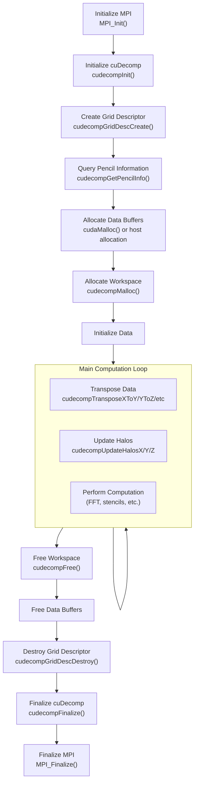
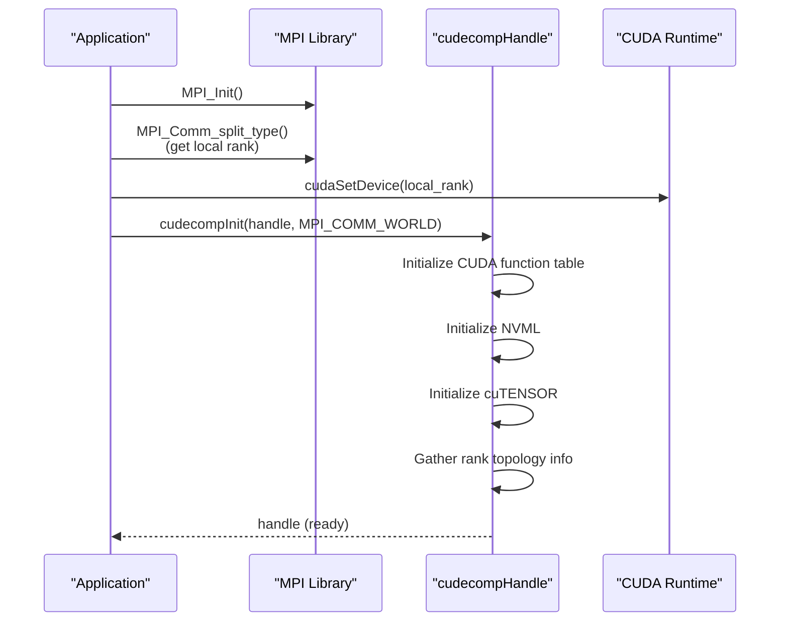
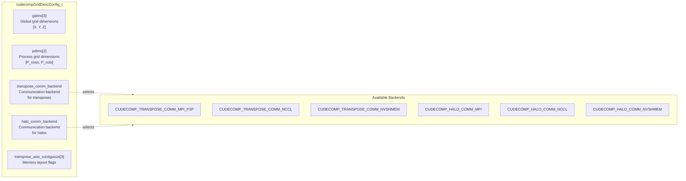
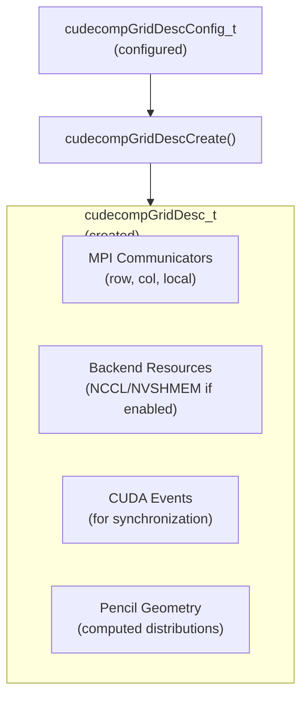
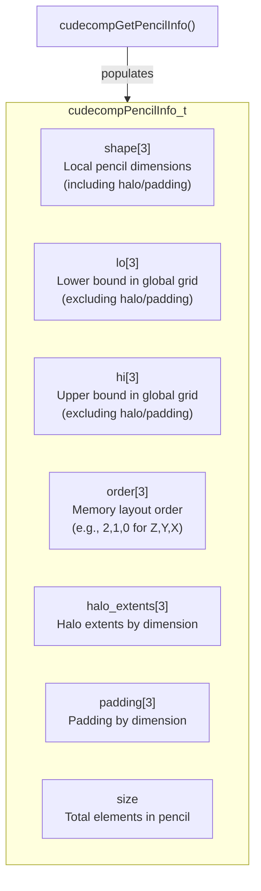
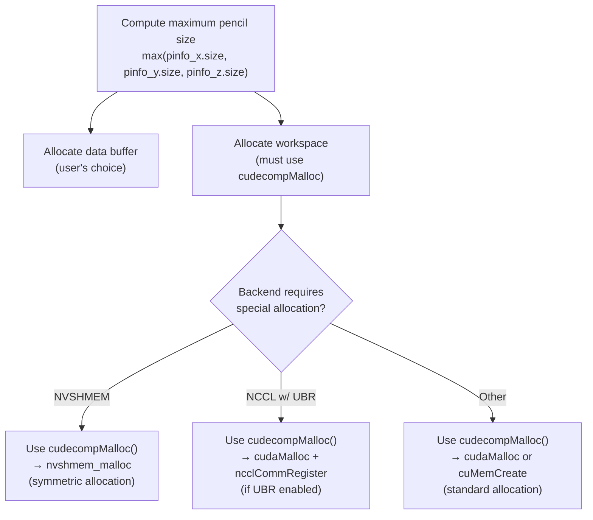
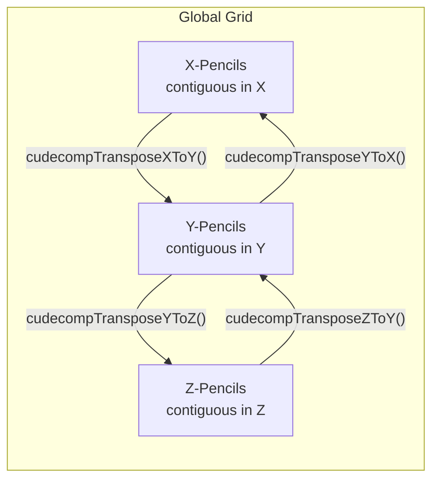
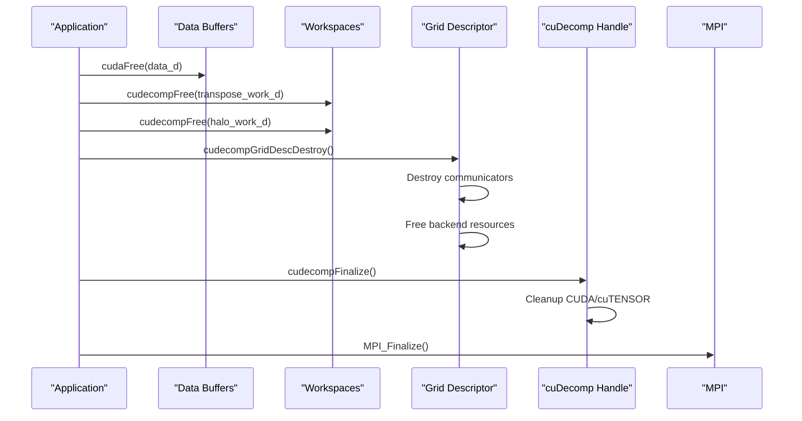

<!-- source: DeepWiki mcp.deepwiki.com · repo NVIDIA/cuDecomp · page 2.2 Quick Start Tutorial · fetched 2026-10-26 -->

# Quick Start Tutorial

<details>
<summary>Relevant source files</summary>

The following files were used as context for generating this wiki page:

- [README.md](README.md)
- [docs/autotuning.rst](docs/autotuning.rst)
- [docs/env_vars.rst](docs/env_vars.rst)
- [docs/overview.rst](docs/overview.rst)
- [examples/fortran/basic_usage/basic_usage_autotune.f90](examples/fortran/basic_usage/basic_usage_autotune.f90)
- [include/cudecomp.h](include/cudecomp.h)

</details>


## Purpose and Scope

This tutorial walks through a minimal working example demonstrating the core cuDecomp operations: library initialization, grid descriptor creation, data transposition, and halo communication. The example uses a simple configuration without autotuning to illustrate the basic API usage patterns.

For detailed information on building and installing cuDecomp, see [Building and Installation](#2.1). For performance optimization through autotuning, see [Performance Autotuning](#7). For comprehensive API documentation, see [API Reference](#4).

---

## Basic Workflow Overview

The typical cuDecomp workflow follows these stages:

**Workflow: Basic cuDecomp Application**


Sources: [examples/fortran/basic_usage/basic_usage_autotune.f90:58-288](), [docs/overview.rst:1-66]()

---

## Step 1: Initialize MPI and cuDecomp

**Initialization Sequence**


The first step is to initialize MPI and the cuDecomp library. Each MPI rank should set its CUDA device to match its local rank within the node.

**C++ Example:**
```cpp
MPI_Init(&argc, &argv);
int rank, nranks, local_rank;
MPI_Comm_rank(MPI_COMM_WORLD, &rank);
MPI_Comm_size(MPI_COMM_WORLD, &nranks);

// Set CUDA device to match local rank
MPI_Comm local_comm;
MPI_Comm_split_type(MPI_COMM_WORLD, MPI_COMM_TYPE_SHARED, 0, 
                    MPI_INFO_NULL, &local_comm);
MPI_Comm_rank(local_comm, &local_rank);
cudaSetDevice(local_rank);

// Initialize cuDecomp
cudecompHandle_t handle;
cudecompInit(&handle, MPI_COMM_WORLD);
```

**Fortran Example:**
```fortran
call MPI_Init(ierr)
call MPI_Comm_rank(MPI_COMM_WORLD, rank, ierr)
call MPI_Comm_size(MPI_COMM_WORLD, nranks, ierr)

! Set CUDA device to match local rank
call MPI_Comm_split_Type(MPI_COMM_WORLD, MPI_COMM_TYPE_SHARED, 0, &
                         MPI_INFO_NULL, local_comm, ierr)
call MPI_Comm_rank(local_comm, local_rank, ierr)
ierr = cudaSetDevice(local_rank)

! Initialize cuDecomp
istat = cudecompInit(handle, MPI_COMM_WORLD)
```

The `cudecompHandle_t` (C++) or `type(cudecompHandle)` (Fortran) is an opaque handle that maintains library state including communicators, CUDA resources, and topology information. This handle must be passed to all subsequent cuDecomp function calls.

Sources: [examples/fortran/basic_usage/basic_usage_autotune.f90:58-68](), [include/cudecomp.h:205-223]()

---

## Step 2: Create Grid Descriptor Configuration

**Grid Configuration Structure**


Before creating the grid descriptor, configure the decomposition parameters:

**C++ Example:**
```cpp
cudecompGridDescConfig_t config;
cudecompGridDescConfigSetDefaults(&config);

// Set global grid dimensions [X, Y, Z]
config.gdims[0] = 256;  // X
config.gdims[1] = 256;  // Y
config.gdims[2] = 256;  // Z

// Set process grid dimensions [P_rows, P_cols]
// For nranks=16, could use [4, 4] or [2, 8] or [8, 2] etc.
config.pdims[0] = 4;  // P_rows
config.pdims[1] = 4;  // P_cols

// Choose communication backends
config.transpose_comm_backend = CUDECOMP_TRANSPOSE_COMM_MPI_P2P;
config.halo_comm_backend = CUDECOMP_HALO_COMM_MPI;

// Make pencil axis contiguous in memory (recommended)
config.transpose_axis_contiguous[0] = true;  // X-pencil
config.transpose_axis_contiguous[1] = true;  // Y-pencil
config.transpose_axis_contiguous[2] = true;  // Z-pencil
```

**Fortran Example:**
```fortran
type(cudecompGridDescConfig) :: config

istat = cudecompGridDescConfigSetDefaults(config)

! Set global grid dimensions [X, Y, Z]
config%gdims = [256, 256, 256]

! Set process grid dimensions [P_rows, P_cols]
config%pdims = [4, 4]

! Choose communication backends
config%transpose_comm_backend = CUDECOMP_TRANSPOSE_COMM_MPI_P2P
config%halo_comm_backend = CUDECOMP_HALO_COMM_MPI

! Make pencil axis contiguous in memory
config%transpose_axis_contiguous = [.true., .true., .true.]
```

**Key Configuration Parameters:**

| Parameter | Description |
|-----------|-------------|
| `gdims[3]` | Global grid dimensions `[X, Y, Z]` in column-major order |
| `pdims[2]` | Process grid dimensions `[P_rows, P_cols]` where `P_rows × P_cols = nranks` |
| `transpose_comm_backend` | Backend for transpose communication (MPI, NCCL, or NVSHMEM) |
| `halo_comm_backend` | Backend for halo communication (MPI, NCCL, or NVSHMEM) |
| `transpose_axis_contiguous[3]` | Whether pencil axis should be contiguous in memory (improves FFT performance) |

Sources: [include/cudecomp.h:112-132](), [examples/fortran/basic_usage/basic_usage_autotune.f90:71-80]()

---

## Step 3: Create Grid Descriptor

**Grid Descriptor Creation**


Create the grid descriptor using the configuration:

**C++ Example:**
```cpp
cudecompGridDesc_t grid_desc;
// Pass NULL for autotune options to disable autotuning
cudecompGridDescCreate(handle, &grid_desc, &config, NULL);
```

**Fortran Example:**
```fortran
type(cudecompGridDesc) :: grid_desc

! Pass null() for autotune options to disable autotuning
istat = cudecompGridDescCreate(handle, grid_desc, config, null())
```

The grid descriptor contains all internal state needed for communication operations, including MPI communicators, backend-specific resources, and computed pencil geometry. It can be reused for multiple data buffers with the same decomposition.

For autotuned grid descriptor creation, see [Autotune Configuration and Options](#7.1).

Sources: [include/cudecomp.h:235-253](), [examples/fortran/basic_usage/basic_usage_autotune.f90:120-121]()

---

## Step 4: Query Pencil Information

**Pencil Information Structure**


Query the geometry of pencils assigned to the local rank:

**C++ Example:**
```cpp
// Query X-pencil information (axis = 0)
cudecompPencilInfo_t pinfo_x;
int32_t halo_extents[3] = {1, 1, 1};  // 1 element halo in each direction
cudecompGetPencilInfo(handle, grid_desc, &pinfo_x, 0, halo_extents, NULL);

// Query Y-pencil information (axis = 1, no halos)
cudecompPencilInfo_t pinfo_y;
cudecompGetPencilInfo(handle, grid_desc, &pinfo_y, 1, NULL, NULL);

// Query Z-pencil information (axis = 2, no halos)
cudecompPencilInfo_t pinfo_z;
cudecompGetPencilInfo(handle, grid_desc, &pinfo_z, 2, NULL, NULL);
```

**Fortran Example:**
```fortran
type(cudecompPencilInfo) :: pinfo_x, pinfo_y, pinfo_z

! Query X-pencil information with halos
istat = cudecompGetPencilInfo(handle, grid_desc, pinfo_x, 1, [1, 1, 1])

! Query Y-pencil information (no halos)
istat = cudecompGetPencilInfo(handle, grid_desc, pinfo_y, 2)

! Query Z-pencil information (no halos)
istat = cudecompGetPencilInfo(handle, grid_desc, pinfo_z, 3)
```

**Pencil Information Fields:**

| Field | Description |
|-------|-------------|
| `shape[3]` | Local pencil dimensions in local order (includes halos and padding) |
| `lo[3]`, `hi[3]` | Lower and upper bounds in global grid coordinates (excludes halos/padding) |
| `order[3]` | Memory layout order; e.g., `[2,1,0]` means data is ordered Z,Y,X |
| `halo_extents[3]` | Halo extents by dimension in global order |
| `size` | Total number of elements in pencil buffer |

The `axis` parameter uses C indexing (0=X, 1=Y, 2=Z) in C++ and Fortran indexing (1=X, 2=Y, 3=Z) in Fortran.

Sources: [include/cudecomp.h:192-307](), [examples/fortran/basic_usage/basic_usage_autotune.f90:135-145]()

---

## Step 5: Allocate Memory

**Memory Allocation Strategy**


Allocate memory for data buffers and cuDecomp workspaces:

**C++ Example:**
```cpp
// Determine maximum pencil size
int64_t data_num_elements = std::max({pinfo_x.size, pinfo_y.size, pinfo_z.size});

// Allocate data buffer (can use cudaMalloc or host allocation)
double* data_d;
cudaMalloc(&data_d, data_num_elements * sizeof(double));

// Query workspace sizes
int64_t transpose_work_num_elements;
cudecompGetTransposeWorkspaceSize(handle, grid_desc, &transpose_work_num_elements);

int64_t halo_work_num_elements;
cudecompGetHaloWorkspaceSize(handle, grid_desc, 0, halo_extents, &halo_work_num_elements);

// Allocate workspaces using cudecompMalloc (required for backend compatibility)
double* transpose_work_d;
cudecompMalloc(handle, grid_desc, (void**)&transpose_work_d, 
               transpose_work_num_elements * sizeof(double));

double* halo_work_d;
cudecompMalloc(handle, grid_desc, (void**)&halo_work_d,
               halo_work_num_elements * sizeof(double));
```

**Fortran Example:**
```fortran
! Determine maximum pencil size
data_num_elements = max(pinfo_x%size, pinfo_y%size, pinfo_z%size)

! Allocate data buffer
real(real64), allocatable, device, target :: data_d(:)
allocate(data_d(data_num_elements))

! Query workspace sizes
integer(8) :: transpose_work_num_elements, halo_work_num_elements
istat = cudecompGetTransposeWorkspaceSize(handle, grid_desc, transpose_work_num_elements)
istat = cudecompGetHaloWorkspaceSize(handle, grid_desc, 1, [1,1,1], halo_work_num_elements)

! Allocate workspaces using cudecompMalloc
real(real64), pointer, device :: transpose_work_d(:), halo_work_d(:)
istat = cudecompMalloc(handle, grid_desc, transpose_work_d, transpose_work_num_elements)
istat = cudecompMalloc(handle, grid_desc, halo_work_d, halo_work_num_elements)
```

**Important Notes:**
- Data buffers can be allocated using standard methods (`cudaMalloc`, host allocation)
- Workspace buffers **must** be allocated using `cudecompMalloc()` for backend compatibility
- `cudecompMalloc()` automatically selects the appropriate allocator based on the communication backend:
  - NVSHMEM backends require symmetric memory (`nvshmem_malloc`)
  - NCCL backends may use User Buffer Registration for performance
  - Standard backends use `cudaMalloc` or CUDA VMM

Sources: [include/cudecomp.h:309-381](), [examples/fortran/basic_usage/basic_usage_autotune.f90:148-237]()

---

## Step 6: Perform Transpose Operations

**Transpose Data Flow**


Transpose operations redistribute data between different pencil orientations:

**C++ Example:**
```cpp
// Transpose from X-pencils to Y-pencils
cudecompTransposeXToY(handle, grid_desc, 
                      data_d, data_d,  // in-place
                      transpose_work_d,
                      CUDECOMP_DOUBLE,
                      halo_extents, NULL,  // input has halos, output does not
                      NULL, NULL,          // no padding
                      0);                  // default stream

// Transpose from Y-pencils to Z-pencils
cudecompTransposeYToZ(handle, grid_desc,
                      data_d, data_d,
                      transpose_work_d,
                      CUDECOMP_DOUBLE,
                      NULL, NULL,  // no halos
                      NULL, NULL,  // no padding
                      0);

// Transpose from Z-pencils to Y-pencils
cudecompTransposeZToY(handle, grid_desc,
                      data_d, data_d,
                      transpose_work_d,
                      CUDECOMP_DOUBLE,
                      NULL, NULL,
                      NULL, NULL,
                      0);

// Transpose from Y-pencils back to X-pencils
cudecompTransposeYToX(handle, grid_desc,
                      data_d, data_d,
                      transpose_work_d,
                      CUDECOMP_DOUBLE,
                      NULL, halo_extents,  // output has halos
                      NULL, NULL,
                      0);
```

**Fortran Example:**
```fortran
! Transpose from X-pencils to Y-pencils
istat = cudecompTransposeXToY(handle, grid_desc, data_d, data_d, &
                              transpose_work_d, CUDECOMP_DOUBLE, &
                              pinfo_x%halo_extents, [0,0,0])

! Transpose from Y-pencils to Z-pencils
istat = cudecompTransposeYToZ(handle, grid_desc, data_d, data_d, &
                              transpose_work_d, CUDECOMP_DOUBLE)

! Transpose from Z-pencils to Y-pencils
istat = cudecompTransposeZToY(handle, grid_desc, data_d, data_d, &
                              transpose_work_d, CUDECOMP_DOUBLE)

! Transpose from Y-pencils to X-pencils
istat = cudecompTransposeYToX(handle, grid_desc, data_d, data_d, &
                              transpose_work_d, CUDECOMP_DOUBLE, &
                              [0,0,0], pinfo_x%halo_extents)
```

**Transpose Function Parameters:**

| Parameter | Description |
|-----------|-------------|
| `input`, `output` | Input and output buffers; can be same pointer for in-place operation |
| `work` | Workspace buffer allocated with `cudecompMalloc()` |
| `dtype` | Data type: `CUDECOMP_DOUBLE`, `CUDECOMP_FLOAT`, `CUDECOMP_DOUBLE_COMPLEX`, etc. |
| `input_halo_extents` | Halo extents of input data (3-element array or NULL) |
| `output_halo_extents` | Halo extents of output data (3-element array or NULL) |
| `input_padding`, `output_padding` | Padding amounts (3-element arrays or NULL) |
| `stream` | CUDA stream for GPU operations |

Sources: [include/cudecomp.h:430-545](), [examples/fortran/basic_usage/basic_usage_autotune.f90:242-255]()

---

## Step 7: Perform Halo Updates

**Halo Communication Pattern**
```mermaid
graph TB
    subgraph Pencil["X-Pencil (Local Data)"]
        Core["Core Data<br/>(owned by rank)"]
        HaloLeft["Left Halo<br/>(received)"]
        HaloRight["Right Halo<br/>(received)"]
    end
    
    RankMinus["Rank-1<br/>(neighbor)"]
    RankPlus["Rank+1<br/>(neighbor)"]
    
    RankMinus -->|"Send boundary"| HaloLeft
    HaloRight <--|"Send boundary"| RankPlus
    
    Core -->|"Send to Rank+1"| RankPlus
    Core -->|"Send to Rank-1"| RankMinus
```

Halo updates exchange boundary data with neighboring ranks:

**C++ Example:**
```cpp
bool halo_periods[3] = {true, true, true};  // periodic in all directions

// Update X-pencil halos in X direction (dim=0)
cudecompUpdateHalosX(handle, grid_desc,
                     data_d,
                     halo_work_d,
                     CUDECOMP_DOUBLE,
                     halo_extents,
                     halo_periods,
                     0,     // dim: X direction
                     NULL,  // no padding
                     0);    // default stream

// Update X-pencil halos in Y direction (dim=1)
cudecompUpdateHalosX(handle, grid_desc,
                     data_d,
                     halo_work_d,
                     CUDECOMP_DOUBLE,
                     halo_extents,
                     halo_periods,
                     1,     // dim: Y direction
                     NULL,
                     0);

// Update X-pencil halos in Z direction (dim=2)
cudecompUpdateHalosX(handle, grid_desc,
                     data_d,
                     halo_work_d,
                     CUDECOMP_DOUBLE,
                     halo_extents,
                     halo_periods,
                     2,     // dim: Z direction
                     NULL,
                     0);
```

**Fortran Example:**
```fortran
logical :: halo_periods(3) = [.true., .true., .true.]

! Update X-pencil halos in X direction (dim=1 in Fortran)
istat = cudecompUpdateHalosX(handle, grid_desc, data_d, halo_work_d, &
                             CUDECOMP_DOUBLE, pinfo_x%halo_extents, &
                             halo_periods, 1)

! Update X-pencil halos in Y direction (dim=2)
istat = cudecompUpdateHalosX(handle, grid_desc, data_d, halo_work_d, &
                             CUDECOMP_DOUBLE, pinfo_x%halo_extents, &
                             halo_periods, 2)

! Update X-pencil halos in Z direction (dim=3)
istat = cudecompUpdateHalosX(handle, grid_desc, data_d, halo_work_d, &
                             CUDECOMP_DOUBLE, pinfo_x%halo_extents, &
                             halo_periods, 3)
```

**Halo Update Function Parameters:**

| Parameter | Description |
|-----------|-------------|
| `input` | Data buffer (modified in-place with updated halos) |
| `work` | Workspace buffer allocated with `cudecompMalloc()` |
| `dtype` | Data type |
| `halo_extents` | Number of halo elements per direction (3-element array) |
| `halo_periods` | Periodicity flags by dimension (3-element boolean array or NULL) |
| `dim` | Which dimension to perform the halo update (C: 0/1/2, Fortran: 1/2/3) |
| `padding` | Padding amounts (3-element array or NULL) |
| `stream` | CUDA stream for GPU operations |

Similar functions exist for Y-pencils (`cudecompUpdateHalosY()`) and Z-pencils (`cudecompUpdateHalosZ()`).

Sources: [include/cudecomp.h:547-620](), [examples/fortran/basic_usage/basic_usage_autotune.f90:261-273]()

---

## Step 8: Cleanup

**Cleanup Sequence**


Properly clean up resources in reverse order of creation:

**C++ Example:**
```cpp
// Free data buffers
cudaFree(data_d);

// Free workspaces (must use cudecompFree)
cudecompFree(handle, grid_desc, transpose_work_d);
cudecompFree(handle, grid_desc, halo_work_d);

// Destroy grid descriptor
cudecompGridDescDestroy(handle, grid_desc);

// Finalize cuDecomp
cudecompFinalize(handle);

// Finalize MPI
MPI_Finalize();
```

**Fortran Example:**
```fortran
! Free data buffers
deallocate(data_d)

! Free workspaces
istat = cudecompFree(handle, grid_desc, transpose_work_d)
istat = cudecompFree(handle, grid_desc, halo_work_d)

! Destroy grid descriptor
istat = cudecompGridDescDestroy(handle, grid_desc)

! Finalize cuDecomp
istat = cudecompFinalize(handle)

! Finalize MPI
call MPI_Finalize(ierr)
```

**Cleanup Order (Critical):**
1. Free user-allocated data buffers
2. Free cuDecomp workspaces using `cudecompFree()`
3. Destroy grid descriptors with `cudecompGridDescDestroy()`
4. Finalize cuDecomp handle with `cudecompFinalize()`
5. Finalize MPI

Workspaces must be freed before destroying the grid descriptor since the grid descriptor tracks allocation types (NVSHMEM, NCCL-registered, standard) needed for proper deallocation.

Sources: [examples/fortran/basic_usage/basic_usage_autotune.f90:276-287](), [include/cudecomp.h:255-261]()

---

## Complete Example Reference

The complete working examples demonstrating this basic workflow are available in the cuDecomp repository:

**Without Autotuning:**
- C++: [examples/cc/basic_usage/basic_usage.cu]()
- Fortran: [examples/fortran/basic_usage/basic_usage.f90]()

**With Autotuning:**
- C++: [examples/cc/basic_usage/basic_usage_autotune.cu]()
- Fortran: [examples/fortran/basic_usage/basic_usage_autotune.f90]()

**Real-World Application:**
- Taylor-Green Vortex Solver (3D Navier-Stokes): [examples/cc/taylor_green/tg.cu]()

For building and running these examples, see [Building and Installation](#2.1). For more complex use cases including FFT-based applications, see [Examples and Use Cases](#11).

Sources: [examples/fortran/basic_usage/basic_usage_autotune.f90:1-290](), [README.md:1-43]()

---

## Next Steps

After completing this tutorial, you may want to explore:

- **[Performance Autotuning](#7)**: Automatically find optimal process grid and communication backends
- **[Pipelined Transposes](#5.2)**: Enable computation-communication overlap for improved performance
- **[Communication Backend Details](#8)**: Understand when to use MPI, NCCL, or NVSHMEM backends
- **[FFT-Based Applications](#11.3)**: Integrate cuDecomp with cuFFT for spectral solvers
- **[API Reference](#4)**: Complete documentation of all available functions and options

Sources: [docs/autotuning.rst:1-498](), [docs/overview.rst:1-66]()

---

