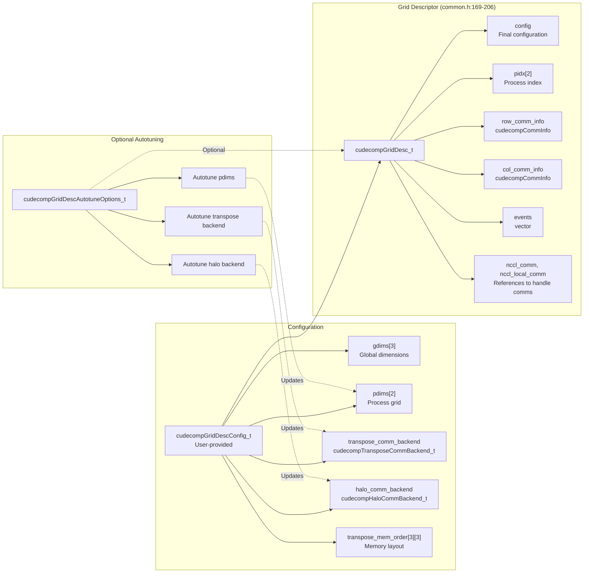
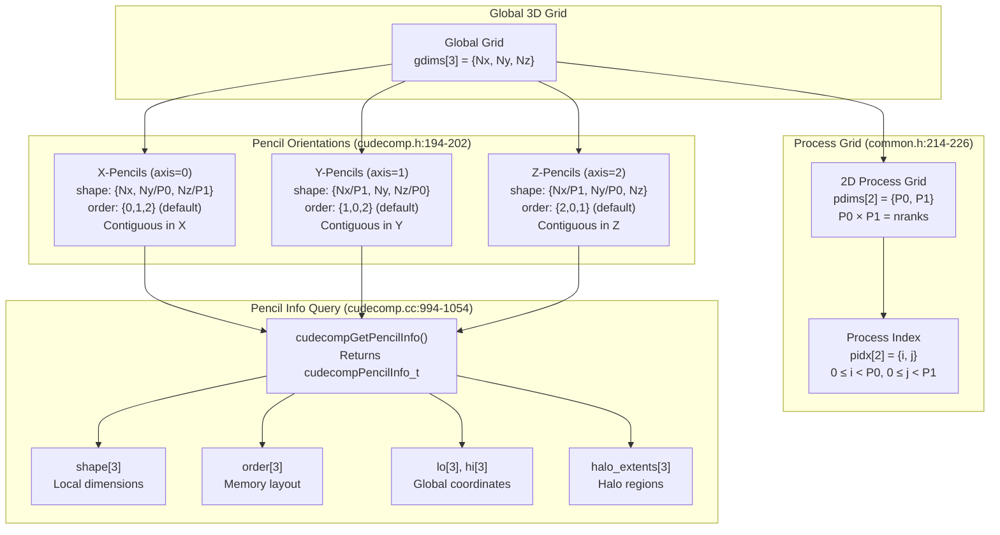
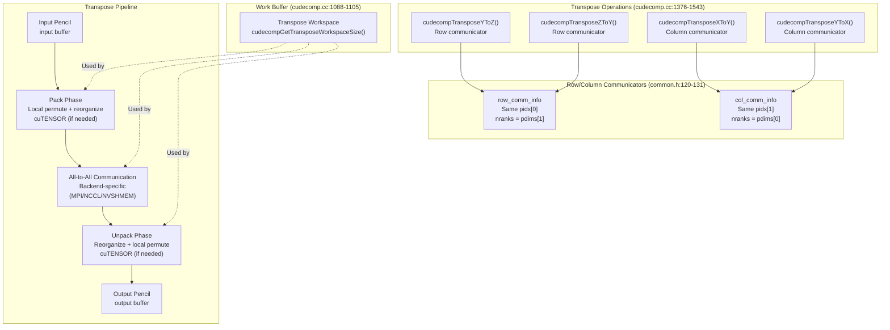
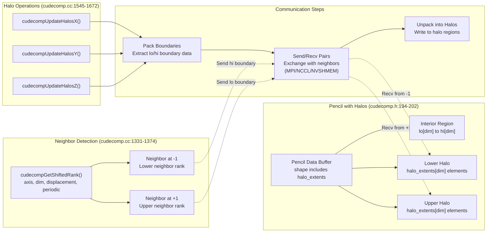
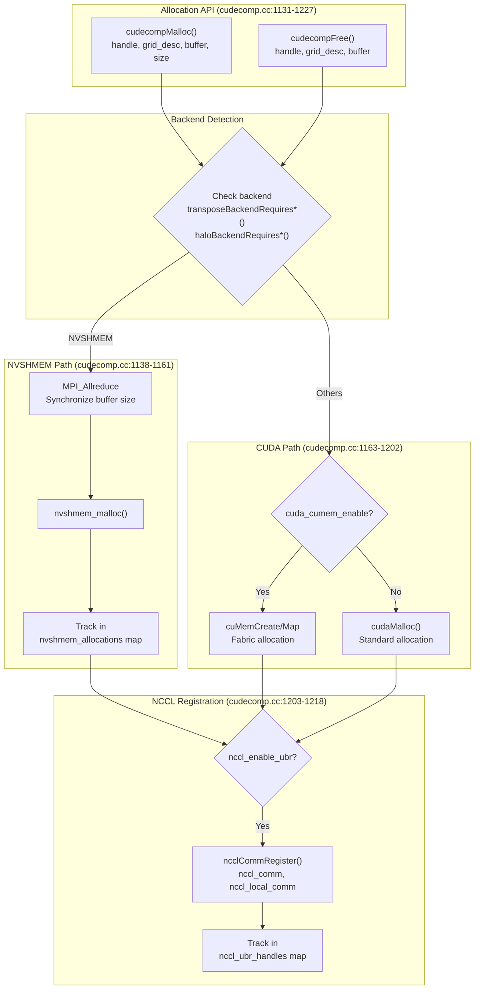

<!-- source: DeepWiki mcp.deepwiki.com · repo NVIDIA/cuDecomp · page 3 Core Concepts · fetched 2026-10-26 -->

# Core Concepts

Relevant source files

The following files were used as context for generating this wiki page:

- [include/cudecomp.h](include/cudecomp.h)
- [include/internal/common.h](include/internal/common.h)
- [src/cudecomp.cc](src/cudecomp.cc)

This page introduces the fundamental concepts and abstractions that form the foundation of cuDecomp. Understanding these concepts is essential for effectively using the library to perform distributed 3D data decomposition on GPU systems.

This document covers the high-level architecture, data structures, and communication patterns. For detailed information about initialization procedures and resource management, see [Library Architecture and Initialization](#3.1). For in-depth discussion of decomposition strategies and memory layouts, see [Data Decomposition and Pencil Orientations](#3.2). For details about selecting and configuring communication methods, see [Communication Backends](#3.3).

## Library Abstractions

cuDecomp provides two primary abstractions that users interact with: the **handle** and the **grid descriptor**.

### cudecompHandle_t: Library Context

The `cudecompHandle_t` is an opaque pointer to a `cudecompHandle` structure that maintains global library state and resources shared across all decompositions. A handle must be created via `cudecompInit()` before any other library operations and manages:

- **MPI communicators**: Global, local (node-level), and clique (MNNVL) communicators
- **NCCL communicators**: Global and local NCCL communicators for GPU-direct communication
- **CUDA resources**: Internal streams for concurrent operations, cuTENSOR handle
- **Topology information**: Rank-to-hostname mappings, MNNVL clique information
- **NVSHMEM state**: Symmetric heap tracking and allocation management
- **Configuration flags**: User buffer registration, CUDA graphs, performance reporting

The library currently supports only a single handle per process. Multiple grid descriptors can be created from one handle to support different decomposition configurations.

**Diagram: Handle Structure and Managed Resources**

```mermaid
graph TB
    subgraph "User Space"
        User["Application Code"]
    end
    
    subgraph "cudecompHandle (cudecomp.cc:409-511)"
        Handle["cudecompHandle_t<br/>Opaque Pointer"]
        
        subgraph "Communicators"
            MPI_COMM["mpi_comm<br/>MPI_Comm"]
            MPI_LOCAL["mpi_local_comm<br/>Node-local"]
            MPI_CLIQUE["mpi_clique_comm<br/>MNNVL clique"]
            NCCL_GLOBAL["nccl_comm<br/>ncclComm (global)"]
            NCCL_LOCAL["nccl_local_comm<br/>ncclComm (local)"]
        end
        
        subgraph "CUDA Resources"
            STREAMS["streams<br/>vector<cudaStream_t>"]
            CUTENSOR["cutensor_handle<br/>cutensorHandle_t"]
        end
        
        subgraph "Topology Info"
            HOSTNAMES["hostnames<br/>vector<array<char>>"]
            RANK_LOCAL["rank_to_local_rank<br/>vector<int32_t>"]
            RANK_CLIQUE["rank_to_clique<br/>vector<unsigned int>"]
            MNNVL_INFO["rank_to_mnnvl_info<br/>vector<mnnvl_info>"]
        end
        
        subgraph "Feature Flags"
            NCCL_UBR["nccl_enable_ubr<br/>bool"]
            CUMEM["cuda_cumem_enable<br/>bool"]
            GRAPHS["cuda_graphs_enable<br/>bool"]
            PERF["performance_report_enable<br/>bool"]
        end
    end
    
    User -->|"cudecompInit()"| Handle
    Handle --> MPI_COMM
    Handle --> MPI_LOCAL
    Handle --> MPI_CLIQUE
    Handle --> NCCL_GLOBAL
    Handle --> NCCL_LOCAL
    Handle --> STREAMS
    Handle --> CUTENSOR
    Handle --> HOSTNAMES
    Handle --> RANK_LOCAL
    Handle --> RANK_CLIQUE
    Handle --> MNNVL_INFO
    Handle --> NCCL_UBR
    Handle --> CUMEM
    Handle --> GRAPHS
    Handle --> PERF
```

Sources: [include/internal/common.h:54-117](), [src/cudecomp.cc:409-511]()

### cudecompGridDesc_t: Decomposition Configuration

The `cudecompGridDesc_t` is an opaque pointer to a `cudecompGridDesc` structure that defines a specific decomposition configuration for a 3D data grid. Grid descriptors are created via `cudecompGridDescCreate()` and encapsulate:

- **Grid dimensions**: Global data dimensions (`gdims`), distribution dimensions (`gdims_dist`), process grid dimensions (`pdims`)
- **Communication backends**: Selected backends for transpose and halo operations
- **Memory layout**: Axis contiguity and memory ordering specifications
- **Communicator references**: Row and column MPI/NCCL/NVSHMEM communicators
- **Scheduling resources**: CUDA events for pipeline synchronization
- **Performance tracking**: Event collections for performance monitoring

Multiple grid descriptors can coexist under a single handle, each representing different decomposition strategies (e.g., different process grid dimensions or memory layouts).

**Diagram: Grid Descriptor Configuration Pipeline**

Sources: [include/cudecomp.h:113-132](), [include/internal/common.h:169-206](), [src/cudecomp.cc:565-822]()

## Pencil Decomposition Strategy

cuDecomp uses a **pencil decomposition** strategy where the 3D global data grid is distributed across a 2D process grid. Each process owns a "pencil" - a contiguous slice of data that extends fully along one axis while being partitioned along the other two axes.

### Process Grid and Pencil Orientations

The process grid is defined by `pdims[2]` where `pdims[0] × pdims[1]` must equal the total number of MPI ranks. Data can exist in three orientations:

- **X-pencils**: Data is contiguous along the X-axis, partitioned in Y and Z
- **Y-pencils**: Data is contiguous along the Y-axis, partitioned in X and Z  
- **Z-pencils**: Data is contiguous along the Z-axis, partitioned in X and Y

Each orientation is optimized for algorithms requiring contiguous access along a specific axis (e.g., 1D FFTs, finite differences).

**Diagram: Pencil Decomposition and Process Grid Mapping**

Sources: [include/cudecomp.h:194-202](), [include/internal/common.h:214-226](), [src/cudecomp.cc:994-1054]()

### Memory Layout Control

The memory layout of pencils is controlled by the `transpose_mem_order` field in `cudecompGridDescConfig_t`. Each pencil orientation can have a custom memory ordering specified as a permutation of `{0, 1, 2}`:

- `order[i]` indicates which global dimension occupies the i-th position in memory
- For X-pencils with `order = {0,1,2}`: memory is ordered `x + y*Nx + z*Nx*Ny`
- For Y-pencils with `order = {1,0,2}`: memory is ordered `y + x*Ny + z*Nx*Ny` (Y is contiguous)

The `cudecompPencilInfo_t` structure returned by `cudecompGetPencilInfo()` contains the shape, order, and bounds information needed to access pencil data.

**Table: Pencil Information Fields**

| Field | Type | Description |
|-------|------|-------------|
| `shape[3]` | `int32_t[3]` | Pencil dimensions in local memory order (includes halo and padding) |
| `lo[3]`, `hi[3]` | `int32_t[3]` | Lower and upper bound coordinates in global order |
| `order[3]` | `int32_t[3]` | Memory layout permutation (maps global to local dimension order) |
| `halo_extents[3]` | `int32_t[3]` | Halo region extents in global order |
| `padding[3]` | `int32_t[3]` | Padding elements in global order |
| `size` | `int64_t` | Total number of elements (including halos and padding) |

Sources: [include/cudecomp.h:194-202](), [src/cudecomp.cc:994-1054]()

## Communication Patterns

cuDecomp provides two fundamental communication operations: **transpose** and **halo update**.

### Transpose Operations

Transpose operations redistribute data between different pencil orientations. The library provides four transpose functions:

- `cudecompTransposeXToY()`: X-pencils → Y-pencils (uses column communicator)
- `cudecompTransposeYToZ()`: Y-pencils → Z-pencils (uses row communicator)
- `cudecompTransposeZToY()`: Z-pencils → Y-pencils (uses row communicator)
- `cudecompTransposeYToX()`: Y-pencils → X-pencils (uses column communicator)

Each transpose involves three phases executed on GPUs:

1. **Pack**: Reorganize local data for efficient communication (may use cuTENSOR for local permutation)
2. **Communicate**: All-to-all exchange with peers in row or column communicator
3. **Unpack**: Reorganize received data into target memory layout

**Diagram: Transpose Communication Flow**

Sources: [include/cudecomp.h:431-545](), [include/internal/common.h:120-131](), [src/cudecomp.cc:1376-1543](), [src/cudecomp.cc:1088-1105]()

### Halo Update Operations

Halo operations exchange boundary data between neighboring processes along a specified dimension. The library provides three halo functions:

- `cudecompUpdateHalosX()`: Update halos for X-pencils
- `cudecompUpdateHalosY()`: Update halos for Y-pencils
- `cudecompUpdateHalosZ()`: Update halos for Z-pencils

Each halo operation:

1. Identifies neighbor ranks using `cudecompGetShiftedRank()` for specified dimension and periodicity
2. Packs boundary data from source regions into communication buffers (if not contiguous)
3. Performs pair-wise send/receive with ±1 neighbors along the specified dimension
4. Unpacks received data into halo regions

**Diagram: Halo Communication Pattern**

Sources: [include/cudecomp.h:548-625](), [src/cudecomp.cc:1331-1374](), [src/cudecomp.cc:1545-1672]()

## Communication Backend Selection

cuDecomp supports three communication backends, each with specific characteristics and requirements:

### Backend Types

**Table: Communication Backend Options**

| Backend | Enum Values | Requirements | Characteristics |
|---------|-------------|--------------|-----------------|
| **MPI** | `CUDECOMP_TRANSPOSE_COMM_MPI_P2P` `CUDECOMP_TRANSPOSE_COMM_MPI_P2P_PL` `CUDECOMP_TRANSPOSE_COMM_MPI_A2A` `CUDECOMP_HALO_COMM_MPI` `CUDECOMP_HALO_COMM_MPI_BLOCKING` | Standard MPI library | CPU-mediated transfers, widest compatibility |
| **NCCL** | `CUDECOMP_TRANSPOSE_COMM_NCCL` `CUDECOMP_TRANSPOSE_COMM_NCCL_PL` `CUDECOMP_HALO_COMM_NCCL` | NCCL library | GPU-direct transfers, optimized for NVLink/InfiniBand |
| **NVSHMEM** | `CUDECOMP_TRANSPOSE_COMM_NVSHMEM` `CUDECOMP_TRANSPOSE_COMM_NVSHMEM_PL` `CUDECOMP_HALO_COMM_NVSHMEM` `CUDECOMP_HALO_COMM_NVSHMEM_BLOCKING` | NVSHMEM library, compile-time `ENABLE_NVSHMEM` | One-sided GPU-direct transfers, requires symmetric heap |

Sources: [include/cudecomp.h:44-63](), [src/cudecomp.cc:89-124]()

### Pipelined Variants

Backends with `_PL` suffix support **pipelined** operation, which overlaps communication with local computation by splitting the all-to-all into multiple chunks. This can improve performance by hiding communication latency.

Pipelined transposes:
- Split pencil data into chunks along the non-contiguous dimension
- Overlap pack/communication/unpack operations across chunks
- Use CUDA events for dependency management between pipeline stages
- Optionally use CUDA graphs (when `CUDECOMP_ENABLE_CUDA_GRAPHS=1`) for reduced kernel launch overhead

**Diagram: Backend Selection and Initialization**

```mermaid
graph TB
    subgraph "Configuration (cudecomp.h:113-132)"
        CONFIG["cudecompGridDescConfig_t"]
        T_BACKEND_CFG["transpose_comm_backend"]
        H_BACKEND_CFG["halo_comm_backend"]
    end
    
    subgraph "Backend Validation (cudecomp.cc:89-124)"
        CHECK_T["checkTransposeCommBackend()"]
        CHECK_H["checkHaloCommBackend()"]
        NVSHMEM_IFDEF["#ifdef ENABLE_NVSHMEM"]
    end
    
    subgraph "Backend Initialization (cudecomp.cc:632-696)"
        INIT_NCCL["Initialize NCCL<br/>transposeBackendRequiresNccl()<br/>haloBackendRequiresNccl()"]
        CREATE_NCCL_GLOBAL["ncclCommFromMPIComm()<br/>Global communicator"]
        CREATE_NCCL_LOCAL["ncclCommFromMPIComm()<br/>Local/clique communicator"]
        
        INIT_NVSHMEM["Initialize NVSHMEM<br/>transposeBackendRequiresNvshmem()<br/>haloBackendRequiresNvshmem()"]
        INIT_NVSHMEM_CALL["initNvshmemFromMPIComm()"]
        NVSHMEM_TEAMS["nvshmem_team_split_2d()<br/>Create row/col teams"]
    end
    
    subgraph "Backend Functions (internal/common.h:273-296)"
        REQUIRES_MPI["transposeBackendRequiresMpi()<br/>haloBackendRequiresMpi()"]
        REQUIRES_NCCL["transposeBackendRequiresNccl()<br/>haloBackendRequiresNccl()"]
        REQUIRES_NVSHMEM["transposeBackendRequiresNvshmem()<br/>haloBackendRequiresNvshmem()"]
    end
    
    CONFIG --> T_BACKEND_CFG
    CONFIG --> H_BACKEND_CFG
    
    T_BACKEND_CFG --> CHECK_T
    H_BACKEND_CFG --> CHECK_H
    
    CHECK_T --> NVSHMEM_IFDEF
    CHECK_H --> NVSHMEM_IFDEF
    
    T_BACKEND_CFG --> INIT_NCCL
    H_BACKEND_CFG --> INIT_NCCL
    INIT_NCCL --> CREATE_NCCL_GLOBAL
    INIT_NCCL --> CREATE_NCCL_LOCAL
    
    T_BACKEND_CFG --> INIT_NVSHMEM
    H_BACKEND_CFG --> INIT_NVSHMEM
    INIT_NVSHMEM --> INIT_NVSHMEM_CALL
    INIT_NVSHMEM --> NVSHMEM_TEAMS
    
    T_BACKEND_CFG --> REQUIRES_MPI
    T_BACKEND_CFG --> REQUIRES_NCCL
    T_BACKEND_CFG --> REQUIRES_NVSHMEM
```

Sources: [include/cudecomp.h:44-63](), [include/cudecomp.h:113-132](), [include/internal/common.h:273-296](), [src/cudecomp.cc:89-124](), [src/cudecomp.cc:632-696]()

### Autotuning

The library provides autotuning capabilities to automatically select optimal backend and process grid configurations. The `cudecompGridDescAutotuneOptions_t` structure controls autotuning behavior:

- `autotune_transpose_backend`: Enable backend selection for transpose operations
- `autotune_halo_backend`: Enable backend selection for halo operations  
- `disable_nccl_backends`: Exclude NCCL from autotuning trials
- `disable_nvshmem_backends`: Exclude NVSHMEM from autotuning trials
- `n_trials`, `n_warmup_trials`: Control timing sample collection
- Process grid autotuning: When `pdims = {0, 0}`, autotune will search for optimal decomposition

Autotuning performs timed trials of different configurations and selects the fastest based on measured performance. For details on autotuning implementation and options, see [Performance Autotuning](#7).

Sources: [include/cudecomp.h:137-189](), [src/cudecomp.cc:724-734]()

## Memory Management

cuDecomp provides specialized allocation functions that select appropriate memory allocators based on the communication backend configuration.

### cudecompMalloc/cudecompFree

The `cudecompMalloc()` and `cudecompFree()` functions automatically select the correct allocator:

- **NVSHMEM backends**: Use `nvshmem_malloc()` / `nvshmem_free()` for symmetric heap allocation
- **NCCL/MPI with CUDA VMM enabled**: Use `cuMemCreate()` / `cuMemMap()` for fabric allocations  
- **Standard case**: Use `cudaMalloc()` / `cudaFree()`

When NCCL User Buffer Registration (UBR) is enabled via `CUDECOMP_ENABLE_NCCL_UBR=1`, buffers are automatically registered with NCCL communicators using `ncclCommRegister()` to eliminate runtime registration overhead.

**Diagram: Memory Allocation Paths**

Sources: [include/cudecomp.h:352-381](), [src/cudecomp.cc:1131-1286]()

### Workspace Requirements

Transpose and halo operations require workspace buffers for staging and local reorganization. Query workspace size using:

- `cudecompGetTransposeWorkspaceSize()`: Returns size in elements for transpose workspace
- `cudecompGetHaloWorkspaceSize()`: Returns size in elements for halo workspace  

Workspace buffers must be allocated using `cudecompMalloc()` to ensure proper backend compatibility. The workspace size depends on the maximum pencil sizes and can be computed at grid descriptor creation time.

Sources: [include/cudecomp.h:310-340](), [src/cudecomp.cc:1088-1129]()

---

