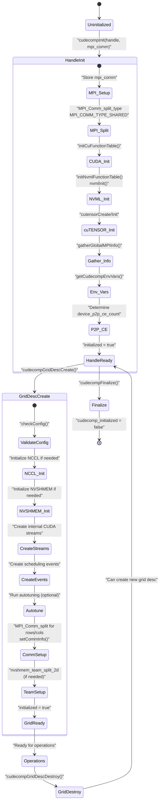
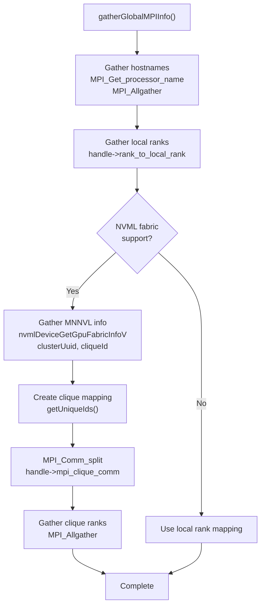
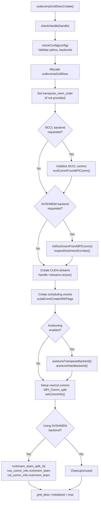
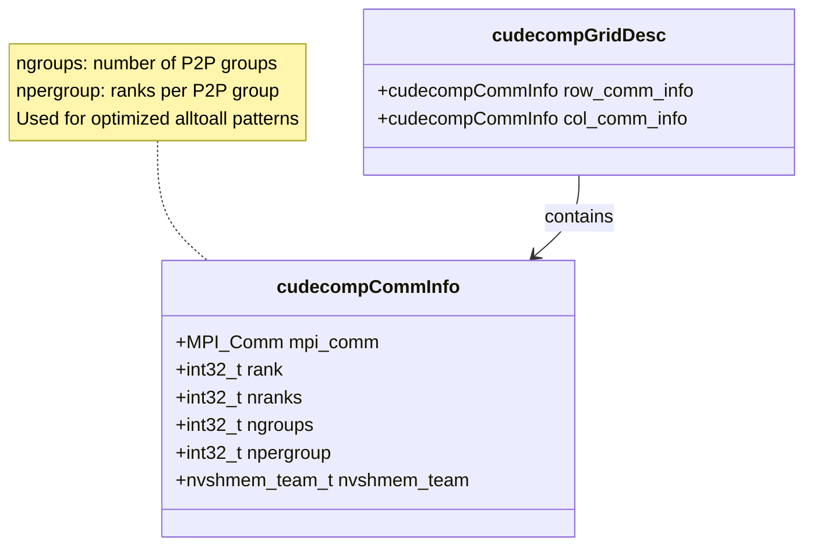
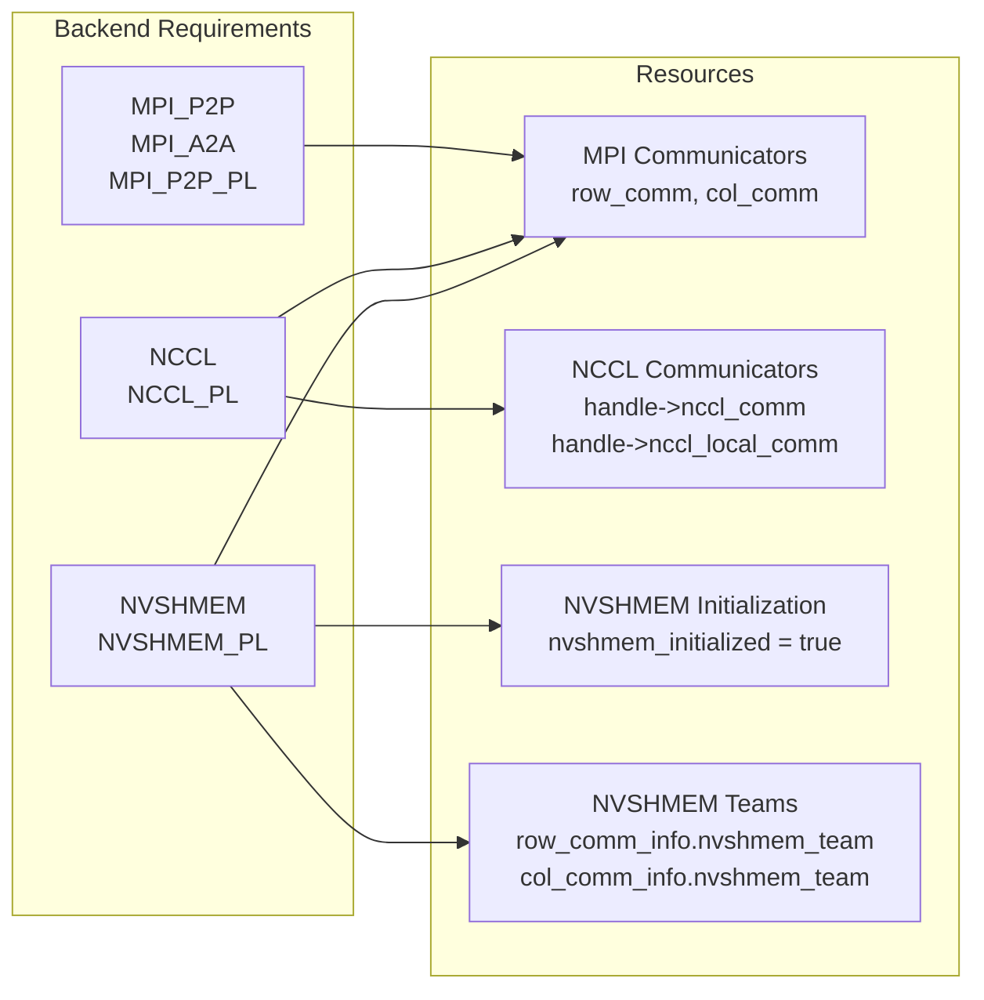
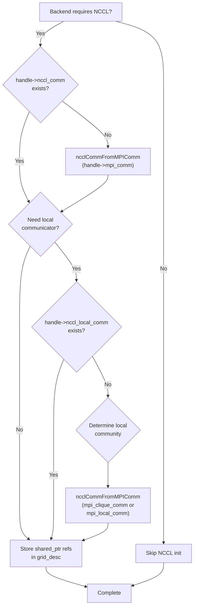
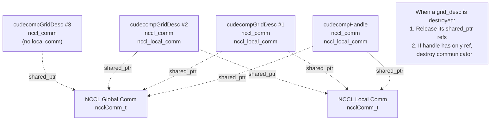
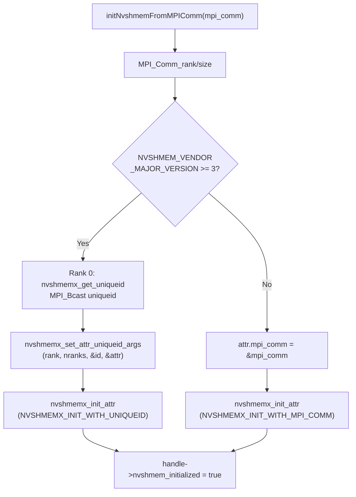
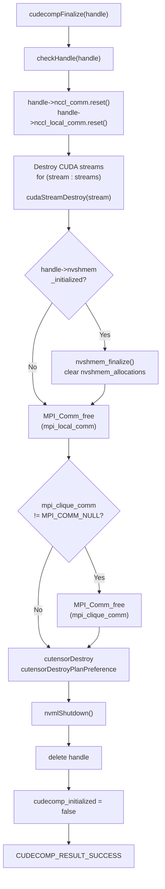

<!-- source: DeepWiki mcp.deepwiki.com · repo NVIDIA/cuDecomp · page 3.1 Library Architecture and Initialization · fetched 2026-10-26 -->

# Library Architecture and Initialization

<details>
<summary>Relevant source files</summary>

The following files were used as context for generating this wiki page:

- [include/internal/common.h](include/internal/common.h)
- [src/cudecomp.cc](src/cudecomp.cc)

</details>


## Purpose and Scope

This page describes the core architecture of cuDecomp's handle and grid descriptor system, the multi-stage initialization lifecycle, and resource management strategies. It covers how the library establishes MPI integration, initializes GPU resources, and manages the lifecycle of communicators and other resources.

For information about data decomposition concepts and pencil orientations, see [Data Decomposition and Pencil Orientations](#3.2). For communication backend selection and behavior, see [Communication Backends](#3.3). For detailed API documentation of initialization functions, see [Initialization and Finalization](#4.1).

---

## Handle System

### Core Data Structures

cuDecomp's architecture revolves around two primary structures: `cudecompHandle` and `cudecompGridDesc`. The handle contains global state shared across all operations, while grid descriptors contain configuration-specific information for a particular domain decomposition.

**Handle Structure (`cudecompHandle`)**

The `cudecompHandle` structure maintains library-wide state and resources. Key components include:

| Category | Members | Purpose |
|----------|---------|---------|
| **MPI State** | `mpi_comm`, `rank`, `nranks` | Global MPI communicator and rank information |
| **Local Topology** | `mpi_local_comm`, `local_rank`, `local_nranks` | Intra-node MPI communicator |
| **MNNVL Support** | `mpi_clique_comm`, `rank_to_clique`, `rank_to_mnnvl_info` | Multi-node NVLink clique information |
| **NCCL Resources** | `nccl_comm`, `nccl_local_comm` | Global and local NCCL communicators |
| **CUDA Resources** | `streams`, `cutensor_handle` | Internal CUDA streams and cuTENSOR handle |
| **NVSHMEM State** | `nvshmem_initialized`, `nvshmem_allocations` | NVSHMEM initialization tracking |
| **Configuration** | `nccl_enable_ubr`, `cuda_cumem_enable`, `cuda_graphs_enable` | Feature flags from environment variables |

Sources: [include/internal/common.h:54-117]()

**Grid Descriptor Structure (`cudecompGridDesc`)**

The `cudecompGridDesc` structure contains decomposition-specific configuration and resources:

| Category | Members | Purpose |
|----------|---------|---------|
| **Configuration** | `config`, `pidx` | Grid configuration and process grid index |
| **Communicators** | `row_comm_info`, `col_comm_info` | Row and column communicator information |
| **Synchronization** | `events`, `nvshmem_sync_event` | CUDA events for operation scheduling |
| **Performance** | `transpose_perf_samples_map`, `halo_perf_samples_map` | Performance monitoring data |
| **NCCL** | `nccl_comm`, `nccl_local_comm` | Shared references to NCCL communicators |
| **CUDA Graphs** | `graph_cache` | Cache for captured CUDA graphs |

Sources: [include/internal/common.h:168-206]()

### Single Handle Restriction

cuDecomp enforces a single-handle restriction using a static flag `cudecomp_initialized`. Attempting to create multiple handles results in an error:

```
"cuDecomp already initialized and multiple handles are not supported."
```

This design simplifies resource management and ensures consistent global state across the library.

Sources: [src/cudecomp.cc:50-51](), [src/cudecomp.cc:413-415]()

---

## Initialization Lifecycle

### Initialization State Machine

The following diagram shows the multi-stage initialization process when creating a handle and grid descriptor:



Sources: [src/cudecomp.cc:409-511](), [src/cudecomp.cc:565-822]()

### Handle Initialization (`cudecompInit`)

The `cudecompInit` function establishes the foundational library state through several stages:

**Stage 1: MPI Communicator Setup**

```
mpi_comm       -> handle->mpi_comm
MPI_Comm_split_type(MPI_COMM_TYPE_SHARED) -> handle->mpi_local_comm
```

The function stores the provided global MPI communicator and creates a local communicator containing only ranks on the same physical node.

Sources: [src/cudecomp.cc:417-423]()

**Stage 2: CUDA and NVML Initialization**

The library initializes function tables for dynamic loading:

- `initCuFunctionTable()`: Loads CUDA driver API symbols
- `initNvmlFunctionTable()`: Loads NVML symbols
- `nvmlInit()`: Initializes NVML library

Sources: [src/cudecomp.cc:425-431](), [src/nvml_wrap.cc]()

**Stage 3: cuTENSOR Initialization**

Initializes cuTENSOR for local tensor permutation operations:

```
cutensorCreate(&handle->cutensor_handle)              // cuTENSOR 2.x
cutensorCreatePlanPreference(...)                      // cuTENSOR 2.x
OR
cutensorInit(&handle->cutensor_handle)                 // cuTENSOR 1.x
```

Sources: [src/cudecomp.cc:433-440]()

**Stage 4: Global Information Gathering**

The `gatherGlobalMPIInfo` function collects topology information using MPI collectives:



Sources: [src/cudecomp.cc:179-262]()

**Stage 5: Environment Variable Processing**

The `getCudecompEnvVars` function reads configuration from environment variables:

| Environment Variable | Effect | Default |
|---------------------|--------|---------|
| `CUDECOMP_ENABLE_NCCL_UBR` | Enable NCCL User Buffer Registration | false |
| `CUDECOMP_ENABLE_CUMEM` | Use CUDA VMM for allocations | false |
| `CUDECOMP_ENABLE_CUDA_GRAPHS` | Enable CUDA graph capture | false |
| `CUDECOMP_ENABLE_PERFORMANCE_REPORT` | Enable performance tracking | false |
| `CUDECOMP_USE_COL_MAJOR_RANK_ORDER` | Column-major rank assignment | false |

The function performs runtime capability checks for CUDA VMM and CUDA graphs to ensure compatibility with the current driver and device.

Sources: [src/cudecomp.cc:264-368]()

**Stage 6: P2P Copy Engine Detection**

The function determines available copy engines for peer-to-peer communication:

```
if (has_nvswitch) {
    device_p2p_ce_count = 1
} else if (num_nvlink_peers > 0) {
    device_p2p_ce_count = num_nvlink_peers
} else {
    device_p2p_ce_count = 2  // Shared D2H/H2D CEs
}
```

This count determines the number of internal CUDA streams created for concurrent operation scheduling.

Sources: [src/cudecomp.cc:448-498]()

---

## Grid Descriptor Creation

### Configuration and Validation

Grid descriptor creation (`cudecompGridDescCreate`) takes a configuration structure and optional autotuning options. The process validates configuration parameters before allocating resources.



Sources: [src/cudecomp.cc:565-822]()

### Communicator Information Structure

The `cudecompCommInfo` structure stores details about row and column communicators:



The `setCommInfo` function analyzes communicator topology to detect peer-to-peer groups:

```
For non-MNNVL: Count ranks per hostname
For MNNVL: Count ranks per clique
npergroup = GCD of all group sizes
ngroups = nranks / npergroup
```

This information optimizes communication patterns by grouping ranks with fast interconnects.

Sources: [include/internal/common.h:119-131](), [src/cudecomp.cc:305-355]()

### Resource Initialization Dependencies

The following diagram shows which backends require which resources:



NCCL communicators are created lazily when first needed and shared across all grid descriptors that require them. The handle maintains reference counts via `std::shared_ptr` to automatically destroy communicators when no longer needed.

Sources: [src/cudecomp.cc:633-683](), [src/cudecomp.cc:775-796]()

---

## NCCL Communicator Management

### Initialization Strategy

NCCL communicators are initialized conditionally based on backend requirements:



The local NCCL communicator (`nccl_local_comm`) is created from either:
- `mpi_clique_comm` on MNNVL systems (multi-node NVLink clique)
- `mpi_local_comm` otherwise (single-node local ranks)

A local communicator is only needed if row or column communicators form single-group (intra-node or intra-clique) configurations.

Sources: [src/cudecomp.cc:632-678]()

### Reference Counting and Cleanup

NCCL communicators use `std::shared_ptr` with custom deleters for automatic resource management:



When a grid descriptor is destroyed or determines it doesn't need a communicator:

1. Releases its `shared_ptr` reference
2. If `handle->nccl_local_comm.use_count() == 1`, the handle destroys the communicator

This allows multiple grid descriptors to share NCCL resources efficiently.

Sources: [include/internal/common.h:428-441](), [src/cudecomp.cc:777-796](), [src/cudecomp.cc:875-884]()

---

## NVSHMEM Initialization

### Initialization Process

NVSHMEM initialization uses version-specific APIs:



Sources: [src/cudecomp.cc:68-86]()

### Environment Variable Inspection

The `inspectNvshmemEnvVars` function checks NVSHMEM configuration:

**NVSHMEM_DISABLE_CUDA_VMM**

```
if (NVSHMEM_DISABLE_CUDA_VMM unset or == 0) {
    handle->nvshmem_vmm = true
    Warning: "We recommend setting NVSHMEM_DISABLE_CUDA_VMM=1"
}
```

The warning is issued because CUDA VMM mode can have compatibility issues with some MPI libraries.

**NVSHMEM_SYMMETRIC_SIZE**

```
Parse value with suffixes: k/K, m/M, g/G, t/T
Default: 1 GiB if not set
Store in handle->nvshmem_symmetric_size
```

This size limit is used during `cudecompMalloc` to warn users when approaching the symmetric heap limit.

Sources: [src/cudecomp.cc:370-403]()

### Team Creation

For grid descriptors using NVSHMEM backends, `nvshmem_team_split_2d` creates row and column teams:

```
nvshmem_team_split_2d(
    NVSHMEM_TEAM_WORLD,
    pdims[1],                              // column dimension
    NULL, 0, &row_comm_info.nvshmem_team,  // row team output
    NULL, 0, &col_comm_info.nvshmem_team   // col team output
)
```

The function splits the world team into a 2D grid matching the process grid dimensions.

Sources: [src/cudecomp.cc:758-764]()

### Finalization Logic

NVSHMEM is finalized when no grid descriptors are using it:

```
if (handle->nvshmem_initialized && 
    handle->n_grid_descs_using_nvshmem == 0) {
    nvshmem_finalize()
    handle->nvshmem_initialized = false
    handle->nvshmem_allocations.clear()
    handle->nvshmem_allocation_size = 0
}
```

This occurs when:
1. A grid descriptor not using NVSHMEM is created after NVSHMEM initialization
2. The last grid descriptor using NVSHMEM is destroyed

This reclaims symmetric heap memory for other uses.

Sources: [src/cudecomp.cc:767-773](), [src/cudecomp.cc:897-903]()

---

## Stream and Event Allocation

### Internal CUDA Streams

cuDecomp creates internal streams for concurrent operation scheduling:

```
handle->streams.resize(device_p2p_ce_count + 1)
cudaDeviceGetStreamPriorityRange(nullptr, &greatest_priority)
for each stream:
    cudaStreamCreateWithPriority(
        &stream,
        cudaStreamNonBlocking,
        greatest_priority
    )
```

The number of streams equals the P2P copy engine count plus one, enabling maximum concurrency for pipelined operations.

Sources: [src/cudecomp.cc:698-705]()

### Grid Descriptor Events

Each grid descriptor allocates events for operation scheduling:

```
grid_desc->events.resize(nranks)
for each event:
    cudaEventCreateWithFlags(&event, cudaEventDisableTiming)
```

These events coordinate dependencies between communication operations and local computation. The `cudaEventDisableTiming` flag reduces overhead since these events are only used for synchronization, not performance measurement.

An additional NVSHMEM synchronization event is allocated if NVSHMEM is enabled:

```
cudaEventCreateWithFlags(&grid_desc->nvshmem_sync_event, cudaEventDisableTiming)
```

Sources: [src/cudecomp.cc:708-714]()

---

## Library Finalization

### Cleanup Order

The `cudecompFinalize` function destroys resources in reverse initialization order:



Key aspects:
- NCCL communicators are destroyed via `shared_ptr::reset()` (automatic via deleter)
- NVSHMEM is finalized before MPI communicators are freed
- The global MPI communicator (`mpi_comm`) is NOT freed (user-owned)
- cuTENSOR handle is destroyed
- NVML is shut down last

Sources: [src/cudecomp.cc:513-551]()

### Grid Descriptor Destruction

Grid descriptors can be destroyed independently while the handle remains active:

```
cudecompGridDescDestroy(handle, grid_desc):
    1. Free MPI row/col communicators
    2. Destroy CUDA events
    3. Print performance report (if enabled)
    4. Destroy performance sample events
    5. Release NCCL communicator references
    6. Destroy NVSHMEM teams (if used)
    7. Decrement n_grid_descs_using_nvshmem
    8. Finalize NVSHMEM if count reaches 0
```

This allows creating multiple grid descriptors sequentially for different decompositions without recreating the handle.

Sources: [src/cudecomp.cc:824-915]()

---

## Configuration Validation

### Configuration Checks

The `checkConfig` function validates grid descriptor configuration before resource allocation:

**Process Grid Validation**

```
if (pdims[0] * pdims[1] == 0):
    Both must be 0 (autotuning) or neither can be 0
else:
    pdims[0] * pdims[1] must equal nranks
```

**Backend Validation**

```
checkTransposeCommBackend(config->transpose_comm_backend)
checkHaloCommBackend(config->halo_comm_backend)
```

These functions verify:
- Backend enum is valid
- NVSHMEM backends are only used when `ENABLE_NVSHMEM` is defined

**Memory Order Validation**

```
if (transpose_mem_order partially set):
    Error: "transpose_mem_order only partially set"

if (transpose_mem_order fully set):
    For each axis:
        Verify values are permutation of {0, 1, 2}
```

Sources: [src/cudecomp.cc:144-177]()

### Empty Pencil Detection

After configuration validation, the library checks for decompositions that would create empty pencils:

```
if (pdims[0] > min(gdims_dist[0], gdims_dist[1]) ||
    pdims[1] > min(gdims_dist[1], gdims_dist[2])):
    Error: "grid descriptor settings yields distribution with empty pencils"
```

This prevents invalid decompositions where some ranks would have zero-sized local domains.

Sources: [src/cudecomp.cc:716-721]()

---

## Entity-to-Code Mapping

### Key Initialization Functions

| Function | File:Lines | Purpose |
|----------|-----------|---------|
| `cudecompInit` | [src/cudecomp.cc:409-511]() | Main handle initialization entry point |
| `cudecompFinalize` | [src/cudecomp.cc:513-551]() | Handle cleanup and resource destruction |
| `cudecompGridDescCreate` | [src/cudecomp.cc:565-822]() | Grid descriptor creation and configuration |
| `cudecompGridDescDestroy` | [src/cudecomp.cc:824-915]() | Grid descriptor cleanup |
| `gatherGlobalMPIInfo` | [src/cudecomp.cc:179-262]() | Collects topology information across ranks |
| `getCudecompEnvVars` | [src/cudecomp.cc:264-368]() | Reads environment variable configuration |
| `setCommInfo` | [include/internal/common.h:305-355]() | Analyzes communicator topology |
| `ncclCommFromMPIComm` | [src/cudecomp.cc:53-66]() | Creates NCCL communicator from MPI |
| `initNvshmemFromMPIComm` | [src/cudecomp.cc:68-86]() | Initializes NVSHMEM from MPI communicator |

### Key Data Structure Definitions

| Structure | File:Lines | Purpose |
|-----------|-----------|---------|
| `cudecompHandle` | [include/internal/common.h:54-117]() | Main library handle containing global state |
| `cudecompGridDesc` | [include/internal/common.h:168-206]() | Grid-specific configuration and resources |
| `cudecompCommInfo` | [include/internal/common.h:119-131]() | Row/column communicator information |
| `cudecompGridDescConfig_t` | [include/cudecomp.h]() | User-facing configuration structure |

### Helper Functions

| Function | File:Lines | Purpose |
|----------|-----------|---------|
| `checkHandle` | [src/cudecomp.cc:136-138]() | Validates handle is initialized |
| `checkGridDesc` | [src/cudecomp.cc:140-142]() | Validates grid descriptor is initialized |
| `checkConfig` | [src/cudecomp.cc:144-177]() | Validates grid configuration parameters |
| `checkTransposeCommBackend` | [src/cudecomp.cc:89-107]() | Validates transpose backend enum |
| `checkHaloCommBackend` | [src/cudecomp.cc:109-124]() | Validates halo backend enum |
| `getGlobalRank` | [include/internal/common.h:215-226]() | Converts row/col rank to global rank |
| `createNcclComm` | [include/internal/common.h:439-441]() | Creates shared_ptr NCCL communicator |

---

## Summary

The cuDecomp initialization system follows a carefully orchestrated multi-stage process:

1. **Handle Creation**: Establishes MPI integration, initializes GPU resources (CUDA, NVML, cuTENSOR), gathers topology information, and processes environment variables.

2. **Grid Descriptor Creation**: Validates configuration, conditionally initializes communication backends (NCCL, NVSHMEM), creates internal streams and events, runs optional autotuning, and sets up row/column communicators.

3. **Resource Sharing**: NCCL communicators are shared across grid descriptors via reference-counted pointers, enabling efficient multi-descriptor workflows.

4. **Cleanup**: Resources are destroyed in reverse initialization order, with careful handling of shared resources and conditional finalization of NVSHMEM.

This architecture provides flexibility for users to create multiple grid descriptors with different decompositions while minimizing resource overhead through intelligent sharing and lazy initialization of expensive resources.

---

