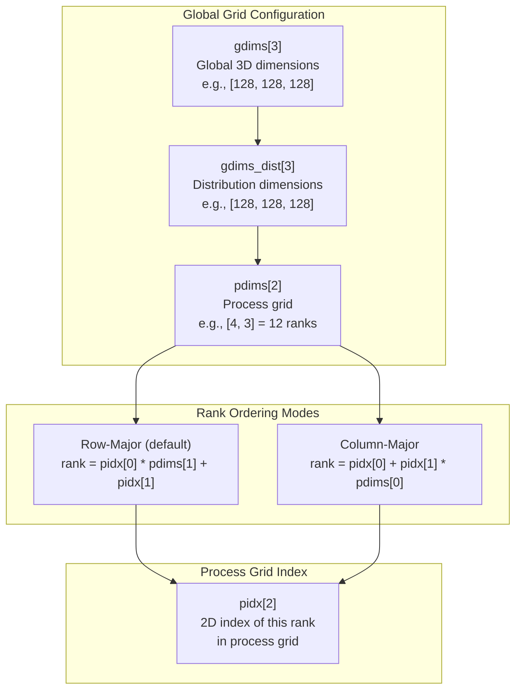
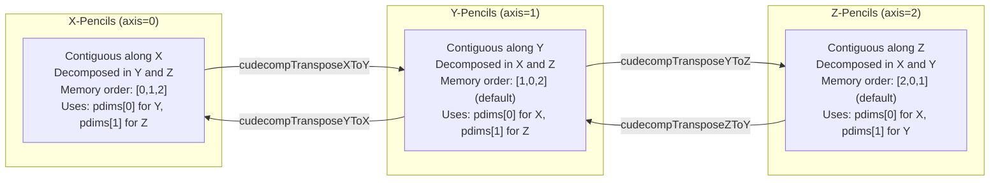
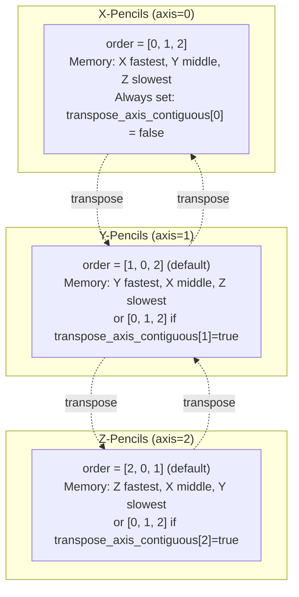
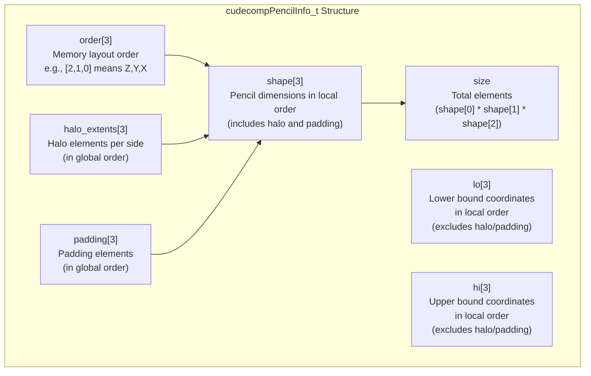
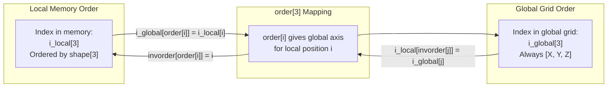
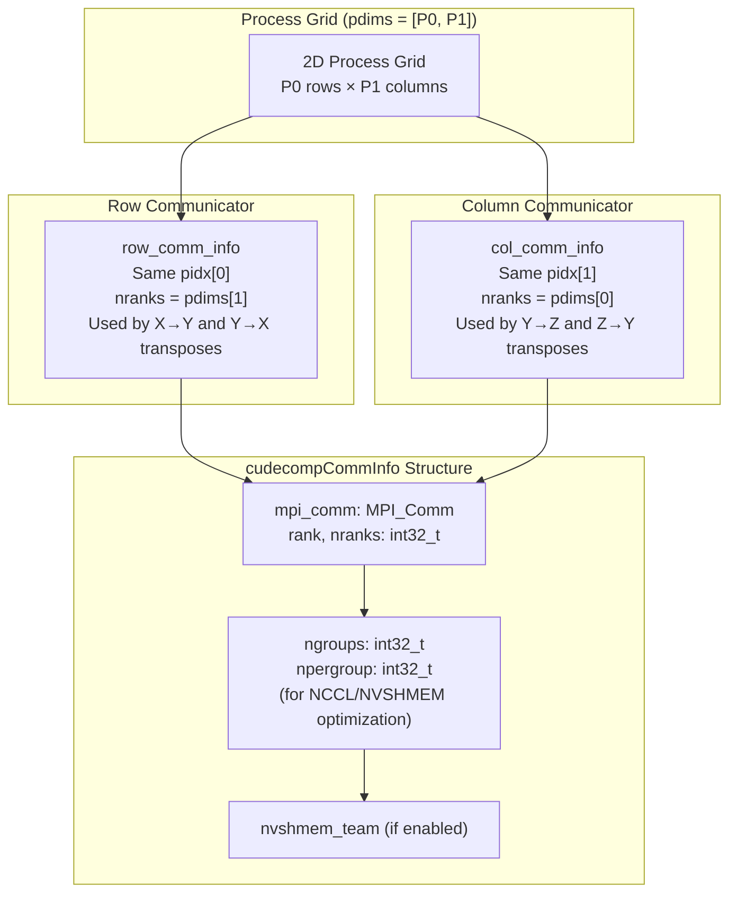

<!-- source: DeepWiki mcp.deepwiki.com · repo NVIDIA/cuDecomp · page 3.2 Data Decomposition and Pencil Orientations · fetched 2026-10-26 -->

# Data Decomposition and Pencil Orientations

<details>
<summary>Relevant source files</summary>

The following files were used as context for generating this wiki page:

- [include/cudecomp.h](include/cudecomp.h)
- [include/internal/common.h](include/internal/common.h)
- [src/cudecomp.cc](src/cudecomp.cc)

</details>


This page explains how cuDecomp decomposes a 3D global data grid across multiple processes using a pencil decomposition strategy. It covers the process grid configuration, pencil orientations, memory layouts, and the data structures used to query decomposition information.

For details on transpose operations that move data between pencil orientations, see [Transpose Operations](#5). For information on halo communication within a pencil orientation, see [Halo Updates](#6).

---

## Process Grid Configuration

cuDecomp uses a 2D process grid to decompose 3D data. The process grid is defined by `pdims[2]` in the `cudecompGridDescConfig_t` structure, specifying the number of processes along two dimensions.

### Grid Dimensions

The decomposition uses three key dimension arrays:

| Array | Purpose | Notes |
|-------|---------|-------|
| `gdims[3]` | Global data grid dimensions | Total size of 3D data |
| `gdims_dist[3]` | Distribution grid dimensions | Subset of global grid used for decomposition; defaults to `gdims` if not set |
| `pdims[2]` | Process grid dimensions | 2D process arrangement; must satisfy `pdims[0] * pdims[1] == nranks` |

The distribution grid (`gdims_dist`) allows decomposing only a portion of the global data, with the remainder assigned to the last process in each dimension. This is useful for handling padding in FFT operations.

Sources: [include/cudecomp.h:113-117](), [src/cudecomp.cc:615-630]()

### Process Grid Layout and Rank Assignment



**Rank Assignment**

Each process is assigned a 2D index `pidx[2]` in the process grid. By default, cuDecomp uses **row-major rank ordering**:

```
pidx[0] = rank / pdims[1]
pidx[1] = rank % pdims[1]
```

Column-major ordering can be enabled via the `CUDECOMP_USE_COL_MAJOR_RANK_ORDER` environment variable, which changes the assignment to:

```
pidx[0] = rank % pdims[0]
pidx[1] = rank / pdims[0]
```

Sources: [src/cudecomp.cc:740-746](), [src/cudecomp.cc:365-367](), [include/internal/common.h:214-226]()

---

## Pencil Decomposition Strategy

cuDecomp decomposes 3D data into **pencils**: elongated sub-domains that are contiguous along one axis and decomposed along the other two. This strategy is particularly effective for algorithms like FFTs and finite-difference stencils.

### Three Pencil Orientations



**Pencil Characteristics by Orientation**

| Orientation | Contiguous Axis | Decomposed Axes | Process Dimensions Used |
|-------------|----------------|-----------------|------------------------|
| X-pencils (axis=0) | X (entire dimension) | Y (pdims[0]), Z (pdims[1]) | Both pdims |
| Y-pencils (axis=1) | Y (entire dimension) | X (pdims[0]), Z (pdims[1]) | Both pdims |
| Z-pencils (axis=2) | Z (entire dimension) | X (pdims[0]), Y (pdims[1]) | Both pdims |

Sources: [src/cudecomp.cc:1004-1047](), [include/cudecomp.h:194-202]()

### Pencil Size Calculation

For a given pencil orientation (axis), each process receives a sub-pencil of the global grid. The size along decomposed dimensions is calculated as:

```
dim_size = gdims_dist[i] / pdims[j]
extra = gdims_dist[i] % pdims[j]

local_size = dim_size + (1 if pidx[j] < extra else 0)
```

If this process is the last in the distribution (i.e., `pidx[j] == min(pdims[j], gdims_dist[i]) - 1`), it also receives any difference between `gdims[i]` and `gdims_dist[i]`.

Sources: [src/cudecomp.cc:1017-1024](), [include/internal/common.h:228-246]()

---

## Memory Layout and Ordering

cuDecomp provides flexible memory ordering for pencil data to optimize different computational patterns.

### Memory Order Configuration

The memory layout for each pencil orientation is controlled by `transpose_mem_order[3][3]` in `cudecompGridDescConfig_t`:
- First index: pencil axis (0=X, 1=Y, 2=Z)
- Second index: memory order position (0=fastest, 1=middle, 2=slowest)

If `transpose_mem_order` is not explicitly set, it is derived from `transpose_axis_contiguous[3]`:

```c
// Default memory order calculation
for (int axis = 0; axis < 3; ++axis) {
  for (int i = 0; i < 3; ++i) {
    if (transpose_axis_contiguous[axis]) {
      config.transpose_mem_order[axis][i] = (axis + i) % 3;
    } else {
      config.transpose_mem_order[axis][i] = i;
    }
  }
}
```

Sources: [src/cudecomp.cc:599-611](), [include/cudecomp.h:122-126]()

### Default Memory Orderings



**Key Points:**
- X-pencils always use order `[0, 1, 2]` (X is always fastest)
- Y and Z-pencils default to non-contiguous axis ordering for better communication patterns
- Setting `transpose_axis_contiguous[axis]=true` makes the pencil axis contiguous in memory

Sources: [src/cudecomp.cc:613](), [src/cudecomp.cc:599-611]()

### Pointer Offset Calculation

Given a pencil and a local index `lx[3]` in global order, the memory offset is:

```c
offset = lx[order[0]] + lx[order[1]] * shape[0] + lx[order[2]] * shape[0] * shape[1]
```

This calculation is provided by the helper function at [include/internal/common.h:249-252]().

Sources: [include/internal/common.h:249-252]()

---

## Pencil Information Structure

The `cudecompPencilInfo_t` structure provides complete geometry information about a pencil.

### cudecompPencilInfo_t Fields



**Field Descriptions**

| Field | Order | Description |
|-------|-------|-------------|
| `shape[3]` | Local | Total dimensions including halos and padding |
| `lo[3]`, `hi[3]` | Local | Data bounds excluding halos and padding |
| `order[3]` | N/A | Mapping from local index to global axis (e.g., `order[0]=2` means fastest dimension is Z) |
| `halo_extents[3]` | Global | Symmetric halo extents per axis |
| `padding[3]` | Global | Padding per axis |
| `size` | N/A | Total elements: `shape[0] * shape[1] * shape[2]` |

Sources: [include/cudecomp.h:194-202]()

### Querying Pencil Information

Use `cudecompGetPencilInfo()` to retrieve pencil geometry:

```c
cudecompResult_t cudecompGetPencilInfo(
    cudecompHandle_t handle,
    cudecompGridDesc_t grid_desc,
    cudecompPencilInfo_t* pencil_info,
    int32_t axis,                    // 0=X, 1=Y, 2=Z
    const int32_t halo_extents[],    // Can be NULL
    const int32_t padding[]          // Can be NULL
);
```

**Example Usage:**

```c
// Get Y-pencil info with halos
int32_t halo_extents[3] = {1, 1, 1};  // 1 element halo on each side
cudecompPencilInfo_t pinfo;
cudecompGetPencilInfo(handle, grid_desc, &pinfo, 1, halo_extents, NULL);

// Access pencil data:
// - pinfo.shape[]: dimensions in local memory order
// - pinfo.order[]: mapping to global coordinates
// - pinfo.lo[], pinfo.hi[]: data bounds (excluding halos)
```

Sources: [include/cudecomp.h:305-307](), [src/cudecomp.cc:994-1054]()

### Converting Between Local and Global Order



Helper functions for order conversions:
- `getShapeG(pinfo)`: Converts shape from local to global order [include/internal/common.h:255-261]()
- `getPencilPtrOffset(pinfo, lx)`: Computes memory offset for global coordinates `lx[3]` [include/internal/common.h:249-252]()

Sources: [include/internal/common.h:249-261](), [src/cudecomp.cc:1004-1010]()

---

## Communicators and Data Movement

Each pencil orientation has associated MPI communicators for data movement between processes.

### Row and Column Communicators



**Communicator Selection by Transpose**

| Transpose Operation | Communicator Used | Communication Pattern |
|---------------------|-------------------|-----------------------|
| `cudecompTransposeXToY` | Column (same pidx[1]) | Redistribute along Y direction |
| `cudecompTransposeYToZ` | Row (same pidx[0]) | Redistribute along Z direction |
| `cudecompTransposeZToY` | Row (same pidx[0]) | Redistribute along Z direction |
| `cudecompTransposeYToX` | Column (same pidx[1]) | Redistribute along Y direction |

Sources: [include/internal/common.h:119-131](), [src/cudecomp.cc:748-757](), [include/internal/common.h:305-355]()

### Group Structure for Communication Optimization

The `setCommInfo()` function analyzes the communicator topology to identify peer-to-peer groups (ranks connected by fast interconnects). This information is stored in `ngroups` and `npergroup`:

- **`ngroups`**: Number of peer-to-peer groups in the communicator
- **`npergroup`**: Number of ranks per group

For systems without MNNVL, groups are based on shared hostnames. For MNNVL systems, groups are based on clique membership. This grouping information is used by communication backends (especially NCCL) to optimize communication patterns.

Sources: [include/internal/common.h:305-355](), [src/cudecomp.cc:193-262]()

---

## Empty Pencil Prevention

cuDecomp validates that the decomposition does not create empty pencils, which would occur if `pdims` exceeds the smallest decomposed dimensions:

```c
// Check performed during grid descriptor creation
if (pdims[0] > min(gdims_dist[0], gdims_dist[1]) ||
    pdims[1] > min(gdims_dist[1], gdims_dist[2])) {
    // Error: decomposition yields empty pencils
}
```

This ensures each process receives at least one element along each decomposed dimension.

Sources: [src/cudecomp.cc:717-721]()

---

## Summary

The pencil decomposition strategy in cuDecomp:

1. **Decomposes 3D data** using a 2D process grid (`pdims[2]`)
2. **Supports three orientations** (X, Y, Z-pencils), each contiguous along a different axis
3. **Uses flexible memory layouts** controlled by `transpose_mem_order[3][3]`
4. **Provides pencil geometry** through `cudecompPencilInfo_t` structure
5. **Organizes processes** into row and column communicators for efficient data movement
6. **Validates decompositions** to prevent empty pencils

This design enables efficient implementation of algorithms requiring different data access patterns, with transpose operations redistributing data between pencil orientations as needed.

Sources: [src/cudecomp.cc:565-822](), [include/cudecomp.h:110-132](), [include/internal/common.h:168-206]()

---

