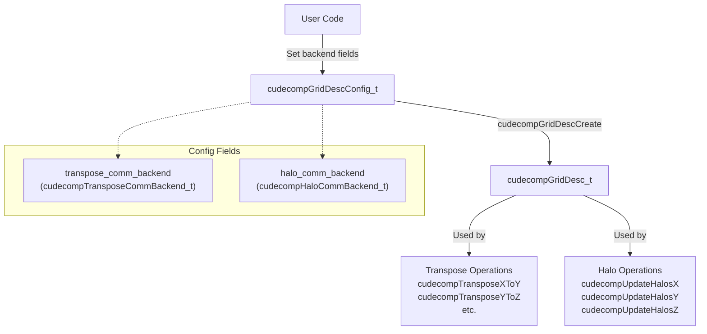
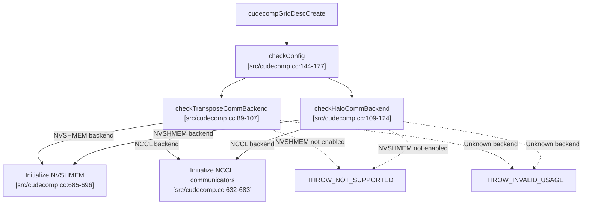
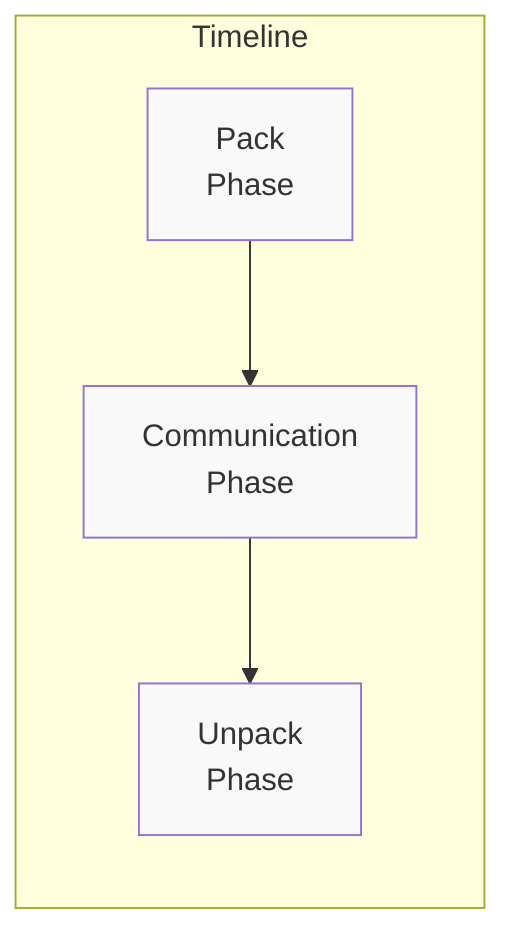
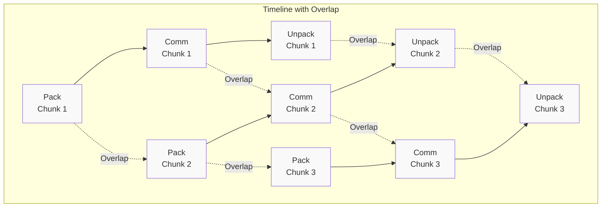
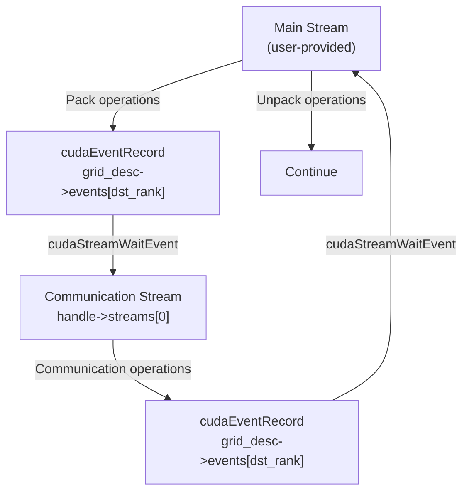
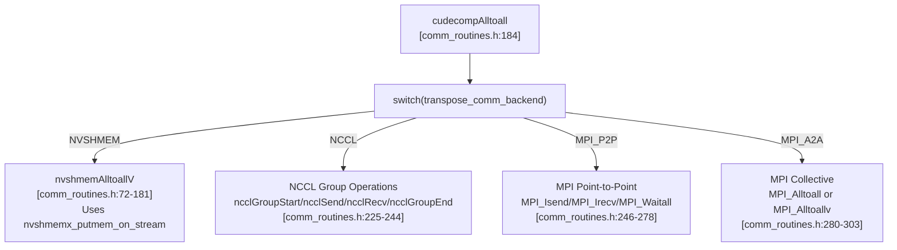
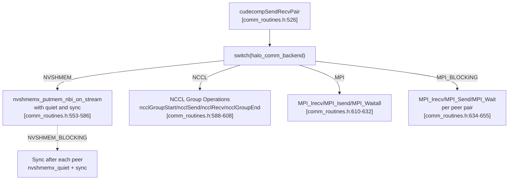

<!-- source: DeepWiki mcp.deepwiki.com · repo NVIDIA/cuDecomp · page 3.3 Communication Backends · fetched 2026-10-26 -->

# Communication Backends

<details>
<summary>Relevant source files</summary>

The following files were used as context for generating this wiki page:

- [include/cudecomp.h](include/cudecomp.h)
- [include/internal/comm_routines.h](include/internal/comm_routines.h)
- [src/cudecomp.cc](src/cudecomp.cc)

</details>


This page provides an overview of the communication backends available in cuDecomp, including MPI, NCCL, and NVSHMEM. It covers when to use each backend, the differences between pipelined and non-pipelined modes, and configuration requirements. For detailed implementation information about each backend, see [Communication Backend Details](#8).

## Overview

cuDecomp supports multiple communication backends to enable optimal performance across different hardware configurations and network topologies. Communication occurs during two types of operations:

1. **Transpose operations** - redistribute data between different pencil orientations (X→Y, Y→Z, Z→Y, Y→X)
2. **Halo operations** - exchange boundary data between neighboring processes for stencil computations

Each operation type can use a different backend, configured independently through the grid descriptor.

**Sources:** [include/cudecomp.h:42-63]()

## Available Backend Options

cuDecomp provides three communication libraries as backend options, each with standard and pipelined variants for transpose operations:

### Transpose Communication Backends

| Backend | Enum Value | Description | Pipelined |
|---------|-----------|-------------|-----------|
| MPI P2P | `CUDECOMP_TRANSPOSE_COMM_MPI_P2P` | Point-to-point using `MPI_Isend`/`MPI_Irecv` | No |
| MPI P2P Pipelined | `CUDECOMP_TRANSPOSE_COMM_MPI_P2P_PL` | Point-to-point with computation-communication overlap | Yes |
| MPI Alltoall | `CUDECOMP_TRANSPOSE_COMM_MPI_A2A` | Collective using `MPI_Alltoall`/`MPI_Alltoallv` | No |
| NCCL | `CUDECOMP_TRANSPOSE_COMM_NCCL` | GPU-native using `ncclSend`/`ncclRecv` | No |
| NCCL Pipelined | `CUDECOMP_TRANSPOSE_COMM_NCCL_PL` | NCCL with computation-communication overlap | Yes |
| NVSHMEM | `CUDECOMP_TRANSPOSE_COMM_NVSHMEM` | Symmetric memory using `nvshmemx_putmem` | No |
| NVSHMEM Pipelined | `CUDECOMP_TRANSPOSE_COMM_NVSHMEM_PL` | NVSHMEM with computation-communication overlap | Yes |

### Halo Communication Backends

| Backend | Enum Value | Description | Blocking |
|---------|-----------|-------------|----------|
| MPI | `CUDECOMP_HALO_COMM_MPI` | Non-blocking point-to-point | No |
| MPI Blocking | `CUDECOMP_HALO_COMM_MPI_BLOCKING` | Blocking point-to-point, one peer at a time | Yes |
| NCCL | `CUDECOMP_HALO_COMM_NCCL` | GPU-native send/recv | No |
| NVSHMEM | `CUDECOMP_HALO_COMM_NVSHMEM` | Non-blocking symmetric memory puts | No |
| NVSHMEM Blocking | `CUDECOMP_HALO_COMM_NVSHMEM_BLOCKING` | Blocking with sync after each peer | Yes |

**Sources:** [include/cudecomp.h:44-63]()

## Backend Selection and Configuration

### Backend Configuration in Grid Descriptor

Communication backends are configured through the `cudecompGridDescConfig_t` structure when creating a grid descriptor:



**Sources:** [include/cudecomp.h:113-132]()

### Default Configuration

The default backends are set by `cudecompGridDescConfigSetDefaults`:

- **Transpose backend**: `CUDECOMP_TRANSPOSE_COMM_MPI_P2P` (MPI point-to-point)
- **Halo backend**: `CUDECOMP_HALO_COMM_MPI` (MPI non-blocking)

**Sources:** [src/cudecomp.cc:932-941]()

### Validation and Initialization

Backend selection is validated during grid descriptor creation:



**Sources:** [src/cudecomp.cc:89-124](), [src/cudecomp.cc:632-696]()

### Automatic Backend Selection (Autotuning)

cuDecomp can automatically select optimal backends through autotuning by setting flags in `cudecompGridDescAutotuneOptions_t`:

- `autotune_transpose_backend` - enable transpose backend autotuning
- `autotune_halo_backend` - enable halo backend autotuning
- `disable_nccl_backends` - exclude NCCL backends from autotuning
- `disable_nvshmem_backends` - exclude NVSHMEM backends from autotuning

When autotuning is enabled, cuDecomp benchmarks different backend configurations and selects the fastest. See [Performance Autotuning](#7) for details.

**Sources:** [include/cudecomp.h:137-189](), [src/cudecomp.cc:576-734]()

## Pipelined vs Non-Pipelined Modes

### Standard (Non-Pipelined) Mode

Standard backends perform communication in a bulk operation:



All data is packed, then all-to-all communication occurs, then all data is unpacked. This is implemented by `cudecompAlltoall` in [include/internal/comm_routines.h:184-316]().

### Pipelined Mode

Pipelined backends overlap communication with computation by processing data in chunks:



Pipelined communication allows packing, communication, and unpacking of different chunks to occur concurrently, potentially reducing overall transpose time. This is implemented by `cudecompAlltoallPipelined` in [include/internal/comm_routines.h:318-524]().

### CUDA Event Synchronization

Pipelined modes use CUDA events to coordinate work between the main stream and internal communication streams:



**Sources:** [include/internal/comm_routines.h:318-524](), [src/cudecomp.cc:698-711]()

### When to Use Pipelined Mode

Pipelined modes are beneficial when:

- Communication time is significant compared to pack/unpack time
- Hardware supports concurrent computation and communication (e.g., separate copy engines)
- Multiple communicating peer groups exist (rows and columns in 2D decomposition)

Pipelined modes add complexity and may have higher overhead for small messages. Autotuning is recommended to determine the best configuration for your workload.

**Sources:** [include/internal/comm_routines.h:318-524]()

## Backend Implementation Dispatch

### Transpose Communication Dispatch

The dispatch logic in `cudecompAlltoall` selects the appropriate implementation based on `config.transpose_comm_backend`:



**Sources:** [include/internal/comm_routines.h:184-316]()

### Halo Communication Dispatch

The dispatch logic in `cudecompSendRecvPair` selects based on `config.halo_comm_backend`:



**Sources:** [include/internal/comm_routines.h:526-667]()

## Backend Comparison and Selection Guidelines

### Performance Characteristics

| Backend | Best Use Case | Requirements | Notes |
|---------|---------------|--------------|-------|
| **MPI P2P** | Default, widely compatible | Standard MPI | Works everywhere, moderate performance |
| **MPI P2P Pipelined** | Overlapping communication | Standard MPI | Better than standard for large messages |
| **MPI Alltoall** | Balanced, regular communication | Standard MPI | May leverage MPI optimizations |
| **NCCL** | GPU-direct, InfiniBand, NVLink | NCCL library | Excellent for GPU-connected systems |
| **NCCL Pipelined** | GPU-direct with overlap | NCCL library | Best for multi-stage transposes |
| **NVSHMEM** | Multi-GPU, MNNVL, symmetric memory | NVSHMEM, symmetric heap | Lowest latency for direct memory access |
| **NVSHMEM Pipelined** | MNNVL with overlap | NVSHMEM, symmetric heap | Optimal for NVLink-connected multi-node |

**Sources:** [include/cudecomp.h:42-63]()

### Backend Requirements

#### NVSHMEM Requirements

NVSHMEM backends require:

1. **Symmetric memory allocation**: All work buffers must be allocated via `cudecompMalloc`, which uses `nvshmem_malloc` internally when NVSHMEM backends are configured
2. **Symmetric heap sizing**: Set `NVSHMEM_SYMMETRIC_SIZE` environment variable appropriately (default: 1 GiB)
3. **Build-time support**: cuDecomp must be compiled with `-DENABLE_NVSHMEM=ON`

The symmetric allocation requirement is enforced at runtime:

```c++
// From comm_routines.h:214-220
if (nvshmem_ptr(send_buff, handle->rank) && nvshmem_ptr(recv_buff, handle->rank)) {
  nvshmemAlltoallV(handle, grid_desc, send_buff, ...);
} else {
  THROW_INVALID_USAGE("NVSHMEM communication backends require workspace allocated via cudecompMalloc.");
}
```

**Sources:** [include/internal/comm_routines.h:214-220](), [src/cudecomp.cc:1131-1161](), [src/cudecomp.cc:369-403]()

#### NCCL Requirements

NCCL backends require:

1. **NCCL communicator initialization**: Automatically handled during grid descriptor creation
2. **Optional User Buffer Registration (UBR)**: Enable with `CUDECOMP_ENABLE_NCCL_UBR=1` for better performance
3. **Local vs global communicators**: cuDecomp creates separate communicators for intra-node and inter-node communication

NCCL communicators are initialized lazily when needed:

```c++
// From cudecomp.cc:632-683
if (transposeBackendRequiresNccl(comm_backend) || haloBackendRequiresNccl(halo_comm_backend)) {
  if (!handle->nccl_comm) { 
    handle->nccl_comm = ncclCommFromMPIComm(handle->mpi_comm); 
  }
  if (!handle->nccl_local_comm) {
    // Create local communicator for intra-node optimization
    handle->nccl_local_comm = ncclCommFromMPIComm(handle->mpi_clique_comm);
  }
}
```

**Sources:** [src/cudecomp.cc:632-683](), [src/cudecomp.cc:1203-1219]()

#### MPI Considerations

MPI backends:

1. **Managed memory compatibility**: Some MPI implementations may have issues with CUDA managed memory
2. **GPU-awareness**: Performance varies based on MPI GPU-awareness support
3. **Stream synchronization**: MPI P2P backends call `cudaStreamSynchronize` before communication

**Warning about mixed buffer types:**

When NVSHMEM-allocated buffers are used with MPI backends, cuDecomp issues a warning:

```c++
// From comm_routines.h:199-207
if (handle->nvshmem_initialized && transposeBackendRequiresMpi(...) &&
    (nvshmem_ptr(send_buff, ...) || nvshmem_ptr(recv_buff, ...))) {
  printf("CUDECOMP:WARN: A work buffer allocated with nvshmem_malloc is being used with "
         "an MPI communication backend. This may cause issues with some MPI implementations.");
}
```

**Sources:** [include/internal/comm_routines.h:199-207](), [include/internal/comm_routines.h:248]()

## Backend Feature Matrix

The following table summarizes which features are supported by each backend:

| Feature | MPI P2P | MPI A2A | NCCL | NVSHMEM |
|---------|---------|---------|------|---------|
| Pipelining | ✓ | ✗ | ✓ | ✓ |
| Asynchronous | ✓ | ✗ | ✓ | ✓ |
| GPU-Direct | Varies | Varies | ✓ | ✓ |
| Symmetric Memory Required | ✗ | ✗ | ✗ | ✓ |
| Build Dependency | Always | Always | Always | Optional |
| Halo Blocking Mode | ✓ | N/A | ✗ | ✓ |

**Sources:** [include/cudecomp.h:44-63](), [include/internal/comm_routines.h:184-667]()

---

