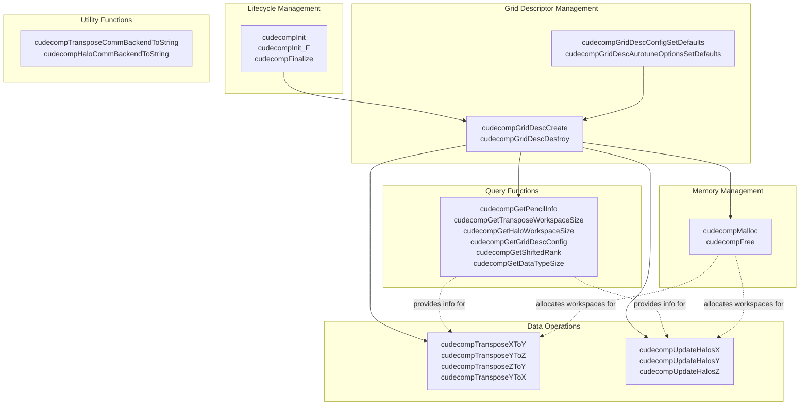
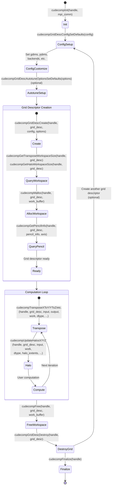

<!-- source: DeepWiki mcp.deepwiki.com · repo NVIDIA/cuDecomp · page 4 API Reference · fetched 2026-10-26 -->

# API Reference

Relevant source files

The following files were used as context for generating this wiki page:

- [include/cudecomp.h](include/cudecomp.h)
- [src/cudecomp.cc](src/cudecomp.cc)

This section provides a comprehensive reference for all public API functions, data types, and enumerations in the cuDecomp library. All declarations are defined in [include/cudecomp.h:1-632]().

For detailed documentation of specific API categories, see:
- Initialization and finalization functions: [#4.1](#4.1)
- Grid configuration and creation: [#4.2](#4.2)
- Transpose operations: [#4.3](#4.3)
- Halo update operations: [#4.4](#4.4)
- Memory management: [#4.5](#4.5)
- Fortran bindings: [#4.6](#4.6)

## API Organization

The cuDecomp public API is organized into the following functional categories:

**Sources:** [include/cudecomp.h:204-626]()

## Core Data Types

### Opaque Handles

| Type | Description | Defined |
|------|-------------|---------|
| `cudecompHandle_t` | Pointer to internal library handle structure. Created by `cudecompInit`, destroyed by `cudecompFinalize`. Manages global library state including MPI communicators, CUDA resources, NCCL/NVSHMEM state. | [include/cudecomp.h:103]() |
| `cudecompGridDesc_t` | Pointer to internal grid descriptor structure. Created by `cudecompGridDescCreate`, destroyed by `cudecompGridDescDestroy`. Encapsulates process grid configuration, communication backends, and decomposition information. | [include/cudecomp.h:108]() |

**Sources:** [include/cudecomp.h:103-108](), [src/cudecomp.cc:416-511]()

### Configuration Structures

#### cudecompGridDescConfig_t

Configuration structure for grid descriptor creation. Contains all parameters that define how a 3D grid is decomposed.

| Field | Type | Description |
|-------|------|-------------|
| `gdims[3]` | `int32_t` | Global grid dimensions (X, Y, Z) |
| `gdims_dist[3]` | `int32_t` | Grid dimensions used for distribution. If unset (all zeros), defaults to `gdims`. Allows creating grids smaller than the full domain. |
| `pdims[2]` | `int32_t` | Process grid dimensions. If set to `[0, 0]`, autotuning selects optimal values. Product must equal MPI communicator size. |
| `transpose_comm_backend` | `cudecompTransposeCommBackend_t` | Communication backend for transpose operations |
| `transpose_axis_contiguous[3]` | `bool` | Flag per axis indicating if memory should be contiguous along pencil axis |
| `transpose_mem_order[3][3]` | `int32_t` | Explicit memory ordering per axis. Overrides `transpose_axis_contiguous`. Default: unset (all `-1`) |
| `halo_comm_backend` | `cudecompHaloCommBackend_t` | Communication backend for halo operations |

**Default initialization:** [include/cudecomp.h:264-272](), [src/cudecomp.cc:917-948]()

**Sources:** [include/cudecomp.h:113-132]()

#### cudecompGridDescAutotuneOptions_t

Configuration structure controlling autotuning behavior during grid descriptor creation.

| Field | Type | Description |
|-------|------|-------------|
| `n_warmup_trials` | `int32_t` | Number of warmup trials per configuration (default: 3) |
| `n_trials` | `int32_t` | Number of timed trials per configuration (default: 5) |
| `grid_mode` | `cudecompAutotuneGridMode_t` | Use transpose or halo communication for grid autotuning |
| `dtype` | `cudecompDataType_t` | Data type for autotuning benchmarks (default: `CUDECOMP_DOUBLE`) |
| `allow_uneven_decompositions` | `bool` | Allow process grids with uneven element distribution (default: true) |
| `disable_nccl_backends` | `bool` | Skip NCCL backends during autotuning (default: false) |
| `disable_nvshmem_backends` | `bool` | Skip NVSHMEM backends during autotuning (default: false) |
| `skip_threshold` | `double` | Skip slow configurations: skip if `skip_threshold * t > t_best` (default: 0.0, disabled) |
| `autotune_transpose_backend` | `bool` | Enable transpose backend autotuning (default: false) |
| `transpose_use_inplace_buffers[4]` | `bool` | Use in-place buffers per transpose operation during autotuning |
| `transpose_op_weights[4]` | `double` | Weight per transpose operation (X→Y, Y→Z, Z→Y, Y→X) in cost calculation |
| `transpose_input_halo_extents[4][3]` | `int32_t` | Input halo extents per transpose operation for autotuning |
| `transpose_output_halo_extents[4][3]` | `int32_t` | Output halo extents per transpose operation for autotuning |
| `transpose_input_padding[4][3]` | `int32_t` | Input padding per transpose operation for autotuning |
| `transpose_output_padding[4][3]` | `int32_t` | Output padding per transpose operation for autotuning |
| `autotune_halo_backend` | `bool` | Enable halo backend autotuning (default: false) |
| `halo_extents[3]` | `int32_t` | Halo extents for autotuning |
| `halo_periods[3]` | `bool` | Periodicity per dimension for halo autotuning |
| `halo_axis` | `int32_t` | Pencil axis for halo autotuning (default: 0, X-pencils) |
| `halo_padding[3]` | `int32_t` | Padding for halo autotuning |

**Default initialization:** [include/cudecomp.h:275-283](), [src/cudecomp.cc:950-992]()

**Sources:** [include/cudecomp.h:137-189]()

#### cudecompPencilInfo_t

Structure containing geometry and layout information for a pencil decomposition. Returned by `cudecompGetPencilInfo`.

| Field | Type | Description |
|-------|------|-------------|
| `shape[3]` | `int32_t` | Pencil shape in local memory order (includes halo and padding) |
| `lo[3]` | `int32_t` | Lower bound coordinates in local order (excludes halo and padding) |
| `hi[3]` | `int32_t` | Upper bound coordinates in local order (excludes halo and padding) |
| `order[3]` | `int32_t` | Memory layout order. Example: `[2,1,0]` means Z-fastest, then Y, then X |
| `halo_extents[3]` | `int32_t` | Halo extents per dimension in global order |
| `padding[3]` | `int32_t` | Padding per dimension in global order |
| `size` | `int64_t` | Total number of elements (includes halo and padding) |

**Populated by:** [src/cudecomp.cc:994-1054]()

**Sources:** [include/cudecomp.h:194-202]()

## Enumerations

### cudecompResult_t

Return codes indicating success or failure type for API functions.

| Value | Name | Description |
|-------|------|-------------|
| `0` | `CUDECOMP_RESULT_SUCCESS` | Operation completed successfully |
| `1` | `CUDECOMP_RESULT_INVALID_USAGE` | Invalid argument or user error |
| `2` | `CUDECOMP_RESULT_NOT_SUPPORTED` | Unsupported operation or configuration |
| `3` | `CUDECOMP_RESULT_INTERNAL_ERROR` | Internal library error (should be reported) |
| `4` | `CUDECOMP_RESULT_CUDA_ERROR` | CUDA Runtime error occurred |
| `5` | `CUDECOMP_RESULT_CUTENSOR_ERROR` | cuTENSOR library error occurred |
| `6` | `CUDECOMP_RESULT_MPI_ERROR` | MPI library error occurred |
| `7` | `CUDECOMP_RESULT_NCCL_ERROR` | NCCL library error occurred |
| `8` | `CUDECOMP_RESULT_NVSHMEM_ERROR` | NVSHMEM library error occurred |
| `9` | `CUDECOMP_RESULT_NVML_ERROR` | NVML library error occurred |

**Sources:** [include/cudecomp.h:87-98]()

### cudecompTransposeCommBackend_t

Communication backend options for transpose operations.

| Value | Name | Description | Pipelined |
|-------|------|-------------|-----------|
| `1` | `CUDECOMP_TRANSPOSE_COMM_MPI_P2P` | MPI peer-to-peer using `MPI_Isend`/`MPI_Irecv` | No |
| `2` | `CUDECOMP_TRANSPOSE_COMM_MPI_P2P_PL` | MPI peer-to-peer with pipelining | Yes |
| `3` | `CUDECOMP_TRANSPOSE_COMM_MPI_A2A` | MPI using `MPI_Alltoallv` | No |
| `4` | `CUDECOMP_TRANSPOSE_COMM_NCCL` | NCCL group send/recv | No |
| `5` | `CUDECOMP_TRANSPOSE_COMM_NCCL_PL` | NCCL with pipelining | Yes |
| `6` | `CUDECOMP_TRANSPOSE_COMM_NVSHMEM` | NVSHMEM symmetric memory operations | No |
| `7` | `CUDECOMP_TRANSPOSE_COMM_NVSHMEM_PL` | NVSHMEM with pipelining | Yes |

**String conversion:** [src/cudecomp.cc:1288-1299]()

**Backend validation:** [src/cudecomp.cc:89-107]()

**Sources:** [include/cudecomp.h:44-52]()

### cudecompHaloCommBackend_t

Communication backend options for halo update operations.

| Value | Name | Description | Blocking |
|-------|------|-------------|----------|
| `1` | `CUDECOMP_HALO_COMM_MPI` | MPI non-blocking send/recv | No |
| `2` | `CUDECOMP_HALO_COMM_MPI_BLOCKING` | MPI with blocking between peer transfers | Yes |
| `3` | `CUDECOMP_HALO_COMM_NCCL` | NCCL group send/recv | No |
| `4` | `CUDECOMP_HALO_COMM_NVSHMEM` | NVSHMEM symmetric memory operations | No |
| `5` | `CUDECOMP_HALO_COMM_NVSHMEM_BLOCKING` | NVSHMEM with blocking between peer transfers | Yes |

**String conversion:** [src/cudecomp.cc:1301-1310]()

**Backend validation:** [src/cudecomp.cc:109-124]()

**Sources:** [include/cudecomp.h:57-63]()

### cudecompDataType_t

Supported data types for transpose and halo operations.

| Value | Name | Size (bytes) | Description |
|-------|------|--------------|-------------|
| `-1` | `CUDECOMP_FLOAT` | 4 | Single-precision real |
| `-2` | `CUDECOMP_DOUBLE` | 8 | Double-precision real |
| `-3` | `CUDECOMP_FLOAT_COMPLEX` | 8 | Single-precision complex (interleaved) |
| `-4` | `CUDECOMP_DOUBLE_COMPLEX` | 16 | Double-precision complex (interleaved) |

**Size query:** [src/cudecomp.cc:1312-1329]()

**Type validation:** [src/cudecomp.cc:126-134]()

**Sources:** [include/cudecomp.h:68-73]()

### cudecompAutotuneGridMode_t

Mode selection for process grid autotuning.

| Value | Name | Description |
|-------|------|-------------|
| `0` | `CUDECOMP_AUTOTUNE_GRID_TRANSPOSE` | Use transpose communication patterns for grid autotuning |
| `1` | `CUDECOMP_AUTOTUNE_GRID_HALO` | Use halo communication patterns for grid autotuning |

**Sources:** [include/cudecomp.h:78-81]()

## Typical API Usage Flow

The following diagram illustrates the typical sequence of API calls for a cuDecomp application:

**Sources:** [src/cudecomp.cc:409-511](), [src/cudecomp.cc:565-822](), [src/cudecomp.cc:1131-1286]()

## Function Categories Overview

### Initialization and Finalization

Functions for initializing and finalizing the cuDecomp library handle. These manage global library state including MPI communicators, CUDA resources, NVML, cuTENSOR, and optional NCCL/NVSHMEM initialization.

| Function | Description |
|----------|-------------|
| `cudecompInit` | Initialize library from C MPI communicator |
| `cudecompInit_F` | Initialize library from Fortran MPI communicator |
| `cudecompFinalize` | Finalize library and free all associated resources |

**Detailed documentation:** [#4.1](#4.1)

**Sources:** [include/cudecomp.h:205-232](), [src/cudecomp.cc:409-551]()

### Grid Descriptor Management

Functions for creating, configuring, and destroying grid descriptors. Grid descriptors encapsulate all decomposition information and are required for transpose and halo operations.

| Function | Description |
|----------|-------------|
| `cudecompGridDescConfigSetDefaults` | Initialize config structure with default values |
| `cudecompGridDescAutotuneOptionsSetDefaults` | Initialize autotune options structure with default values |
| `cudecompGridDescCreate` | Create grid descriptor with optional autotuning |
| `cudecompGridDescDestroy` | Destroy grid descriptor and free resources |

**Detailed documentation:** [#4.2](#4.2)

**Sources:** [include/cudecomp.h:235-283](), [src/cudecomp.cc:565-822](), [src/cudecomp.cc:824-915]()

### Query Functions

Functions for querying decomposition information, workspace requirements, and grid configuration.

| Function | Description |
|----------|-------------|
| `cudecompGetPencilInfo` | Get geometry and layout information for a pencil |
| `cudecompGetTransposeWorkspaceSize` | Query transpose workspace size in elements |
| `cudecompGetHaloWorkspaceSize` | Query halo workspace size in elements |
| `cudecompGetGridDescConfig` | Retrieve config used to create grid descriptor |
| `cudecompGetShiftedRank` | Get global rank of neighboring process |
| `cudecompGetDataTypeSize` | Get size in bytes of a data type |

**Sources:** [include/cudecomp.h:286-428](), [src/cudecomp.cc:994-1374]()

### Memory Management

Backend-aware allocation and deallocation functions for cuDecomp workspaces. These handle NVSHMEM symmetric memory requirements, CUDA VMM fabric allocations, and NCCL User Buffer Registration.

| Function | Description |
|----------|-------------|
| `cudecompMalloc` | Allocate workspace with backend-specific requirements |
| `cudecompFree` | Free workspace allocated with cudecompMalloc |

**Detailed documentation:** [#4.5](#4.5)

**Sources:** [include/cudecomp.h:342-381](), [src/cudecomp.cc:1131-1286]()

### Transpose Operations

Functions for performing transpose communication between different pencil orientations. All functions support in-place operation, halos, and padding.

| Function | Input Orientation | Output Orientation | Communicator |
|----------|-------------------|-------------------|--------------|
| `cudecompTransposeXToY` | X-pencils | Y-pencils | Column |
| `cudecompTransposeYToZ` | Y-pencils | Z-pencils | Row |
| `cudecompTransposeZToY` | Z-pencils | Y-pencils | Row |
| `cudecompTransposeYToX` | Y-pencils | X-pencils | Column |

**Detailed documentation:** [#4.3](#4.3)

**Sources:** [include/cudecomp.h:430-545](), [src/cudecomp.cc:1376-1546]()

### Halo Update Operations

Functions for exchanging halo regions between neighboring processes. Support periodic and non-periodic boundary conditions.

| Function | Pencil Orientation |
|----------|-------------------|
| `cudecompUpdateHalosX` | X-pencils |
| `cudecompUpdateHalosY` | Y-pencils |
| `cudecompUpdateHalosZ` | Z-pencils |

**Detailed documentation:** [#4.4](#4.4)

**Sources:** [include/cudecomp.h:547-625](), [src/cudecomp.cc:1548-1684]()

### Utility Functions

Convenience functions for converting enumerations to strings and other helper operations.

| Function | Description |
|----------|-------------|
| `cudecompTransposeCommBackendToString` | Convert transpose backend enum to string |
| `cudecompHaloCommBackendToString` | Convert halo backend enum to string |

**Sources:** [include/cudecomp.h:384-411](), [src/cudecomp.cc:1288-1310]()

## API Function Relationship Map

This diagram shows how API functions relate to core data structures and typical data flow:

```mermaid
graph TB
    subgraph "Opaque Handles"
        HANDLE["cudecompHandle_t<br/>(struct cudecompHandle)"]
        GRIDDESC["cudecompGridDesc_t<br/>(struct cudecompGridDesc)"]
    end
    
    subgraph "Configuration"
        CONFIG["cudecompGridDescConfig_t"]
        AUTOTUNE["cudecompGridDescAutotuneOptions_t"]
        PENCILINFO["cudecompPencilInfo_t"]
    end
    
    subgraph "Lifecycle Functions"
        INIT["cudecompInit/<br/>cudecompInit_F"]
        FINALIZE["cudecompFinalize"]
    end
    
    subgraph "Grid Functions"
        CONFIGDEFAULTS["cudecompGridDescConfigSetDefaults"]
        AUTOTUNEDEFAULTS["cudecompGridDescAutotuneOptionsSetDefaults"]
        CREATEGRIDDESC["cudecompGridDescCreate"]
        DESTROYGRIDDESC["cudecompGridDescDestroy"]
    end
    
    subgraph "Query Functions"
        GETPENCIL["cudecompGetPencilInfo"]
        GETTRANSWS["cudecompGetTransposeWorkspaceSize"]
        GETHALOWS["cudecompGetHaloWorkspaceSize"]
        GETCONFIG["cudecompGetGridDescConfig"]
        GETSHIFTED["cudecompGetShiftedRank"]
        GETDTSIZE["cudecompGetDataTypeSize"]
    end
    
    subgraph "Memory Functions"
        MALLOC["cudecompMalloc"]
        FREE["cudecompFree"]
    end
    
    subgraph "Operation Functions"
        TRANSPOSE["cudecompTransposeXToY<br/>cudecompTransposeYToZ<br/>cudecompTransposeZToY<br/>cudecompTransposeYToX"]
        HALO["cudecompUpdateHalosX<br/>cudecompUpdateHalosY<br/>cudecompUpdateHalosZ"]
    end
    
    INIT -->|creates| HANDLE
    HANDLE -->|used by| CREATEGRIDDESC
    CONFIG -->|input to| CREATEGRIDDESC
    AUTOTUNE -->|optional input to| CREATEGRIDDESC
    CONFIGDEFAULTS -->|initializes| CONFIG
    AUTOTUNEDEFAULTS -->|initializes| AUTOTUNE
    
    CREATEGRIDDESC -->|creates| GRIDDESC
    GRIDDESC -->|input to| GETPENCIL
    GRIDDESC -->|input to| GETTRANSWS
    GRIDDESC -->|input to| GETHALOWS
    GRIDDESC -->|input to| GETCONFIG
    GRIDDESC -->|input to| GETSHIFTED
    GRIDDESC -->|input to| MALLOC
    GRIDDESC -->|input to| FREE
    GRIDDESC -->|input to| TRANSPOSE
    GRIDDESC -->|input to| HALO
    GRIDDESC -->|input to| DESTROYGRIDDESC
    
    GETPENCIL -->|populates| PENCILINFO
    GETCONFIG -->|returns| CONFIG
    
    HANDLE -->|input to| FINALIZE
    HANDLE -->|input to| DESTROYGRIDDESC
    
    FINALIZE -->|destroys| HANDLE
    DESTROYGRIDDESC -->|destroys| GRIDDESC
```

**Sources:** [include/cudecomp.h:103-626](), [src/cudecomp.cc:409-1684]()

## Implementation Notes

### Error Handling

All API functions return `cudecompResult_t`. Success is indicated by `CUDECOMP_RESULT_SUCCESS`. On error, functions print diagnostic information to stderr and return an appropriate error code. Exception handling is used internally but all exceptions are caught at the API boundary and converted to result codes.

**Error handling implementation:** [src/cudecomp.cc:505-510](), [src/cudecomp.cc:816-820]()

### Thread Safety

The cuDecomp API is not thread-safe. All API functions must be called from the same thread that called `cudecompInit`. Multiple grid descriptors can exist simultaneously under a single handle, but concurrent operations on the same grid descriptor are not supported.

### MPI Collectives

Several functions are collective and must be called by all ranks in the MPI communicator:
- `cudecompInit` / `cudecompFinalize`
- `cudecompGridDescCreate` (when autotuning is enabled)
- `cudecompMalloc` / `cudecompFree` (when NVSHMEM backends are used)

**Sources:** [src/cudecomp.cc:409-511](), [src/cudecomp.cc:1131-1227]()

### Handle Lifetime

Only one `cudecompHandle_t` instance is supported per process. Multiple calls to `cudecompInit` will result in an error. Multiple grid descriptors can be created and destroyed under a single handle.

**Initialization check:** [src/cudecomp.cc:413-415](), [src/cudecomp.cc:51](), [src/cudecomp.cc:501](), [src/cudecomp.cc:544]()

**Sources:** [src/cudecomp.cc:409-551]()

---

