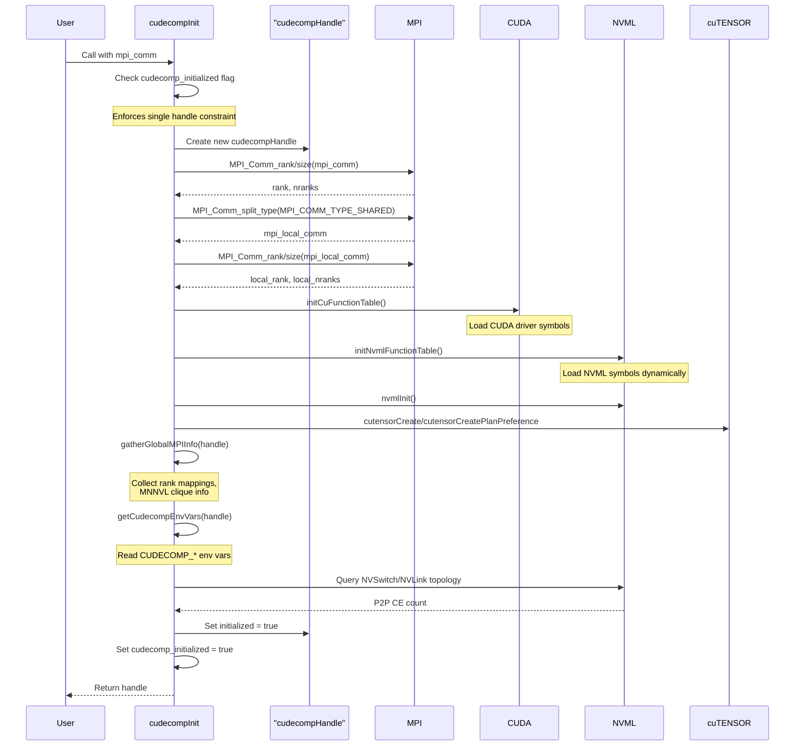
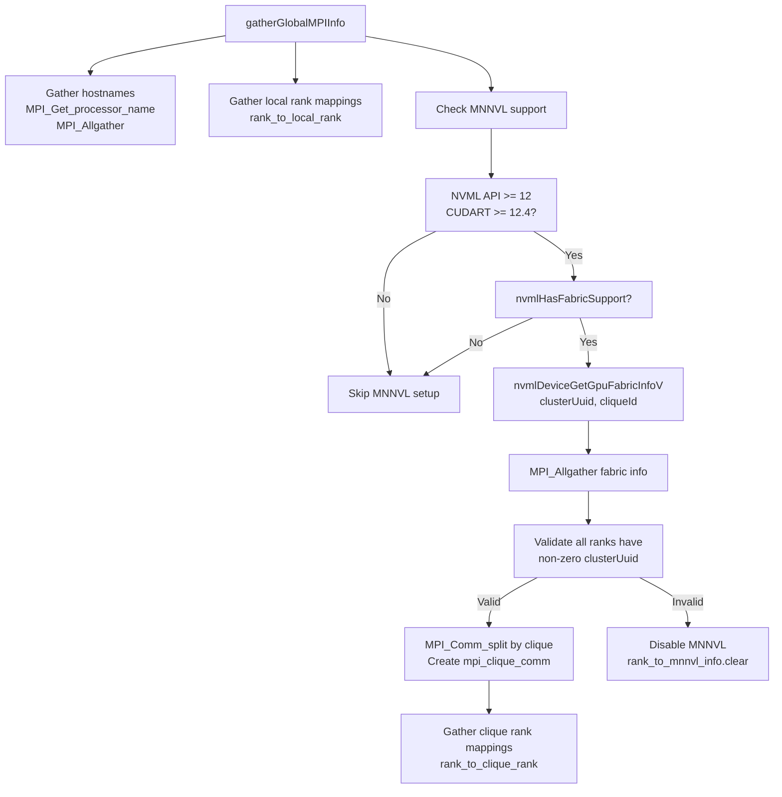
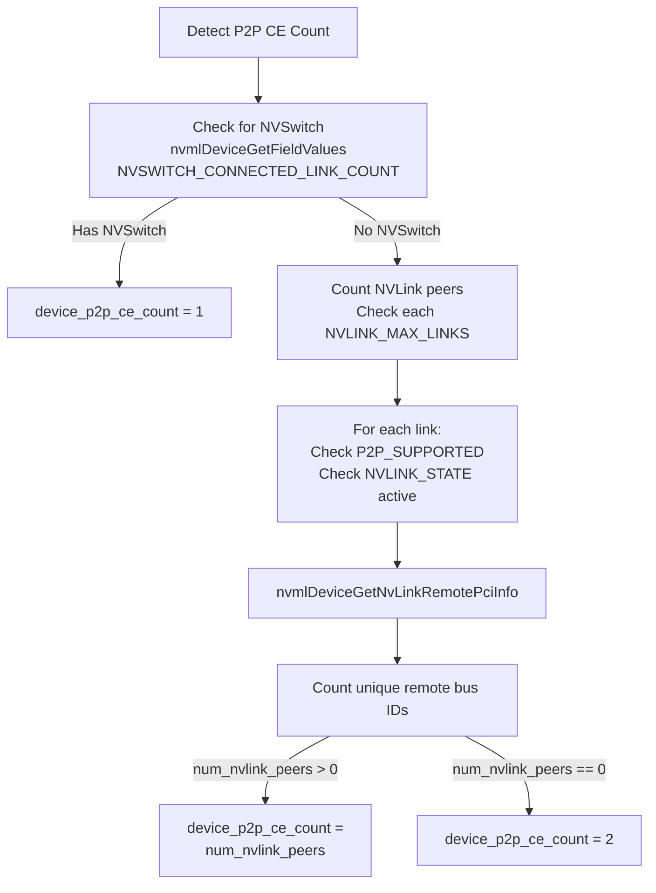
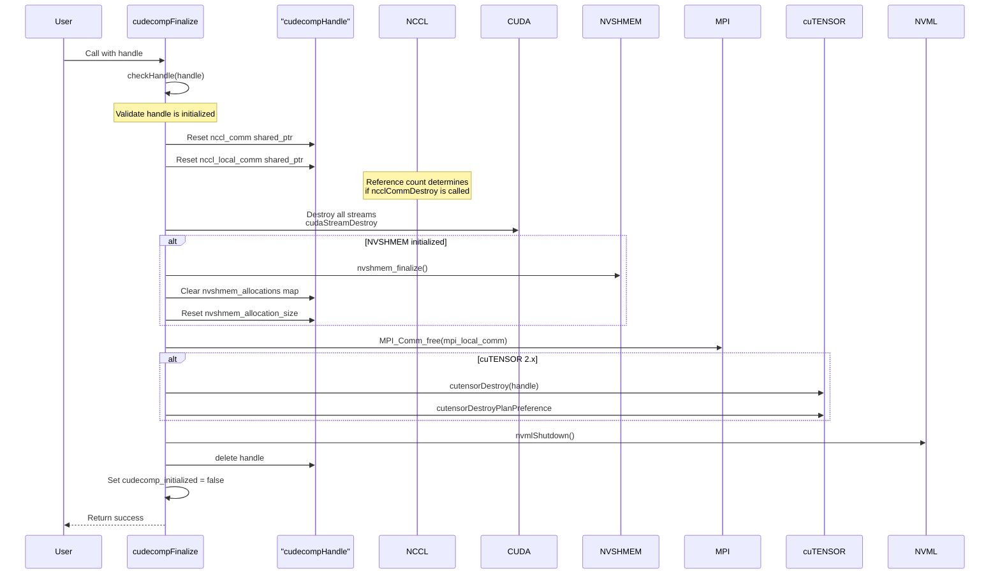
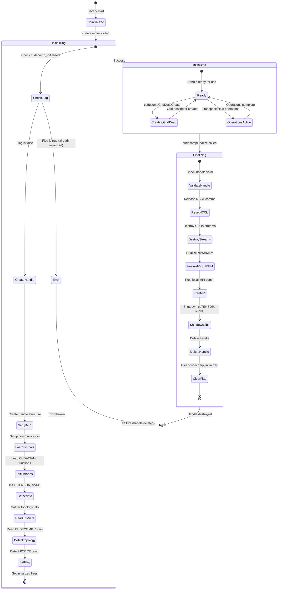
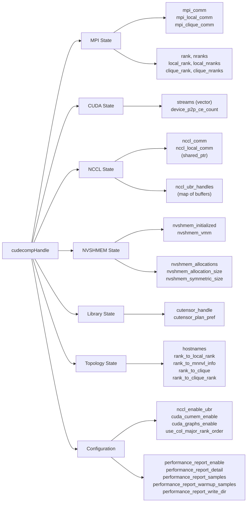

<!-- source: DeepWiki mcp.deepwiki.com · repo NVIDIA/cuDecomp · page 4.1 Initialization and Finalization · fetched 2026-10-26 -->

# Initialization and Finalization

<details>
<summary>Relevant source files</summary>

The following files were used as context for generating this wiki page:

- [include/cudecomp.h](include/cudecomp.h)
- [src/cudecomp.cc](src/cudecomp.cc)

</details>


This page documents the functions and mechanisms for initializing and finalizing the cuDecomp library. Initialization must be performed before any other cuDecomp operations, and finalization should be called to properly clean up resources when the library is no longer needed.

For information about creating and configuring grid descriptors after initialization, see [Grid Configuration and Creation](#4.2). For details about the internal handle structure, see [Core Data Structures](#14.1).

## Overview

The cuDecomp library uses a handle-based initialization model where a single `cudecompHandle_t` instance manages the library's global state and resources. The library supports only **one active handle per process** and enforces this constraint with a static initialization flag.

The initialization and finalization functions are:
- `cudecompInit`: Initializes the library and creates a handle
- `cudecompInit_F`: Fortran wrapper for initialization
- `cudecompFinalize`: Cleans up resources and destroys the handle

## Initialization Function

### cudecompInit

```c
cudecompResult_t cudecompInit(cudecompHandle_t* handle, MPI_Comm mpi_comm);
```

**Purpose**: Initializes the cuDecomp library from an existing MPI communicator.

**Parameters**:
- `handle`: Pointer to an uninitialized `cudecompHandle_t` that will be populated
- `mpi_comm`: MPI communicator containing the ranks that will use cuDecomp

**Return Value**: `CUDECOMP_RESULT_SUCCESS` on success, error code on failure.

**Thread Safety**: Not thread-safe. Should only be called once per process.

Sources: [include/cudecomp.h:213](), [src/cudecomp.cc:409-511]()

### Initialization Sequence

The following diagram shows the complete initialization sequence performed by `cudecompInit`:



Sources: [src/cudecomp.cc:409-511]()

### Initialization Stages

#### 1. Single Handle Enforcement

The library maintains a static flag `cudecomp_initialized` [src/cudecomp.cc:51]() to prevent multiple handle creation:

```c
static bool cudecomp_initialized = false;
```

If `cudecompInit` is called when this flag is already `true`, it throws an error indicating multiple handles are not supported [src/cudecomp.cc:413-415]().

Sources: [src/cudecomp.cc:50-51](), [src/cudecomp.cc:413-415]()

#### 2. MPI Communicator Setup

The initialization creates three MPI communicators stored in the handle:

| Communicator | Purpose | Creation Method |
|--------------|---------|----------------|
| `mpi_comm` | Global communicator for all ranks | Passed as argument |
| `mpi_local_comm` | Node-local ranks (shared memory domain) | `MPI_Comm_split_type` with `MPI_COMM_TYPE_SHARED` |
| `mpi_clique_comm` | MNNVL clique ranks (NVLink domain) | Created later if MNNVL support detected |

The handle stores rank and size information for both global and local communicators [src/cudecomp.cc:418-423]().

Sources: [src/cudecomp.cc:417-423]()

#### 3. CUDA and NVML Initialization

The library dynamically loads function symbols for CUDA driver API and NVML to avoid hard dependencies:

- **CUDA Driver**: `initCuFunctionTable()` [src/cudecomp.cc:426]() loads CUDA driver API functions needed for memory management
- **NVML**: `initNvmlFunctionTable()` [src/cudecomp.cc:429]() loads NVML functions for GPU topology detection
- **NVML Init**: `nvmlInit()` [src/cudecomp.cc:431]() initializes the NVML library

Sources: [src/cudecomp.cc:425-431]()

#### 4. cuTENSOR Initialization

The library initializes a `cutensorHandle_t` for use in transpose operations. The initialization differs based on cuTENSOR version:

- **cuTENSOR 2.x**: Creates handle and plan preference [src/cudecomp.cc:435-437]()
- **cuTENSOR 1.x**: Only creates handle [src/cudecomp.cc:439]()

Sources: [src/cudecomp.cc:433-440]()

#### 5. Global MPI Information Gathering

The `gatherGlobalMPIInfo` function [src/cudecomp.cc:179-262]() collects topology information across all ranks:



**Gathered Information**:
- `hostnames`: Hostname for each global rank [src/cudecomp.cc:180-185]()
- `rank_to_local_rank`: Local rank mapping for each global rank [src/cudecomp.cc:187-191]()
- `rank_to_mnnvl_info`: MNNVL cluster UUID and clique ID (if supported) [src/cudecomp.cc:193-232]()
- `rank_to_clique`: Modified clique ID with global uniqueness [src/cudecomp.cc:234-244]()
- `rank_to_clique_rank`: Clique-local rank mapping [src/cudecomp.cc:241-256]()

Sources: [src/cudecomp.cc:179-262]()

#### 6. Environment Variable Processing

The `getCudecompEnvVars` function [src/cudecomp.cc:264-368]() reads configuration from environment variables:

| Environment Variable | Handle Field | Default | Description |
|---------------------|--------------|---------|-------------|
| `CUDECOMP_ENABLE_NCCL_UBR` | `nccl_enable_ubr` | `false` | Enable NCCL User Buffer Registration |
| `CUDECOMP_ENABLE_CUMEM` | `cuda_cumem_enable` | `false` | Enable CUDA VMM fabric allocations |
| `CUDECOMP_ENABLE_CUDA_GRAPHS` | `cuda_graphs_enable` | `false` | Enable CUDA Graphs in pipelined backends |
| `CUDECOMP_ENABLE_PERFORMANCE_REPORT` | `performance_report_enable` | `false` | Enable performance reporting |
| `CUDECOMP_PERFORMANCE_REPORT_DETAIL` | `performance_report_detail` | `0` | Detail level (0-2) |
| `CUDECOMP_PERFORMANCE_REPORT_SAMPLES` | `performance_report_samples` | `100` | Number of samples to keep |
| `CUDECOMP_PERFORMANCE_REPORT_WARMUP_SAMPLES` | `performance_report_warmup_samples` | `10` | Initial samples to ignore |
| `CUDECOMP_PERFORMANCE_REPORT_WRITE_DIR` | `performance_report_write_dir` | (empty) | Directory for CSV reports |
| `CUDECOMP_USE_COL_MAJOR_RANK_ORDER` | `use_col_major_rank_order` | `false` | Column-major rank assignment |

The function also validates that required CUDA/driver versions support requested features (e.g., CUDA VMM requires CUDA 12.3+) [src/cudecomp.cc:272-304]().

Sources: [src/cudecomp.cc:264-368]()

#### 7. P2P Copy Engine Detection

The initialization determines the number of peer-to-peer (P2P) copy engines available based on GPU topology [src/cudecomp.cc:448-498]():



**P2P CE Count Values**:
- **1**: NVSwitch present (all peers accessible via single CE)
- **N**: N NVLink-connected peers (assumes one CE per peer)
- **2**: No NVSwitch or NVLink (default for PCIe, assumes shared D2H/H2D CE)

This count is used to create an appropriate number of CUDA streams for overlapping communication [src/cudecomp.cc:699]().

Sources: [src/cudecomp.cc:448-498]()

### Fortran Initialization

The `cudecompInit_F` function [src/cudecomp.cc:553-563]() provides a Fortran-compatible wrapper:

```c
cudecompResult_t cudecompInit_F(cudecompHandle_t* handle_in, MPI_Fint mpi_comm_f) {
  MPI_Comm mpi_comm = MPI_Comm_f2c(mpi_comm_f);
  cudecompInit(handle_in, mpi_comm);
  // ...
}
```

It converts the Fortran MPI communicator (`MPI_Fint`) to a C communicator (`MPI_Comm`) using `MPI_Comm_f2c`, then calls the standard `cudecompInit`.

Sources: [include/cudecomp.h:223](), [src/cudecomp.cc:553-563]()

## Finalization Function

### cudecompFinalize

```c
cudecompResult_t cudecompFinalize(cudecompHandle_t handle);
```

**Purpose**: Finalizes the cuDecomp library and frees all associated resources.

**Parameters**:
- `handle`: The initialized cuDecomp library handle to finalize

**Return Value**: `CUDECOMP_RESULT_SUCCESS` on success, error code on failure.

**Important Notes**:
- Must be called **after** all grid descriptors are destroyed
- After calling this function, the handle is invalid and should not be used
- This is a collective operation and must be called on all ranks

Sources: [include/cudecomp.h:232](), [src/cudecomp.cc:513-551]()

### Finalization Sequence

The following diagram shows the complete finalization sequence:



Sources: [src/cudecomp.cc:513-551]()

### Finalization Steps

#### 1. Handle Validation

The finalization begins by validating the handle using `checkHandle` [src/cudecomp.cc:516](), which ensures:
- The handle pointer is not null
- The handle's `initialized` field is true

Sources: [src/cudecomp.cc:136-138](), [src/cudecomp.cc:516]()

#### 2. NCCL Communicator Cleanup

NCCL communicators are managed via `std::shared_ptr` for reference counting. The finalization resets these shared pointers [src/cudecomp.cc:518-519]():

```c
handle->nccl_comm.reset();
handle->nccl_local_comm.reset();
```

The underlying `ncclComm_t` is destroyed only when the reference count reaches zero (i.e., no grid descriptors still reference it).

Sources: [src/cudecomp.cc:518-519]()

#### 3. CUDA Stream Cleanup

All CUDA streams created during initialization or grid descriptor creation are destroyed [src/cudecomp.cc:521-523]():

```c
for (auto& stream : handle->streams) {
  CHECK_CUDA(cudaStreamDestroy(stream));
}
```

Sources: [src/cudecomp.cc:521-523]()

#### 4. NVSHMEM Finalization

If NVSHMEM was initialized (indicated by `handle->nvshmem_initialized`), the library finalizes it and clears tracking structures [src/cudecomp.cc:524-530]():

```c
#ifdef ENABLE_NVSHMEM
if (handle->nvshmem_initialized) {
  nvshmem_finalize();
  handle->nvshmem_initialized = false;
  handle->nvshmem_allocations.clear();
  handle->nvshmem_allocation_size = 0;
}
#endif
```

Sources: [src/cudecomp.cc:524-530]()

#### 5. MPI Communicator Cleanup

The node-local MPI communicator is freed [src/cudecomp.cc:532]():

```c
CHECK_MPI(MPI_Comm_free(&handle->mpi_local_comm));
```

Note: The global `mpi_comm` is **not** freed because it was provided by the user and may still be needed.

Sources: [src/cudecomp.cc:532]()

#### 6. cuTENSOR Cleanup

For cuTENSOR 2.x, both the handle and plan preference are destroyed [src/cudecomp.cc:534-537]():

```c
#if CUTENSOR_MAJOR >= 2
CHECK_CUTENSOR(cutensorDestroy(handle->cutensor_handle));
CHECK_CUTENSOR(cutensorDestroyPlanPreference(handle->cutensor_plan_pref));
#endif
```

Sources: [src/cudecomp.cc:534-537]()

#### 7. NVML Shutdown

NVML is shut down to release its resources [src/cudecomp.cc:539]():

```c
CHECK_NVML(nvmlShutdown());
```

Sources: [src/cudecomp.cc:539]()

#### 8. Handle Deletion

Finally, the handle itself is deleted and the global initialization flag is reset [src/cudecomp.cc:541-544]():

```c
handle = nullptr;
delete handle;
cudecomp_initialized = false;
```

Sources: [src/cudecomp.cc:541-544]()

## Handle Lifecycle

The following state diagram shows the complete lifecycle of a `cudecompHandle_t`:



Sources: [src/cudecomp.cc:409-551]()

## Internal Handle Structure

The `cudecompHandle` structure (defined in `internal/common.h`) contains all the state managed by the initialization and finalization functions:



**Key Fields**:
- `initialized`: Boolean flag indicating if handle is valid
- `mpi_comm`, `mpi_local_comm`, `mpi_clique_comm`: MPI communicators
- `nccl_comm`, `nccl_local_comm`: NCCL communicators (shared pointers)
- `cutensor_handle`: cuTENSOR library handle
- `streams`: Vector of CUDA streams for pipelining
- `nvshmem_initialized`: Flag indicating if NVSHMEM is active
- `rank_to_*`: Topology mapping vectors

Sources: [src/cudecomp.cc:409-551]()

## Error Handling

Both initialization and finalization functions use exception-based error handling internally, catching exceptions and converting them to `cudecompResult_t` return codes:

```c
try {
  // Initialization/finalization logic
} catch (const BaseException& e) {
  if (handle) { delete handle; }  // Only in init
  std::cerr << e.what();
  return e.getResult();
}
return CUDECOMP_RESULT_SUCCESS;
```

**Common Error Cases**:
- **CUDECOMP_RESULT_INVALID_USAGE**: Multiple initialization attempts, invalid handle
- **CUDECOMP_RESULT_MPI_ERROR**: MPI operation failed
- **CUDECOMP_RESULT_CUDA_ERROR**: CUDA operation failed
- **CUDECOMP_RESULT_NVML_ERROR**: NVML operation failed
- **CUDECOMP_RESULT_CUTENSOR_ERROR**: cuTENSOR operation failed

Sources: [src/cudecomp.cc:505-510](), [src/cudecomp.cc:546-549]()

## Usage Example

The following shows typical initialization and finalization usage:

```c
// Initialize MPI
MPI_Init(&argc, &argv);

// Initialize cuDecomp
cudecompHandle_t handle;
cudecompResult_t result = cudecompInit(&handle, MPI_COMM_WORLD);
if (result != CUDECOMP_RESULT_SUCCESS) {
  // Handle error
}

// Create grid descriptors and perform operations
// ...

// Finalize cuDecomp (after all grid descriptors are destroyed)
result = cudecompFinalize(handle);
if (result != CUDECOMP_RESULT_SUCCESS) {
  // Handle error
}

// Finalize MPI
MPI_Finalize();
```

**Important**: Grid descriptors created with `cudecompGridDescCreate` must be destroyed with `cudecompGridDescDestroy` **before** calling `cudecompFinalize`. See [Grid Configuration and Creation](#4.2) for details.

Sources: [include/cudecomp.h:204-232]()

---

