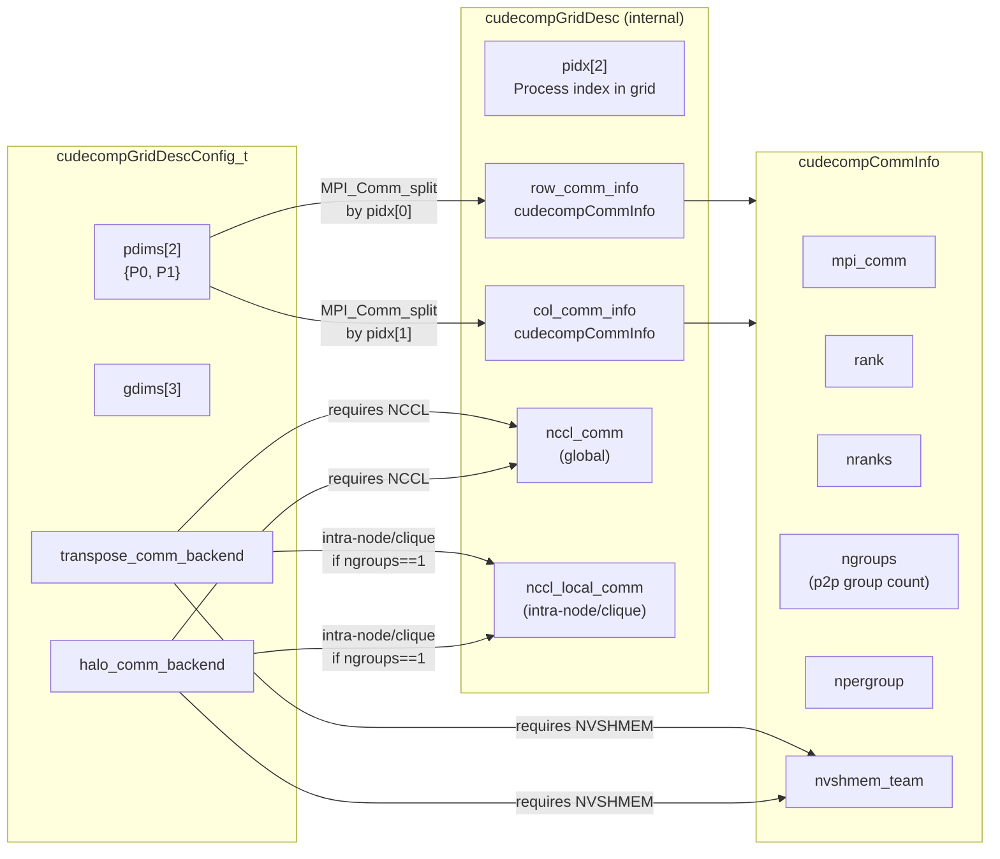

<!-- source: DeepWiki mcp.deepwiki.com · repo NVIDIA/cuDecomp · page 4.2 Grid Configuration and Creation · fetched 2026-10-26 -->

# Grid Configuration and Creation

<details>
<summary>Relevant source files</summary>

The following files were used as context for generating this wiki page:

- [include/cudecomp.h](include/cudecomp.h)
- [include/internal/common.h](include/internal/common.h)
- [src/cudecomp.cc](src/cudecomp.cc)

</details>


## Purpose and Scope

This page documents the API for creating and configuring grid descriptors in cuDecomp. Grid descriptors (`cudecompGridDesc_t`) define how 3D data grids are decomposed across processes and contain all the information needed for transpose and halo communication operations. This page covers the configuration structures, creation and destruction functions, and query operations for grid descriptors.

For information about library initialization before creating grid descriptors, see [Initialization and Finalization](#4.1). For details on using grid descriptors with transpose operations, see [Transpose Operations API](#4.3). For halo update operations, see [Halo Update Operations API](#4.4).

## Grid Descriptor Overview

A grid descriptor is the central configuration object in cuDecomp that describes:
- The global 3D data grid dimensions (`gdims`)
- The 2D process grid dimensions (`pdims`)
- Communication backend selections for transpose and halo operations
- Memory layout preferences for different pencil orientations
- Internal resources (communicators, events, etc.) for communication

Grid descriptors are created via `cudecompGridDescCreate()` and must be destroyed with `cudecompGridDescDestroy()` to release resources. Multiple grid descriptors can exist simultaneously under a single `cudecompHandle_t`.

**Sources:** [include/cudecomp.h:106-108](), [include/internal/common.h:168-206]()

## Configuration Structures

### cudecompGridDescConfig_t

The `cudecompGridDescConfig_t` structure defines the required configuration for a grid descriptor. Users populate this structure and pass it to `cudecompGridDescCreate()`.

| Field | Type | Description |
|-------|------|-------------|
| `gdims[3]` | `int32_t` | Dimensions of the global 3D data grid (X, Y, Z order) |
| `gdims_dist[3]` | `int32_t` | Dimensions to use for distribution. If different from `gdims`, the difference is added to the last pencil in each dimension. Default: same as `gdims` |
| `pdims[2]` | `int32_t` | Dimensions of the 2D process grid. If set to `[0, 0]`, autotuning determines these values |
| `transpose_comm_backend` | `cudecompTransposeCommBackend_t` | Communication backend for transpose operations (default: `CUDECOMP_TRANSPOSE_COMM_MPI_P2P`) |
| `transpose_axis_contiguous[3]` | `bool` | Per-axis flag indicating if memory should be contiguous along pencil axis (default: all `false`) |
| `transpose_mem_order[3][3]` | `int32_t` | Explicit memory ordering by axis, overrides `transpose_axis_contiguous`. First index: axis (X=0, Y=1, Z=2), second index: memory order position. Default: unset (all `-1`) |
| `halo_comm_backend` | `cudecompHaloCommBackend_t` | Communication backend for halo operations (default: `CUDECOMP_HALO_COMM_MPI`) |

**Memory Order Convention:** For `transpose_mem_order`, values specify which global dimension appears in each memory position. For example, `[2, 1, 0]` means Z-major ordering (Z varies slowest, X varies fastest).

**Sources:** [include/cudecomp.h:113-132](), [src/cudecomp.cc:598-614]()

### cudecompGridDescAutotuneOptions_t

The `cudecompGridDescAutotuneOptions_t` structure controls autotuning behavior when passed to `cudecompGridDescCreate()`. Pass `NULL` if autotuning is not desired.

**General Autotuning Options:**

| Field | Type | Default | Description |
|-------|------|---------|-------------|
| `n_warmup_trials` | `int32_t` | 3 | Warmup trials per configuration |
| `n_trials` | `int32_t` | 5 | Timed trials per configuration |
| `grid_mode` | `cudecompAutotuneGridMode_t` | `CUDECOMP_AUTOTUNE_GRID_TRANSPOSE` | Which operation to use for `pdims` autotuning |
| `dtype` | `cudecompDataType_t` | `CUDECOMP_DOUBLE` | Data type for autotuning |
| `allow_uneven_decompositions` | `bool` | `true` | Allow process grids with uneven element distribution |
| `disable_nccl_backends` | `bool` | `false` | Exclude NCCL backends from autotuning |
| `disable_nvshmem_backends` | `bool` | `false` | Exclude NVSHMEM backends from autotuning |
| `skip_threshold` | `double` | 0.0 | Skip slow configurations if `skip_threshold * t > t_best` |

**Transpose-Specific Options:**

| Field | Type | Description |
|-------|------|-------------|
| `autotune_transpose_backend` | `bool` | Enable transpose backend autotuning |
| `transpose_use_inplace_buffers[4]` | `bool` | Use in-place buffers during autotuning by operation (X→Y, Y→Z, Z→Y, Y→X) |
| `transpose_op_weights[4]` | `double` | Multiplicative weights for each transpose operation's contribution to cost |
| `transpose_input_halo_extents[4][3]` | `int32_t` | Input halo extents by operation |
| `transpose_output_halo_extents[4][3]` | `int32_t` | Output halo extents by operation |
| `transpose_input_padding[4][3]` | `int32_t` | Input padding by operation |
| `transpose_output_padding[4][3]` | `int32_t` | Output padding by operation |

**Halo-Specific Options:**

| Field | Type | Description |
|-------|------|-------------|
| `autotune_halo_backend` | `bool` | Enable halo backend autotuning |
| `halo_extents[3]` | `int32_t` | Halo extents for autotuning |
| `halo_periods[3]` | `bool` | Periodicity for autotuning |
| `halo_axis` | `int32_t` | Pencil axis for halo autotuning (0=X, 1=Y, 2=Z) |
| `halo_padding[3]` | `int32_t` | Padding for autotuning |

**Sources:** [include/cudecomp.h:137-189](), [src/cudecomp.cc:950-992]()

## Grid Descriptor Creation

### cudecompGridDescCreate()

```c
cudecompResult_t cudecompGridDescCreate(
    cudecompHandle_t handle,
    cudecompGridDesc_t* grid_desc,
    cudecompGridDescConfig_t* config,
    const cudecompGridDescAutotuneOptions_t* options
);
```

Creates a grid descriptor with the specified configuration. This is a collective operation that must be called by all processes in the handle's MPI communicator.

**Parameters:**
- `handle`: Initialized cuDecomp handle
- `grid_desc`: Pointer to receive the created grid descriptor
- `config`: Configuration structure (input/output). On exit, fields may be updated with autotuning results
- `options`: Autotuning options, or `NULL` to skip autotuning

**Return Value:** `CUDECOMP_RESULT_SUCCESS` on success, error code otherwise.

**Key Behaviors:**
- If `pdims` are `[0, 0]`, they must be autotuned (requires non-NULL `options`)
- If `transpose_mem_order` is not set, it is derived from `transpose_axis_contiguous`
- Communication backend validation ensures NVSHMEM backends are only accepted if enabled at compile time
- NCCL and NVSHMEM communicators are initialized only if needed by the selected backends
- CUDA events for scheduling are allocated internally
- Empty pencil decompositions (where any dimension has more processes than elements) are rejected

**Sources:** [include/cudecomp.h:234-253](), [src/cudecomp.cc:565-822]()

### Grid Descriptor Creation Flow

```mermaid
flowchart TD
    Start["cudecompGridDescCreate()"] --> ValidateInputs["Validate handle and config<br/>[cudecomp.cc:572-573]"]
    ValidateInputs --> CheckAutotune{"Autotuning enabled?<br/>[cudecomp.cc:576-591]"}
    
    CheckAutotune -->|Yes| CheckConfig["checkConfig() with<br/>autotune flags<br/>[cudecomp.cc:587]"]
    CheckAutotune -->|No| CheckConfig
    
    CheckConfig --> AllocGridDesc["Allocate cudecompGridDesc<br/>[cudecomp.cc:592-594]"]
    
    AllocGridDesc --> SetMemOrder["Set transpose_mem_order<br/>from axis_contiguous<br/>[cudecomp.cc:599-614]"]
    
    SetMemOrder --> ValidateGdimsDist["Validate gdims_dist<br/>[cudecomp.cc:615-630]"]
    
    ValidateGdimsDist --> InitComms{"Initialize NCCL/NVSHMEM?<br/>[cudecomp.cc:632-696]"}
    
    InitComms -->|NCCL needed| InitNCCL["ncclCommFromMPIComm()<br/>Create global NCCL comm<br/>[cudecomp.cc:635]"]
    InitComms -->|NVSHMEM needed| InitNVSHMEM["initNvshmemFromMPIComm()<br/>[cudecomp.cc:689-694]"]
    InitComms -->|Neither| CreateStreams
    
    InitNCCL --> CheckLocalNCCL{"Local NCCL comm needed?<br/>[cudecomp.cc:636-678]"}
    CheckLocalNCCL -->|Yes| CreateLocalNCCL["Create NCCL comm from<br/>mpi_clique_comm or<br/>mpi_local_comm<br/>[cudecomp.cc:668-677]"]
    CheckLocalNCCL -->|No| CreateStreams
    InitNVSHMEM --> CreateStreams
    CreateLocalNCCL --> CreateStreams
    
    CreateStreams["Create CUDA streams if needed<br/>[cudecomp.cc:698-705]"]
    
    CreateStreams --> CreateEvents["Allocate CUDA events<br/>for scheduling<br/>[cudecomp.cc:707-714]"]
    
    CreateEvents --> CheckEmptyPencils{"Empty pencils?<br/>[cudecomp.cc:717-721]"}
    CheckEmptyPencils -->|Yes| ErrorEmpty["THROW_NOT_SUPPORTED"]
    CheckEmptyPencils -->|No| RunAutotune
    
    RunAutotune{"Autotune requested?<br/>[cudecomp.cc:724-734]"}
    
    RunAutotune -->|Transpose| AutotuneTranspose["autotuneTransposeBackend()<br/>[autotune.h]"]
    RunAutotune -->|Halo| AutotuneHalo["autotuneHaloBackend()<br/>[autotune.h]"]
    RunAutotune -->|No| SetupComms
    
    AutotuneTranspose --> CheckAutotuneResult{"pdims found?<br/>[cudecomp.cc:736-738]"}
    AutotuneHalo --> CheckAutotuneResult
    
    CheckAutotuneResult -->|No| ErrorAutotune["THROW_NOT_SUPPORTED<br/>'No valid decomposition'"]
    CheckAutotuneResult -->|Yes| SetupComms
    
    SetupComms["Set pidx from rank<br/>[cudecomp.cc:740-746]"]
    
    SetupComms --> CreateRowCol["Create row/col communicators<br/>via MPI_Comm_split<br/>[cudecomp.cc:748-757]"]
    
    CreateRowCol --> SetCommInfo["setCommInfo() for row and col<br/>Determine ngroups, npergroup<br/>[common.h:305-355]"]
    
    SetCommInfo --> SetupNVSHMEMTeams{"NVSHMEM backends?<br/>[cudecomp.cc:758-773]"}
    
    SetupNVSHMEMTeams -->|Yes| CreateTeams["nvshmem_team_split_2d()<br/>Create row/col teams<br/>[cudecomp.cc:762-763]"]
    SetupNVSHMEMTeams -->|No| CheckNCCLUsage
    CreateTeams --> CheckNCCLUsage
    
    CheckNCCLUsage["Release unused NCCL comms<br/>[cudecomp.cc:775-796]"]
    
    CheckNCCLUsage --> ReturnConfig["Return grid_desc and<br/>updated config<br/>[cudecomp.cc:798-814]"]
    
    ReturnConfig --> Success["Return SUCCESS"]
    
    ErrorEmpty --> End["Return error"]
    ErrorAutotune --> End
    Success --> End
```



**Sources:** [src/cudecomp.cc:565-822](), [include/internal/common.h:305-355]()

### Internal Grid Descriptor Structure

The internal `cudecompGridDesc` structure (defined in [common.h:168-206]()) contains:

**Configuration and State:**
- `config`: Copy of the `cudecompGridDescConfig_t` provided at creation
- `gdims_dist_set`, `transpose_mem_order_set`: Flags tracking which fields were explicitly set
- `pidx[2]`: This process's index in the 2D process grid

**Communication Resources:**
- `row_comm_info`, `col_comm_info`: `cudecompCommInfo` structures with MPI communicators, ranks, and group information
- `nccl_comm`, `nccl_local_comm`: Shared pointers to NCCL communicators (reference counted)
- NVSHMEM teams in each `cudecompCommInfo` structure

**Scheduling Resources:**
- `events`: Vector of CUDA events for coordinating transfers
- `nvshmem_sync_event`: Event for NVSHMEM synchronization
- `graph_cache`: Cache for CUDA graph instances (pipelined backends)

**Performance Monitoring:**
- `transpose_perf_samples_map`: Performance samples for transpose operations
- `halo_perf_samples_map`: Performance samples for halo operations
- Events for timing collection

**Sources:** [include/internal/common.h:168-206]()

## Querying Grid Descriptor Information

### cudecompGetPencilInfo()

```c
cudecompResult_t cudecompGetPencilInfo(
    cudecompHandle_t handle,
    cudecompGridDesc_t grid_desc,
    cudecompPencilInfo_t* pencil_info,
    int32_t axis,
    const int32_t halo_extents[],
    const int32_t padding[]
);
```

Retrieves geometry information about the pencil assigned to the calling process for a given axis.

**Parameters:**
- `handle`: Initialized cuDecomp handle
- `grid_desc`: Created grid descriptor
- `pencil_info`: Pointer to receive pencil information
- `axis`: Pencil axis (0=X, 1=Y, 2=Z)
- `halo_extents`: Array of 3 integers for symmetric halo extents (global order), or `NULL`
- `padding`: Array of 3 integers for padding (global order), or `NULL`

**Output Structure (`cudecompPencilInfo_t`):**

| Field | Description |
|-------|-------------|
| `shape[3]` | Pencil dimensions in local order (includes halo and padding) |
| `lo[3]` | Lower bound global coordinates in local order (excludes halo/padding) |
| `hi[3]` | Upper bound global coordinates in local order (excludes halo/padding) |
| `order[3]` | Memory layout order (e.g., `[2,1,0]` for Z-major) |
| `halo_extents[3]` | Halo extents in global order |
| `padding[3]` | Padding in global order |
| `size` | Total number of elements (includes halo and padding) |

**Pencil Decomposition Logic:**

The decomposition algorithm ([cudecomp.cc:1004-1047]()):
1. Computes base pencil size: `d = gdims_dist[i] / pdims[j]`
2. Distributes remainder: first `mod` processes get `d+1` elements
3. Last process in distribution gets additional `gdims[i] - gdims_dist[i]` elements
4. Pencil axis dimension is not decomposed (full global extent)
5. Applies memory ordering transformation based on `transpose_mem_order`

**Sources:** [include/cudecomp.h:286-307](), [src/cudecomp.cc:994-1054]()

### Pencil Information Query Process

```mermaid
flowchart TD
    Start["cudecompGetPencilInfo()"] --> Validate["Validate handle, grid_desc,<br/>pencil_info, axis<br/>[cudecomp.cc:999-1002]"]
    
    Validate --> SetupOrder["Setup order and invorder arrays<br/>from transpose_mem_order[axis]<br/>[cudecomp.cc:1004-1010]"]
    
    SetupOrder --> InitSize["pencil_info->size = 1<br/>[cudecomp.cc:1013]"]
    
    InitSize --> LoopDims["For each dimension i in [0,2]<br/>[cudecomp.cc:1014]"]
    
    LoopDims --> CheckAxis{"i == axis?<br/>[cudecomp.cc:1027]"}
    
    CheckAxis -->|Yes| FullDim["shape[ord] = gdims[i]<br/>lo[ord] = 0<br/>[cudecomp.cc:1028-1029]"]
    CheckAxis -->|No| DecompDim
    
    DecompDim["Compute decomposed dimension:<br/>d = gdims_dist[i] / pdims[j]<br/>mod = gdims_dist[i] % pdims[j]<br/>[cudecomp.cc:1017-1018]"]
    
    DecompDim --> BaseShape["shape[ord] = d<br/>[cudecomp.cc:1019]"]
    
    BaseShape --> AddRemainder{"pidx[j] < mod?<br/>[cudecomp.cc:1020]"}
    
    AddRemainder -->|Yes| IncrShape["shape[ord] += 1<br/>[cudecomp.cc:1020]"]
    AddRemainder -->|No| CheckLast
    IncrShape --> CheckLast
    
    CheckLast{"pidx[j] == last in dist?<br/>[cudecomp.cc:1021]"}
    
    CheckLast -->|Yes| AddExtra["shape[ord] += gdims[i] - gdims_dist[i]<br/>[cudecomp.cc:1023]"]
    CheckLast -->|No| ComputeLo
    AddExtra --> ComputeLo
    
    ComputeLo["lo[ord] = pidx[j] * d + min(pidx[j], mod)<br/>[cudecomp.cc:1025]"]
    
    FullDim --> ComputeHi
    ComputeLo --> ComputeHi
    
    ComputeHi["hi[ord] = lo[ord] + shape[ord] - 1<br/>[cudecomp.cc:1031]"]
    
    ComputeHi --> AddHalo{"halo_extents != NULL?<br/>[cudecomp.cc:1033]"}
    
    AddHalo -->|Yes| ApplyHalo["shape[ord] += 2 * halo_extents[i]<br/>pencil_info->halo_extents[i] = ...<br/>[cudecomp.cc:1034-1035]"]
    AddHalo -->|No| AddPadding
    ApplyHalo --> AddPadding
    
    AddPadding{"padding != NULL?<br/>[cudecomp.cc:1040]"}
    
    AddPadding -->|Yes| ApplyPadding["shape[ord] += padding[i]<br/>pencil_info->padding[i] = ...<br/>[cudecomp.cc:1041-1042]"]
    AddPadding -->|No| UpdateSize
    ApplyPadding --> UpdateSize
    
    UpdateSize["pencil_info->size *= shape[ord]<br/>[cudecomp.cc:1046]"]
    
    UpdateSize --> NextDim{"More dimensions?"}
    NextDim -->|Yes| LoopDims
    NextDim -->|No| Return["Return SUCCESS"]
```



**Sources:** [src/cudecomp.cc:994-1054]()

### cudecompGetTransposeWorkspaceSize()

```c
cudecompResult_t cudecompGetTransposeWorkspaceSize(
    cudecompHandle_t handle,
    cudecompGridDesc_t grid_desc,
    int64_t* workspace_size
);
```

Queries the required workspace size in elements for transpose operations. The workspace is used for packing, unpacking, and staging during transpose communication.

**Algorithm:** Returns the maximum of:
- `max_pencil_size_x + max_pencil_size_y`
- `max_pencil_size_y + max_pencil_size_z`

Where `max_pencil_size_*` is the largest pencil size for that axis across all processes, computed by `getGlobalMaxPencilSize()` ([common.h:229-246]()).

**Sources:** [include/cudecomp.h:310-321](), [src/cudecomp.cc:1088-1105]()

### cudecompGetHaloWorkspaceSize()

```c
cudecompResult_t cudecompGetHaloWorkspaceSize(
    cudecompHandle_t handle,
    cudecompGridDesc_t grid_desc,
    int32_t axis,
    const int32_t halo_extents[],
    int64_t* workspace_size
);
```

Queries the required workspace size in elements for halo operations on a specific axis. The workspace is used for packing non-contiguous halo regions.

**Algorithm:** Computes sizes for halos in each dimension:
- `halo_size_x = 4 * shape_g[1] * shape_g[2] * halo_extents[0]`
- `halo_size_y = 4 * shape_g[0] * shape_g[2] * halo_extents[1]`
- `halo_size_z = 4 * shape_g[0] * shape_g[1] * halo_extents[2]`

Returns the maximum of these three sizes. The factor of 4 accounts for sending/receiving halos on both sides (±1 neighbors).

**Sources:** [include/cudecomp.h:324-340](), [src/cudecomp.cc:1107-1129]()

### cudecompGetGridDescConfig()

```c
cudecompResult_t cudecompGetGridDescConfig(
    cudecompHandle_t handle,
    cudecompGridDesc_t grid_desc,
    cudecompGridDescConfig_t* config
);
```

Retrieves the configuration used to create a grid descriptor. This is useful for querying the results of autotuning.

**Behavior:**
- Returns a copy of the grid descriptor's internal `config` structure
- If `gdims_dist` was not explicitly set, returns zeros (default values)
- If `transpose_mem_order` was not explicitly set, returns -1 (default values)

**Sources:** [include/cudecomp.h:403-411](), [src/cudecomp.cc:1056-1086]()

## Grid Descriptor Destruction

### cudecompGridDescDestroy()

```c
cudecompResult_t cudecompGridDescDestroy(
    cudecompHandle_t handle,
    cudecompGridDesc_t grid_desc
);
```

Destroys a grid descriptor and releases associated resources. This is a collective operation.

**Cleanup Operations:**
1. Frees row and column MPI communicators ([cudecomp.cc:829-834]())
2. Destroys CUDA events for scheduling ([cudecomp.cc:836-842]())
3. If performance reporting is enabled:
   - Prints performance report ([cudecomp.cc:846]())
   - Destroys all performance sample events ([cudecomp.cc:848-873]())
4. Releases NCCL communicator references ([cudecomp.cc:877-883]())
   - If handle has the only remaining reference, destroys the communicator
5. Destroys NVSHMEM teams if used ([cudecomp.cc:889-894]())
6. Finalizes NVSHMEM if no grid descriptors are using it ([cudecomp.cc:898-903]())
7. Deletes the grid descriptor object ([cudecomp.cc:907-908]())

**Important:** Buffers allocated with `cudecompMalloc()` using this grid descriptor should be freed with `cudecompFree()` before destroying the grid descriptor.

**Sources:** [include/cudecomp.h:254-261](), [src/cudecomp.cc:824-915]()

## Configuration Defaults

### cudecompGridDescConfigSetDefaults()

```c
cudecompResult_t cudecompGridDescConfigSetDefaults(
    cudecompGridDescConfig_t* config
);
```

Initializes a `cudecompGridDescConfig_t` structure with default values.

**Default Values:**
- `pdims`: `[0, 0]` (requires autotuning)
- `gdims`: `[0, 0, 0]` (must be set by user)
- `gdims_dist`: `[0, 0, 0]` (unset, will use `gdims`)
- `transpose_comm_backend`: `CUDECOMP_TRANSPOSE_COMM_MPI_P2P`
- `transpose_axis_contiguous`: `[false, false, false]`
- `transpose_mem_order`: all `-1` (unset)
- `halo_comm_backend`: `CUDECOMP_HALO_COMM_MPI`

**Sources:** [include/cudecomp.h:264-272](), [src/cudecomp.cc:917-948]()

### cudecompGridDescAutotuneOptionsSetDefaults()

```c
cudecompResult_t cudecompGridDescAutotuneOptionsSetDefaults(
    cudecompGridDescAutotuneOptions_t* options
);
```

Initializes a `cudecompGridDescAutotuneOptions_t` structure with default values.

**Default Values:**

General options:
- `n_warmup_trials`: 3
- `n_trials`: 5
- `grid_mode`: `CUDECOMP_AUTOTUNE_GRID_TRANSPOSE`
- `dtype`: `CUDECOMP_DOUBLE`
- `allow_uneven_decompositions`: `true`
- `disable_nccl_backends`: `false`
- `disable_nvshmem_backends`: `false`
- `skip_threshold`: 0.0

Transpose options:
- `autotune_transpose_backend`: `false`
- `transpose_use_inplace_buffers`: all `false`
- `transpose_op_weights`: all `1.0`
- All halo extents, padding: zeros

Halo options:
- `autotune_halo_backend`: `false`
- `halo_axis`: 0 (X-axis)
- `halo_extents`: `[0, 0, 0]`
- `halo_periods`: all `false`
- `halo_padding`: `[0, 0, 0]`

**Sources:** [include/cudecomp.h:274-283](), [src/cudecomp.cc:950-992]()

## Configuration Validation

### Validation Rules

The `checkConfig()` function ([cudecomp.cc:144-177]()) validates configuration before grid descriptor creation:

**Process Grid Validation:**
- If `pdims` is not `[0, 0]`, product must equal total number of ranks
- Both `pdims` values must be zero or both non-zero
- Empty pencil check: `pdims[0]` must not exceed `min(gdims_dist[0], gdims_dist[1])`
- Empty pencil check: `pdims[1]` must not exceed `min(gdims_dist[1], gdims_dist[2])`

**Memory Order Validation:**
- If any `transpose_mem_order` value is non-negative, all values must be set
- Each axis's ordering must be a permutation of `[0, 1, 2]`

**Backend Validation:**
- NVSHMEM backends are rejected if not compiled with `ENABLE_NVSHMEM`
- Backend enums are checked for valid values

### Configuration to Communicator Mapping



**Sources:** [src/cudecomp.cc:144-177](), [src/cudecomp.cc:748-757](), [include/internal/common.h:305-355]()

## Example Usage Patterns

### Basic Grid Descriptor Creation

```c
// Initialize configuration with defaults
cudecompGridDescConfig_t config;
cudecompGridDescConfigSetDefaults(&config);

// Set required fields
config.gdims[0] = 512;
config.gdims[1] = 512;
config.gdims[2] = 512;
config.pdims[0] = 4;
config.pdims[1] = 8;  // 32 total processes

// Create grid descriptor (no autotuning)
cudecompGridDesc_t grid_desc;
cudecompGridDescCreate(handle, &grid_desc, &config, NULL);

// Query pencil information for X-axis
cudecompPencilInfo_t pinfo;
cudecompGetPencilInfo(handle, grid_desc, &pinfo, 0, NULL, NULL);

// Use the grid descriptor for transpose/halo operations...

// Clean up
cudecompGridDescDestroy(handle, grid_desc);
```

### Grid Descriptor Creation with Autotuning

```c
// Initialize configuration and autotune options
cudecompGridDescConfig_t config;
cudecompGridDescConfigSetDefaults(&config);
config.gdims[0] = 512;
config.gdims[1] = 512;
config.gdims[2] = 512;
config.pdims[0] = 0;  // Let autotuning determine
config.pdims[1] = 0;

cudecompGridDescAutotuneOptions_t options;
cudecompGridDescAutotuneOptionsSetDefaults(&options);
options.autotune_transpose_backend = true;
options.grid_mode = CUDECOMP_AUTOTUNE_GRID_TRANSPOSE;

// Create with autotuning
cudecompGridDesc_t grid_desc;
cudecompGridDescCreate(handle, &grid_desc, &config, &options);

// config.pdims and config.transpose_comm_backend are now populated
// with autotuned values
```

**Sources:** [examples/basic_usage.cu]()

---

