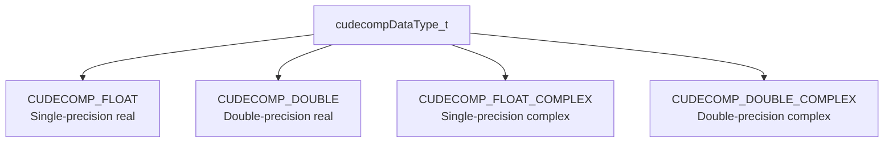
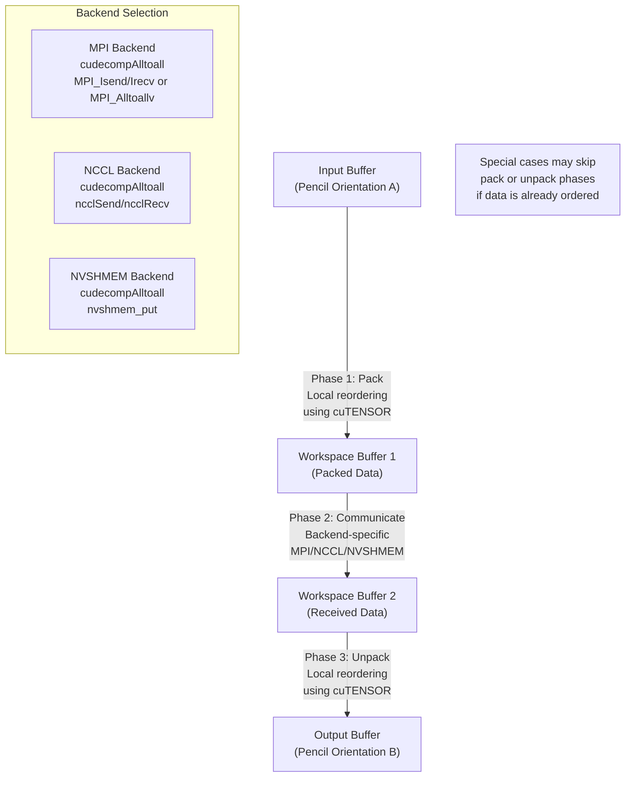
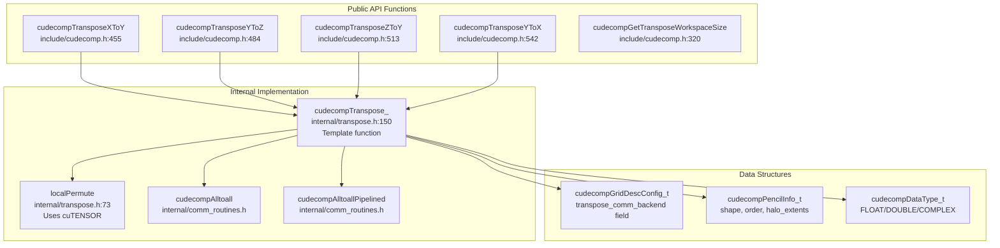

<!-- source: DeepWiki mcp.deepwiki.com · repo NVIDIA/cuDecomp · page 4.3 Transpose Operations API · fetched 2026-10-26 -->

# Transpose Operations API

<details>
<summary>Relevant source files</summary>

The following files were used as context for generating this wiki page:

- [include/cudecomp.h](include/cudecomp.h)
- [include/internal/transpose.h](include/internal/transpose.h)

</details>


## Purpose and Scope

This page documents the public API functions for performing transpose operations in cuDecomp. Transpose operations redistribute 3D data between different pencil orientations (X-pencils, Y-pencils, Z-pencils), enabling efficient computation patterns that require different data layouts. This page covers function signatures, parameters, workspace requirements, and usage patterns.

For implementation details of the transpose pipeline and internal data flow, see [Transpose Operations](#5). For information on pipelined transpose optimizations, see [Pipelined Transposes](#5.2). For grid configuration and pencil decomposition concepts, see [Data Decomposition and Pencil Orientations](#3.2).

**Sources:** [include/cudecomp.h:430-545]()

---

## Overview of Transpose Functions

cuDecomp provides four transpose functions that enable transitions between pencil orientations:


**Transpose Function Overview**

Each transpose function redistributes data between two pencil orientations using a three-phase pipeline: pack local data, perform communication via the configured backend, and unpack received data. The functions support both in-place and out-of-place operations, handle halo regions and padding, and can operate on different data types.

**Sources:** [include/cudecomp.h:430-545](), [include/internal/transpose.h:149-830]()

---

## Transpose Function Reference

### cudecompTransposeXToY

Transposes data from X-axis aligned pencils to Y-axis aligned pencils.

```c
cudecompResult_t cudecompTransposeXToY(
    cudecompHandle_t handle,
    cudecompGridDesc_t grid_desc,
    void* input,
    void* output,
    void* work,
    cudecompDataType_t dtype,
    const int32_t input_halo_extents[],
    const int32_t output_halo_extents[],
    const int32_t input_padding[],
    const int32_t output_padding[],
    cudaStream_t stream
);
```

#### Parameters

| Parameter | Direction | Description |
|-----------|-----------|-------------|
| `handle` | in | Initialized cuDecomp library handle |
| `grid_desc` | in | Grid descriptor defining the decomposition |
| `input` | in | Pointer to input X-pencil data buffer |
| `output` | out | Pointer to output Y-pencil data buffer (may equal `input` for in-place) |
| `work` | in | Pointer to transpose workspace memory |
| `dtype` | in | Data type from `cudecompDataType_t` enum |
| `input_halo_extents` | in | Array of 3 integers for input halo extents (global order), or `NULL` |
| `output_halo_extents` | in | Array of 3 integers for output halo extents (global order), or `NULL` |
| `input_padding` | in | Array of 3 integers for input padding (global order), or `NULL` |
| `output_padding` | in | Array of 3 integers for output padding (global order), or `NULL` |
| `stream` | in | CUDA stream for GPU operations |

#### Communication Pattern

X-to-Y transposes communicate along the column communicator (processes with the same `pidx[0]`).

**Sources:** [include/cudecomp.h:431-458]()

---

### cudecompTransposeYToZ

Transposes data from Y-axis aligned pencils to Z-axis aligned pencils.

```c
cudecompResult_t cudecompTransposeYToZ(
    cudecompHandle_t handle,
    cudecompGridDesc_t grid_desc,
    void* input,
    void* output,
    void* work,
    cudecompDataType_t dtype,
    const int32_t input_halo_extents[],
    const int32_t output_halo_extents[],
    const int32_t input_padding[],
    const int32_t output_padding[],
    cudaStream_t stream
);
```

#### Parameters

Parameters are identical to `cudecompTransposeXToY`, but operate on Y-pencils as input and Z-pencils as output.

#### Communication Pattern

Y-to-Z transposes communicate along the row communicator (processes with the same `pidx[1]`).

**Sources:** [include/cudecomp.h:460-487]()

---

### cudecompTransposeZToY

Transposes data from Z-axis aligned pencils to Y-axis aligned pencils.

```c
cudecompResult_t cudecompTransposeZToY(
    cudecompHandle_t handle,
    cudecompGridDesc_t grid_desc,
    void* input,
    void* output,
    void* work,
    cudecompDataType_t dtype,
    const int32_t input_halo_extents[],
    const int32_t output_halo_extents[],
    const int32_t input_padding[],
    const int32_t output_padding[],
    cudaStream_t stream
);
```

#### Parameters

Parameters are identical to `cudecompTransposeXToY`, but operate on Z-pencils as input and Y-pencils as output.

#### Communication Pattern

Z-to-Y transposes communicate along the row communicator (processes with the same `pidx[1]`).

**Sources:** [include/cudecomp.h:489-516]()

---

### cudecompTransposeYToX

Transposes data from Y-axis aligned pencils to X-axis aligned pencils.

```c
cudecompResult_t cudecompTransposeYToX(
    cudecompHandle_t handle,
    cudecompGridDesc_t grid_desc,
    void* input,
    void* output,
    void* work,
    cudecompDataType_t dtype,
    const int32_t input_halo_extents[],
    const int32_t output_halo_extents[],
    const int32_t input_padding[],
    const int32_t output_padding[],
    cudaStream_t stream
);
```

#### Parameters

Parameters are identical to `cudecompTransposeXToY`, but operate on Y-pencils as input and X-pencils as output.

#### Communication Pattern

Y-to-X transposes communicate along the column communicator (processes with the same `pidx[0]`).

**Sources:** [include/cudecomp.h:518-545]()

---

## Common Parameter Details

### Data Type Specification

The `dtype` parameter must be one of the following values from `cudecompDataType_t`:



All input, output, and workspace buffers must be allocated with sufficient size for the specified data type.

**Sources:** [include/cudecomp.h:68-73]()

---

### Halo Extents

Halo extents define the number of ghost/boundary elements per direction along each axis. The arrays `input_halo_extents` and `output_halo_extents` are specified in **global order** (X, Y, Z):

- `halo_extents[0]`: Number of halo elements per side along global X-axis
- `halo_extents[1]`: Number of halo elements per side along global Y-axis  
- `halo_extents[2]`: Number of halo elements per side along global Z-axis

Halos are **symmetric**: a value of 1 means 1 element on each side (2 total halo elements along that axis).

If no halos are present, pass `NULL` for the halo extent arrays.

**Example:** For a pencil with `halo_extents = {1, 2, 0}`:
- 2 halo elements along X (1 on each side)
- 4 halo elements along Y (2 on each side)
- 0 halo elements along Z

**Sources:** [include/cudecomp.h:440-445](), [include/internal/transpose.h:156-160]()

---

### Padding

Padding defines additional elements to treat as padding (ignored during computation) along each axis. The `input_padding` and `output_padding` arrays are specified in **global order** (X, Y, Z):

- `padding[0]`: Padding elements along global X-axis
- `padding[1]`: Padding elements along global Y-axis
- `padding[2]`: Padding elements along global Z-axis

Padding is typically used for alignment requirements or to accommodate FFT transformations that require specific dimensions.

If no padding is present, pass `NULL` for the padding arrays.

**Sources:** [include/cudecomp.h:446-450](), [include/internal/transpose.h:162-165]()

---

### In-Place vs Out-of-Place Operations

Transpose operations support both in-place and out-of-place modes:

- **Out-of-place:** `input != output` - Data is read from `input` and written to `output`
- **In-place:** `input == output` - Data is transposed within the same buffer

In-place operations require that input and output halo extents and padding match. Performance characteristics may differ between modes depending on the configured transpose backend.

**Sources:** [include/cudecomp.h:436-437](), [include/internal/transpose.h:169]()

---

## Workspace Requirements

### Querying Workspace Size

Before performing transpose operations, allocate workspace memory using `cudecompGetTransposeWorkspaceSize`:

```c
cudecompResult_t cudecompGetTransposeWorkspaceSize(
    cudecompHandle_t handle,
    cudecompGridDesc_t grid_desc,
    int64_t* workspace_size
);
```

This function returns the required workspace size in **elements** (not bytes). To convert to bytes, multiply by the size of your data type.

**Example:**
```c
int64_t workspace_elements;
cudecompGetTransposeWorkspaceSize(handle, grid_desc, &workspace_elements);
size_t workspace_bytes = workspace_elements * sizeof(double);
```

### Allocating Workspace

Workspace must be allocated using `cudecompMalloc`, which selects the appropriate allocator based on the configured communication backend:

```c
void* work;
cudecompMalloc(handle, grid_desc, &work, workspace_bytes);
```

Do not use `cudaMalloc` directly, as backends like NVSHMEM require symmetric allocations. See [Memory Management API](#4.5) for details.

**Sources:** [include/cudecomp.h:310-321](), [include/cudecomp.h:352-367]()

---

## Transpose Pipeline Data Flow



**Transpose Operation Data Flow**

The transpose operation follows a three-phase pipeline. The pack phase uses cuTENSOR to reorder local data. The communication phase uses the configured backend (set via `cudecompGridDescConfig_t.transpose_comm_backend`). The unpack phase again uses cuTENSOR to place data in the output orientation. The implementation may optimize away pack or unpack phases if data is already in the required orientation.

**Sources:** [include/internal/transpose.h:149-830](), [include/cudecomp.h:120-126]()

---

## Function to Code Entity Mapping



**Code Entity Relationships**

Public transpose functions are thin wrappers around the internal template function `cudecompTranspose_`, which implements the transpose pipeline. Local permutations use `localPermute` with cuTENSOR. Communication uses either `cudecompAlltoall` (non-pipelined) or `cudecompAlltoallPipelined` (pipelined) based on the backend configuration.

**Sources:** [include/cudecomp.h:430-545](), [include/internal/transpose.h:72-110](), [include/internal/transpose.h:149-830]()

---

## Return Values

All transpose functions return `cudecompResult_t` with the following possible values:

| Return Value | Description |
|--------------|-------------|
| `CUDECOMP_RESULT_SUCCESS` | Operation completed successfully |
| `CUDECOMP_RESULT_INVALID_USAGE` | Invalid arguments (e.g., NULL pointers, invalid axis) |
| `CUDECOMP_RESULT_CUDA_ERROR` | CUDA runtime error occurred |
| `CUDECOMP_RESULT_CUTENSOR_ERROR` | cuTENSOR error during local permutation |
| `CUDECOMP_RESULT_MPI_ERROR` | MPI communication error |
| `CUDECOMP_RESULT_NCCL_ERROR` | NCCL communication error |
| `CUDECOMP_RESULT_NVSHMEM_ERROR` | NVSHMEM communication error |

Always check return values to detect errors. Internal library state may be inconsistent after errors.

**Sources:** [include/cudecomp.h:87-98]()

---

## Usage Patterns

### Basic Out-of-Place Transpose

```c
// Query workspace size
int64_t work_elements;
cudecompGetTransposeWorkspaceSize(handle, grid_desc, &work_elements);

// Allocate workspace
void* work;
cudecompMalloc(handle, grid_desc, &work, work_elements * sizeof(double));

// Perform transpose without halos or padding
cudecompTransposeXToY(handle, grid_desc, 
                      input_x, output_y, work,
                      CUDECOMP_DOUBLE,
                      NULL, NULL,  // no halos
                      NULL, NULL,  // no padding
                      stream);

// Clean up
cudecompFree(handle, grid_desc, work);
```

### Transpose with Halos

```c
// Define halo extents (1 element per side on all axes)
int32_t input_halos[3] = {1, 1, 1};
int32_t output_halos[3] = {1, 1, 1};

// Transpose with halos (no padding)
cudecompTransposeXToY(handle, grid_desc,
                      input_x, output_y, work,
                      CUDECOMP_DOUBLE,
                      input_halos, output_halos,
                      NULL, NULL,  // no padding
                      stream);
```

### In-Place Transpose

```c
// For in-place, input and output point to same buffer
// Halos and padding must match between input and output
int32_t halos[3] = {1, 1, 1};

cudecompTransposeXToY(handle, grid_desc,
                      buffer, buffer, work,  // same buffer
                      CUDECOMP_DOUBLE,
                      halos, halos,  // matching halos
                      NULL, NULL,
                      stream);
```

### Complete Cycle Through All Orientations

```c
// Start with X-pencils, cycle through all orientations and back
cudecompTransposeXToY(handle, grid_desc, x_data, y_data, work, dtype,
                      NULL, NULL, NULL, NULL, stream);
cudecompTransposeYToZ(handle, grid_desc, y_data, z_data, work, dtype,
                      NULL, NULL, NULL, NULL, stream);
cudecompTransposeZToY(handle, grid_desc, z_data, y_data, work, dtype,
                      NULL, NULL, NULL, NULL, stream);
cudecompTransposeYToX(handle, grid_desc, y_data, x_data, work, dtype,
                      NULL, NULL, NULL, NULL, stream);
// x_data now contains result in original orientation
```

**Sources:** [include/cudecomp.h:430-545]()

---

## Performance Considerations

### Backend Selection

The transpose communication backend is configured via `cudecompGridDescConfig_t.transpose_comm_backend`:

| Backend | Description | Use Case |
|---------|-------------|----------|
| `CUDECOMP_TRANSPOSE_COMM_MPI_P2P` | MPI peer-to-peer (Isend/Irecv) | Default, good portability |
| `CUDECOMP_TRANSPOSE_COMM_MPI_P2P_PL` | MPI P2P with pipelining | Overlap communication and computation |
| `CUDECOMP_TRANSPOSE_COMM_MPI_A2A` | MPI Alltoallv collective | May be faster on some systems |
| `CUDECOMP_TRANSPOSE_COMM_NCCL` | NCCL group operations | GPU-optimized, requires NCCL |
| `CUDECOMP_TRANSPOSE_COMM_NCCL_PL` | NCCL with pipelining | Best for NCCL with overlap |
| `CUDECOMP_TRANSPOSE_COMM_NVSHMEM` | NVSHMEM put operations | NVIDIA NVLink systems |
| `CUDECOMP_TRANSPOSE_COMM_NVSHMEM_PL` | NVSHMEM with pipelining | Best for NVSHMEM with overlap |

For backend details and selection guidance, see [Communication Backends](#3.3). For autotuning backend selection, see [Performance Autotuning](#7).

**Sources:** [include/cudecomp.h:44-52](), [include/cudecomp.h:120-121]()

---

### Memory Layout Optimization

The `transpose_axis_contiguous` and `transpose_mem_order` fields in `cudecompGridDescConfig_t` control memory layout for each pencil orientation. Contiguous access along the pencil axis can improve performance but may increase transpose overhead.

For memory layout configuration, see [Grid Configuration and Creation](#4.2).

**Sources:** [include/cudecomp.h:122-126]()

---

### Stream Synchronization

Transpose operations enqueue work into the provided CUDA stream and return immediately. To ensure completion:

```c
// Option 1: Synchronize the stream
cudaStreamSynchronize(stream);

// Option 2: Use CUDA events
cudaEvent_t event;
cudaEventCreate(&event);
cudecompTransposeXToY(handle, grid_desc, input, output, work, 
                      dtype, NULL, NULL, NULL, NULL, stream);
cudaEventRecord(event, stream);
cudaEventSynchronize(event);
```

**Sources:** [include/cudecomp.h:451]()

---

## Related API Functions

The following related functions are documented on other pages:

- **Workspace allocation:** `cudecompMalloc`, `cudecompFree` - see [Memory Management API](#4.5)
- **Pencil info queries:** `cudecompGetPencilInfo` - see [Grid Configuration and Creation](#4.2)  
- **Grid descriptor creation:** `cudecompGridDescCreate` - see [Grid Configuration and Creation](#4.2)
- **Backend configuration:** `cudecompGridDescConfig_t` - see [Grid Configuration and Creation](#4.2)
- **Data type utilities:** `cudecompGetDataTypeSize` - see [Grid Configuration and Creation](#4.2)

**Sources:** [include/cudecomp.h:234-412]()

---

