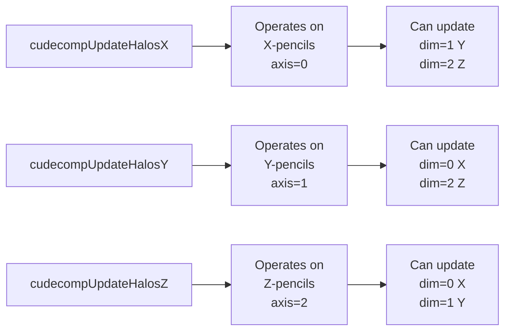
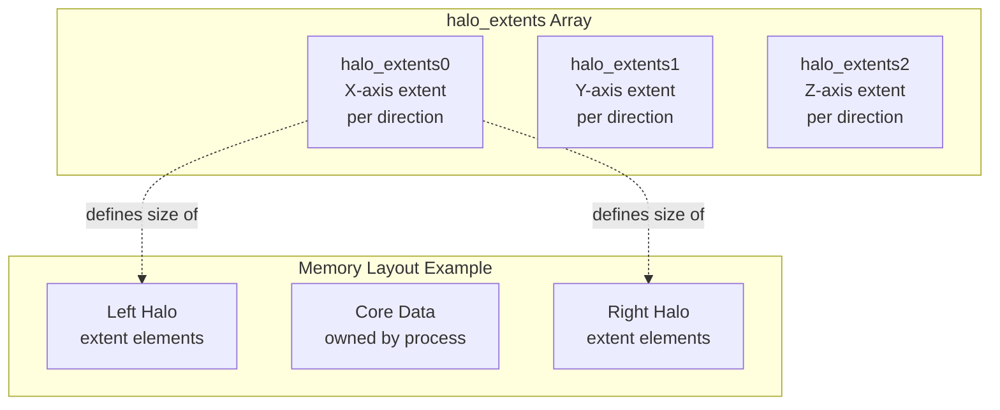
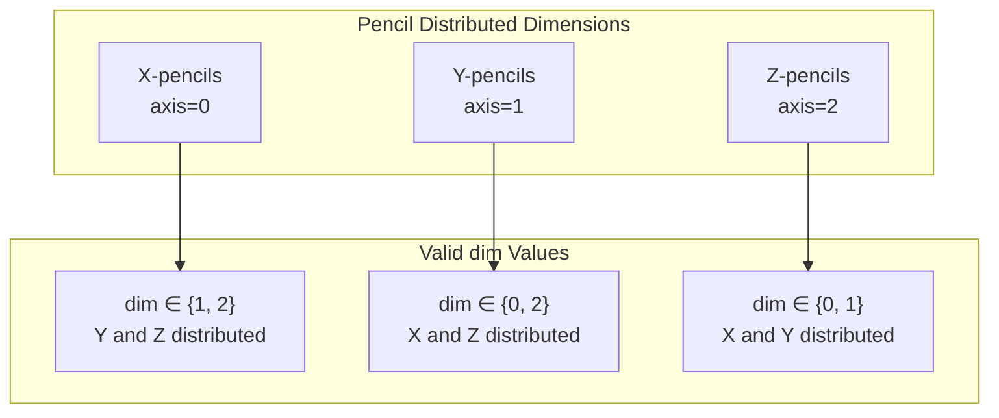
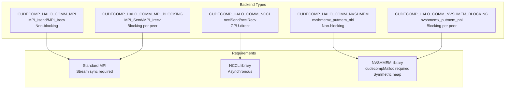
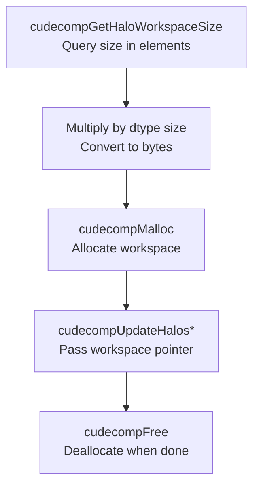
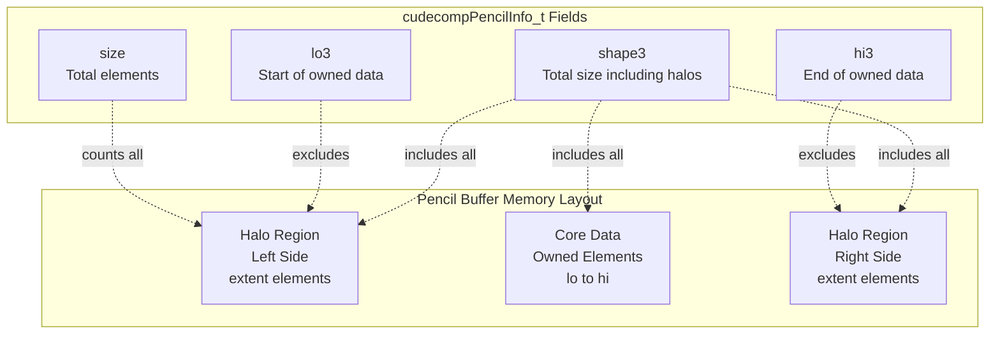
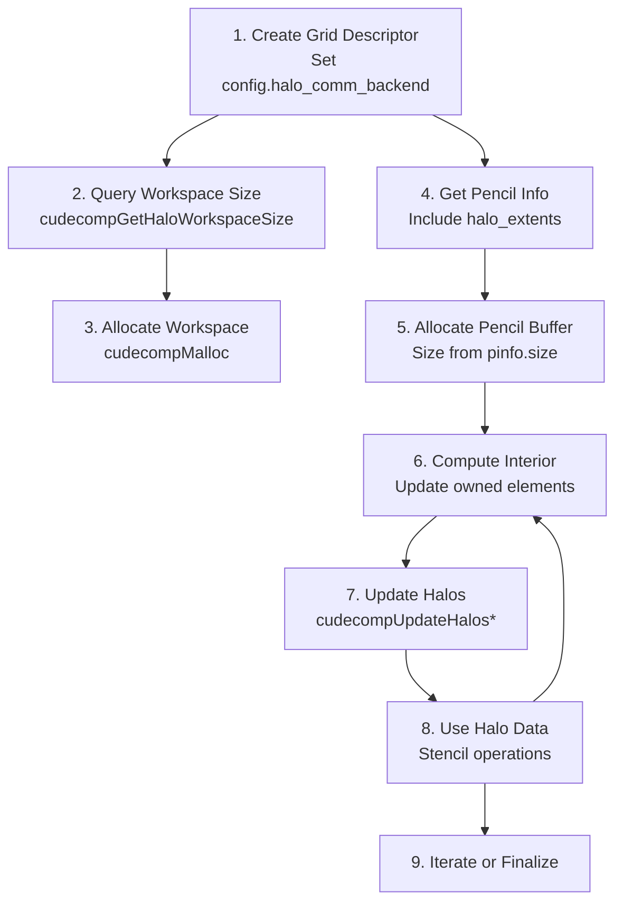
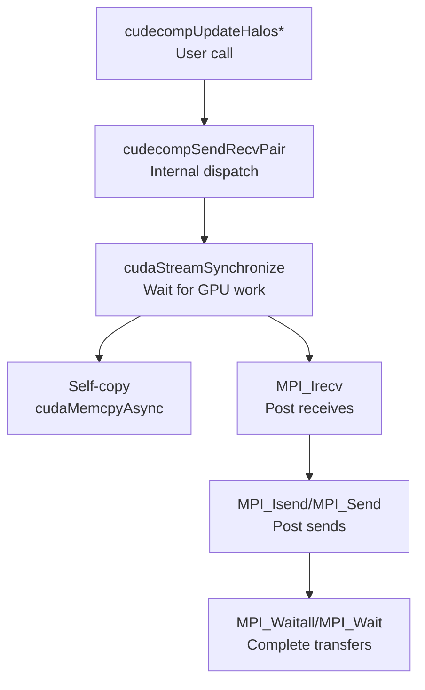
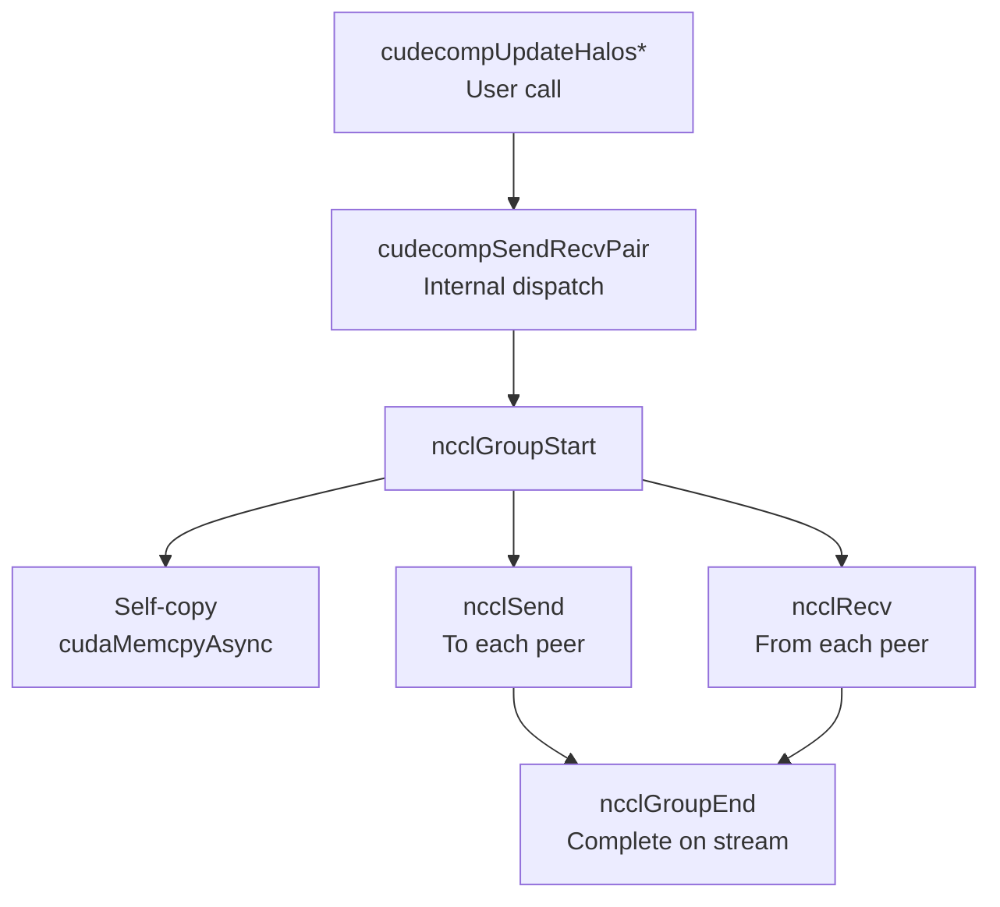
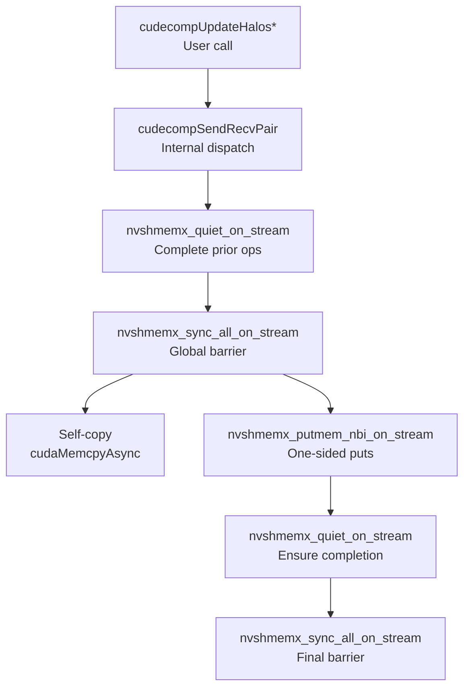

<!-- source: DeepWiki mcp.deepwiki.com · repo NVIDIA/cuDecomp · page 4.4 Halo Update Operations API · fetched 2026-10-26 -->

# Halo Update Operations API

<details>
<summary>Relevant source files</summary>

The following files were used as context for generating this wiki page:

- [include/cudecomp.h](include/cudecomp.h)
- [include/internal/comm_routines.h](include/internal/comm_routines.h)

</details>


## Purpose and Scope

This page documents the cuDecomp API functions for performing halo exchanges on distributed pencil data. Halo exchanges update boundary regions (ghost zones) of local pencil data with corresponding data from neighboring processes, which is essential for stencil operations and other algorithms that require access to adjacent grid points.

For implementation details about halo communication patterns and the underlying send/recv mechanisms, see [Halo Updates](#6) and [Halo Communication Patterns](#6.1). For details on communication backend implementations, see [Communication Backend Details](#8).

**Sources:** [include/cudecomp.h:547-625]()

## Overview

Halo update operations exchange boundary data between neighboring processes in the pencil decomposition. Each process maintains extra "halo" or "ghost" elements at the boundaries of its local domain that are filled with data from adjacent processes during a halo update.

**Key Concepts:**
- **Symmetric halos**: cuDecomp assumes symmetric halo regions (same number of elements on both sides of the domain)
- **Global ordering**: Halo extents, periods, and padding are always specified in global order (X, Y, Z)
- **Dimension selection**: Updates occur along one distributed dimension at a time
- **Workspace**: May be required for packing non-contiguous halo regions

**Sources:** [include/cudecomp.h:547-625]()

## Halo Update Functions

cuDecomp provides three halo update functions, one for each pencil orientation:



All three functions have identical signatures but operate on different pencil orientations. You can only update halos along **distributed dimensions** of a pencil.

**Sources:** [include/cudecomp.h:571-625]()

## Function Signature

```c
cudecompResult_t cudecompUpdateHalosX(
    cudecompHandle_t handle,
    cudecompGridDesc_t grid_desc,
    void* input,
    void* work,
    cudecompDataType_t dtype,
    const int32_t halo_extents[],
    const bool halo_periods[],
    int32_t dim,
    const int32_t padding[],
    cudaStream_t stream
);
```

The signatures for `cudecompUpdateHalosY` and `cudecompUpdateHalosZ` are identical.

**Sources:** [include/cudecomp.h:571-573](), [include/cudecomp.h:597-599](), [include/cudecomp.h:623-625]()

## Parameters

| Parameter | Direction | Type | Description |
|-----------|-----------|------|-------------|
| `handle` | in | `cudecompHandle_t` | The initialized cuDecomp library handle |
| `grid_desc` | in | `cudecompGridDesc_t` | A cuDecomp grid descriptor |
| `input` | in/out | `void*` | Pointer to pencil data buffer. On entry, contains local pencil data with uninitialized halos. On exit, halo regions are updated with neighbor data |
| `work` | in | `void*` | Pointer to halo workspace memory (allocated via `cudecompMalloc`) |
| `dtype` | in | `cudecompDataType_t` | Data type of the pencil data |
| `halo_extents` | in | `const int32_t[3]` | Array defining halo extents in global order (per direction) |
| `halo_periods` | in | `const bool[3]` | Array defining periodicity in global order. Pass `NULL` for non-periodic domain |
| `dim` | in | `int32_t` | Which pencil dimension (global indexed) to perform the halo update. Range: [0, 2] |
| `padding` | in | `const int32_t[3]` | Array defining padding in global order. Pass `NULL` if no padding |
| `stream` | in | `cudaStream_t` | CUDA stream to enqueue operations into |

**Sources:** [include/cudecomp.h:550-573]()

### Halo Extents Parameter



The `halo_extents` parameter specifies **symmetric** halo regions. Each entry indicates the number of halo elements **per direction** (one side):

- `halo_extents = {1, 0, 0}`: 1 halo element on each side along X-axis (2 total halo elements)
- `halo_extents = {1, 1, 2}`: 1 element per side on X, 1 on Y, 2 on Z (2, 2, and 4 total halo elements respectively)

Halo extents are always specified in **global order** (X, Y, Z), regardless of the pencil orientation or memory layout.

**Sources:** [include/cudecomp.h:556-559]()

### Dimension Parameter



The `dim` parameter selects which dimension to exchange halos along, using **global indexing**:
- `dim = 0`: Exchange along global X-axis
- `dim = 1`: Exchange along global Y-axis
- `dim = 2`: Exchange along global Z-axis

**Important:** You can only exchange along distributed dimensions:
- X-pencils: `dim` can be 1 (Y) or 2 (Z)
- Y-pencils: `dim` can be 0 (X) or 2 (Z)
- Z-pencils: `dim` can be 0 (X) or 1 (Y)

Attempting to update halos along the pencil's contiguous axis will result in `CUDECOMP_RESULT_INVALID_USAGE`.

**Sources:** [include/cudecomp.h:563]()

### Periodicity Parameter

The `halo_periods` array controls boundary wrapping behavior:

| Value | Behavior |
|-------|----------|
| `halo_periods[i] = true` | Domain is periodic along axis `i`; boundaries wrap around |
| `halo_periods[i] = false` | Domain is non-periodic along axis `i`; no exchange at domain edges |
| `halo_periods = NULL` | All axes are non-periodic |

For **non-periodic boundaries**, processes at the domain edges will not exchange data in that direction. Their halo regions on the boundary side remain unmodified.

**Example:**
```c
// Periodic in X and Y, open boundaries in Z
bool halo_periods[3] = {true, true, false};
cudecompUpdateHalosX(handle, grid_desc, data, work, dtype, 
                     halo_extents, halo_periods, 1, NULL, stream);
```

**Sources:** [include/cudecomp.h:560-562]()

## Return Values

Returns `CUDECOMP_RESULT_SUCCESS` on success, or an error code on failure:

| Error Code | Description |
|------------|-------------|
| `CUDECOMP_RESULT_INVALID_USAGE` | Invalid parameters (e.g., wrong `dim` for pencil orientation, NULL required pointer) |
| `CUDECOMP_RESULT_NOT_SUPPORTED` | Unsupported configuration |
| `CUDECOMP_RESULT_CUDA_ERROR` | CUDA operation failed |
| `CUDECOMP_RESULT_MPI_ERROR` | MPI communication failed |
| `CUDECOMP_RESULT_NCCL_ERROR` | NCCL communication failed |
| `CUDECOMP_RESULT_NVSHMEM_ERROR` | NVSHMEM operation failed |

**Sources:** [include/cudecomp.h:87-98]()

## Communication Backends

Halo updates support multiple communication backends, configured via the `halo_comm_backend` field in `cudecompGridDescConfig_t`:



**Backend Selection Guide:**

| Backend | Value | Best For | Synchronization |
|---------|-------|----------|-----------------|
| MPI | `1` | General purpose, broadest compatibility | Stream sync before MPI calls |
| MPI_BLOCKING | `2` | Debugging, reducing memory pressure | Stream sync, blocking per peer |
| NCCL | `3` | GPU-direct communication, high bandwidth | Asynchronous |
| NVSHMEM | `4` | Lowest latency, one-sided communication | Quiet + barrier |
| NVSHMEM_BLOCKING | `5` | Debugging NVSHMEM, controlled synchronization | Quiet + barrier per peer |

**Sources:** [include/cudecomp.h:57-63](), [include/internal/comm_routines.h:552-667]()

## Workspace Requirements

### Querying Workspace Size

Halo operations may require workspace memory for packing/unpacking non-contiguous halo regions. Query the required size using:

```c
cudecompResult_t cudecompGetHaloWorkspaceSize(
    cudecompHandle_t handle,
    cudecompGridDesc_t grid_desc,
    int32_t axis,
    const int32_t halo_extents[],
    int64_t* workspace_size
);
```

| Parameter | Description |
|-----------|-------------|
| `axis` | Pencil axis: 0 (X-pencils), 1 (Y-pencils), or 2 (Z-pencils) |
| `halo_extents` | Array of 3 integers defining halo extents in global order |
| `workspace_size` | Output: workspace size in **elements** (not bytes) |

**Sources:** [include/cudecomp.h:339-340]()

### Allocating Workspace



**Always use `cudecompMalloc` for workspace allocation:**

```c
int64_t workspace_size_elements;
cudecompGetHaloWorkspaceSize(handle, grid_desc, 0, halo_extents, 
                              &workspace_size_elements);

int64_t dtype_size;
cudecompGetDataTypeSize(CUDECOMP_DOUBLE, &dtype_size);

void* work;
size_t work_bytes = workspace_size_elements * dtype_size;
cudecompMalloc(handle, grid_desc, &work, work_bytes);
```

Using `cudecompMalloc` ensures:
- Correct allocation type for NVSHMEM backends (symmetric heap via `nvshmem_malloc`)
- NCCL User Buffer Registration (UBR) when enabled
- Proper memory fabric awareness (CUDA VMM when applicable)

**Sources:** [include/cudecomp.h:324-340](), [include/cudecomp.h:352-367]()

## Helper Functions

### Getting Neighbor Ranks

The `cudecompGetShiftedRank` function retrieves the global rank of neighboring processes:

```c
cudecompResult_t cudecompGetShiftedRank(
    cudecompHandle_t handle,
    cudecompGridDesc_t grid_desc,
    int32_t axis,
    int32_t dim,
    int32_t displacement,
    bool periodic,
    int32_t* shifted_rank
);
```

| Parameter | Description |
|-----------|-------------|
| `axis` | Pencil axis: 0 (X), 1 (Y), 2 (Z) |
| `dim` | Global dimension to shift along: 0 (X), 1 (Y), 2 (Z) |
| `displacement` | Shift amount: +1 for next neighbor, -1 for previous, etc. |
| `periodic` | Whether to wrap around at domain boundaries |
| `shifted_rank` | Output: global rank of neighbor, or **-1** if outside domain (non-periodic case) |

**Example:**
```c
// For X-pencils, get the rank of the process one position higher in Y
int neighbor_rank;
cudecompGetShiftedRank(handle, grid_desc, 0, 1, 1, false, &neighbor_rank);

if (neighbor_rank == -1) {
    // We're at the domain edge (non-periodic)
}
```

**Sources:** [include/cudecomp.h:414-428]()

## Data Layout with Halos

Understanding how halos affect the pencil memory layout:



**Key Points:**

- `pinfo.shape[3]`: Includes halo and padding elements in local order
- `pinfo.lo[3]` and `pinfo.hi[3]`: Specify **core data bounds** (excluding halos) in local order
- `pinfo.size`: Total number of elements (including halos and padding)
- `pinfo.halo_extents[3]`: Halo extents in **global order**

**Example:** For a 1D pencil with 6 core elements and `halo_extents[dim] = 1`:

| Index | Content | Description |
|-------|---------|-------------|
| 0 | Halo | Left halo element |
| 1-6 | Core | Owned data (lo=1, hi=6 in local indexing) |
| 7 | Halo | Right halo element |

Total `pinfo.size = 8`, `pinfo.shape[dim] = 8`.

**Sources:** [include/cudecomp.h:194-202]()

## Usage Pattern

### Typical Workflow



**Sources:** [include/cudecomp.h:235-261](), [include/cudecomp.h:571-625]()

### Complete Example

```c
// 1. Configure grid descriptor
cudecompGridDescConfig_t config;
cudecompGridDescConfigSetDefaults(&config);
config.gdims[0] = 512; 
config.gdims[1] = 512; 
config.gdims[2] = 512;
config.pdims[0] = 4; 
config.pdims[1] = 4;
config.halo_comm_backend = CUDECOMP_HALO_COMM_NCCL;

cudecompGridDesc_t grid_desc;
cudecompGridDescCreate(handle, &grid_desc, &config, NULL);

// 2. Define halo requirements
int32_t halo_extents[3] = {1, 1, 1}; // 1 element per side
bool halo_periods[3] = {true, true, false}; // Periodic in X,Y

// 3. Get pencil info
cudecompPencilInfo_t pinfo;
cudecompGetPencilInfo(handle, grid_desc, &pinfo, 0, halo_extents, NULL);

// 4. Allocate pencil buffer
int64_t dtype_size;
cudecompGetDataTypeSize(CUDECOMP_DOUBLE, &dtype_size);
void* data;
cudaMalloc(&data, pinfo.size * dtype_size);

// 5. Allocate workspace
int64_t work_size;
cudecompGetHaloWorkspaceSize(handle, grid_desc, 0, halo_extents, &work_size);
void* work;
cudecompMalloc(handle, grid_desc, &work, work_size * dtype_size);

// 6. Perform computation with halo updates
cudaStream_t stream;
cudaStreamCreate(&stream);

for (int iter = 0; iter < num_iterations; ++iter) {
    // Compute interior elements
    // ... computation kernel ...
    
    // Update halos in Y-dimension
    cudecompUpdateHalosX(handle, grid_desc, data, work, 
                         CUDECOMP_DOUBLE, halo_extents, halo_periods, 
                         1, NULL, stream);
    
    // Update halos in Z-dimension
    cudecompUpdateHalosX(handle, grid_desc, data, work,
                         CUDECOMP_DOUBLE, halo_extents, halo_periods,
                         2, NULL, stream);
    
    // Apply stencil using halo data
    // ... stencil kernel ...
}

// 7. Cleanup
cudecompFree(handle, grid_desc, work);
cudaFree(data);
cudecompGridDescDestroy(handle, grid_desc);
```

**Sources:** [include/cudecomp.h:571-625]()

## Backend Implementation Details

### MPI Backend Flow



- Uses `MPI_Isend`/`MPI_Irecv` for non-blocking variant
- Uses `MPI_Send`/`MPI_Irecv` for blocking variant (blocks between peer pairs)
- Stream synchronization required before MPI calls
- Self-copy uses `cudaMemcpyAsync` for intra-process exchanges

**Sources:** [include/internal/comm_routines.h:610-656]()

### NCCL Backend Flow



- Uses `ncclSend`/`ncclRecv` within `ncclGroupStart`/`ncclGroupEnd`
- Fully asynchronous GPU-to-GPU communication
- No stream synchronization required
- Self-copy uses `cudaMemcpyAsync`
- Supports NCCL User Buffer Registration (UBR) for optimized performance

**Sources:** [include/internal/comm_routines.h:588-608]()

### NVSHMEM Backend Flow



- Uses `nvshmemx_putmem_nbi_on_stream` for non-blocking one-sided puts
- Requires symmetric heap allocation via `cudecompMalloc`
- `nvshmemx_quiet_on_stream` ensures local completion
- `nvshmemx_sync_all_on_stream` provides global synchronization
- Blocking variant adds quiet+sync between each peer pair
- Self-copy uses `cudaMemcpyAsync`

**Sources:** [include/internal/comm_routines.h:553-586]()

## Performance Considerations

### Backend Selection via Autotuning

```c
cudecompGridDescAutotuneOptions_t options;
cudecompGridDescAutotuneOptionsSetDefaults(&options);

// Enable halo backend autotuning
options.autotune_halo_backend = true;

// Configure autotuning parameters
options.halo_extents[0] = 1;
options.halo_extents[1] = 1;
options.halo_extents[2] = 1;
options.halo_periods[0] = true;
options.halo_periods[1] = true;
options.halo_periods[2] = false;
options.halo_axis = 0; // Autotune using X-pencils
options.halo_padding[0] = 0;
options.halo_padding[1] = 0;
options.halo_padding[2] = 0;

cudecompGridDescCreate(handle, &grid_desc, &config, &options);
// config.halo_comm_backend is updated with best backend
```

For details on autotuning, see [Performance Autotuning](#7) and [Autotune Configuration and Options](#7.1).

**Sources:** [include/cudecomp.h:183-189]()

### Memory Bandwidth Optimization

Halo updates involve:
1. **Local packing** (if halo region is non-contiguous in memory)
2. **Communication** (network or GPU-direct transfer)
3. **Local unpacking** (if needed)

**Best practices:**
- Choose memory layouts that align halo regions with contiguous memory when possible
- Use `transpose_axis_contiguous` or `transpose_mem_order` in grid configuration
- For higher-order stencils, larger halo extents increase both workspace and communication volume

**Sources:** [include/cudecomp.h:122-126]()

### Common Patterns

#### Stencil Operations

```c
// Typical iterative stencil with halo updates
int32_t halo_extents[3] = {1, 1, 1};
bool periods[3] = {true, true, false};

for (int iter = 0; iter < num_iterations; ++iter) {
    // Update all distributed dimensions
    cudecompUpdateHalosX(handle, grid_desc, data, work,
                         dtype, halo_extents, periods, 1, NULL, stream);
    cudecompUpdateHalosX(handle, grid_desc, data, work,
                         dtype, halo_extents, periods, 2, NULL, stream);
    
    // Launch stencil kernel that accesses halo data
    apply_stencil_kernel<<<...>>>(data, pinfo, ...);
}
```

#### Higher-Order Stencils

```c
// 3-point stencil: halo_extent = 1
// 5-point stencil: halo_extent = 2
// 7-point stencil: halo_extent = 3
int32_t halo_extents[3] = {2, 2, 2}; // 5-point stencil

// Workspace size scales with halo extent
cudecompGetHaloWorkspaceSize(handle, grid_desc, 0, halo_extents, &work_size);
```

#### Selective Dimension Updates

```c
// Only update specific dimensions as needed
int32_t halo_extents[3] = {1, 1, 0}; // No halos in Z

// Only update Y-dimension
cudecompUpdateHalosX(handle, grid_desc, data, work,
                     dtype, halo_extents, NULL, 1, NULL, stream);

// Z-dimension has no halos, skip update
```

**Sources:** [include/cudecomp.h:571-625]()

## Error Handling

Always check return codes from halo update functions:

```c
cudecompResult_t result = cudecompUpdateHalosX(
    handle, grid_desc, data, work, dtype, 
    halo_extents, periods, dim, padding, stream);

if (result != CUDECOMP_RESULT_SUCCESS) {
    fprintf(stderr, "Halo update failed: error code %d\n", result);
    // Handle error appropriately
    return result;
}
```

### Common Error Scenarios

| Scenario | Error | Solution |
|----------|-------|----------|
| Invalid dimension for pencil | `INVALID_USAGE` | Check that `dim` is a distributed dimension for the pencil axis |
| NULL workspace pointer | `INVALID_USAGE` | Allocate workspace via `cudecompMalloc` |
| NVSHMEM without `cudecompMalloc` | `INVALID_USAGE` | Use `cudecompMalloc` for buffers with NVSHMEM backends |
| Negative halo extents | `INVALID_USAGE` | Ensure `halo_extents[i] >= 0` |
| Halo extent too large | `INVALID_USAGE` | Halo extent must be smaller than local pencil size |
| Backend not available | `NOT_SUPPORTED` | Check build configuration (NCCL, NVSHMEM enabled) |

**Sources:** [include/cudecomp.h:87-98]()

## Summary

The cuDecomp halo update API provides:

- **Three orientation-specific functions**: `cudecompUpdateHalosX`, `cudecompUpdateHalosY`, `cudecompUpdateHalosZ`
- **Flexible halo configuration**: Arbitrary symmetric halo extents, periodic/non-periodic boundaries
- **Multiple communication backends**: MPI (blocking/non-blocking), NCCL, NVSHMEM (blocking/non-blocking)
- **Workspace management**: Query and allocation utilities
- **Helper functions**: Neighbor rank queries via `cudecompGetShiftedRank`

### API Function Summary

| Function | Purpose |
|----------|---------|
| `cudecompUpdateHalosX/Y/Z` | Perform halo exchange for X/Y/Z-pencils |
| `cudecompGetHaloWorkspaceSize` | Query workspace requirements |
| `cudecompGetShiftedRank` | Get neighbor process ranks |
| `cudecompMalloc`/`cudecompFree` | Allocate/free workspace memory |

### Related Pages

- [Halo Updates](#6) - Implementation details and communication patterns
- [Halo Communication Patterns](#6.1) - Send/recv mechanisms and rank shifting
- [Communication Backend Details](#8) - MPI, NCCL, NVSHMEM implementations
- [Performance Autotuning](#7) - Selecting optimal backends and configurations
- [Memory Management API](#4.5) - `cudecompMalloc` and backend-specific allocations

**Sources:** [include/cudecomp.h:547-625](), [include/internal/comm_routines.h:526-667]()

---

