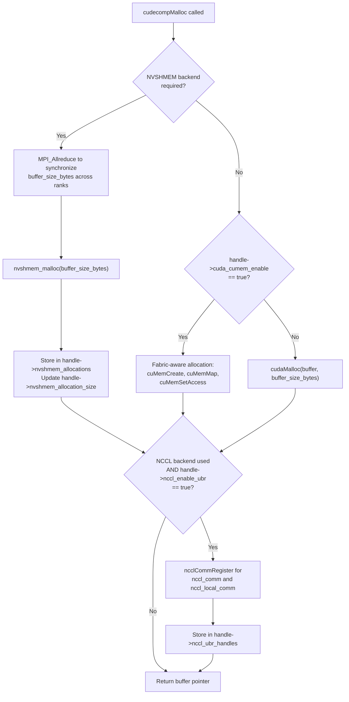
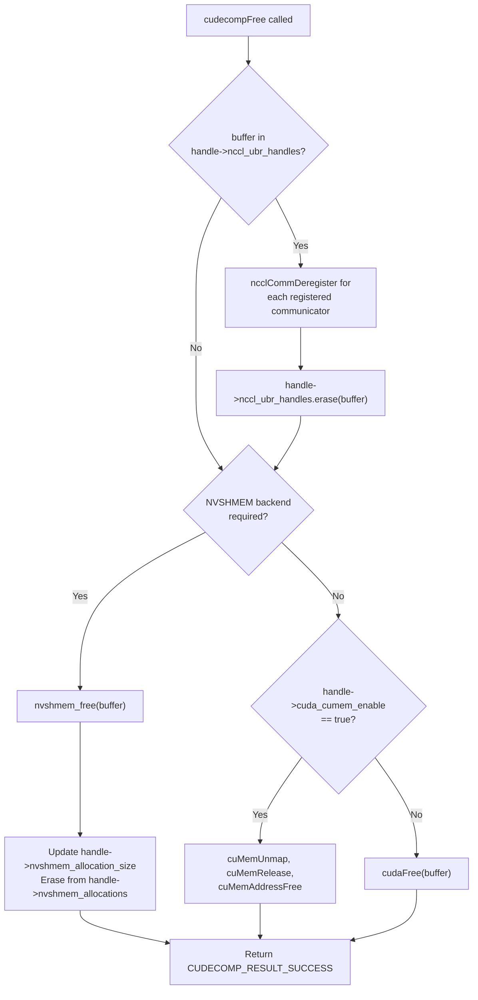
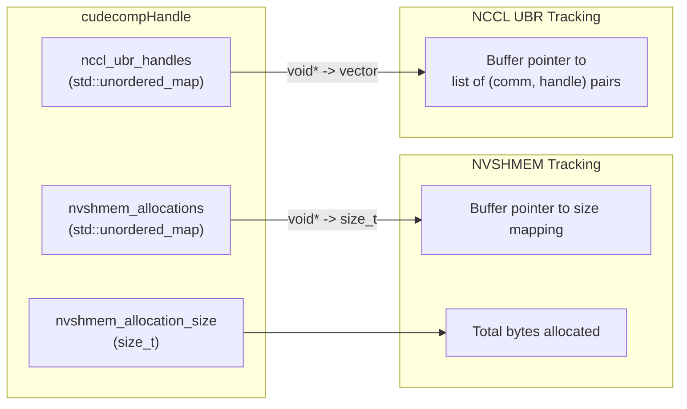

<!-- source: DeepWiki mcp.deepwiki.com · repo NVIDIA/cuDecomp · page 4.5 Memory Management API · fetched 2026-10-26 -->

# Memory Management API

<details>
<summary>Relevant source files</summary>

The following files were used as context for generating this wiki page:

- [include/cudecomp.h](include/cudecomp.h)
- [src/cudecomp.cc](src/cudecomp.cc)

</details>


This page documents the memory allocation and deallocation functions provided by cuDecomp. These functions handle backend-specific memory requirements and optimizations to ensure proper operation with different communication backends (MPI, NCCL, NVSHMEM).

For information about workspace size calculation, see [Transpose Operations API](#4.3) and [Halo Update Operations API](#4.4). For details about the memory allocation implementation and backend selection logic, see [Memory Management](#9).

## Purpose and Scope

cuDecomp provides specialized memory allocation functions (`cudecompMalloc` and `cudecompFree`) that automatically select the appropriate allocator based on the communication backend configuration in the grid descriptor. These functions are required for allocating transpose and halo workspaces, as different backends have specific memory requirements:

- **NVSHMEM backends** require symmetric heap allocations across all ranks
- **NCCL backends** benefit from User Buffer Registration (UBR) to reduce latency
- **CUDA VMM allocations** enable fabric-aware memory for multi-GPU systems

Users should always use these functions to allocate cuDecomp workspaces rather than calling `cudaMalloc` directly.

## API Functions

### cudecompMalloc

Allocates memory suitable for use with cuDecomp operations based on the communication backend configuration.

**Function Signature:**
```c
cudecompResult_t cudecompMalloc(cudecompHandle_t handle,
                                cudecompGridDesc_t grid_desc,
                                void** buffer,
                                size_t buffer_size_bytes);
```

**Parameters:**

| Parameter | Type | Direction | Description |
|-----------|------|-----------|-------------|
| `handle` | `cudecompHandle_t` | in | The initialized cuDecomp library handle |
| `grid_desc` | `cudecompGridDesc_t` | in | A cuDecomp grid descriptor containing backend configuration |
| `buffer` | `void**` | out | Pointer to receive the address of allocated memory |
| `buffer_size_bytes` | `size_t` | in | Size of requested allocation in bytes |

**Return Value:** `CUDECOMP_RESULT_SUCCESS` on success or error code on failure.

**Collective Behavior:** This function is collective and must be called by all ranks in the communicator to avoid deadlocks, particularly when using NVSHMEM backends which require synchronized symmetric allocations.

Sources: [include/cudecomp.h:352-367](), [src/cudecomp.cc:1131-1227]()

### cudecompFree

Deallocates memory previously allocated with `cudecompMalloc`.

**Function Signature:**
```c
cudecompResult_t cudecompFree(cudecompHandle_t handle,
                              cudecompGridDesc_t grid_desc,
                              void* buffer);
```

**Parameters:**

| Parameter | Type | Direction | Description |
|-----------|------|-----------|-------------|
| `handle` | `cudecompHandle_t` | in | The initialized cuDecomp library handle |
| `grid_desc` | `cudecompGridDesc_t` | in | A cuDecomp grid descriptor (must be same as used for allocation) |
| `buffer` | `void*` | in | Pointer to memory to be deallocated |

**Return Value:** `CUDECOMP_RESULT_SUCCESS` on success or error code on failure.

**Collective Behavior:** This function is collective and must be called by all ranks to avoid deadlocks.

Sources: [include/cudecomp.h:370-381](), [src/cudecomp.cc:1229-1286]()

## Allocation Decision Flow

The following diagram illustrates how `cudecompMalloc` selects the appropriate allocation method based on the backend configuration:



**Backend Detection Logic**

The allocation path is determined by checking the `transpose_comm_backend` and `halo_comm_backend` fields in the grid descriptor's configuration:

- **NVSHMEM path:** Triggered by `CUDECOMP_TRANSPOSE_COMM_NVSHMEM`, `CUDECOMP_TRANSPOSE_COMM_NVSHMEM_PL`, `CUDECOMP_HALO_COMM_NVSHMEM`, or `CUDECOMP_HALO_COMM_NVSHMEM_BLOCKING`
- **NCCL UBR path:** Triggered by `CUDECOMP_TRANSPOSE_COMM_NCCL`, `CUDECOMP_TRANSPOSE_COMM_NCCL_PL`, or `CUDECOMP_HALO_COMM_NCCL`

Sources: [src/cudecomp.cc:1138-1220]()

## Deallocation Decision Flow

The following diagram shows how `cudecompFree` determines the appropriate deallocation method:



Sources: [src/cudecomp.cc:1235-1280]()

## Backend-Specific Behavior

### NVSHMEM Symmetric Allocation

When NVSHMEM backends are used, `cudecompMalloc` performs the following steps:

1. **Size Synchronization:** Uses `MPI_Allreduce` with `MPI_MAX` to ensure all ranks allocate the same buffer size, as required by NVSHMEM's symmetric heap [src/cudecomp.cc:1142]()
2. **Allocation:** Calls `nvshmem_malloc(buffer_size_bytes)` [src/cudecomp.cc:1154]()
3. **Tracking:** Records allocation in `handle->nvshmem_allocations` map and updates `handle->nvshmem_allocation_size` [src/cudecomp.cc:1157-1158]()
4. **Size Warning:** If sufficient symmetric heap space may not be available, prints a warning suggesting to increase `NVSHMEM_SYMMETRIC_SIZE` [src/cudecomp.cc:1145-1151]()

**Important:** The available symmetric heap size is controlled by the `NVSHMEM_SYMMETRIC_SIZE` environment variable (default: 1 GiB). The library tracks allocations to warn when approaching the limit.

Sources: [src/cudecomp.cc:1140-1158]()

### CUDA Virtual Memory Management (VMM)

When `CUDECOMP_ENABLE_CUMEM` environment variable is set to 1, `cudecompMalloc` uses CUDA VMM APIs for fabric-aware allocations:

1. **Property Setup:** Configures `CUmemAllocationProp` with `CU_MEM_HANDLE_TYPE_FABRIC` and checks for RDMA support [src/cudecomp.cc:1170-1180]()
2. **Granularity Alignment:** Aligns buffer size to required allocation granularity [src/cudecomp.cc:1183-1185]()
3. **Allocation:** Calls `cuMemCreate`, `cuMemAddressReserve`, and `cuMemMap` [src/cudecomp.cc:1188-1191]()
4. **Access Control:** Sets read/write access permissions using `cuMemSetAccess` [src/cudecomp.cc:1193-1198]()

This allocation method is only available with CUDA 12.3+ and compatible drivers. The library automatically disables this feature if not supported.

Sources: [src/cudecomp.cc:1164-1199](), [src/cudecomp.cc:270-305]()

### NCCL User Buffer Registration (UBR)

When NCCL backends are used and `CUDECOMP_ENABLE_NCCL_UBR` is enabled, buffers are pre-registered with NCCL communicators:

1. **Registration:** Calls `ncclCommRegister` for both global and local communicators if present [src/cudecomp.cc:1210-1215]()
2. **Handle Tracking:** Stores registration handles in `handle->nccl_ubr_handles` map [src/cudecomp.cc:1211-1215]()
3. **Deregistration:** On free, calls `ncclCommDeregister` for each registered communicator [src/cudecomp.cc:1241]()

UBR reduces communication latency by avoiding runtime buffer registration overhead. This feature requires NCCL 2.19.0 or later.

Sources: [src/cudecomp.cc:1203-1219](), [src/cudecomp.cc:1235-1244]()

## Memory Allocation Tracking

The following data structures in `cudecompHandle` track allocated memory:



**NVSHMEM Tracking:**
- `nvshmem_allocations`: Maps buffer pointers to their sizes in bytes
- `nvshmem_allocation_size`: Running total of allocated symmetric heap memory
- Used to provide warnings about symmetric heap exhaustion

**NCCL UBR Tracking:**
- `nccl_ubr_handles`: Maps buffer pointers to vectors of (communicator, registration handle) pairs
- Each buffer may be registered with multiple communicators (global and local)
- Required for proper deregistration during `cudecompFree`

Sources: [src/cudecomp.cc:1157-1158](), [src/cudecomp.cc:1211-1215]()

## Environment Variables

The following environment variables control memory allocation behavior:

| Variable | Type | Default | Description |
|----------|------|---------|-------------|
| `CUDECOMP_ENABLE_NCCL_UBR` | int | 0 (disabled) | Enable NCCL User Buffer Registration for reduced latency |
| `CUDECOMP_ENABLE_CUMEM` | int | 0 (disabled) | Enable CUDA VMM fabric-aware allocations (requires CUDA 12.3+) |
| `NVSHMEM_SYMMETRIC_SIZE` | size | 1G | Size of NVSHMEM symmetric heap (e.g., "2G", "512M") |

These variables are read during `cudecompInit` and stored in the handle.

Sources: [src/cudecomp.cc:264-305](), [src/cudecomp.cc:383-403]()

## Usage Notes

### Memory Lifetime

Memory allocated with `cudecompMalloc` remains valid as long as:
1. The `cudecompHandle_t` used for allocation has not been finalized
2. The `cudecompGridDesc_t` used for allocation has not been destroyed

Users must call `cudecompFree` before destroying the grid descriptor to avoid resource leaks.

### Collective Operations

Both `cudecompMalloc` and `cudecompFree` are **collective operations** that must be called by all ranks in the communicator. This is required because:
- NVSHMEM allocations use `MPI_Allreduce` to synchronize sizes
- Some backends may perform implicit synchronization

Failure to call these functions on all ranks will result in deadlocks.

### Standard vs. Workspace Allocations

While `cudecompMalloc` should be used for all transpose and halo workspaces, users may use standard allocation functions (e.g., `cudaMalloc`) for their own data arrays (input/output pencils). The special allocation is only required for the internal workspace buffers passed to transpose and halo operations.

Sources: [include/cudecomp.h:352-381]()

## Example Usage

```c
// Query required workspace size
int64_t workspace_size;
cudecompGetTransposeWorkspaceSize(handle, grid_desc, &workspace_size);

// Allocate workspace using cudecompMalloc
void* work;
int64_t dtype_size;
cudecompGetDataTypeSize(CUDECOMP_DOUBLE, &dtype_size);
cudecompMalloc(handle, grid_desc, &work, workspace_size * dtype_size);

// Use workspace in transpose operations
cudecompTransposeXToY(handle, grid_desc, input, output, work,
                      CUDECOMP_DOUBLE, NULL, NULL, NULL, NULL, stream);

// Free workspace before destroying grid descriptor
cudecompFree(handle, grid_desc, work);
cudecompGridDescDestroy(handle, grid_desc);
```

This example demonstrates the typical lifecycle: query workspace size, allocate with `cudecompMalloc`, use in operations, and free before destroying the grid descriptor.

Sources: [include/cudecomp.h:309-381](), [examples/C/basic_usage.cu]()

---

