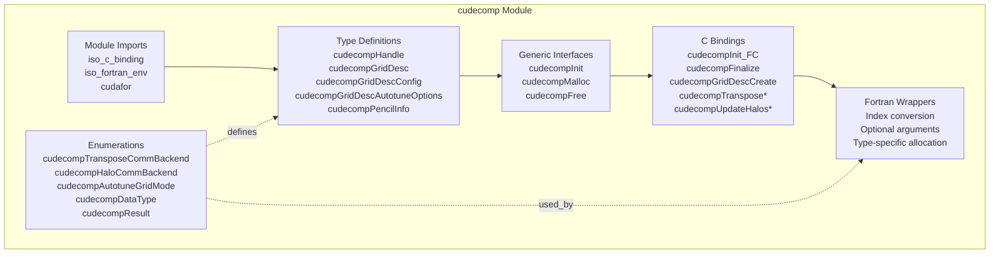
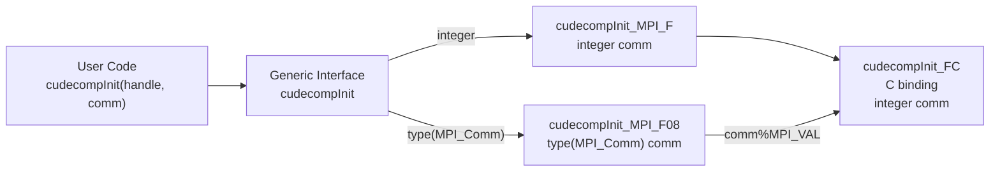
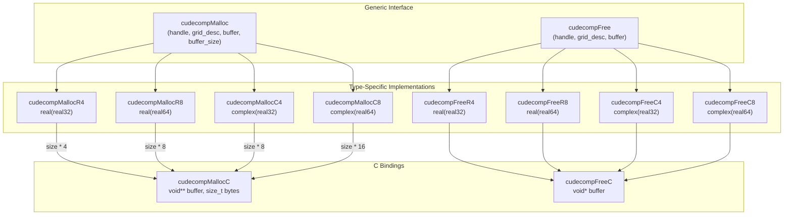
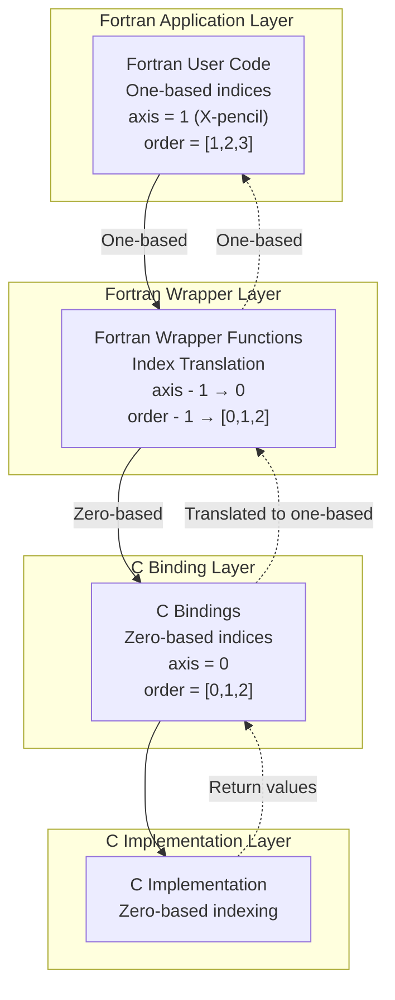
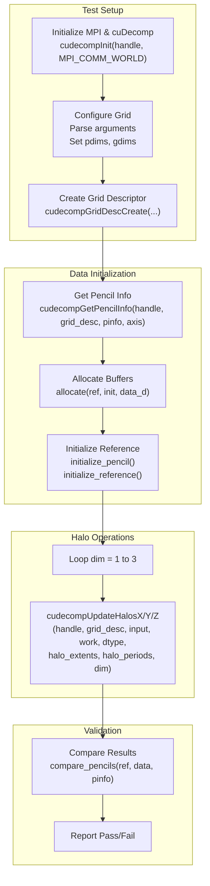

<!-- source: DeepWiki mcp.deepwiki.com · repo NVIDIA/cuDecomp · page 4.6 Fortran Interface · fetched 2026-10-26 -->

# Fortran Interface

<details>
<summary>Relevant source files</summary>

The following files were used as context for generating this wiki page:

- [docs/autotuning.rst](docs/autotuning.rst)
- [examples/fortran/basic_usage/basic_usage_autotune.f90](examples/fortran/basic_usage/basic_usage_autotune.f90)
- [src/cudecomp_m.cuf](src/cudecomp_m.cuf)
- [tests/cc/halo_test.cc](tests/cc/halo_test.cc)
- [tests/fortran/halo_test.f90](tests/fortran/halo_test.f90)

</details>


## Purpose and Scope

This document describes the Fortran bindings for cuDecomp, provided through the `cudecomp` module. The Fortran interface wraps the C API, providing idiomatic Fortran usage with type-safe generic interfaces, proper index conventions, and support for multiple MPI implementations. For the underlying C API documentation, see [Initialization and Finalization](#4.1), [Grid Configuration and Creation](#4.2), [Transpose Operations API](#4.3), [Halo Update Operations API](#4.4), and [Memory Management API](#4.5).

Sources: [src/cudecomp_m.cuf:1-1130]()

---

## Module Organization

The Fortran interface is provided through a single module `cudecomp` defined in [src/cudecomp_m.cuf](). The module uses CUDA Fortran extensions (`.cuf` file extension) and integrates with the `cudafor` module for device memory management.

**Module Structure**



Sources: [src/cudecomp_m.cuf:16-21]()

---

## Type System

### Opaque Handle Types

The Fortran interface uses opaque types to wrap C pointers, providing type safety while hiding implementation details.

| Fortran Type | C Equivalent | Purpose |
|--------------|--------------|---------|
| `cudecompHandle` | `cudecompHandle_t` | Library instance handle |
| `cudecompGridDesc` | `cudecompGridDesc_t` | Grid descriptor handle |

Both types contain a single `type(c_ptr) :: member` field and are defined with `bind(c)` for C interoperability.

Sources: [src/cudecomp_m.cuf:74-82]()

### Configuration and Information Structures

**cudecompGridDescConfig**

This structure configures grid decomposition and communication settings. All fields use C-compatible types with `bind(c)`.

```fortran
type, bind(c) :: cudecompGridDescConfig
    integer(c_int32_t) :: gdims(3)                      ! Global grid dimensions
    integer(c_int32_t) :: gdims_dist(3)                 ! Distribution grid dimensions
    integer(c_int32_t) :: pdims(2)                      ! Process grid dimensions
    integer(c_int32_t) :: transpose_comm_backend        ! Transpose communication backend
    logical(c_bool) :: transpose_axis_contiguous(3)     ! Axis contiguity flags
    integer(c_int32_t) :: transpose_mem_order(3,3)      ! Memory ordering per axis
    integer(c_int32_t) :: halo_comm_backend             ! Halo communication backend
end type
```

**Important:** The `transpose_mem_order` array is adjusted for zero-based indexing in the wrapper functions.

Sources: [src/cudecomp_m.cuf:84-99]()

**cudecompGridDescAutotuneOptions**

This structure controls autotuning behavior with separate options for general, transpose, and halo autotuning.

| Field Group | Key Fields | Purpose |
|-------------|-----------|---------|
| General | `n_warmup_trials`, `n_trials`, `dtype`, `grid_mode` | Controls trial count and data type |
| Grid Selection | `allow_uneven_decompositions`, `disable_nccl_backends`, `disable_nvshmem_backends` | Filters tested configurations |
| Transpose | `autotune_transpose_backend`, `transpose_use_inplace_buffers(4)`, `transpose_op_weights(4)` | Transpose-specific settings |
| Halo | `autotune_halo_backend`, `halo_extents(3)`, `halo_periods(3)`, `halo_axis` | Halo-specific settings |

**Important:** The `halo_axis` field uses one-based indexing in Fortran (1/2/3 for X/Y/Z) and is automatically converted to zero-based indexing (0/1/2) when passed to C functions.

Sources: [src/cudecomp_m.cuf:101-128]()

**cudecompPencilInfo**

This structure provides information about a pencil decomposition.

```fortran
type, bind(c) :: cudecompPencilInfo
    integer(c_int32_t) :: shape(3)        ! Pencil shape (local order, including halos)
    integer(c_int32_t) :: lo(3)           ! Lower bound (local order, excluding halos)
    integer(c_int32_t) :: hi(3)           ! Upper bound (local order, excluding halos)
    integer(c_int32_t) :: order(3)        ! Memory layout order
    integer(c_int32_t) :: halo_extents(3) ! Halo extents (x,y,z order)
    integer(c_int32_t) :: padding(3)      ! Padding (x,y,z order)
    integer(c_int64_t) :: size            ! Total elements including halos
end type
```

**Important:** The `order`, `lo`, and `hi` fields use one-based indexing in the Fortran interface and are converted from the zero-based C values.

Sources: [src/cudecomp_m.cuf:130-139]()

---

## Enumerations

The Fortran interface mirrors all C enumerations using Fortran `enum, bind(c)` constructs.

**Communication Backend Enumerations**

| Transpose Backend | Value | Fortran Constant |
|-------------------|-------|------------------|
| MPI Point-to-Point | 1 | `CUDECOMP_TRANSPOSE_COMM_MPI_P2P` |
| MPI P2P Pipelined | 2 | `CUDECOMP_TRANSPOSE_COMM_MPI_P2P_PL` |
| MPI Alltoall | 3 | `CUDECOMP_TRANSPOSE_COMM_MPI_A2A` |
| NCCL | 4 | `CUDECOMP_TRANSPOSE_COMM_NCCL` |
| NCCL Pipelined | 5 | `CUDECOMP_TRANSPOSE_COMM_NCCL_PL` |
| NVSHMEM | 6 | `CUDECOMP_TRANSPOSE_COMM_NVSHMEM` |
| NVSHMEM Pipelined | 7 | `CUDECOMP_TRANSPOSE_COMM_NVSHMEM_PL` |

| Halo Backend | Value | Fortran Constant |
|--------------|-------|------------------|
| MPI Non-blocking | 1 | `CUDECOMP_HALO_COMM_MPI` |
| MPI Blocking | 2 | `CUDECOMP_HALO_COMM_MPI_BLOCKING` |
| NCCL | 3 | `CUDECOMP_HALO_COMM_NCCL` |
| NVSHMEM | 4 | `CUDECOMP_HALO_COMM_NVSHMEM` |
| NVSHMEM Blocking | 5 | `CUDECOMP_HALO_COMM_NVSHMEM_BLOCKING` |

Sources: [src/cudecomp_m.cuf:24-42]()

**Data Type Enumeration**

| Data Type | Value | Fortran Constant |
|-----------|-------|------------------|
| Single precision real | -1 | `CUDECOMP_FLOAT` |
| Double precision real | -2 | `CUDECOMP_DOUBLE` |
| Single precision complex | -3 | `CUDECOMP_FLOAT_COMPLEX` |
| Double precision complex | -4 | `CUDECOMP_DOUBLE_COMPLEX` |

Sources: [src/cudecomp_m.cuf:50-56]()

**Result Enumeration**

```fortran
enum, bind(c) ! cudecompResult
    enumerator :: CUDECOMP_RESULT_SUCCESS = 0
    enumerator :: CUDECOMP_RESULT_INVALID_USAGE = 1
    enumerator :: CUDECOMP_RESULT_NOT_SUPPORTED = 2
    enumerator :: CUDECOMP_RESULT_INTERNAL_ERROR = 3
    enumerator :: CUDECOMP_RESULT_CUDA_ERROR = 4
    enumerator :: CUDECOMP_RESULT_CUTENSOR_ERROR = 5
    enumerator :: CUDECOMP_RESULT_MPI_ERROR = 6
    enumerator :: CUDECOMP_RESULT_NCCL_ERROR = 7
    enumerator :: CUDECOMP_RESULT_NVSHMEM_ERROR = 8
    enumerator :: CUDECOMP_RESULT_NVML_ERROR = 9
end enum
```

Sources: [src/cudecomp_m.cuf:58-70]()

---

## Generic Interfaces and MPI Interoperability

### MPI Communicator Support

The `cudecompInit` function uses a generic interface to support both legacy MPI (integer communicators) and MPI F08 (derived type communicators).

**Generic Interface Pattern**



**Implementation Details:**

1. **Legacy MPI (mpif.h)**: Communicators are integers, passed directly
2. **MPI F08**: Communicators are derived types with `MPI_VAL` component, extracted before C call

```fortran
! Generic interface
interface cudecompInit
    module procedure cudecompInit_MPI_F, cudecompInit_MPI_F08
end interface cudecompInit

! MPI F08 wrapper extracts integer value
function cudecompInit_MPI_F08(handle, comm) result(res)
    type, bind(c) :: MPI_Comm
        integer :: MPI_VAL
    end type MPI_Comm
    type(cudecompHandle) :: handle
    type(MPI_Comm) :: comm
    integer(c_int) :: res
    
    res = cudecompInit_FC(handle, comm%MPI_VAL)
end function
```

Sources: [src/cudecomp_m.cuf:146-507]()

### Type-Safe Memory Allocation

The `cudecompMalloc` and `cudecompFree` functions use generic interfaces to provide type-safe allocation for different data types, automatically handling size calculations and pointer conversions.

**Memory Management Interface Pattern**



**Implementation Example:**

```fortran
! Generic interface
interface cudecompMalloc
    module procedure cudecompMallocR4, cudecompMallocR8, &
                     cudecompMallocC4, cudecompMallocC8
end interface cudecompMalloc

! Type-specific implementation for real64
function cudecompMallocR8(handle, grid_desc, buffer, buffer_size) result(res)
    type(cudecompHandle) :: handle
    type(cudecompGridDesc) :: grid_desc
    real(real64), pointer, device, contiguous :: buffer(:)
    integer(int64) :: buffer_size
    integer(c_int) :: res
    
    type(c_devptr) :: buffer_c
    
    ! Allocate with byte size = buffer_size * 8
    res = cudecompMallocC(handle, grid_desc, buffer_c, buffer_size * 8)
    ! Convert C device pointer to Fortran device pointer
    call c_f_pointer(buffer_c, buffer, [buffer_size])
end function
```

This pattern provides several benefits:
- **Automatic size calculation**: Users specify element count, not bytes
- **Type safety**: Compiler ensures buffer type matches allocation type
- **Pointer conversion**: Transparent conversion between C and Fortran device pointers

Sources: [src/cudecomp_m.cuf:282-702]()

---

## Index Convention Translation

A critical aspect of the Fortran interface is automatic translation between Fortran's one-based indexing and C's zero-based indexing. The library handles this transparently in wrapper functions.

**Index Translation Patterns**



### Functions Performing Index Translation

| Function | Fields Translated | Direction |
|----------|------------------|-----------|
| `cudecompGridDescCreate` | `config%transpose_mem_order` | Fortran→C (subtract 1)<br/>C→Fortran (add 1) |
| `cudecompGridDescAutotuneOptionsSetDefaults` | `options%halo_axis` | C→Fortran (add 1) |
| `cudecompGetPencilInfo` | Input: `axis`<br/>Output: `pinfo%order`, `pinfo%lo`, `pinfo%hi` | Input: subtract 1<br/>Output: add 1 |
| `cudecompGetHaloWorkspaceSize` | `axis` | Fortran→C (subtract 1) |
| `cudecompGetShiftedRank` | `axis`, `dim` | Fortran→C (subtract 1) |
| `cudecompUpdateHalos*` | `dim` | Fortran→C (subtract 1) |

**Example: cudecompGetPencilInfo Translation**

```fortran
function cudecompGetPencilInfo(handle, grid_desc, pencil_info, axis, &
                               halo_extents, padding) result(res)
    ! ... declarations ...
    integer :: axis  ! ONE-BASED: 1=X, 2=Y, 3=Z
    
    ! Call C function with zero-based axis
    res = cudecompGetPencilInfoC(handle, grid_desc, pencil_info, &
                                 axis - 1, halo_extents_, padding_)
    
    ! Convert returned indices to one-based
    pencil_info%order = pencil_info%order + 1  ! [0,1,2] → [1,2,3]
    pencil_info%lo = pencil_info%lo + 1        ! Convert to one-based
    pencil_info%hi = pencil_info%hi + 1        ! Convert to one-based
end function
```

Sources: [src/cudecomp_m.cuf:509-738]()

---

## Transpose and Halo Operations

### Transpose Function Interface

All transpose functions (`cudecompTransposeXToY`, `cudecompTransposeYToZ`, etc.) share a common pattern with optional arguments and automatic default value handling.

**Common Transpose Function Signature**

```fortran
function cudecompTransposeXToY(handle, grid_desc, input, output, work, dtype, &
                               input_halo_extents, output_halo_extents, &
                               input_padding, output_padding, stream) result(res)
    type(cudecompHandle) :: handle
    type(cudecompGridDesc) :: grid_desc
    real(c_float), device :: input(*), output(*), work(*)  ! !dir$ ignore_tkr
    integer :: dtype
    integer, optional :: input_halo_extents(3)
    integer, optional :: output_halo_extents(3)
    integer, optional :: input_padding(3)
    integer, optional :: output_padding(3)
    integer(cuda_stream_kind), optional :: stream
    integer(c_int) :: res
```

**Key Features:**
- **Type-agnostic buffers**: The `!dir$ ignore_tkr` directive allows any data type for buffer arguments
- **Optional arguments**: Halo extents, padding, and stream are optional with zero/null defaults
- **Automatic defaults**: Wrapper functions initialize missing optional arguments before C call

Sources: [src/cudecomp_m.cuf:742-888]()

### Halo Update Function Interface

Halo functions include additional logic for boolean array conversion (Fortran `logical` to C `logical(c_bool)`).

**Halo Function Pattern**

```fortran
function cudecompUpdateHalosX(handle, grid_desc, input, work, dtype, &
                              halo_extents, halo_periods, dim, padding, stream) result(res)
    ! ... declarations ...
    logical :: halo_periods(3)              ! Fortran logical
    logical(c_bool) :: halo_periods_c(3)    ! C-compatible bool
    integer :: dim                           ! ONE-BASED dimension (1/2/3)
    
    ! Convert Fortran logical to C bool
    halo_periods_c(:) = halo_periods
    
    ! Call C function with zero-based dim
    res = cudecompUpdateHalosX_C(handle, grid_desc, input, work, dtype, &
                                 halo_extents, halo_periods_c, &
                                 dim - 1, padding_, stream_)
end function
```

**Index Translation for Dimension Parameter:**
- **Fortran**: `dim = 1, 2, 3` corresponds to X, Y, Z directions
- **C**: `dim = 0, 1, 2` corresponds to X, Y, Z directions
- **Translation**: `dim - 1` in wrapper function

Sources: [src/cudecomp_m.cuf:890-978]()

---

## Usage Patterns and Best Practices

### Basic Initialization Pattern

```fortran
use mpi
use cudafor
use cudecomp

! MPI setup
call MPI_Init(ierr)
call MPI_Comm_rank(MPI_COMM_WORLD, rank, ierr)

! Initialize cuDecomp
type(cudecompHandle) :: handle
integer :: istat

istat = cudecompInit(handle, MPI_COMM_WORLD)
if (istat /= CUDECOMP_RESULT_SUCCESS) then
    ! Handle error
endif
```

Sources: [examples/fortran/basic_usage/basic_usage_autotune.f90:58-68]()

### Grid Descriptor Creation with Index Conventions

```fortran
! Configure grid (using one-based indexing where appropriate)
type(cudecompGridDescConfig) :: config
type(cudecompGridDesc) :: grid_desc

istat = cudecompGridDescConfigSetDefaults(config)

config%gdims = [64, 64, 64]    ! X, Y, Z dimensions
config%pdims = [2, 2]          ! Process grid

! If specifying memory order, use ONE-BASED indices
! For example: [1, 2, 3] means X, Y, Z order in memory
! The wrapper function will convert to [0, 1, 2] for C
config%transpose_mem_order(:, 1) = [1, 2, 3]  ! X-pencil order

istat = cudecompGridDescCreate(handle, grid_desc, config)
```

Sources: [examples/fortran/basic_usage/basic_usage_autotune.f90:70-121]()

### Querying Pencil Information

```fortran
! Get pencil information for X-pencils (axis=1) with halos
type(cudecompPencilInfo) :: pinfo
integer :: halo_extents(3)

halo_extents = [1, 1, 1]
istat = cudecompGetPencilInfo(handle, grid_desc, pinfo, 1, halo_extents)

! pinfo%order contains ONE-BASED indices [1, 2, 3]
! pinfo%lo, pinfo%hi are ONE-BASED coordinates
! Use these directly in Fortran array indexing
do k = pinfo%lo(3), pinfo%hi(3)
    do j = pinfo%lo(2), pinfo%hi(2)
        do i = pinfo%lo(1), pinfo%hi(1)
            ! Compute global coordinates using order array
            gx(pinfo%order(1)) = i
            gx(pinfo%order(2)) = j
            gx(pinfo%order(3)) = k
        enddo
    enddo
enddo
```

Sources: [examples/fortran/basic_usage/basic_usage_autotune.f90:135-191]()

### Type-Safe Memory Allocation

```fortran
! Allocate workspace with automatic type handling
real(real64), pointer, device, contiguous :: work_d(:)
integer(int64) :: work_size

! Get required size in elements
istat = cudecompGetTransposeWorkspaceSize(handle, grid_desc, work_size)

! Allocate - size is in elements, wrapper calculates bytes
istat = cudecompMalloc(handle, grid_desc, work_d, work_size)

! Use work_d as real(real64) device array
! ...

! Free when done
istat = cudecompFree(handle, grid_desc, work_d)
```

Sources: [examples/fortran/basic_usage/basic_usage_autotune.f90:224-237]()

### Halo Updates with Dimension Indexing

```fortran
! Update halos in all directions using ONE-BASED dimension indices
logical :: halo_periods(3)
halo_periods = [.true., .true., .true.]  ! Periodic in all directions

! Update in X direction (dim=1)
istat = cudecompUpdateHalosX(handle, grid_desc, data_d, work_d, &
                             CUDECOMP_DOUBLE, pinfo%halo_extents, &
                             halo_periods, 1)

! Update in Y direction (dim=2)
istat = cudecompUpdateHalosX(handle, grid_desc, data_d, work_d, &
                             CUDECOMP_DOUBLE, pinfo%halo_extents, &
                             halo_periods, 2)

! Update in Z direction (dim=3)
istat = cudecompUpdateHalosX(handle, grid_desc, data_d, work_d, &
                             CUDECOMP_DOUBLE, pinfo%halo_extents, &
                             halo_periods, 3)
```

Sources: [examples/fortran/basic_usage/basic_usage_autotune.f90:258-273]()

---

## Key Differences from C API

### Summary Table

| Aspect | C API | Fortran API |
|--------|-------|-------------|
| **Array Indexing** | Zero-based (0, 1, 2) | One-based (1, 2, 3) |
| **Axis Constants** | `0` = X, `1` = Y, `2` = Z | `1` = X, `2` = Y, `3` = Z |
| **Pointer Types** | `void*` with explicit casting | Type-safe pointers via generics |
| **Optional Arguments** | Null pointers for defaults | Fortran `optional` keyword |
| **MPI Communicators** | `MPI_Comm` (int or opaque) | Generic interface for both MPI versions |
| **Memory Allocation** | Size in bytes | Size in elements, type-inferred |
| **Boolean Types** | `bool` | `logical`, converted to `logical(c_bool)` |
| **Result Checking** | Return `cudecompResult_t` | Return `integer(c_int)`, compare to enums |

### Index Convention Examples

**Pencil Axis Selection:**
```fortran
! C: axis = 0 for X-pencils
! Fortran: axis = 1 for X-pencils
istat = cudecompGetPencilInfo(handle, grid_desc, pinfo, 1)  ! X-pencils
```

**Memory Order Specification:**
```fortran
! C: config.transpose_mem_order[axis][i] = {0, 1, 2}  // X, Y, Z
! Fortran: config%transpose_mem_order(:, axis) = [1, 2, 3]  ! X, Y, Z
```

**Pencil Info Interpretation:**
```fortran
! C: pinfo.order = {0, 1, 2} means X, Y, Z order
! Fortran: pinfo%order = [1, 2, 3] means X, Y, Z order

! Both map local indices to global coordinates identically
! C: global[pinfo.order[i]] = local[i] + pinfo.lo[i]
! Fortran: global(pinfo%order(i)) = local(i) + pinfo%lo(i) - 1
```

Sources: [src/cudecomp_m.cuf:488-888](), [tests/fortran/halo_test.f90:68-152]()

---

## Testing and Validation Example

The Fortran halo test demonstrates proper use of the interface including index conventions, optional arguments, and type-safe allocation.

**Key Test Patterns:**



**Index Convention in Tests:**

The test correctly uses one-based indexing throughout:
```fortran
! ONE-BASED axis selection (1, 2, 3 for X, Y, Z)
istat = cudecompGetPencilInfo(handle, grid_desc, pinfo, axis, halo_extents)

! ONE-BASED dimension loop
do i = 1, 3
    select case(axis)
        case(1)
            ! ONE-BASED dim passed to halo function
            istat = cudecompUpdateHalosX(handle, grid_desc, input, work, &
                                         dtype, halo_extents, halo_periods, i)
    end select
end do

! ONE-BASED array indexing using pinfo
do k = pinfo%lo(3), pinfo%hi(3)
    do j = pinfo%lo(2), pinfo%hi(2)
        do i = pinfo%lo(1), pinfo%hi(1)
            gx(pinfo%order(1)) = i
            gx(pinfo%order(2)) = j  
            gx(pinfo%order(3)) = k
        enddo
    enddo
enddo
```

Sources: [tests/fortran/halo_test.f90:202-500]()

---

## Module Import and Compilation

### Required Modules

```fortran
program my_program
    use mpi                                      ! MPI functionality
    use cudafor                                  ! CUDA Fortran extensions
    use cudecomp                                 ! cuDecomp library
    use, intrinsic :: iso_fortran_env, only: real32, real64  ! Standard types
    
    implicit none
    ! Your code here
end program
```

### Compiler Requirements

The Fortran interface requires:
- **NVHPC compiler** with CUDA Fortran support
- **MPI implementation** (OpenMPI, MPICH, etc.)
- The library must be compiled with `BUILD_FORTRAN=ON` in CMake

Sources: [src/cudecomp_m.cuf:16-20](), [tests/fortran/halo_test.f90:27-47]()

---

