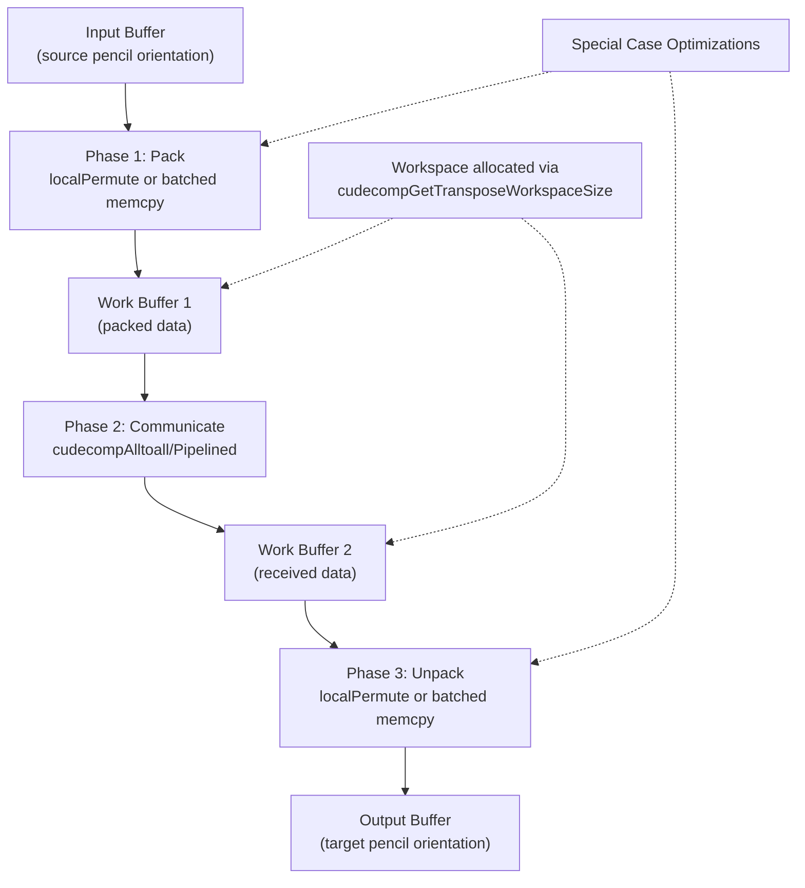
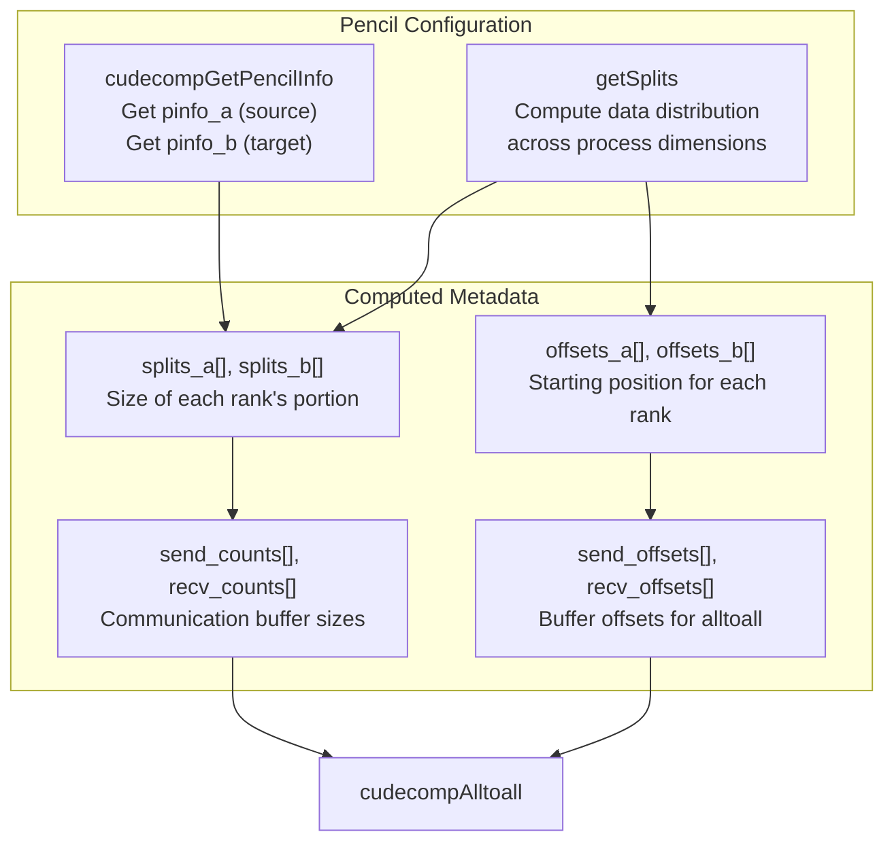
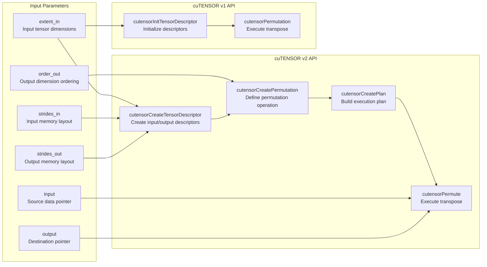
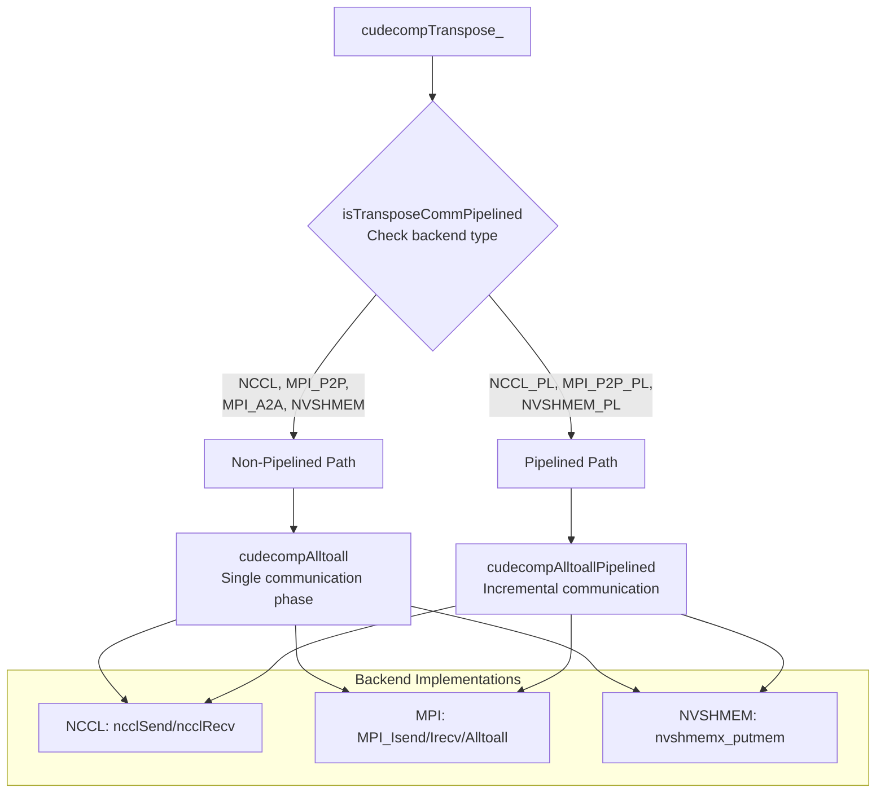
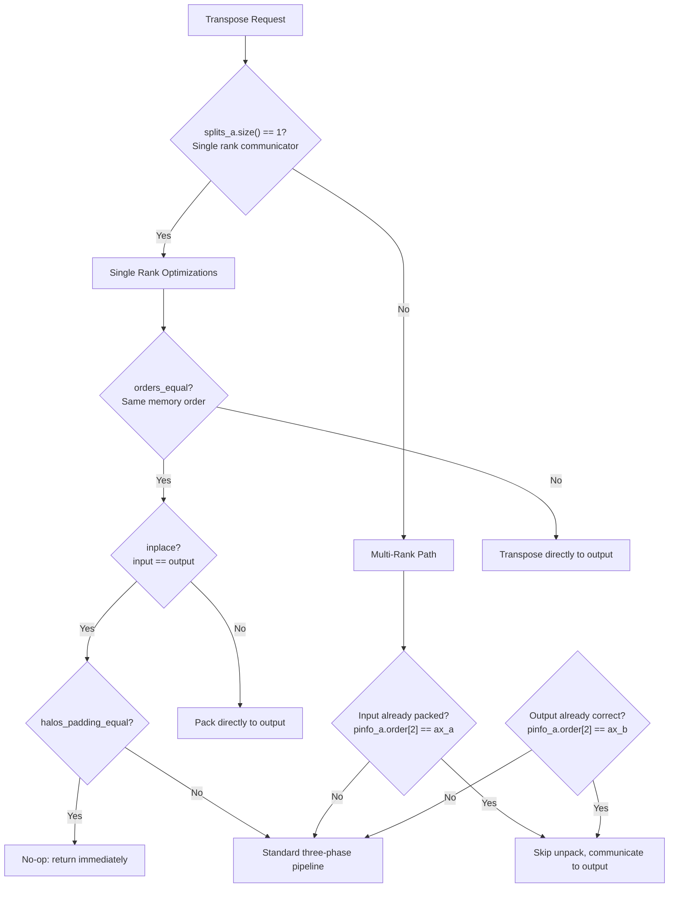
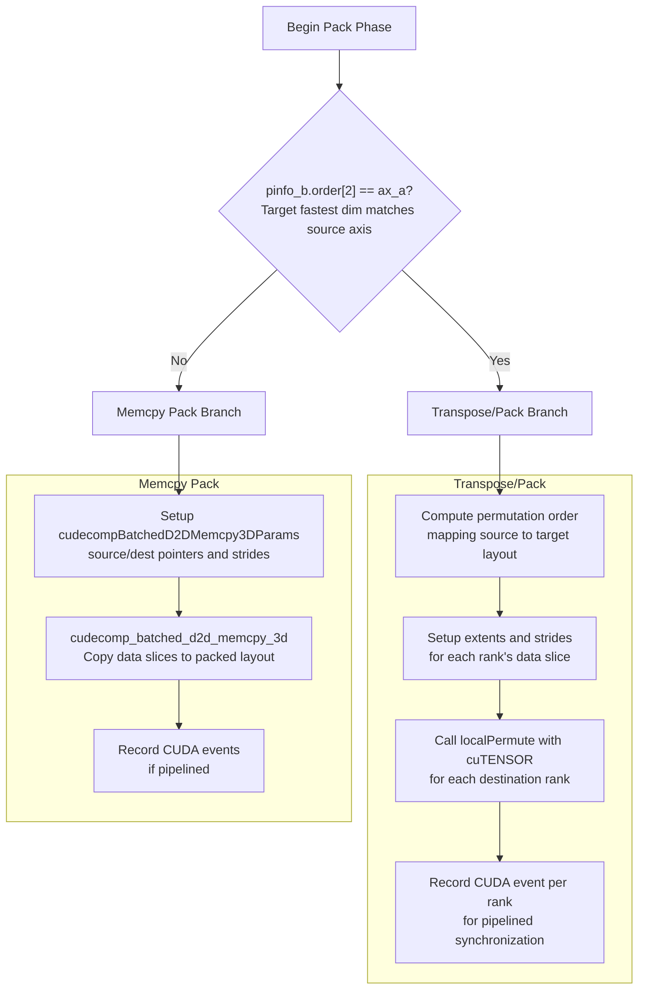
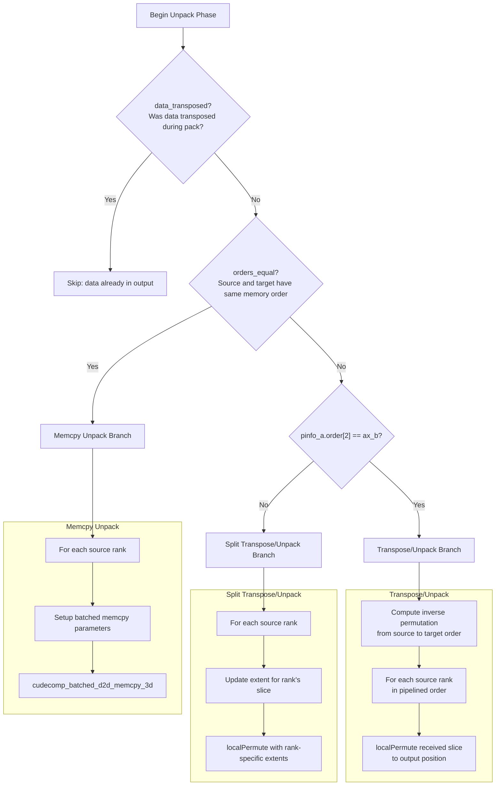

<!-- source: DeepWiki mcp.deepwiki.com · repo NVIDIA/cuDecomp · page 5 Transpose Operations · fetched 2026-10-26 -->

# Transpose Operations

<details>
<summary>Relevant source files</summary>

The following files were used as context for generating this wiki page:

- [include/internal/comm_routines.h](include/internal/comm_routines.h)
- [include/internal/transpose.h](include/internal/transpose.h)
- [src/cudecomp.cc](src/cudecomp.cc)

</details>


This page provides a detailed explanation of transpose operation implementation in cuDecomp, covering the pack-communicate-unpack pipeline, local data reorganization, and communication patterns used to redistribute data between different pencil orientations. For information about the public API for transpose operations, see [4.3](#4.3). For details about communication backend selection and configuration, see [3.3](#3.3). For pipelined transpose implementation specifics, see [5.2](#5.2).

## Overview

Transpose operations in cuDecomp redistribute 3D data arrays between different pencil orientations (X-pencils, Y-pencils, and Z-pencils), enabling algorithms that require different data access patterns. The library provides four transpose functions:

- **`cudecompTransposeXToY`**: Redistributes X-pencil data to Y-pencil orientation
- **`cudecompTransposeYToZ`**: Redistributes Y-pencil data to Z-pencil orientation  
- **`cudecompTransposeZToY`**: Redistributes Z-pencil data back to Y-pencil orientation
- **`cudecompTransposeYToX`**: Redistributes Y-pencil data back to X-pencil orientation

Each transpose operation transforms data between pencil orientations along two of the three spatial dimensions, using a three-phase pipeline: local packing, inter-process communication, and local unpacking.

Sources: [src/cudecomp.cc:1376-1561](), [include/internal/transpose.h:832-878]()

## Transpose Pipeline Architecture

The transpose implementation consists of three main phases executed sequentially. The implementation dynamically optimizes the pipeline based on data layout, communication backend, and whether the operation is in-place or out-of-place.

**Transpose Pipeline Data Flow**



**Phase 1: Pack** reorganizes the local portion of the input pencil into a layout suitable for all-to-all communication, grouping data by destination rank. If the input memory order does not match the required communication order, `localPermute` is called to transpose the local data using cuTENSOR. Otherwise, batched 3D memcpy operations copy data slices into the work buffer.

**Phase 2: Communicate** exchanges data between all processes using `cudecompAlltoall` (non-pipelined) or `cudecompAlltoallPipelined` (pipelined). The specific communication implementation depends on the configured backend (MPI, NCCL, or NVSHMEM).

**Phase 3: Unpack** reorganizes received data from the work buffer into the output pencil format. Similar to packing, this may use `localPermute` for transpose operations or batched memcpy for data copying.

Sources: [include/internal/transpose.h:149-830](), [src/cudecomp.cc:1088-1105]()

## Core Transpose Implementation

The main transpose logic is implemented in the templated function `cudecompTranspose_`, which handles all four transpose directions through parameterization.

**Key Parameters and Data Flow**

| Parameter | Purpose |
|-----------|---------|
| `ax` | Source axis (0=X, 1=Y, 2=Z) |
| `dir` | Direction: +1 for forward (e.g., X→Y), -1 for backward (e.g., Y→X) |
| `input` | Input buffer pointer |
| `output` | Output buffer pointer |
| `work` | Workspace buffer pointer |
| `input_halo_extents` | Optional halo regions around input data |
| `output_halo_extents` | Optional halo regions around output data |
| `input_padding` | Optional padding in input data |
| `output_padding` | Optional padding in output data |
| `stream` | CUDA stream for asynchronous execution |

The function uses `ax` and `dir` to compute three axis indices:
- `ax_a`: Source axis
- `ax_b`: Target axis (forward: `(ax_a + 1) % 3`, backward: `(ax_a + 2) % 3`)
- `ax_c`: Remaining axis

These determine which communicator to use (`CUDECOMP_COMM_ROW` or `CUDECOMP_COMM_COL`) and how to split the data across processes.

Sources: [include/internal/transpose.h:149-178]()

**Pencil Information and Data Splits**



The implementation queries pencil information for both source and target orientations, accounting for any halo extents and padding. It then computes how data is distributed across processes using `getSplits`, which divides each dimension according to the process grid topology. These splits determine the communication pattern for the all-to-all exchange.

Sources: [include/internal/transpose.h:184-198](), [include/internal/transpose.h:332-346]()

## Local Permutation with cuTENSOR

Local permutation operations use the cuTENSOR library to perform efficient tensor transpose operations on GPU. The `localPermute` function provides a unified interface for both cuTENSOR v1 and v2 APIs.

**cuTENSOR Integration**



The function handles data type conversion, alignment computation, and proper stride setup for both contiguous and non-contiguous memory layouts. It supports all cuDecomp data types: `CUDECOMP_FLOAT`, `CUDECOMP_DOUBLE`, `CUDECOMP_FLOAT_COMPLEX`, and `CUDECOMP_DOUBLE_COMPLEX`.

**Key Implementation Details:**

- **Alignment Detection**: Uses `getAlignment` to determine optimal memory alignment [include/internal/transpose.h:64-70]()
- **Stride Handling**: Accepts custom strides for both input and output, defaulting to contiguous layout when strides are zero
- **Zero-Size Handling**: Returns early if any dimension is zero to avoid unnecessary cuTENSOR calls
- **Compute Type Selection**: Automatically selects appropriate compute precision based on data type

Sources: [include/internal/transpose.h:47-147]()

## Communication Backends

Transpose operations support multiple communication backends, each with different performance characteristics and requirements.

**Backend Selection and Requirements**

| Backend | Enum Value | Description | Special Requirements |
|---------|-----------|-------------|---------------------|
| NCCL | `CUDECOMP_TRANSPOSE_COMM_NCCL` | GPU-direct communication via NCCL | Requires NCCL communicators |
| NCCL Pipelined | `CUDECOMP_TRANSPOSE_COMM_NCCL_PL` | Overlaps communication and computation | Requires NCCL communicators |
| MPI Point-to-Point | `CUDECOMP_TRANSPOSE_COMM_MPI_P2P` | Non-blocking MPI Isend/Irecv | Standard MPI |
| MPI P2P Pipelined | `CUDECOMP_TRANSPOSE_COMM_MPI_P2P_PL` | Pipelined MPI point-to-point | Standard MPI |
| MPI Alltoall | `CUDECOMP_TRANSPOSE_COMM_MPI_A2A` | MPI collective operations | Standard MPI |
| NVSHMEM | `CUDECOMP_TRANSPOSE_COMM_NVSHMEM` | Symmetric memory operations | NVSHMEM initialization, symmetric buffers |
| NVSHMEM Pipelined | `CUDECOMP_TRANSPOSE_COMM_NVSHMEM_PL` | Pipelined NVSHMEM | NVSHMEM initialization, symmetric buffers |

**Communication Backend Dispatch**



The backend is selected during grid descriptor creation and validated by `checkTransposeCommBackend`. NVSHMEM backends require special handling: workspace buffers must be allocated via `cudecompMalloc` to ensure symmetric allocation across all ranks.

Sources: [src/cudecomp.cc:89-107](), [include/internal/transpose.h:39-45](), [include/internal/comm_routines.h:184-316]()

## Special Case Optimizations

The transpose implementation includes numerous optimizations for common scenarios that can skip or simplify phases of the pipeline.

**Optimization Decision Tree**



**Key Optimizations:**

1. **Single Rank, In-place, No Layout Change**: If the communicator has only one rank, the operation is in-place, and memory layouts are identical, the function returns immediately without any data movement [include/internal/transpose.h:264-276]().

2. **Skip Pack Phase**: If the input data is already in packed order (fastest-varying dimension matches the source axis), the all-to-all can read directly from the input buffer [include/internal/transpose.h:320-324]().

3. **Skip Unpack Phase**: If the output of the all-to-all is already in the correct orientation, data is written directly to the output buffer [include/internal/transpose.h:324-327]().

4. **Direct Transpose**: For single-rank operations requiring a transpose, the function applies `localPermute` directly from input to output, skipping workspace allocation entirely [include/internal/transpose.h:283-296]().

5. **Managed Memory Handling**: Special cases are disabled if input or output use CUDA managed memory with MPI backends, as MPI performance from managed memory is suboptimal [include/internal/transpose.h:312-317]().

6. **NVSHMEM Staging**: For NVSHMEM backends, communication is always staged through workspace buffers allocated via `nvshmem_malloc` to ensure proper symmetric memory semantics [include/internal/transpose.h:307-311]().

Sources: [include/internal/transpose.h:259-329]()

## Workspace Management

Transpose operations require temporary workspace buffers to stage data during the pack-communicate-unpack pipeline. The workspace size depends on the maximum pencil sizes across all orientations involved in the transpose.

**Workspace Size Calculation**

The function `cudecompGetTransposeWorkspaceSize` computes the required workspace as:

```
workspace_size = max(max_pencil_size_x + max_pencil_size_y, 
                     max_pencil_size_y + max_pencil_size_z)
```

This ensures sufficient space for both buffer regions needed during the transpose operation. The maximum pencil sizes are computed using `getGlobalMaxPencilSize`, which accounts for the largest pencil across all ranks in the decomposition.

**Buffer Allocation Requirements:**

- Workspace must be allocated on GPU (device memory)
- For NVSHMEM backends, workspace must be allocated via `cudecompMalloc` to ensure symmetric allocation
- For MPI backends, avoid CUDA managed memory for optimal performance
- The same workspace can be reused across multiple transpose operations with the same grid descriptor

**Workspace Layout for NVSHMEM:**

For NVSHMEM backends, the workspace layout is modified to accommodate symmetric memory requirements:

```
work buffer:
  [0 ... max_pencil_size_a) : packed data (send buffer)
  [max_pencil_size_a ... max_pencil_size_a + max_pencil_size_b) : received data
```

This is different from other backends, which use:

```
work buffer:
  [0 ... pinfo_a.size) : packed data
  [pinfo_a.size ... pinfo_a.size + pinfo_b.size) : received data
```

Sources: [src/cudecomp.cc:1088-1105](), [include/internal/transpose.h:229-240]()

## Pack Phase Implementation

The pack phase reorganizes local data to prepare it for all-to-all communication. The implementation chooses between two strategies based on whether a local transpose is required.

**Pack Phase Strategy Selection**



**Transpose/Pack Branch:**

When the target orientation requires a different memory order than the source, the pack phase performs local transpose operations using cuTENSOR. For pipelined backends, this is done incrementally for each destination rank to enable overlapping with communication. The implementation:

1. Computes the permutation order by matching source dimensions to target dimensions
2. Sets up input extents based on the source pencil with halo regions
3. Sets up output extents based on the portion of data destined for each rank
4. Calls `localPermute` for each data slice
5. Records CUDA events after each transpose for pipelined coordination

Sources: [include/internal/transpose.h:351-453]()

**Memcpy Pack Branch:**

When no transpose is needed (memory orders are compatible), the pack phase uses batched 3D memcpy operations to copy contiguous slices from the input buffer to the packed work buffer. This is more efficient than transpose when applicable. The implementation:

1. Computes source and destination pointers accounting for halo regions
2. Sets up stride information for 3D copy operations
3. Batches multiple copy operations to amortize kernel launch overhead
4. Uses `CUDECOMP_BATCHED_D2D_3D_PARAM_CAPACITY` (typically 32) as the batch limit

Sources: [include/internal/transpose.h:456-536]()

**CUDA Graph Capture for Pipelined Operations:**

For pipelined transposes with CUDA graphs enabled (`handle->cuda_graphs_enable`), the pack phase can be captured into a CUDA graph for repeated execution with lower overhead. The captured graph is keyed by:

- Input and output buffer pointers
- Transpose axis and direction
- Pencil information with halo extents
- Data type

This allows the entire pack sequence to be replayed efficiently on subsequent calls with the same configuration.

Sources: [include/internal/transpose.h:385-441](), [include/internal/transpose.h:464-534]()

## Unpack Phase Implementation

The unpack phase reorganizes received data from the communication phase into the final output format. Like the pack phase, it chooses between transpose and memcpy strategies based on the required data layout transformation.

**Unpack Phase Strategy Selection**



**Transpose/Unpack Branch:**

Used when the received data needs to be transposed to match the output memory order and the fastest-varying dimension in the received data matches the target axis (`ax_b`). This branch:

1. Computes the permutation order mapping received data layout to output layout
2. For pipelined backends, processes each rank's data incrementally as it arrives
3. Applies `localPermute` to each slice, placing it at the correct position in the output buffer
4. Accounts for halo extents in both source and destination pointers

Sources: [include/internal/transpose.h:570-677]()

**Split Transpose/Unpack Branch:**

Used when a transpose is required but the data layout doesn't match the simple transpose case. This occurs when the received data is not contiguous along the target axis. The implementation:

1. Iterates through received data slices from each source rank
2. Updates the extent for the specific rank's data portion
3. Recomputes strides for each rank to handle non-contiguous layouts
4. Applies `localPermute` with rank-specific parameters

Sources: [include/internal/transpose.h:679-751]()

**Memcpy Unpack Branch:**

Used when source and target memory orders are identical, requiring only data copying without transposition. This is the most efficient path. The implementation:

1. Computes source and destination pointers for each rank's data
2. Sets up batched 3D memcpy parameters with appropriate strides
3. Batches multiple ranks' data into a single kernel call when possible
4. Handles halo extents and padding in pointer calculations

Sources: [include/internal/transpose.h:753-820]()

**Pipelined Unpack Coordination:**

For pipelined transposes, the unpack phase coordinates with the communication phase via CUDA events. The function `cudecompAlltoallPipelined` is called incrementally for each rank or pair of ranks, allowing the unpack operation to begin as soon as data from a rank is available, even while communication with other ranks is still in progress.

Sources: [include/internal/transpose.h:602-665](), [include/internal/transpose.h:707-731]()

## Performance Monitoring

When performance reporting is enabled (`handle->performance_report_enable`), the transpose implementation collects detailed timing information about each operation.

**Performance Sample Collection**


**Collected Metrics:**

- **Overall Transpose Time**: From `transpose_start_event` to `transpose_end_event`
- **Communication Time**: Multiple `alltoall_start_events` and `alltoall_end_events` for each communication phase
- **Communication Volume**: `alltoall_bytes` tracks the total data volume transferred
- **Sample Validity**: `valid` flag indicates whether the sample completed successfully

The performance data is keyed by a transpose configuration tuple including:
- Transpose axis and direction
- Input and output buffer pointers
- Halo extents and padding
- Data type

This allows the system to separately track performance for different transpose configurations and report statistics aggregated across multiple invocations.

Sources: [include/internal/transpose.h:242-256](), [include/internal/transpose.h:822-829]()

---

