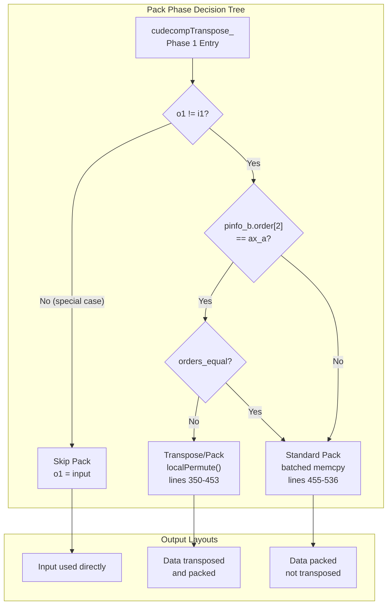
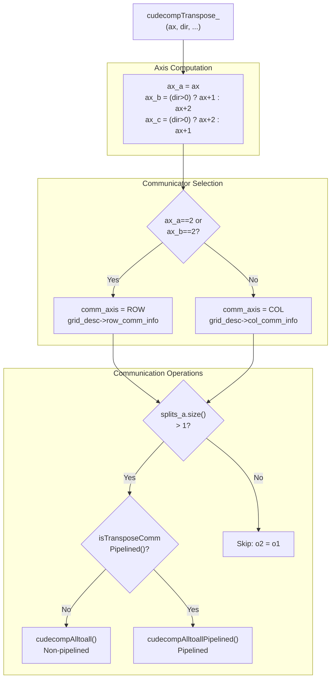
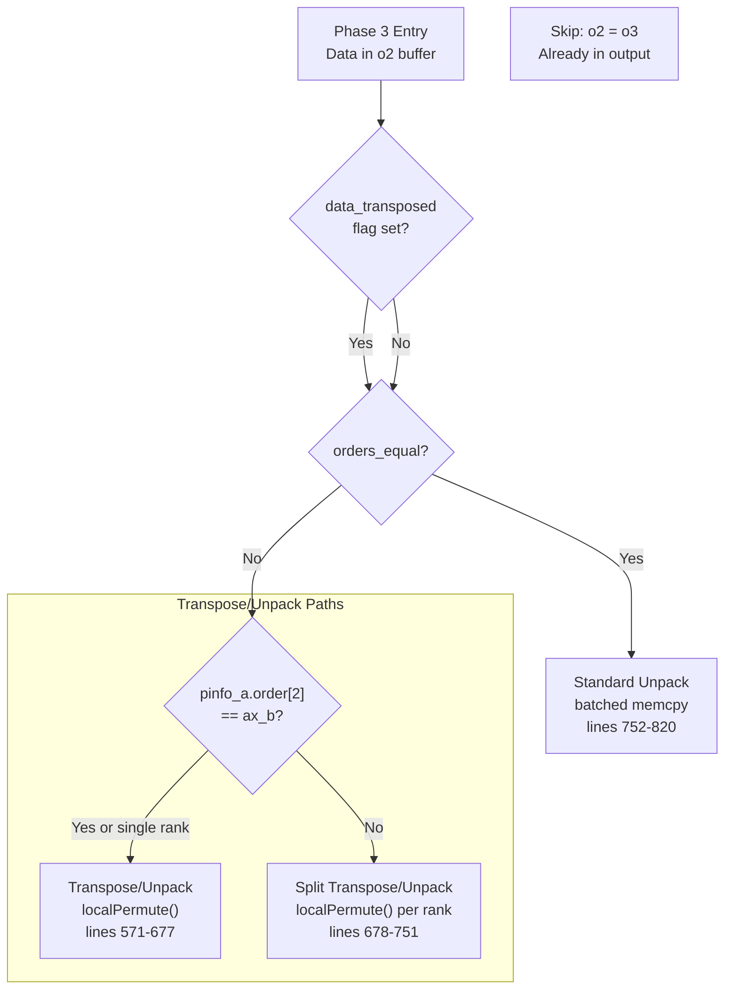
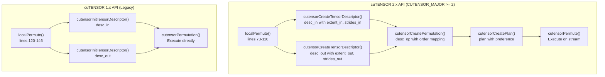
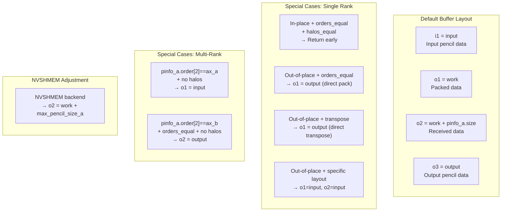
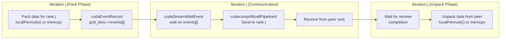
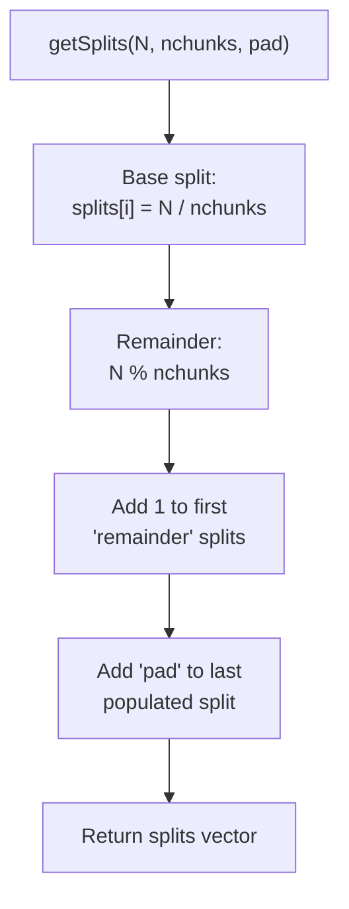
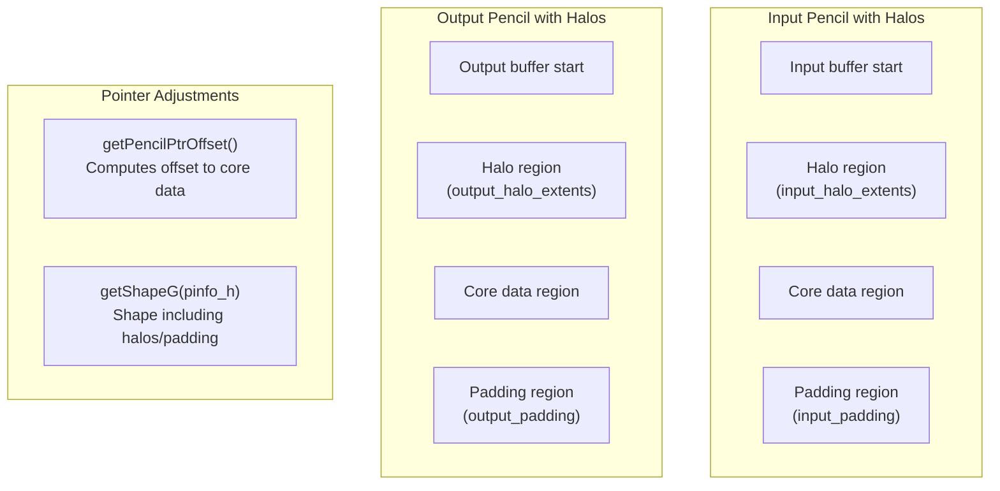
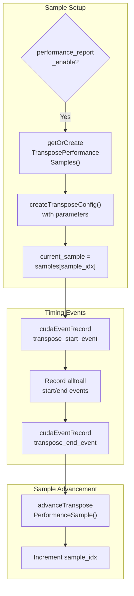

<!-- source: DeepWiki mcp.deepwiki.com · repo NVIDIA/cuDecomp · page 5.1 Transpose Pipeline and Data Flow · fetched 2026-10-26 -->

# Transpose Pipeline and Data Flow

<details>
<summary>Relevant source files</summary>

The following files were used as context for generating this wiki page:

- [include/internal/common.h](include/internal/common.h)
- [include/internal/transpose.h](include/internal/transpose.h)

</details>


## Purpose and Scope

This document describes the internal implementation of transpose operations in cuDecomp, focusing on the three-phase pipeline that redistributes data between pencil orientations. It explains how data flows through the pack-communicate-unpack stages, how cuTENSOR is used for local tensor permutations, and the optimization strategies employed to minimize data movement.

For API usage of transpose operations, see [Transpose Operations API](#4.3). For pipelined transpose variants that enable computation-communication overlap, see [Pipelined Transposes](#5.2). For communication backend selection, see [Communication Backends](#3.3).

---

## Three-Phase Transpose Pipeline

All transpose operations in cuDecomp follow a three-phase pipeline implemented in the `cudecompTranspose_` template function. This pipeline redistributes data from one pencil orientation to another through a combination of local permutations and inter-process communication.

```mermaid
graph LR
    subgraph "Input Pencil Orientation"
        INPUT["Input Buffer<br/>(input pointer)<br/>Pencil A orientation"]
    end
    
    subgraph "Phase 1: Pack"
        PACK_CHECK{"Need local<br/>reorganization?"}
        PACK_OP["Pack/Transpose<br/>localPermute() or<br/>batched memcpy"]
        WORK1["Work Buffer 1<br/>(o1 pointer)<br/>Packed for alltoall"]
    end
    
    subgraph "Phase 2: Communicate"
        COMM_CHECK{"Single rank<br/>communicator?"}
        ALLTOALL["cudecompAlltoall() or<br/>cudecompAlltoallPipelined()"]
        WORK2["Work Buffer 2<br/>(o2 pointer)<br/>Received data"]
    end
    
    subgraph "Phase 3: Unpack"
        UNPACK_CHECK{"Need local<br/>reorganization?"}
        UNPACK_OP["Unpack/Transpose<br/>localPermute() or<br/>batched memcpy"]
        OUTPUT["Output Buffer<br/>(output pointer)<br/>Pencil B orientation"]
    end
    
    INPUT --> PACK_CHECK
    PACK_CHECK -->|Yes| PACK_OP
    PACK_CHECK -->|No| WORK1
    PACK_OP --> WORK1
    
    WORK1 --> COMM_CHECK
    COMM_CHECK -->|No| ALLTOALL
    COMM_CHECK -->|Yes| WORK2
    ALLTOALL --> WORK2
    
    WORK2 --> UNPACK_CHECK
    UNPACK_CHECK -->|Yes| UNPACK_OP
    UNPACK_CHECK -->|No| OUTPUT
    UNPACK_OP --> OUTPUT
```



**Pipeline Phases Overview**

The pipeline operates on data distributed across processes in a 2D process grid. Each phase can be conditionally skipped based on data layout requirements:

| Phase | Purpose | Skip Condition | Implementation |
|-------|---------|----------------|----------------|
| **Pack** | Reorganize local data into contiguous blocks for each destination rank | Input already in correct layout | `localPermute()` or batched 3D memcpy |
| **Communicate** | Exchange data blocks between all ranks in communicator | Single-rank communicator | `cudecompAlltoall()` or `cudecompAlltoallPipelined()` |
| **Unpack** | Reorganize received data into final output orientation | Output already in correct layout | `localPermute()` or batched 3D memcpy |

**Sources:** [include/internal/transpose.h:150-330](), [include/internal/transpose.h:348-557](), [include/internal/transpose.h:559-568](), [include/internal/transpose.h:570-820]()

---

## Phase 1: Pack

The pack phase reorganizes the input pencil data into a format suitable for all-to-all communication. The input data is split along the decomposed dimension and rearranged so that data destined for each peer rank is stored contiguously.

### Pack Logic and Data Layout



### Pack Implementation Details

The pack phase uses two different strategies depending on whether a transpose operation is required:

**Transpose/Pack Path** [include/internal/transpose.h:350-453]():
- Used when `pinfo_b.order[2] == ax_a` and orders differ
- Calls `localPermute()` to simultaneously transpose and pack data
- Computes permutation order mapping from input to output orientation
- Sets up strides for both input and output tensors
- In pipelined mode, packs data for each destination rank iteratively

**Standard Pack Path** [include/internal/transpose.h:455-536]():
- Used when no transpose is needed, only data splitting
- Uses `cudecompBatchedD2DMemcpy3DParams` for efficient 3D copies
- Splits input data along the decomposed axis (`ax_a`)
- Copies each split into contiguous blocks in work buffer
- Batches multiple copies together up to `CUDECOMP_BATCHED_D2D_3D_PARAM_CAPACITY`

**Pack Optimization: Skip Cases** [include/internal/transpose.h:319-329]():
The pack phase can be skipped when:
- `pinfo_a.order[2] == ax_a` and no halo extents/padding: Input already packed
- Single-rank communicator with matching in/out halos: No redistribution needed

**Sources:** [include/internal/transpose.h:348-557]()

---

## Phase 2: Communication

The communication phase performs an all-to-all exchange of data blocks between all ranks in the row or column communicator. The choice of communicator depends on which axes are being transposed.

### Communication Axis Selection



### Communication Parameters

The communication phase uses several arrays to specify data distribution:

| Parameter | Purpose | Computation |
|-----------|---------|-------------|
| `send_offsets` | Starting offset in packed buffer for each destination rank | `offsets_a[i] * shape_g_a[ax_b] * shape_g_a[ax_c]` |
| `recv_offsets` | Starting offset in receive buffer for each source rank | `offsets_b[i] * shape_g_b[ax_a] * shape_g_b[ax_c]` |
| `send_counts` | Number of elements to send to each rank | `splits_a[i] * shape_g_a[ax_b] * shape_g_a[ax_c]` |
| `recv_counts` | Number of elements to receive from each rank | `splits_b[i] * shape_g_b[ax_a] * shape_g_b[ax_c]` |

The `splits_a` and `splits_b` arrays are computed by `getSplits()` [include/internal/common.h:403-413](), which divides the decomposed dimension as evenly as possible across ranks, with padding added to the last populated pencil if needed.

**Communicator Axis Logic** [include/internal/transpose.h:180-181]():
- Column communicator (`CUDECOMP_COMM_COL`): Used when transposing between X↔Y orientations
- Row communicator (`CUDECOMP_COMM_ROW`): Used when transposing between Y↔Z orientations

**Communication Backend** [include/internal/transpose.h:559-567]():
The actual communication is dispatched through `cudecompAlltoall()` or `cudecompAlltoallPipelined()` based on the `transpose_comm_backend` configuration. These functions select between MPI, NCCL, or NVSHMEM backends. See [Communication Backend Details](#8) for implementation details.

**Sources:** [include/internal/transpose.h:176-181](), [include/internal/transpose.h:185-198](), [include/internal/transpose.h:332-346](), [include/internal/transpose.h:559-567]()

---

## Phase 3: Unpack

The unpack phase reorganizes the received data from the all-to-all communication into the final output pencil orientation. Like the pack phase, it can perform both data movement and transposition.

### Unpack Logic Decision Tree



### Unpack Implementation Variants

**Transpose/Unpack Path** [include/internal/transpose.h:571-677]():
- Used when data needs transposition after communication
- Single `localPermute()` call for entire received buffer (non-pipelined)
- Or per-rank `localPermute()` calls interleaved with communication (pipelined)
- Permutes from received orientation to final output orientation
- Handles halo extents and padding in output buffer

**Split Transpose/Unpack Path** [include/internal/transpose.h:678-751]():
- Used when `pinfo_a.order[2] != ax_b` (data needs multi-step reorganization)
- Performs separate transpose for each source rank's data block
- Computes extents and strides dynamically for each rank's split
- Interleaves with pipelined communication when enabled

**Standard Unpack Path** [include/internal/transpose.h:752-820]():
- Used when no transpose is needed, only data rearrangement
- Uses batched 3D memcpy operations
- Extracts data from contiguous receive blocks
- Places data into proper locations in output buffer with correct strides

**Pipelined Unpack** [include/internal/transpose.h:602-665](), [include/internal/transpose.h:698-750](), [include/internal/transpose.h:754-819]():
When pipelined communication is enabled, the unpack operations are interleaved with `cudecompAlltoallPipelined()` calls. This allows unpacking of received data to overlap with communication of remaining data blocks.

**Sources:** [include/internal/transpose.h:570-820]()

---

## cuTENSOR Integration for Local Permutations

Local tensor permutations are performed using the NVIDIA cuTENSOR library, which provides optimized routines for arbitrary tensor transpositions and memory layouts.

### localPermute Function Architecture



### cuTENSOR Integration Details

**Tensor Descriptor Creation** [include/internal/transpose.h:88-93]():
- Describes input tensor with `extent_in` (3D shape) and `strides_in` (memory layout)
- Describes output tensor with `extent_out` (permuted shape) and `strides_out`
- Uses `getAlignment()` [include/internal/transpose.h:64-70]() to specify pointer alignment for optimization
- Supports custom strides for handling halo regions and padding

**Data Type Support** [include/internal/transpose.h:48-52]():
The library supports four data types via template specialization:
- `float` → `CUTENSOR_R_32F`
- `double` → `CUTENSOR_R_64F`
- `cuda::std::complex<float>` → `CUTENSOR_C_32F`
- `cuda::std::complex<double>` → `CUTENSOR_C_64F`

**Permutation Operation** [include/internal/transpose.h:95-98]():
- Creates permutation operation descriptor with `order_in = {0, 1, 2}` and variable `order_out`
- The `order_out` array specifies how input dimensions map to output dimensions
- Example: `order_out = {1, 0, 2}` swaps first two dimensions

**Compute Type Selection** [include/internal/transpose.h:54-62]():
- Real and complex 32-bit types use `CUTENSOR_COMPUTE_DESC_32F`
- Real and complex 64-bit types use `CUTENSOR_COMPUTE_DESC_64F`

**Asynchronous Execution** [include/internal/transpose.h:104]():
All cuTENSOR permutations execute asynchronously on the specified CUDA stream, enabling overlap with other operations.

**Sources:** [include/internal/transpose.h:47-147]()

---

## Work Buffer Management

The transpose pipeline uses a carefully managed set of work buffers to stage data through the three phases. Buffer pointer management is critical for avoiding unnecessary copies and enabling in-place optimizations.

### Buffer Pointer Assignment



### Buffer Management Logic

**Default Pointer Setup** [include/internal/transpose.h:229-234]():
```
i1 = input;           // Source data
o1 = work;            // Pack destination
o2 = work + pinfo_a.size;  // Communication receive buffer
o3 = output;          // Final output
```

**NVSHMEM Buffer Adjustment** [include/internal/transpose.h:235-240]():
For NVSHMEM backends, `o2` must be placed at the global maximum pencil size offset to ensure symmetric memory layout across all ranks. This is required because NVSHMEM operations assume symmetric heap allocation.

**Single-Rank Optimizations** [include/internal/transpose.h:261-297]():
When the communicator has only one rank (no actual communication needed):
- **Case 1**: In-place with matching halos → Return immediately, no operation needed
- **Case 2**: Out-of-place, same orientation → Direct pack to output
- **Case 3**: Out-of-place, different orientation, specific layout → Direct transpose to output
- **Case 4**: Out-of-place, different orientation, other layout → Skip pack, use input directly

**Multi-Rank Skip Optimizations** [include/internal/transpose.h:319-329]():
- Skip pack if input is already in the correct layout for all-to-all
- Skip unpack if all-to-all output is already in the final output orientation
- Disabled for pipelined in-place operations to avoid data dependencies
- Disabled for NVSHMEM (to ensure staging through workspace)
- Disabled for MPI with managed memory (performance consideration)

**In-Place Detection** [include/internal/transpose.h:169]():
The `inplace` flag is set when `input == output`, which affects buffer reuse decisions and optimization eligibility.

**Sources:** [include/internal/transpose.h:169-329]()

---

## Pipelined Mode Data Dependencies

When pipelined communication is enabled (`isTransposeCommPipelined()` returns true), the transpose pipeline interleaves pack/unpack operations with communication using CUDA events to manage data dependencies.

### CUDA Event Synchronization



### Event Recording in Pack Phase

**Transpose/Pack Path** [include/internal/transpose.h:425-434]():
After each `localPermute()` call for destination rank, an event is recorded:
```
cudaEventRecord(grid_desc->events[dst_rank], stream)
```
This event signals that the packed data for this rank is ready to be communicated.

**Standard Pack Path** [include/internal/transpose.h:518-529]():
Events are recorded after batched memcpy operations complete for each destination rank.

### Event Usage in Communication

The `cudecompAlltoallPipelined()` function (defined in `comm_routines.h`) waits on the appropriate pack events before initiating send operations. This ensures that:
1. Pack operations for rank N complete before sending to rank N
2. Multiple pack operations can execute in parallel
3. Communication can begin as soon as first pack completes

### CUDA Graph Capture Support

**Graph Capture for Pack Phase** [include/internal/transpose.h:387-440](), [include/internal/transpose.h:464-534]():
When `handle->cuda_graphs_enable` is true and multiple ranks exist:
1. `grid_desc->graph_cache.startCapture()` begins capturing operations
2. All pack operations for all destination ranks are recorded into graph
3. `grid_desc->graph_cache.endCapture()` finalizes the graph
4. Subsequent calls replay the cached graph with `grid_cache.replay()`

The graph key includes input/output pointers, axis, direction, and pencil info to ensure correct graph reuse.

**Graph Cache Keys** [include/internal/transpose.h:385](), [include/internal/transpose.h:461]():
```cpp
auto key = std::tie(i1, o1, ax, dir, pinfo_a_h, pinfo_b_h, dtype);
```
This tuple uniquely identifies a specific transpose configuration for graph caching.

**Sources:** [include/internal/transpose.h:383-440](), [include/internal/transpose.h:461-534](), [include/internal/transpose.h:518-529]()

---

## Pencil Splitting and Data Distribution

The transpose operation divides the decomposed dimension across ranks in the communicator. The `getSplits()` function computes how data is distributed.

### Split Computation Algorithm



**getSplits Implementation** [include/internal/common.h:403-413]():
1. Base split: Divide dimension `N` evenly across `nchunks` ranks
2. Distribute remainder: First `N % nchunks` ranks get one extra element
3. Add padding: The last populated pencil gets additional `pad` elements

This ensures:
- Load balance: Ranks differ by at most 1 element
- Padding support: Extra space for FFT padding or alignment requirements
- Efficient packing: Minimal communication overhead

### Offset Computation

**Offset Calculation** [include/internal/transpose.h:193-198]():
```cpp
for (int i = 0; i < splits.size() - 1; ++i) {
    offsets[i + 1] = offsets[i] + splits[i];
}
```
Each rank's data begins at the cumulative sum of previous splits, enabling direct addressing into split data.

**Send/Receive Offset Calculation** [include/internal/transpose.h:339-346]():
- `send_offsets[i]`: Position in packed buffer for rank `i`'s data
- `recv_offsets[i]`: Position in receive buffer for data from rank `i`
- Both scaled by the product of non-decomposed dimensions

**Sources:** [include/internal/common.h:403-413](), [include/internal/transpose.h:185-198](), [include/internal/transpose.h:332-346]()

---

## Halo and Padding Support

Transpose operations support halo regions and padding in both input and output pencils. These are commonly needed for stencil operations and FFT transforms.

### Halo and Padding Pointer Offsets



**Pencil Info with Halos** [include/internal/transpose.h:201-208]():
Two `cudecompPencilInfo_t` structures are obtained for each pencil:
- `pinfo_a`: Shape without halos or padding
- `pinfo_a_h`: Shape including halos and padding

**Pointer Offset Helper** [include/internal/common.h:249-252]():
```cpp
size_t getPencilPtrOffset(const cudecompPencilInfo_t& pinfo, 
                          const std::array<int32_t, 3>& lx)
```
Computes the linear offset to position `lx` in global order, accounting for pencil shape and memory layout order.

**Halo/Padding Usage in Pack** [include/internal/transpose.h:405-406](), [include/internal/transpose.h:482]():
When packing, the source pointer is adjusted to skip input halos:
```cpp
T* src = i1 + shift + getPencilPtrOffset(pinfo_a_h, input_halo_extents);
```

**Halo/Padding Usage in Unpack** [include/internal/transpose.h:417](), [include/internal/transpose.h:492](), [include/internal/transpose.h:655]():
When unpacking, the destination pointer is adjusted to write into the core region:
```cpp
T* dst = o3 + shift + getPencilPtrOffset(pinfo_b_h, output_halo_extents);
```

**Stride Calculation with Halos** [include/internal/transpose.h:369-381](), [include/internal/transpose.h:497-508]():
Strides must account for the full shape including halos when computing memory offsets.

**Sources:** [include/internal/transpose.h:156-165](), [include/internal/transpose.h:201-208](), [include/internal/common.h:249-252]()

---

## Performance Monitoring Integration

The transpose pipeline integrates with cuDecomp's performance monitoring system to collect timing data for optimization and analysis.

### Performance Sample Collection



**Performance Sample Initialization** [include/internal/transpose.h:243-256]():
When performance reporting is enabled:
1. Retrieve or create sample collection for current transpose configuration
2. Get pointer to current sample in circular buffer
3. Record total data size for bandwidth calculation
4. Record start event before pack phase

**Configuration Key Creation** [include/internal/transpose.h:246-248]():
The transpose configuration includes:
- Axis and direction parameters
- Input/output pointers
- Halo extents and padding arrays
- Data type

This uniquely identifies each transpose variant for separate performance tracking.

**All-to-All Timing** [include/internal/transpose.h:250-252]():
The `current_sample->alltoall_timing_count` is incremented each time communication occurs, enabling separate measurement of communication vs. computation.

**Sample Advancement** [include/internal/transpose.h:270-274](), [include/internal/transpose.h:541-546](), [include/internal/transpose.h:823-829]():
After recording the end event, `advanceTransposePerformanceSample()` moves to the next sample slot in the circular buffer.

**Sources:** [include/internal/transpose.h:243-256](), [include/internal/transpose.h:270-274](), [include/internal/transpose.h:541-546](), [include/internal/transpose.h:822-829](), [include/internal/common.h:134-149]()

---

## Public API Entry Points

The transpose pipeline is accessed through four main public API functions that map to specific axis transformations.

### API Function Mapping

| Function | Axis (`ax`) | Direction (`dir`) | Source | Destination | Communicator |
|----------|-------------|-------------------|--------|-------------|--------------|
| `cudecompTransposeXToY` | 0 | +1 | X-pencil | Y-pencil | Column |
| `cudecompTransposeYToZ` | 1 | +1 | Y-pencil | Z-pencil | Row |
| `cudecompTransposeZToY` | 2 | -1 | Z-pencil | Y-pencil | Row |
| `cudecompTransposeYToX` | 1 | -1 | Y-pencil | X-pencil | Column |

**Entry Point Implementation** [include/internal/transpose.h:833-878]():
Each public function:
1. Pushes an NVTX range for profiling
2. Calls `cudecompTranspose_` with appropriate axis and direction
3. Pops the NVTX range
4. Returns control to caller

**Template Instantiation**:
All four functions are template functions accepting type `T` for:
- `float`, `double` (real types)
- `cuda::std::complex<float>`, `cuda::std::complex<double>` (complex types)

**Optional Parameters** [include/internal/transpose.h:834-836]():
All functions accept optional arrays for:
- `input_halo_extents_ptr`: Halo regions in input pencil
- `output_halo_extents_ptr`: Halo regions in output pencil
- `input_padding_ptr`: Padding in input pencil
- `output_padding_ptr`: Padding in output pencil
- `stream`: CUDA stream for asynchronous execution (default: stream 0)

**Sources:** [include/internal/transpose.h:833-878]()

---

