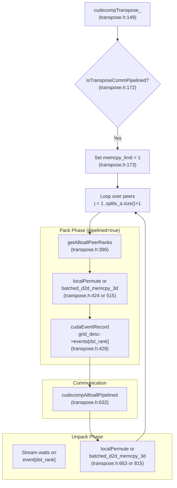
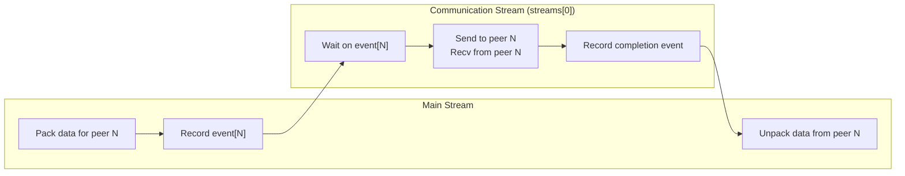
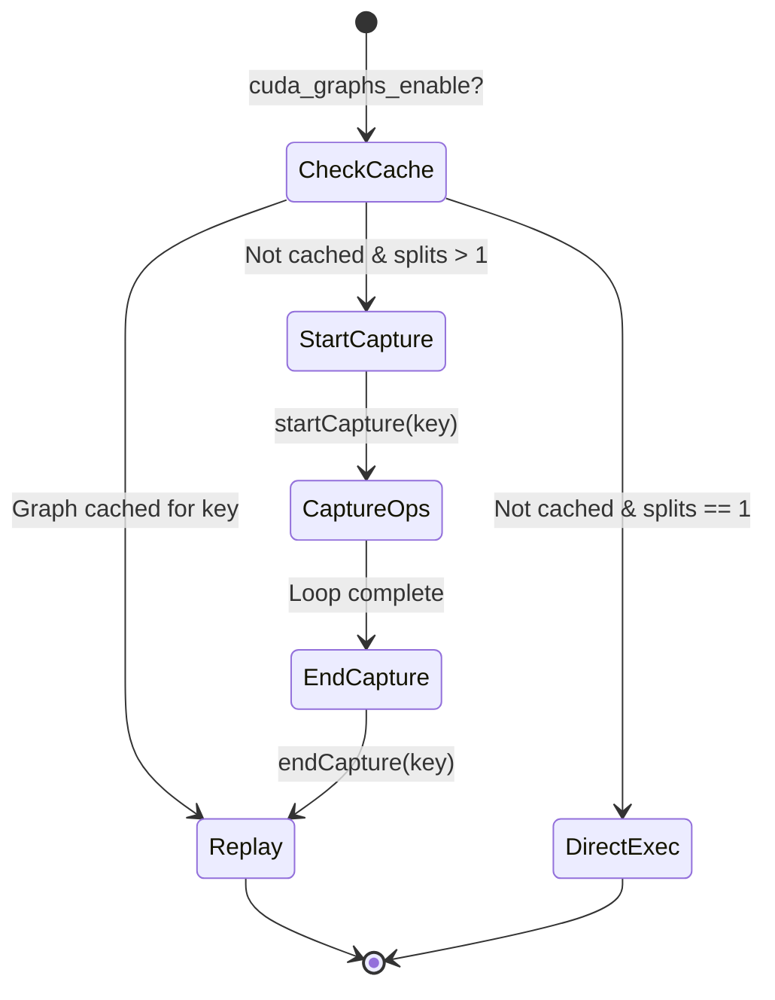
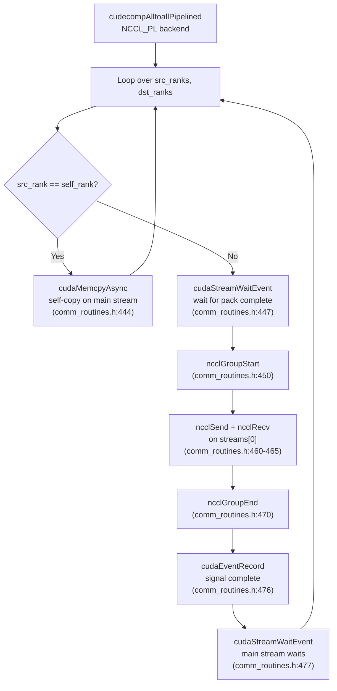

<!-- source: DeepWiki mcp.deepwiki.com · repo NVIDIA/cuDecomp · page 5.2 Pipelined Transposes · fetched 2026-10-26 -->

# Pipelined Transposes

<details>
<summary>Relevant source files</summary>

The following files were used as context for generating this wiki page:

- [include/internal/comm_routines.h](include/internal/comm_routines.h)
- [include/internal/transpose.h](include/internal/transpose.h)

</details>


## Purpose and Scope

This document describes the pipelined transpose implementation in cuDecomp, which enables overlap of computation and communication operations for improved performance. Pipelined transposes break the transpose operation into smaller stages that execute concurrently, allowing local data packing, unpacking, and permutation operations to be overlapped with inter-process communication.

For general transpose operation concepts and the standard (non-pipelined) implementation, see [5.1](#5.1). This page focuses specifically on the pipelined variants and their optimization strategies.

## Overview of Pipelining Strategy

In standard (non-pipelined) transposes, the operation proceeds in three sequential phases:
1. **Pack**: Reorganize local input data for communication
2. **Communicate**: Perform all-to-all exchange with all peers
3. **Unpack**: Reorganize received data into the output layout

Pipelined transposes break these phases into smaller chunks that can execute concurrently. Instead of packing all data before starting communication, the implementation processes data in peer-by-peer increments, allowing:
- Packing for peer N+1 to overlap with communication to peer N
- Unpacking from peer N to overlap with communication from peer N+1
- Local transpose operations to be interleaved with communication

The pipelining strategy is determined by the `isTransposeCommPipelined()` function ([include/internal/transpose.h:39-45]()), which identifies three pipelined backends:
- `CUDECOMP_TRANSPOSE_COMM_NCCL_PL`: Pipelined NCCL communication
- `CUDECOMP_TRANSPOSE_COMM_NVSHMEM_PL`: Pipelined NVSHMEM communication  
- `CUDECOMP_TRANSPOSE_COMM_MPI_P2P_PL`: Pipelined MPI point-to-point communication

**Sources:** [include/internal/transpose.h:39-45](), [include/internal/transpose.h:172-173]()

### Execution Timeline Comparison

```mermaid
gantt
    title Non-Pipelined vs Pipelined Transpose Execution
    dateFormat X
    axisFormat %L
    
    section Non-Pipelined
    Pack All Data       :0, 100
    Communicate (All)   :100, 300
    Unpack All Data     :300, 400
    
    section Pipelined
    Pack Peer 0         :0, 25
    Pack Peer 1         :25, 50
    Pack Peer 2         :50, 75
    Pack Peer 3         :75, 100
    Communicate Peer 0  :25, 125
    Communicate Peer 1  :50, 150
    Communicate Peer 2  :75, 175
    Communicate Peer 3  :100, 200
    Unpack Peer 0       :125, 150
    Unpack Peer 1       :150, 175
    Unpack Peer 2       :175, 200
    Unpack Peer 3       :200, 225
```



This diagram illustrates how pipelined execution reduces total execution time by overlapping operations. Note that actual overlap depends on computation-to-communication ratios and backend capabilities.

**Sources:** [include/internal/transpose.h:149-830](), [include/internal/comm_routines.h:318-524]()

## Pipelined Communication Backends

Three communication backends support pipelined execution, each with distinct implementation characteristics:

| Backend | Description | Use Case | Key Features |
|---------|-------------|----------|--------------|
| `NCCL_PL` | NCCL group operations on dedicated stream | GPU-direct communication, especially multi-GPU nodes | Uses `handle->streams[0]` for async communication, CUDA events for sync |
| `NVSHMEM_PL` | NVSHMEM non-blocking puts | Systems with NVSHMEM support, symmetric memory | Requires symmetric heap allocation, uses `nvshmemx_putmem_nbi_on_stream` |
| `MPI_P2P_PL` | MPI Isend/Irecv | Fallback for systems without GPU-direct support | Synchronizes stream before MPI calls, uses event sync between peers |

### Backend Selection Logic

The pipelined backend is selected during grid descriptor creation and can be influenced by autotuning ([7](#7)). The `cudecompAlltoallPipelined()` function ([include/internal/comm_routines.h:318-524]()) dispatches to the appropriate implementation based on `grid_desc->config.transpose_comm_backend`.

**Sources:** [include/internal/comm_routines.h:318-524](), [include/internal/transpose.h:39-45]()

## Implementation Architecture

The pipelined transpose implementation consists of two main components that work together:

1. **Local Operation Pipelining** in `cudecompTranspose_()` ([include/internal/transpose.h:149-830]())
2. **Communication Pipelining** in `cudecompAlltoallPipelined()` ([include/internal/comm_routines.h:318-524]())

### Pipelined Local Operations

The `cudecompTranspose_()` function contains multiple code paths that execute local operations (packing, unpacking, or local permutations) in a pipelined manner:



**Sources:** [include/internal/transpose.h:149-830](), [include/internal/transpose.h:172-173](), [include/internal/transpose.h:383-441](), [include/internal/transpose.h:602-665]()

### Key Implementation Details

#### 1. Single Operation Per Peer
When pipelined mode is active, `memcpy_limit` is set to 1 ([include/internal/transpose.h:173]()), forcing the batched memory copy operations to process only one peer at a time:

```cpp
int memcpy_limit = pipelined ? 1 : CUDECOMP_BATCHED_D2D_3D_PARAM_CAPACITY;
```

This ensures fine-grained control over the execution order and enables proper event-based synchronization.

#### 2. Peer Ordering
The loop iterates from `j = 1` to `splits_a.size() + 1`, with the last iteration handling the self-rank ([include/internal/transpose.h:395-398]() for transpose/pack, [include/internal/transpose.h:604-610]() for unpack). The `getAlltoallPeerRanks()` function computes source and destination ranks for each iteration.

#### 3. Multi-Group Optimization
For systems with multiple communication groups (`comm_info.ngroups != 1`), pipelined operations pair transfers to hide intra-group communication latency behind inter-group transfers ([include/internal/transpose.h:615-629]()):

```cpp
if (j != 0 && comm_info.ngroups != 1) {
    // Perform pipelining in pairs to hide intra-group comms behind inter-group transfers
    if (j % 2 == 1) {
        if (j + 1 < splits_b.size()) {
            // Process two peers in one communication call
        }
    } else {
        // Skip alltoall, this transfer was paired with previous one
    }
}
```

**Sources:** [include/internal/transpose.h:615-629](), [include/internal/transpose.h:711-725]()

## CUDA Event Synchronization

CUDA events are the primary mechanism for coordinating dependencies between local operations on the main stream and pipelined communication on auxiliary streams.

### Event Array Structure

Each `cudecompGridDesc` contains an array of CUDA events (`grid_desc->events`) allocated to track per-peer dependencies. The number of events equals the maximum number of ranks in the communicator ([include/internal/transpose.h:428-431]()):

```cpp
CHECK_CUDA(cudaEventRecordWithFlags(grid_desc->events[dst_rank], graph_stream,
                                    capture_status == cudaStreamCaptureStatusActive
                                        ? cudaEventRecordExternal
                                        : cudaEventRecordDefault));
```

### Event Flow in Pipelined Execution



**Sources:** [include/internal/transpose.h:428-431](), [include/internal/comm_routines.h:342-344](), [include/internal/comm_routines.h:476-478]()

### Backend-Specific Event Usage

#### NCCL_PL Implementation
The NCCL pipelined backend uses events to synchronize between the main stream and `handle->streams[0]`:

1. **Before communication**: Wait for pack operation to complete ([include/internal/comm_routines.h:447]()):
   ```cpp
   CHECK_CUDA(cudaStreamWaitEvent(pl_stream, grid_desc->events[dst_rank], 0));
   ```

2. **After communication**: Signal completion for unpack operations ([include/internal/comm_routines.h:476-478]()):
   ```cpp
   CHECK_CUDA(cudaEventRecord(grid_desc->events[dst_rank], pl_stream));
   CHECK_CUDA(cudaStreamWaitEvent(stream, grid_desc->events[dst_rank], 0));
   ```

#### NVSHMEM_PL Implementation  
NVSHMEM uses a special synchronization event for team barriers ([include/internal/transpose.h:238-239]()):
```cpp
CHECK_CUDA(cudaEventRecord(grid_desc->nvshmem_sync_event, stream));
```

This event is synchronized at the start of each communication batch ([include/internal/comm_routines.h:383-387]()):
```cpp
if (!synced) {
    CHECK_CUDA(cudaEventSynchronize(grid_desc->nvshmem_sync_event));
    CHECK_MPI(MPI_Barrier(comm));
    synced = true;
}
```

#### MPI_P2P_PL Implementation
MPI requires explicit stream synchronization before each communication ([include/internal/comm_routines.h:496]()):
```cpp
CHECK_CUDA(cudaEventSynchronize(grid_desc->events[dst_rank]));
```

**Sources:** [include/internal/comm_routines.h:430-481](), [include/internal/comm_routines.h:360-428](), [include/internal/comm_routines.h:482-512]()

## CUDA Graph Capture

For improved performance, the pipelined local operations can be captured into CUDA graphs, which reduces kernel launch overhead for repeated transpose operations with the same configuration.

### Graph Cache System

The `graph_cache` member of `cudecompGridDesc` maintains a cache of captured graphs keyed by operation parameters ([include/internal/transpose.h:385-441]()):

```cpp
auto dtype = getCudecompDataType<T>();
auto key = std::tie(i1, o1, ax, dir, pinfo_a_h, pinfo_b_h, dtype);

if (handle->cuda_graphs_enable && grid_desc->graph_cache.cached(key)) {
    grid_desc->graph_cache.replay(key, stream);
} else {
    // Capture new graph or execute directly
}
```

The cache key uniquely identifies the transpose configuration, ensuring graphs are only reused for identical operations.

### Graph Capture Flow



**Sources:** [include/internal/transpose.h:387-441](), [include/internal/transpose.h:464-534]()

### Capture Implementation Details

#### 1. Conditional Capture
Graph capture only occurs when beneficial ([include/internal/transpose.h:391-393]()):
```cpp
if (handle->cuda_graphs_enable && splits_a.size() > 1) {
    graph_stream = grid_desc->graph_cache.startCapture(key, stream);
}
```

Single-rank cases execute directly without capture overhead.

#### 2. External Event Recording
During capture, events must be recorded with the `cudaEventRecordExternal` flag ([include/internal/transpose.h:426-431]()):

```cpp
cudaStreamCaptureStatus capture_status;
CHECK_CUDA(cudaStreamIsCapturing(graph_stream, &capture_status));
CHECK_CUDA(cudaEventRecordWithFlags(grid_desc->events[dst_rank], graph_stream,
                                    capture_status == cudaStreamCaptureStatusActive
                                        ? cudaEventRecordExternal
                                        : cudaEventRecordDefault));
```

This allows the captured graph to properly synchronize with external streams during replay.

#### 3. Multiple Capture Sites
Graph capture occurs at three locations in the code:
- **Pack with transpose**: [include/internal/transpose.h:387-441]()
- **Pack without transpose**: [include/internal/transpose.h:464-534]()
- Both sites handle the loop over peers, capturing local permute or memory copy operations

**Sources:** [include/internal/transpose.h:387-441](), [include/internal/transpose.h:464-534](), [include/internal/transpose.h:426-431]()

## Communication Implementation Details

The `cudecompAlltoallPipelined()` function ([include/internal/comm_routines.h:318-524]()) implements the communication portion of pipelined transposes, with backend-specific optimizations.

### Function Signature

```cpp
template <typename T>
static void cudecompAlltoallPipelined(
    const cudecompHandle_t& handle,
    const cudecompGridDesc_t& grid_desc,
    T* send_buff,
    const std::vector<comm_count_t>& send_counts,
    const std::vector<comm_count_t>& send_offsets,
    T* recv_buff,
    const std::vector<comm_count_t>& recv_counts,
    const std::vector<comm_count_t>& recv_offsets,
    const std::vector<comm_count_t>& recv_offsets_nvshmem,
    cudecompCommAxis comm_axis,
    const std::vector<int>& src_ranks,
    const std::vector<int>& dst_ranks,
    cudaStream_t stream,
    bool& synced,
    cudecompTransposePerformanceSample* current_sample = nullptr)
```

The `src_ranks` and `dst_ranks` vectors specify which peer(s) to communicate with in this call, enabling the pipelined approach of processing one or two peers at a time.

**Sources:** [include/internal/comm_routines.h:318-326]()

### NCCL Pipelined Implementation



**Key features:**
- Uses dedicated pipeline stream `handle->streams[0]` for communication ([include/internal/comm_routines.h:434]())
- Groups NCCL operations for all peers in current batch ([include/internal/comm_routines.h:449-470]())
- For single-group scenarios, uses `nccl_local_comm` for better performance ([include/internal/comm_routines.h:432-433]())
- Self-copies execute on main stream and bypass NCCL ([include/internal/comm_routines.h:442-445]())

**Sources:** [include/internal/comm_routines.h:430-481]()

### NVSHMEM Pipelined Implementation

The NVSHMEM pipelined implementation uses non-blocking put operations with careful synchronization:

```cpp
if (!synced) {
    // Only need to sync on the first remote operation
    CHECK_CUDA(cudaEventSynchronize(grid_desc->nvshmem_sync_event));
    CHECK_MPI(MPI_Barrier(comm));
    synced = true;
}

int dst_rank_global = getGlobalRank(handle, grid_desc, comm_axis, dst_rank);
size_t send_bytes = send_counts[dst_rank] * sizeof(T);
int nchunks = (send_bytes + CUDECOMP_NVSHMEM_CHUNK_SZ - 1) / CUDECOMP_NVSHMEM_CHUNK_SZ;

for (int j = 0; j < nchunks; ++j) {
    nvshmemx_putmem_nbi_on_stream(
        recv_buff + recv_offsets_nvshmem[dst_rank] + j * (CUDECOMP_NVSHMEM_CHUNK_SZ / sizeof(T)),
        send_buff + send_offsets[dst_rank] + j * (CUDECOMP_NVSHMEM_CHUNK_SZ / sizeof(T)),
        std::min(static_cast<size_t>(CUDECOMP_NVSHMEM_CHUNK_SZ), send_bytes - j * CUDECOMP_NVSHMEM_CHUNK_SZ),
        dst_rank_global, pl_stream);
}
```

**Key features:**
- Chunks large transfers into 1 GiB pieces to work around NVSHMEM API limitations ([include/internal/comm_routines.h:391-400]())
- Uses team synchronization only on first remote operation ([include/internal/comm_routines.h:381-388]())
- Completes with `nvshmemx_quiet_on_stream` and barrier ([include/internal/comm_routines.h:407-410]())

**Sources:** [include/internal/comm_routines.h:360-428](), [include/internal/comm_routines.h:381-400]()

### MPI Pipelined Implementation

MPI pipelining uses non-blocking sends and receives with event synchronization:

```cpp
for (int i = 0; i < src_ranks.size(); ++i) {
    int src_rank = src_ranks[i];
    int dst_rank = dst_ranks[i];
    
    if (src_rank != self_rank) {
        CHECK_CUDA(cudaEventSynchronize(grid_desc->events[dst_rank]));
        
        if (send_counts[dst_rank] != 0) {
            CHECK_MPI(MPI_Isend(send_buff + send_offsets[dst_rank],
                               send_counts[dst_rank], getMpiDataType<T>(),
                               dst_rank, 0, comm, &reqs[i]));
        }
        if (recv_counts[src_rank] != 0) {
            CHECK_MPI(MPI_Irecv(recv_buff + recv_offsets[src_rank],
                               recv_counts[src_rank], getMpiDataType<T>(),
                               src_rank, 0, comm, &reqs[i + src_ranks.size()]));
        }
    }
}

CHECK_MPI(MPI_Waitall(reqs.size(), reqs.data(), MPI_STATUSES_IGNORE));
```

**Key features:**
- Explicit event synchronization before each MPI operation ([include/internal/comm_routines.h:496]())
- Uses non-blocking MPI_Isend/Irecv ([include/internal/comm_routines.h:499-505]())
- Waits for all operations to complete before returning ([include/internal/comm_routines.h:509]())

**Sources:** [include/internal/comm_routines.h:482-512]()

## Performance Considerations

### When to Use Pipelined Transposes

Pipelined transposes provide the most benefit when:

1. **Large Data Volumes**: The increased complexity is amortized over substantial data transfers
2. **Balanced Computation/Communication Ratio**: Sufficient local operation time to overlap with communication
3. **Multi-Rank Scenarios**: Single-rank transposes gain minimal benefit from pipelining
4. **GPU-Direct Communication**: NCCL and NVSHMEM backends show the strongest pipelining benefits

### Special Case Handling

The implementation includes several optimizations that disable pipelining in specific scenarios ([include/internal/transpose.h:301-318]()):

```cpp
bool enable = true;

if (pipelined && inplace) {
    // Disabling for in-place pipelined to avoid complex dependencies
    enable = false;
} else if (transposeBackendRequiresNvshmem(...)) {
    // Ensure communication staged through workspace (nvshmem allocated)
    enable = false;
} else if (transposeBackendRequiresMpi(...) && 
           (isManagedPointer(input) || isManagedPointer(output))) {
    // MPI performance from managed memory is poor
    enable = false;
}
```

These conditions prevent pipelined execution when it would be inefficient or create complex data dependencies.

**Sources:** [include/internal/transpose.h:301-318]()

### Performance Monitoring

When performance reporting is enabled (`handle->performance_report_enable`), the implementation tracks timing for each pipelined communication operation:

```cpp
if (handle->performance_report_enable && src_ranks[0] != self_rank) {
    CHECK_CUDA(cudaStreamWaitEvent(handle->streams[0], grid_desc->events[dst_ranks[0]], 0));
    CHECK_CUDA(cudaEventRecord(current_sample->alltoall_start_events[current_sample->alltoall_timing_count],
                               handle->streams[0]));
}
// ... communication ...
if (handle->performance_report_enable && src_ranks[0] != self_rank) {
    CHECK_CUDA(cudaEventRecord(current_sample->alltoall_end_events[current_sample->alltoall_timing_count],
                               handle->streams[0]));
    current_sample->alltoall_timing_count++;
}
```

Self-copies are excluded from timing as they should be overlapped with communication ([include/internal/comm_routines.h:340-345](), [include/internal/comm_routines.h:518-522]()).

**Sources:** [include/internal/comm_routines.h:340-345](), [include/internal/comm_routines.h:518-522]()

### Multi-Group Optimization

For systems with multiple communication groups (e.g., nodes with intra-node NVLink and inter-node networking), the pipelined implementation pairs consecutive transfers to maximize overlap ([include/internal/transpose.h:615-629]()):

```cpp
if (j != 0 && comm_info.ngroups != 1) {
    // Perform pipelining in pairs to hide intra-group comms behind inter-group transfers
    if (j % 2 == 1) {
        if (j + 1 < splits_b.size()) {
            // Add next peer to current batch
            dst_ranks.push_back(dst_rank_next);
            src_ranks.push_back(src_rank_next);
        }
    } else {
        // Skip alltoall, paired with previous
        dst_ranks.resize(0);
        src_ranks.resize(0);
    }
}
```

This strategy ensures fast intra-group transfers can hide behind slower inter-group communication.

**Sources:** [include/internal/transpose.h:615-629](), [include/internal/transpose.h:711-725](), [include/internal/transpose.h:769-783]()

---

**Document Sources:** [include/internal/transpose.h:39-830](), [include/internal/comm_routines.h:318-524]()

---

