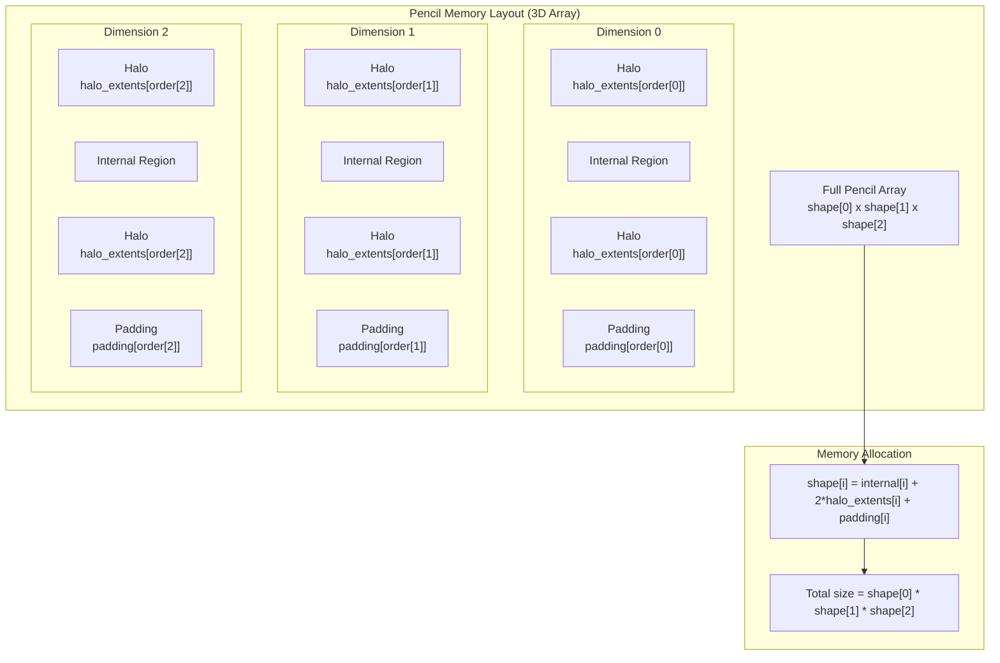
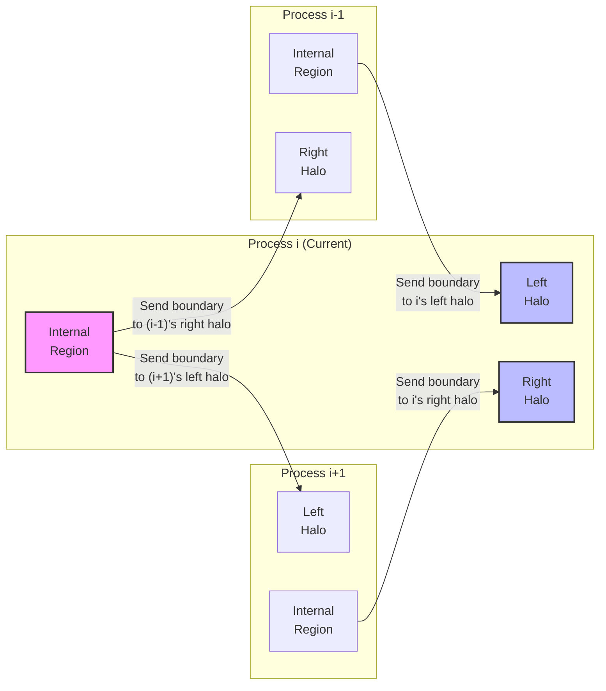
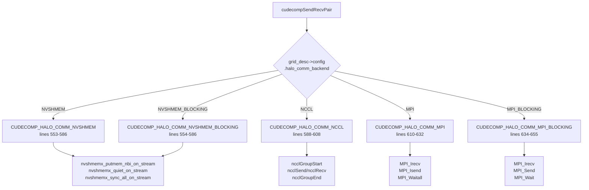
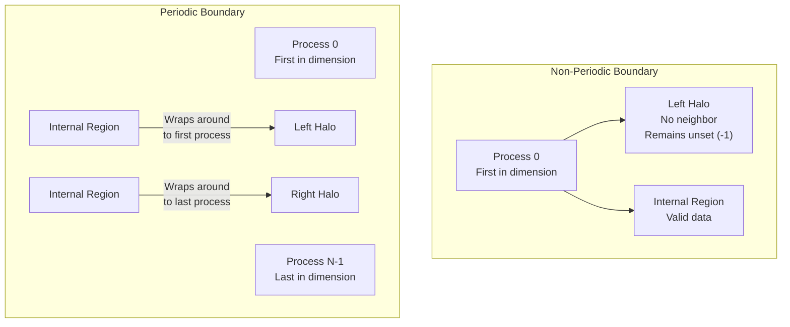
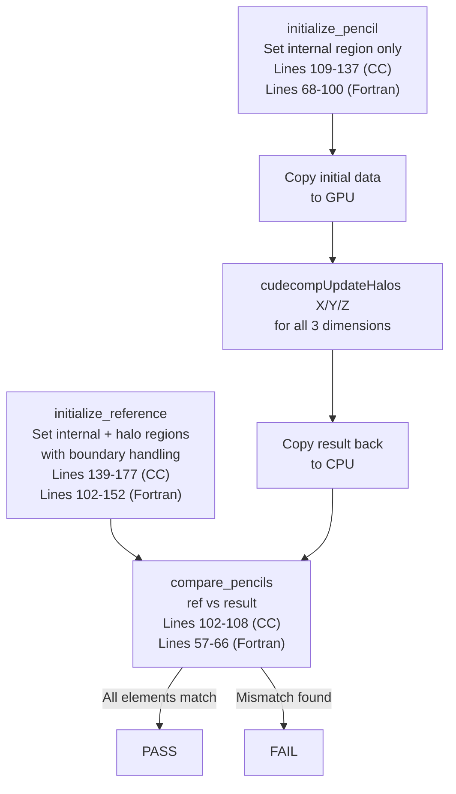

<!-- source: DeepWiki mcp.deepwiki.com · repo NVIDIA/cuDecomp · page 6 Halo Updates · fetched 2026-10-26 -->

# Halo Updates

<details>
<summary>Relevant source files</summary>

The following files were used as context for generating this wiki page:

- [include/internal/comm_routines.h](include/internal/comm_routines.h)
- [src/cudecomp.cc](src/cudecomp.cc)
- [tests/cc/halo_test.cc](tests/cc/halo_test.cc)
- [tests/fortran/halo_test.f90](tests/fortran/halo_test.f90)

</details>


Halo updates exchange boundary data between neighboring processes in a decomposed domain. This operation is essential for implementing stencil-based numerical methods (finite differences, convolutions, etc.) where each process needs access to data elements owned by adjacent processes.

For information about transpose operations (data redistribution between pencil orientations), see [Transpose Operations](#5). For details on communication backend implementations, see [Communication Backend Details](#8).

## Purpose and Scope

This page describes:
- The halo update API functions (`cudecompUpdateHalosX/Y/Z`)
- Memory layout of pencil data with halo regions
- Communication patterns for exchanging boundary data
- Periodic and non-periodic boundary conditions
- Backend selection and workspace requirements

**Sources:** [include/internal/comm_routines.h:526-667](), [tests/cc/halo_test.cc:1-596]()

## API Functions

cuDecomp provides three halo update functions, one for each pencil orientation:

```c
cudecompResult_t cudecompUpdateHalosX(cudecompHandle_t handle, cudecompGridDesc_t grid_desc,
                                      void* input, void* work, cudecompDataType_t dtype,
                                      const int32_t halo_extents[], const bool halo_periods[],
                                      int32_t dim, const int32_t padding[], cudaStream_t stream);

cudecompResult_t cudecompUpdateHalosY(...);  // Similar signature
cudecompResult_t cudecompUpdateHalosZ(...);  // Similar signature
```

| Parameter | Description |
|-----------|-------------|
| `handle` | cuDecomp library handle |
| `grid_desc` | Grid descriptor defining the decomposition |
| `input` | Pointer to pencil data (device memory) |
| `work` | Pointer to workspace buffer (device memory) |
| `dtype` | Data type enum (FLOAT, DOUBLE, FLOAT_COMPLEX, DOUBLE_COMPLEX) |
| `halo_extents` | Array[3] of halo widths in each global dimension |
| `halo_periods` | Array[3] of boolean flags for periodic boundaries |
| `dim` | Dimension index (0, 1, or 2) to update |
| `padding` | Array[3] of padding elements in each dimension |
| `stream` | CUDA stream for asynchronous execution |

The `dim` parameter controls which dimension's halos are updated. Typically, all three dimensions are updated in sequence:

```c
for (int dim = 0; dim < 3; dim++) {
    cudecompUpdateHalosX(handle, grid_desc, data, work, dtype, 
                        halo_extents, halo_periods, dim, padding, stream);
}
```

**Sources:** [tests/cc/halo_test.cc:469-484](), [tests/fortran/halo_test.f90:476-485]()

## Halo Region Memory Layout

**Diagram: Pencil Data Layout with Halo Regions**



The pencil shape returned by `cudecompGetPencilInfo` includes space for:
1. **Internal region**: The actual data owned by this process
2. **Halo regions**: Boundary data received from neighbors (before and after internal region)
3. **Padding regions**: Extra space for alignment or FFT operations

For example, with `halo_extents = {1, 1, 1}` and `padding = {0, 0, 0}`:
- Internal region of 64x64x64
- Becomes 66x66x66 allocated array (2 extra elements per dimension for halos)

**Sources:** [tests/cc/halo_test.cc:109-137](), [tests/fortran/halo_test.f90:68-100]()

## Halo Update Process

**Diagram: Halo Update Communication Pattern**



The halo update performs simultaneous bidirectional exchanges:
1. **Pack**: Extract boundary data from internal region
2. **Send/Recv**: Exchange with two neighbors using `cudecompSendRecvPair`
3. **Unpack**: Place received data into halo regions

Each update handles one dimension at a time. For a given dimension `dim`:
- Left neighbor rank: calculated by shifting process coordinates
- Right neighbor rank: calculated by shifting in opposite direction
- Self-copy: when a process is its own neighbor (single process in that dimension)

**Sources:** [include/internal/comm_routines.h:526-667]()

## Communication Backend Implementation

**Diagram: cudecompSendRecvPair Backend Dispatch**



The `cudecompSendRecvPair` function is a template that dispatches to different communication backends based on the grid descriptor configuration. Each backend has specific characteristics:

| Backend | Characteristics | Synchronization |
|---------|----------------|-----------------|
| `CUDECOMP_HALO_COMM_MPI` | Non-blocking MPI point-to-point | Stream sync + MPI_Waitall |
| `CUDECOMP_HALO_COMM_MPI_BLOCKING` | Blocking MPI | MPI_Wait per pair |
| `CUDECOMP_HALO_COMM_NCCL` | NCCL send/recv groups | Stream-ordered |
| `CUDECOMP_HALO_COMM_NVSHMEM` | NVSHMEM non-blocking puts | quiet + sync_all |
| `CUDECOMP_HALO_COMM_NVSHMEM_BLOCKING` | NVSHMEM with intermediate sync | quiet + sync_all per pair |

**Self-Copy Optimization**: All backends handle self-communication (when a process is its own neighbor) using `cudaMemcpyAsync` for better performance.

**Sources:** [include/internal/comm_routines.h:526-667]()

## Periodic Boundary Conditions

**Diagram: Periodic vs Non-Periodic Boundaries**



The `halo_periods` array controls boundary behavior for each dimension:

- **`halo_periods[i] = true`**: Periodic boundary
  - First process receives from last process
  - Last process receives from first process
  - All halo regions receive valid data

- **`halo_periods[i] = false`**: Non-periodic boundary
  - Processes at domain boundaries have no neighbors in that direction
  - Those halo regions are not updated (remain at initialization value)

Typical usage patterns:
```c
// Fully periodic domain (e.g., periodic box)
bool halo_periods[3] = {true, true, true};

// Wall boundaries in Z, periodic in X and Y
bool halo_periods[3] = {true, true, false};

// No periodic boundaries
bool halo_periods[3] = {false, false, false};
```

**Sources:** [tests/cc/halo_test.cc:154-166](), [tests/fortran/halo_test.f90:130-142]()

## Neighbor Rank Calculation

For a given dimension `dim` being updated, neighbor ranks are determined by shifting the process coordinates in the decomposition:

**For X-pencils** (axis=0, contiguous in X):
- Dimension 0 (X): Self (not decomposed, owned entirely)
- Dimension 1 (Y): Neighbors in column communicator (P1 dimension)
- Dimension 2 (Z): Neighbors in row communicator (P0 dimension)

**For Y-pencils** (axis=1, contiguous in Y):
- Dimension 0 (X): Neighbors in column communicator (P0 dimension)
- Dimension 1 (Y): Self (not decomposed, owned entirely)
- Dimension 2 (Z): Neighbors in row communicator (P1 dimension)

**For Z-pencils** (axis=2, contiguous in Z):
- Dimension 0 (X): Neighbors in row communicator (P0 dimension)
- Dimension 1 (Y): Neighbors in column communicator (P1 dimension)  
- Dimension 2 (Z): Self (not decomposed, owned entirely)

The `peer_ranks` array passed to `cudecompSendRecvPair` contains:
- `peer_ranks[0]`: Rank to receive from (and send to for bidirectional exchange)
- `peer_ranks[1]`: Rank to send to (and receive from)
- Special value `-1`: Indicates no neighbor in that direction (boundary)

**Sources:** [include/internal/comm_routines.h:528-531]()

## Workspace Requirements

Halo updates require temporary workspace for packing and unpacking boundary data. The workspace size depends on the halo extents and pencil dimensions.

```c
int64_t workspace_size;
cudecompGetHaloWorkspaceSize(handle, grid_desc, axis, halo_extents, &workspace_size);

void* work;
cudecompMalloc(handle, grid_desc, &work, workspace_size * dtype_size);
```

The workspace calculation for a given axis accounts for the maximum buffer size needed across all three dimensions:

```
halo_size_x = 4 * shape[1] * shape[2] * halo_extents[0]
halo_size_y = 4 * shape[0] * shape[2] * halo_extents[1]  
halo_size_z = 4 * shape[0] * shape[1] * halo_extents[2]

workspace_size = max(halo_size_x, halo_size_y, halo_size_z)
```

The factor of 4 accounts for send/receive buffers in both directions (left/right or forward/backward).

**Workspace Reuse**: The same workspace buffer can be reused for all three dimension updates in a single halo update cycle.

**Sources:** [src/cudecomp.cc:1107-1128](), [tests/cc/halo_test.cc:410-413]()

## Backend Selection and Autotuning

The halo communication backend is configured in `cudecompGridDescConfig`:

```c
cudecompGridDescConfig_t config;
cudecompGridDescConfigSetDefaults(&config);

// Manual selection
config.halo_comm_backend = CUDECOMP_HALO_COMM_NCCL;

// Or enable autotuning
cudecompGridDescAutotuneOptions_t options;
cudecompGridDescAutotuneOptionsSetDefaults(&options);
options.autotune_halo_backend = true;
options.halo_axis = 0;  // Axis to benchmark
options.halo_extents[0] = 1;
options.halo_extents[1] = 1;
options.halo_extents[2] = 1;
options.halo_periods[0] = true;
options.halo_periods[1] = true;
options.halo_periods[2] = true;

cudecompGridDescCreate(handle, &grid_desc, &config, &options);
```

The autotuning system benchmarks available backends and selects the fastest one for the specified halo configuration. For more details, see [Performance Autotuning](#7).

Available backends (controlled by compile-time flags):

| Backend | Requires | Description |
|---------|----------|-------------|
| `CUDECOMP_HALO_COMM_MPI` | MPI | Non-blocking point-to-point |
| `CUDECOMP_HALO_COMM_MPI_BLOCKING` | MPI | Blocking point-to-point |
| `CUDECOMP_HALO_COMM_NCCL` | NCCL | GPU-initiated collective |
| `CUDECOMP_HALO_COMM_NVSHMEM` | NVSHMEM | One-sided RDMA |
| `CUDECOMP_HALO_COMM_NVSHMEM_BLOCKING` | NVSHMEM | One-sided with blocking sync |

**Sources:** [src/cudecomp.cc:109-124](), [tests/cc/halo_test.cc:379-396]()

## Validation and Testing

The test suite validates halo updates by comparing against a reference implementation that explicitly handles boundary conditions and periodicity.

**Diagram: Test Validation Flow**



**Key Validation Features**:

1. **Reference Implementation**: Explicitly computes expected values including:
   - Periodic wrapping: `gx[i] = (gx[i] + gdims[i]) % gdims[i]`
   - Non-periodic boundaries: Set to sentinel value `-1`
   - Padding regions: Set to sentinel value `-1`

2. **Test Coverage**: The test files support parameterized testing with:
   - Different grid sizes and process grids
   - All communication backends
   - Various halo extents (0-4 typically)
   - Periodic and non-periodic combinations
   - Padding configurations
   - Memory order variations
   - Both device and managed memory

3. **Test File Format**: Tests can be run individually or from a test file containing multiple test cases:
   ```
   # Example test cases (one per line)
   --gx 256 --gy 256 --gz 256 --hex 1 --hey 1 --hez 1 --backend 1
   --gx 128 --gy 128 --gz 256 --hex 2 --hey 2 --hez 2 --hpz 0 --backend 2
   ```

**Sources:** [tests/cc/halo_test.cc:102-177](), [tests/fortran/halo_test.f90:57-152](), [tests/cc/halo_test.cc:347-496]()

## Performance Considerations

1. **Backend Selection**: Different backends perform better in different scenarios:
   - NCCL excels for intra-node communication with NVLink
   - NVSHMEM can be faster for small messages on NVLink systems
   - MPI may be better for inter-node communication or heterogeneous networks

2. **Halo Extent Impact**: Larger halo extents increase communication volume but reduce frequency of updates needed. Balance depends on the stencil order.

3. **Dimension Update Order**: The order of updating dimensions (x, y, z) can affect cache behavior but typically has minimal impact.

4. **Stream Overlap**: Halo updates accept a CUDA stream parameter, allowing overlap with computation on other streams.

5. **Workspace Allocation**: Use `cudecompMalloc` for workspace to enable NCCL UBR optimization and ensure compatibility with NVSHMEM backends. See [Memory Management](#9) for details.

**Sources:** [include/internal/comm_routines.h:526-667](), [src/cudecomp.cc:1131-1176]()

---

