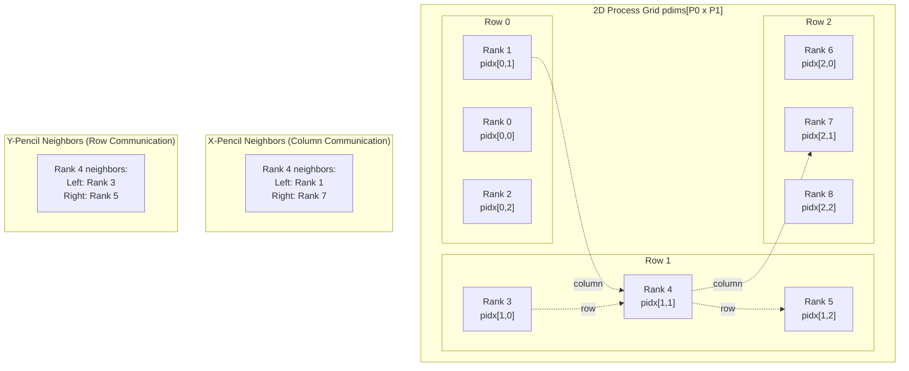
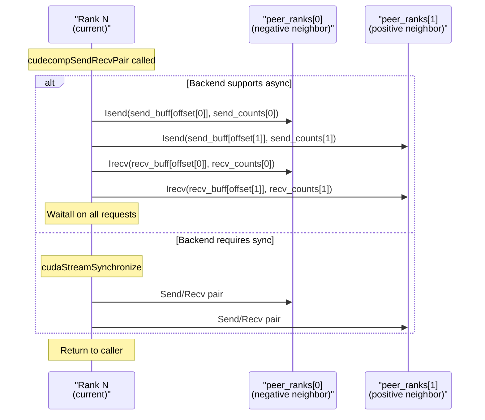
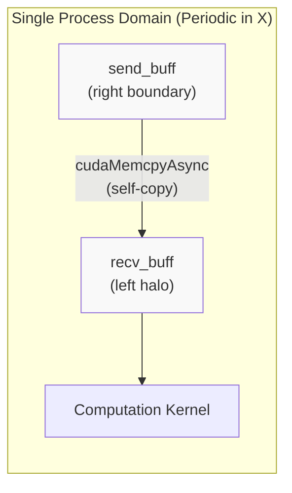
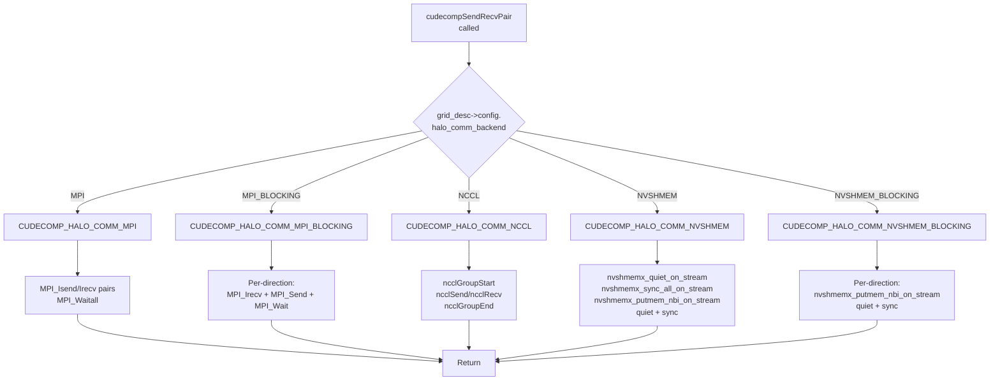
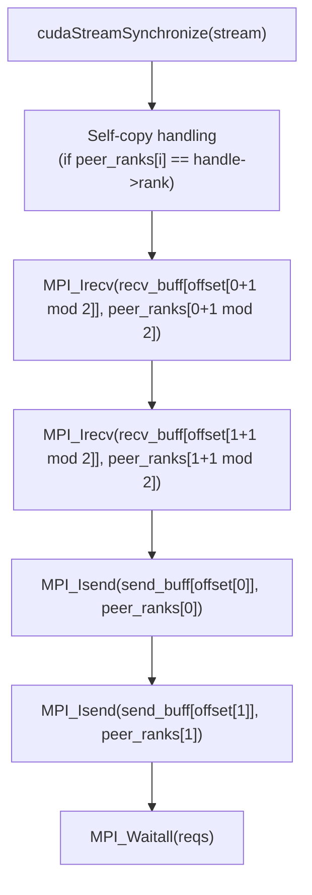
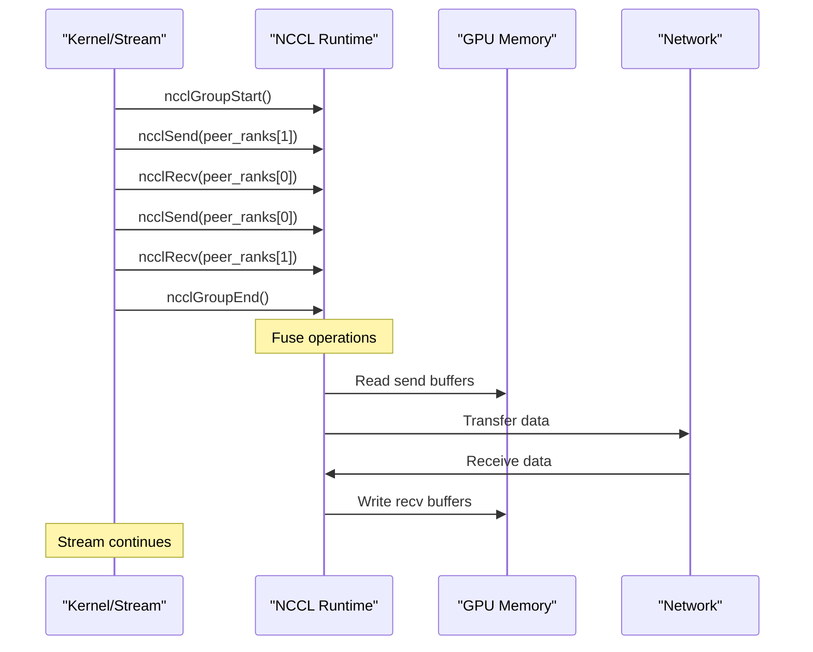
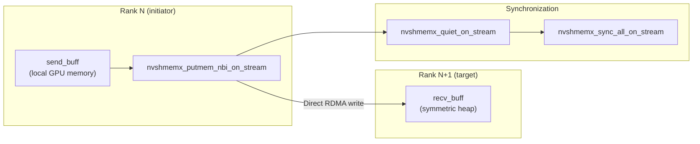

<!-- source: DeepWiki mcp.deepwiki.com · repo NVIDIA/cuDecomp · page 6.1 Halo Communication Patterns · fetched 2026-10-26 -->

# Halo Communication Patterns

<details>
<summary>Relevant source files</summary>

The following files were used as context for generating this wiki page:

- [include/internal/comm_routines.h](include/internal/comm_routines.h)
- [include/internal/common.h](include/internal/common.h)

</details>


## Purpose and Scope

This page describes the communication patterns used by cuDecomp to exchange halo (ghost cell) data between neighboring processes in a pencil decomposition. Halo updates enable stencil computations by providing access to boundary data from adjacent processes. This document covers neighbor rank determination, the send/recv pair pattern, periodic boundary conditions, and backend-specific implementation details.

For information about the halo API and usage, see [Halo Update Operations API](#4.4). For details on individual communication backends, see [Communication Backend Details](#8).

---

## Halo Exchange Communication Model

Halo updates in cuDecomp use a **bidirectional send/recv pair pattern** where each process exchanges boundary data with up to two neighbors along a single axis. This is implemented through the `cudecompSendRecvPair` function, which handles communication in both directions simultaneously.

### Key Characteristics

- **Simultaneous bidirectional exchange**: Each call exchanges data with neighbors in both the positive and negative directions along one axis
- **Two peer ranks**: A pair of ranks representing neighbors in opposite directions (e.g., left/right or top/bottom)
- **Backend-agnostic interface**: The same function signature works across MPI, NCCL, and NVSHMEM backends
- **Self-copy handling**: Special handling for periodic boundary conditions where a process is its own neighbor
- **Blocking and non-blocking modes**: Different backends support different synchronization behaviors

**Halo Exchange Data Flow**
```mermaid
graph LR
    subgraph "Rank N-1"
        SB1["send_buff<br/>(boundary data)"]
        RB1["recv_buff<br/>(halo region)"]
    end
    
    subgraph "Rank N"
        SB2["send_buff<br/>(boundary data)"]
        RB2["recv_buff<br/>(halo region)"]
        SB3["send_buff<br/>(boundary data)"]
        RB3["recv_buff<br/>(halo region)"]
    end
    
    subgraph "Rank N+1"
        SB4["send_buff<br/>(boundary data)"]
        RB4["recv_buff<br/>(halo region)"]
    end
    
    SB1 -->|"Send"| RB2
    RB1 <--|"Recv"| SB2
    
    SB3 -->|"Send"| RB4
    RB3 <--|"Recv"| SB4
    
    style SB2 fill:#f9f9f9
    style RB2 fill:#f9f9f9
    style SB3 fill:#f9f9f9
    style RB3 fill:#f9f9f9
```

Sources: [include/internal/comm_routines.h:526-667]()

---

## Neighbor Rank Determination

The determination of neighbor ranks depends on the pencil orientation and process grid configuration. Neighbors are computed differently for X-, Y-, and Z-pencil orientations based on the 2D process grid layout (`pdims`).

### Rank Calculation

Neighbor ranks are calculated by shifting the current process's position in the process grid. The specific logic depends on whether column-major or row-major rank ordering is used.

**Process Grid and Neighbor Relationships**


The `getGlobalRank` helper function converts between local communicator ranks and global ranks:

```cpp
// From common.h:215-226
static inline int getGlobalRank(const cudecompHandle_t handle, 
                                const cudecompGridDesc_t grid_desc,
                                cudecompCommAxis axis, int axis_rank)
```

This function handles both column-major and row-major rank ordering based on the `use_col_major_rank_order` flag.

Sources: [include/internal/common.h:215-226]()

---

## Send/Recv Pair Communication Pattern

The core halo communication pattern is implemented in the `cudecompSendRecvPair` function, which exchanges data with two peer ranks simultaneously. This function is templated on data type and dispatches to the appropriate backend implementation.

### Function Signature

```cpp
template <typename T>
static void cudecompSendRecvPair(
    const cudecompHandle_t& handle,
    const cudecompGridDesc_t& grid_desc,
    const std::array<int32_t, 2>& peer_ranks,    // neighbor ranks [left, right]
    T* send_buff,
    const std::array<comm_count_t, 2>& send_counts,  // counts per neighbor
    const std::array<size_t, 2>& send_offsets,       // offsets in send_buff
    T* recv_buff,
    const std::array<comm_count_t, 2>& recv_counts,  // counts per neighbor
    const std::array<size_t, 2>& recv_offsets,       // offsets in recv_buff
    cudaStream_t stream = 0,
    cudecompHaloPerformanceSample* current_sample = nullptr
)
```

### Peer Rank Array Convention

The `peer_ranks` array contains exactly two elements:
- **`peer_ranks[0]`**: Neighbor in the negative direction (left/bottom/back)
- **`peer_ranks[1]`**: Neighbor in the positive direction (right/top/front)

Special values:
- **`-1`**: No neighbor in this direction (non-periodic boundary)
- **`handle->rank`**: Self-neighbor (periodic boundary where domain wraps to itself)

**Send/Recv Pair Communication Flow**


Sources: [include/internal/comm_routines.h:526-667]()

---

## Periodic Boundary Conditions

Periodic boundary conditions are handled by setting a process's neighbor rank to itself when the domain wraps around. This requires a special self-copy operation instead of inter-process communication.

### Self-Copy Handling

When `peer_ranks[i] == handle->rank`, the function performs a local `cudaMemcpyAsync` instead of network communication:

```cpp
if (peer_ranks[i] == handle->rank) {
    // Self-copy with cudaMemcpy
    CHECK_CUDA(cudaMemcpyAsync(recv_buff + recv_offsets[i], 
                               send_buff + send_offsets[i],
                               send_counts[i] * sizeof(T), 
                               cudaMemcpyDeviceToDevice, stream));
}
```

This pattern appears in all backend implementations to handle the periodic self-copy case efficiently.

**Periodic Boundary Self-Copy**


Sources: [include/internal/comm_routines.h:560-563, 592-595, 615-618, 638-641]()

---

## Backend-Specific Communication Implementations

The `cudecompSendRecvPair` function uses a switch statement to dispatch to different backend implementations based on `grid_desc->config.halo_comm_backend`.

### Backend Comparison Table

| Backend | Enum Value | Sync Behavior | Memory Requirements | Use Case |
|---------|-----------|---------------|---------------------|----------|
| MPI | `CUDECOMP_HALO_COMM_MPI` | Non-blocking (Isend/Irecv + Waitall) | Standard GPU memory | General purpose, high portability |
| MPI Blocking | `CUDECOMP_HALO_COMM_MPI_BLOCKING` | Blocking per direction (Irecv + Send + Wait) | Standard GPU memory | Simplified synchronization |
| NCCL | `CUDECOMP_HALO_COMM_NCCL` | Non-blocking (ncclGroupStart/End) | Standard GPU memory or UBR | GPU-optimized, low latency |
| NVSHMEM | `CUDECOMP_HALO_COMM_NVSHMEM` | Non-blocking (putmem_nbi + quiet + sync) | NVSHMEM symmetric heap | Direct RDMA, lowest latency |
| NVSHMEM Blocking | `CUDECOMP_HALO_COMM_NVSHMEM_BLOCKING` | Blocking per direction (putmem_nbi + quiet + sync) | NVSHMEM symmetric heap | Simplified NVSHMEM usage |

**Backend Dispatch Logic**


Sources: [include/internal/comm_routines.h:552-660]()

---

## MPI Backend Implementation

The MPI backend provides two modes: standard non-blocking and blocking.

### Non-Blocking MPI (CUDECOMP_HALO_COMM_MPI)

The non-blocking implementation posts all receives first, then all sends, then waits for all operations to complete:

1. **Synchronize stream**: `cudaStreamSynchronize(stream)` ensures GPU data is ready
2. **Post receives**: `MPI_Irecv` for both directions
3. **Post sends**: `MPI_Isend` for both directions  
4. **Wait for completion**: `MPI_Waitall` on all requests

**MPI Non-Blocking Communication Pattern**


Note the index shifting in receive operations: `recv_offsets[(i + 1) % 2]` ensures that data received from `peer_ranks[i]` goes into the opposite buffer position.

Sources: [include/internal/comm_routines.h:610-632]()

### Blocking MPI (CUDECOMP_HALO_COMM_MPI_BLOCKING)

The blocking implementation processes each direction sequentially with `MPI_Send` instead of `MPI_Isend`:

1. **Post receive**: `MPI_Irecv` for direction i
2. **Blocking send**: `MPI_Send` for direction i
3. **Wait for receive**: `MPI_Wait` on the receive request
4. **Repeat** for the other direction

This mode is simpler but may have higher latency as it doesn't overlap communication in both directions.

Sources: [include/internal/comm_routines.h:634-655]()

---

## NCCL Backend Implementation

The NCCL backend uses GPU-initiated communication with group operations for efficiency.

### NCCL Group Communication

NCCL operations are grouped to enable kernel fusion and reduce synchronization overhead:

```cpp
auto comm = *grid_desc->nccl_comm;
CHECK_NCCL(ncclGroupStart());
for (int i = 0; i < send_counts.size(); ++i) {
    if (peer_ranks[i] == handle->rank) {
        // Self-copy with cudaMemcpy
        CHECK_CUDA(cudaMemcpyAsync(...));
    } else {
        if (send_counts[(i + 1) % 2] != 0 && peer_ranks[(i + 1) % 2] != -1) {
            CHECK_NCCL(ncclSend(..., peer_ranks[(i + 1) % 2], comm, stream));
        }
        if (recv_counts[i] != 0 && peer_ranks[i] != -1) {
            CHECK_NCCL(ncclRecv(..., peer_ranks[i], comm, stream));
        }
    }
}
CHECK_NCCL(ncclGroupEnd());
```

**NCCL Communication Flow**


### Key Features

- **Stream-based**: All operations enqueued on the provided CUDA stream
- **No CPU synchronization**: Communication overlaps with computation
- **Global communicator**: Uses `grid_desc->nccl_comm` which spans all ranks
- **Index shifting**: Same pattern as MPI to ensure correct buffer mapping

Sources: [include/internal/comm_routines.h:588-608]()

---

## NVSHMEM Backend Implementation

NVSHMEM backends use one-sided PUT operations instead of paired send/recv.

### Non-Blocking NVSHMEM (CUDECOMP_HALO_COMM_NVSHMEM)

The non-blocking NVSHMEM implementation:

1. **Quiet previous operations**: `nvshmemx_quiet_on_stream(stream)`
2. **Global sync**: `nvshmemx_sync_all_on_stream(stream)`
3. **Issue PUTs**: `nvshmemx_putmem_nbi_on_stream` for each peer
4. **Quiet and sync**: Final quiet and sync to ensure completion

**NVSHMEM One-Sided Communication**


### Important Index Handling

NVSHMEM uses the opposite direction for PUT operations to achieve the same result as send/recv:

```cpp
if (peer_ranks[(i + 1) % 2] != -1) {
    nvshmemx_putmem_nbi_on_stream(
        recv_buff + recv_offsets[i],           // remote destination
        send_buff + send_offsets[(i + 1) % 2], // local source
        send_counts[(i + 1) % 2] * sizeof(T),  // size
        peer_ranks[(i + 1) % 2],               // target PE
        stream
    );
}
```

The logic is: to fill my recv buffer at position `i` (from peer `i`), I PUT my send buffer at position `(i+1)%2` to peer `(i+1)%2`, which writes to their recv buffer at position `i`.

Sources: [include/internal/comm_routines.h:553-586]()

### Blocking NVSHMEM (CUDECOMP_HALO_COMM_NVSHMEM_BLOCKING)

The blocking variant synchronizes after each direction's PUT operation, providing stricter ordering guarantees at the cost of potentially higher latency.

Sources: [include/internal/comm_routines.h:570-574]()

---

## Performance Monitoring

When performance reporting is enabled, the `cudecompSendRecvPair` function records timing events:

```cpp
if (handle->performance_report_enable && current_sample) {
    CHECK_CUDA(cudaEventRecord(current_sample->sendrecv_start_event, stream));
}
// ... communication operations ...
if (handle->performance_report_enable && current_sample) {
    CHECK_CUDA(cudaEventRecord(current_sample->sendrecv_end_event, stream));
}
```

The `cudecompHaloPerformanceSample` structure tracks:
- **`halo_start_event`/`halo_end_event`**: Total halo update time
- **`sendrecv_start_event`/`sendrecv_end_event`**: Communication-only time
- **`sendrecv_bytes`**: Amount of data transferred

This enables detailed performance analysis and comparison of different backends. See [Performance Monitoring](#14.3) for more details on the performance tracking system.

Sources: [include/internal/comm_routines.h:536-538, 662-664](), [include/internal/common.h:151-166]()

---

## Error Handling and Edge Cases

### Invalid Rank Handling

The code checks for invalid peer ranks (`-1`) before attempting communication:

```cpp
if (peer_ranks[i] != -1) {
    // Perform communication
}
```

This allows halo updates to work correctly with non-periodic boundaries where no neighbor exists.

### Zero-Count Transfers

Backend implementations check for zero counts before initiating transfers:

```cpp
if (send_counts[i] != 0 && peer_ranks[i] != -1) {
    // Perform send
}
```

This avoids unnecessary communication calls and potential errors with some MPI implementations.

### NVSHMEM Buffer Validation

NVSHMEM backends verify that buffers are allocated in symmetric memory:

```cpp
if (nvshmem_ptr(send_buff, handle->rank) && nvshmem_ptr(recv_buff, handle->rank)) {
    // Proceed with NVSHMEM operations
} else {
    THROW_INVALID_USAGE("NVSHMEM communication backends require workspace allocated via cudecompMalloc.");
}
```

This check ensures correctness since NVSHMEM operations require symmetric heap allocation.

### Mixed Buffer Warning

A warning is issued if NVSHMEM-allocated buffers are used with MPI backends, as this can cause issues with some MPI implementations:

```cpp
if (handle->rank == 0 && handle->nvshmem_initialized && 
    !handle->nvshmem_mixed_buffer_warning_issued &&
    haloBackendRequiresMpi(grid_desc->config.halo_comm_backend) &&
    (nvshmem_ptr(send_buff, handle->rank) || nvshmem_ptr(recv_buff, handle->rank))) {
    printf("CUDECOMP:WARN: A work buffer allocated with nvshmem_malloc...");
    handle->nvshmem_mixed_buffer_warning_issued = true;
}
```

Sources: [include/internal/comm_routines.h:540-549, 556-583, 598-604, 620-628, 644-650]()

---

