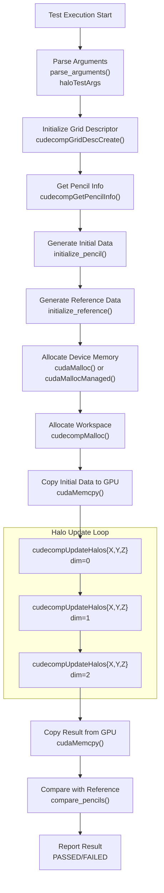
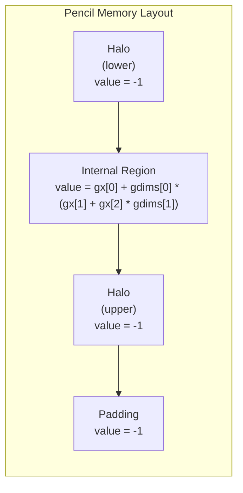
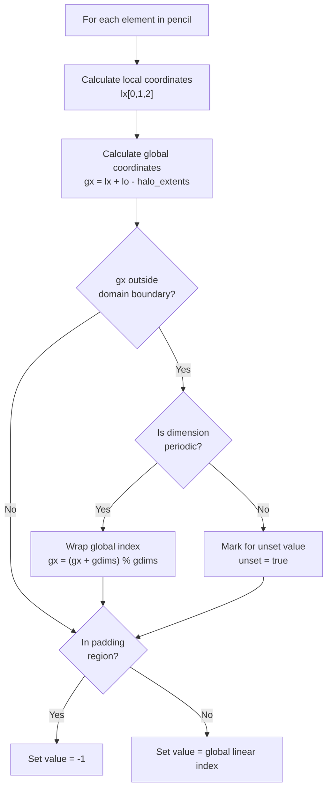
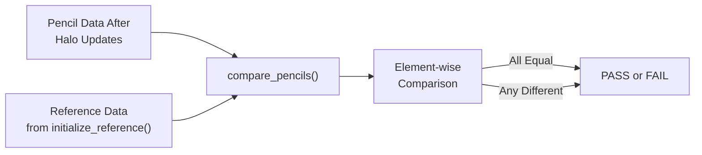
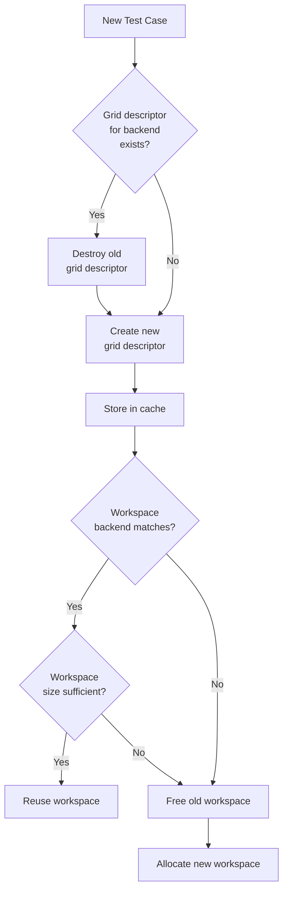

<!-- source: DeepWiki mcp.deepwiki.com · repo NVIDIA/cuDecomp · page 6.2 Testing Halo Operations · fetched 2026-10-26 -->

# Testing Halo Operations

<details>
<summary>Relevant source files</summary>

The following files were used as context for generating this wiki page:

- [include/cudecomp.h](include/cudecomp.h)
- [tests/cc/halo_test.cc](tests/cc/halo_test.cc)
- [tests/fortran/halo_test.f90](tests/fortran/halo_test.f90)

</details>


This page describes the test infrastructure and methodology used to validate halo communication operations in cuDecomp. It covers the reference implementation used for correctness checking, test execution modes, and the validation process. For information about the halo communication implementation itself, see [Halo Communication Patterns](#6.1).

## Purpose and Scope

The cuDecomp library includes comprehensive test suites in both C++ and Fortran that validate halo exchange operations across different communication backends, data types, grid configurations, and boundary conditions. These tests ensure that:

- Halo data is correctly exchanged between neighboring processes
- Periodic and non-periodic boundary conditions work correctly
- Different communication backends produce identical results
- Padding regions are handled appropriately
- Various pencil orientations (X, Y, Z) are supported

## Test Infrastructure Overview

The halo test infrastructure consists of parallel implementations in C++ ([tests/cc/halo_test.cc]()) and Fortran ([tests/fortran/halo_test.f90]()). Both implementations follow the same validation methodology and support identical command-line arguments.

### Test Workflow



**Sources:** [tests/cc/halo_test.cc:347-495](), [tests/fortran/halo_test.f90:202-500]()

### Key Data Structures

| Structure | Description | File Location |
|-----------|-------------|---------------|
| `haloTestArgs` | C++ struct holding parsed command-line arguments | [tests/cc/halo_test.cc:229-244]() |
| `cudecompPencilInfo_t` | Pencil geometry information including shape, bounds, halos | [include/cudecomp.h:194-202]() |
| `grid_desc_cache` | Map caching grid descriptors by backend type | [tests/cc/halo_test.cc:335]() |
| `workspace` | Tuple storing workspace backend, pointer, and size | [tests/cc/halo_test.cc:336]() |

**Sources:** [tests/cc/halo_test.cc:229-336](), [tests/fortran/halo_test.f90:49-55]()

## Reference Data Generation

The test validation relies on two key data initialization functions that establish known patterns for comparison.

### Initial Pencil Data

The `initialize_pencil` function sets up the input data before halo exchanges. It initializes only the internal (non-halo) region of each pencil with values equal to the global linear index.



The global coordinate `gx[]` is computed from the local pencil coordinate and the pencil bounds:

```
gx[pinfo.order[i]] = lx[i] + pinfo.lo[i] - pinfo.halo_extents[pinfo.order[i]]
```

**Key implementation details:**
- Iterates over entire pencil shape including halos and padding
- Sets halo and padding regions to -1 (uninitialized marker)
- Sets internal region to global linear index for uniqueness
- Respects pencil memory ordering specified by `pinfo.order[]`

**Sources:** [tests/cc/halo_test.cc:109-137](), [tests/fortran/halo_test.f90:68-100]()

### Reference Data with Halos

The `initialize_reference` function generates the expected result after halo exchanges. It fills the entire pencil including halo regions with correct values based on periodicity settings.



**Periodicity handling:**
- If `halo_periods[dim] == true`: wrap around using modulo arithmetic
- If `halo_periods[dim] == false`: leave halo value as -1 (no neighbor exists)

**Sources:** [tests/cc/halo_test.cc:139-177](), [tests/fortran/halo_test.f90:102-152]()

## Test Execution Modes

The test suite supports two execution modes to accommodate different testing scenarios.

### Single Test Mode

Execute a single test case with command-line arguments:

```bash
mpirun -np 4 ./halo_test --gx 128 --gy 128 --gz 128 --backend 1 --hex 2 --hey 2 --hez 2
```

This mode is useful for:
- Interactive testing and debugging
- Quick validation of specific configurations
- Manual exploration of parameter space

**Sources:** [tests/cc/halo_test.cc:524-530](), [tests/fortran/halo_test.f90:558-566]()

### Test File Mode

Execute multiple test cases from a file:

```bash
mpirun -np 4 ./halo_test --testfile halo_tests.txt
```

Each line in the test file contains command-line arguments for one test case:

```
--gx 64 --gy 64 --gz 64 --backend 1 --hex 1
--gx 128 --gy 128 --gz 128 --backend 3 --hex 2 --hey 2 --hez 2 --hpx 0
--gx 256 --gy 256 --gz 256 --backend 4 --ax 2 --mem_order 2 0 1
```

**Test file features:**
- Progress reporting every 10 tests
- Summary statistics (passed/failed counts)
- List of failing test cases for easy reproduction
- Total execution time tracking

**Sources:** [tests/cc/halo_test.cc:84-100,510-574](), [tests/fortran/halo_test.f90:164-187,545-618]()

## Command-Line Arguments

The test suite accepts extensive command-line arguments to configure test parameters:

### Grid Configuration

| Argument | Description | Default |
|----------|-------------|---------|
| `--gx`, `--gy`, `--gz` | Global grid dimensions | 256 |
| `--pr`, `--pc` | Process grid dimensions (0 = autotune) | 0 |
| `--gd X Y Z` | Distribution grid dimensions (`gdims_dist = gdims - gd`) | 0 0 0 |

### Halo Configuration

| Argument | Description | Default |
|----------|-------------|---------|
| `--hex`, `--hey`, `--hez` | Halo extents per dimension | 1 |
| `--hpx`, `--hpy`, `--hpz` | Periodicity flags (0=false, 1=true) | 1 |
| `--ax` | Pencil axis to test (0=X, 1=Y, 2=Z) | 0 |

### Communication Backend

| Argument | Description | Default |
|----------|-------------|---------|
| `--backend N` | Halo communication backend | 0 (autotune) |

Backend values:
- 1: `CUDECOMP_HALO_COMM_MPI`
- 2: `CUDECOMP_HALO_COMM_MPI_BLOCKING`
- 3: `CUDECOMP_HALO_COMM_NCCL`
- 4: `CUDECOMP_HALO_COMM_NVSHMEM`
- 5: `CUDECOMP_HALO_COMM_NVSHMEM_BLOCKING`

### Memory and Layout

| Argument | Description | Default |
|----------|-------------|---------|
| `--pdx`, `--pdy`, `--pdz` | Padding per dimension | 0 |
| `--mem_order X Y Z` | Memory order for pencil | unset |
| `--ac 0/1` | Axis-contiguous flag | 0 |
| `-m` | Use managed memory | false |

**Sources:** [tests/cc/halo_test.cc:179-227,246-331](), [tests/fortran/halo_test.f90:258-377]()

## Test Validation Process

The validation process compares the result of halo operations against the reference data.

### Comparison Logic



The comparison is straightforward element-wise equality:

**C++ implementation:**
```cpp
static bool compare_pencils(const std::vector<real_t>& ref, 
                           const std::vector<real_t>& res,
                           const cudecompPencilInfo_t& pinfo) {
  for (int64_t i = 0; i < ref.size(); ++i) {
    if (ref[i] != res[i]) return false;
  }
  return true;
}
```

**Fortran implementation:**
```fortran
function compare_pencils(ref, res, pinfo) result(mismatch)
  ARRTYPE :: ref(pinfo%shape(1), pinfo%shape(2), pinfo%shape(3))
  ARRTYPE :: res(pinfo%shape(1), pinfo%shape(2), pinfo%shape(3))
  logical :: mismatch
  mismatch = any(ref /= res)
end function compare_pencils
```

**Sources:** [tests/cc/halo_test.cc:102-108](), [tests/fortran/halo_test.f90:57-66]()

### Multi-Dimensional Halo Updates

The test performs halo updates in all three dimensions sequentially:

```cpp
for (int i = 0; i < 3; ++i) {
  switch (args.axis) {
  case 0:
    cudecompUpdateHalosX(handle, grid_desc, input, work_d, 
                        dtype, pinfo.halo_extents, 
                        args.halo_periods.data(), i, pinfo.padding, 0);
    break;
  case 1:
    cudecompUpdateHalosY(handle, grid_desc, input, work_d, 
                        dtype, pinfo.halo_extents,
                        args.halo_periods.data(), i, pinfo.padding, 0);
    break;
  case 2:
    cudecompUpdateHalosZ(handle, grid_desc, input, work_d, 
                        dtype, pinfo.halo_extents,
                        args.halo_periods.data(), i, pinfo.padding, 0);
    break;
  }
}
```

This ensures all halo regions (lower/upper in all dimensions) are updated before validation.

**Sources:** [tests/cc/halo_test.cc:469-484](), [tests/fortran/halo_test.f90:476-485]()

## Advanced Testing Features

### Grid Descriptor and Workspace Caching

To improve test throughput when running many test cases, the infrastructure caches grid descriptors and workspaces between tests.



**Grid descriptor caching:**
- Maintains one grid descriptor per communication backend type
- Avoids repeated NCCL/NVSHMEM initialization overhead
- Implemented in `cache_grid_desc()` function

**Workspace caching:**
- Tracks current workspace backend and size
- Reuses workspace if backend matches and size is sufficient
- Frees and reallocates if backend changes or size increases

**Sources:** [tests/cc/halo_test.cc:335-345,436-461](), [tests/fortran/halo_test.f90:189-200,444-457]()

### Multi-Datatype Support

The test suite is compiled separately for each data type using preprocessor macros:

```cpp
#if defined(R32)
using real_t = float;
static cudecompDataType_t get_cudecomp_datatype(float) { 
  return CUDECOMP_FLOAT; 
}
#elif defined(R64)
using real_t = double;
static cudecompDataType_t get_cudecomp_datatype(double) { 
  return CUDECOMP_DOUBLE; 
}
#elif defined(C32)
using real_t = std::complex<float>;
static cudecompDataType_t get_cudecomp_datatype(std::complex<float>) { 
  return CUDECOMP_FLOAT_COMPLEX; 
}
#elif defined(C64)
using real_t = std::complex<double>;
static cudecompDataType_t get_cudecomp_datatype(std::complex<double>) { 
  return CUDECOMP_DOUBLE_COMPLEX; 
}
#endif
```

This generates separate test binaries:
- `halo_test_r32` (single-precision real)
- `halo_test_r64` (double-precision real)
- `halo_test_c32` (single-precision complex)
- `halo_test_c64` (double-precision complex)

**Sources:** [tests/cc/halo_test.cc:38-53](), [tests/fortran/halo_test.f90:20-42]()

### Managed Memory Testing

The `-m` flag enables testing with CUDA managed memory instead of device-only memory:

```cpp
real_t *data_d, *work_d;
if (args.use_managed_memory) {
  CHECK_CUDA(cudaMallocManaged(&data_d, data.size() * sizeof(*data_d)));
} else {
  CHECK_CUDA(cudaMalloc(&data_d, data.size() * sizeof(*data_d)));
}
```

This validates that halo operations work correctly with unified memory, which is important for some MPI implementations and backend combinations.

**Sources:** [tests/cc/halo_test.cc:428-432](), [tests/fortran/halo_test.f90:438-474]()

### Test Result Aggregation

When running in test file mode, results are aggregated across all MPI ranks using `MPI_Reduce`:

```cpp
int res = run_test(testcases[i], using_testfile);
CHECK_MPI_EXIT(MPI_Reduce((rank == 0) ? MPI_IN_PLACE : &res, &res, 1, 
                         MPI_INT, MPI_MAX, 0, MPI_COMM_WORLD));
```

This ensures that if any rank fails validation, the test is marked as failed. The test infrastructure tracks failing cases and reports them at the end:

```
Failed 2/150 tests. Failing cases:
 ./halo_test --gx 64 --gy 64 --gz 64 --backend 1 --hex 3
 ./halo_test --gx 128 --gy 128 --gz 128 --backend 4 --ax 2
```

**Sources:** [tests/cc/halo_test.cc:541,560-573](), [tests/fortran/halo_test.f90:582-617]()

---

