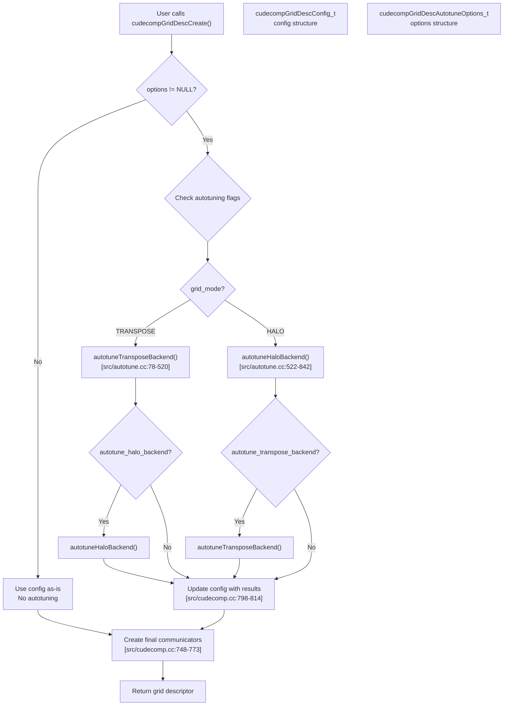
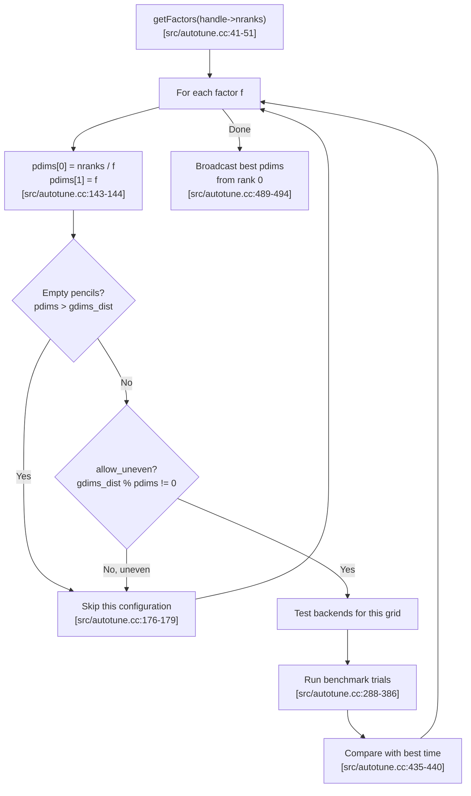
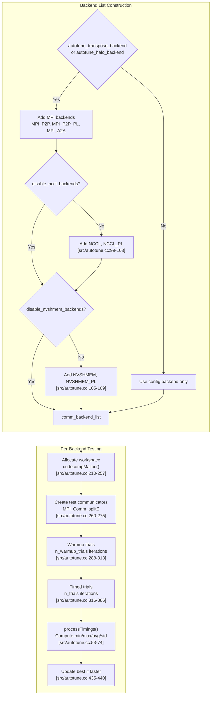
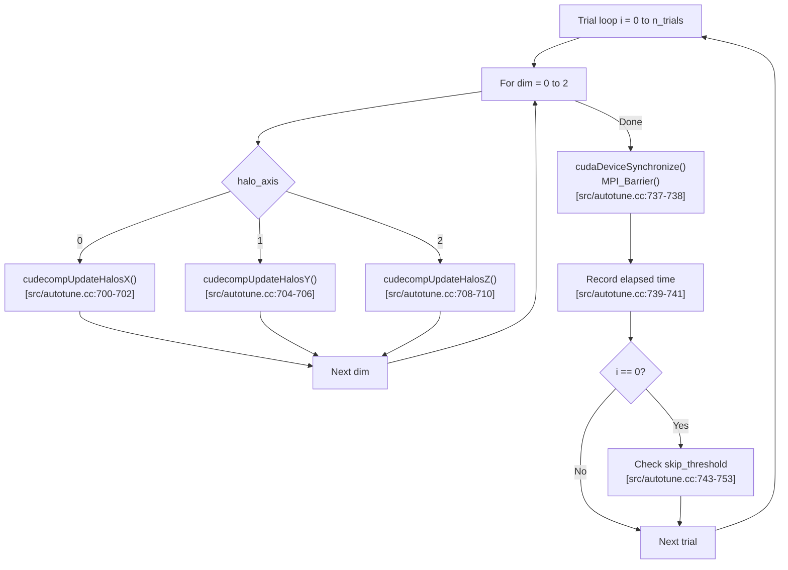
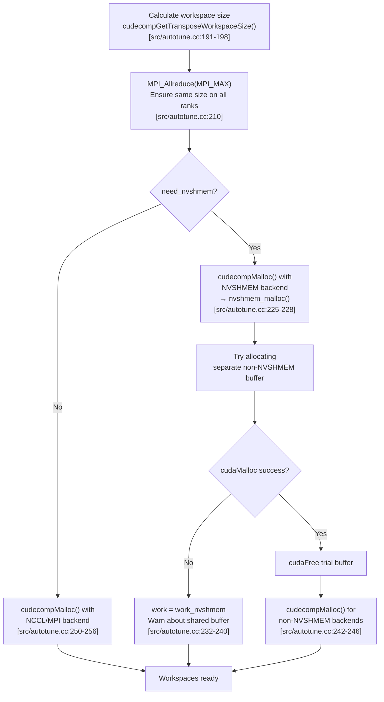
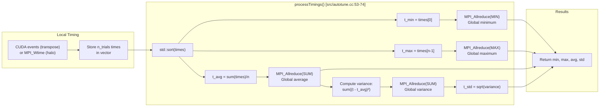
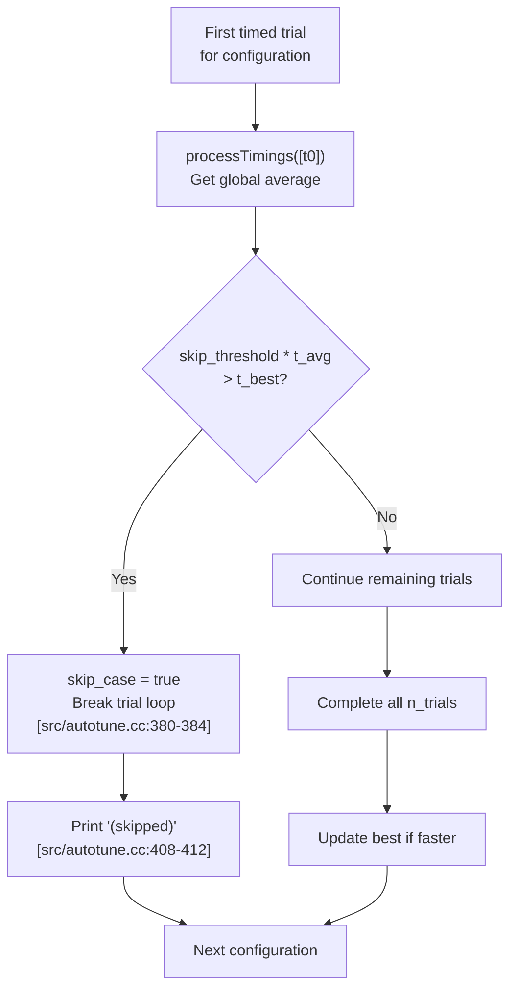

<!-- source: DeepWiki mcp.deepwiki.com · repo NVIDIA/cuDecomp · page 7 Performance Autotuning · fetched 2026-10-26 -->

# Performance Autotuning

<details>
<summary>Relevant source files</summary>

The following files were used as context for generating this wiki page:

- [include/cudecomp.h](include/cudecomp.h)
- [src/autotune.cc](src/autotune.cc)
- [src/cudecomp.cc](src/cudecomp.cc)

</details>


This document describes the autotuning system in cuDecomp that automatically benchmarks and selects optimal configurations for process grid dimensions and communication backends. For details on how these configurations are used during actual transpose and halo operations, see [Transpose Operations](#5) and [Halo Updates](#6). For information on the specific communication backend implementations, see [Communication Backend Details](#8).

## Purpose and Scope

The autotuning system in cuDecomp automatically determines optimal settings for two key configuration parameters:

1. **Process grid dimensions** (`pdims[0]` × `pdims[1]`) - how the 2D process grid is sized
2. **Communication backends** - which backend to use (MPI, NCCL, or NVSHMEM) for transpose and halo operations

Autotuning runs during grid descriptor creation when `cudecompGridDescAutotuneOptions_t` is provided to `cudecompGridDescCreate()`. It performs systematic benchmarking across different configurations and selects the fastest option based on measured performance.

## Autotuning Workflow

The autotuning process is orchestrated during grid descriptor creation and involves systematic benchmarking of different configurations.

**Autotuning Invocation and Control Flow**



Sources: [src/cudecomp.cc:565-822](), [src/autotune.cc:78-842]()

## Autotune Configuration Options

The `cudecompGridDescAutotuneOptions_t` structure controls all aspects of the autotuning process. This structure must be initialized before use.

**Configuration Structure Fields and Usage**

| Field | Type | Default | Purpose |
|-------|------|---------|---------|
| `n_warmup_trials` | `int32_t` | 3 | Number of warmup iterations before timing |
| `n_trials` | `int32_t` | 5 | Number of timed trials per configuration |
| `grid_mode` | `cudecompAutotuneGridMode_t` | `TRANSPOSE` | Whether to optimize for transpose or halo operations |
| `dtype` | `cudecompDataType_t` | `DOUBLE` | Data type to use during benchmarking |
| `allow_uneven_decompositions` | `bool` | `true` | Whether to test grids with uneven element distribution |
| `disable_nccl_backends` | `bool` | `false` | Skip NCCL backend options |
| `disable_nvshmem_backends` | `bool` | `false` | Skip NVSHMEM backend options |
| `skip_threshold` | `double` | `0.0` | Early skip factor: skip if `threshold * t > t_best` |
| `autotune_transpose_backend` | `bool` | `false` | Enable transpose backend autotuning |
| `autotune_halo_backend` | `bool` | `false` | Enable halo backend autotuning |
| `transpose_op_weights[4]` | `double` | `[1.0, 1.0, 1.0, 1.0]` | Weights for X→Y, Y→Z, Z→Y, Y→X operations |

To initialize with defaults:

```c
cudecompGridDescAutotuneOptions_t options;
cudecompGridDescAutotuneOptionsSetDefaults(&options);
```

Sources: [include/cudecomp.h:137-189](), [src/cudecomp.cc:950-992]()

## Process Grid Autotuning

When `pdims[0]` and `pdims[1]` are both set to `0` in the `cudecompGridDescConfig_t`, the autotuning system automatically tests all valid factorizations of the total process count.

**Process Grid Factorization Logic**



The `getFactors()` function finds all integer factorizations of the process count:

```
getFactors(12) → [1, 2, 3, 4, 6, 12]
```

For each factor `f`, the process grid is tested as `(nranks/f) × f`.

Sources: [src/autotune.cc:41-51](), [src/autotune.cc:125-454](), [src/autotune.cc:558-797]()

## Backend Autotuning

When backend autotuning is enabled, the system tests all available communication backends for the selected operation type.

**Backend Selection and Testing**



The backend list for transpose autotuning includes:
- **MPI backends**: `MPI_P2P`, `MPI_P2P_PL` (pipelined), `MPI_A2A` (alltoall)
- **NCCL backends**: `NCCL`, `NCCL_PL` (pipelined) 
- **NVSHMEM backends**: `NVSHMEM`, `NVSHMEM_PL` (pipelined)

Sources: [src/autotune.cc:93-117](), [src/autotune.cc:277-441](), [src/autotune.cc:537-556]()

## Transpose Autotuning Implementation

The `autotuneTransposeBackend()` function benchmarks transpose operations across all four transpose directions with configurable weights.

**Transpose Autotuning Flow**

```mermaid
graph LR
    subgraph "Trial Execution [src/autotune.cc:326-386]"
    Start["cudaEventRecord(events[0])"]
    Start --> XY["cudecompTransposeXToY()<br/>weight[0]"]
    XY --> E1["cudaEventRecord(events[1])"]
    E1 --> YZ["cudecompTransposeYToZ()<br/>weight[1]"]
    YZ --> E2["cudaEventRecord(events[2])"]
    E2 --> ZY["cudecompTransposeZToY()<br/>weight[2]"]
    ZY --> E3["cudaEventRecord(events[3])"]
    E3 --> YX["cudecompTransposeYToX()<br/>weight[3]"]
    YX --> E4["cudaEventRecord(events[4])"]
    E4 --> Sync["cudaDeviceSynchronize()"]
    end
    
    subgraph "Timing Calculation"
    Sync --> Compute["Compute weighted time:<br/>t = w[0]*t_xy + w[1]*t_yz<br/>+ w[2]*t_zy + w[3]*t_yx<br/>[src/autotune.cc:370-373]"]
    Compute --> FirstTrial{"i == 0?"}
    FirstTrial -->|Yes| SkipCheck["Check skip_threshold<br/>[src/autotune.cc:375-385]"]
    FirstTrial -->|No| Continue["Continue trials"]
    SkipCheck -->|threshold * t > t_best| Skip["Skip remaining trials"]
    SkipCheck -->|Otherwise| Continue
    end
```



The weighting system allows users to optimize for specific transpose patterns. For example, if an application primarily uses X→Y and Y→Z transposes:

```c
options.transpose_op_weights[0] = 1.0;  // X→Y
options.transpose_op_weights[1] = 1.0;  // Y→Z
options.transpose_op_weights[2] = 0.0;  // Z→Y (skip)
options.transpose_op_weights[3] = 0.0;  // Y→X (skip)
```

Sources: [src/autotune.cc:78-520](), [src/autotune.cc:326-386]()

## Halo Autotuning Implementation

The `autotuneHaloBackend()` function benchmarks halo communication for a specified pencil axis across all three dimensions.

**Halo Autotuning Trial Structure**



Unlike transpose autotuning which uses CUDA events for timing, halo autotuning uses MPI wall-clock time (`MPI_Wtime()`) to measure the complete halo update sequence including all three dimensions.

Sources: [src/autotune.cc:522-842](), [src/autotune.cc:696-754]()

## Memory Management During Autotuning

Autotuning requires careful workspace allocation to handle different backend requirements, particularly for NVSHMEM which requires symmetric allocations across all ranks.

**Workspace Allocation Strategy**



The dual-workspace strategy ensures:
1. **NVSHMEM backends** use symmetric heap allocations required by NVSHMEM
2. **MPI/NCCL backends** can use standard CUDA memory or NCCL UBR-registered memory
3. If memory is constrained, a single NVSHMEM-allocated workspace is shared (with warning)

Sources: [src/autotune.cc:190-257](), [src/autotune.cc:604-663]()

## Timing Collection and Statistics

The autotuning system collects precise timing data and computes statistical measures across all ranks.

**Timing Statistics Pipeline**



The returned statistics provide insight into:
- **Minimum time**: Best-case performance across all ranks
- **Maximum time**: Worst-case performance (often limited by slowest rank)
- **Average time**: Typical performance for the configuration
- **Standard deviation**: Performance consistency across ranks

Sources: [src/autotune.cc:53-74](), [src/autotune.cc:391-396](), [src/autotune.cc:756]()

## Skip Threshold Optimization

The `skip_threshold` option enables early termination of slow configurations to reduce autotuning time.

**Skip Logic Implementation**



Example: With `skip_threshold = 1.5` and `t_best = 10 ms`:
- If first trial takes 16 ms → `1.5 * 16 = 24 > 10` → Continue testing
- If first trial takes 8 ms → `1.5 * 8 = 12 > 10` → Continue testing  
- If first trial takes 7 ms → Skip (would be new best)

The threshold prevents wasting time on obviously slow configurations while still testing potentially competitive ones.

Sources: [src/autotune.cc:375-385](), [src/autotune.cc:743-753]()

## Autotune Output and Reporting

During autotuning, detailed timing information is printed to stdout by rank 0.

**Output Format for Transpose Autotuning:**

```
CUDECOMP: Running transpose autotuning...
CUDECOMP:	grid: 2 x 4, backend: MPI_P2P 
CUDECOMP:	Total time min/max/avg/std [ms]: 5.2/5.8/5.5/0.2
CUDECOMP:	           min/max/avg/std [ms]: 5.2/5.8/5.5/0.2 (weighted)
CUDECOMP:	TransposeXY time min/max/avg/std [ms]: 1.2/1.4/1.3/0.1
CUDECOMP:	TransposeYZ time min/max/avg/std [ms]: 1.3/1.5/1.4/0.1
CUDECOMP:	TransposeZY time min/max/avg/std [ms]: 1.4/1.6/1.5/0.1
CUDECOMP:	TransposeYX time min/max/avg/std [ms]: 1.3/1.3/1.3/0.0
...
CUDECOMP: SELECTED: grid: 2 x 4, backend: NCCL, Avg. time (weighted) [ms]: 4.8
CUDECOMP: transpose autotuning time [s]: 12.3
```

**Output Format for Halo Autotuning:**

```
CUDECOMP: Running halo autotuning...
CUDECOMP: Autotune halo axis: x
CUDECOMP:	grid: 2 x 4, halo backend: MPI 
CUDECOMP:	Total time min/max/avg/std [ms]: 2.1/2.3/2.2/0.1
...
CUDECOMP: SELECTED: grid: 2 x 4, halo backend: NCCL, Avg. time [ms]: 1.8
CUDECOMP: halo autotuning time [s]: 8.5
```

Sources: [src/autotune.cc:407-428](), [src/autotune.cc:496-504](), [src/autotune.cc:758-771](), [src/autotune.cc:831-838]()

## Best Practices and Recommendations

### When to Use Autotuning

Autotuning is recommended when:
- Problem size or system configuration is not known in advance
- Optimal process grid decomposition is unclear
- Multiple communication backends are available
- Performance is critical and worth the upfront cost

### Configuration Guidelines

1. **Set appropriate trial counts**: 
   - Default `n_warmup_trials=3` and `n_trials=5` work well for most cases
   - Increase for more stable results or when performance is highly variable
   - Decrease to reduce autotuning time for quick tests

2. **Use operation weights for transpose autotuning**:
   - Set weights to match your application's transpose pattern
   - Set unused operations to `0.0` to skip them entirely
   - Weighted average time is used for selection

3. **Enable skip threshold for faster autotuning**:
   - Values like `skip_threshold=1.5` or `2.0` can significantly reduce time
   - Too low values may skip potentially good configurations
   - Set to `0.0` to disable (test all configurations fully)

4. **Select appropriate grid mode**:
   - Use `CUDECOMP_AUTOTUNE_GRID_TRANSPOSE` if transposes dominate
   - Use `CUDECOMP_AUTOTUNE_GRID_HALO` if halo updates dominate
   - The grid mode determines which operation is tested first for pdims

5. **Consider backend restrictions**:
   - Set `disable_nccl_backends=true` if NCCL causes issues
   - Set `disable_nvshmem_backends=true` to avoid NVSHMEM symmetric heap requirements
   - Both can be disabled to test only MPI backends

### Memory Considerations

- Autotuning allocates temporary test buffers that can be large for big problem sizes
- NVSHMEM backends require symmetric allocations synchronized via `MPI_Allreduce`
- If memory is limited, the system may share workspaces with a warning
- Consider setting `NVSHMEM_SYMMETRIC_SIZE` appropriately when using NVSHMEM backends

### Post-Autotuning

After autotuning completes:
- The selected configuration is stored in `grid_desc->config`
- The original `config` parameter is updated with the results
- Communicators are created for the final selected process grid
- Temporary test resources are freed
- A final `MPI_Alltoall` is performed to release stale MPI registration handles

Sources: [src/autotune.cc:78-520](), [src/autotune.cc:522-842](), [src/cudecomp.cc:724-734](), [src/cudecomp.cc:506-517]()

---

