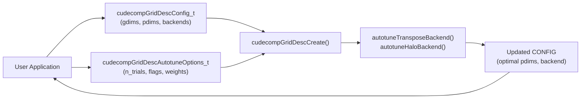
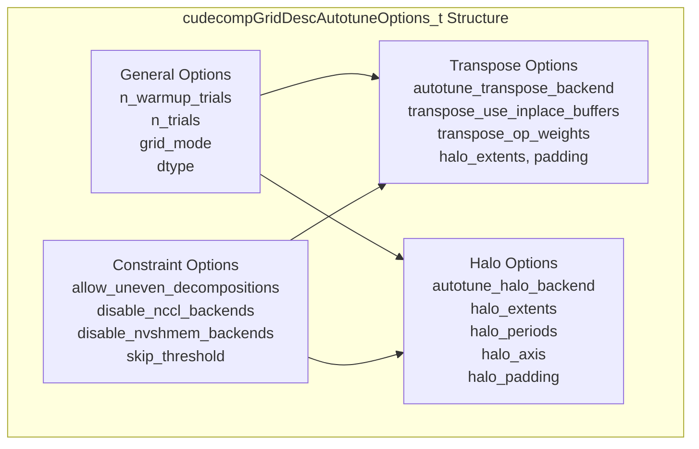
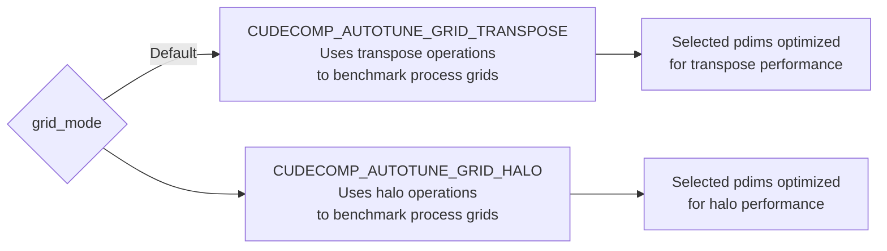
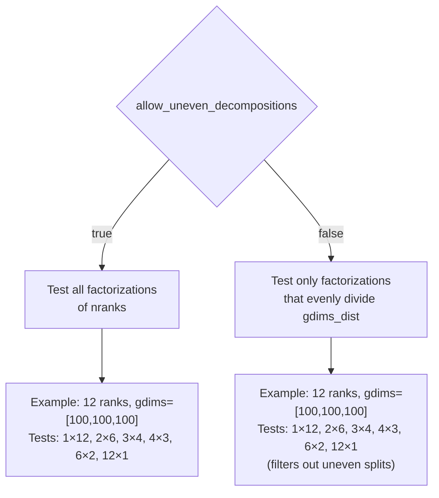
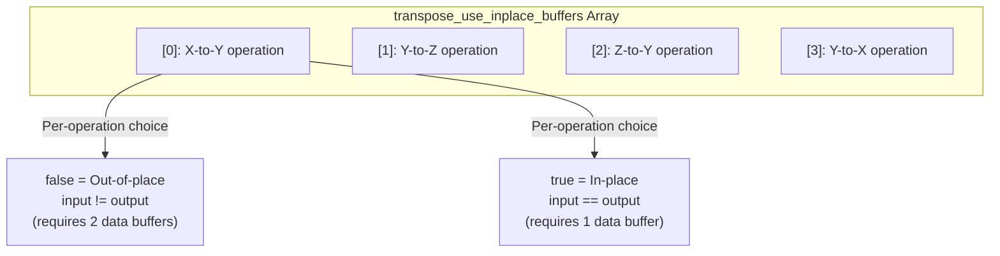
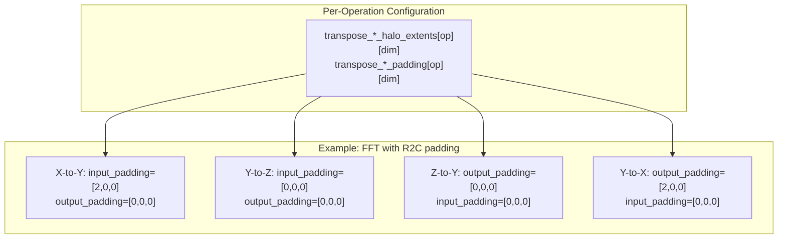
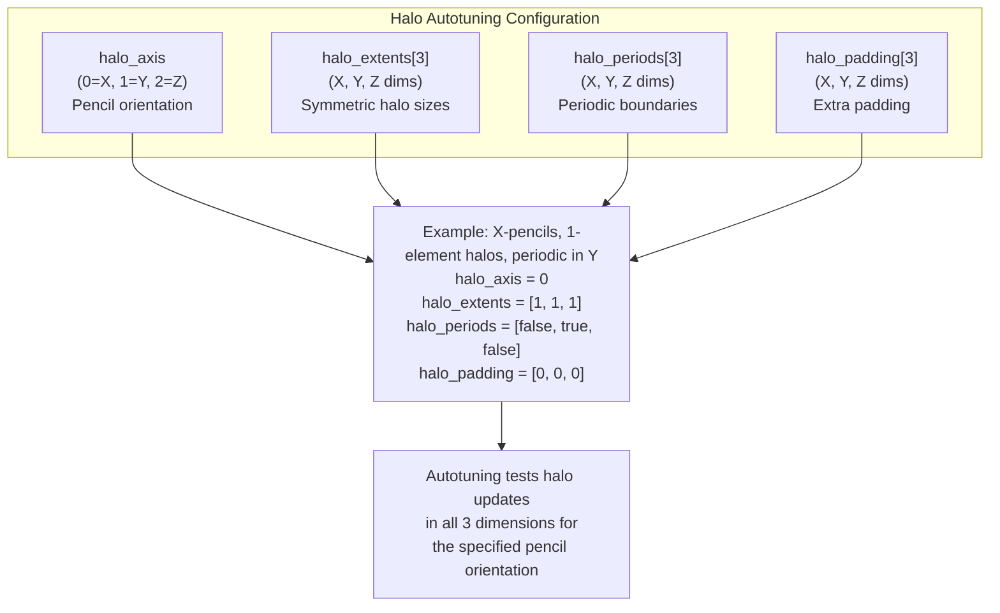
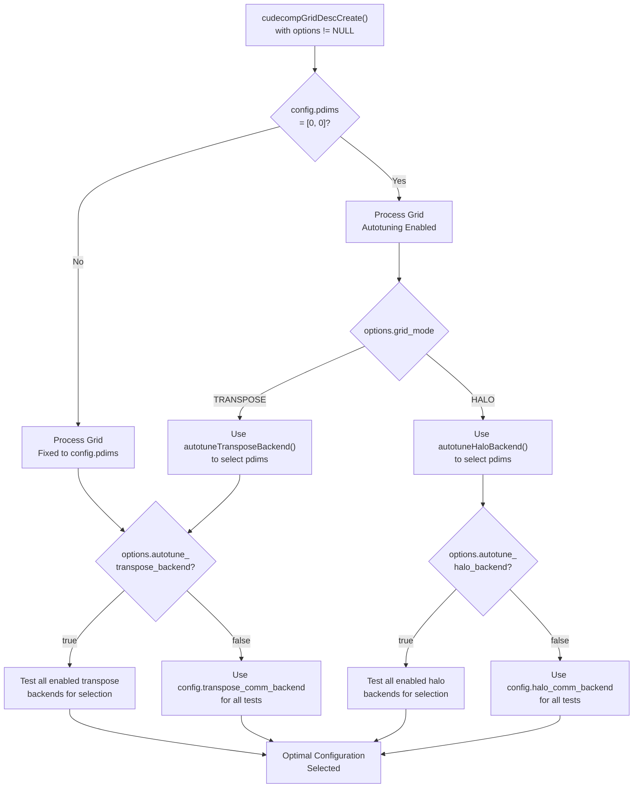

<!-- source: DeepWiki mcp.deepwiki.com · repo NVIDIA/cuDecomp · page 7.1 Autotune Configuration and Options · fetched 2026-10-26 -->

# Autotune Configuration and Options

<details>
<summary>Relevant source files</summary>

The following files were used as context for generating this wiki page:

- [include/cudecomp.h](include/cudecomp.h)
- [src/autotune.cc](src/autotune.cc)

</details>


## Purpose and Scope

This page documents the configuration options available for autotuning in cuDecomp. Autotuning allows the library to automatically select optimal process grid dimensions and communication backends by benchmarking different configurations. This page covers the structure and meaning of all autotuning options. For details on the autotuning implementation and benchmark methodology, see [Autotune Implementation Details](#7.2).

The autotuning system is invoked during grid descriptor creation by passing a `cudecompGridDescAutotuneOptions_t` structure to `cudecompGridDescCreate()`. Users can control process grid selection, communication backend selection, trial counts, and operation-specific parameters.

## Autotuning in Grid Descriptor Creation

Autotuning is triggered when creating a grid descriptor by providing a non-NULL pointer to `cudecompGridDescAutotuneOptions_t` in the `options` parameter of `cudecompGridDescCreate()`.



**Autotuning Trigger Conditions**

| Configuration | Process Grid Autotuning | Backend Autotuning |
|--------------|-------------------------|-------------------|
| `pdims = [0, 0]` | Enabled (tries all factorizations) | Only if flag set |
| `pdims != [0, 0]` | Disabled (uses specified values) | Only if flag set |
| `autotune_transpose_backend = true` | As above | Enabled for transpose |
| `autotune_halo_backend = true` | As above | Enabled for halo |

Sources: [include/cudecomp.h:136-189](), [include/cudecomp.h:235-253]()

## Configuration Structure Overview

The `cudecompGridDescAutotuneOptions_t` structure contains all autotuning configuration options. Users must initialize it with default values before use.



**Initialization**

```c
cudecompGridDescAutotuneOptions_t options;
cudecompGridDescAutotuneOptionsSetDefaults(&options);
// Modify options as needed
options.n_trials = 10;
options.autotune_transpose_backend = true;
```

Sources: [include/cudecomp.h:136-189](), [include/cudecomp.h:275-283]()

## General Autotuning Options

These options control the overall autotuning process behavior.

### Trial Count Options

| Option | Type | Default | Description |
|--------|------|---------|-------------|
| `n_warmup_trials` | `int32_t` | 3 | Number of warmup iterations before timed trials |
| `n_trials` | `int32_t` | 5 | Number of timed trials for each configuration |

Warmup trials allow GPU kernels and communication libraries to initialize and reach steady-state performance. Timed trials are averaged across all ranks to determine the best configuration.

**Timing Methodology**: Each trial measures the complete operation (all transpose directions or all halo dimensions). Statistics (min/max/avg/std) are computed across all ranks using MPI collective operations.

Sources: [include/cudecomp.h:139-142](), [src/autotune.cc:53-74]()

### Grid Mode Option

| Option | Type | Values | Default | Description |
|--------|------|--------|---------|-------------|
| `grid_mode` | `cudecompAutotuneGridMode_t` | `CUDECOMP_AUTOTUNE_GRID_TRANSPOSE` or `CUDECOMP_AUTOTUNE_GRID_HALO` | `CUDECOMP_AUTOTUNE_GRID_TRANSPOSE` | Which operation to use for process grid autotuning |



**Selection Guidance**:
- Use `TRANSPOSE` for applications dominated by transpose operations (e.g., FFT-based solvers)
- Use `HALO` for applications dominated by stencil operations with halo exchanges

Sources: [include/cudecomp.h:76-81](), [include/cudecomp.h:143-144]()

### Data Type Option

| Option | Type | Values | Default | Description |
|--------|------|--------|---------|-------------|
| `dtype` | `cudecompDataType_t` | `CUDECOMP_FLOAT`, `CUDECOMP_DOUBLE`, `CUDECOMP_FLOAT_COMPLEX`, `CUDECOMP_DOUBLE_COMPLEX` | `CUDECOMP_DOUBLE` | Data type to use during autotuning |

The data type affects buffer sizes and communication volume. Use the same data type that your application will use during actual operations.

Sources: [include/cudecomp.h:145](), [include/cudecomp.h:68-73]()

## Constraint and Optimization Options

These options control which configurations are tested and how to skip slow configurations.

### Decomposition Constraints

| Option | Type | Default | Description |
|--------|------|---------|-------------|
| `allow_uneven_decompositions` | `bool` | `true` | Allow process grids where dimensions don't evenly divide grid dimensions |

When `false`, only process grid configurations where `gdims_dist[i] % pdims[j] == 0` are tested. This ensures all ranks have equal workload but reduces the search space.



Sources: [include/cudecomp.h:146-147](), [src/autotune.cc:182-187](), [src/autotune.cc:596-602]()

### Backend Disable Flags

| Option | Type | Default | Description |
|--------|------|---------|-------------|
| `disable_nccl_backends` | `bool` | `false` | Exclude NCCL backends from autotuning |
| `disable_nvshmem_backends` | `bool` | `false` | Exclude NVSHMEM backends from autotuning |

Use these flags to restrict autotuning to specific backend types. Useful when:
- NCCL/NVSHMEM are unavailable or problematic in your environment
- You want to compare MPI-only performance
- You want to reduce autotuning time by testing fewer backends

**Backend Lists by Configuration**:

| Configuration | Backends Tested (Transpose) |
|--------------|------------------------------|
| Default (all enabled) | `MPI_P2P`, `MPI_P2P_PL`, `MPI_A2A`, `NCCL`, `NCCL_PL`, `NVSHMEM`, `NVSHMEM_PL` |
| `disable_nccl_backends=true` | `MPI_P2P`, `MPI_P2P_PL`, `MPI_A2A`, `NVSHMEM`, `NVSHMEM_PL` |
| `disable_nvshmem_backends=true` | `MPI_P2P`, `MPI_P2P_PL`, `MPI_A2A`, `NCCL`, `NCCL_PL` |
| Both disabled | `MPI_P2P`, `MPI_P2P_PL`, `MPI_A2A` |

Sources: [include/cudecomp.h:148-149](), [src/autotune.cc:96-110](), [src/autotune.cc:537-549]()

### Skip Threshold

| Option | Type | Default | Description |
|--------|------|---------|-------------|
| `skip_threshold` | `double` | `0.0` | Threshold to skip slow configurations early |

When `skip_threshold > 0`, autotuning skips a configuration if the first trial is significantly slower than the current best:

**Skip Condition**: `skip_threshold * t_first > t_best_avg`

Where:
- `t_first`: Average time of first trial for current configuration
- `t_best_avg`: Average time of best configuration found so far
- If condition is met, remaining trials for this configuration are skipped

**Example Values**:
- `0.0`: Disabled (test all trials for all configurations)
- `1.5`: Skip if first trial is >50% slower than best
- `2.0`: Skip if first trial is >100% slower (twice as slow) than best

This significantly reduces autotuning time when many process grid configurations are tested, as poor configurations are identified early.

Sources: [include/cudecomp.h:150-153](), [src/autotune.cc:375-385](), [src/autotune.cc:743-753]()

## Transpose-Specific Options

These options control autotuning behavior for transpose operations specifically.

### Backend Autotuning Flag

| Option | Type | Default | Description |
|--------|------|---------|-------------|
| `autotune_transpose_backend` | `bool` | `false` | Enable transpose communication backend autotuning |

When `true`, autotuning tests all available transpose backends (subject to disable flags). When `false`, only the backend specified in `config.transpose_comm_backend` is used, and only process grid dimensions are tuned (if `pdims = [0,0]`).

Sources: [include/cudecomp.h:156](), [src/autotune.cc:90-117]()

### In-Place vs Out-of-Place Buffers

| Option | Type | Default | Description |
|--------|------|---------|-------------|
| `transpose_use_inplace_buffers` | `bool[4]` | `[false, false, false, false]` | Control buffer usage per transpose operation |

Array indexed by operation: `[X-to-Y, Y-to-Z, Z-to-Y, Y-to-X]`



**Performance Implications**:
- In-place: Lower memory usage, potentially different performance characteristics
- Out-of-place: Higher memory usage, potentially better performance for some backends

Match your application's actual usage pattern during autotuning for accurate results.

Sources: [include/cudecomp.h:157-160](), [src/autotune.cc:119-122](), [src/autotune.cc:289-312]()

### Operation Weights

| Option | Type | Default | Description |
|--------|------|---------|-------------|
| `transpose_op_weights` | `double[4]` | `[1.0, 1.0, 1.0, 1.0]` | Multiplicative weights per transpose operation |

Array indexed by operation: `[X-to-Y, Y-to-Z, Z-to-Y, Y-to-X]`

**Weighted Average Time**: `t_weighted = w[0]*t_xy + w[1]*t_yz + w[2]*t_zy + w[3]*t_yx`

**Use Cases**:
- **Unidirectional FFT**: Weight forward transforms (e.g., `[1.0, 1.0, 0.0, 0.0]`) if reverse transforms aren't used
- **Asymmetric Usage**: Weight operations proportional to their frequency in your application
- **Skip Operations**: Set weight to `0.0` to skip an operation entirely during autotuning

**Example - Forward-only FFT**:
```c
options.transpose_op_weights[0] = 1.0; // X-to-Y: needed
options.transpose_op_weights[1] = 1.0; // Y-to-Z: needed
options.transpose_op_weights[2] = 0.0; // Z-to-Y: skip
options.transpose_op_weights[3] = 0.0; // Y-to-X: skip
```

Sources: [include/cudecomp.h:161-163](), [src/autotune.cc:370-373](), [src/autotune.cc:398-405]()

### Halo and Padding Configuration

These options specify halo extents and padding to match your application's usage patterns during autotuning.

| Option | Type | Description |
|--------|------|-------------|
| `transpose_input_halo_extents` | `int32_t[4][3]` | Input halo extents per operation (global order) |
| `transpose_output_halo_extents` | `int32_t[4][3]` | Output halo extents per operation (global order) |
| `transpose_input_padding` | `int32_t[4][3]` | Input padding per operation (global order) |
| `transpose_output_padding` | `int32_t[4][3]` | Output padding per operation (global order) |

**Array Indexing**:
- First index `[0-3]`: Operation (`X-to-Y`, `Y-to-Z`, `Z-to-Y`, `Y-to-X`)
- Second index `[0-2]`: Dimension in global order (X, Y, Z axes)

**Default**: All zeros (no halos, no padding)



**Important**: Configure these to match your actual application usage. Halo extents and padding affect buffer sizes and communication patterns, which impact backend performance.

Sources: [include/cudecomp.h:165-181](), [src/autotune.cc:156-173]()

## Halo-Specific Options

These options control autotuning behavior for halo update operations.

### Backend Autotuning Flag

| Option | Type | Default | Description |
|--------|------|---------|-------------|
| `autotune_halo_backend` | `bool` | `false` | Enable halo communication backend autotuning |

When `true`, autotuning tests all available halo backends (subject to disable flags). When `false`, only the backend specified in `config.halo_comm_backend` is used.

Sources: [include/cudecomp.h:184](), [src/autotune.cc:531-556]()

### Halo Configuration

| Option | Type | Default | Description |
|--------|------|---------|-------------|
| `halo_extents` | `int32_t[3]` | `[0, 0, 0]` | Halo region extents for autotuning (global order) |
| `halo_periods` | `bool[3]` | `[false, false, false]` | Periodicity flags for autotuning (global order) |
| `halo_axis` | `int32_t` | `0` | Which axis pencils to use (0=X, 1=Y, 2=Z) |
| `halo_padding` | `int32_t[3]` | `[0, 0, 0]` | Padding for autotuning (global order) |



**Halo Extent Interpretation**: Value of `N` means `N` elements per side, so `2*N` total halo elements per dimension (symmetric halos).

**Axis Selection**: Choose the axis that matches your application's primary halo update pattern. X-pencils are default.

Sources: [include/cudecomp.h:185-188](), [src/autotune.cc:524-527](), [src/autotune.cc:696-712]()

## Complete Options Reference Table

| Category | Option | Type | Default | Effect on Autotuning |
|----------|--------|------|---------|----------------------|
| **Trial Control** | `n_warmup_trials` | `int32_t` | 3 | Number of unmeasured warmup iterations |
| | `n_trials` | `int32_t` | 5 | Number of timed measurement iterations |
| **Grid Selection** | `grid_mode` | `enum` | `TRANSPOSE` | Use transpose or halo ops to select process grid |
| | `dtype` | `enum` | `DOUBLE` | Data type for sizing buffers during autotuning |
| **Constraints** | `allow_uneven_decompositions` | `bool` | `true` | Allow process grids with uneven distributions |
| | `disable_nccl_backends` | `bool` | `false` | Exclude NCCL backends from testing |
| | `disable_nvshmem_backends` | `bool` | `false` | Exclude NVSHMEM backends from testing |
| | `skip_threshold` | `double` | `0.0` | Skip configurations if first trial exceeds threshold |
| **Transpose** | `autotune_transpose_backend` | `bool` | `false` | Test multiple transpose backends vs. just process grids |
| | `transpose_use_inplace_buffers[4]` | `bool[]` | `[false×4]` | Use in-place buffers per operation |
| | `transpose_op_weights[4]` | `double[]` | `[1.0×4]` | Weight contribution per operation to total score |
| | `transpose_input_halo_extents[4][3]` | `int32_t[][]` | zeros | Input halo sizes per operation and dimension |
| | `transpose_output_halo_extents[4][3]` | `int32_t[][]` | zeros | Output halo sizes per operation and dimension |
| | `transpose_input_padding[4][3]` | `int32_t[][]` | zeros | Input padding per operation and dimension |
| | `transpose_output_padding[4][3]` | `int32_t[][]` | zeros | Output padding per operation and dimension |
| **Halo** | `autotune_halo_backend` | `bool` | `false` | Test multiple halo backends vs. just process grids |
| | `halo_extents[3]` | `int32_t[]` | `[0,0,0]` | Halo region sizes for testing |
| | `halo_periods[3]` | `bool[]` | `[false×3]` | Periodic boundary conditions for testing |
| | `halo_axis` | `int32_t` | `0` | Pencil orientation for halo testing (0/1/2) |
| | `halo_padding[3]` | `int32_t[]` | `[0,0,0]` | Padding for halo testing |

## Autotuning Decision Flow



Sources: [src/autotune.cc:78-120](), [src/autotune.cc:522-556]()

## Usage Examples

### Example 1: Autotune Process Grid Only

```c
cudecompGridDescConfig_t config;
cudecompGridDescConfigSetDefaults(&config);
config.gdims[0] = 512;
config.gdims[1] = 512;
config.gdims[2] = 512;
config.pdims[0] = 0;  // Autotune
config.pdims[1] = 0;  // Autotune
config.transpose_comm_backend = CUDECOMP_TRANSPOSE_COMM_NCCL;  // Fixed backend

cudecompGridDescAutotuneOptions_t options;
cudecompGridDescAutotuneOptionsSetDefaults(&options);
options.n_trials = 10;  // More trials for better accuracy
options.dtype = CUDECOMP_DOUBLE;
// autotune_transpose_backend defaults to false

cudecompGridDesc_t grid_desc;
cudecompGridDescCreate(handle, &grid_desc, &config, &options);
// config.pdims now contains optimal values for NCCL backend
```

### Example 2: Autotune Backend and Process Grid

```c
cudecompGridDescConfig_t config;
cudecompGridDescConfigSetDefaults(&config);
config.gdims[0] = 1024;
config.gdims[1] = 1024;
config.gdims[2] = 1024;
config.pdims[0] = 0;  // Autotune
config.pdims[1] = 0;  // Autotune

cudecompGridDescAutotuneOptions_t options;
cudecompGridDescAutotuneOptionsSetDefaults(&options);
options.autotune_transpose_backend = true;  // Test all backends
options.n_trials = 5;
options.skip_threshold = 1.5;  // Skip slow configs early
options.disable_nvshmem_backends = true;  // Only test MPI and NCCL

cudecompGridDesc_t grid_desc;
cudecompGridDescCreate(handle, &grid_desc, &config, &options);
// config.pdims and config.transpose_comm_backend now contain optimal values
```

### Example 3: Forward-Only FFT Optimization

```c
cudecompGridDescAutotuneOptions_t options;
cudecompGridDescAutotuneOptionsSetDefaults(&options);
options.autotune_transpose_backend = true;
options.n_trials = 10;

// Only weight forward transforms (X→Y→Z)
options.transpose_op_weights[0] = 1.0;  // X-to-Y
options.transpose_op_weights[1] = 1.0;  // Y-to-Z
options.transpose_op_weights[2] = 0.0;  // Z-to-Y (skip)
options.transpose_op_weights[3] = 0.0;  // Y-to-X (skip)

// Configure R2C padding on X-axis
options.transpose_input_padding[0][0] = 2;  // X-to-Y input
options.transpose_output_padding[3][0] = 2; // Y-to-X output

cudecompGridDesc_t grid_desc;
cudecompGridDescCreate(handle, &grid_desc, &config, &options);
```

### Example 4: Halo-Dominated Application

```c
cudecompGridDescAutotuneOptions_t options;
cudecompGridDescAutotuneOptionsSetDefaults(&options);
options.grid_mode = CUDECOMP_AUTOTUNE_GRID_HALO;  // Use halo ops for grid selection
options.autotune_halo_backend = true;

// Configure for stencil with 2-element halos
options.halo_extents[0] = 2;
options.halo_extents[1] = 2;
options.halo_extents[2] = 2;

// Periodic in X and Y, not in Z
options.halo_periods[0] = true;
options.halo_periods[1] = true;
options.halo_periods[2] = false;

options.halo_axis = 0;  // Test with X-pencils
options.n_trials = 8;

cudecompGridDesc_t grid_desc;
cudecompGridDescCreate(handle, &grid_desc, &config, &options);
// Optimized for halo communication pattern
```

Sources: [include/cudecomp.h:235-253](), [include/cudecomp.h:275-283]()

---

