<!-- source: DeepWiki mcp.deepwiki.com · repo NVIDIA/cuDecomp · page 7.2 Autotune Implementation Details · fetched 2026-10-26 -->

# Autotune Implementation Details

<details>
<summary>Relevant source files</summary>

The following files were used as context for generating this wiki page:

- [include/internal/common.h](include/internal/common.h)
- [src/autotune.cc](src/autotune.cc)

</details>


This page explains the internal implementation of cuDecomp's autotuning system, including the benchmark loop structure, timing methodology, workspace management, and configuration selection algorithms. For information about configuring autotuning options, see [Autotune Configuration and Options](#7.1).

The autotuning implementation consists of two main functions in [src/autotune.cc](): `autotuneTransposeBackend` for transpose operations and `autotuneHaloBackend` for halo exchanges. Both follow similar patterns but differ in timing methodology and tested operations.

## Benchmark Loop Structure

The autotuning system uses nested loops to systematically evaluate different configurations. The outer loop iterates over process grid decompositions (pdims), while the inner loop tests different communication backends for each decomposition.

### Transpose Benchmark Flow

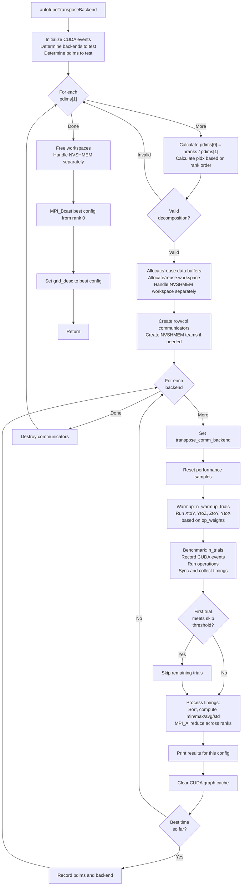

**Sources:** [src/autotune.cc:78-520]()

The transpose autotuning flow includes several optimization mechanisms:

| Optimization | Description | Code Location |
|-------------|-------------|---------------|
| Skip Threshold | After first trial, skip remaining trials if config is clearly worse than best | [src/autotune.cc:375-385]() |
| Empty Pencil Detection | Skip decompositions that would create empty pencils | [src/autotune.cc:176-179]() |
| Uneven Decomposition Filter | Optionally skip decompositions with uneven distribution | [src/autotune.cc:182-187]() |
| Workspace Reuse | Reuse allocated buffers across configurations when possible | [src/autotune.cc:199-257]() |
| Graph Cache Clearing | Clear CUDA graph cache between configurations | [src/autotune.cc:389]() |

### Halo Benchmark Flow

The halo autotuning follows a similar structure but with key differences:

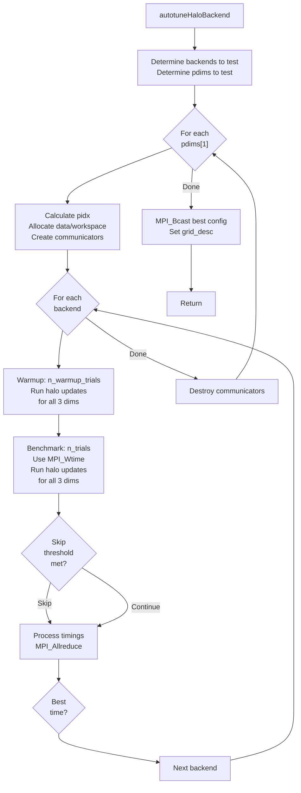

**Sources:** [src/autotune.cc:522-842]()

## Timing Methodology

### Transpose Timing with CUDA Events

The transpose autotuning uses CUDA events to measure GPU operation performance accurately:

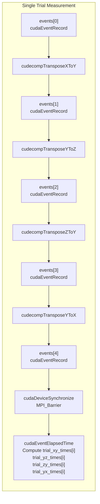

**Sources:** [src/autotune.cc:84-88](), [src/autotune.cc:326-368]()

The timing methodology uses the following approach:

1. **Event Creation**: Five CUDA events are created at the start of autotuning [src/autotune.cc:86-88]()
2. **Event Recording**: Events are recorded before/after each transpose operation [src/autotune.cc:327-355]()
3. **Synchronization**: Both CUDA device and MPI barrier synchronization before computing elapsed time [src/autotune.cc:356-357]()
4. **Time Computation**: `cudaEventElapsedTime` computes milliseconds between event pairs [src/autotune.cc:359-366]()
5. **Weighted Timing**: Operation times are weighted according to user-specified weights [src/autotune.cc:370-373]()

### Timing Statistics Processing

The `processTimings` helper function [src/autotune.cc:53-74]() computes comprehensive statistics across all ranks:

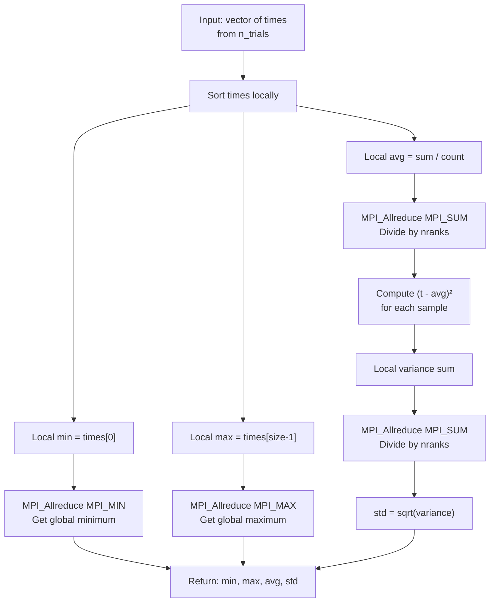

**Sources:** [src/autotune.cc:53-74]()

### Halo Timing with Wall-Clock Time

Halo autotuning uses MPI wall-clock timing instead of CUDA events [src/autotune.cc:717-741](). This approach:

1. Synchronizes with `cudaDeviceSynchronize()` and `MPI_Barrier()` [src/autotune.cc:717-718]()
2. Records start time with `MPI_Wtime()` [src/autotune.cc:719]()
3. Executes halo updates for all three dimensions [src/autotune.cc:721-736]()
4. Records end time and computes elapsed time in seconds [src/autotune.cc:737-741]()
5. Converts to milliseconds when processing timings [src/autotune.cc:756]()

## Workspace Management

The autotuning system must carefully manage memory allocation to support testing multiple backends with different memory requirements.

### Allocation Strategy

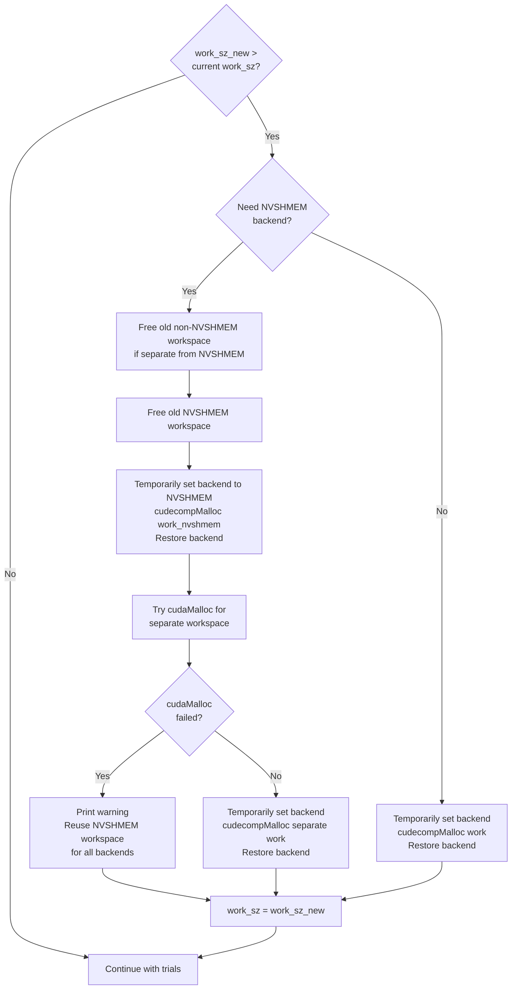

**Sources:** [src/autotune.cc:212-257]() for transpose, [src/autotune.cc:621-663]() for halo

### NVSHMEM Workspace Handling

NVSHMEM backends require special handling due to symmetric memory requirements:

| Requirement | Implementation | Code Location |
|------------|----------------|---------------|
| Symmetric Size | `MPI_Allreduce` with `MPI_MAX` to find global maximum workspace size | [src/autotune.cc:210]() |
| Separate Allocation | Attempt to allocate separate workspace for non-NVSHMEM backends | [src/autotune.cc:231-247]() |
| Fallback to Shared | If allocation fails, reuse NVSHMEM workspace with warning | [src/autotune.cc:232-238]() |
| Backend Switching | Temporarily set backend to force allocation path in `cudecompMalloc` | [src/autotune.cc:224-228]() |
| Selection at Runtime | Choose workspace pointer based on backend being tested | [src/autotune.cc:279-282]() |

The warning message [src/autotune.cc:234-237]() alerts users that NVSHMEM-allocated memory will be used with MPI backends, which may cause issues with certain MPI implementations.

### Workspace Reuse Optimization

The autotuning system reuses workspace allocations across configurations when possible:

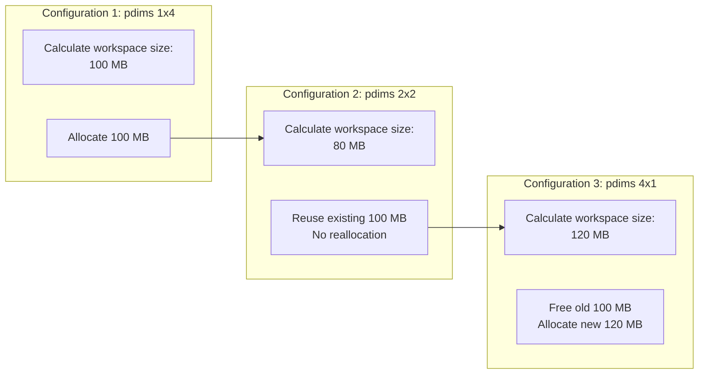

**Sources:** [src/autotune.cc:199-207](), [src/autotune.cc:212-257]()

This optimization significantly reduces autotuning time by avoiding repeated allocations when workspace requirements decrease or remain constant across configurations.

## Configuration Selection

### Skip Threshold Optimization

The skip threshold mechanism [src/autotune.cc:375-385]() provides early termination for clearly inferior configurations:

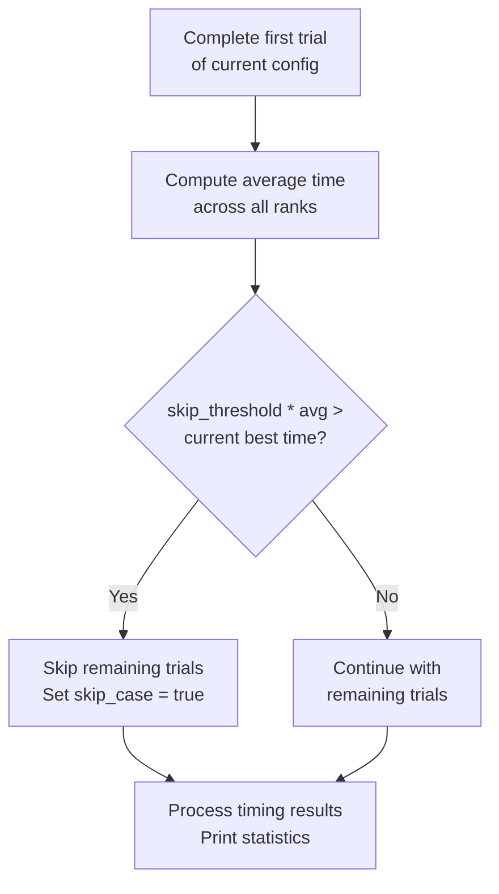

**Sources:** [src/autotune.cc:375-385]() for transpose, [src/autotune.cc:743-753]() for halo

Default skip threshold is 1.0, meaning if the first trial's average time equals or exceeds the current best, remaining trials are skipped. Setting a higher threshold (e.g., 1.5) makes skipping more conservative.

### Best Configuration Selection

The autotuning system selects the configuration with the lowest weighted average time:

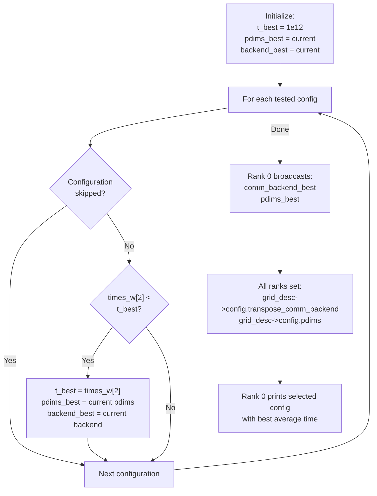

**Sources:** [src/autotune.cc:435-500]() for transpose, [src/autotune.cc:778-834]() for halo

The weighted average time (`times_w[2]`) is used for transpose autotuning, which accounts for user-specified operation weights [src/autotune.cc:370-373](). For halo autotuning, the unweighted average time is used [src/autotune.cc:778-783]().

### Broadcasting Best Configuration

To ensure all ranks use the same configuration, the best settings are broadcast from rank 0:

```c++
// Transpose backend and pdims
CHECK_MPI(MPI_Bcast(&comm_backend_best, sizeof(cudecompTransposeCommBackend_t), MPI_CHAR, 0, handle->mpi_comm));
CHECK_MPI(MPI_Bcast(pdims_best, 2 * sizeof(int), MPI_INT, 0, handle->mpi_comm));

// Halo backend and pdims  
CHECK_MPI(MPI_Bcast(&comm_backend_best, sizeof(cudecompHaloCommBackend_t), MPI_CHAR, 0, handle->mpi_comm));
CHECK_MPI(MPI_Bcast(pdims_best, 2 * sizeof(int), MPI_INT, 0, handle->mpi_comm));
```

**Sources:** [src/autotune.cc:489-490](), [src/autotune.cc:824-825]()

## Implementation Details

### Communicator Lifecycle

For each process grid decomposition, temporary MPI communicators are created and destroyed:

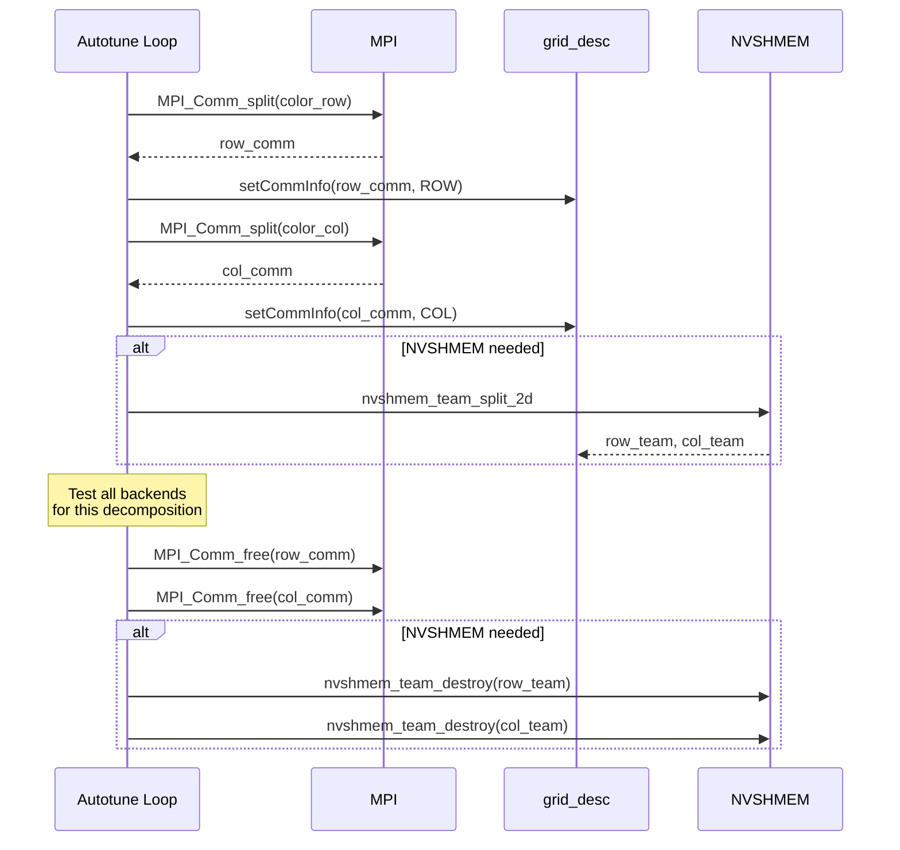

**Sources:** [src/autotune.cc:260-275](), [src/autotune.cc:444-453]() for transpose; [src/autotune.cc:666-681](), [src/autotune.cc:787-796]() for halo

The `setCommInfo` function [include/internal/common.h:305-355]() initializes communicator information including rank, size, and p2p group detection.

### Graph Cache Management

CUDA graph cache must be cleared between configurations to prevent incorrect reuse:

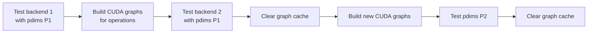

**Sources:** [src/autotune.cc:389]()

The graph cache is stored in `grid_desc->graph_cache` [include/internal/common.h:182]() and cleared via `grid_cache.clear()`.

### Memory Cleanup Strategy

At the end of autotuning, a special MPI_Alltoall is performed to force memory registration cleanup:

```c++
// Perform MPI_Alltoall on small (~1 MiB) buffers to force some MPI backends (e.g. UCX)
// to release stale registration handles on larger test data buffers
char *tmp1, *tmp2;
size_t per_rank_size = (1024 * 1024 + handle->nranks - 1) / handle->nranks;
CHECK_CUDA(cudaMalloc(&tmp1, per_rank_size * handle->nranks * sizeof(*tmp1)));
CHECK_CUDA(cudaMalloc(&tmp2, per_rank_size * handle->nranks * sizeof(*tmp2)));
CHECK_MPI(MPI_Alltoall(tmp1, per_rank_size, MPI_CHAR, tmp2, per_rank_size, MPI_CHAR, handle->mpi_comm));
CHECK_MPI(MPI_Barrier(handle->mpi_comm));
CHECK_CUDA(cudaFree(tmp1));
CHECK_CUDA(cudaFree(tmp2));
```

**Sources:** [src/autotune.cc:506-516]()

This workaround forces MPI implementations like UCX to release stale registration handles, allowing prompt freeing of test buffer GPU memory. Without this, the memory might remain registered and unavailable for reuse.

### Performance Sample Reset

After autotuning completes, performance samples are reset to ensure clean data collection:

```c++
// Reset performance samples after autotuning
resetPerformanceSamples(handle, grid_desc);
```

**Sources:** [src/autotune.cc:519](), [src/autotune.cc:841]()

This clears the performance sample collections used during autotuning so that subsequent performance monitoring starts fresh.

## Process Grid Factor Generation

The `getFactors` helper function [src/autotune.cc:41-51]() generates all valid process grid decompositions:

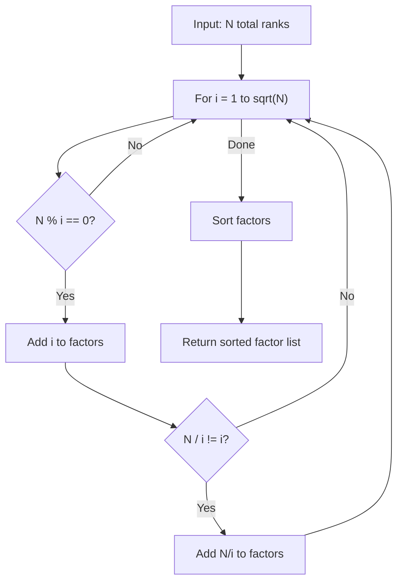

**Sources:** [src/autotune.cc:41-51]()

For example, with 12 ranks, this returns `[1, 2, 3, 4, 6, 12]`, which are all valid values for `pdims[1]`. The corresponding `pdims[0]` values are `[12, 6, 4, 3, 2, 1]`.

---

