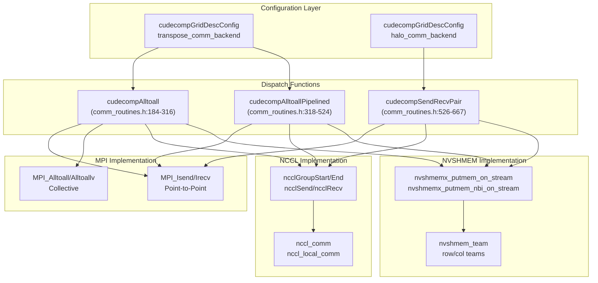
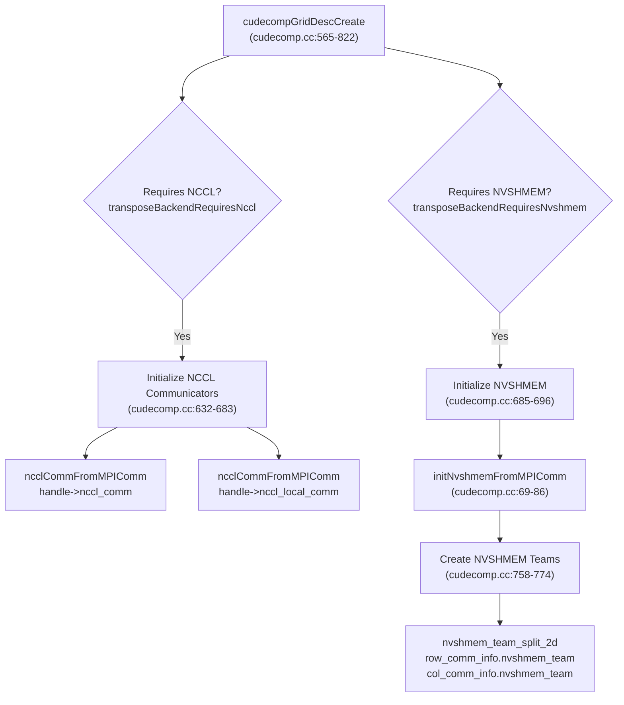
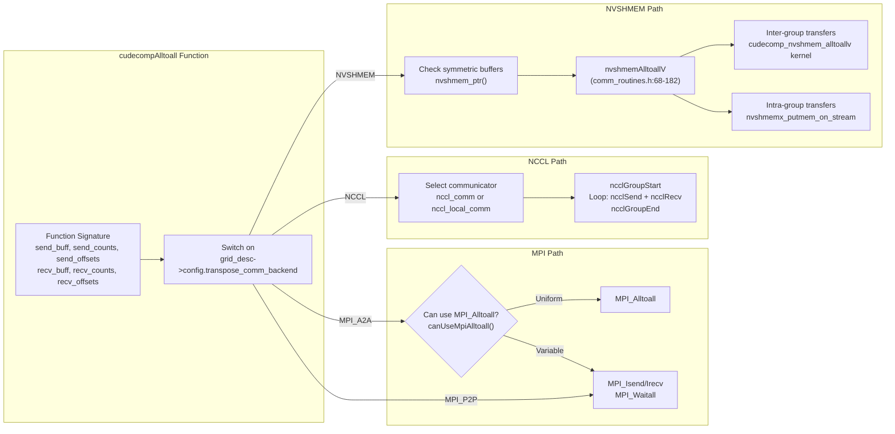
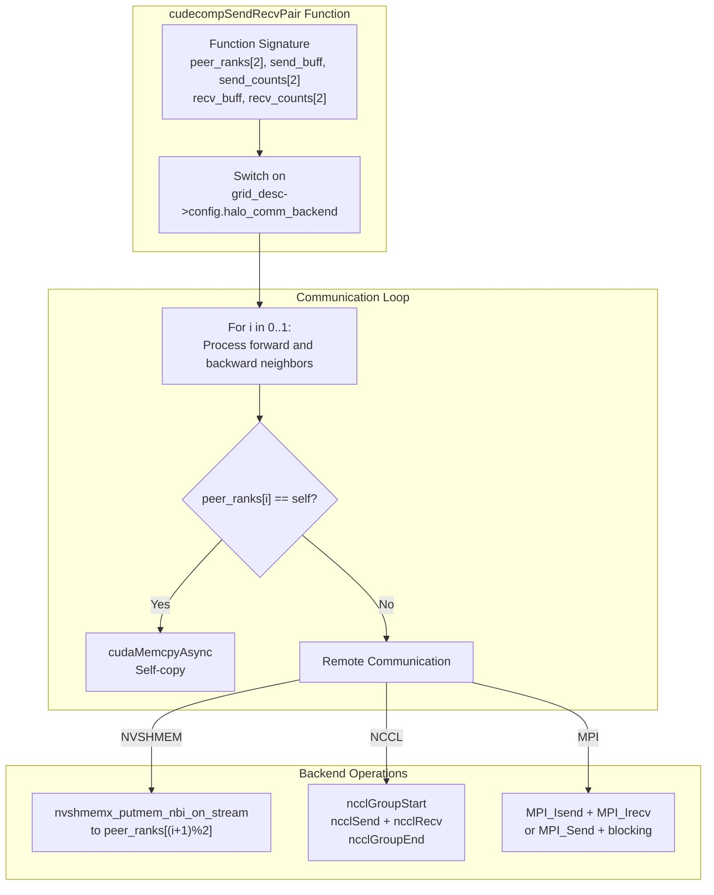

<!-- source: DeepWiki mcp.deepwiki.com · repo NVIDIA/cuDecomp · page 8 Communication Backend Details · fetched 2026-10-26 -->

# Communication Backend Details

<details>
<summary>Relevant source files</summary>

The following files were used as context for generating this wiki page:

- [include/internal/comm_routines.h](include/internal/comm_routines.h)
- [src/cudecomp.cc](src/cudecomp.cc)

</details>


This page provides an in-depth technical overview of the three communication backend implementations in cuDecomp: MPI, NCCL, and NVSHMEM. It covers backend selection, communication patterns (all-to-all and send/recv), and the differences between standard and pipelined execution modes. For backend-specific implementation details, see [MPI Backend](#8.1), [NCCL Backend](#8.2), and [NVSHMEM Backend](#8.3). For higher-level conceptual information about backends, see [Communication Backends](#3.3).

## Backend Architecture Overview

cuDecomp implements a unified communication interface that dispatches to different backend implementations based on the grid configuration. The backend determines how data is transferred between processes during transpose and halo operations.

**Backend Dispatch Architecture**



Sources: [include/internal/comm_routines.h:1-671](), [src/cudecomp.cc:89-124]()

## Backend Enumeration Types

cuDecomp defines separate backend types for transpose and halo operations, as they have different communication patterns and requirements.

### Transpose Communication Backends

| Backend Constant | Description | Pipelined | Build Requirement |
|-----------------|-------------|-----------|-------------------|
| `CUDECOMP_TRANSPOSE_COMM_MPI_P2P` | MPI point-to-point (Isend/Irecv) | No | None |
| `CUDECOMP_TRANSPOSE_COMM_MPI_P2P_PL` | MPI point-to-point (pipelined) | Yes | None |
| `CUDECOMP_TRANSPOSE_COMM_MPI_A2A` | MPI collective (Alltoall/Alltoallv) | No | None |
| `CUDECOMP_TRANSPOSE_COMM_NCCL` | NCCL group Send/Recv | No | None |
| `CUDECOMP_TRANSPOSE_COMM_NCCL_PL` | NCCL group Send/Recv (pipelined) | Yes | None |
| `CUDECOMP_TRANSPOSE_COMM_NVSHMEM` | NVSHMEM put operations | No | `ENABLE_NVSHMEM` |
| `CUDECOMP_TRANSPOSE_COMM_NVSHMEM_PL` | NVSHMEM put operations (pipelined) | Yes | `ENABLE_NVSHMEM` |

### Halo Communication Backends

| Backend Constant | Description | Blocking | Build Requirement |
|-----------------|-------------|----------|-------------------|
| `CUDECOMP_HALO_COMM_MPI` | MPI point-to-point (non-blocking) | No | None |
| `CUDECOMP_HALO_COMM_MPI_BLOCKING` | MPI point-to-point (blocking) | Yes | None |
| `CUDECOMP_HALO_COMM_NCCL` | NCCL group Send/Recv | No | None |
| `CUDECOMP_HALO_COMM_NVSHMEM` | NVSHMEM put operations (non-blocking) | No | `ENABLE_NVSHMEM` |
| `CUDECOMP_HALO_COMM_NVSHMEM_BLOCKING` | NVSHMEM put operations (blocking) | Yes | `ENABLE_NVSHMEM` |

Sources: [src/cudecomp.cc:89-124](), [src/cudecomp.cc:1288-1310]()

## Backend Selection and Initialization

Backend selection occurs during grid descriptor creation through the `cudecompGridDescConfig_t` structure. The system automatically initializes required communication libraries based on the selected backends.

**Backend Initialization Flow**



Sources: [src/cudecomp.cc:565-822](), [src/cudecomp.cc:632-696](), [src/cudecomp.cc:758-774]()

### Backend Validation

The library validates backend selection at configuration time, checking both backend support and build configuration:

```c++
// From cudecomp.cc:89-107
static void checkTransposeCommBackend(cudecompTransposeCommBackend_t comm_backend) {
  switch (comm_backend) {
  case CUDECOMP_TRANSPOSE_COMM_NCCL:
  case CUDECOMP_TRANSPOSE_COMM_NCCL_PL:
  case CUDECOMP_TRANSPOSE_COMM_MPI_P2P:
  case CUDECOMP_TRANSPOSE_COMM_MPI_P2P_PL:
  case CUDECOMP_TRANSPOSE_COMM_MPI_A2A:
#ifdef ENABLE_NVSHMEM
  case CUDECOMP_TRANSPOSE_COMM_NVSHMEM:
  case CUDECOMP_TRANSPOSE_COMM_NVSHMEM_PL: return;
#else
    return;
  case CUDECOMP_TRANSPOSE_COMM_NVSHMEM:
  case CUDECOMP_TRANSPOSE_COMM_NVSHMEM_PL: THROW_NOT_SUPPORTED("...");
#endif
  default: THROW_INVALID_USAGE("unknown transpose communication type");
  }
}
```

Sources: [src/cudecomp.cc:89-124]()

## Communication Patterns

cuDecomp uses two primary communication patterns depending on the operation type:

### All-to-All Pattern (Transpose Operations)

The all-to-all pattern exchanges data between all processes in a row or column communicator during transpose operations. Each process sends and receives a different amount of data to/from every other process.

**All-to-All Communication Structure**



Sources: [include/internal/comm_routines.h:184-316](), [include/internal/comm_routines.h:68-182]()

### Send/Recv Pair Pattern (Halo Operations)

The send/recv pair pattern exchanges boundary data with immediate neighbors in a specific dimension. Each process communicates with at most two neighbors (forward and backward in the dimension).

**Send/Recv Pair Communication Structure**



Sources: [include/internal/comm_routines.h:526-667]()

## Standard vs Pipelined Execution Modes

Pipelined backends enable overlap between computation (packing/unpacking) and communication by scheduling transfers in smaller chunks and using CUDA events for synchronization.

### Standard Mode Characteristics

- **Single communication phase**: All data transferred in one batch
- **Synchronization**: Single stream synchronization before/after communication
- **Simplicity**: Easier to debug, more predictable performance
- **Use case**: Small problem sizes, backends without overlap benefit

**Standard Mode Execution Timeline**

```mermaid
gantt
    title Standard Mode Transpose Execution
    dateFormat X
    axisFormat %s
    
    section Rank 0
    Pack data          :p0, 0, 1
    Stream sync        :s0, after p0, 0
    Communication      :c0, after s0, 2
    Unpack data        :u0, after c0, 1
    
    section Rank 1
    Pack data          :p1, 0, 1
    Stream sync        :s1, after p1, 0
    Communication      :c1, after s1, 2
    Unpack data        :u1, after c1, 1
```



### Pipelined Mode Characteristics

- **Multi-phase communication**: Data split into chunks, transferred incrementally
- **Event-based synchronization**: CUDA events coordinate between phases
- **Dedicated stream**: Uses `handle->streams[0]` for communication
- **Overlap opportunity**: Unpacking of early chunks overlaps with later communication
- **Complexity**: More synchronization points, backend-specific optimizations

**Pipelined Mode Execution Timeline**

```mermaid
gantt
    title Pipelined Mode Transpose Execution
    dateFormat X
    axisFormat %s
    
    section Rank 0
    Pack chunk 0       :p00, 0, 1
    Comm chunk 0       :c00, after p00, 1
    Pack chunk 1       :p01, after p00, 1
    Comm chunk 1       :c01, after p01, 1
    Unpack chunk 0     :u00, after c00, 1
    Unpack chunk 1     :u01, after c01, 1
    
    section Rank 1
    Pack chunk 0       :p10, 0, 1
    Comm chunk 0       :c10, after p10, 1
    Pack chunk 1       :p11, after p10, 1
    Comm chunk 1       :c11, after p11, 1
    Unpack chunk 0     :u10, after c10, 1
    Unpack chunk 1     :u11, after c11, 1
```



### Pipelined Implementation

The `cudecompAlltoallPipelined` function accepts `src_ranks` and `dst_ranks` vectors that specify which peer communications to execute in the current pipeline stage:

```c++
// From comm_routines.h:318-524
template <typename T>
static void cudecompAlltoallPipelined(
    const cudecompHandle_t& handle, 
    const cudecompGridDesc_t& grid_desc,
    T* send_buff,
    const std::vector<comm_count_t>& send_counts,
    const std::vector<comm_count_t>& send_offsets,
    T* recv_buff,
    const std::vector<comm_count_t>& recv_counts,
    const std::vector<comm_count_t>& recv_offsets,
    const std::vector<comm_count_t>& recv_offsets_nvshmem,
    cudecompCommAxis comm_axis,
    const std::vector<int>& src_ranks,      // Ranks to receive from
    const std::vector<int>& dst_ranks,      // Ranks to send to
    cudaStream_t stream,
    bool& synced,
    cudecompTransposePerformanceSample* current_sample = nullptr)
```

Each backend implements pipelined communication differently:
- **NCCL**: Uses `ncclGroupStart/End` to batch operations, events coordinate stream dependencies
- **MPI**: Synchronizes events before issuing `MPI_Isend/Irecv`, then waits for completion
- **NVSHMEM**: Uses non-blocking put operations (`nvshmemx_putmem_nbi_on_stream`), with team sync only once per sequence

Sources: [include/internal/comm_routines.h:318-524]()

## Backend-Specific Requirements

### Memory Requirements

| Backend | Allocation Method | Requirement |
|---------|------------------|-------------|
| MPI | `cudaMalloc` or `cudecompMalloc` | GPU-accessible memory |
| NCCL | `cudaMalloc` or `cudecompMalloc` | GPU-accessible memory, UBR optional |
| NVSHMEM | `cudecompMalloc` only | Symmetric heap allocation via `nvshmem_malloc` |

The library tracks NVSHMEM allocations and enforces symmetric allocation by synchronizing buffer sizes across all ranks:

```c++
// From cudecomp.cc:1131-1162
if (transposeBackendRequiresNvshmem(...) || haloBackendRequiresNvshmem(...)) {
  #ifdef ENABLE_NVSHMEM
    // NVSHMEM requires allocations to be the same size for all ranks
    CHECK_MPI(MPI_Allreduce(MPI_IN_PLACE, &buffer_size_bytes, 1, 
                            MPI_LONG_LONG_INT, MPI_MAX, handle->mpi_comm));
    
    *buffer = nvshmem_malloc(buffer_size_bytes);
    // Record allocation details
    handle->nvshmem_allocations[*buffer] = buffer_size_bytes;
    handle->nvshmem_allocation_size += buffer_size_bytes;
  #endif
}
```

Sources: [src/cudecomp.cc:1131-1227]()

### Communicator Requirements

Each backend uses different communication objects:

**NCCL Communicators**
- `handle->nccl_comm`: Global NCCL communicator for all ranks
- `handle->nccl_local_comm`: Local NCCL communicator for intra-node communication
- Created lazily during grid descriptor creation
- Reference-counted to support multiple grid descriptors

**NVSHMEM Teams**
- `grid_desc->row_comm_info.nvshmem_team`: Team for row communicator
- `grid_desc->col_comm_info.nvshmem_team`: Team for column communicator
- Created via `nvshmem_team_split_2d` to partition global team
- Destroyed with grid descriptor

**MPI Communicators**
- `grid_desc->row_comm_info.mpi_comm`: MPI communicator for row
- `grid_desc->col_comm_info.mpi_comm`: MPI communicator for column
- Created via `MPI_Comm_split` during grid descriptor setup

Sources: [src/cudecomp.cc:748-774](), [src/cudecomp.cc:632-683]()

## Backend Performance Considerations

### MPI Backend
- **Advantages**: Universal availability, no special memory requirements, mature implementations
- **Disadvantages**: CPU involvement, potential synchronization overhead, limited GPU-direct support
- **Best for**: Systems without NCCL/NVSHMEM, debugging, small-scale runs

### NCCL Backend
- **Advantages**: GPU-direct communication, efficient group operations, automatic topology awareness
- **Disadvantages**: Requires NCCL library, communicator setup overhead
- **Best for**: Multi-GPU nodes with NVLink, GPU-direct RDMA networks, medium-to-large scale
- **Optimization**: Use `nccl_local_comm` for intra-node communication (automatically selected)

### NVSHMEM Backend
- **Advantages**: Lowest latency for small transfers, efficient put operations, good for irregular patterns
- **Disadvantages**: Symmetric memory requirement, complex setup, limited symmetric heap size
- **Best for**: Systems with NVLink/NVSwitch, applications with fine-grained communication
- **Optimization**: Set `NVSHMEM_SYMMETRIC_SIZE` appropriately to avoid allocation failures

Sources: [include/internal/comm_routines.h:184-316](), [include/internal/comm_routines.h:68-182]()

## Mixed Buffer Warning

When using MPI backends with buffers allocated via NVSHMEM (through `cudecompMalloc` with NVSHMEM-enabled grid), the library issues a warning about potential compatibility issues:

```c++
// From comm_routines.h:199-208
#ifdef ENABLE_NVSHMEM
  if (handle->rank == 0 && handle->nvshmem_initialized && 
      !handle->nvshmem_mixed_buffer_warning_issued &&
      transposeBackendRequiresMpi(grid_desc->config.transpose_comm_backend) &&
      (nvshmem_ptr(send_buff, handle->rank) || nvshmem_ptr(recv_buff, handle->rank))) {
    printf("CUDECOMP:WARN: A work buffer allocated with nvshmem_malloc (via cudecompMalloc) is "
           "being used with an MPI communication backend. This may cause issues with some MPI "
           "implementations. See the documentation for additional details and possible workarounds "
           "if you encounter issues.\n");
  }
#endif
```

This occurs because some MPI implementations may not properly handle NVSHMEM symmetric memory. Workarounds include:
1. Use NVSHMEM backend if symmetric memory is allocated
2. Use separate `cudecompMalloc` calls for MPI and NVSHMEM grids
3. Set `NVSHMEM_DISABLE_CUDA_VMM=1` for better MPI compatibility

Sources: [include/internal/comm_routines.h:199-208](), [include/internal/comm_routines.h:348-357](), [include/internal/comm_routines.h:541-550]()

---

