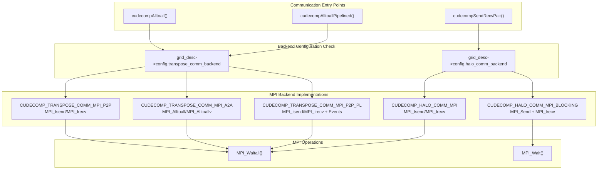
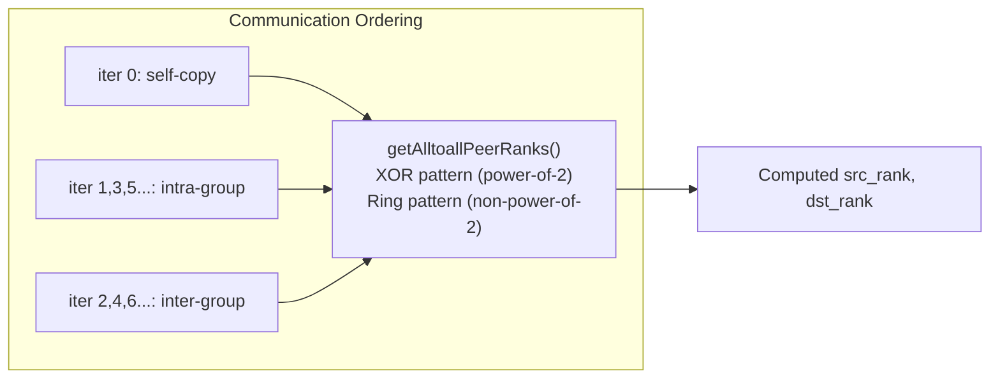
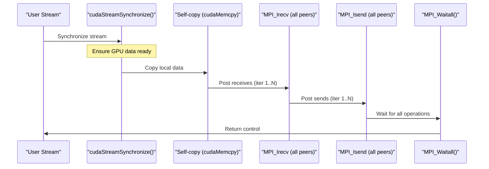
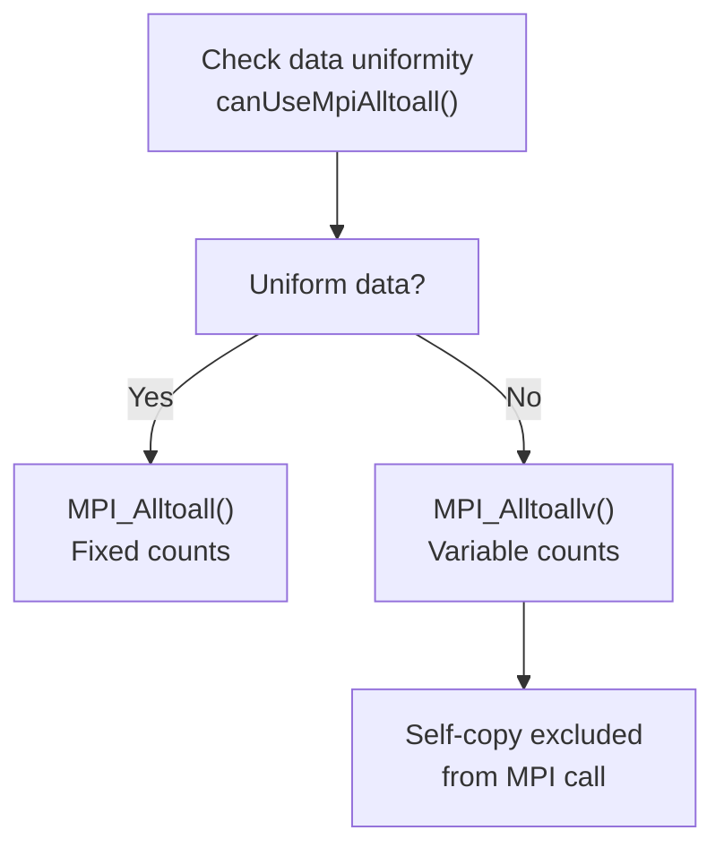
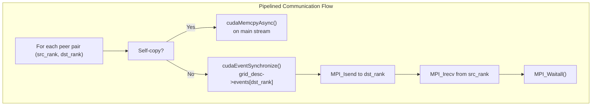
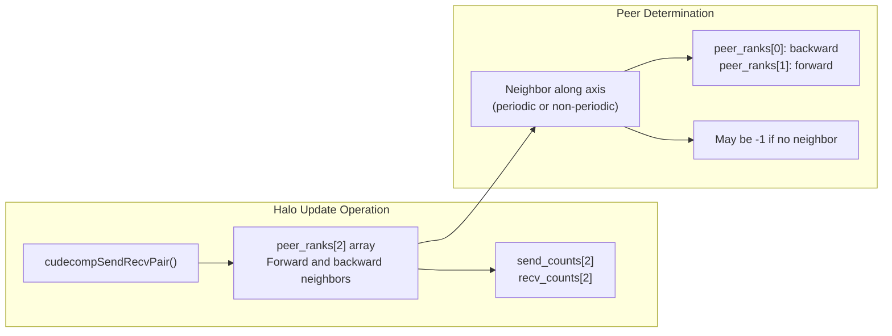
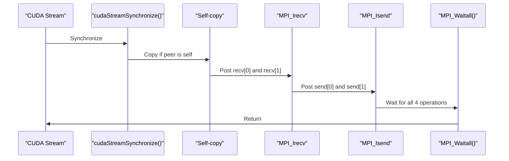
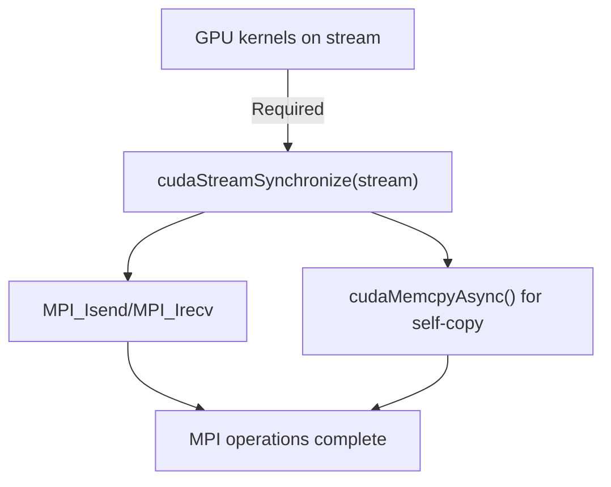
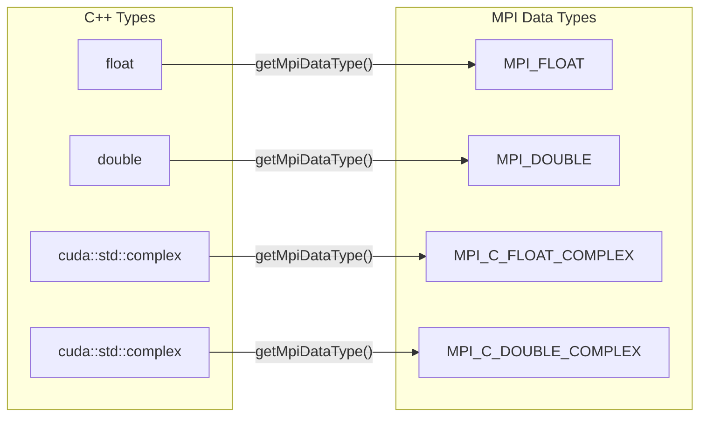
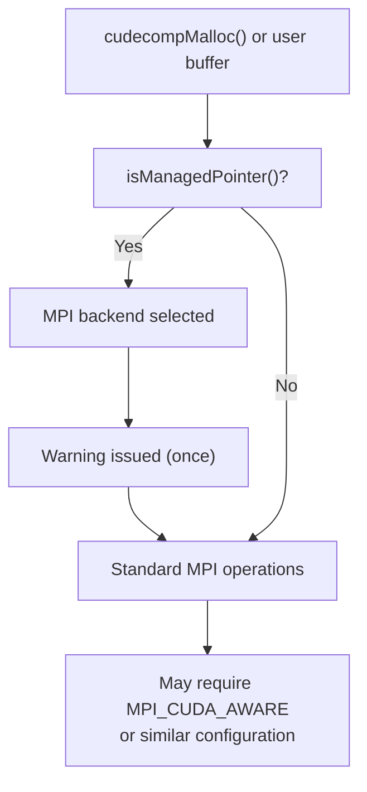

<!-- source: DeepWiki mcp.deepwiki.com · repo NVIDIA/cuDecomp · page 8.1 MPI Backend · fetched 2026-10-26 -->

# MPI Backend

<details>
<summary>Relevant source files</summary>

The following files were used as context for generating this wiki page:

- [include/internal/comm_routines.h](include/internal/comm_routines.h)
- [include/internal/common.h](include/internal/common.h)

</details>


## Purpose and Scope

This page documents the MPI (Message Passing Interface) communication backend implementation in cuDecomp, which provides CPU-based inter-process communication for transpose and halo exchange operations. The MPI backend offers multiple variants optimized for different communication patterns and performance characteristics.

For information about other communication backends, see [NCCL Backend](#8.2) and [NVSHMEM Backend](#8.3). For an overview of backend selection and configuration, see [Communication Backends](#3.3).

## MPI Backend Variants

cuDecomp supports five distinct MPI backend configurations, each with different characteristics:

| Backend Constant | Operation Type | Communication Pattern | Pipelined | Use Case |
|------------------|----------------|----------------------|-----------|----------|
| `CUDECOMP_TRANSPOSE_COMM_MPI_P2P` | Transpose | Point-to-point (Isend/Irecv) | No | General-purpose, good for irregular data sizes |
| `CUDECOMP_TRANSPOSE_COMM_MPI_A2A` | Transpose | Alltoall/Alltoallv | No | Optimized MPI collective, best for uniform data |
| `CUDECOMP_TRANSPOSE_COMM_MPI_P2P_PL` | Transpose | Point-to-point (Isend/Irecv) | Yes | Enables computation-communication overlap |
| `CUDECOMP_HALO_COMM_MPI` | Halo | Point-to-point (Isend/Irecv) | N/A | Non-blocking halo exchange |
| `CUDECOMP_HALO_COMM_MPI_BLOCKING` | Halo | Point-to-point (Isend/Irecv) | N/A | Blocking halo exchange with lower latency |

**Sources:** [include/internal/comm_routines.h:211-308](), [include/internal/comm_routines.h:552-660]()

## Backend Detection and Routing

The following diagram shows how the communication dispatch layer routes operations to the appropriate MPI backend implementation:



**Sources:** [include/internal/comm_routines.h:184-316](), [include/internal/comm_routines.h:526-667]()

## Transpose Operations with MPI

### Point-to-Point (MPI_P2P)

The standard point-to-point backend uses non-blocking MPI send/receive operations with a carefully designed communication pattern to maximize throughput and minimize contention.

#### Communication Pattern

The `getAlltoallPeerRanks()` function determines the order of peer-to-peer transfers:



The pattern alternates between intra-group and inter-group transfers to distribute traffic across the network topology.

**Sources:** [include/internal/common.h:357-401](), [include/internal/comm_routines.h:246-278]()

#### Implementation Flow



The implementation follows this sequence at [include/internal/comm_routines.h:246-278]():

1. **Stream synchronization**: `cudaStreamSynchronize(stream)` ensures GPU data is ready for MPI
2. **Self-copy**: Local data transfer using `cudaMemcpyAsync()` with `cudaMemcpyDeviceToDevice`
3. **Post receives**: `MPI_Irecv()` for all peer ranks determined by communication pattern
4. **Post sends**: `MPI_Isend()` for all peer ranks
5. **Wait completion**: `MPI_Waitall()` blocks until all transfers complete

**Sources:** [include/internal/comm_routines.h:246-278]()

### Alltoall (MPI_A2A)

The alltoall backend uses MPI collective operations, which can be more efficient for uniform data distributions:



The implementation optimizes for two cases at [include/internal/comm_routines.h:280-303]():

1. **Uniform case**: When all send/recv counts are identical and offsets are contiguous, use `MPI_Alltoall()` for maximum efficiency
2. **Non-uniform case**: Use `MPI_Alltoallv()` with variable counts and offsets, excluding self-rank from the MPI call

**Key implementation details:**

- **Self-copy handling**: Self-copy is performed separately with `cudaMemcpyAsync()` and excluded from MPI operations by setting counts to zero
- **Uniformity check**: `canUseMpiAlltoall()` validates that counts are constant and offsets are contiguous at [include/internal/comm_routines.h:43-66]()

**Sources:** [include/internal/comm_routines.h:280-303](), [include/internal/comm_routines.h:43-66]()

### Pipelined Point-to-Point (MPI_P2P_PL)

The pipelined variant enables overlap between computation and communication by breaking the alltoall into smaller chunks that can be scheduled incrementally.



**Key differences from non-pipelined:**

- **Event-based scheduling**: Each transfer waits on a CUDA event (`grid_desc->events[dst_rank]`) to ensure upstream data is ready
- **Incremental execution**: Processes pairs of (src_rank, dst_rank) computed by `getAlltoallPeerRanks()` one at a time
- **Overlapping**: Allows packing and unpacking kernels to overlap with communication

The implementation at [include/internal/comm_routines.h:482-511]() creates MPI requests incrementally rather than all at once, enabling finer-grained control over communication scheduling.

**Sources:** [include/internal/comm_routines.h:482-511](), [include/internal/comm_routines.h:318-524]()

## Halo Operations with MPI

Halo exchange operations communicate boundary data with neighboring processes along each axis. The MPI backend provides both non-blocking and blocking variants.

### Halo Communication Pattern



Each halo update involves simultaneous communication with two neighbors (forward and backward) along a specific axis. The `peer_ranks` array contains the global ranks of these neighbors, or -1 if a boundary is non-periodic.

**Sources:** [include/internal/comm_routines.h:526-533]()

### Non-blocking Halo Exchange (HALO_COMM_MPI)

The non-blocking variant posts all receives and sends together, allowing MPI to optimize the communication schedule:



Implementation at [include/internal/comm_routines.h:610-632]():

1. Synchronize CUDA stream to ensure data is ready
2. Handle self-copy case (when process sends to itself)
3. Post `MPI_Irecv()` for both neighbors
4. Post `MPI_Isend()` for both neighbors
5. `MPI_Waitall()` blocks until all operations complete

The ordering ensures receives are posted before sends to minimize the chance of messages arriving before the receive buffer is ready.

**Sources:** [include/internal/comm_routines.h:610-632]()

### Blocking Halo Exchange (HALO_COMM_MPI_BLOCKING)

The blocking variant completes each direction sequentially, which can reduce latency for small messages:

```mermaid
sequenceDiagram
    participant Stream as "CUDA Stream"
    participant Loop as "For each direction"
    participant Recv as "MPI_Irecv"
    participant Send as "MPI_Send (blocking)"
    participant Wait as "MPI_Wait"
    
    Stream->>Loop: Synchronize once
    Loop->>Recv: Post non-blocking receive
    Recv->>Send: Blocking send
    Send->>Wait: Wait for receive
    Wait->>Loop: Next direction
```

Implementation at [include/internal/comm_routines.h:634-655]():

1. Synchronize CUDA stream once at the beginning
2. For each direction:
   - Post `MPI_Irecv()` for incoming data
   - Perform `MPI_Send()` (blocking) for outgoing data
   - `MPI_Wait()` on the receive

This approach trades potential parallelism for reduced latency, as `MPI_Send()` can complete faster than `MPI_Isend()` for small messages.

**Sources:** [include/internal/comm_routines.h:634-655]()

## Stream Synchronization Requirements

All MPI backends require explicit CUDA stream synchronization before initiating MPI operations, as MPI is not stream-aware:



**Critical synchronization points:**

- **Before MPI operations**: `cudaStreamSynchronize(stream)` at [include/internal/comm_routines.h:248](), [include/internal/comm_routines.h:281](), [include/internal/comm_routines.h:613]()
- **Self-copy exception**: Local copies use `cudaMemcpyAsync()` which respects stream ordering without explicit synchronization
- **After MPI completion**: No synchronization needed; MPI guarantees data availability

The synchronization overhead is a key limitation of MPI backends compared to NCCL and NVSHMEM, which can operate asynchronously with CUDA streams.

**Sources:** [include/internal/comm_routines.h:248](), [include/internal/comm_routines.h:281](), [include/internal/comm_routines.h:496](), [include/internal/comm_routines.h:613]()

## MPI Data Type Mapping

cuDecomp provides type-safe wrappers that map C++ types to MPI data types:



The template function `getMpiDataType<T>()` provides compile-time type resolution at [include/internal/comm_routines.h:37-41]():

| C++ Type | MPI Type | Usage |
|----------|----------|-------|
| `float` | `MPI_FLOAT` | Single-precision real |
| `double` | `MPI_DOUBLE` | Double-precision real |
| `cuda::std::complex<float>` | `MPI_C_FLOAT_COMPLEX` | Single-precision complex |
| `cuda::std::complex<double>` | `MPI_C_DOUBLE_COMPLEX` | Double-precision complex |

This ensures type safety and correct byte counts in all MPI operations.

**Sources:** [include/internal/comm_routines.h:37-41]()

## Managed Memory Considerations

When using CUDA managed memory with MPI backends, special handling may be required depending on the MPI implementation:



For buffers allocated via `cudecompMalloc()` with NVSHMEM backends that are then used with MPI communication, a warning is issued at [include/internal/comm_routines.h:199-207]():

> "CUDECOMP:WARN: A work buffer allocated with nvshmem_malloc (via cudecompMalloc) is being used with an MPI communication backend. This may cause issues with some MPI implementations."

**Workarounds:**
- Use CUDA-aware MPI implementations that support device pointers
- Ensure proper MPI environment configuration (e.g., `MPICH_GPU_SUPPORT_ENABLED=1`)
- Avoid mixing NVSHMEM allocations with MPI backends

**Sources:** [include/internal/comm_routines.h:199-207](), [include/internal/comm_routines.h:348-356](), [include/internal/comm_routines.h:540-549]()

## Helper Functions and Utilities

Several utility functions support MPI backend operations:

| Function | Purpose | Location |
|----------|---------|----------|
| `transposeBackendRequiresMpi()` | Check if transpose backend uses MPI | [include/internal/common.h:273-276]() |
| `haloBackendRequiresMpi()` | Check if halo backend uses MPI | [include/internal/common.h:278-280]() |
| `getAlltoallPeerRanks()` | Compute communication pattern peer ranks | [include/internal/common.h:357-401]() |
| `canUseMpiAlltoall()` | Check if MPI_Alltoall can be used | [include/internal/comm_routines.h:43-66]() |
| `getMpiDataType<T>()` | Map C++ type to MPI data type | [include/internal/comm_routines.h:37-41]() |

These functions encapsulate backend-specific logic and enable clean separation between the dispatch layer and backend implementations.

**Sources:** [include/internal/common.h:273-280](), [include/internal/common.h:357-401](), [include/internal/comm_routines.h:37-66]()

## Performance Characteristics

The MPI backends have distinct performance profiles:

| Backend | Latency | Throughput | Best For |
|---------|---------|------------|----------|
| `MPI_P2P` | Moderate | Good for irregular | Non-uniform decompositions |
| `MPI_A2A` | Low (collective) | Excellent for uniform | Uniform decompositions |
| `MPI_P2P_PL` | Higher | Good with overlap | Workloads with computation-communication overlap |
| `HALO_COMM_MPI` | Moderate | Good | General halo updates |
| `HALO_COMM_MPI_BLOCKING` | Lower | Lower | Small messages, low latency priority |

The primary limitation of all MPI backends is the required stream synchronization, which introduces serialization between GPU operations and communication. For applications that can exploit asynchronous communication, NCCL or NVSHMEM backends typically provide better performance.

**Sources:** [include/internal/comm_routines.h:184-667]()

---

