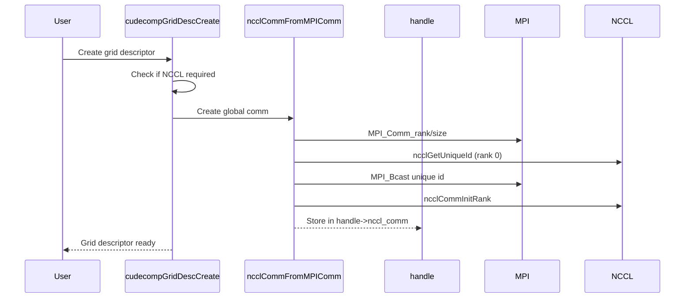
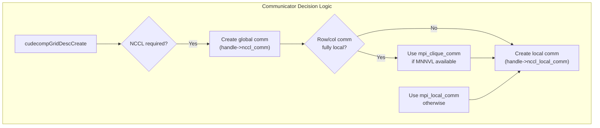
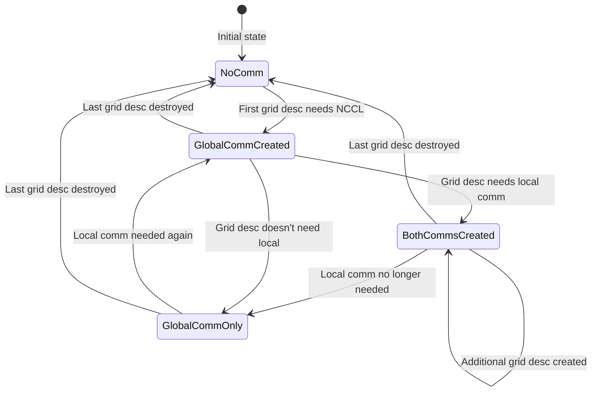
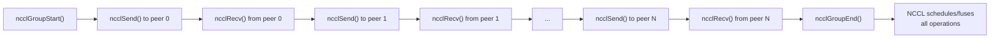
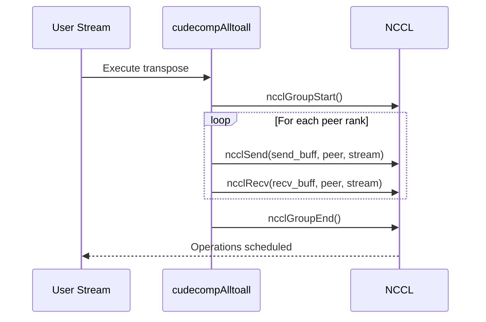
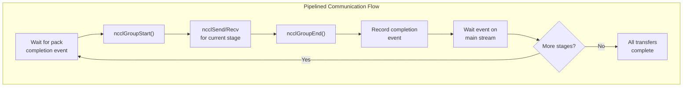
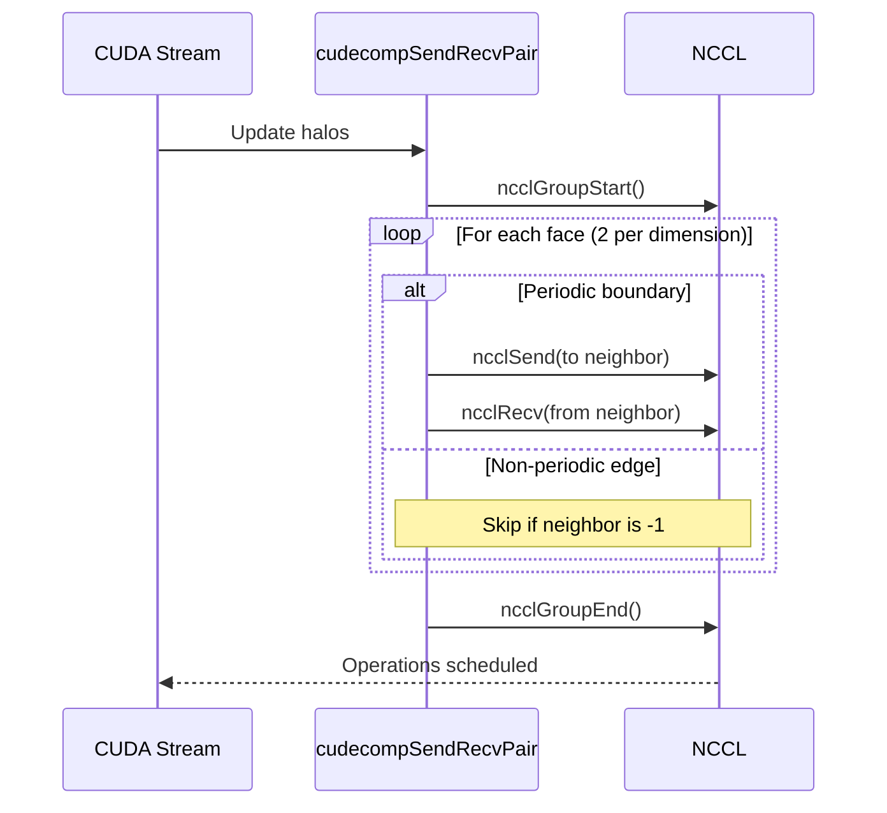
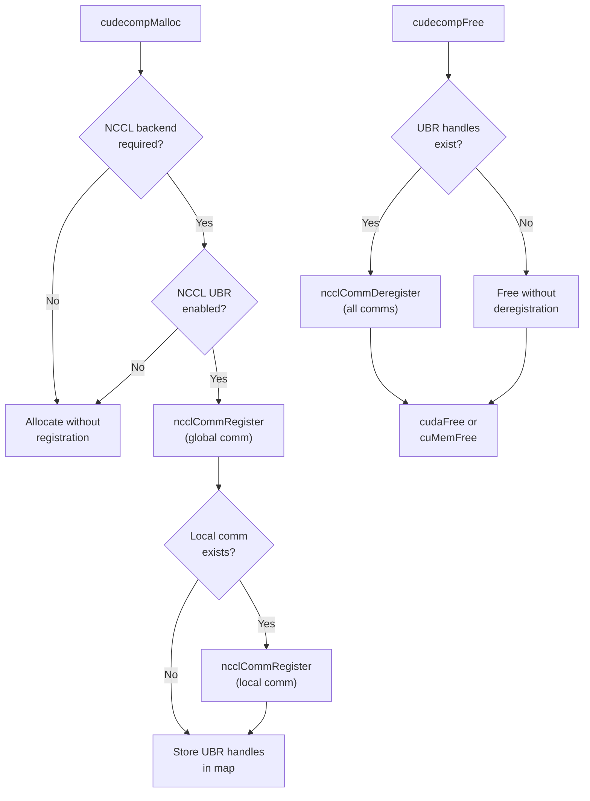
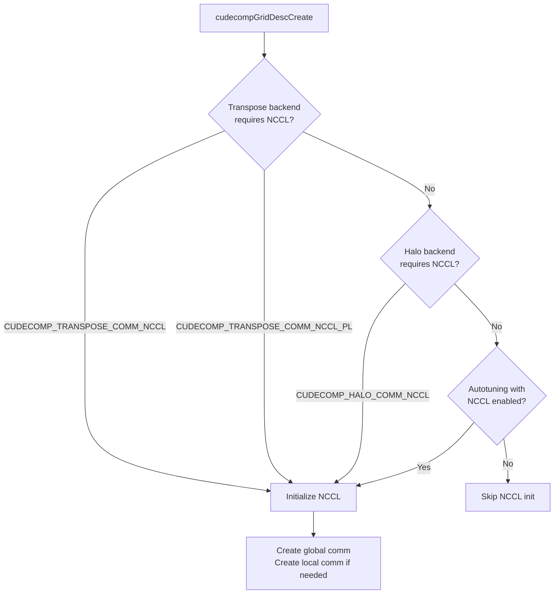

<!-- source: DeepWiki mcp.deepwiki.com · repo NVIDIA/cuDecomp · page 8.2 NCCL Backend · fetched 2026-10-26 -->

# NCCL Backend

<details>
<summary>Relevant source files</summary>

The following files were used as context for generating this wiki page:

- [include/internal/comm_routines.h](include/internal/comm_routines.h)
- [src/cudecomp.cc](src/cudecomp.cc)

</details>


## Purpose and Scope

This page describes the NCCL (NVIDIA Collective Communications Library) backend implementation in cuDecomp. It covers NCCL communicator setup, group operations, and how NCCL is used for both transpose and halo communication patterns. For information about other communication backends, see [MPI Backend](#8.1) and [NVSHMEM Backend](#8.3). For general communication backend concepts, see [Communication Backends](#3.3).

---

## NCCL Communicator Initialization

cuDecomp creates NCCL communicators on-demand when grid descriptors require them. The library maintains two types of NCCL communicators: a global communicator spanning all ranks, and an optional local communicator for intra-node or intra-clique communication.

### Global Communicator Creation

The global NCCL communicator is created from the MPI communicator during grid descriptor creation if the selected backend requires NCCL.



**Sources:** [src/cudecomp.cc:53-66](), [src/cudecomp.cc:632-636]()

### Local Communicator Creation

The local NCCL communicator is created for intra-node or intra-clique (MNNVL) communication when row or column communicators are fully contained within a single node or clique. This optimization reduces communication latency.



**Sources:** [src/cudecomp.cc:636-678]()

The local communicator selection prioritizes MNNVL clique communicators when available, falling back to node-local communicators otherwise. The logic performs a collective check across all ranks in the potential local communicator to determine if any rank needs it:

| Condition | Communicator Used | Rationale |
|-----------|------------------|-----------|
| Row comm has ngroups=1, nranks>1 | Local NCCL comm | Row-wise alltoall is fully intra-node/clique |
| Col comm has ngroups=1, nranks>1 | Local NCCL comm | Column-wise alltoall is fully intra-node/clique |
| Both have ngroups>1 or nranks=1 | No local comm | All communication crosses nodes/cliques |

**Sources:** [src/cudecomp.cc:657-677]()

### Communicator Lifecycle and Reference Counting

cuDecomp uses shared pointers (`std::shared_ptr<ncclComm>`) to manage NCCL communicator lifetimes. Multiple grid descriptors can reference the same communicators, and communicators are destroyed only when no longer referenced.



**Sources:** [src/cudecomp.cc:680-683](), [src/cudecomp.cc:775-796](), [src/cudecomp.cc:875-884]()

---

## NCCL Group Operations

NCCL group operations allow bundling multiple point-to-point operations into a single collective call, enabling efficient kernel fusion and overlap. cuDecomp uses `ncclGroupStart()` and `ncclGroupEnd()` to bracket collections of send/recv operations.

### Group Operation Structure



All NCCL communication in cuDecomp follows this pattern: operations are issued within a group, and NCCL schedules them for optimal execution.

**Sources:** [include/internal/comm_routines.h:230-243](), [include/internal/comm_routines.h:449-470]()

---

## Transpose Communication with NCCL

The NCCL backend supports both non-pipelined and pipelined variants for transpose operations. Both use all-to-all patterns implemented via grouped point-to-point operations.

### Non-Pipelined NCCL Alltoall



**Non-Pipelined Implementation Details:**
- Backend type: `CUDECOMP_TRANSPOSE_COMM_NCCL`
- All sends and recvs issued in a single group
- Uses `ncclChar` datatype with byte count = element_count × sizeof(T)
- Selects between global and local communicator based on `comm_info.ngroups`
- For fully intra-group communication (ngroups=1), uses local comm for lower latency

**Sources:** [include/internal/comm_routines.h:225-244]()

### Pipelined NCCL Alltoall

The pipelined variant overlaps communication with computation by scheduling transfers incrementally across multiple pipeline stages.



**Pipelined Implementation Details:**
- Backend type: `CUDECOMP_TRANSPOSE_COMM_NCCL_PL`
- Uses dedicated pipeline stream (`handle->streams[0]`)
- CUDA events synchronize between pack/unpack and communication
- Self-copies use `cudaMemcpyAsync` on main stream
- Each stage processes a subset of ranks determined by the pipelining schedule

**Sources:** [include/internal/comm_routines.h:430-481]()

### Communicator Selection Logic

The NCCL backend dynamically selects between global and local communicators based on the communication pattern:

```c++
// Pseudo-code from comm_routines.h:226-228, 431-433
auto comm_info = (comm_axis == CUDECOMP_COMM_ROW) ? 
                  grid_desc->row_comm_info : grid_desc->col_comm_info;
auto comm = (comm_info.ngroups == 1) ? 
            *grid_desc->nccl_local_comm : *grid_desc->nccl_comm;
```

When using the local communicator, ranks are remapped to clique-local ranks:

```c++
// From comm_routines.h:233, 455-458
int peer_rank_global = getGlobalRank(handle, grid_desc, comm_axis, i);
if (comm_info.ngroups == 1) { 
    peer_rank_global = handle->rank_to_clique_rank[peer_rank_global];
}
```

**Sources:** [include/internal/comm_routines.h:226-233](), [include/internal/comm_routines.h:431-458]()

---

## Halo Communication with NCCL

Halo updates use NCCL send/recv pairs to exchange boundary data between neighboring ranks. Unlike transpose operations which use alltoall patterns, halo updates typically involve only 2-6 neighbors depending on dimensionality and periodicity.

### NCCL Halo Send/Recv Pattern



**Halo Communication Details:**
- Backend type: `CUDECOMP_HALO_COMM_NCCL`
- Uses global communicator (`*grid_desc->nccl_comm`)
- Peer ranks determined by `cudecompGetShiftedRank()` API
- Self-copies handled via `cudaMemcpyAsync` outside NCCL group
- Null ranks (-1) are skipped for non-periodic boundaries

**Sources:** [include/internal/comm_routines.h:588-608]()

### Peer Rank Handling

Halo updates may involve up to 2 peers per dimension (forward and backward neighbors). The communication handles three cases:

| Case | Peer Rank Value | Handling |
|------|----------------|----------|
| Self | `handle->rank` | `cudaMemcpyAsync` (device-to-device) |
| Valid neighbor | 0 to nranks-1 | `ncclSend`/`ncclRecv` within group |
| Non-periodic boundary | -1 | Skipped (no operation) |

```c++
// From comm_routines.h:592-606
for (int i = 0; i < send_counts.size(); ++i) {
    if (peer_ranks[i] == handle->rank) {
        // Self-copy
    } else {
        if (send_counts[(i+1)%2] != 0 && peer_ranks[(i+1)%2] != -1) {
            ncclSend(...);  // Only if valid peer
        }
        if (recv_counts[i] != 0 && peer_ranks[i] != -1) {
            ncclRecv(...);  // Only if valid peer
        }
    }
}
```

**Sources:** [include/internal/comm_routines.h:591-606]()

---

## NCCL User Buffer Registration (UBR)

NCCL User Buffer Registration (UBR) is an optimization that pre-registers buffers with NCCL communicators, eliminating runtime registration overhead during communication operations.

### UBR Overview and Benefits

**What is UBR?**
- Available in NCCL 2.19.0+
- Allows applications to register buffers ahead of time
- NCCL maintains internal metadata for registered buffers
- Eliminates per-operation registration/deregistration overhead

**Performance Benefits:**
- Reduces communication latency, especially for smaller messages
- Particularly beneficial for transpose operations with many ranks
- Minimal overhead for registration/deregistration during allocation/deallocation

**Sources:** [src/cudecomp.cc:1203-1218]()

### UBR Implementation in cuDecomp

UBR is controlled by the `CUDECOMP_ENABLE_NCCL_UBR` environment variable and requires NCCL 2.19.0+.



**Sources:** [src/cudecomp.cc:1203-1219](), [src/cudecomp.cc:1235-1245]()

### UBR Handle Tracking

cuDecomp maintains a map of UBR handles to support multiple communicator registrations per buffer:

```c++
// Data structure (conceptual, from cudecomp.cc:1210-1216)
std::unordered_map<void*, std::vector<std::pair<ncclComm_t, void*>>> nccl_ubr_handles;
// Maps buffer pointer -> [(comm, ubr_handle), ...]
```

Each buffer may be registered with:
1. Global NCCL communicator (`grid_desc->nccl_comm`)
2. Local NCCL communicator (`grid_desc->nccl_local_comm`), if present

**Registration Process:**
```c++
// From cudecomp.cc:1209-1216
if (grid_desc->nccl_comm) {
    ncclCommRegister(*grid_desc->nccl_comm, buffer, size, &ubr_handle);
    handle->nccl_ubr_handles[*buffer].push_back({*grid_desc->nccl_comm, ubr_handle});
}
if (grid_desc->nccl_local_comm) {
    ncclCommRegister(*grid_desc->nccl_local_comm, buffer, size, &ubr_handle);
    handle->nccl_ubr_handles[*buffer].push_back({*grid_desc->nccl_local_comm, ubr_handle});
}
```

**Deregistration Process:**
```c++
// From cudecomp.cc:1239-1244
if (handle->nccl_ubr_handles.count(buffer) != 0) {
    for (const auto& entry : handle->nccl_ubr_handles[buffer]) {
        ncclCommDeregister(entry.first, entry.second);
    }
    handle->nccl_ubr_handles.erase(buffer);
}
```

**Sources:** [src/cudecomp.cc:1209-1216](), [src/cudecomp.cc:1239-1244]()

---

## NCCL Backend Selection and Requirements

### When NCCL Backend is Required

The NCCL communicators are initialized when any of the following conditions are met:



**Backend Types Requiring NCCL:**
- `CUDECOMP_TRANSPOSE_COMM_NCCL` - Non-pipelined transpose
- `CUDECOMP_TRANSPOSE_COMM_NCCL_PL` - Pipelined transpose
- `CUDECOMP_HALO_COMM_NCCL` - Halo updates

**Sources:** [src/cudecomp.cc:632-683]()

### NCCL Availability Checking

cuDecomp validates backend selections during configuration:

```c++
// From cudecomp.cc:89-107
static void checkTransposeCommBackend(cudecompTransposeCommBackend_t comm_backend) {
    switch (comm_backend) {
    case CUDECOMP_TRANSPOSE_COMM_NCCL:
    case CUDECOMP_TRANSPOSE_COMM_NCCL_PL:
        // Always available (NCCL is a required dependency)
        return;
    // ...
    }
}
```

Unlike NVSHMEM, NCCL support is always enabled in cuDecomp (NCCL is a required build dependency).

**Sources:** [src/cudecomp.cc:89-107](), [src/cudecomp.cc:109-124]()

---

## Performance Considerations

### Global vs Local Communicator Performance

| Scenario | Communicator Used | Performance Impact |
|----------|------------------|-------------------|
| All peers in same node/clique | Local comm | Lower latency due to optimized intra-node path |
| Mixed intra/inter-node peers | Global comm | Standard latency, handles cross-node communication |
| Single-node job | Local comm | Best performance for all operations |
| Multi-node job with even decomposition | Depends on process grid | Row or column may be fully local |

**Key Insight:** The local communicator optimization is most beneficial when the process grid is configured such that entire rows or columns fit within a single node or MNNVL clique.

**Sources:** [include/internal/comm_routines.h:226-233](), [include/internal/comm_routines.h:431-433]()

### Pipelined vs Non-Pipelined Trade-offs

| Aspect | Non-Pipelined | Pipelined |
|--------|--------------|-----------|
| Latency | Single bulk transfer | Multiple smaller transfers |
| Overlap | Limited | Communication overlaps with pack/unpack |
| Complexity | Simple, single group | Multiple stages with event synchronization |
| Best For | Small problem sizes, low rank counts | Large problems, high rank counts |

Pipelined communication amortizes latency by overlapping data movement with computation, but introduces overhead from event management and multiple group operations.

**Sources:** [include/internal/comm_routines.h:318-524]()

### CUDA Stream Usage

The NCCL backend uses multiple CUDA streams to enable concurrency:

- **Main stream:** User-provided stream for pack/unpack operations
- **Pipeline stream (`handle->streams[0]`):** Dedicated stream for pipelined communication
- **P2P streams (`handle->streams[1..n]`):** Used by NVSHMEM but not NCCL

CUDA events coordinate between streams:
```c++
// From comm_routines.h:447, 476-478
cudaStreamWaitEvent(pl_stream, grid_desc->events[dst_rank], 0);  // Wait for pack
// ... NCCL operations ...
cudaEventRecord(grid_desc->events[dst_rank], pl_stream);          // Signal completion
cudaStreamWaitEvent(stream, grid_desc->events[dst_rank], 0);      // Wait for unpack
```

**Sources:** [include/internal/comm_routines.h:430-481]()

---

