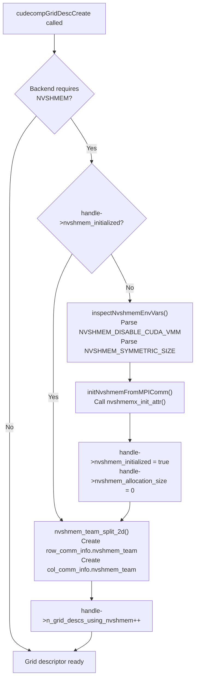
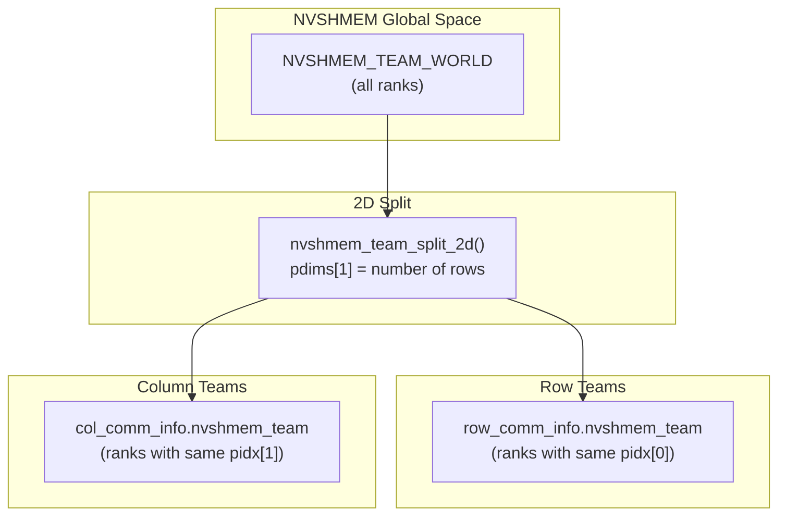
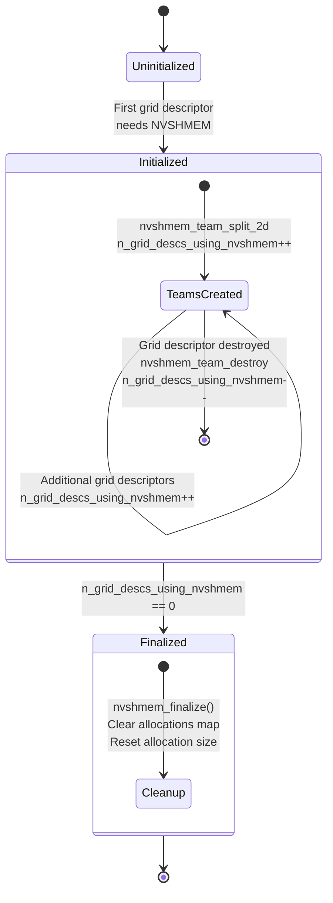
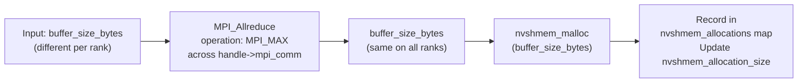
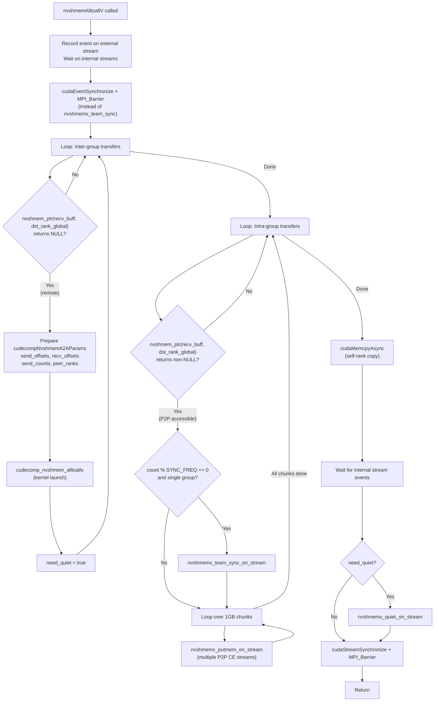
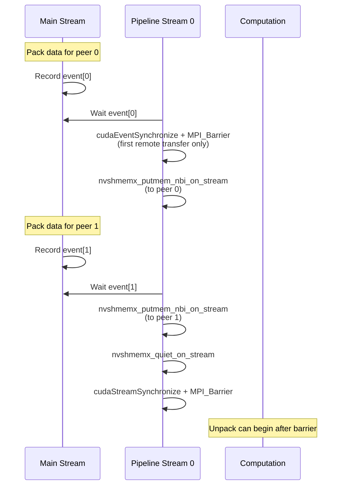
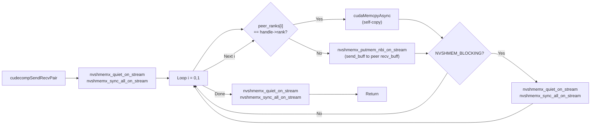
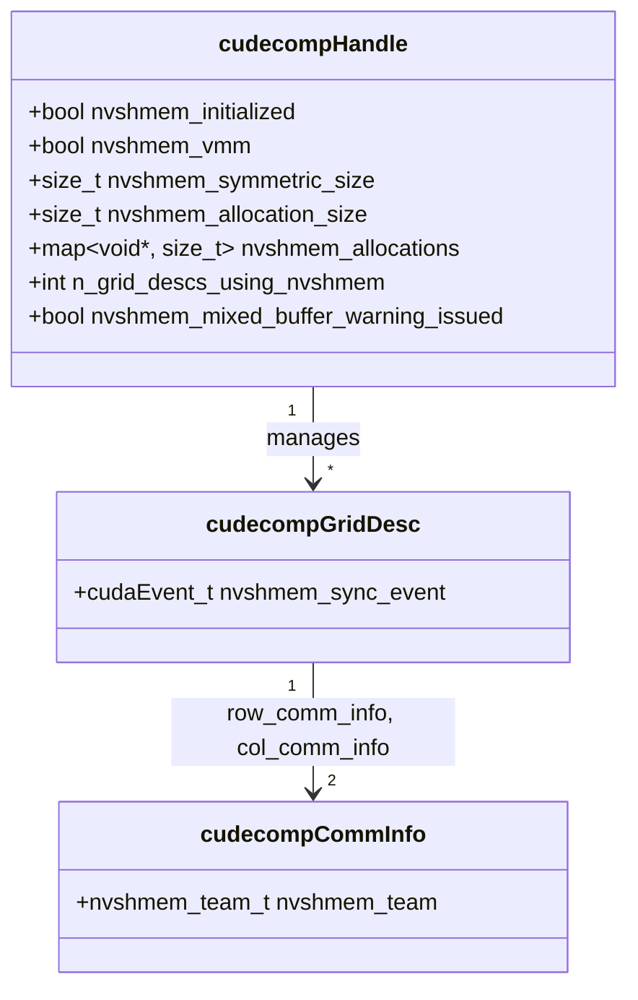

<!-- source: DeepWiki mcp.deepwiki.com · repo NVIDIA/cuDecomp · page 8.3 NVSHMEM Backend · fetched 2026-10-26 -->

# NVSHMEM Backend

<details>
<summary>Relevant source files</summary>

The following files were used as context for generating this wiki page:

- [include/internal/comm_routines.h](include/internal/comm_routines.h)
- [src/cudecomp.cc](src/cudecomp.cc)

</details>


## Purpose and Scope

This page describes the NVSHMEM communication backend implementation in cuDecomp. NVSHMEM is NVIDIA's implementation of the OpenSHMEM standard, providing a Partitioned Global Address Space (PGAS) programming model for GPUs. The NVSHMEM backend enables direct GPU-to-GPU communication using one-sided `put` operations, potentially offering lower latency than MPI or NCCL for certain communication patterns.

For general information about communication backend selection, see [Communication Backends](#3.3). For MPI backend details, see [MPI Backend](#8.1). For NCCL backend details, see [NCCL Backend](#8.2).

This page covers:
- NVSHMEM initialization and team configuration
- Symmetric memory allocation requirements
- Communication patterns for transpose and halo operations
- Synchronization mechanisms
- Performance considerations and optimizations

## Backend Identifiers

The NVSHMEM backend is available through the following enum values:

**Transpose Operations:**
- `CUDECOMP_TRANSPOSE_COMM_NVSHMEM`: Standard NVSHMEM all-to-all
- `CUDECOMP_TRANSPOSE_COMM_NVSHMEM_PL`: Pipelined variant for computation-communication overlap

**Halo Operations:**
- `CUDECOMP_HALO_COMM_NVSHMEM`: Non-blocking send/recv pairs
- `CUDECOMP_HALO_COMM_NVSHMEM_BLOCKING`: Blocking send/recv pairs

Sources: [src/cudecomp.cc:96-103](), [src/cudecomp.cc:114-121]()

## Initialization and Configuration

### NVSHMEM Library Initialization

NVSHMEM is initialized lazily when a grid descriptor requires it. The initialization occurs in `cudecompGridDescCreate` and uses the MPI communicator to bootstrap NVSHMEM's global communication.

**Initialization Flow**



Sources: [src/cudecomp.cc:685-696](), [src/cudecomp.cc:758-774]()

### Two-Phase Initialization Process

The initialization uses different methods based on NVSHMEM version:

**NVSHMEM 3.x+ (Unique ID Method):**
```
Rank 0: nvshmemx_get_uniqueid(&id)
All ranks: MPI_Bcast(id)
All ranks: nvshmemx_set_attr_uniqueid_args(rank, nranks, &id, &attr)
All ranks: nvshmemx_init_attr(NVSHMEMX_INIT_WITH_UNIQUEID, &attr)
```

**NVSHMEM 2.x (MPI Communicator Method):**
```
All ranks: attr.mpi_comm = &mpi_comm
All ranks: nvshmemx_init_attr(NVSHMEMX_INIT_WITH_MPI_COMM, &attr)
```

Sources: [src/cudecomp.cc:68-86]()

### Environment Variable Configuration

The handle stores NVSHMEM configuration parsed from environment variables:

| Variable | Purpose | Default | Stored In |
|----------|---------|---------|-----------|
| `NVSHMEM_DISABLE_CUDA_VMM` | Controls CUDA VMM usage | `0` (enabled) | `handle->nvshmem_vmm` |
| `NVSHMEM_SYMMETRIC_SIZE` | Symmetric heap size | `1 GiB` | `handle->nvshmem_symmetric_size` |

The implementation issues a warning if CUDA VMM is enabled (`NVSHMEM_DISABLE_CUDA_VMM` is unset), as disabling it is recommended for better compatibility with MPI libraries.

Sources: [src/cudecomp.cc:370-403]()

## NVSHMEM Teams

### Team Structure

NVSHMEM teams partition the global communication space. cuDecomp uses `nvshmem_team_split_2d` to create row and column teams corresponding to the process grid dimensions.

**Team Creation for Process Grid**



**Code Implementation:**
```c
nvshmem_team_config_t tmp;
nvshmem_team_split_2d(NVSHMEM_TEAM_WORLD, grid_desc->config.pdims[1], &tmp, 0,
                      &grid_desc->row_comm_info.nvshmem_team, &tmp, 0, 
                      &grid_desc->col_comm_info.nvshmem_team);
```

The teams are destroyed when the grid descriptor is destroyed, and if no other grid descriptors are using NVSHMEM, the library is finalized to reclaim the symmetric heap.

Sources: [src/cudecomp.cc:758-774](), [src/cudecomp.cc:886-905]()

### Team Lifecycle Management



Sources: [src/cudecomp.cc:758-774](), [src/cudecomp.cc:886-905]()

## Symmetric Memory Allocation

### Allocation Requirements

NVSHMEM requires all allocations to be **symmetric** across all ranks, meaning every rank must allocate the same amount of memory at the same symmetric heap offset. This is enforced in `cudecompMalloc`:

**Symmetric Size Enforcement**



Sources: [src/cudecomp.cc:1138-1161]()

### Allocation Tracking

The handle maintains metadata for NVSHMEM allocations:

| Field | Type | Purpose |
|-------|------|---------|
| `nvshmem_allocations` | `std::map<void*, size_t>` | Maps buffer pointer to allocation size |
| `nvshmem_allocation_size` | `size_t` | Total bytes allocated from symmetric heap |
| `nvshmem_symmetric_size` | `size_t` | Total symmetric heap size available |

**Allocation Size Warning:**

When CUDA VMM is disabled (`!handle->nvshmem_vmm`), cuDecomp issues a warning if the requested allocation exceeds available symmetric heap space:

```
CUDECOMP:WARN: Attempting an NVSHMEM allocation of X bytes but *approximately* 
Y free bytes of Z total bytes of symmetric heap space available. If the allocation 
fails, set NVSHMEM_SYMMETRIC_SIZE >= W and try again.
```

Sources: [src/cudecomp.cc:1144-1152]()

### Deallocation

NVSHMEM buffers are freed using `nvshmem_free` and their metadata is removed from tracking structures:

```c
nvshmem_free(buffer);
size_t buffer_size_bytes = handle->nvshmem_allocations[buffer];
handle->nvshmem_allocation_size -= buffer_size_bytes;
handle->nvshmem_allocations.erase(buffer);
```

Sources: [src/cudecomp.cc:1248-1261]()

## Communication Patterns

### All-to-All for Transpose Operations

The NVSHMEM all-to-all implementation (`nvshmemAlltoallV`) distinguishes between intra-group (direct P2P accessible) and inter-group (remote) transfers.

**Transfer Classification and Execution Flow**



Sources: [include/internal/comm_routines.h:68-182]()

### Transfer Chunking

Due to a 2 GiB limitation in the NVSHMEM API, large transfers are chunked:

| Constant | Value | Purpose |
|----------|-------|---------|
| `CUDECOMP_NVSHMEM_CHUNK_SZ` | `1024 * 1024 * 1024` (1 GiB) | Maximum size per API call |
| `CUDECOMP_NVSHMEM_INTRAGROUP_SYNC_FREQ` | `8` | Team sync frequency for intra-group |

**Chunking Implementation:**
```c
size_t send_bytes = send_counts[dst_rank] * sizeof(T);
size_t nchunks = (send_bytes + CUDECOMP_NVSHMEM_CHUNK_SZ - 1) / CUDECOMP_NVSHMEM_CHUNK_SZ;
for (size_t j = 0; j < nchunks; ++j) {
    nvshmemx_putmem_on_stream(
        recv_buff + recv_offsets[dst_rank] + j * (CUDECOMP_NVSHMEM_CHUNK_SZ / sizeof(T)),
        send_buff + send_offsets[dst_rank] + j * (CUDECOMP_NVSHMEM_CHUNK_SZ / sizeof(T)),
        std::min(CUDECOMP_NVSHMEM_CHUNK_SZ, send_bytes - j * CUDECOMP_NVSHMEM_CHUNK_SZ),
        dst_rank_global, handle->streams[count % handle->device_p2p_ce_count]);
}
```

Sources: [include/internal/comm_routines.h:153-160]()

### Pipelined Variant

The pipelined NVSHMEM backend (`CUDECOMP_TRANSPOSE_COMM_NVSHMEM_PL`) enables computation-communication overlap by scheduling transfers for specific peer pairs rather than all-to-all:

**Pipelined Execution**



Sources: [include/internal/comm_routines.h:360-428]()

### Send/Recv Pairs for Halo Operations

Halo exchanges use bidirectional communication with two peer ranks (typically neighbors in the process grid). The NVSHMEM implementation issues puts in both directions:

**NVSHMEM Halo Communication**



**Non-Blocking vs Blocking Modes:**

| Backend | Behavior |
|---------|----------|
| `CUDECOMP_HALO_COMM_NVSHMEM` | Synchronizes once before and once after all transfers |
| `CUDECOMP_HALO_COMM_NVSHMEM_BLOCKING` | Synchronizes after each peer pair transfer |

Sources: [include/internal/comm_routines.h:553-586]()

## Synchronization Mechanisms

### Quiet and Sync Operations

NVSHMEM provides two primary synchronization primitives used in cuDecomp:

**Synchronization Primitives**

| Function | Purpose | Usage in cuDecomp |
|----------|---------|-------------------|
| `nvshmemx_quiet_on_stream` | Ensures all outstanding put operations have completed | Called before and after communication phases |
| `nvshmemx_sync_all_on_stream` | Barrier across all ranks | Ensures remote ranks have completed their operations |
| `nvshmemx_team_sync_on_stream` | Barrier within a team | Alternative to MPI_Barrier (commented out for lower latency) |

### Hybrid Synchronization Strategy

cuDecomp uses a hybrid approach for lower latency, combining CUDA events with MPI barriers instead of NVSHMEM team synchronization:

```c
// Lower latency approach (used):
CHECK_CUDA(cudaEventSynchronize(grid_desc->nvshmem_sync_event));
CHECK_MPI(MPI_Barrier(comm));

// Alternative (commented out):
// nvshmemx_team_sync_on_stream(team, stream);
```

This hybrid approach is used because it has been observed to have lower latency than pure NVSHMEM synchronization in practice.

Sources: [include/internal/comm_routines.h:88-91](), [include/internal/comm_routines.h:177-180](), [include/internal/comm_routines.h:382-384](), [include/internal/comm_routines.h:408-410]()

### Event Dependencies

The implementation uses CUDA events to manage dependencies between the external stream and internal P2P CE streams:

```c
// Event dependency on external stream for intra-group transfers
CHECK_CUDA(cudaEventRecord(grid_desc->events[0], stream));
for (int i = 0; i < handle->device_p2p_ce_count; ++i) {
    CHECK_CUDA(cudaStreamWaitEvent(handle->streams[i], grid_desc->events[0], 0));
}

// ... perform transfers on internal streams ...

// Event dependency on internal streams for completion
for (int i = 0; i < handle->device_p2p_ce_count; ++i) {
    CHECK_CUDA(cudaEventRecord(grid_desc->events[0], handle->streams[i]));
    CHECK_CUDA(cudaStreamWaitEvent(stream, grid_desc->events[0], 0));
}
```

Sources: [include/internal/comm_routines.h:83-86](), [include/internal/comm_routines.h:170-173]()

## Performance Considerations

### Intra-Group Optimization

Transfers within a node group (where `nvshmem_ptr` returns a valid local pointer) are handled specially:

1. **Multiple P2P CE Streams**: Intra-group transfers are distributed across `handle->device_p2p_ce_count` streams to maximize copy engine utilization
2. **Blocking API**: Uses `nvshmemx_putmem_on_stream` (blocking) instead of `nvshmemx_putmem_nbi_on_stream` (non-blocking) for lower overhead
3. **Periodic Synchronization**: For single-group, single-CE configurations (e.g., NVSwitch), synchronizes every `CUDECOMP_NVSHMEM_INTRAGROUP_SYNC_FREQ` (8) transfers to reduce CE contention from jitter

```c
if (comm_info.ngroups == 1 && handle->device_p2p_ce_count == 1 &&
    count % CUDECOMP_NVSHMEM_INTRAGROUP_SYNC_FREQ == 0) {
    // Synchronize to reduce CE contention
    nvshmemx_team_sync_on_stream(team, handle->streams[handle->device_p2p_ce_count]);
}
```

Sources: [include/internal/comm_routines.h:133-148]()

### Inter-Group Optimization

Transfers between node groups use:

1. **Kernel-Based Transfers**: Custom kernel `cudecomp_nvshmem_alltoallv` launched on the main stream
2. **Batched Parameters**: Up to `CUDECOMP_NVSHMEM_A2A_PARAM_CAPACITY` transfers per kernel launch
3. **Non-Blocking Operations**: Scheduled early to overlap with intra-group transfers
4. **Single Quiet**: Only one `nvshmemx_quiet_on_stream` call needed for all inter-group transfers

Sources: [include/internal/comm_routines.h:95-123]()

### MPI Compatibility Warning

When NVSHMEM-allocated buffers are used with MPI backends, a warning is issued:

```
CUDECOMP:WARN: A work buffer allocated with nvshmem_malloc (via cudecompMalloc) is 
being used with an MPI communication backend. This may cause issues with some MPI 
implementations. See the documentation for additional details and possible workarounds 
if you encounter issues.
```

This warning is issued once per handle to avoid spam.

Sources: [include/internal/comm_routines.h:199-207](), [include/internal/comm_routines.h:348-356](), [include/internal/comm_routines.h:540-549]()

## Data Structure Integration

### Handle-Level State



| Field | Location | Purpose |
|-------|----------|---------|
| `nvshmem_initialized` | `cudecompHandle` | Whether NVSHMEM has been initialized |
| `nvshmem_vmm` | `cudecompHandle` | Whether CUDA VMM is enabled in NVSHMEM |
| `nvshmem_symmetric_size` | `cudecompHandle` | Total symmetric heap size |
| `nvshmem_allocation_size` | `cudecompHandle` | Currently allocated bytes from symmetric heap |
| `nvshmem_allocations` | `cudecompHandle` | Map of buffer pointers to sizes |
| `n_grid_descs_using_nvshmem` | `cudecompHandle` | Count of grid descriptors using NVSHMEM (for finalization) |
| `nvshmem_mixed_buffer_warning_issued` | `cudecompHandle` | Whether warning has been issued |
| `nvshmem_sync_event` | `cudecompGridDesc` | Event for synchronization with NVSHMEM operations |
| `nvshmem_team` | `cudecompCommInfo` | NVSHMEM team for row or column communicator |

Sources: [src/cudecomp.cc:31-34](), [src/cudecomp.cc:712-714](), [src/cudecomp.cc:758-774]()

## Backend Selection Matrix

### When to Use NVSHMEM

**Advantages:**
- Lower latency for small messages compared to MPI
- Direct GPU-to-GPU transfers without host involvement
- Efficient for systems with NVLink/NVSwitch

**Disadvantages:**
- Requires symmetric memory allocations (less flexible)
- Limited by symmetric heap size
- May have compatibility issues with certain MPI implementations when VMM is enabled
- Requires NVSHMEM library installation and configuration

### Comparison with Other Backends

| Feature | NVSHMEM | NCCL | MPI |
|---------|---------|------|-----|
| Memory allocation | Symmetric (restrictive) | Flexible | Flexible |
| Small message latency | Low | Medium | High |
| Large message throughput | High | High | Medium-High |
| Setup complexity | Medium | Low | Low |
| Compatibility | May conflict with MPI | High | Universal |
| Pipelined mode | Yes | Yes | Yes |

Sources: [src/cudecomp.cc:96-103](), [src/cudecomp.cc:114-121]()

---

